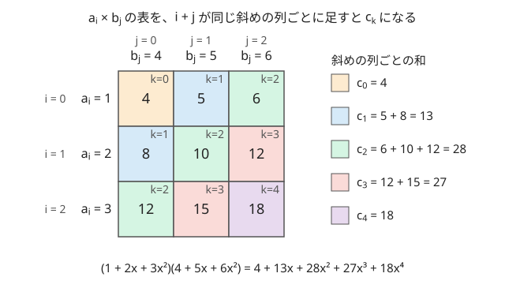
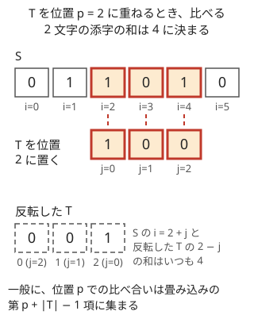

!!! abstract "要点"
    - **何ができるか**：2 つの列から $c_k = \sum_{i+j=k} a_i b_j$（多項式の積の係数）を、すべての $k$ について $O((N + M) \log (N + M))$ で求める。値の出現回数の列どうしを掛ければ「和が $k$ になる組の数」が、片方を反転して掛ければ「ずらしたときの一致数」が、すべての $k$ について一度に求まる。
    - **いつ使うか**：
        - すべての $k$ について、和が $k$ になる組の数を求める
        - 列をずらしたときの一致数・不一致の数を、すべてのずらし方について求める
        - ワイルドカード（?）を含むパターンの照合
        - 値の範囲や列の長さが $10^5$〜$10^6$ 程度で、組の全探索 $O(N^2)$ が間に合わない
        - 立てた式が $c_k = \sum_{i+j=k} a_i b_j$ の形の和になる
    - **計算量**：長さ $N$ と $M$ の列で $O((N + M) \log (N + M))$。値は $998244353$ で割った余りで返る。整数のまま欲しいときの `convolution_ll` は定数倍が約 3 倍
    - **前提**：[mod の計算の基本](../math/mod-arithmetic.md)

<!-- textlint-disable -->
別名：畳み込み・convolution・多項式の積・ACL の convolution・convolution_ll・ずらしたときの一致数・全シフトのハミング距離・ワイルドカード照合
<!-- textlint-enable -->

畳み込みは、2 つの列 $a, b$ から「添字の和が $k$ になる組の積の和」$c_k$ を作る演算で、多項式の積の係数と同じものである。素朴には $O(NM)$ かかるが、ACL の `convolution` は $O((N + M) \log (N + M))$ で計算する。競技プログラミングでは仕組みよりも、何と何を畳み込めば答えになるかという言い換えが要になる。

このページで使う記法：列は 0-indexed で、$a$ の長さを $N$、$b$ の長さを $M$ とする。$[P]$ は条件 $P$ が成り立てば 1、成り立たなければ 0 を表す（[記法と用語の約束](../start/notation.md#math)）。

## i + j = k の形に言い換える（出現回数の配列） {#sum-pairs}

畳み込みが要るのは、「2 つのものを 1 つずつ選んだときの和」の分布を、すべての和について求めたい場面である。たとえば、列 $A$（長さ $N$）と列 $B$（長さ $M$）から 1 つずつ選んで、和が $s$ になる組 $(i, j)$ の数をすべての $s$ について求める。組をすべて試すと $O(NM)$ で、$N = M = 2 \times 10^5$ なら $4 \times 10^{10}$ 回になり間に合わない。

鍵は、組を添字ではなく値でまとめることである。$f_v$ を「$A$ の中の値 $v$ の個数」、$g_w$ を「$B$ の中の値 $w$ の個数」とする。値が $v$ と $w$ の組は $f_v g_w$ 個あるので、和が $s$ になる組の数は

$$
\#\{(i, j) \mid A_i + B_j = s\} = \sum_{v + w = s} f_v \, g_w
$$

となる。右辺はちょうど $f$ と $g$ の畳み込みの第 $s$ 項である。数えるものを「組」から「値の組」に入れ替えるのは[主客転倒](../thinking/contribution.md)の一種で、畳み込みの長さは列の長さではなく値の範囲 $V$ で決まり、全体で $O(N + M + V \log V)$ になる。

畳み込みの定義を、小さな列で確かめる。$a = (1, 2, 3)$、$b = (4, 5, 6)$ の各組の積を表にすると、$i + j$ が同じマスは右上から左下への斜めの列に並ぶ。斜めの列ごとに足したものが $c_k$ である。



$a$ を多項式 $1 + 2x + 3x^2$、$b$ を $4 + 5x + 6x^2$ とみると、$a_i x^i \cdot b_j x^j = a_i b_j x^{i+j}$ なので、積の $x^k$ の係数が $c_k$ になる。畳み込みと多項式の積は同じものである。

素朴に計算するなら、$b$ を反転して $a$ の下に置き、1 つずつずらしながら重なった部分の積を足す。ずらし幅が $k$ のとき $b_j$ は $a_{k-j}$ の真下に来るので、重なるのは $i + j = k$ の組だけである。次の図は、この手順を 1 段ずつ進める。

<div class="kp-viz" data-viz="convolution-naive" data-config='{"a": [1, 2, 3], "b": [4, 5, 6]}'></div>

図の流れを文章で書くと次のとおりである。ずらし幅 0 では $a_0$ と $b_0$ だけが重なり $c_0 = 4$、幅 1 では $a_0 b_1 + a_1 b_0 = 5 + 8 = 13$、幅 2 では 3 組が重なり $6 + 10 + 12 = 28$ となる。以後は重なりが減って $c_3 = 27$、$c_4 = 18$ で終わる。ずらし幅は $N + M - 1$ 通りあり、全体で $O(NM)$ かかる。

**なぜ速くできるか**：次数 $d$ の多項式は、異なる $d + 1$ 点での値で 1 つに決まる。積の多項式は次数 $N + M - 2$ なので、$N + M - 1$ 点以上での値が分かれば 1 つに決まる。点での値どうしなら、積は各点で値を掛けるだけで $O(N + M)$ で済む。点として 1 の冪根を選ぶと、係数から値への変換とその逆が分割統治で $O(N \log N)$ になる。これが FFT で、余りの世界で同じことをするのが NTT である。仕組みは [FFT・NTT の仕組み](../math/fft-ntt.md#point-value)に任せ、このページでは呼び出す側の考え方を扱う。

出現回数の配列を作って畳み込むコードは次のようになる。組の数は $NM$ まであり $998244353$ を超えうるので、ここでは整数のまま返す `convolution_ll` を使う（[結果の長さと mod](#length-mod)）。

```cpp
--8<-- "convolution-ntt/sum-pairs.cpp:core"
```

**応用の型**：

- **同じ列を自分と畳み込む**：1 つの集合から 2 つ選ぶときは $f$ と $f$ を畳み込む。結果は順序付きの組で、同じ要素を 2 回選ぶ組も含む。「$x + y = s$ で $x = y$」の組を引き、順序を無視するなら 2 で割る（[ABC392 G](#abc392_g)）
- **3 つ以上の列**：畳み込みを繰り返せば、3 つ以上から 1 つずつ選んだ和の分布になる。各色から何個選ぶかを $\binom{R}{r}$ の列にして掛ければ、選び方の数を個数ごとに数えられる（[典型90 065](#practice)）
- **母関数として見る**：「各品物から何個選ぶか」の数え上げは多項式の積で、畳み込みはその係数を求める道具になる（[母関数で数える](../comb/generating-function-counting.md#coefficients)）
- **値の範囲が条件**：配列の長さは値の範囲で決まる。値が $10^9$ まであると配列を作れない。座標圧縮は和を保たないので使えない

## i − j = k の形は片方を反転する {#reverse}

差が $k$ になる組の和 $\sum_{i - j = k} a_i b_j$ は、$b$ を反転すれば畳み込みの形になる。$b'_t = b_{M-1-t}$ とおくと、$j = M - 1 - t$ なので

$$
i - j = k \iff i + t = k + (M - 1)
$$

である。よって $a$ と $b'$ の畳み込みの第 $k + M - 1$ 項が、差が $k$ の組の和になる。$k$ は $-(M-1)$ から $N - 1$ までを動き、添字は $0$ から $N + M - 2$ までに収まる。

値の差で数える場合も同じで、$B$ の値 $w$ を添字 $V_B - w$（$V_B$ は $B$ の最大値）に置けば、畳み込みの第 $t$ 項が「$A_i - B_j = t - V_B$ となる組の数」になる。

```cpp
--8<-- "convolution-ntt/sum-pairs.cpp:diff"
```

この形は「パターン $T$ を $S$ の位置 $p$ に重ねたときの $\sum_j S_{p+j} T_j$」を、すべての $p$ について求めるときに使う。位置 $p$ で比べる 2 文字の添字 $p + j$ と $M - 1 - j$（反転した $T$ での添字）は、足すと常に $p + M - 1$ になる。



位置 $p$ の値は畳み込みの第 $p + M - 1$ 項に入る。$T$ が $S$ からはみ出さない $p$（$0 \le p \le N - M$）だけを読む。

**応用の型**：

- **差が $k$ の組の数**：値の出現回数の配列の片方を反転して畳み込む
- **巡回シフト**：$A$ を回転させたときの $\sum_i A_{(i+p) \bmod N} B_i$ は、$A$ を 2 周並べた長さ $2N$ の列と反転した $B$ を畳み込めば、すべての $p$ について求まる（第 $p + N - 1$ 項を $0 \le p < N$ について読む）
- **1 列の中の 2 点の差**：$A$ の中で差が $d$ の 2 要素の数は、$f$ と反転した $f$ の畳み込みで、差 0 の項から自分自身との組を引く

## 結果の長さと mod（998244353 での値しか返らない） {#length-mod}

ACL の `convolution(a, b)` は、長さ $N + M - 1$ の列を返す。$N + M$ でも $\max(N, M)$ でもない。どちらかが空なら空の列が返る。

`convolution` が返すのは $c_k$ を $998244353$ で割った余りである。答え自体が $998244353$ で割った余りなら、そのまま使える。整数の値が欲しいときは、$c_k$ の大きさを先に見積もる。

$$
|c_k| \le \min(N, M) \cdot \max_i |a_i| \cdot \max_j |b_j|
$$

この上限が $998244353$ 未満で、どの値も 0 以上なら、余りはそのまま本当の値である。出現回数どうしの畳み込みでは、$c_k$ は組の数なので上限は $NM$ になる。

| 場面 | $c_k$ の上限 | `convolution` で足りるか |
| --- | --- | --- |
| 0/1 の列の一致数（長さ $10^6$） | $10^6$ | 足りる |
| 集合の指示関数どうし（要素 $10^6$ 個） | $10^6$ | 足りる |
| 長さ $2 \times 10^5$ の列の出現回数どうし | $4 \times 10^{10}$ | 足りない |
| 値 $10^9$ の列どうし | $10^{18} \times$ 長さ | 足りない |

足りないときは、整数のまま返す `convolution_ll` か、[mod 10^9+7 の方法](#convolution-ll)を使う。

負の値も余りに直されて返る。たとえば $c_k = -1$ は $998244353 - 1$ として返る。負になりうる値を整数で欲しいときは `convolution_ll` を使う。

## 整数のまま・mod 10^9+7 で欲しいとき（convolution_ll） {#convolution-ll}

`convolution_ll(a, b)` は、`long long` の列を受け取って整数のまま畳み込む。中では NTT に向く 3 つの素数（$754974721$・$167772161$・$469762049$）で 3 回畳み込み、[中国剰余定理](../math/crt.md)で元の値に戻している。3 つの素数の積はおよそ $5.9 \times 10^{25}$ で、本当の値が `long long` に収まれば正しく戻る。負の値も扱える。

- 要件：$N + M - 1 \le 2^{24}$（約 $1.7 \times 10^7$）、結果のすべての項が `long long` に収まる
- 速さ：`convolution` を 3 回呼ぶので、約 3 倍かかる。手元（g++-15 -O2）の計測では、長さ $5 \times 10^5$ どうしで `convolution` の約 3〜4 倍かかった

**mod $10^9 + 7$ の畳み込み**：$10^9 + 7$ は NTT に向かない素数なので、`convolution<1000000007>` は使えない（[ACL の要件](#acl)）。値が $10^9$ 程度だと、積の和は $10^{18} \times$ 長さになり、`convolution_ll` もあふれる。そこで次のどちらかをとる。

- **値を 2 桁に分ける**：$a_i = a^{(1)}_i \cdot 2^{15} + a^{(0)}_i$（$0 \le a^{(0)}_i, a^{(1)}_i < 2^{15}$）と分けると、桁どうしの積は $2^{30}$ 未満で、その和は長さ $5 \times 10^5$ でも $2^{49}$ 未満に収まる。4 通りの桁の組を `convolution_ll` で掛け、$2^{30}$・$2^{15}$・$1$ 倍して $10^9 + 7$ で足し合わせる
- **3 つの素数と Garner**：3 つの NTT 素数で畳み込み、[Garner のアルゴリズム](../math/crt.md#garner)で本当の値を $10^9 + 7$ で割った余りに戻す。本当の値は長さ $5 \times 10^5$ でも約 $5 \times 10^{23}$ で、3 つの素数の積より小さいので、正しく戻る。`convolution_ll` との違いは、`long long` を経由せずに余りを求める点である

前者は `convolution_ll` を 4 回呼ぶので `convolution` 12 回分、後者は 3 回分の時間がかかる。ACL だけで短く書くなら前者、速さが要るなら後者を使う。

```cpp
--8<-- "convolution-ntt/mod-any.cpp:core"
```

浮動小数点数の FFT（`complex<double>`）でも畳み込めるが、値が大きいと丸めの誤差で整数に戻らない。ACL があるなら NTT の方法を使う。

## 文字列の照合：ずらしたときの一致数・ハミング距離・ワイルドカード {#string-matching}

この節は [i − j = k の形は片方を反転する](#reverse) を前提にする。パターン $T$（長さ $M$）を文字列 $S$（長さ $N$）の各位置 $p$ に重ねたときの「一致する文字の数」を、すべての $p$ について $O(\sigma N \log N)$（$\sigma$ は文字の種類）で求める。完全に一致するかだけなら [Z-algorithm](../string/z-algorithm.md) やローリングハッシュで足りる。一致の数や、ワイルドカードを含む一致が欲しいときに畳み込みを使う。ハッシュでは一致しか分からないので、これらは扱えない（[ローリングハッシュ](../string/rolling-hash.md#when-to-use)）。

**一致数と[ハミング距離](../guide/glossary.md#hamming-distance)**：文字 $\alpha$ ごとに、$f_i = [S_i = \alpha]$ と $g_j = [T_j = \alpha]$ を作る。$g$ を反転して $f$ と畳み込むと、第 $p + M - 1$ 項が「位置 $p$ で両方 $\alpha$ の箇所の数」になる。すべての文字について足せば一致数で、$M$ から引けばハミング距離（食い違う文字の数）である。一致数は $M$ 以下なので、`convolution` の余りで足りる。

```cpp
--8<-- "convolution-ntt/hamming.cpp:core"
```

0 と 1 だけの文字列なら、1 を $+1$、0 を $-1$ に置き換えて 1 回で済ませる方法もある。積は一致なら $+1$、不一致なら $-1$ なので、畳み込みの値 $R$ は「一致数 − 不一致数」になり、不一致数は $(M - R) / 2$ である。$R$ は負になりうるので、`convolution_ll` を使うか、余りを $-M$ 以上 $M$ 以下の値に直してから使う。

**ワイルドカード**：$S$ と $T$ の両方に、どの文字とも一致する ? があるとする。? を 0、a〜z を 1〜26 の値 $x$ に置き換えると、位置 $p$ で一致することは

$$
D_p = \sum_{j=0}^{M-1} x_{p+j} \, y_j \, (x_{p+j} - y_j)^2 = 0
$$

と同じである（$x$ は $S$ の値、$y$ は $T$ の値）。各項は 0 以上で、0 になるのは「どちらかが ?」か「同じ文字」のときだけだからである。展開すると $\sum x^3 y - 2 \sum x^2 y^2 + \sum x y^3$ で、それぞれが反転した $y$ との畳み込みになる。3 回の畳み込みで、すべての位置の判定が終わる。

```cpp
--8<-- "convolution-ntt/wildcard.cpp:core"
```

各項は $26^4 < 5 \times 10^5$ 以下なので、$D_p$ は長さ $10^6$ でも $5 \times 10^{11}$ 程度で、`convolution_ll` で正確に求まる。`convolution` の余りで判定すると、0 でない $D_p$ がたまたま $998244353$ の倍数になり、一致と誤判定することがある。余りで済ませたいなら、文字に $1$ から $998244352$ までの乱数を割り当てて誤判定の確率を下げる。

**応用の型**：

- 「$T$ を書き換えて $S$ の連続部分に一致させる最小の回数」は、すべての位置のハミング距離の最小値である（[ABC196 F](#practice)）
- 文字の種類が多いと、文字ごとの畳み込みは $\sigma$ 倍の時間がかかる。26 種類で長さ $10^6$ なら重いので、ワイルドカードの式のように少ない回数にまとめられないかを考える

## bit ごと・文字ごとに分けて畳み込む（OR の和など） {#split-by-bit}

この節は [bit ごとの寄与](../basics/bitwise-independence.md#per-bit-contribution)と、[巡回シフトの型](#reverse)を前提にする。畳み込みが数えるのは積の和だけで、OR や XOR の和はそのままでは数えられない。値を bit ごとに分けると、各 bit は 0 か 1 になり、OR・XOR・AND が積で書ける。

| 演算（$x, y \in \{0, 1\}$） | 積で書くと |
| --- | --- |
| $x \text{ AND } y$ | $xy$ |
| $x \text{ OR } y$ | $x + y - xy$ |
| $x \oplus y$ | $x + y - 2xy$ |

たとえば、$A$ を巡回シフトしたときの $\sum_i (A_{(i+p) \bmod N} \text{ OR } B_i)$ をすべての $p$ について求めたいとする。bit $k$ について、$x_i$ を $A_i$ の bit $k$、$y_i$ を $B_i$ の bit $k$ とすると、

$$
\sum_i (x_{(i+p) \bmod N} \text{ OR } y_i) = \Bigl(\sum_i x_i\Bigr) + \Bigl(\sum_i y_i\Bigr) - \sum_i x_{(i+p) \bmod N}\, y_i
$$

となる。最初の 2 つの和はシフトによらない定数で、最後の和は「$x$ を 2 周並べた列」と「反転した $y$」の畳み込みで、すべての $p$ について求まる。bit ごとに $2^k$ 倍して足せば答えになる。値が $L$ bit なら、畳み込みは $L$ 回で済む。$1 - (1 - x)(1 - y)$ と書けば、0 と 1 を入れ替えた列どうしの積の和（元の列で両方 0 の位置の数）を $N$ から引いても求まる。

文字ごとに分けるのも同じ考え方である。[一致数の計算](#string-matching)は、$[S_i = T_j]$ が積で書けないので、文字 $\alpha$ ごとの $[S_i = \alpha][T_j = \alpha]$ に分けて足していた。

**応用の型**：

- 値が 30 bit なら 30 回の畳み込みになる。1 回の長さと回数の積で時間を見積もる
- 添字の演算が OR・AND・XOR の畳み込み（$c_k = \sum_{i \oplus j = k} a_i b_j$ など）は、この節とは別物である。添字の XOR なら[アダマール変換](../math/hadamard-transform.md#index-operations)、添字の OR・AND なら[部分集合の高速ゼータ変換](../comb/zeta-mobius-subset.md)を使う

## ACL の convolution の要件（法の形と長さ） {#acl}

!!! info "ACL では"
    `#include <atcoder/convolution>`。`atcoder::convolution(a, b)` は $c_k$ を $998244353$ で割った余りを、`atcoder::convolution<m>(a, b)` は $m$ で割った余りを返す。`a`・`b` は `vector<int>`・`vector<long long>` など（返り値も同じ型）か、`vector<static_modint<m>>`。`atcoder::convolution_ll(a, b)` は `vector<long long>` を整数のまま畳み込む。計算量は $n = N + M$ として $O(n \log n + \log m)$ で、どちらかが空なら空の列を返す。

`convolution<m>` の法 $m$ には、次の条件がある。

- $m$ は素数で、$2 \le m \le 2 \times 10^9$
- $2^c$ が $m - 1$ を割り切り、かつ $N + M - 1 \le 2^c$ となる $c$ がある

NTT は長さ $2^c$ の変換に「$2^c$ 乗して初めて 1 になる数」を使う。そのような数が法 $m$ の世界にあるのは、$2^c$ が $m - 1$ を割り切るときである（[位数・原始根](../math/multiplicative-order.md#primitive-root)）。$998244353 - 1 = 2^{23} \times 7 \times 17$ なので、$N + M - 1 \le 2^{23} = 8388608$ まで畳み込める。長さ $10^6$ の列どうしなら足りる。

| 法 | $m - 1$ | 結果の長さの上限 |
| --- | --- | --- |
| $998244353$ | $2^{23} \times 7 \times 17$ | $2^{23}$ |
| $754974721$ | $2^{24} \times 3^2 \times 5$ | $2^{24}$ |
| $167772161$ | $2^{25} \times 5$ | $2^{25}$ |
| $469762049$ | $2^{26} \times 7$ | $2^{26}$ |
| $10^9 + 7$ | $2 \times 500000003$ | $2$（使えない） |

条件を満たさないと、`convolution` の中の `assert` で実行時エラーになる。$10^9 + 7$ では結果の長さが 3 以上になった時点で止まる。

- $\min(N, M) \le 60$ なら、中で素朴な $O(NM)$ の方法に切り替わる（ACL のソースで確かめた）。片方が短い畳み込みを何度も呼んでも遅くならない
- `vector<int>` で受け取ると、返り値も `int` になる。値は $998244353$ 未満なので収まるが、その後の足し算でのあふれに気を付ける
- 長さは $N + M - 1$ 以上の最小の 2 の冪に広げて計算するので、メモリはその数倍を使う

## 落とし穴 {#pitfalls}

- **組の数が法を超える**：出現回数どうしの畳み込みは、組の数を数えるので $NM$ まで大きくなる。答えを整数で出す問題で `convolution` を使うと、$998244353$ を超えた項が黙って余りになる。[上限を見積もり](#length-mod)、超えるなら `convolution_ll` にする
- **負の値が大きな数で返る**：`convolution` は負の入力も余りに直し、$0$ 以上 $998244353$ 未満で返す。$\pm 1$ に置き換える照合などで、余りのまま大小を比べない
- **反転のずれ**：$b$ を反転したとき、位置 $p$ の値は第 $p + M - 1$ 項にある。第 $p$ 項を読むと $M - 1$ だけずれる。小さい例で全探索と比べて確かめる
- **自分自身との組**：$f$ を自分と畳み込むと、同じ要素を 2 回選んだ組と、順序を入れ替えた組が入る。「異なる 2 つを順序なしで」なら、$x = y$ の組を引いてから 2 で割る
- **結果の長さ**：返る列の長さは $N + M - 1$ である。値の和 $2V$ を添字にするなら、配列は $V + 1$ の長さで作る（$V$ にすると最大値が落ちる）
- **値の範囲が広い**：配列の長さは値の範囲で決まる。値が $10^9$ まであると作れない。値を小さく言い換えられないか（差だけを見る・余りで分ける）を先に考える
- **法を書き換える**：mod $10^9 + 7$ の問題で `convolution<1000000007>` と書くと、`assert` で止まる。[分けて掛ける方法](#convolution-ll)を使う
- **1 つずつ掛けていく**：$\prod_{i=1}^{N} (1 + a_i x)$ を左から 1 つずつ畳み込むと、途中の多項式が長くなり、全体で $O(N^2)$ かかる（ACL は片方が短いと素朴に計算する。毎回 NTT なら $O(N^2 \log N)$）。次数の小さいものから 2 つずつ掛ける分割統治にすれば $O(N \log^2 N)$ である（[分割統治 FFT](../math/online-convolution.md#product-of-many)）

## 例題 {#examples}

### PRACTICE2 F. Convolution {#practice2_f}

<div class="kp-problems" data-role="example" markdown>

- [PRACTICE2 F. Convolution](https://atcoder.jp/contests/practice2/tasks/practice2_f)（diff なし）：2 つの数列 a, b について、c_k = Σ_{i+j=k} a_i b_j を 998244353 で割った余りですべての k について求める。

</div>

畳み込みの定義そのものを求める、ACL の練習用の問題である。`atcoder::convolution(a, b)` を呼び、返った長さ $N + M - 1$ の列を出力すればよい。

??? note "解法の詳細"
    $N, M \le 524288 = 2^{19}$ なので、$N + M - 1 < 2^{20} \le 2^{23}$ で、$998244353$ の要件を満たす。入力を `vector<long long>` で読んで `convolution(a, b)` を呼ぶか、`vector<atcoder::modint998244353>` で読んで同じ関数を呼び、各項を `val()` で出す。どちらも $O((N + M) \log (N + M))$ である。

### ABC392 G. Fine Triplets {#abc392_g}

<div class="kp-problems" data-role="example" markdown>

- [ABC392 G. Fine Triplets](https://atcoder.jp/contests/abc392/tasks/abc392_g)（diff 1817）：整数の集合 S から、B − A = C − B > 0 を満たす (A, B, C) を選ぶ方法の数を求める（値 ≤ 10^6）。

</div>

$B - A = C - B$ は $A + C = 2B$ と同じである。真ん中の $B$ を固定すると、「和が $2B$ になる $A, C$ の組の数」を数えればよい。集合の指示関数 $f_v = [v \in S]$ を自分自身と畳み込めば、すべての和について組の数が一度に求まる。

??? note "解法の詳細"
    $c = f * f$ とすると、$c_t$ は $x + y = t$ を満たす $x, y \in S$ の順序付きの組の数である。$t = 2B$ の組には $x = y = B$ の 1 組が含まれ、残りは $(A, C)$ と $(C, A)$ の 2 回ずつ数えられている。$B - A > 0$ の向きだけを数えるので、各 $B \in S$ について $(c_{2B} - 1) / 2$ を足す。

    $c_t$ は $\lvert S \rvert$ 以下なので、`convolution` の余りで足りる。値は $10^6$ 以下で、結果の長さは $2 \times 10^6 + 1 \le 2^{23}$ である。答えは $\lvert S \rvert^2$ 程度になりうるので `long long` で足す。

    ```cpp
    --8<-- "convolution-ntt/triplets.cpp:core"
    ```

## 練習問題 {#practice}

<div class="kp-problems" data-role="practice" markdown>

- [ABC143 D. Triangles](https://atcoder.jp/contests/abc143/tasks/abc143_d)（diff 686）：N 本の棒から 3 本を選んで三角形を作れる組の数を求める。
- [ABC291 G. OR Sum](https://atcoder.jp/contests/abc291/tasks/abc291_g)（diff 2176）：長さ N の数列 A, B（各値は 32 未満）について、A を巡回シフトしたときの Σ (A_i OR B_i) の最大値を求める。
- [ABC196 F. Substring 2](https://atcoder.jp/contests/abc196/tasks/abc196_f)（diff 2274）：0/1 の文字列 T を S の連続する部分と比べるとき、一致させるために書き換える文字数の最小値を求める（|S|, |T| ≤ 10^6）。
- [典型90 065. RGB Balls 2（★7）](https://atcoder.jp/contests/typical90/tasks/typical90_bm)（diff なし）：赤・緑・青のボールから個数の条件を満たすように選ぶ方法の数を、998244353 で割った余りで求める。

</div>

??? note "方針"
    - **ABC143 D**：ソートと二分探索で解ける問題だが、長さの値が $10^3$ 以下なので畳み込みの入門にもなる。3 辺のうち最長の辺が残り 2 辺の和以上なら三角形にならず、長さが正なのでそうなる辺は高々 1 本である。よって答えは $\binom{N}{3}$ から「棒 $k$ と、ほかの 2 本で長さの和が $L_k$ 以下の組」の数を引いたものになる。長さの出現回数を自分と畳み込み、同じ棒の組を引いて 2 で割ると、和ごとの組の数が求まる。その累積和で各 $L_k$ 以下の組を数える
    - **ABC291 G**：[bit ごとに分ける節](#split-by-bit)の OR の式そのものである。bit ごとに $A$ を 2 周並べ、反転した $B$ と畳み込んで両方 1 の数を求める。5 回の畳み込みで済む
    - **ABC196 F**：$T$ を反転して畳み込み、すべての位置のハミング距離を求めて最小値を答える。0 と 1 の 2 回の畳み込みか、$\pm 1$ に置き換えた 1 回で求まる
    - **典型90 065**：合計 $K$ 個を選ぶ。赤を $r$ 個、緑を $g$ 個、青を $b$ 個選ぶ方法は $\binom{R}{r}\binom{G}{g}\binom{B}{b}$ 通りである。個数の条件を各色の個数の下限に直し、下限（負なら 0）より少ない項を 0 にした $\binom{R}{r}$ の列と $\binom{G}{g}$ の列を畳み込む。最後に青の個数 $b$ ごとに、合計が $K$ になる項と掛けて足す

## 力試し {#challenge}

<div class="kp-problems" data-role="challenge" markdown>

- [ABC471 G. Caeser Syllables](https://atcoder.jp/contests/abc471/tasks/abc471_g)（diff 2464）：母音か子音に分かれた K 種類の文字からなる長さ N の文字列について、すべての文字を同じ幅だけ巡回にずらしたときの音節の数を、すべてのずらし幅ごとに求める。

</div>

??? note "方針"
    - **ABC471 G**：音節の数は「先頭が母音か」と「子音の直後に母音が来る箇所の数」で決まる。隣り合う 2 文字の差（文字の番号の差）はずらしても変わらないので、隣の組を差 $d$ ごとにまとめる。差 $d$ ごとに「文字 $x$ から $x + d$ への組の数」と「$x$ が子音で $x + d$ が母音か」を巡回の畳み込みで掛け合わせると、すべてのずらし幅への寄与が一度に求まる。$K$ 回の畳み込みで、全体は $O(N + K^2 \log K)$ である

## 確認問題 {#quiz}

??? question "確認問題：列 A から 1 つ、列 B から 1 つ選んだ和が k になる組の数を、すべての k について求めたい。何と何を畳み込むか"
    $A$ の値の出現回数の列 $f$（$f_v$ は $A$ の中の $v$ の個数）と、$B$ の値の出現回数の列 $g$ を畳み込む。第 $k$ 項が答えである。$A$ と $B$ そのものを畳み込むと、添字の和が $k$ になる組の値の積の和になり、別物である。

??? question "確認問題：A_i − B_j = d となる組の数を、すべての d について求めるにはどうするか"
    $B$ の値 $w$ を添字 $V_B - w$ に置いた出現回数の列（反転した $g$）と $f$ を畳み込む。第 $t$ 項が $d = t - V_B$ の組の数になる。$d$ が負の場合も $t \ge 0$ の添字に収まる。

??? question "確認問題：長さ 2×10^5 の列の、値の出現回数どうしを convolution で畳み込んだ。答えを整数で出すとき何が起きうるか"
    組の数は最大で $(2 \times 10^5)^2 = 4 \times 10^{10}$ で、$998244353$ を超える。超えた項は余りで返るので、誤った値になる。`convolution_ll` を使うか、問題が余りを求めているならそのままでよい。

??? question "確認問題：列 A の異なる 3 要素（添字が異なり、順序なし）の和が s になる選び方を、すべての s について求めるにはどうするか"
    出現回数の多項式を $F(x) = \sum_i x^{A_i}$ とする。$F(x)^3$ は添字の重複を許す順序付きの 3 つ組を数える。添字がそろう組を[包除原理](../comb/inclusion-exclusion.md)で除くと、添字がすべて異なる順序付きの組は $F(x)^3 - 3 F(x^2) F(x) + 2 F(x^3)$ になる。$F(x^2)$ は「同じ要素を 2 回選ぶ」項で、値 $v$ を添字 $2v$ に置いた列である。順序を無視するので 6 で割る。

## 使い分け {#comparison}

| 状況 | 使う手法 |
| --- | --- |
| 和・差の分布を、値の範囲 $10^6$ 程度まで | 畳み込み（このページ） |
| 片方が短い（長さ $K$ が小さい） | 素朴な $O(NK)$。ACL も $\min(N, M) \le 60$ なら中で素朴に計算する |
| 0/1 の列で、部分和などの可否だけ | [bitset で高速化](../misc/bitset-speedup.md) |
| パターンの完全一致だけ | [Z-algorithm](../string/z-algorithm.md)・[ローリングハッシュ](../string/rolling-hash.md) |
| 添字の XOR で畳み込む | [アダマール変換](../math/hadamard-transform.md) |
| 添字の OR・AND で畳み込む | [部分集合の高速ゼータ変換](../comb/zeta-mobius-subset.md) |
| 多数の多項式の積・左から決まる DP の畳み込み | [分割統治 FFT・オンライン畳み込み](../math/online-convolution.md) |

## 参考 {#references}

- [AtCoder Library「Convolution」（document_ja）](https://github.com/atcoder/ac-library/blob/master/document_ja/convolution.md)：`convolution` と `convolution_ll` の型・要件・計算量（v1.6 の手元の版で確かめた）
- [AtCoder Library「convolution.hpp」](https://github.com/atcoder/ac-library/blob/master/atcoder/convolution.hpp)：要件の `assert`、$\min(N, M) \le 60$ での素朴な方法への切り替え、`convolution_ll` の 3 つの素数
- [drken「AtCoder Library Practice Contest F - Convolution」](https://drken1215.hatenablog.com/entry/2023/05/24/014903)：例題 practice2_f の制約と要件の確かめ方
- [merom686「ABC392」](https://merom686.hatenablog.com/entry/2025/02/09/020958)：例題 abc392_g の、指示関数の自己畳み込みと $2B$ の係数の補正
- [drken「AtCoder ABC 143 D - Triangles (3Q, 茶色, 400 点)」](https://drken1215.hatenablog.com/entry/2019/10/20/032700)：練習 abc143_d の問いと制約
- [kmjp「AtCoder ABC #291 : G - OR Sum」](https://kmjp.hatenablog.jp/entry/2023/02/26/0900)：練習 abc291_g の bit ごとの分解と、OR を両方 0 の数から求める式
- [kmjp「AtCoder ABC #196 : F - Substring 2」](https://kmjp.hatenablog.jp/entry/2021/03/20/1000)：練習 abc196_f の $\pm 1$ に置き換えた 1 回の畳み込み
- [E869120「kyopro_educational_90 sol/065-03.cpp」](https://github.com/E869120/kyopro_educational_90/blob/main/sol/065-03.cpp)：練習 typical90_bm の、下限で切った二項係数の列の畳み込み
- [kmjp「AtCoder ABC #471 : G - Caeser Syllables」](https://kmjp.hatenablog.jp/entry/2026/08/16/0900)：力試し abc471_g の問いと、差ごとにまとめて畳み込む方針
