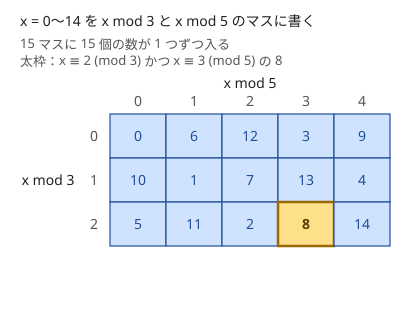
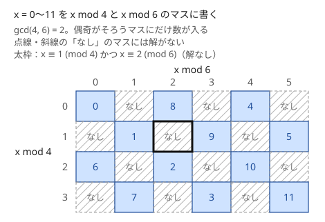

!!! abstract "要点"
    - **何ができるか**：複数の合同式 $x \equiv r_i \pmod{m_i}$ を同時に満たす $x$ を、拡張ユークリッドで 2 式ずつ合わせて、$\operatorname{lcm}$ を法とするただ 1 つの式 $x \equiv y \pmod{z}$ にまとめる。解があるのは、どの 2 式でも $r_i \equiv r_j \pmod{\gcd(m_i, m_j)}$ のときだけである。
    - **いつ使うか**：
        - 周期の違う複数の条件が同時に成り立つ最初の時刻を求める。
        - $x$ を $m_i$ で割った余り $r_i$ が複数与えられる。
        - 法が素数でない数え上げを、素因数ごとに分けて解いて最後に戻す。
    - **計算量**：2 式の統合は $O(\log \min(m_1, m_2))$、$n$ 式で $O(n \log L)$（$L$ は法の lcm で、`long long` に収まること）。Garner のアルゴリズムは $K$ 式で $O(K^2 + K \log \max m_i)$。
    - **前提**：[拡張ユークリッドの互除法と一次合同式](../math/ext-gcd.md)

<!-- textlint-disable -->
別名：CRT・Chinese remainder theorem・中国の剰余定理・Garner・連立合同式
<!-- textlint-enable -->

中国剰余定理（CRT）は、「3 で割ると 2 余り、5 で割ると 3 余る数」のように、いくつかの法での余りから元の数を mod lcm で復元する定理である。競技プログラミングでは、2 つの合同式を拡張ユークリッドの互除法で 1 つにまとめる手順として使う。式を 1 つずつ足していけば、何本の式でも同じ手順で解ける。

このページで使う記法：法を $m$、余りを $r$、2 つの法の最大公約数を $g = \gcd(m_0, m_1)$ と書く。$a \bmod m$ は $0$ 以上 $m$ 未満の余りを指す（[記法と用語の約束](../start/notation.md#math)）。

## 2式の CRT は一次不定方程式を1回解くこと {#two-equations}

2 つの合同式 $x \equiv r_0 \pmod{m_0}$、$x \equiv r_1 \pmod{m_1}$ を同時に満たす $x$ は、1 本目を満たす数 $r_0, r_0 + m_0, r_0 + 2m_0, \dots$ を順に試せば見つかる。2 本目の余りは $m_1$ 回で一周するので、試すのは $m_1$ 個までで足りる。ただし、法が $10^9$ や $10^{18}$ だとこれでは間に合わない。CRT はこの探索を、拡張ユークリッドの互除法 1 回に置き換える。

まず法が[互いに素](../guide/glossary.md#coprime)な場合を見る。$x = 0, 1, \dots, 14$ を、$x \bmod 3$ を行、$x \bmod 5$ を列にした表のマスに書き込むと、次の図になる。



15 個の数が 15 マスに 1 つずつ入り、空きも重なりもない。2 つの数 $x, x'$ が同じマスに入ったとすると、$x - x'$ は 3 と 5 の両方で割り切れる。3 と 5 は互いに素なので、$x - x'$ は 15 で割り切れる。$0 \le x, x' < 15$ なら $x = x'$ しかない。15 個が重ならずに 15 マスへ入るので、すべてのマスが埋まる。これが中国剰余定理である。

> $m_0$ と $m_1$ が互いに素なら、どんな余りの組 $(r_0, r_1)$ に対しても、$x \equiv r_0 \pmod{m_0}$ かつ $x \equiv r_1 \pmod{m_1}$ となる $x$ が $0 \le x < m_0 m_1$ にちょうど 1 つある。

解の作り方は、1 本目を満たす形 $x = r_0 + m_0 t$（$t$ は整数）を 2 本目に代入することである。

$$
r_0 + m_0 t \equiv r_1 \pmod{m_1} \iff m_0 t \equiv r_1 - r_0 \pmod{m_1}
$$

これは $t$ についての一次合同式で、$m_0 t + m_1 s = r_1 - r_0$ という一次不定方程式と同じである。[拡張ユークリッドの互除法](../math/ext-gcd.md)で $m_0 p + m_1 q = 1$ となる $p$ を求めれば、$p$ は $m_0$ の $\bmod m_1$ での逆元なので $t \equiv (r_1 - r_0) p \pmod{m_1}$ と決まる。

図の太枠の例で一度動かす。$x \equiv 2 \pmod 3$、$x \equiv 3 \pmod 5$ とする。$x = 2 + 3t$ を代入すると $3t \equiv 1 \pmod 5$ になる。$3 \cdot 2 + 5 \cdot (-1) = 1$ なので $p = 2$ で、$t \equiv 1 \cdot 2 = 2 \pmod 5$ になる。よって $x = 2 + 3 \cdot 2 = 8$ で、解は $x \equiv 8 \pmod{15}$ である。

## 法が互いに素でないときの解の存在条件 {#non-coprime}

法が互いに素でないときは、解がないことがある。$x \equiv 1 \pmod 4$ と $x \equiv 2 \pmod 6$ を考えると、1 本目からは $x$ が奇数、2 本目からは偶数と決まり、両立しない。$\gcd(4, 6) = 2$ で割った余りが食い違っているからである。表に書くと次のようになる。



一般に、$g = \gcd(m_0, m_1)$ として次が成り立つ。

- **解の存在条件**：解があるのは $r_0 \equiv r_1 \pmod g$、すなわち $g \mid r_1 - r_0$ のときだけである
- **解の一意性**：解があれば、$0 \le x < \operatorname{lcm}(m_0, m_1)$ にちょうど 1 つある。法は積 $m_0 m_1$ ではなく lcm になる

この条件が必要であることは、$x$ が $m_0$ でも $m_1$ でも決まった余りを持つなら、その共通の約数 $g$ での余りも両方から決まり、一致しなければならないことから分かる。十分であることは、次の作り方で実際に解が作れることから分かる。一意性は互いに素のときと同じ論法で、2 つの解の差は $m_0$ と $m_1$ の公倍数、すなわち $\operatorname{lcm}(m_0, m_1)$ の倍数になる。

作り方は互いに素のときと同じく、$m_0 t \equiv r_1 - r_0 \pmod{m_1}$ を解く。$g \mid r_1 - r_0$ なら全体を $g$ で割って

$$
\frac{m_0}{g} t \equiv \frac{r_1 - r_0}{g} \pmod{\frac{m_1}{g}}
$$

とすると、$m_0 / g$ と $m_1 / g$ は互いに素なので逆元で $t$ が決まる。拡張ユークリッドで $m_0 p + m_1 q = g$ を求めれば、両辺を $g$ で割った式から $p$ がそのまま $m_0 / g$ の逆元になる。$u_1 = m_1 / g$ として $t \equiv \frac{r_1 - r_0}{g} \cdot p \pmod{u_1}$ を $[0, u_1)$ に取ると、$x = r_0 + m_0 t$ は $[0, m_0 u_1)$ に入る。$m_0 u_1 = \operatorname{lcm}(m_0, m_1)$ なので、これが求める最小の非負の解である。

```cpp
--8<-- "crt/crt-merge.cpp:core"
```

- `r0` と `r1` を最初に $[0, m)$ に直すのは、`-1` のような負の余りを渡せるようにするためである
- $\frac{r_1 - r_0}{g} \cdot p$ は、どちらの因数も $10^{18}$ 近くになりうる。`__int128` で掛けてから $u_1$ で割った余りを取る（[整数のオーバーフロー](../cpp/cpp-integer-overflow.md)）
- 戻り値の `m0 * t` は lcm 未満なので、lcm が `long long` に収まればあふれない

??? question "確認問題：解があるか"
    $x \equiv 3 \pmod 4$ と $x \equiv 5 \pmod 6$ に解はあるか。あれば、最小の非負の解と、解全体を表す法を答えよ。

    ??? success "答え"
        $\gcd(4, 6) = 2$ で、$3 \equiv 5 \equiv 1 \pmod 2$ なので解がある。$x = 3 + 4t$ を代入すると $4t \equiv 2 \pmod 6$、2 で割って $2t \equiv 1 \pmod 3$、$t \equiv 2 \pmod 3$ になる。$x = 3 + 4 \cdot 2 = 11$ で、解全体は $x \equiv 11 \pmod{12}$ である。法は積の 24 ではなく lcm の 12 になる。

## 多数の式を順に合わせる・lcm のあふれ {#many-equations}

式が $n$ 本あるときは、「すべての整数」を表す $x \equiv 0 \pmod 1$ から始めて、1 本ずつ 2 式の統合を繰り返す。統合のたびに式が 1 本の $x \equiv y \pmod z$ に戻るので、最後に残った式が全体の解である。途中で 1 回でも解がなければ、全体にも解はない。

```cpp
--8<-- "crt/crt-merge.cpp:fold"
```

どの 2 式も $r_i \equiv r_j \pmod{\gcd(m_i, m_j)}$ を満たせば全体に解があり、解は $L = \operatorname{lcm}(m_0, \dots, m_{n-1})$ を法としてただ 1 つに決まる。統合 1 回は拡張ユークリッドの互除法 1 回で $O(\log \min(z, m_i))$ なので、全体は $O(n \log L)$ である。

問題になるのは、$L$ が式を足すたびに大きくなることである。法が $10^9$ 程度でも、互いに素な法が 3 本あれば $L$ は $10^{27}$ になり、`long long`（約 $9.2 \times 10^{18}$）に収まらない。$L$ があふれそうなときの避け方は、何を求めたいかで変わる。

- **答えに上限がある**：「条件を満たす最小の時刻を求め、$10^{18}$ を超えるなら $-1$」のような問題では、$z$ が上限を超えた時点で、それ以上法を大きくする必要がない。ただし、上限を超える統合の 1 回そのものが `long long` をあふれうる（$z \approx 10^{17}$ に $10^9$ 級の法を合わせると lcm は約 $10^{26}$）。統合の前に $\operatorname{lcm}(z, m_i) = z / \gcd(z, m_i) \cdot m_i$ を `__int128` で計算し、上限を超えるならその 1 回だけ `__int128` で統合する（上限 × $\max m_i$ は `__int128` に収まる）。その後、最小の非負の解 $y$ が上限以下なら、残りの式は「$y$ が $r_i$ を満たすか」を確かめるだけでよい。$y$ が上限を超えていれば、答えは $-1$ である
- **解の mod だけが欲しい**：法が互いに素なら、[Garner のアルゴリズム](#garner)で $L$ を作らずに解の $\bmod M$ を求める
- **素因数ごとに持つ**：まず各式 $x \equiv r \pmod m$ を、$m$ の素因数分解 $m = \prod p^e$ に従って、素数の冪の式 $x \equiv r \pmod{p^e}$ の組に分ける（互いに素な法への分解なので、CRT により元の式と同じ条件である）。同じ素数 $p$ の式は、指数の大きい方が小さい方を含むので、大きい方を $\bmod$ 小さい $p^e$ で見て矛盾がないかを確かめ、大きい方だけを残す。残った式は法が互いに素なので、解そのものが要るなら Garner に渡して解の $\bmod M$ を求め、数え上げなどで素数の冪ごとの条件で足りるならそのまま使う。どちらでも $L$ そのものを作らずに済む

## 応用の型（範囲を余りに直す・分けて戻す） {#applications}

CRT が使える問題では、問題文に合同式が書かれていることは少ない。次の 3 つの型で、問題を合同式の連立に直す。

**周期の重なりを、余りの全探索と CRT に直す**。「周期 $A$ の中で区間 $[a, b)$ にいて、同時に周期 $B$ の中で区間 $[c, d)$ にいる最初の時刻」は、範囲の条件なのでそのままでは合同式にならない。区間の幅 $b - a$ と $d - c$ が小さいなら、余り $i \in [a, b)$ と $j \in [c, d)$ の組を全探索し、組ごとに $t \equiv i \pmod A$、$t \equiv j \pmod B$ を解いて最小を取る。組の数 × $O(\log)$ で済む（[ABC193 E](#practice) がこの型）。

**互いに素な因数への分け方を全探索する**。$k(k + 1)$ が $M$ の倍数、のように、隣り合う 2 数の積が条件に現れたら、2 数が互いに素であることを使う。$M$ の各素因数の冪は $k$ か $k + 1$ の片方だけを割り切るので、$M = a b$（$a \mid k$、$b \mid k + 1$）の分け方ごとに $k \equiv 0 \pmod a$、$k \equiv -1 \pmod b$ を解く。分け方は素因数の種類数を $\omega$ として $2^\omega$ 通りで、$M \le 2 \times 10^{15}$ なら $\omega \le 13$ なので 8192 通り以下である（[約数の個数の上界](../math/divisor-count-bound.md)）。[例題の ACL1 B](#acl1_b) がこの型である。

**情報を余りに分けて受け取り、最後に戻す**。直接は大きすぎて扱えない値 $N$ を、互いに素な小さい法 $m_0, \dots, m_{k-1}$ での余りに分けて求め、CRT で $N$ に戻す。インタラクティブで、長さが互いに素な閉路を並べて $N$ の各余りを読み取る問題（[ABC286 F](#practice)）や、法が素数でない数え上げを $p^e$ ごとに解いて戻す問題がこの形である。法の lcm が $N$ の取りうる値の個数以上（ABC286 F なら $10^9$ 以上）になるように法を選ぶ。

## Garner のアルゴリズム（巨大な解を mod で求める） {#garner}

この節は、[逆元](../math/mod-inverse.md)と、ここまでの 2 式の統合を前提にする。法 $m_0, \dots, m_{K-1}$ が互いに素で、その積 $L$ が `long long` に収まらないとき、解 $x$（$0 \le x < L$）そのものは作れない。それでも $x \bmod M$（たとえば $M = 998244353$）を求めたい場面がある。代表は、3 つの素数で計算した畳み込みを元の値に戻す[任意 mod の畳み込み](../math/convolution-ntt.md#convolution-ll)である。

Garner のアルゴリズムは、$x$ を次の形（混合基数表示）で書き、係数 $t_i$ を前から 1 つずつ決める。

$$
x = t_0 + t_1 m_0 + t_2 m_0 m_1 + \dots + t_{K-1} m_0 m_1 \cdots m_{K-2} \quad (0 \le t_i < m_i)
$$

この形を $\bmod m_i$ で見ると、$t_{i+1}$ 以降の項はすべて $m_i$ を因数に持つので消える。残るのは $t_0, \dots, t_i$ だけで、$t_0, \dots, t_{i-1}$ が決まっていれば、$t_i$ についての一次合同式

$$
\underbrace{t_0 + t_1 m_0 + \dots + t_{i-1} m_0 \cdots m_{i-2}}_{\text{確定した部分}} + t_i \cdot m_0 \cdots m_{i-1} \equiv r_i \pmod{m_i}
$$

になる。法が互いに素なので $m_0 \cdots m_{i-1}$ は $\bmod m_i$ で逆元を持ち、$t_i$ がただ 1 つに決まる。

処理の流れは次のとおりである。確定した部分と係数を、それぞれの法 $m_j$（$j > i$）と、欲しい法 $M$ での値として持つ。

```text
cons[j] = 0, coef[j] = 1     （j = 0, …, K。m[K] = M とする）
for i = 0, …, K-1:
    t = (r[i] - cons[i]) * inv(coef[i]) mod m[i]
    for j = i+1, …, K:
        cons[j] += t * coef[j]   (mod m[j])
        coef[j] *= m[i]          (mod m[j])
答えは cons[K]
```

`cons[j]` は「確定した部分 $\bmod m_j$」、`coef[j]` は「次の項の係数 $m_0 \cdots m_{i-1} \bmod m_j$」である。どの値も法未満に保つので、$x$ がどれほど大きくても扱う数は小さいままである。二重ループで $O(K^2)$、逆元が $K$ 回で $O(K \log \max m_i)$ かかる。

```cpp
--8<-- "crt/garner.cpp:core"
```

- 法が互いに素でないときは、そのままでは使えない。素因数ごとに分けて互いに素な法に直してから使う
- $M$ が $10^{18}$ 近くでも動くよう、積はすべて `__int128` で計算している。法が $10^9$ 程度なら `long long` で足りる
- 多数の式の統合（[前の節](#many-equations)）とは役割が違う。統合は解そのもの（$L$ が収まるとき）、Garner は解の $\bmod M$（$L$ が収まらないとき）を求める

## ACL の crt（解がなければ (0, 0)） {#acl}

ACL の `crt` は、[多数の式の統合](#many-equations)をそのまま行う関数である。負の余りも受け付けるので、$k \equiv -1 \pmod b$ を `-1` のまま渡せる。

!!! info "ACL では"
    `#include <atcoder/math>` の `atcoder::crt(r, m)`（`r`・`m` は `vector<long long>`）。$x \equiv r_i \pmod{m_i}$ をすべて満たす解を $x \equiv y \pmod z$（$0 \le y < z = \operatorname{lcm}$）として `pair` $(y, z)$ で返す。解がなければ $(0, 0)$、式が 0 本なら $(0, 1)$。要件は $m_i \ge 1$ と、lcm が `long long` に収まること。計算量は $O(n \log \operatorname{lcm})$。

次は[例題の ACL1 B](#acl1_b) で、分け方ごとに `crt` を呼ぶ部分である。

```cpp
--8<-- "crt/sum-multiple.cpp:core"
```

- 解なしは $z = 0$ で判定する。$y$ は解があっても 0 になりうるので、$y$ では判定できない
- 返る $y$ は非負の最小の解である。「正の整数で最小」を問われたら、$y = 0$ のときは $z$ に直す

## 落とし穴 {#pitfalls}

**負の余りをそのまま使う**。C++ の `%` は、割られる数が負のとき負の値を返す（`-1 % 7` は `-1`）。自作の統合で $r_1 - r_0$ や $t$ が負のまま残ると、最小の非負の解にならない。余りは最初に $[0, m)$ に直し、$t$ も負なら法を足す。

**途中の積のあふれ**。lcm が `long long` に収まっても、途中の $\frac{r_1 - r_0}{g} \cdot p$ は 2 つの $10^{18}$ 級の数の積になりうる。`__int128` で掛けるか、法の大きい方を $m_0$ に入れ替えてから、それぞれを $u_1 = m_1 / g$ で割った余りにして掛ける。入れ替えると $u_1^2 \le \operatorname{lcm}(m_0, m_1)$ になるので、積は lcm が収まる範囲に収まる（ACL の `crt` の方法）。法で割った余りにするだけでは、$u_1$ そのものが $10^{18}$ 近いと積は小さくならない。

**lcm そのもののあふれ**。式を足すたびに法は lcm で増え、互いに素な $10^9$ 級の法が 3 本で収まらなくなる。ACL の `crt` もこの場合は正しく動かない。法の大きさを先に見積もり、収まらないなら[答えの上限で打ち切るか、Garner を使う](#many-equations)。

**解なしと 0 の取り違え**。ACL の `crt` は解がないと $(0, 0)$ を返す。$y = 0$ で判定すると、解が 0 の場合と区別できない。必ず $z = 0$ で判定する。

**正の最小と非負の最小**。CRT が返すのは $[0, z)$ の解なので、「正の」最小が欲しいなら $y = 0$ のとき $z$ を答える。逆に「時刻 0 を含む」なら 0 のままでよい。問題がどちらを求めているかを確かめる。

**法が互いに素だと思い込む**。周期の問題で現れる法は、互いに素とは限らない。積を法にしたり、互いに素を前提に $m_0^{-1} \bmod m_1$ を作ったりすると、逆元がなくて壊れる。gcd で割る形の統合（ACL の `crt`）を使えば、互いに素かどうかを気にしなくてよい。

## 例題 {#examples}

### ACL1 B. Sum is Multiple {#acl1_b}

<div class="kp-problems" data-role="example" markdown>

- [ACL1 B. Sum is Multiple](https://atcoder.jp/contests/acl1/tasks/acl1_b)（diff 1785）：1 + 2 + … + k が N の倍数になる最小の正の整数 k を求める（N ≤ 10^15）。

</div>

$1 + \dots + k = k(k + 1) / 2$ なので、条件は「$k(k + 1)$ が $2N$ の倍数」と言い換えられる。$k$ と $k + 1$ は互いに素なので、$2N$ の素因数の冪はそれぞれ片方だけを割る。そこで $2N = a b$ の分け方を全探索し、分け方ごとに $k \equiv 0 \pmod a$、$k \equiv -1 \pmod b$ を CRT で解いて、最小の正の解を取る。

??? note "解法の詳細"
    - $2N \le 2 \times 10^{15}$ を試し割りで素因数分解し、素数の冪 $p^e$ の列にする。$\sqrt{2N} \approx 4.5 \times 10^7$ まで試すので $O(\sqrt N)$ である（[素因数分解](../math/prime-factorization.md)）
    - 冪の列を $a$ 側と $b$ 側に分ける方法を [bit 全探索](../basics/bit-full-search.md)する。異なる素因数は最小の 13 個の素数の積でも約 $3.0 \times 10^{14}$、14 個で $10^{16}$ を超えるので、高々 13 個で $2^{13} = 8192$ 通り以下である
    - $a$ と $b$ は互いに素なので、CRT の解は必ずある。解は $\bmod 2N$ で 1 つに決まり、lcm は $2N$ なので `long long` に収まる
    - 返った $y$ が 0 なら（$b = 1$ のとき）、正の最小は $2N$ である。すべての分け方の最小を出力する。全体で $O(\sqrt N + 2^\omega \log N)$
    - 中心のコードは [ACL の crt](#acl) の節のものである

## 練習問題 {#practice}

<div class="kp-problems" data-role="practice" markdown>

- [ABC286 F. Guess The Number 2](https://atcoder.jp/contests/abc286/tasks/abc286_f)（diff 1841）：インタラクティブ。隠された整数 N（≤ 10^9）を、写像 f を 1 つ指定して f を N 回適用した結果を教えてもらう 1 回の質問から当てる。
- [ABC193 E. Oversleeping](https://atcoder.jp/contests/abc193/tasks/abc193_e)（diff 1948）：電車が X 秒走って Y 秒停車するのを往復で繰り返し、乗客が P 秒眠り Q 秒起きるを繰り返すとき、起きている間に電車が目的の駅に停車している最初の時刻を求める。

</div>

??? note "練習の方針"
    - **ABC286 F**：長さ $\ell$ の閉路を 1 つ作ると、$N$ 回たどった先から $N \bmod \ell$ が分かる。長さが互いに素な閉路を並べ、長さの合計を使える頂点数（110）以内に、長さの lcm を $10^9$ 以上にする。たとえば $4, 9, 5, 7, 11, 13, 17, 19, 23$ は合計 108、lcm は $1338557220$ である。各余りを CRT でまとめると $N$ が決まる
    - **ABC193 E**：電車は周期 $2(X + Y)$ で、時刻を周期で割った余りが $[X, X + Y)$ のとき目的の駅にいる。乗客は周期 $P + Q$ で、余りが $[P, P + Q)$ のとき起きている。$Y, Q \le 500$ なので余りの組を全探索し（最大 $2.5 \times 10^5$ 組）、組ごとに CRT で解いて最小を取る。法の lcm は約 $2 \times 10^{18}$ までで `long long` に収まる。解が 1 つもなければ infinity を出力する

## 力試し {#challenge}

<div class="kp-problems" data-role="challenge" markdown>

- [ABC371 G. Lexicographically Smallest Permutation](https://atcoder.jp/contests/abc371/tasks/abc371_g)（diff 2348）：列 A に置換 P を何回か適用してできる列のうち、辞書順最小のものを求める。

</div>

??? note "力試しの方針"
    - **ABC371 G**：置換を $X$ 回適用すると、長さ $\ell$ の巡回の上の値は $X \bmod \ell$ だけ回る。先頭の位置から順に、その位置を含む巡回でまだ見ていないものについて、その位置の値が最小になる回し方を選ぶ。それまでの選択は 1 つの合同式 $X \equiv r \pmod{L}$ にまとまっていて、この巡回の回し方 $t$ が選べるのは $t \equiv r \pmod{\gcd(L, \ell)}$ のときだけである（[法が互いに素でないときの存在条件](#non-coprime)）。選んだら 2 つの式を法 $\operatorname{lcm}(L, \ell)$ の 1 つの式にまとめる。$L$ は数百桁になりうるので、多倍長整数で持つか、条件を素数冪ごとの余り（$X \bmod p^e$、$p^e$ は $L$ を割り切る最大の冪）に分けて持つ

## 確認問題 {#quiz}

??? question "確認問題：解を決める法"
    $x \equiv r_0 \pmod{12}$ と $x \equiv r_1 \pmod{18}$ に解があるとき、解はどの法でただ 1 つに決まるか。また、解があるための $r_0, r_1$ の条件は何か。

    ??? success "答え"
        法は $\operatorname{lcm}(12, 18) = 36$ で、積の 216 ではない。解があるのは $r_0 \equiv r_1 \pmod 6$（$\gcd(12, 18) = 6$）のときだけである。$12 \times 18$ の組 $(r_0, r_1)$ のうち解があるのは 36 通りで、36 個の $x$ と 1 対 1 に対応する。

??? question "確認問題：ACL の戻り値"
    `atcoder::crt({0, 0}, {4, 6})` と `atcoder::crt({1, 2}, {4, 6})` は、それぞれ何を返すか。

    ??? success "答え"
        前者は $x \equiv 0 \pmod 4$ かつ $x \equiv 0 \pmod 6$ なので、$x \equiv 0 \pmod{12}$ で $(0, 12)$ を返す。後者は奇数かつ偶数になり解がないので $(0, 0)$ を返す。どちらも $y = 0$ なので、解の有無は $z$ で見分ける。

## 使い分け {#comparison}

- 式の 1 本が $x = r_0 + m_0 t$（$m_0$ ずつ進む）の形で与えられ、もう 1 本の合同式に代入するだけなら、CRT と言わずに[一次合同式](../math/ext-gcd.md)を 1 回解くだけで済む（円周を $K$ ずつ進む問題など）
- 式が多数で、lcm が `long long` に収まるなら ACL の `crt`（法が互いに素でなくてよい）
- 法が互いに素で、lcm が収まらず解の $\bmod M$ だけが欲しいなら [Garner のアルゴリズム](#garner)
- 法が小さく（合わせて $10^6$ 程度まで）、式が 2〜3 本なら、1 本目を満たす数を順に試すだけでも間に合う

## 参考 {#references}

- [drken「中国剰余定理 (CRT) の解説と、それを用いる問題のまとめ」](https://qiita.com/drken/items/ae02240cd1f8edfc86fd)：法が互いに素でないときの存在条件と、Garner のアルゴリズムの考え方
- [flkanjin「中国剰余定理」](https://flkanjin.hatenablog.com/entry/chineseremainder)：2 式の構成と一意性の証明の筋、途中のあふれを避ける工夫
- [AtCoder Library「Math」（document_ja）](https://github.com/atcoder/ac-library/blob/master/document_ja/math.md)：`crt` の戻り値・要件・計算量
- [drken「AtCoder ACL Contest 1 B - Sum is Multiple (2D, 青色, 600 点)」](https://drken1215.hatenablog.com/entry/2020/09/23/080300)：例題の方針（2N の互いに素な分け方と CRT）
- [kazun「ABC286 F - Guess The Number 2」](https://kazun-kyopro.hatenablog.com/entry/ABC/286/F)：練習の方針（互いに素な長さの閉路の選び方）
- [nullkara「競プロ参加記037 AtCoder Beginner Contest 193」](https://nullkara.jp/2021/02/28/atcoder_abc193/)：練習の方針（余りの組の全探索と CRT）
- [ikatakos「AtCoder Beginner Contest 371 F,G問題メモ」](https://ikatakos.com/pot/programming_algorithm/contest_history/atcoder/2024/0914_abc371)：力試しの方針（巡回ごとの条件を合同式にして中国剰余定理でまとめること、lcm が数百桁になりうること）（解説の部分だけを参照）
