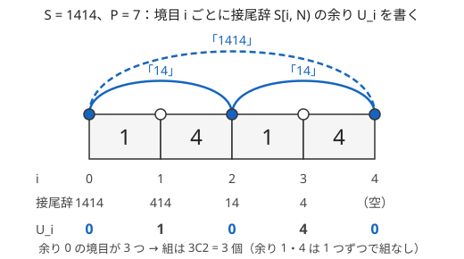

!!! abstract "要点"
    - **何ができるか**：10 進数の桁を mod で考えて、倍数判定・数の連結 $x \cdot 10^d + y$・部分文字列が $P$ の倍数になる個数を求める。部分文字列は接尾辞の余りが等しい組を数え、$P$ が 2・5 のときは場合を分ける。
    - **いつ使うか**：
        - 数字列の部分文字列を整数とみて、$P$ の倍数になるものを数える。
        - 桁を消したり並べ替えたりして $K$ の倍数にする。
        - 2 つの数を文字列として連結した数についての条件。
        - $\lvert S \rvert \le 2 \times 10^5$ の数字列で、部分文字列を全部試すと間に合わない。
    - **計算量**：桁数 $L$ の数の余りと倍数判定は $O(L)$。長さ $N$ の数字列の部分文字列のうち $P$ の倍数を数えるのは $O(N + P)$（余りごとの個数の表に $O(P)$）。
    - **前提**：[mod の計算の基本](../math/mod-arithmetic.md)

<!-- textlint-disable -->
別名：九去法・倍数判定・divisibility rule・数の連結・10 倍して a を足す・部分文字列の余り・桁和
<!-- textlint-enable -->

桁と mod は、10 進数を「各桁 × 10 の累乗」の和とみて、その余りを桁の側から計算する考え方である。鍵になるのは $10^k$ を法 $m$ で割った余りである。これが 1 になる（9 の倍数判定）、0 になる（下の桁だけで決まる）、逆元を持つ（部分文字列の数え上げ）のどれに当たるかによって使い方が分かれる。

このページで使う記法：数字列を $S = S[0] S[1] \cdots S[N-1]$（0-indexed、$S[0]$ が最上位）、部分文字列を $S[l, r)$ と書き、$S[l, r)$ を 10 進の整数とみた値を $\mathrm{val}(S[l, r))$ と書く。$d(y)$ は正の整数 $y$ の 10 進の桁数である（[記法と用語の約束](../start/notation.md#string)）。

## 倍数判定（3・9 は桁和、4 は下2桁、8 は下3桁、11 は交互和） {#divisibility}

倍数判定は、桁 $a_k$（$10^k$ の位）を使って $X = \sum_k a_k 10^k$ と書き、$10^k \bmod m$ が簡単な形になる法 $m$ を選ぶと得られる。合同式は足し算と掛け算で保たれるので（[途中で余りを取ってよい理由](../math/mod-arithmetic.md#why-mod)）、$10^k$ を余りに置き換えてよい。

| 法 $m$ | $10^k \bmod m$ | $X \bmod m$ を決めるもの |
| --- | --- | --- |
| 3・9 | すべての $k$ で 1 | 桁和 $\sum_k a_k$ |
| 11 | $k$ が偶数なら 1、奇数なら $-1$ | 1 の位から交互に足し引きした和 |
| $2^j$・$5^j$ | $k \ge j$ なら 0 | 下 $j$ 桁（2・5 は 1 の位、4・25 は下 2 桁、8・125 は下 3 桁） |
| そのほか | 周期的に変わる | 上の桁から $r \leftarrow (10r + a) \bmod m$ と計算する |

3・9 は $10 \equiv 1 \pmod 9$ から $10^k \equiv 1$ となり、$X \equiv \sum_k a_k \pmod 9$ が出る。3 は 9 の約数なので同じ式がそのまま使える。この「余りを桁和で求める」方法を九去法と呼ぶ。11 は $10 \equiv -1 \pmod{11}$ から $10^k \equiv (-1)^k$ になる。$2^j$・$5^j$ は $10^j = 2^j 5^j$ がどちらでも割り切れるので、$10^j$ 以上の位はすべて 0 になる。

表の最後の行は、どの法にも使える一般の方法である。上の桁から 1 桁ずつ読み、「今までの値を 10 倍して次の桁を足す」たびに余りを取る。最終的な値が $10^{200000}$ のような巨大な数でも、途中の値は $m$ 未満に収まる。入力が「長さ $2 \times 10^5$ の数字列で表された整数」なら、整数型ではなく文字列で受け取り、この方法で余りを求める。

倍数判定が問題の本体になるのは、桁を操作しても余りの変化が追えるときである。

- **桁を消す・選ぶ**：3・9 の判定は桁和の余りだけで決まるので、桁 $a$ を消すと余りが $a \bmod 3$ だけ減る。どの桁を消すかは、各桁の余り（0・1・2）の個数だけ見れば決まる
- **桁を並べ替える**：桁和は並べ替えで変わらないので、3・9 の倍数かどうかは並べ方によらない。8 の倍数は下 3 桁だけで決まる。だから桁数が 3 以上なら、$0$ から $992$ までの 8 の倍数を 3 桁に 0 を補った形（$008, 016, \dots, 992$）で書き、その 3 つの数字が足りるものがあるかを試せば済む。0 を補わずに「16 は 1 と 6 があれば作れる」と数えると、残りの 1 桁が 100 の位に来て値が変わる（$S = 116$ は 1 と 6 を持つが、116・161・611 はどれも 8 の倍数でない）。桁数が 3 未満なら、その桁数で作れる数を全部試す
- **桁和が条件に入る**：「$N$ 以下で桁和が $K$ の倍数」のように範囲の数を数えるなら、桁和の余りを状態として持つ[桁 DP](../dp/digit-dp.md#extra-state) を使う

??? question "確認問題：7 の倍数判定"
    9 の倍数は桁和で判定できるのに、7 の倍数は桁和で判定できないのはなぜか。

    ??? success "答え"
        桁和で判定できるのは $10^k \equiv 1$ がすべての $k$ で成り立つからである。7 では $10 \equiv 3$、$100 \equiv 2$、$1000 \equiv 6 \pmod 7$ と位ごとに余りが変わるので、桁に掛ける重みを無視できない。7 では表の最後の行の方法（上の桁から $10r + a$）で余りを求める。

## 数の連結：x の後ろに d 桁の y を付けると x·10^d + y {#concatenation}

数の連結は、$x$ の 10 進表記の後ろに $y$ の 10 進表記を付けた数で、次の式で表せる。たとえば $x = 12$、$y = 345$ なら $d(y) = 3$ で、$12 \times 1000 + 345 = 12345$ になる。

$$
\mathrm{concat}(x, y) = x \cdot 10^{d(y)} + y
$$

この式は、連結を掛け算と足し算だけで書けることを示している。だから余りを取りながら計算でき、$x$ と $y$ の余りと $10^{d(y)} \bmod m$ が分かれば連結の余りも分かる。[倍数判定の節](#divisibility)の「10 倍して次の桁を足す」は、1 桁の数を後ろに連結し続ける特別な場合である。

連結の式は、条件を $x$ と $y$ について分けたいときに効く。$x$ に掛かる $10^{d(y)}$ は $y$ の桁数だけで決まるので、$y$ の桁数 $d$ を固定すると $10^d$ は定数になる。$N$ 以下の正の整数の桁数は高々 19 種類なので（$N \le 10^{18}$ なら $10^{18}$ 自身の 19 桁まで）、桁数ごとに場合を分けても回数は少ない。

- **連結がある値と合同になる条件**：たとえば $\mathrm{concat}(x, y) \equiv x + y \pmod m$ は、$d = d(y)$ を固定すると $x(10^d - 1) \equiv 0 \pmod m$ になり、$y$ が消える。$g = \gcd(10^d - 1, m)$ とすると、これは「$x$ が $m / g$ の倍数」と同じなので（[GCD・LCM](../math/gcd-lcm.md)）、$x$ の個数は $\lfloor N / (m / g) \rfloor$ である。$d$ 桁の $y$ の個数を掛けて、$d$ について足す
- **ペアの連結の総和**：$\sum_{i < j} \mathrm{concat}(A_i, A_j) = \sum_{j} \Bigl( 10^{d(A_j)} \sum_{i < j} A_i + (j - 1) A_j \Bigr)$（$j$ は 1-indexed）と分け、$j$ を左から動かしながら $\sum_{i < j} A_i$ を持てば $O(N)$ になる。前半は、$A_i$ ごとに「後ろに来る数の $10^{d}$ の和」を掛けると見てもよい。この見方では桁数ごとの個数を数えておく
- **同じ数を何回も並べる**：$x$ を $K$ 回連結した数は $x(1 + 10^d + 10^{2d} + \cdots + 10^{(K-1)d})$ で、公比 $10^d$ の等比数列の和になる（[等比数列の和を mod で](../math/geometric-series-mod.md)）
- **余りの全体を状態にする**：「10 倍する」「1 を足す」のような桁の操作で余りがどう移るかを辺にすると、余りを頂点にしたグラフの最短路になる（[余りを頂点にした最短路](../graph/modular-shortest-path.md#residue-vertices)）

## 接尾辞の余りで部分文字列を数える（10 と P が互いに素なとき） {#suffix-remainder}

数字列 $S$（長さ $N$）の部分文字列のうち、整数とみて $P$ の倍数になるものを数えたい。部分文字列は $N(N+1)/2$ 個あり、$N = 2 \times 10^5$ では約 $2 \times 10^{10}$ 個なので、全部を調べると間に合わない。そこで、部分文字列の値を 2 つの接尾辞の値の差で表す。

境目 $i$（$0 \le i \le N$）ごとに、接尾辞 $S[i, N)$ の値の余りを $U_i = \mathrm{val}(S[i, N)) \bmod P$ とする。$U_N$ は空の接尾辞なので 0 である。接尾辞 $S[l, N)$ は、$S[l, r)$ の後ろに $N - r$ 桁の $S[r, N)$ を連結したものなので、[数の連結の式](#concatenation)から次が成り立つ。

$$
\begin{aligned}
&\mathrm{val}(S[l, N)) - \mathrm{val}(S[r, N)) \\
&= \mathrm{val}(S[l, r)) \cdot 10^{N-r}
\end{aligned}
$$

$10$ と $P$ が[互いに素](../guide/glossary.md#coprime)なら、$10^{N-r}$ と $P$ も互いに素なので、右辺が $P$ の倍数であることと $\mathrm{val}(S[l, r))$ が $P$ の倍数であることは同じである。$P$ と互いに素な数を掛けたり割ったりしても、$P$ で割り切れるかは変わらないからである。よって次の同値が成り立つ。

$$
\begin{aligned}
& \mathrm{val}(S[l, r)) \equiv 0 \pmod P \\
\iff & U_l \equiv U_r \pmod P
\end{aligned}
$$

部分文字列を数える問題が、「余りが等しい境目の組 $(l, r)$（$l < r$）を数える」問題に変わった。余り $u$ を持つ境目が $c_u$ 個あれば、組は $\binom{c_u}{2}$ 個ある。これは[累積和の余りが等しい組を数える](../basics/prefix-sum-counting.md#same-remainder)のと同じ形で、累積和を後ろから取ったものにあたる。

次の図は $S = 1414$、$P = 7$ の例である。



接尾辞の値は $1414, 414, 14, 4, 0$ で、7 で割った余りは $0, 1, 0, 4, 0$ である。余り 0 の境目が 3 つあるので組は $\binom{3}{2} = 3$ 個で、それぞれ $S[0, 2) = 14$、$S[2, 4) = 14$、$S[0, 4) = 1414 = 7 \times 202$ に対応する。余り 1 と 4 の境目は 1 つずつなので組を作らない。

処理の流れは次のとおりである。

1. 余りごとの個数の表 $\mathrm{cnt}[0..P)$ を 0 で埋め、空の接尾辞の分として $\mathrm{cnt}[0] = 1$ にする
2. $i = N - 1, N - 2, \dots, 0$ の順に、$U_i = (S[i] \cdot 10^{N-1-i} + U_{i+1}) \bmod P$ を計算する。$10^{N-1-i} \bmod P$ も同じループで 10 倍しながら持つ
3. 答えに $\mathrm{cnt}[U_i]$ を足し（右側にある同じ余りの境目と組にする）、$\mathrm{cnt}[U_i]$ を 1 増やす

```cpp
--8<-- "digit-and-mod/substring-multiple.cpp:core"
```

完全なプログラム：[`substring-multiple.cpp`](https://github.com/yuukougun/kyopro-atlas/blob/main/snippets/digit-and-mod/substring-multiple.cpp)（GitHub）
{ .kp-code-src }

計算量は、各位置で定数回の計算をするので $O(N)$、表の初期化に $O(P)$ で、合わせて $O(N + P)$ である。$P$ が大きくて表を作れないときは、`map` で余りを数えれば $O(N \log N)$ になる。

接頭辞の余りで考えることもできるが、$\mathrm{val}(S[l, r)) = \mathrm{val}(S[0, r)) - \mathrm{val}(S[0, l)) \cdot 10^{r-l}$ となり、$r - l$ が組ごとに違うので、そのまま「余りが等しい組」にはならない。両辺を $10^r$ で割り、$10$ の逆元を使えば同じ形に直せる。接尾辞で考えれば、掛かる $10^{N-r}$ は右側の境目だけで決まるので逆元が要らない。

??? question "確認問題：2019 では使えて 10 では使えない"
    この方法で「2019 の倍数になる部分文字列」を数えられるのに、「10 の倍数になる部分文字列」を数えられないのはなぜか。

    ??? success "答え"
        同値 $\mathrm{val}(S[l, r)) \equiv 0 \iff U_l \equiv U_r$ は、$10^{N-r}$ を割ってよいこと、すなわち $10$ と $P$ が互いに素であることに頼っている。$2019 = 3 \times 673$ は 2 も 5 も約数に持たないので 10 と互いに素だが、10 は 10 と互いに素でない。たとえば $S = 10$ では $U_0 = U_1 = U_2 = 0$ なので 3 組と数えてしまうが、$S[0, 1) = 1$ は 10 の倍数ではない。$P = 10$ なら 1 の位が 0 かどうかで決まるので、[P が 2・5 のときの場合分け](#p-2-5)と同じ方法で数える。

## P が 2・5 のときの場合分け {#p-2-5}

$P$ が 2 か 5 のときは、[接尾辞の余りの方法](#suffix-remainder)が使えない。$r < N$ なら $10^{N-r}$ が $P$ の倍数になり、$\mathrm{val}(S[l, r))$ が何であっても $U_l \equiv U_r$ が成り立つからである。たとえば $P = 2$、$S = 10$ では、接尾辞の値 $10, 0, 0$ はどれも偶数で、余りがすべて 0 になる。この組を全部数えると、奇数の $S[0, 1) = 1$ まで数えてしまう。

代わりに、[倍数判定](#divisibility)の「2 と 5 は 1 の位だけで決まる」を使う。部分文字列 $S[l, r)$ が $P$ の倍数かどうかは、最後の桁 $S[r-1]$ だけで決まる。$P = 2$ なら $S[r-1]$ が偶数、$P = 5$ なら 0 か 5 である。最後の桁が $S[i]$ の部分文字列は、始点 $l = 0, 1, \dots, i$ の $i + 1$ 個あるので、条件を満たす位置 $i$ ごとに $i + 1$ を足せばよい。計算量は $O(N)$ である。上のコードの `if (p == 2 || p == 5)` の分岐がこれにあたる。

$P$ が素数とは限らず、2 や 5 を約数に持つ一般の場合（たとえば $P = 12$）は、2 つの場合を組み合わせる。$P = 2^a 5^b Q$（$Q$ は 10 と互いに素）と分け、$k = \max(a, b)$ とする。

- 長さが $k$ 以上の部分文字列は、$2^a 5^b$ で割り切れるかが最後の $k$ 桁だけで決まる。つまり右端 $r$ だけで決まる
- $Q$ で割り切れるかは、接尾辞の値を $Q$ で割った余りを $U'_i$ とすれば、$U'_l = U'_r$ と同じである

そこで、最後の $k$ 桁が $2^a 5^b$ の倍数になる右端 $r$ ごとに、$U'_l = U'_r$ となる $l \le r - k$ を数える。$r$ を左から動かし、$U'_{r-k}$ を表へ足していけば数えられる。長さが $k$ 未満の部分文字列は $O(Nk)$ 個しかないので直接調べる。右端ごとに最後の $k$ 桁を読む手間も含め、全体で $O(Nk + Q)$ である（$k \le \log_2 P$ なので小さい）。

## 落とし穴 {#pitfalls}

**$P = 2, 5$ の場合分けを忘れる**。問題が「素数 $P$」とだけ言うときは、$P = 2$ と $P = 5$ が入りうる。接尾辞の余りの方法だけを書くと、このときに多く数えてしまう。$P$ が 10 と互いに素かを最初に確かめ、そうでなければ [1 の位で数える方法](#p-2-5)に分ける。

**空の接尾辞（$U_N = 0$）を数え忘れる**。$\mathrm{cnt}[0] = 1$ から始めないと、$S[l, N)$ のように末尾まで続く部分文字列が数えられない。$S = 14$、$P = 7$ なら、$U_0 = 0$ と組になる相手は $U_2 = 0$ だけである。

**組の数のオーバーフロー**。$N = 2 \times 10^5$ ですべての余りが等しいと、組は $N(N+1)/2 \approx 2 \times 10^{10}$ 個になり、`int` に収まらない。答えは `long long` で持つ。余りごとの個数 $c_u$ から $c_u(c_u - 1)/2$ で数えるなら、この掛け算も `long long` で行う。

**先頭の 0 を除いてしまう**。数字列に 0 が含まれる問題では、部分文字列「0」や「03」も整数 0・3 とみるのがふつうである。0 は $P$ の倍数なので数に入る。問題文が先頭の 0 をどう扱うかを確かめ、特別扱いの指示がなければ除かない。

**$10^d$ をそのまま計算してあふれる**。[数の連結](#concatenation)で $y$ の桁数 $d$ が 19 になると、$10^{19}$ は `long long`（最大約 $9.2 \times 10^{18}$）に収まらない。$\gcd(10^d - 1, m)$ は $\gcd((10^d - 1) \bmod m, m)$ と同じなので、$10^d$ は最初から $m$ で割った余りとして持つ。`pow(10, d)` は `double` を返し、大きな $d$ では誤差が出るので使わない。

**桁数の境目の数え間違い**。$d$ 桁の正の整数は $10^{d-1}$ 以上 $10^d - 1$ 以下の $9 \times 10^{d-1}$ 個だが、$N$ と同じ桁数のときは $10^{d-1}$ 以上 $N$ 以下の $N - 10^{d-1} + 1$ 個である。$d$ 桁の上端を $\min(10^d - 1, N)$ とし、こちらの上限が小さくなったところでループを止める。

## 例題 {#examples}

### ABC164 D. Multiple of 2019 {#abc164_d}

<div class="kp-problems" data-role="example" markdown>

- [ABC164 D. Multiple of 2019](https://atcoder.jp/contests/abc164/tasks/abc164_d)（diff 1232）：数字列 S の部分文字列のうち、整数とみて 2019 の倍数になるものの個数を求める（|S| ≤ 2×10^5）。

</div>

部分文字列を全部試すと約 $2 \times 10^{10}$ 個になるので、[接尾辞の余り](#suffix-remainder)で数える。$2019 = 3 \times 673$ は約数に 2 と 5 を持たないので 10 と互いに素であり、「部分文字列が 2019 の倍数 ⇔ 両端の境目の接尾辞の余りが等しい」が成り立つ。余りごとに境目の個数を数え、組の数を足す。

??? note "解法の詳細"
    - $S$ を後ろから読み、$U_i = (S[i] \cdot 10^{N-1-i} + U_{i+1}) \bmod 2019$ と、$10^{N-1-i} \bmod 2019$ を同時に更新する。
    - 大きさ 2019 の表 $\mathrm{cnt}$ を $\mathrm{cnt}[0] = 1$（空の接尾辞）で始め、各 $i$ で答えに $\mathrm{cnt}[U_i]$ を足してから $\mathrm{cnt}[U_i]$ を 1 増やす。
    - 答えは最大で約 $2 \times 10^{10}$ なので `long long` で持つ。全体で $O(\lvert S \rvert + 2019)$。
    - コードは[接尾辞の余りの節](#suffix-remainder)のものに $P = 2019$ を渡せばよい（2019 は素数でないが、10 と互いに素なので同じ分岐で正しい）。

## 練習問題 {#practice}

<div class="kp-problems" data-role="practice" markdown>

- [ABC182 C. To 3](https://atcoder.jp/contests/abc182/tasks/abc182_c)（diff 292）：正の整数 N の桁をいくつか（全部ではなく）消して 3 の倍数にするとき、消す桁の最小の個数を求める。
- [ABC181 D. Hachi](https://atcoder.jp/contests/abc181/tasks/abc181_d)（diff 600）：数字列 S の桁を並べ替えて 8 の倍数にできるかを判定する。
- [ABC460 E. x + y ≡ x + y](https://atcoder.jp/contests/abc460/tasks/abc460_e)（diff 1362）：N 以下の正の整数の組 (x, y) のうち、x の後ろに y を 10 進で連結した数が、M を法として x + y と合同になるものの個数を求める。
- [ABC158 E. Divisible Substring](https://atcoder.jp/contests/abc158/tasks/abc158_e)（diff 1866）：数字列 S の部分文字列のうち、整数とみて素数 P の倍数になるものの個数を求める。

</div>

??? note "練習の方針"
    - **ABC182 C**：桁和の余りが 0 なら 0 個。各桁の余り（1 か 2）の個数を数え、桁和の余りと同じ余りの桁を 1 つ消すか、もう一方の余りの桁を 2 つ消す。消すと桁がなくなる場合は不可。桁数が少ないので、残す桁の部分集合を全部試してもよい
    - **ABC181 D**：8 の倍数は下 3 桁で決まるので、3 桁の 8 の倍数（112 から 992 まで、0 を含むものを除く）ごとに数字の個数が足りるかを調べる。桁数が 1・2 のときは並べ方を全部試す
    - **ABC460 E**：$y$ の桁数 $d$ を固定すると、連結の式から条件は $x(10^d - 1) \equiv 0 \pmod M$ になり、$y$ によらない。$x$ は $M / \gcd(10^d - 1, M)$ の倍数の個数、$y$ は $d$ 桁の数の個数で、積を $d$ について足す。$10^d$ は余りで持つ
    - **ABC158 E**：接尾辞の余りが等しい組を数える。$P = 2, 5$ は 1 の位だけで決まるので、条件を満たす位置 $i$ ごとに $i + 1$ を足す。$S$ は 0 を含みうる

## 力試し {#challenge}

<div class="kp-problems" data-role="challenge" markdown>

- [ARC084 D. Small Multiple](https://atcoder.jp/contests/arc084/tasks/arc084_b)（diff 2457）：正の整数 K の正の倍数のうち、10 進の桁和の最小値を求める。

</div>

??? note "力試しの方針"
    - **ARC084 D**：数は 1 から始めて「1 を足す（桁和が 1 増える）」と「10 倍する（桁和は変わらない）」で作れる。$K$ で割った余りを頂点にし、コスト 1 の辺 $r \to r + 1$ とコスト 0 の辺 $r \to 10r$ を張って、余り 1 から余り 0 までの最短距離を 01-BFS で求め、1 を足す（[余りを頂点にした最短路](../graph/modular-shortest-path.md#arc084_b)）

## 使い分け {#comparison}

- 数字列ではなく一般の数列の区間の和が $M$ の倍数になる個数は、前から取った累積和の余りが等しい組を数える（[累積和で区間を数える](../basics/prefix-sum-counting.md)）。数字列は桁に $10$ の累乗の重みが付くので、後ろから取る
- 「$N$ 以下の整数のうち、桁和や値の余りが条件を満たすものを数える」なら、余りを状態に持つ[桁 DP](../dp/digit-dp.md)
- 数を選んだり並べたりして和や連結の余りを条件にするなら、余りを状態に持つ DP（[余りを状態にする DP](../dp/dp-mod-state.md)）
- 余りの間を操作で移り、最小のコストを求めるなら[余りを頂点にした最短路](../graph/modular-shortest-path.md#residue-vertices)

## 参考 {#references}

- [drken「AtCoder ABC 164 D - Multiple of 2019 (1Q, 水色, 400 点)」](https://drken1215.hatenablog.com/entry/2020/04/29/171300)：例題の方針（後ろからの累積の余りと、10 と 2019 が互いに素であること、空の接尾辞）
- [drken「AtCoder ABC 158 E - Divisible Substring (1D, 青色, 500 点)」](https://drken1215.hatenablog.com/entry/2020/03/08/020200)：P = 2, 5 の場合分けと、それ以外の素数での数え方
- [drken「AtCoder ABC 182 C - To 3 (3Q, 灰色, 300 点)」](https://drken1215.hatenablog.com/entry/2020/11/30/014517)：練習の方針（桁和の余りによる判定）
- [drken「AtCoder ABC 181 D - Hachi (3Q, 茶色, 400 点)」](https://drken1215.hatenablog.com/entry/2020/11/02/023700)：練習の方針（下 3 桁による 8 の倍数判定）
- [comet725「ABC460Eを解いた【桁ごとの数え上げ】」](https://qiita.com/comet725/items/7ac6436793b6e5d1ee4f)：練習の方針（桁数ごとに連結の式を変形し、gcd で数える）
- [ikatakos「AtCoder Beginner Contest 460 E,F,G問題メモ」](https://ikatakos.com/pot/programming_algorithm/contest_history/atcoder/2026/0530_abc460)：ABC460 E の式変形と桁数ごとの個数（解説の部分だけを参照）
- [drken「AtCoder ABC 077 D - Small Multiple (ARC 084 D) (3D, 橙色, 700 点)」](https://drken1215.hatenablog.com/entry/2021/07/30/160000)：力試しの方針（余りを頂点にした 01-BFS）
