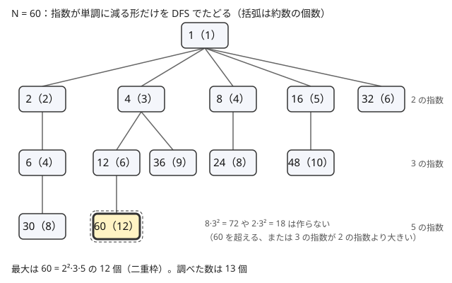

!!! abstract "要点"
    - **何ができるか**：約数（の組）を全部試す全探索が間に合うかを、約数の個数の上界から見積もる。$10^9$ 以下の数の約数は多くても 1344 個、$10^{18}$ 以下でも 103680 個しかない。約数の多い数は、小さい素数の指数が減っていく形に限って列挙する。
    - **いつ使うか**：
        - $N$ の約数ごとに〜を計算する・$d \mid N$ を満たす $d$ を全部試す。
        - $N$ 以下で約数の個数が最大の数・約数が多い数を探す。
        - $N \le 10^{12}$〜$10^{18}$ で、約数の組を全探索して間に合うかを見積もる。
    - **計算量**：約数の個数 $d(N)$ は $N \le 10^9$ で 1344 以下、$N \le 10^{12}$ で 6720 以下、$N \le 10^{18}$ で 103680 以下。約数の組を全部試すと $O(d(N)^2)$。ただし約数の列挙そのものは試し割りで $O(\sqrt N)$ かかる。
    - **前提**：[素因数分解とルジャンドルの公式](../math/prime-factorization.md)

<!-- textlint-disable -->
別名：約数の個数の最大値・highly composite number・約数が多い数・素因数の種類数の上界
<!-- textlint-enable -->

約数の個数の上界は、「$N$ の約数を全部試す」「約数の組を全部試す」という全探索が間に合うかを決める数である。約数は $d$ と $N / d$ の対になるので $2\sqrt N$ 個以下だが、実際の最大はそれよりずっと少ない。$10^{12}$ 以下の数でも約数は 6720 個以下なので、$\sqrt N = 10^6$ 個あると思って諦めた全探索が、実は余裕で間に合うことがある。

このページでは、正の整数 $n$ の正の約数の個数を $d(n)$、$n$ の異なる素因数の個数を $\omega(n)$ と書く（記法は[記法と用語の約束](../start/notation.md)）。$n = p_1^{e_1} p_2^{e_2} \cdots p_k^{e_k}$ と[素因数分解](../math/prime-factorization.md)すると、$d(n) = (e_1 + 1)(e_2 + 1) \cdots (e_k + 1)$ である（[約数の個数の公式](../math/divisor-enum.md#count-and-sum)）。

## 約数の個数・素因数の種類数の最大値の表（10^3〜10^18） {#table}

$N$ 以下の正の整数での $d(n)$ と $\omega(n)$ の最大値は次のとおりである。「達成する数」は $d(n)$ が最大になる最小の $n$ で、[高度合成数の列挙](#enumerate-hcn)のプログラムで計算して確かめた。

| $N$ | $d(n)$ の最大 | 達成する数 | $\omega(n)$ の最大 |
| --- | --- | --- | --- |
| $10^3$ | 32 | 840 | 4 |
| $10^5$ | 128 | 83160 | 6 |
| $2 \times 10^5$ | 160 | 166320 | 6 |
| $10^6$ | 240 | 720720 | 7 |
| $10^7$ | 448 | 8648640 | 8 |
| $10^9$ | 1344 | 735134400 | 9 |
| $10^{10}$ | 2304 | 6983776800 | 10 |
| $10^{12}$ | 6720 | 963761198400 | 11 |
| $10^{15}$ | 26880 | 866421317361600 | 13 |
| $10^{18}$ | 103680 | 897612484786617600 | 15 |

覚えるのは $10^9$ で 1344、$10^{12}$ で 6720、$10^{18}$ で 103680 の 3 つで足りる。表にない $N$ の見当には、$\sqrt[3]{N}$ と比べる経験則が使える。これは定理ではなく、表の値から読み取れる傾向である。$10^9$ 付近ではほぼ $\sqrt[3]{N}$ で、それより小さい $N$ では数倍になる。$N$ が大きいほど $\sqrt[3]{N}$ を大きく下回り、$10^{18}$ では約 10 分の 1 である。

**なぜ $\sqrt N$ よりずっと少ないか**。$d(n) = \prod (e_i + 1)$ なので、約数を増やすには指数を増やすか、素因数の種類を増やすしかない。素数 $p$ を 1 つ掛けるごとに $n$ は $p$ 倍になるのに、約数の個数は高々 2 倍にしかならない。素因数の種類は、異なる素数の積が $N$ を超えた時点で打ち止めになる。指数も、$2^e \le N$ から $e \le \log_2 N$ に限られる。最小の 15 個の素数の積は約 $6.1 \times 10^{17}$ で、16 個目の 53 を掛けると $10^{18}$ を超えるので、$10^{18}$ 以下の数の $\omega(n)$ は 15 以下である。

**素因数の種類数も使いどころがある**。素因数の冪 $p^e$ ごとに「どちらに入れるか」を選ぶ全探索は $2^{\omega(N)}$ 通りで、$N \le 10^{18}$ でも $2^{15} = 32768$ 通りである。$2N \le 2 \times 10^{15}$ を互いに素な 2 数の積に分ける方法を全部試す[ACL1 B](#practice)はこの形で、$\omega \le 13$ から 8192 通り以下と分かる（詳しくは[中国剰余定理の応用の型](../math/crt.md#applications)）。

??? question "確認問題：素因数の種類数"
    $N \le 10^9$ のとき、$N$ の異なる素因数は最大で何個か。$2 \cdot 3 \cdot 5 \cdots$ と小さい素数を掛けていって確かめよ。

    ??? success "答え"
        9 個である。$2 \cdot 3 \cdot 5 \cdot 7 \cdot 11 \cdot 13 \cdot 17 \cdot 19 \cdot 23 = 223092870 \le 10^9$ で、次の 29 を掛けると約 $6.5 \times 10^9$ になり $10^9$ を超える。どの 10 個の異なる素数の積も、最小の 10 個の積以上なので、10 個は持てない。

## 約数の組を全部試す見積もり（1344² ≈ 1.8×10^6） {#pairs}

「$a \times b \times c = N$ となる組を数える」「約数 $e$ と、$e$ で割り切れる約数 $d$ の組ごとに計算する」のように、約数の組を全部試したい場面がある。約数を昇順の配列 `ds` に列挙しておき、二重ループで組を回すと、試す組は $d(N)^2$ 個である。

| $N$ の上限 | $d(N)$ の最大 | 組の数 $d(N)^2$ | 間に合うか |
| --- | --- | --- | --- |
| $10^9$ | 1344 | 約 $1.8 \times 10^6$ | 余裕がある |
| $10^{12}$ | 6720 | 約 $4.5 \times 10^7$ | 割り算 1 回なら間に合う |
| $10^{18}$ | 103680 | 約 $1.1 \times 10^{10}$ | 間に合わない |

$a \le b$ に絞れば半分になる。$10^{12}$ までは「組を全部試して、割り切れるかを `%` で調べる」で済むが、$10^{18}$ では組を素朴に回すと間に合わない。$10^{18}$ で組が要るときは、割り切る組だけを素因数の指数から直接作る（[約数を状態にした DP](#divisor-dp)）か、素因数の種類数 $\omega(N)$ の方で数える方法を考える。

割り切る組 $e \mid d \mid N$ だけに絞ると、その数は $\prod_i \frac{(e_i + 1)(e_i + 2)}{2}$ になる（素因数ごとに、$e$ と $d$ の指数 $0 \le f \le g \le e_i$ を選ぶ）。$N = 963761198400$（$10^{12}$ 以下で約数が最多）なら約 $1.8 \times 10^6$、$10^{18}$ 以下で約数が最多の数でも約 $1.6 \times 10^8$ で、全部の組の 1 割以下に減る。

組を回す二重ループでは、積 $a \times b$ のあふれに気をつける。$a, b$ がどちらも $10^{12}$ 近い約数なら、積は `long long` の上限（約 $9.2 \times 10^{18}$）を超える。`b > N / a` なら $a b > N$ なので、掛ける前に割り算で比べて飛ばす。

??? question "確認問題：3 つの約数の積"
    $K \le 10^{12}$ について、$a \le b \le c$ かつ $abc = K$ となる組を数えたい。$a$ と $b$ を約数から選び、$c = K / (ab)$ を計算する方法の計算量を見積もれ。

    ??? success "答え"
        約数の列挙が $O(\sqrt K) = 10^6$ 回、$a \le b$ の組が多くても $6720^2 / 2 \approx 2.3 \times 10^7$ 個で、組ごとに `K / a < b` の比較と `K % (a * b)` の割り算を 1 回ずつする。合わせて $10^7$〜$10^8$ 回程度なので間に合う。$c$ は計算で決まるので、3 重ループにする必要はない。

## 落とし穴 {#pitfalls}

**約数の個数を $\sqrt N$ と見積もって諦める**。$d(N) \le 2\sqrt N$ は正しいが、上界としては粗すぎる。$N \le 10^{12}$ で「約数は $10^6$ 個、組は $10^{12}$ 個」と考えると全探索を捨ててしまうが、実際は 6720 個・組は $4.5 \times 10^7$ 個である。約数を回す解法を思いついたら、表の値で見積もり直す。

**約数が少ないことと、列挙が速いことを混同する**。$10^{18}$ 以下の数の約数は 103680 個以下でも、試し割りで列挙するには $\sqrt N = 10^9$ 回の割り算がかかり、間に合わない。試し割りで間に合うのは $N \le 10^{12}$〜$10^{14}$ 程度までと考える。$10^{18}$ の約数を全部試す解法では、次のどれかで列挙の部分を速くする。

- $N$ を[大きな数の素因数分解](../math/miller-rabin.md#pollard-rho)（Pollard の ρ 法）で分解し、指数の組合せから約数を作る
- $N$ が「小さい数の積」「$A^B$」の形で与えられるなら、小さい方を分解して指数を足す

**多数の数の約数を、1 個ずつ試し割りで列挙する**。$N$ 個の数 $A_i \le 10^6$ の約数をそれぞれ求めるとき、1 個あたりの約数は 240 個以下でも、試し割りは 1 個あたり $10^3$ 回かかる。$N = 2 \times 10^5$ なら合わせて $2 \times 10^8$ 回である。[最小素因数の篩](../math/spf-sieve.md#many-numbers)で分解すれば 1 個 $O(\log A)$ で済み、約数の生成は約数の個数に比例する時間で終わる。

**約数の個数が多すぎて列挙できない数を、列挙しようとする**。$A^B$（$A \le 10^{12}$、$B \le 10^{18}$）の約数の個数 $\prod (B e_i + 1)$ は天文学的な大きさで、表の上界は使えない（$A^B$ は $10^{18}$ をはるかに超える）。こうした問題では約数を 1 つずつ扱わず、個数の公式から答えを式で求める（[例題の ARC167 B](#arc167_b)）。

**あふれ**。組の積 $a \times b$ を比べる前に掛けると、積が `long long` の上限（約 $9.2 \times 10^{18}$）を超えることがある。符号付き整数のあふれは未定義動作で、多くの環境では負の値などになり、割り切れる判定がでたらめになる。[約数の組の見積もり](#pairs)のとおり、掛ける前に割り算で比べる。約数の個数を掛け合わせる $\prod (e_i + 1)$ も、指数が大きい（$A^B$ の形の）ときは `long long` に収まらないので、mod で計算するか、上限で打ち切る。

## 約数を状態にした DP（約数の個数が少ないことを使う） {#divisor-dp}

この節は [DP の基本](../dp/dp-basics.md)と[ナップサック DP](../dp/knapsack-01.md)を前提にする。「積が $N$ になる」「$N$ を割り切る値だけが現れる」問題では、途中の値はすべて $N$ の約数になる。値そのものは $10^{18}$ まであっても、取りうる値は $d(N)$ 個しかないので、約数の番号を DP の状態にできる。

**状態の持ち方**。約数を昇順の配列 `ds` に列挙し、約数 $x$ を「`ds` の中での番号」で表す。$x$ から番号を引くには、`lower_bound` で二分探索する（$O(\log d(N))$）か、素因数の指数の組 $(f_1, \dots, f_k)$ を混合基数の番号 $f_1 + (e_1 + 1)(f_2 + (e_2 + 1)(\cdots))$ に直す（$O(k)$）。混合基数の番号から `ds` の番号への表を作っておけば、配列で引ける。混合基数の番号をそのまま状態にしてもよい。$y \mid x$ なら $y$ の指数は各桁で $x$ 以下なので、番号も小さくなり、次の例の「番号の小さい順に計算する」がそのまま使える。`map<long long, …>` で持つと定数倍が重いので、番号を使う。

**例：順序付きの積への分け方**。$N$ を 2 以上の整数の積に、順序を区別して分ける方法の数を数える。$\mathrm{dp}[i]$ ＝ 約数 `ds[i]` を 2 以上の整数の積に順序付きで分ける方法の数、とする。初期値は $\mathrm{dp}[0] = 1$（`ds[0]` は 1 で、空の積の 1 通り）である。最後の因数を `ds[i] / ds[j]`（$j < i$ で `ds[j]` が `ds[i]` を割り切るもの）と決めると、残りは `ds[j]` の分け方なので、$\mathrm{dp}[i] = \sum_{j < i,\ \mathtt{ds}[j] \mid \mathtt{ds}[i]} \mathrm{dp}[j]$ になる。`ds[j]` は `ds[i]` より小さいので、番号の小さい順に計算すればよい。答えは $\mathrm{dp}[d(N) - 1]$ である。

```cpp
--8<-- "divisor-count-bound/divisor-dp.cpp:core"
```

$N = 12$ なら、約数は $1, 2, 3, 4, 6, 12$ で、$\mathrm{dp}$ は順に $1, 1, 1, 2, 3, 8$ になる。12 の分け方は $12$、$2 \cdot 6$、$6 \cdot 2$、$3 \cdot 4$、$4 \cdot 3$、$2 \cdot 2 \cdot 3$、$2 \cdot 3 \cdot 2$、$3 \cdot 2 \cdot 2$ の 8 通りで一致する。計算量は約数の組を全部見るので $O(\sqrt N + d(N)^2)$ で、$N \le 10^{12}$ まで間に合う。

**品物が約数のナップサック**。「相異なる約数をいくつか選んで積を $N$ にする」なら、約数を 1 つずつ品物として見て、$\mathrm{dp}[\text{積の番号}]$ を 0-1 ナップサックと同じ向き（大きい番号から）で更新する。ただし品物 1 は積を変えないので、番号の向きだけで回し、$c$ を小さい方から回すと 1 を何度も使ってしまう。$c$ も大きい方から回すか、1 は DP の後で「入れる・入れない」を別に足す。選んだ個数 $c$ が答えに効く（並べ方が $c!$ 通りになるなど）なら、$c$ も状態に足す。相異なる 2 以上の整数 $k$ 個の積は $2 \cdot 3 \cdots (k + 1) = (k + 1)!$ 以上なので、$N \le 10^{10}$ なら $k \le 12$ で、1 を含めても $c \le 13$ と小さい。状態数は $c \times d(N)$、遷移は品物 $d(N)$ 個ごとに全状態を見るので $O(c \cdot d(N)^2)$ で、$N \le 10^{10}$ なら $13 \times 2304^2 \approx 7 \times 10^7$ である（[力試しの ABC461 F](#challenge)がこの型）。

**メモ化再帰でも同じ**。$f(n)$ が $f(n / k)$ から決まる再帰（サイコロの目を掛けていく確率など）では、現れる引数は $N$ の約数だけなので、メモの大きさは $d(N)$ で抑えられる。[メモ化再帰](../dp/memoized-recursion.md)を `map` で書いても、呼ばれる状態の数をこの上界で見積もれる。

## 高度合成数の列挙（小さい素数の指数が単調に減る形を DFS で） {#enumerate-hcn}

この節は[再帰による全列挙](../basics/recursive-enumeration.md)を前提にする。「$N$ 以下で約数の個数が最大の数」を求めるには、$N$ 以下の数を全部調べる必要はない。約数の個数が最大になりうる数の形は強く制限される。

自分より小さいどの数よりも約数が多い正の整数を、高度合成数という（1・2・4・6・12・24・36・48・60・120・…）。$N$ 以下での $d(n)$ の最大は、$N$ 以下で最大の高度合成数で達成される。

**指数が単調に減る形だけ調べればよい理由**。$n = 2^{a_1} 3^{a_2} 5^{a_3} \cdots$ とする（$p_1 = 2, p_2 = 3, \dots$ と小さい素数の順に並べ、$a_i \ge 0$）。

- 指数の並びを入れ替えても $d(n) = \prod (a_i + 1)$ は変わらない。小さい素数に大きい指数を割り当てると $n$ が小さくなるので、$a_1 \ge a_2 \ge a_3 \ge \cdots$ の並びが最も小さい
- 使う素数に「すき間」があるとき（5 を使わずに 7 を使うなど）、7 を 5 に替えれば $d(n)$ は同じで $n$ は小さくなる

したがって、同じ $d(n)$ を持つ最小の数は「2 から連続する素数を使い、指数が単調に減る」形をしている。$d(n)$ が最大の数のうち最小のものもこの形なので、この形の数だけを調べれば $d(n)$ の最大が分かる。

**DFS で列挙する**。素数 2, 3, 5, … の順に指数を決める。$i$ 番目の素数の指数は、1 つ前の素数の指数以下にする。値が $N$ を超えたらその枝を打ち切る。次の図は $N = 60$ の場合で、13 個の数を調べて最大の 60（約数 12 個）を見つける。



この形の数はとても少なく、$N = 10^{18}$ でも 3 万 3 千個ほど（1 を含めて 32749 個）しかない。$i$ 番目の素数で掛ける前に `y > N / p` で比べれば、あふれずに打ち切れる。

```cpp
--8<-- "divisor-count-bound/hcn.cpp:core"
```

[表](#table)の値は、このプログラムで $N = 10^3, \dots, 10^{18}$ について求めたものである。

**条件が付くと形が崩れる**。「$D$ の倍数を除く」「奇数に限る」のような条件が付くと、上の 2 つの置き換え（指数の入れ替え・素数の詰め替え）をすると条件を破ることがある。たとえば奇数に限るなら 2 を使えないので、3, 5, 7, … の範囲で同じ議論をし直す。一般には、置き換えても条件を保つ範囲だけで形を絞り、絞れない部分は素数を飛ばす・指数の上限を見直すなどして候補に加える（[力試しの ABC475 G](#challenge)）。

## 例題 {#examples}

### ARC167 B. Product of Divisors {#arc167_b}

<div class="kp-problems" data-role="example" markdown>

- [ARC167 B. Product of Divisors](https://atcoder.jp/contests/arc167/tasks/arc167_b)（diff 1292）：A^B の正の約数をすべて掛けた積が A で何回割り切れるかを、998244353 で割った余りで求める。

</div>

$A \le 10^{12}$、$B \le 10^{18}$ なので、$A^B$ の約数は列挙できず、個数も `long long` に収まらないことがある。約数を 1 つずつ掛けるのではなく、約数の積の公式と約数の個数の公式から指数を式で求める。$M$ の約数は $k$ と $M / k$ の対に分けられ、各対の積は $M$ なので、約数の積は $M^{d(M) / 2}$ である。$M = A^B$ を当てはめると、積は $A^{X / 2}$（$X = B \cdot d(A^B)$）と書ける。

??? note "解法の詳細"
    - $A = p_1^{e_1} \cdots p_k^{e_k}$ と試し割りで分解する（$O(\sqrt A) = 10^6$ 回）。$A^B$ の指数は $B e_i$ なので、$d(A^B) = \prod_i (B e_i + 1)$ である
    - 約数の積は $A^{X/2}$、$X = B \prod_i (B e_i + 1)$ である。$X$ が偶数なら答えは $X / 2$
    - $X$ が奇数になるのは、$B$ が奇数で、すべての $e_i$ が偶数（$A$ が平方数）のときだけである。このとき積は $A^{(X-1)/2} \sqrt A$ で、$\sqrt A$ は $A$ で割り切れないので、答えは $(X - 1) / 2$ になる
    - 偶奇は mod を取る前の $B$ と $e_i$ で判定する。$X \bmod 998244353$ を計算し、奇数なら 1 を引いてから 2 の[逆元](../math/mod-inverse.md)を掛ける。$X \bmod 998244353$ の偶奇は $X$ の偶奇と一致するとは限らないので、余りで偶奇を判定してはいけない
    - $B = 0$ なら $X = 0$ で、答えは 0 になる

## 練習問題 {#practice}

<div class="kp-problems" data-role="practice" markdown>

- [典型90 085. Multiplication 085（★4）](https://atcoder.jp/contests/typical90/tasks/typical90_cg)（diff なし）：a ≤ b ≤ c かつ a × b × c = K を満たす正の整数の組の個数を求める（K ≤ 10^12）。
- [ACL1 B. Sum is Multiple](https://atcoder.jp/contests/acl1/tasks/acl1_b)（diff 1785）：1 + 2 + … + k が N の倍数になる最小の正の整数 k を求める（N ≤ 10^15）。

</div>

??? note "練習の方針"
    - **典型90 085**：$K$ の約数を列挙し、$a \le b$ の約数の組ごとに $c = K / (ab)$ が整数で $b \le c$ かを調べる。組は多くても $6720^2 / 2$ 個である（[約数の組の見積もり](#pairs)の確認問題）。`K / a < b` で先に飛ばして、積のあふれを防ぐ
    - **ACL1 B**：条件を「$k(k + 1)$ が $2N$ の倍数」に直す。$k$ と $k + 1$ は互いに素なので、$2N$ の素因数の冪を $k$ 側と $k + 1$ 側に分ける $2^{\omega(2N)} \le 2^{13}$ 通りを全部試し、それぞれ中国剰余定理で解く（[中国剰余定理の例題](../math/crt.md#acl1_b)）

## 力試し {#challenge}

<div class="kp-problems" data-role="challenge" markdown>

- [ABC461 F. Total Product is N](https://atcoder.jp/contests/abc461/tasks/abc461_f)（diff 1940）：相異なる正の整数からなり、総積が N になる数列すべてについて要素の総和を足し合わせ、998244353 で割った余りを求める（N ≤ 10^10）。
- [ABC475 G. Has Many Divisors](https://atcoder.jp/contests/abc475/tasks/abc475_g)（diff 2360）：N 以下で D の倍数でない正の整数のうち、約数の個数が最も多いものを求める。

</div>

??? note "力試しの方針"
    - **ABC461 F**：要素はすべて $N$ の約数で、$N \le 10^{10}$ なら約数は 2304 個以下である。要素は相異なるので、集合として数えて最後に長さ $c$ の並べ方 $c!$ を掛ければよい。約数を品物にして、「積の番号・選んだ個数 $c$」を状態に、個数と総和の 2 つを持つナップサック風の DP をする（[約数を状態にした DP](#divisor-dp)）。$c$ は 13 程度までなので、全体で $c \cdot d(N)^2$ 程度に収まる
    - **ABC475 G**：$D$ の倍数でない条件がなければ、指数が単調に減る形の DFS で済む（[高度合成数の列挙](#enumerate-hcn)）。$D$ の倍数になる候補は、新しく足す素数を次の素数に替える・指数を増やす枝を捨てるなどして避ける。素数ごとの指数に上限を設けて候補を絞り、値の小さい順に調べて約数の個数の最大を更新していく

## 使い分け {#comparison}

- 1 つの $N$ の約数を全部試すなら、試し割りで列挙して約数の個数の上界で見積もる。$N \le 10^{12}$ 程度までが目安で、それより大きければ[大きな数の素因数分解](../math/miller-rabin.md#pollard-rho)を使う
- $1$ 以上 $M$ 以下の全部の数について約数を扱うなら、各 $d$ の倍数を回す方が速い。合計 $O(M \log M)$ である（[調和級数](../math/harmonic-sum.md)）
- 約数の組が多すぎる（$10^{18}$ 級）なら、割り切る組だけを指数から作るか、素因数の冪ごとの選び方（$2^{\omega(N)}$ 通り）で考える

## 参考 {#references}

- [drken「AtCoder ARC 167 B - Product of Divisors (青色, 500 点)」](https://drken1215.hatenablog.com/entry/2024/01/31/220502)：例題の方針（約数の積の公式・偶奇の場合分け・偶奇を mod の前の値で判定すること）
- [E869120「競プロ典型 90 問 085 の解答例」](https://github.com/E869120/kyopro_educational_90/blob/main/sol/085.cpp)：練習の方針（約数の組を回し、割り算で先に飛ばす）
- [drken「AtCoder ACL Contest 1 B - Sum is Multiple (2D, 青色, 600 点)」](https://drken1215.hatenablog.com/entry/2020/09/23/080300)：練習の方針（互いに素な 2 数への分け方を全部試す）
- [drken「けんちょんの競プロ精進記録」カテゴリ「数量が小さいことの活用：約数の個数」](https://drken1215.hatenablog.com/archive/category/数量が小さいことの活用：約数の個数)：約数の個数が少ないことを使う問題の分類
- [ikatakos「AtCoder Beginner Contest 461 E,F,G問題メモ」](https://ikatakos.com/pot/programming_algorithm/contest_history/atcoder/2026/0606_abc461)：力試しの方針（約数を品物にした DP と長さの上限。解法の部分だけを参照）
- [ikatakos「AtCoder Beginner Contest 475 E,F,G問題メモ」](https://ikatakos.com/pot/programming_algorithm/contest_history/atcoder/2026/0912_abc475)：力試しの方針（指数が単調に減る候補の列挙と、D の倍数を避ける扱い。解法の部分だけを参照）
