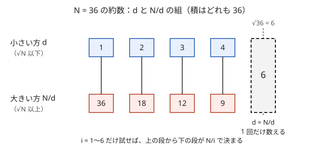

!!! abstract "要点"
    - **何ができるか**：$d$ と $N/d$ が $\sqrt{N}$ を境に対になることを使い、素数判定と約数の列挙を $O(\sqrt{N})$ で行う。答えの候補が $N$ の約数に限られる問題では、列挙した約数を全部試す全探索ができる。
    - **いつ使うか**：
        - $N \le 10^{12}$ 程度（$\sqrt{N} \le 10^6$）の約数・素数判定。
        - $a \times b = N$ となる組を調べる。
        - 答え（gcd・周期・個数）が $N$ の約数のどれかになる。
        - $X$ 以上の最小の素数。
    - **計算量**：素数判定・約数の列挙は $O(\sqrt{N})$。列挙した約数を小さい順に並べるなら、ソートに $O(d(N) \log d(N))$（$d(N)$ は約数の個数）が加わる。$N = 10^{12}$ でもループは $10^6$ 回である。
    - **前提**：[整数の割り算と余り](../math/integer-division.md)

<!-- textlint-disable -->
別名：試し割り・trial division・divisor enumeration・primality test・√N まで調べる・約数の総和
<!-- textlint-enable -->

約数列挙と素数判定は、$N$ を $1$ から $N$ までのすべての数で割る代わりに、$\sqrt{N}$ 以下の数だけで割って調べる方法である。約数は小さい方と大きい方の対になっているので、小さい方を見つければ大きい方は割り算で分かる。素因数分解・篩・約数を候補にした全探索など、整数の問題の多くの手法がこの考え方の上にある。

このページで使う記法：$N$ は正の整数、$d \mid N$ は「$d$ が $N$ を割り切る」、$s = \lfloor \sqrt{N} \rfloor$ とする。$N$ の約数の個数を $d(N)$ と書く。ほかの記法は[記法と用語の約束](../start/notation.md)にそろえる。

## √N まで調べればよい理由（約数の対） {#why-sqrt}

$d$ が $N$ の約数なら、$N/d$ も $N$ の約数である。2 つの積は $N$ なので、両方が $\sqrt{N}$ より大きいことはなく（積が $N$ を超える）、両方が $\sqrt{N}$ より小さいこともない（積が $N$ に届かない）。したがって、約数は「$\sqrt{N}$ 以下の $d$」と「$\sqrt{N}$ 以上の $N/d$」の対に分かれる。



$N = 36$ なら、対は $(1, 36)$・$(2, 18)$・$(3, 12)$・$(4, 9)$・$(6, 6)$ である。上の段は $1$ から $6 = \sqrt{36}$ までに収まっているので、$i = 1, \dots, 6$ で割り切れるかを調べれば、下の段は $36/i$ で全部求まる。最後の $(6, 6)$ のように $N$ が平方数のときは $d = N/d$ の対が 1 つだけでき、同じ数を 2 回数えないよう注意が要る。

ループの回数は $\lfloor \sqrt{N} \rfloor$ 回なので計算量は $O(\sqrt{N})$ である。$N = 10^{12}$ なら $10^6$ 回、$N = 10^{18}$ なら $10^9$ 回で、後者は 1 秒に収まらない（[使い分け](#comparison)）。同じ「片方は $\sqrt{N}$ 以下」という考え方は、$\lfloor N/i \rfloor$ の値をまとめる[商の列挙](../math/floor-quotient-enum.md#why-sqrt)でも使われる。

## 素数判定（試し割り） {#primality}

$N \ge 2$ が素数であるとは、約数が $1$ と $N$ だけであることをいう。$N$ が合成数なら $N = ab$（$2 \le a \le b$）と書け、$a^2 \le ab = N$ なので $a \le \sqrt{N}$ である。よって $2$ から $\lfloor \sqrt{N} \rfloor$ までのどれでも割り切れなければ $N$ は素数である。これを試し割りという。

```cpp
--8<-- "divisor-enum/divisors.cpp:prime"
```

- **1 は素数ではない**：$N = 1$ ではループが 1 回も回らないので、先に `n < 2` を弾かないと素数と判定してしまう
- **終了条件は `i * i <= n`**：$\sqrt{N}$ を浮動小数点で求めると誤差でずれる（[落とし穴](#pitfalls)）。`i` を `long long` にしておけば、$N \le 10^{18}$ の範囲で `i * i` はあふれない
- **見つかった時点で止める**：合成数なら最小の素因数 $p \le \sqrt{N}$ で止まる。最悪は $N$ が素数のときで、そのとき $\sqrt{N}$ 回かかる

**$X$ 以上の最小の素数**。$X, X + 1, X + 2, \dots$ と順に試し割りすれば求まる。素数の間隔は小さく、$10^9$ 以下で始まる隣り合う素数の差は最大でも $282$ である（$436273009$ と次の素数の差）。したがって高々 300 回ほどの判定で見つかり、全体は $300 \times \sqrt{10^9} \approx 10^7$ 回程度で済む。

**たくさんの数を判定するとき**。$10^6$ 以下の数を $10^5$ 個判定するような場合は、1 個ずつ試し割りすると $10^5 \times 10^3 = 10^8$ 回になる。値の上限までの[エラトステネスの篩](../math/sieve-eratosthenes.md)を一度作れば、各判定は $O(1)$ である。

## 約数の列挙とソート・平方数での重複 {#enumerate}

約数の列挙では、$i = 1, \dots, \lfloor \sqrt{N} \rfloor$ について $i \mid N$ なら $i$ と $N/i$ の両方を集める。

```cpp
--8<-- "divisor-enum/divisors.cpp:divisors"
```

この手順で気をつけるのは 2 点である。

- **平方数での重複**：$i = N/i$ になるのは $N = i^2$ のときだけである。そのまま 2 つとも入れると $\sqrt{N}$ が 2 回入り、約数の個数を数えると 1 多くなる。`if (i != n / i)` で 1 回だけにする
- **並び順**：集めた順は $1, N, 2, N/2, \dots$ のように小さい方と大きい方が交互になる。小さい順が欲しいならソートする。ソートを避けたいなら、小さい方と大きい方を別の配列に集め、大きい方の配列を逆順にしてつなげてもよい

$N$ が大きいとき、約数の個数は $\sqrt{N}$ よりずっと少ない。$10^9$ 以下の数の約数は最大 $1344$ 個、$10^{12}$ 以下でも最大 $6720$ 個である（[約数の個数の上界](../math/divisor-count-bound.md)）。だから列挙した約数ごとに $O(\log N)$ の処理をしても間に合う。$N$ が列の長さ程度（$10^5$〜$10^6$）なら、約数ごとに $O(N)$ の処理をしてもよい。このことが次の[答えの候補が約数に限られる型](#candidates)の土台になる。

??? question "確認問題：約数の個数の偶奇"
    約数の個数が奇数になる正の整数 $N$ は、どのような数か。

    ??? success "答え"
        平方数である。約数は $d$ と $N/d$ の対に分かれ、$d \ne N/d$ の対は 2 個ずつ数える。個数が奇数になるのは、$d = N/d$（$N = d^2$）の対が 1 つあるときだけである。$N = 36$ の約数は 9 個、$N = 12$ の約数は $1, 2, 3, 4, 6, 12$ の 6 個である。

## 約数の個数 Π(e+1) と約数の総和の公式 {#count-and-sum}

$N$ を素因数分解して $N = p_1^{e_1} p_2^{e_2} \cdots p_k^{e_k}$ と書けるとき、約数の個数と総和は次の式で求まる。

$$
d(N) = \prod_{i=1}^{k} (e_i + 1), \qquad
\sigma(N) = \prod_{i=1}^{k} \left(1 + p_i + p_i^2 + \cdots + p_i^{e_i}\right)
$$

**なぜか**。$N$ の約数は $p_1^{f_1} p_2^{f_2} \cdots p_k^{f_k}$（$0 \le f_i \le e_i$）の形の数と一対一に対応する。各素数の指数 $f_i$ を $e_i + 1$ 通りから独立に選べるので、個数は積 $\prod (e_i + 1)$ になる。総和の式の右辺を展開すると、各かっこから $p_i^{f_i}$ を 1 つずつ選んだ積がすべて 1 回ずつ現れ、それはちょうど約数を 1 つずつ足したものである。

$N = 36 = 2^2 \cdot 3^2$ なら、$d(36) = 3 \times 3 = 9$、$\sigma(36) = (1 + 2 + 4)(1 + 3 + 9) = 7 \times 13 = 91$ で、列挙した $1 + 2 + 3 + 4 + 6 + 9 + 12 + 18 + 36 = 91$ と一致する。かっこの中は等比数列の和なので $(p^{e+1} - 1)/(p - 1)$ とも書ける。

使い分けは、$N$ がどう与えられるかで決まる。

- **$N$ が普通の整数で与えられる**：約数を列挙して数えたり足したりすれば済み、公式は要らない
- **$N$ が素因数分解の形で決まる**：$N!$ や $A^B$ のように値が巨大で列挙できない数でも、指数さえ分かれば公式で個数を求められる。指数の求め方は[素因数分解](../math/prime-factorization.md)に任せる
- **「約数がちょうど $K$ 個」の数を探す**：$\prod (e_i + 1) = K$ となる指数の組を考える。$K = 75 = 3 \cdot 5 \cdot 5$ なら、指数の組は $(74)$・$(24, 2)$・$(14, 4)$・$(4, 4, 2)$ のどれかになる

## 答えの候補が約数に限られる型（gcd の最大・商と余り・割るか引くか） {#candidates}

答えが「$N$ の約数のどれか」と分かれば、約数を列挙して 1 つずつ試す全探索ができる。候補は $d(N)$ 個しかないので、候補ごとに重い判定をしても間に合いやすい。問題の式から「割り切れる」関係を引き出すのが本体である。

- **gcd の最大**：和が $M$ の数列の要素がすべて $g$ の倍数なら、和 $M$ も $g$ の倍数である。よって gcd は $M$ の約数に限られ、$M$ の約数を大きい順に、その gcd が実現できるかを確かめればよい（[例題](#abc112_d)）
- **商と余りが等しい**：$N$ を $m$ で割った商と余りがともに $r$ なら、$N = mr + r = r(m + 1)$ である。$r$（と $m + 1$）は $N$ の約数なので、約数 $r$ ごとに $m = N/r - 1$ を作り、余りの条件 $r < m$ を満たすかを確かめる
- **割るか引くか**：「$K$ で割り切れれば割り、そうでなければ $K$ を引く」操作では、一度引き始めると割り切れることはない（$N \bmod K$ が変わらないため）。$K \nmid N$ なら最後は $N \bmod K$ になる。それが $1$ になる条件は $K \mid N - 1$ である。$K \mid N$ の場合は候補が $N$ の約数だけなので、約数 $K$ ごとに、割れるだけ割ってから残りを $K$ で割った余りが $1$ かを見る（引き算は余りで済ませる）
- **積が $N$ になる組**：$a \times b = N$ の組は、$a \le b$ と決めれば $a \le \sqrt{N}$ なので、$a$ を約数の列挙と同じループで動かせば全部たどれる。3 数の積なら、約数の組 $(a, b)$ を全部試して $c = N/(ab)$ が整数かを見る（約数が少ないので組でも間に合う）
- **周期**：長さ $N$ の列が長さ $p$ のブロックのくり返しになるなら、$p$ は $N$ の約数である。約数 $p$ ごとに $O(N)$ で確かめても、全体は $O(d(N) \cdot N)$ で済む

どの型でも、「必要条件として約数に絞る」ことと「絞った候補が本当に条件を満たすか確かめる」ことを分けて考える。商と余りの型の $r < m$ のように、約数でも条件を満たさない候補が混ざるからである。

## 落とし穴 {#pitfalls}

**$\sqrt{N}$ を `double` で求めて境界がずれる**。`for (long long i = 1; i <= sqrt(n); i++)` は、$N$ が $2^{52}$（約 $4.5 \times 10^{15}$）程度を超えると、`double` の丸めで $\sqrt{N}$ が整数に化けることがある。$N = 10^{16} - 1$ では、本当は $\lfloor \sqrt{N} \rfloor = 99999999$ だが、`(long long)sqrt(n)` は $10^8$ を返す。約数の列挙なら余分な $i$ を 1 回調べるだけで済むこともあるが、$s$ を式に使う場合（$s^2$ を引くなど）は答えが変わる。終了条件は `i * i <= n` と整数で書けば誤差の心配がない。$s$ そのものが必要なら[整数の平方根](../math/integer-root.md)の補正の手順で求める。

**`i` を `int` にして `i * i` があふれる**。`n` が `long long` でも、`for (int i = 1; i * i <= n; i++)` の `i * i` は `int` で計算される。$N \ge 46340^2 = 2147395600$ になると `i` が $46341$ に達し、`i * i` が `int` の上限（約 $2.1 \times 10^9$）を超える。符号付き整数のあふれは[未定義動作](../cpp/cpp-integer-overflow.md)で、ループが止まらなかったり途中で抜けたりする。`i` は `long long` にする。

**`long long` の上限付近**。`i` が `long long` でも、$N$ が $3037000499^2 \approx 9.22 \times 10^{18}$ 以上になると、最後の `i * i` が `long long` の上限を超える。$N \le 10^{18}$ なら起きないが、上限いっぱいの値を扱うなら `i <= n / i` と割り算で書けばあふれない。

**平方数の重複とソート忘れ**。$N = 36$ で `i != n / i` を書き忘れると $6$ が 2 回入り、約数の個数が 10 個になる。また、集めたままの配列は小さい順ではないので、「小さい順に出力」「$k$ 番目に小さい約数」ではソートを忘れない。

**1 の扱い**。$1$ は素数ではないが、約数の列挙では $N = 1$ の約数として $1$ が 1 つ出る。素数判定の関数と、「$2$ 以上の約数」を候補にする問題（割るか引くかの型の $K \ge 2$ など）で、$1$ を含めるかを確かめる。

??? question "確認問題：止まらない素数判定"
    `int i` を使って `for (int i = 2; i * i <= n; i++)` と書いた素数判定に、素数 $N = 999999999989$ を入れた。何が起きうるか。

    ??? success "答え"
        $N$ は素数なので割り切れる $i$ が見つからず、`i` は $46341$ を越えて増え続ける。そこで `i * i` が `int` であふれる（未定義動作）。`int` の値はどれも $N$（約 $10^{12}$）より小さいので、あふれた後の `i * i` は負でも正でも `i * i <= n` を満たし、条件が偽にならずループが終わらない。未定義動作なので、コンパイラの最適化によっては何が起きるかも保証されない。実際には TLE や誤った判定になる。`i` を `long long` にすれば $10^6$ 回で終わる。

## 上位の手法へのつながり {#next-steps}

約数を $\sqrt{N}$ まで調べる考え方は、約数を状態や候補にする手法の土台になる。

- **約数の個数の上界**：$10^9$ 以下の数の約数は最大 1344 個、$10^{18}$ 以下でも 103680 個なので、約数を全部試しても間に合うかをこの値で見積もる（[約数の個数の上界](../math/divisor-count-bound.md#table)）。
- **素因数分解**：試し割りで割れるだけ割ると素因数分解になり、約数は指数の組合せで作れる（[素因数分解](../math/prime-factorization.md#per-prime)）。
- **1 から M までの約数をまとめて**：1 つずつ $\sqrt{}$ まで調べる代わりに、$d$ の倍数を回すと全体で $O(M \log M)$ になる（[調和級数と倍数の列挙](../math/harmonic-sum.md#collect-multiples)）。
- **gcd ごとの数え上げ**：「gcd が $g$ の倍数」の個数から「ちょうど $g$」を大きい $g$ から引いて求める（[約数包除](../comb/divisor-inclusion-exclusion.md#partition)）。

## 使い分け {#comparison}

- **1 つの $N$ を素因数分解したい**：同じ $\sqrt{N}$ までのループで、割り切れる間は割り続ければよい（[素因数分解](../math/prime-factorization.md)）
- **たくさんの数を判定・分解したい**：値の上限が $10^7$ 程度までなら、[エラトステネスの篩](../math/sieve-eratosthenes.md)や[最小素因数の篩](../math/spf-sieve.md)を前計算する
- **$1$ から $N$ までの各数の約数がすべて欲しい**：各数を試し割りすると $O(N \sqrt{N})$ になる。$d$ ごとに倍数 $d, 2d, 3d, \dots$ をたどれば、[調和級数](../math/harmonic-sum.md)により $O(N \log N)$ で済む
- **$N$ が $10^{18}$ 程度**：試し割りは $10^9$ 回で厳しい。素数判定は [Miller-Rabin](../math/miller-rabin.md#miller-rabin) を使うか、問題の構造から $\sqrt{N}$ まで回さずに済む形を探す
- **約数の個数が少ないことを使う**：約数の組の全探索や、約数を状態にした DP の見積もりは[約数の個数の上界と高度合成数](../math/divisor-count-bound.md)にまとめてある

## 例題 {#examples}

### ABC112 D. Partition {#abc112_d}

<div class="kp-problems" data-role="example" markdown>

- [ABC112 D. Partition](https://atcoder.jp/contests/abc112/tasks/abc112_d)（diff 1025）：和が M になる長さ N の正の整数列について、すべての要素の最大公約数としてありうる最大値を求める（N ≤ 10^5、M ≤ 10^9）。

</div>

gcd を $g$ とすると、すべての要素は $g$ の倍数なので和 $M$ も $g$ の倍数であり、$g$ は $M$ の約数に限られる。さらに各要素は $g$ 以上なので $Ng \le M$ が要る。逆に、この 2 つを満たす $g$ は実現できる。$M$ の約数を列挙し、$Ng \le M$ を満たす最大のものを答えればよい。

??? note "解法の詳細"
    - 必要性：要素がすべて $g$ の倍数なら $g \mid M$。要素は正なので各要素は $g$ 以上で、和は $Ng$ 以上になる。
    - 十分性：$g \mid M$ かつ $Ng \le M$ なら、最初の $N - 1$ 個を $g$、最後を $M - (N - 1)g$ とすればよい。最後の値は $g$ 以上で $g$ の倍数なので、すべての要素が $g$ の倍数になり、gcd は $g$ 以上になる。
    - $M$ の約数を $i \le \sqrt{M}$ のループで $i$ と $M/i$ の両方について調べ、$N \cdot g \le M$ を満たす最大の $g$ を出す。$N \le M$ なので $g = 1$ は必ず条件を満たし、答えは存在する。
    - 計算量は $O(\sqrt{M})$ で、$M = 10^9$ でも約 $3.2 \times 10^4$ 回である。$N \cdot g$ は最大 $10^5 \times 10^9$ になるので `long long` で計算するか、$g \le M/N$ と割り算で比べる。

## 練習問題 {#practice}

<div class="kp-problems" data-role="practice" markdown>

- [ABC149 C. Next Prime](https://atcoder.jp/contests/abc149/tasks/abc149_c)（diff 172）：X 以上の素数のうち最小のものを求める（X ≤ 10^5）。
- [ABC057 C. Digits in Multiplication](https://atcoder.jp/contests/abc057/tasks/abc057_c)（diff 904）：N = A × B となる正の整数の組で、A と B の桁数の大きい方の最小値を求める（N ≤ 10^10）。
- [DIVERTA2019 D. DivRem Number](https://atcoder.jp/contests/diverta2019/tasks/diverta2019_d)（diff 1098）：N を m で割った商と余りが等しくなる正の整数 m をすべて求め、その和を出力する（N ≤ 10^12）。
- [ABC161 F. Division or Subtraction](https://atcoder.jp/contests/abc161/tasks/abc161_f)（diff 1528）：N に対して、K で割り切れるなら割り、そうでなければ K を引く操作を N < K になるまで続けたとき、1 になる K（2 ≤ K ≤ N）の個数を求める（N ≤ 10^12）。

</div>

??? note "練習の方針"
    - **ABC149 C**：$X$ から 1 ずつ増やしながら試し割りで判定し、最初の素数を出す。素数の間隔は小さいので、判定の回数はわずかである
    - **ABC057 C**：$A \le B$ としてよいので、$A$ を $1$ から $\sqrt{N}$ まで動かし、割り切れるとき $B = N/A$ の桁数を求めて最小を取る。$N \le 10^{10}$ なのでループは $10^5$ 回である
    - **diverta 2019 D**：商と余りを $r$ とすると $N = r(m + 1)$ なので、$N$ の約数 $r$ ごとに $m = N/r - 1$ を作る。余りは割る数より小さいので $r < m$ を満たすものだけを足す。$m \ge 1$ の確認も忘れない
    - **ABC161 F**：$K \nmid N$ なら引き続けるだけなので $N \bmod K = 1$、すなわち $K$ は $N - 1$ の $2$ 以上の約数である。$K \mid N$ の候補は $N$ の $2$ 以上の約数で、割れるだけ割ってから $\bmod K = 1$ かを確かめる。$N$ と $N - 1$ は互いに素なので、2 つの候補が重なることはない

## 参考 {#references}

- [drken「AtCoder ABC 112 D - Partition (2Q, 緑色, 400 点)」](https://drken1215.hatenablog.com/entry/2018/11/06/120600)：例題の必要十分条件（gcd は M の約数で Ng ≤ M）
- [drken「AtCoder ABC 149 C - Next Prime (5Q, 灰色, 300 点)」](https://drken1215.hatenablog.com/entry/2020/01/02/112800)：練習の方針（試し割りをくり返す）
- [drken「AtCoder ABC 057 C - Digits in Multiplication (4Q, 緑色, 300 点)」](https://drken1215.hatenablog.com/entry/2019/09/16/221500)：練習の方針（A を √N まで試す）
- [drken「diverta 2019 D - DivRem Number (2Q, 緑色, 500 点)」](https://drken1215.hatenablog.com/entry/2019/05/12/004500)：商と余りの型（N = r(m + 1) と r < m の確認）
- [drken「AtCoder ABC 161 F - Division or Substraction (1D, 水色, 600 点)」](https://drken1215.hatenablog.com/entry/2020/04/04/224500)：割るか引くかの型（N − 1 の約数と N の約数に分ける）
