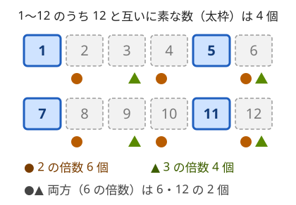

!!! abstract "要点"
    - **何ができるか**：$1$ 以上 $n$ 以下で $n$ と互いに素な整数の個数 $\varphi(n)$ を、素因数分解から $\varphi(n) = n \prod_{p \mid n} (1 - 1/p)$ で求める。オイラーの定理 $a^{\varphi(n)} \equiv 1$ を通じて、位数や指数の mod の計算に使う。
    - **いつ使うか**：
        - $n$ と互いに素な $1..n$ の数の個数や、既約分数の個数を求める。
        - 位数が $d$ になる元の個数を数える。
        - $a^k \equiv 1 \pmod{n}$ となる最小の $k$ を探す。
    - **計算量**：1 個の $\varphi(n)$ は試し割りで $O(\sqrt{n})$。$\varphi(1), \dots, \varphi(N)$ の表は篩で $O(N \log \log N)$（線形篩なら $O(N)$）。
    - **前提**：[素因数分解とルジャンドルの公式](../math/prime-factorization.md)

<!-- textlint-disable -->
別名：トーシェント・totient・Euler's totient function・φ(n)・互いに素な数の個数
<!-- textlint-enable -->

オイラーの φ 関数 $\varphi(n)$ は、$1$ 以上 $n$ 以下の整数のうち $n$ と互いに素なものの個数である。値そのものを問われることは少なく、「$a^{\varphi(n)} \equiv 1$」で累乗の周期の上限を与える道具と、「$\sum_{d \mid n} \varphi(d) = n$」で gcd や位数ごとに数を分ける道具として使う。どちらも $n$ の素因数分解が出発点になる。

このページで使う記法：$p$ は素数を表し、$\prod_{p \mid n}$ は $n$ の異なる素因数すべてについての積、$\sum_{d \mid n}$ は $n$ の正の約数すべてについての和である。$a$ の法 $n$ での位数は、$a^k \equiv 1 \pmod{n}$ となる最小の正の整数 $k$ を指す。ほかの記法は[記法と用語の約束](../start/notation.md)にそろえる。

## 定義と公式 φ(n) = n Π(1 − 1/p)（素因数分解が必要） {#formula}

$\varphi(n)$ は、$1 \le k \le n$ かつ $\gcd(k, n) = 1$ となる $k$ の個数である（[互いに素](../guide/glossary.md#coprime)）。$\gcd(1, 1) = 1$ なので $\varphi(1) = 1$ である。$n = 12$ なら $1, 5, 7, 11$ の 4 個で、$\varphi(12) = 4$ になる。



$k$ が $n$ と互いに素でないのは、$n$ の素因数のどれかで $k$ が割り切れるときである。図のように、$12 = 2^2 \times 3$ なら「2 の倍数」と「3 の倍数」を除けばよい。[包除原理](../comb/inclusion-exclusion.md)で数えると $12 - 6 - 4 + 2 = 4$ になる。一般に、$n$ の異なる素因数を $p_1, \dots, p_r$ とすると、次の公式になる。

$$
\varphi(n) = n \left(1 - \frac{1}{p_1}\right) \left(1 - \frac{1}{p_2}\right) \cdots \left(1 - \frac{1}{p_r}\right)
$$

??? note "包除原理から公式を導く"
    素因数の集合 $S \subseteq \{p_1, \dots, p_r\}$ について、$S$ の素数すべてで割り切れる $1..n$ の数の個数を考える。$\prod_{p \in S} p$ が $n$ の約数なので、個数は割り切れて $n / \prod_{p \in S} p$ になる。包除原理から
    $$
    \varphi(n) = \sum_{S} (-1)^{\lvert S \rvert} \frac{n}{\prod_{p \in S} p} = n \prod_{i=1}^{r} \left(1 - \frac{1}{p_i}\right)
    $$
    となる。右の等号は、積を展開すると各 $p_i$ について「$1$ を取るか $-1/p_i$ を取るか」の選び方が $S$ にあたることから分かる。

公式から、よく使う形がいくつか出る。

- **素数** $p$：$\varphi(p) = p - 1$（$1..p-1$ がすべて互いに素）
- **素数の累乗** $p^e$：$\varphi(p^e) = p^e - p^{e-1} = p^{e-1}(p - 1)$（$p$ の倍数 $p^{e-1}$ 個を除く）
- **乗法的**：$\gcd(a, b) = 1$ なら $\varphi(ab) = \varphi(a)\varphi(b)$。$a$ と $b$ は素因数を共有しないので、公式の積が 2 つに分かれる
- **3 以上なら偶数**：$k$ が互いに素なら $n - k$ もそうなので、$k \ne n - k$ の組に分かれる。$k = n - k$ になるのは $n$ が偶数で $k = n/2$ のときだけで、$n \ge 4$ なら $\gcd(n/2, n) = n/2 \ge 2$ なので互いに素でない。よって組に入らない数はない

公式の指数は使われず、使うのは異なる素因数だけである。それでも素因数を知るには[素因数分解](../math/prime-factorization.md)が要る。1 個の $n$ なら $\sqrt{n}$ までの試し割りで、$O(\sqrt{n})$ である。$n \le 10^{12}$ なら $10^6$ 回で済む。

```cpp
--8<-- "euler-phi/phi.cpp:single"
```

完全なプログラム：[`phi.cpp`](https://github.com/yuukougun/kyopro-atlas/blob/main/snippets/euler-phi/phi.cpp)（GitHub）
{ .kp-code-src }

`res -= res / p` は $\mathrm{res}$ に $(1 - 1/p)$ を掛ける操作で、割り算は割り切れる。$\mathrm{res}$ はその時点で「元の $n$ に、すでに見た素因数 $q$ の $(q-1)/q$ を掛けたもの」である。元の $n$ を、すでに見た素因数 $q$ それぞれで 1 回ずつ割った商はまだ $p$ を約数に持つので、$\mathrm{res}$ も $p$ で割り切れる。`res * (p - 1) / p` と書くと、$n = 10^{18}$ 付近で掛け算が `long long` を超える。

**応用の型**：「$1$ 以上 $N$ 以下の整数の組 $(a, b)$ で $a < b$ かつ互いに素なものの個数」は、$b$ ごとに $\varphi(b)$ 個なので $\sum_{b=2}^{N} \varphi(b)$ である。分母が $N$ 以下で $0$ より大きく $1$ 未満の既約分数の個数も、分母 $b$ の分子が $\varphi(b)$ 個なので同じ値になる。$N$ が大きいので 1 つずつ求められないときは、次の[篩](#sieve)で表を作る。

## 篩で 1..N の φ をすべて求める {#sieve}

$\varphi(1), \dots, \varphi(N)$ を全部使う問題では、1 個ずつ試し割りすると $O(N \sqrt{N})$ かかる。[エラトステネスの篩](../math/sieve-eratosthenes.md)と同じ順で、素数 $p$ ごとにその倍数へ $(1 - 1/p)$ を掛ければ、表がまとめて埋まる。

```cpp
--8<-- "euler-phi/phi.cpp:sieve"
```

完全なプログラム：[`phi.cpp`](https://github.com/yuukougun/kyopro-atlas/blob/main/snippets/euler-phi/phi.cpp)（GitHub）
{ .kp-code-src }

- **初期値**：$\mathrm{phi}[i] = i$ とする。まだ何も掛けていない状態である
- **素数の見分け方**：$p$ を見る時点で $\mathrm{phi}[p] = p$ のままなら、$p$ より小さい素因数を持たないので素数である。合成数なら、自分より小さい素因数の分がすでに掛かっていて $p$ より小さい
- **割り切れる理由**：$p$ の倍数 $m$ を書き換える直前、$\mathrm{phi}[m]$ は $m$ に $p$ 未満の素因数 $q$ の $(q-1)/q$ を掛けた値である。これは $m / \prod q$ に $\prod (q - 1)$ を掛けた整数で、$m / \prod q$ は $p$ の倍数のままなので、$p$ で割り切れる

内側のループは素数 $p$ ごとに $N/p$ 回で、合計は $N \sum_{p \le N} 1/p = O(N \log \log N)$ である。素数判定の篩と違い、内側は $p^2$ からではなく $p$ から始める。$p$ 自身や $2p$ にも $(1 - 1/p)$ を掛ける必要があるからである。

各合成数を 1 回だけ作る[線形篩](../math/spf-sieve.md#linear-sieve)でも、$\varphi$ の表を $O(N)$ で作れる。$N = 10^7$ でも上の篩は 0.2 秒ほどで終わるので、短く書ける方を選べばよい。$N \le 10^7$ なら `int` の配列で 40 MB に収まる。

**応用の型**：「$1 \le i, j \le N$ の組すべての $\gcd(i, j)$ の和」のように、表を作ってから [約数についての和](#divisor-sum)の式に入れる形が多い。$\varphi$ の表はメビウス関数の表と同じ篩の枠組みで作れる（[μ を篩で作る](../comb/mobius-function.md#sieve)）。

## オイラーの定理 a^φ(n) ≡ 1 と、位数・指数の mod への応用 {#euler-theorem}

> **オイラーの定理**：$\gcd(a, n) = 1$ なら $a^{\varphi(n)} \equiv 1 \pmod{n}$ である。

$n$ が素数 $p$ なら $\varphi(p) = p - 1$ で、[フェルマーの小定理](../math/exponent-mod.md#fermat)になる。証明も同じ形である。$n$ と互いに素な余り $r_1, \dots, r_{\varphi(n)}$ に $a$ を掛けた $ar_1, \dots, ar_{\varphi(n)}$ は、どれも $n$ と互いに素で、互いに異なる（$a$ に逆元があるので $ar_i \equiv ar_j$ なら $r_i \equiv r_j$）。よって元の余りの並べ替えで、積を比べると $a^{\varphi(n)} \prod r_i \equiv \prod r_i$ になる。$\prod r_i$ は $n$ と互いに素なので、両辺から消せる。

この定理の使い道は 2 つある。

**位数は $\varphi(n)$ の約数**。$a$ の位数を $k$ とすると、$a^m \equiv 1$ となる $m$ はちょうど $k$ の倍数である（$m$ を $k$ で割った余り $r$ について $a^r \equiv 1$ で、$k$ の最小性から $r = 0$）。オイラーの定理から $m = \varphi(n)$ で成り立つので、$k \mid \varphi(n)$ である。「$a^k \equiv 1$ となる最小の $k$」は、$\varphi(n)$ の約数を小さい順に試せば見つかる。$\varphi(n) \le 10^9$ なら約数は 1344 個以下で、1 つあたり[繰り返し二乗法](../math/mod-pow.md)の $O(\log n)$ で調べられる。素因数を 1 つずつ取り除く速い方法は[位数・原始根・離散対数](../math/multiplicative-order.md)にある。

```text
位数 order(a, n)  ※ gcd(a, n) = 1 を先に確かめる
  t ← φ(n)（n を試し割りして公式で求める）
  t の約数を小さい順に並べ、a^d ≡ 1 (mod n) となる最初の d を返す
```

**指数を小さくする**。$\gcd(a, n) = 1$ なら $a^{e} \equiv a^{e \bmod \varphi(n)}$ である。互いに素でないときは「余り $+ \varphi(n)$」に直す一般化が要る。累乗の塔の扱いを含め、指数の mod は[フェルマーの小定理と指数の mod の一般の法の節](../math/exponent-mod.md#euler-theorem)にまとめてある。

**応用の型**：「同じ数字を $n$ 個並べた数が $K$ の倍数になる最小の $n$」は、$10^n \equiv 1$ の形に直して位数を求める（[練習の ABC222 G](#practice)）。答えがないのは、$10$ と法が互いに素でないときだけである。

## 約数についての φ の和が n になることと、位数が d の元が φ(d) 個あること {#divisor-sum}

$$
\sum_{d \mid n} \varphi(d) = n
$$

$n = 12$ で確かめると、約数 $1, 2, 3, 4, 6, 12$ の $\varphi$ は $1, 1, 2, 2, 2, 4$ で、和は 12 である。

なぜ成り立つかは、分数 $\frac{1}{12}, \frac{2}{12}, \dots, \frac{12}{12}$ を既約分数に直すと分かる。分母は 12 の約数 $d$ のどれかになり、分母が $d$ になるのは分子が $d$ と互いに素な $\frac{c}{d}$（$1 \le c \le d$）である。その個数は $\varphi(d)$ で、12 個の分数が分母ごとに重複なく分かれるので、和は 12 になる。言い換えると、$1..n$ のうち $\gcd(k, n) = n/d$ となる $k$ がちょうど $\varphi(d)$ 個ある。

この式には 2 つの使い道がある。

**gcd を約数の和に分ける**。$g = \gcd(a, b)$ に式を使うと、$\gcd(a, b) = \sum_{d \mid a,\ d \mid b} \varphi(d)$ になる。「$d \mid a$ かつ $d \mid b$」は $a$ と $b$ で別々の条件なので、和の順序を入れ替えられる。たとえば $1 \le i, j \le N$ の組の gcd の総和は

$$
\sum_{i=1}^{N} \sum_{j=1}^{N} \gcd(i, j) = \sum_{d=1}^{N} \varphi(d) \left\lfloor \frac{N}{d} \right\rfloor^2
$$

で、$\varphi$ の表があれば $O(N)$ である。[約数包除](../comb/divisor-inclusion-exclusion.md#gcd-sum)で「gcd がちょうど $g$」の個数を求めてから $g$ を掛ける方法と同じ値になるが、$\varphi$ の形は 1 本の和で済む。[メビウス関数](../comb/mobius-function.md#inversion)で反転すると $\varphi(n) = \sum_{d \mid n} \mu(n/d) \, d$ になる。

**位数ごとに数える**。素数 $p$ を法として、位数が $d$ の元（$1..p-1$ のうち位数がちょうど $d$ のもの）は、$d \mid p - 1$ ならちょうど $\varphi(d)$ 個ある。位数が $p - 1$ の元が原始根なので、原始根は $\varphi(p - 1)$ 個ある。

??? note "証明：位数が d の元は φ(d) 個"
    位数が $d$ の元の個数を $\psi(d)$ とする。

    - **$\psi(d) \le \varphi(d)$**：位数 $d$ の元 $x$ が 1 つでもあれば、$1, x, x^2, \dots, x^{d-1}$ は互いに異なり、どれも $y^d \equiv 1$ を満たす。法が素数なので、$d$ 次式 $y^d - 1$ の根は $d$ 個以下で、根はこの $d$ 個で全部である。このうち位数がちょうど $d$ のものは、指数 $j$ が $\gcd(j, d) = 1$ を満たす $x^j$ で、$\varphi(d)$ 個ある（$x^j$ の位数は $d / \gcd(j, d)$）。位数 $d$ の元がなければ $\psi(d) = 0$ である
    - **等号**：$1..p-1$ の元の位数はどれも $p - 1$ の約数なので、$\sum_{d \mid p-1} \psi(d) = p - 1$ である。一方 $\sum_{d \mid p-1} \varphi(d) = p - 1$ で、各項で $\psi(d) \le \varphi(d)$ だから、すべての $d$ で等号が成り立つ

    $d = p - 1$ で $\psi(p - 1) = \varphi(p - 1) \ge 1$ となり、原始根があることも同時に分かる。「法が素数」は根の個数の上限で使っている。合成数の法では一般に成り立たない。

**応用の型**：「$x^n \equiv y \pmod{P}$ となる組を数える」は、$x$ の位数ごとに分けて $\sum_{d \mid P-1} \varphi(d) \cdot d$ を求める（[例題の ABC212 G](#abc212_g)）。$P - 1$ の約数を素因数分解から作れば、各約数の $\varphi$ も素因数ごとの積として同時に求まる。$n$ 個の玉を円形に並べて $k$ 色で塗る方法を、回転で重なるものを同じとみて数える式 $\frac{1}{n} \sum_{d \mid n} \varphi(d) \, k^{n/d}$ にも $\varphi$ が現れる（[Burnside の補題](../comb/burnside-lemma.md#necklace)）。

## 落とし穴 {#pitfalls}

**どの $n$ にも $\varphi(n) = n - 1$ を使う**。$n - 1$ になるのは $n$ が素数のときだけである。法が $10^9$ や $2^{32}$ のように合成数なら、$\varphi(10^9) = 10^9 \cdot \frac{1}{2} \cdot \frac{4}{5} = 4 \times 10^8$ のように公式で求める。

**素数の累乗で $p^e - 1$ とする**。$\varphi(p^e)$ は $p^e - p^{e-1}$ である。$\varphi(8) = 4$（1・3・5・7）で、$7$ ではない。公式に入れるのは異なる素因数だけで、指数の分は $n$ がすでに持っている。

**互いに素でない $a$ にオイラーの定理を使う**。$a^{\varphi(n)} \equiv 1$ は $\gcd(a, n) = 1$ のときだけ成り立つ。$n = 12$、$a = 2$ では $2^4 = 16 \equiv 4$ である。位数を探す前に $\gcd(a, n) = 1$ を確かめ、互いに素でなければ「$a^k \equiv 1$ となる $k$ はない」と判定する。

**位数を $\varphi(n)$ そのものだと思う**。$a^{\varphi(n)} \equiv 1$ は、位数が $\varphi(n)$ の約数であることしか言わない。$10$ の法 $7$ での位数は $6$ だが、法 $11$ では $\varphi(11) = 10$ に対して位数は $2$ である（$10^2 = 100 \equiv 1$）。最小の $k$ を問われたら約数をすべて調べる。

**公式の計算でオーバーフローする**。`res * (p - 1) / p` は $n \approx 10^{18}$ で掛け算があふれる。先に割る `res / p * (p - 1)` か、`res -= res / p` と書く。$\sum \varphi(d) \cdot d$ のように $\varphi$ と大きな数を掛けるときも、$10^{12}$ どうしの積は `long long` を超えるので、掛ける前に余りを取る。

**篩の内側を $p^2$ から始める**。素数判定の篩の癖で $p^2$ から回すと、$p$ や $2p$ に $(1 - 1/p)$ が掛からない。$\varphi(2) = 2$、$\varphi(6) = 3$ のような誤った値が残る（正しくは 1 と 2）。

## 例題 {#examples}

### ABC212 G. Power Pair {#abc212_g}

<div class="kp-problems" data-role="example" markdown>

- [ABC212 G. Power Pair](https://atcoder.jp/contests/abc212/tasks/abc212_g)（diff 2150）：素数 P について、0 ≤ x, y ≤ P − 1 の組 (x, y) のうち x^n ≡ y (mod P) を満たす正の整数 n があるものの個数を求める（P ≤ 10^12）。

</div>

答えは 998244353 で割った余りを出力する。$x$ を固定すると、$x^n$（$n \ge 1$）が取る値の個数を数えればよい。$x = 0$ なら $y = 0$ の 1 通りである。$x \ne 0$ なら $x^1, x^2, \dots$ は $x$ の位数 $d$ ごとに繰り返すので、ちょうど $d$ 通りの値を取る。[位数ごとに数える](#divisor-sum)と、位数 $d$ の $x$ が $\varphi(d)$ 個あるので、答えは次の式である。

$$
1 + \sum_{d \mid P-1} d \cdot \varphi(d)
$$

??? note "解法の詳細"
    - $P - 1 \le 10^{12}$ を試し割りで素因数分解する。$10^6$ 回で済む
    - 約数を素因数ごとに広げながら作り、各約数の $\varphi$ も同時に作る。約数 $d$ に $p^k$ を掛けるとき、$p$ は $d$ の素因数でないので $\varphi(d \cdot p^k) = \varphi(d) \cdot (p^k - p^{k-1})$ である
    - $10^{12}$ 以下の数の約数は 6720 個以下なので、約数を作る部分は軽い。全体で $O(\sqrt{P})$ である
    - $d$ と $\varphi(d)$ はどちらも $10^{12}$ に届くので、それぞれ余りを取ってから掛ける
    - $x = 0$ の組 $(0, 0)$ を足し忘れない。$P = 2$ なら $(0, 0)$ と $(1, 1)$ の 2 組で、式は $1 + 1 \cdot \varphi(1) = 2$ になる

    ```cpp
    --8<-- "euler-phi/power-pair.cpp:core"
    ```

    完全なプログラム：[`power-pair.cpp`](https://github.com/yuukougun/kyopro-atlas/blob/main/snippets/euler-phi/power-pair.cpp)（GitHub）
    { .kp-code-src }

    約数ごとに $\varphi(d)$ を試し割りで求めても間に合うと、drken 氏の解説にある。その場合は $O(D \sqrt{P})$（$D$ は約数の個数）である。試し割りは素因数を取り除くたびに上限 $\sqrt{n}$ が下がるので、小さい素因数ばかりの約数ではすぐ終わり、見積もりより速い。

## 練習問題 {#practice}

<div class="kp-problems" data-role="practice" markdown>

- [ABC186 E. Throne](https://atcoder.jp/contests/abc186/tasks/abc186_e)（diff 1461）：N 個の椅子が円形に並び、玉座から S 個先にいる人が 1 手で K 個ずつ進むとき、玉座に着くまでの手数の最小を求める（着けなければ −1）。
- [ABC162 E. Sum of gcd of Tuples (Hard)](https://atcoder.jp/contests/abc162/tasks/abc162_e)（diff 1662）：1 以上 K 以下の整数からなる長さ N の数列すべてについて全体の gcd を求め、その総和を 10^9+7 で割った余りで求める。
- [ARC185 E. Adjacent GCD](https://atcoder.jp/contests/arc185/tasks/arc185_e)（diff 2185）：数列の長さ M の接頭辞それぞれについて、空でない部分列すべての「隣り合う 2 要素の gcd の和」を合計した値を 998244353 で割った余りで求める。
- [ABC222 G. 222](https://atcoder.jp/contests/abc222/tasks/abc222_g)（diff 2242）：2 を n 個並べた整数が K の倍数になる最小の n を求める（なければ −1、K ≤ 10^8）。

</div>

??? note "練習の方針"
    - **ABC186 E**：$Kx \equiv -S \pmod{N}$ を $\gcd$ で割って $K$ と $N$ を互いに素にする。$N$ は素数とは限らないので、$K$ の逆元をオイラーの定理から $K^{\varphi(N) - 1}$ として求め、$\varphi(N)$ は試し割りの $O(\sqrt{N})$ で求める。主な解き方は拡張ユークリッドの互除法で、ここでは $\varphi$ を使う別解として解く。
    - **ABC162 E**：$d$ の倍数だけからなる列は $\lfloor K/d \rfloor^N$ 個ある。$g = \sum_{d \mid g} \varphi(d)$ を各列の gcd に当てはめて和の順を入れ替えると、答えは $\sum_{d=1}^{K} \varphi(d) \lfloor K/d \rfloor^N$ になり、$\varphi$ の表を篩で作れば $O(K \log N)$ である。解説はどれも約数包除で解いていて、$\varphi$ の形はその書き換えである。
    - **ARC185 E**：答えは $f(n+1) = 2 f(n) + \sum_{x < n} 2^x \gcd(A_x, A_n)$ と更新できる。$\gcd(A_x, A_n) = \sum_{d \mid A_x, d \mid A_n} \varphi(d)$ と分け、約数 $d$ ごとに「$d$ の倍数である前の要素の $2^x$ の和」$p(d)$ を持てば、$A_n$ の約数を回して $\sum_{d \mid A_n} \varphi(d) p(d)$ で更新できる。
    - **ABC222 G**：2 を $n$ 個並べた数は $\frac{2}{9}(10^n - 1)$ なので、$K$ が奇数なら $L = 9K$、偶数なら $L = 9K/2$ として、条件は $10^n \equiv 1 \pmod{L}$ になる。$\gcd(10, L) \ne 1$ なら答えはない。互いに素なら、$L$ を試し割りして $\varphi(L)$ を求め、その約数を小さい順に試す（[位数は φ(n) の約数](#euler-theorem)）。$L \le 9 \times 10^8$ なので、$10^n \bmod L$ の途中の積は `long long` に収まる。テストケースは複数あるが、1 つあたり $O(\sqrt{K} \log K)$ ほどで間に合う。

## 確認問題 {#quiz}

??? question "確認問題：φ の値"
    $\varphi(36)$、$\varphi(97)$、$\varphi(1)$ を求めよ。

    ??? success "答え"
        $36 = 2^2 \cdot 3^2$ なので $\varphi(36) = 36 \cdot \frac{1}{2} \cdot \frac{2}{3} = 12$。97 は素数なので $\varphi(97) = 96$。$\gcd(1, 1) = 1$ なので $\varphi(1) = 1$ である。

??? question "確認問題：約数についての和"
    $\sum_{d \mid 10} \varphi(d)$ を計算し、$\frac{1}{10}, \dots, \frac{10}{10}$ を既約分数に直したときの分母ごとの個数と比べよ。

    ??? success "答え"
        約数 $1, 2, 5, 10$ の $\varphi$ は $1, 1, 4, 4$ で、和は 10 である。分母 1 は $\frac{1}{1}$ の 1 個、分母 2 は $\frac{1}{2}$ の 1 個、分母 5 は $\frac{1}{5}, \frac{2}{5}, \frac{3}{5}, \frac{4}{5}$ の 4 個、分母 10 は分子が $1, 3, 7, 9$ の 4 個で、一致する。

??? question "確認問題：位数の候補"
    法 $13$ で、位数が $4$ の元はいくつあるか。原始根はいくつあるか。

    ??? success "答え"
        $4 \mid 12$ なので、位数 4 の元は $\varphi(4) = 2$ 個（$5$ と $8$。$5^2 = 25 \equiv 12$、$5^4 \equiv 1$）。原始根は位数 12 の元で、$\varphi(12) = 4$ 個（$2, 6, 7, 11$）ある。

??? question "確認問題：オイラーの定理が使えない場合"
    $6^k \equiv 1 \pmod{9}$ となる正の $k$ を、$\varphi(9) = 6$ の約数から探してよいか。

    ??? success "答え"
        $\gcd(6, 9) = 3$ なので、オイラーの定理は使えない。$6^k$ はつねに 3 の倍数で、$9$ で割った余りも 3 の倍数（$6^1 \equiv 6$、$k \ge 2$ で $0$）なので、$1$ になる $k$ はない。約数を試しても見つからないが、最初に gcd を確かめれば試すまでもない。

## 使い分け {#comparison}

- 指数が巨大な累乗を求めるだけなら、[フェルマーの小定理と指数の mod](../math/exponent-mod.md)を使う。法が合成数のときに $\varphi$ が要る。
- 位数を速く求める、原始根を見つける、$a^x \equiv b$ を解くなら[位数・原始根・離散対数](../math/multiplicative-order.md)へ進む。
- 「gcd がちょうど $g$」の個数をすべての $g$ について知りたいなら[約数包除](../comb/divisor-inclusion-exclusion.md)、gcd が 1 の条件を和に直して入れ替えるなら[メビウス関数](../comb/mobius-function.md)を使う。gcd の総和だけなら $\varphi$ の式が短い。
- $\sum_{n \le N} \varphi(n)$ を $N = 10^{10}$ 以上で求めるなら、篩の表は作れないので[乗法的関数](../math/multiplicative-function.md#prefix-sums)の手法を使う。

## 参考 {#references}

- [drken「AtCoder 版！マスター・オブ・整数（最大公約数編）」](https://qiita.com/drken/items/0c88a37eec520f82b788)：互いに素の性質と、gcd を素因数の指数で見る考え方
- [drken「フェルマーの小定理の証明と使い方」](https://qiita.com/drken/items/6b4031ccbb2cab7436f3)：余りの並べ替えによる証明の筋道（本文ではオイラーの定理に広げた）
- [drken「エラトステネスの篩の活用法を総特集！ 〜 高速素因数分解・メビウスの反転公式 〜」](https://qiita.com/drken/items/3beb679e54266f20ab63)：篩の計算量が素数の逆数和で決まること
- [drken「AtCoder ABC 212 G - Power Pair (3D, 黄色, 600 点)」](https://drken1215.hatenablog.com/entry/2021/08/01/163600)：例題の問いと、位数ごとに数えて $\sum d \cdot \varphi(d) + 1$ にする方針、約数ごとに試し割りしても間に合う見積もり
- [Kazun「AtCoder Beginner Contest 222 G 問題 222」](https://kazun-kyopro.hatenablog.com/entry/ABC/222/G)：練習の問いと、$10^n \equiv 1 \pmod{L}$ への言い換え、$\varphi(L)$ の約数を試す方針
- [drken「AtCoder ABC 186 E - Throne (1D, 水色, 500 点)」](https://drken1215.hatenablog.com/entry/2020/12/20/015100)：練習 ABC186 E のオイラーの定理で逆元を求める解き方
- [kmjp「AtCoder ABC #162 : E - Sum of gcd of Tuples (Hard)」](https://kmjp.hatenablog.jp/entry/2020/04/12/1000)：練習 ABC162 E の d の倍数の列の数と約数包除
- [maspy「[AtCoder 参加感想] 2020/04/12:ABC 162」](https://maspypy.com/atcoder-参加感想-2020-04-12abc-162)：練習 ABC162 E の約数のゼータ・メビウス変換による書き方
- [kmjp「AtCoder ARC #185 : E - Adjacent GCD」](https://kmjp.hatenablog.jp/entry/2024/10/19/0900)：練習 ARC185 E の φ と d の倍数ごとの 2^i の和による更新
