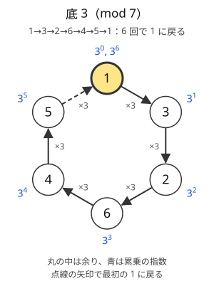
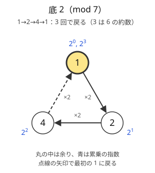

!!! abstract "要点"
    - **何ができるか**：$a^{K^N}$ のように指数が巨大な累乗の mod を、$\gcd(a, p) = 1$ なら指数を $p - 1$ で割った余りに直して求める。一般の法ではオイラーの定理を使い、底が法の倍数になる場合を分ける。
    - **いつ使うか**：
        - $a^{b^c} \bmod p$ のように、指数にさらに指数がある。
        - 累乗の塔を mod で求める。
        - 指数が $10^{18}$ をさらに累乗した大きさになる。
    - **計算量**：素数 $p$ を法とする $a^{b^c} \bmod p$ は、[繰り返し二乗法](../math/mod-pow.md)を 2 回使って $O(\log c + \log p)$。一般の法 $m$ で高さ $k$ の累乗の塔は、$\varphi$ の試し割りを含めて $O(k + \sqrt{m})$。
    - **前提**：[逆元と mod での割り算](../math/mod-inverse.md)

<!-- textlint-disable -->
別名：指数の mod・オイラーの定理・Fermat's little theorem・Euler's theorem・指数を p−1 で割る・累乗の塔・tetration
<!-- textlint-enable -->

フェルマーの小定理は、素数 $p$ と $p$ の倍数でない $a$ について $a^{p-1} \equiv 1 \pmod{p}$ が成り立つという定理である。累乗 $a^0, a^1, a^2, \dots$ の余りは $p - 1$ 回ごとに同じ値に戻るので、巨大な指数は $p - 1$ で割った余りに置き換えてよい。繰り返し二乗法は指数 $n$ が $10^{18}$ 程度までなら $O(\log n)$ で済むが、$K^N$（$K, N \le 10^{18}$）のような指数はそもそも値を持てない。このとき、指数のほうを先に小さくする。

このページで使う記法：素数の法を $p$、一般の法を $m$ と書く。$a \bmod m$ は $0$ 以上 $m$ 未満の余り、$\varphi(m)$ は $1$ 以上 $m$ 以下で $m$ と[互いに素](../guide/glossary.md#coprime)な整数の個数を指す。このページでは $0^0 = 1$ とする（Library Checker の Tetration Mod と同じ約束）。記法全般は[記法と用語の約束](../start/notation.md)にまとめてある。

## フェルマーの小定理と、指数を p − 1 で割ってよい理由（累乗の周期） {#fermat}

指数を小さくできる理由は、累乗の余りが周期的に繰り返すことにある。法 7 で $3^0, 3^1, 3^2, \dots$ の余りを順に書くと、$1, 3, 2, 6, 4, 5, 1, 3, \dots$ となり、6 回で 1 に戻る。1 に戻った後は同じ掛け算を繰り返すだけなので、列は周期 6 で回り続ける。




底 2 では 3 回で戻るが、3 も 6 の約数である。どの底でも $p - 1 = 6$ 回進めれば必ず 1 に戻る、というのがフェルマーの小定理である。

> $p$ が素数で $a$ が $p$ の倍数でないとき、$a^{p-1} \equiv 1 \pmod{p}$ である。

この定理から、$n$ を $p - 1$ で割って $n = q(p - 1) + r$ と書くと、次のように指数が余り $r$ だけになる。

$$
a^n = \left(a^{p-1}\right)^q \cdot a^r \equiv 1^q \cdot a^r = a^r \pmod{p}
$$

つまり、$\gcd(a, p) = 1$ なら $a^n \equiv a^{n \bmod (p-1)} \pmod{p}$ である。たとえば $2^{10} = 1024$ を 7 で割った余りは 2 で、$10 \bmod 6 = 4$ から求めた $2^4 = 16$ の余りも 2 になる。

??? note "証明（並べ替えの考え方）"
    $a$ を $p$ の倍数でないとし、$a, 2a, 3a, \dots, (p-1)a$ の $p$ で割った余りを考える。$ia \equiv ja$（$1 \le i < j \le p - 1$）とすると、$p$ が $(j - i)a$ を割り切る。$p$ は素数で $a$ を割り切らないので $j - i$ を割り切るはずだが、$0 < j - i < p$ なのでありえない。よって $p - 1$ 個の余りはすべて異なり、どれも 0 でもないので、$1, 2, \dots, p - 1$ を並べ替えたものになる。

    すべて掛け合わせると $a^{p-1} \cdot (p-1)! \equiv (p-1)! \pmod{p}$ である。$(p-1)!$ は $p$ の倍数でないので、[逆元](../math/mod-inverse.md)を掛けて両辺から消せる。残るのは $a^{p-1} \equiv 1 \pmod{p}$ である。

実際の周期は $p - 1$ より短いことがある（底 2 なら 3）。最短の周期を[位数](../math/multiplicative-order.md#order)と呼び、それは必ず $p - 1$ の約数である。指数を小さくするだけなら $p - 1$ で割れば十分で、位数を求める必要はない。逆元を $a^{p-2}$ で求める方法も、$a \cdot a^{p-2} = a^{p-1} \equiv 1$ というこの定理の言い換えである。

## 指数の計算は mod (p − 1)（p − 1 は合成数なので割り算はできない） {#exponent-mod-p-1}

$a^{b^c} \bmod p$ は、指数と底を別々の法で計算する。指数 $b^c$ は $p - 1$ で割った余りが分かればよく、それは繰り返し二乗法で $b^c \bmod (p-1)$ として求まる。底のほうは普段どおり $p$ で割る。

```text
a^(b^c) mod p を求める（p は素数）
1. a mod p = 0 なら、底が p の倍数の場合として別に扱う（次の節）
2. e ← b^c mod (p − 1)        ← 法は p − 1
3. 答え ← a^e mod p           ← 法は p
```

$p = 998244353$ なら、手順 2 の法は $998244352$ である。2 つの法を取り違えないことが要点である。次のコードは ACL の `pow_mod` を 2 回呼ぶ。

```cpp
--8<-- "exponent-mod/tower-prime.cpp:core"
```

**指数の計算では割り算ができない**。手順 2 の法 $p - 1$ は、$p \ge 5$ なら偶数の合成数である。たとえば $998244352 = 2^{23} \times 7 \times 17$ なので、2・7・17 の倍数には $\bmod (p - 1)$ での逆元がない。指数が $\binom{n}{2} = n(n-1)/2$ や $\binom{n}{k}$ のように割り算を含む式なら、「2 の逆元を掛ける」は使えない。次のどれかで避ける。

- **割り切れる側を先に割る**：$n(n-1)/2$ なら、$n$ と $n - 1$ のうち偶数のほうを 2 で割ってから $\bmod (p-1)$ で掛ける。`__int128` で積を作ってから割ってもよい（[整数のオーバーフロー](../cpp/cpp-integer-overflow.md)）
- **割り算のない形で数える**：二項係数なら、パスカルの三角形の足し算だけで $\bmod (p-1)$ の表を作る（$O(N^2)$ で済む大きさのとき）
- **法を素因数に分けて戻す**：$p - 1$ を素因数のべきに分け、それぞれで計算して[中国剰余定理](../math/crt.md#applications)でまとめる。手間が大きいので最後の手段である

**指数を modint で計算しない**。`modint998244353` で指数を計算すると、法 $p$ で割った余りになってしまう。指数は `long long` で $\bmod (p-1)$ を取りながら計算し、底の累乗にだけ modint を使う。

??? question "確認問題：3^(10^18) mod 7"
    $3^{10^{18}}$ を 7 で割った余りを求めよ。

    ??? success "答え"
        3 は 7 の倍数でないので、指数を 6 で割った余りに直せる。$10 \equiv 4 \pmod 6$ で、$4^2 = 16 \equiv 4 \pmod 6$ なので $4^k \equiv 4 \pmod 6$（$k \ge 1$）である。よって $10^{18} \equiv 4 \pmod 6$ で、答えは $3^4 = 81 \equiv 4 \pmod 7$ である。指数を 7 で割る誤りをすると $10^{18} \equiv 3^{18} \equiv 1 \pmod 7$ から $3^1 = 3$ になり、合わない。

## 底が p の倍数の場合（答えは 0、指数が 0 なら 1） {#base-multiple}

フェルマーの小定理は「$a$ が $p$ の倍数でない」ことを仮定している。底 $a$ が $p$ の倍数なら $a \equiv 0$ なので、$a^n$ は $n \ge 1$ で 0、$n = 0$ のときだけ 1 になる。周期は「1 に戻る」形をしていないので、指数を $p - 1$ で割ってはいけない。

この場合分けを忘れると、指数 $n$ が $p - 1$ の倍数のときに誤る。たとえば $p = 7$、$a = 7$、$n = 6$ では、正しい答えは $7^6 \equiv 0$ である。しかし $n \bmod 6 = 0$ に直すと $7^0 = 1$ を返してしまう。$a$ が入力で $10^{18}$ まで動く問題では、$a = 998244353$ のような値が入りうる。$a \bmod p = 0$ を最初に調べ、そのときは指数が 0 かどうかだけを見る。

指数が 0 になるかは、指数の式から直接判定する。$b^c$ なら「$b = 0$ かつ $c \ge 1$」のときだけ 0 である（$0^0 = 1$ とする約束なら、$c = 0$ では $b^c = 1$）。$K^N$（$K, N \ge 1$）のように指数が必ず 1 以上なら、底が $p$ の倍数のときの答えは 0 と決まる。

底が $p$ の倍数でなければ、指数を $p - 1$ で割った余り $r$ が 0 になっても問題はない。$a^{p-1} \equiv 1$ なので、$a^0 = 1$ が正しい答えである。

## 一般の法：オイラーの定理と、互いに素でないときの一般化（累乗の塔） {#euler-theorem}

この節は [オイラーの φ 関数](../math/euler-phi.md)と[中国剰余定理](../math/crt.md)を前提にする。法が素数でないときは、$p - 1$ の代わりに $\varphi(m)$ を使う。

> **オイラーの定理**：$\gcd(a, m) = 1$ なら $a^{\varphi(m)} \equiv 1 \pmod{m}$ である。

$m = p$ が素数なら $\varphi(p) = p - 1$ で、フェルマーの小定理になる。証明も同じで、$m$ と互いに素な $\varphi(m)$ 個の余りに $a$ を掛けると並べ替えになることを使う。したがって $\gcd(a, m) = 1$ なら、指数を $\varphi(m)$ で割った余りに直してよい。

$a$ と $m$ が互いに素でないときは、この定理は成り立たない。$m = 12$、$a = 2$ では $\varphi(12) = 4$ だが、$2^4 = 16 \equiv 4 \pmod{12}$ で 1 にならない。それでも、指数がある程度大きければ次の形で小さくできる。

> **一般化**：$n \ge \varphi(m)$ なら、$a$ によらず $a^n \equiv a^{\varphi(m) + (n \bmod \varphi(m))} \pmod{m}$ である。

指数を「$\varphi(m)$ で割った余り」ではなく「余り $+ \varphi(m)$」に直すのが要点である。$2^9 = 512 \equiv 8 \pmod{12}$ を例にとる。$9 \bmod 4 = 1$ に直すと $2^1 = 2$ で合わないが、$4 + 1 = 5$ に直すと $2^5 = 32 \equiv 8$ で合う。

??? note "一般化の証明"
    $m = \prod p_i^{e_i}$ と素因数分解し、各 $p^e$（$p = p_i$、$e = e_i$）を法として 2 つの指数 $n$ と $n' = \varphi(m) + (n \bmod \varphi(m))$ で値が等しいことを示す。両者が等しければ、中国剰余定理から $m$ を法としても等しい。

    - $p$ が $a$ を割り切らないとき：$\gcd(a, p^e) = 1$ なので、オイラーの定理から $a^{\varphi(p^e)} \equiv 1 \pmod{p^e}$ である。$\varphi(m)$ は $\varphi(p^e)$ の倍数で、$n \equiv n' \pmod{\varphi(m)}$ だから、$n \equiv n' \pmod{\varphi(p^e)}$ でもある。よって $a^n \equiv a^{n'} \pmod{p^e}$
    - $p$ が $a$ を割り切るとき：指数が $e$ 以上なら $a^n$ は $p^e$ の倍数で、余りは 0 である。$n \ge \varphi(m)$ かつ $n' \ge \varphi(m)$ で、$\varphi(m) \ge \varphi(p^e) = p^{e-1}(p - 1) \ge 2^{e-1} \ge e$ なので、どちらの指数も $e$ 以上である。よって両方とも 0

    実際には「$n$ が $m$ の素因数の指数の最大値以上」で足りる。その値は $\log_2 m$ 以下なので、「$n \ge \log_2 m$ なら成り立つ」と書かれることも多い。

**累乗の塔**。$a_0^{a_1^{a_2^{\cdots}}} \bmod m$ は、この一般化を上から順に使って求める。$a_0^{E}$（$E$ は上の塔全体）を法 $m$ で求めるには、$E$ を法 $\varphi(m)$ で求めればよい。$E = a_1^{E'}$ を法 $\varphi(m)$ で求めるには、$E'$ を法 $\varphi(\varphi(m))$ で求めればよい。このように法を $\varphi$ に置き換えながら再帰する。

- **止まる理由**：$m \ge 3$ なら $\varphi(m)$ は偶数で、偶数 $m$ では $\varphi(m) \le m/2$ である。よって 2 段ごとに法は半分以下になり、$O(\log m)$ 段で法が 1 になる。法 1 での余りは常に 0 なので、そこで打ち切る。塔がどれだけ高くても、再帰は $O(\log m)$ 段で終わる
- **境目の判定**：一般化は $E \ge \varphi(m)$ のときしか使えない。$E < \varphi(m)$ なら $E$ そのものを指数にする。このため、余りとは別に「塔の本当の値を上限 $2^{31}$ で頭打ちにした値」を下から計算しておき、$\varphi(m)$ との大小を比べる。底が 2 以上なら頭打ちの値は 31 回以内の掛け算で決まる。底が 0 か 1 なら、頭打ちの値は指数が 0 かどうかだけで決まる（底 1 は常に 1、底 0 は指数が 0 なら 1・それ以外は 0）ので、掛け算を回さない

```cpp
--8<-- "exponent-mod/tower-general.cpp:core"
```

$\varphi$ の試し割りは段ごとに $O(\sqrt{m_j})$（$m_j$ はその段の法）かかる。法は 2 段ごとに半分以下になるので、合計は等比級数で抑えられて $O(\sqrt{m})$ である。頭打ちの値の計算が $O(k)$ なので、全体で $O(k + \sqrt{m})$ になる。同じ底を $B$ 段積んだ塔（tetration、$A \uparrow\uparrow B$）なら、$A \uparrow\uparrow 0 = 1$ と定める。$A = 0$ なら $B$ の偶奇で 1 か 0（$0 \uparrow\uparrow 2 = 0^0 = 1$、$0 \uparrow\uparrow 3 = 0^1 = 0$）、$A = 1$ なら 1 と先に分けておく。$A \ge 2$ なら頭打ちの値はすぐに上限に達する。そのため、法が 1 になるまでの段数より数段多い段数を $B_0$ とすると、高さを $\min(B, B_0)$ に縮めても答えは変わらない。塔を配列に展開せず、塔の下（外側）から $O(\log m)$ 段だけを扱えばよい。[Library Checker の Tetration Mod](https://judge.yosupo.jp/problem/tetration_mod) で確かめられる。

## 落とし穴 {#pitfalls}

**指数を $p$ で割る**。最も多い誤りである。$2^{10} \bmod 7$ の指数を 7 で割ると $2^3 = 8 \equiv 1$ となり、正しい答えの 2 と合わない。底は $p$ で、指数は $p - 1$ で割る。指数を modint で計算すると、知らないうちにこの誤りが起きる。

**底が $p$ の倍数の場合を忘れる**。指数を $p - 1$ で割った余りが 0 のとき、$a \equiv 0$ なのに 1 を返してしまう。入力の底が $p$ より大きくなりうるなら、$a \bmod p = 0$ を先に調べる（[底が p の倍数の場合](#base-multiple)）。

**指数の式で逆元を使う**。$p - 1$ は合成数なので、指数の計算で割り算はできない。指数が $n(n-1)/2$ なら割り切れる側を先に割る（[指数の計算は mod (p − 1)](#exponent-mod-p-1)）。

**素数でない法でフェルマーの小定理を使う**。法が $10^9$ や $2^{64}$ のように素数でないなら、指数は $\varphi(m)$ で割る。$\gcd(a, m) \ne 1$ になりうるなら、「余り $+ \varphi(m)$」の一般化を使い、指数が $\varphi(m)$ 未満かどうかを本当の値で判定する（[一般の法](#euler-theorem)）。

**$0^0$ の扱い**。ACL の `pow_mod(0, 0, m)` は（$m \ge 2$ で）1 を返す。指数の余りが 0 になって底も 0 のとき、これが正しいかは問題による。底が 0（法の倍数）の場合を先に分けておけば迷わない。

!!! info "ACL では"
    `atcoder::pow_mod(x, n, m)` は $x^n \bmod m$ を $O(\log n)$ で返す（`#include <atcoder/math>`）。$0 \le n$、$1 \le m$ で、$m$ は `int` に収まること。$x$ は負でも $10^{18}$ でもよい（内部で $\bmod m$ を取る）。$\bmod (p-1)$ の計算にもそのまま使える。modint の `x.pow(n)` も $0 \le n$ の `long long` を指数に取る。

## 使い分け {#comparison}

- 指数が $10^{18}$ 以下の 1 つの整数なら、指数を小さくする必要はなく、[繰り返し二乗法](../math/mod-pow.md)をそのまま使う
- 「$a^n \equiv 1$ となる最小の $n$」や「何回で元に戻るか」を問われたら、$p - 1$ や $\varphi(m)$ の約数を調べて[位数](../math/multiplicative-order.md#find-order)を求める
- $a^{p-1} \equiv 1$ を素数かどうかの判定に使う話は[大きな数の素数判定と素因数分解](../math/miller-rabin.md#miller-rabin)にある

## 例題 {#examples}

### ABC228 E. Integer Sequence Fair {#abc228_e}

<div class="kp-problems" data-role="example" markdown>

- [ABC228 E. Integer Sequence Fair](https://atcoder.jp/contests/abc228/tasks/abc228_e)（diff 1579）：長さ N で各項が 1 以上 K 以下の数列それぞれに 1 以上 M 以下の点数を付ける方法の数（M^(K^N)）を 998244353 で割った余りで求める（N, K, M ≤ 10^18）。

</div>

数列は $K^N$ 通りあり、それぞれに $M$ 通りの点数を付けるので、答えは $M^{K^N}$ である。指数 $K^N$ は値を持てない。そこで、$998244353$ が素数であることを使い、指数を $998244352$ で割った余りに直す。$M$ が $998244353$ の倍数になりうることに注意する。

??? note "解法の詳細"
    - $p = 998244353$ とする。$M \bmod p = 0$ なら、指数 $K^N$ は 1 以上なので答えは 0 である。$M = p$ は制約の範囲内にある。この場合分けがないと、$K^N$ が $p - 1$ の倍数のときに 1 を出力して誤る
    - それ以外では $e = K^N \bmod (p - 1)$ を繰り返し二乗法で求め、$M^e \bmod p$ を出力する。$e = 0$ なら答えは 1 で、これは正しい
    - 計算量は $O(\log N + \log p)$。コードは[指数の計算は mod (p − 1)](#exponent-mod-p-1)の節の関数に $(a, b, c) = (M, K, N)$ を渡せばよい

## 練習問題 {#practice}

<div class="kp-problems" data-role="practice" markdown>

- [ABC212 G. Power Pair](https://atcoder.jp/contests/abc212/tasks/abc212_g)（diff 2150）：素数 P（P ≤ 10^12）について、0 ≤ x, y ≤ P − 1 の組 (x, y) のうち、ある正の整数 n で x^n ≡ y (mod P) となるものの個数を 998244353 で割った余りで求める。
- [ABC222 G. 222](https://atcoder.jp/contests/abc222/tasks/abc222_g)（diff 2242）：2 を n 個並べた整数が K の倍数になる最小の n を求める（なければ −1、K ≤ 10^8）。

</div>

??? note "練習の方針"
    - **ABC212 G**：$x = 0$ は 1 組である。$x \ne 0$ なら到達できる $y$ の個数は $x$ の位数 $d$ で、フェルマーの小定理から $d$ は $P - 1$ の約数である。位数 $d$ の元は $\varphi(d)$ 個あるので、答えは $1 + \sum_{d \mid P-1} d \, \varphi(d)$ になる（$P - 1$ を素因数分解して約数ごとに $\varphi$ を求める）
    - **ABC222 G**：2 を $n$ 個並べた数は $\frac{2}{9}(10^n - 1)$ なので、条件は $10^n \equiv 1 \pmod{L}$（$K$ が奇数なら $L = 9K$、偶数なら $L = 9K/2$）に言い換えられる。$10$ と $L$ が互いに素でなければ答えはない。互いに素なら、オイラーの定理から $n = \varphi(L)$ で必ず成り立つので、最小の $n$ は $\varphi(L)$ の約数の中にある。約数を小さい順に試す（[位数](../math/multiplicative-order.md#find-order)の求め方）

## 確認問題 {#quiz}

??? question "確認問題：底が p の倍数"
    $p = 998244353$ とする。$M = 2p$、$K = 2$、$N = 3$ のとき、$M^{K^N} \bmod p$ はいくつか。「$K^N \bmod (p-1)$ を求めて $M$ をその回数だけ掛ける」方法で計算すると、正しい値になるか。

    ??? success "答え"
        $M \equiv 0 \pmod p$ で、指数 $K^N = 8$ は 1 以上なので、答えは 0 である。この例では $8 \bmod (p-1) = 8$ なので、指数を直す方法でも $0^8 = 0$ となり正しい。誤りが出るのは $K^N$ が $p - 1$ の倍数になるときで、たとえば $K = 998244352$、$N = 1$ なら指数の余りが 0 になって 1 を返す。底が $p$ の倍数の場合を最初に分ければ、どちらも正しく 0 になる。

??? question "確認問題：法が 12 のとき"
    $2^{100} \bmod 12$ を求めよ。指数を $\varphi(12) = 4$ で割った余りに直してよいか。

    ??? success "答え"
        2 と 12 は互いに素でないので、余りに直すだけではいけない（$100 \bmod 4 = 0$ から $2^0 = 1$ とすると誤り）。$100 \ge 4$ なので一般化を使い、指数を $4 + 0 = 4$ に直す。$2^4 = 16 \equiv 4 \pmod{12}$ が答えである。確かめると、$2^n \bmod 12$ は $n \ge 2$ で $4, 8, 4, 8, \dots$ と繰り返し、$n$ が偶数なら 4 である。

## 参考 {#references}

- [drken「フェルマーの小定理の証明と使い方」](https://qiita.com/drken/items/6b4031ccbb2cab7436f3)：並べ替えによる証明の筋道、累乗の周期、逆元・位数へのつながり
- [Kazun「AtCoder Beginner Contest 228 E 問題 Integer Sequence Fair」](https://kazun-kyopro.hatenablog.com/entry/ABC/228/E)：例題の問いと、底が 998244353 の倍数の場合分け
- [kyo-pro「ABC228 E - Integer Sequence Fair」](https://kyo-pro.hatenablog.com/entry/ABC228E)：例題の方針（指数を p − 1 で割る）
- [Kazun「AtCoder Beginner Contest 222 G 問題 222」](https://kazun-kyopro.hatenablog.com/entry/ABC/222/G)：練習の方針（10^n ≡ 1 への言い換えと φ の約数）
- [cp-algorithms「Euler's totient function」](https://cp-algorithms.com/algebra/phi-function.html)：互いに素でないときのオイラーの定理の一般化（式の確認だけ）
- [AtCoder Library「Math」（document_ja）](https://github.com/atcoder/ac-library/blob/master/document_ja/math.md)：`pow_mod` の制約と計算量
- [yosupo06「library-checker-problems: Tetration Mod」](https://github.com/yosupo06/library-checker-problems/blob/master/number_theory/tetration_mod/task.md)：累乗の塔の問題の約束（0^0 = 1）と制約
- [drken「AtCoder ABC 212 G - Power Pair (3D, 黄色, 600 点)」](https://drken1215.hatenablog.com/entry/2021/08/01/163600)：練習 ABC212 G の位数が P − 1 の約数であることと答えの式
