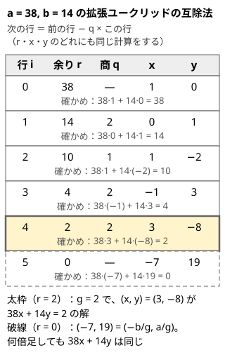

!!! abstract "要点"
    - **何ができるか**：互除法の途中経過から $ax + by = \gcd(a, b)$ の整数解を求める。$ax + by = c$ は $\gcd(a, b) \mid c$ のときだけ解をもち、一次合同式 $ax \equiv b \pmod{m}$ や法が素数でないときの逆元もこれで解く。
    - **いつ使うか**：
        - $ax + by = c$ を満たす整数の組
        - 円周上を $K$ ずつ進んで、何回目で初めて特定の位置に着くか
        - $A$ の倍数を足して、$B$ で割った余りを $C$ にできるか
        - 法 $M$ が素数とは限らない一次方程式 $ax \equiv b \pmod{M}$
        - 法 $M \le 10^9$ が素数とは限らず、$a^{M-2}$ で逆元を作れない
    - **計算量**：$O(\log \min(a, b))$。ループの回数は互除法と同じで、$10^{18}$ 以下の数なら 90 回に満たない。一次合同式 $ax \equiv b \pmod{m}$ は $O(\log m)$
    - **前提**：[GCD・LCM とユークリッドの互除法](../math/gcd-lcm.md)

<!-- textlint-disable -->
別名：拡張 Euclid・extended Euclidean algorithm・extgcd・ベズーの等式・Bézout's identity・ax+by=c・一次不定方程式・linear congruence
<!-- textlint-enable -->

拡張ユークリッドの互除法は、[ユークリッドの互除法](../math/gcd-lcm.md)で $\gcd(a, b)$ を求めるついでに、$ax + by = \gcd(a, b)$ を満たす整数 $x, y$ も求める方法である。これがあれば、一次不定方程式 $ax + by = c$ と一次合同式 $ax \equiv b \pmod{m}$ が解け、法が素数でないときの逆元も作れる。

このページで使う記法：$g = \gcd(a, b)$、$a \mid b$ は「$a$ が $b$ を割り切る」、$x \bmod m$ は $0$ 以上 $m$ 未満の余りを表す（[記法と用語の約束](../start/notation.md)）。

## 互除法の各段で、余りを a と b の整数係数の組み合わせとして持ち続ける {#procedure}

拡張ユークリッドの互除法の核は、互除法に出てくるすべての余りを「$a$ の何倍と $b$ の何倍の和か」という形で持ち続けることである。最後の 0 でない余りは $g$ なので、そのときの係数がそのまま $ax + by = g$ の解になる。

$x, y$ を全探索で探すと、$b$ 通りほど試すことになり、$b$ が $10^9$ を超えると間に合わない。互除法の手順に係数の計算を足すだけなら、回数は互除法と同じで済む。

**保つ性質**：互除法の余りの列を $r_0 = a$、$r_1 = b$、$r_{i+1} = r_{i-1} \bmod r_i$ とする。各 $i$ について、整数 $x_i, y_i$ を次の関係が成り立つように持つ。

$$
r_i = a x_i + b y_i
$$

**手順**：初めは $r_0 = a = a \cdot 1 + b \cdot 0$、$r_1 = b = a \cdot 0 + b \cdot 1$ なので、$(x_0, y_0) = (1, 0)$、$(x_1, y_1) = (0, 1)$ である。商を $q_i = \lfloor r_{i-1} / r_i \rfloor$ とすると、余りは $r_{i+1} = r_{i-1} - q_i r_i$ と書ける。右辺の 2 つの余りはどちらも $a$ と $b$ の組み合わせなので、係数にも同じ計算をすればよい。

$$
x_{i+1} = x_{i-1} - q_i x_i, \qquad y_{i+1} = y_{i-1} - q_i y_i
$$

$r_{i+1} = 0$ になったら止める。そのときの $r_i$ が $g$ で、$(x_i, y_i)$ が答えである。次の図は $a = 38$、$b = 14$ で表を 1 行ずつ埋めた結果である。



表の要点は次の 3 つである。

- どの行でも $38x + 14y$ が余り $r$ に等しい。たとえば $i = 3$ の行は $38 \cdot (-1) + 14 \cdot 3 = -38 + 42 = 4$ である
- 余りが 0 になる直前の行（$r = 2$）が $g = \gcd(38, 14) = 2$ と、その係数 $(3, -8)$ を与える
- 余りが 0 の行の係数 $(-7, 19)$ は $(-b/g, a/g)$ に等しい。この組を何倍かして足しても $38x + 14y$ は変わらない（[一般解](#general-solution)の理由）

実装では、表の直前の 2 行だけを持てばよい。次のコードは $a, b \ge 0$ を受け取り、$\{g, x, y\}$ を返す。

```cpp
--8<-- "ext-gcd/ext-gcd.cpp:core"
```

再帰で書く形もよく見かける。$\gcd(b, a \bmod b)$ の解 $(x', y')$ から、$a \bmod b = a - \lfloor a/b \rfloor b$ を代入して $(x, y) = (y', x' - \lfloor a/b \rfloor y')$ と戻す。中身は表を下から読み返すのと同じで、どちらで書いてもよい。

**計算量**：ループの回数は互除法と同じで $O(\log \min(a, b))$ である。互除法が最も遅いのは隣り合うフィボナッチ数を入れたときで、$10^{18}$ 以下の数なら 90 回に満たない（[GCD・LCM とユークリッドの互除法](../math/gcd-lcm.md)）。

??? question "確認問題：3x + 5y = 1 の解"
    $3x + 5y = 1$ を満たす整数の組を 1 つ求めよ。

    ??? success "答え"
        表を作ると、余りは $3, 5, 3, 2, 1, 0$ と進む（最初の商は $\lfloor 3/5 \rfloor = 0$ で、$a$ と $b$ が入れ替わるだけ）。余りが 1 の行の係数は $(x, y) = (2, -1)$ で、$3 \cdot 2 + 5 \cdot (-1) = 1$ である。$(2 + 5k, -1 - 3k)$ もすべて解になる。

## ax + by = c の解の存在条件と一般解 x = x0 + k·b/g {#general-solution}

一次不定方程式 $ax + by = c$（$a, b$ は 0 でない整数）が整数解をもつのは、$g = \gcd(a, b)$ が $c$ を割り切るときだけである。解があれば、無数にある解をまとめて 1 つの式で書ける。

**存在条件の理由**：$a$ も $b$ も $g$ の倍数なので、$ax + by$ はどんな整数 $x, y$ でも $g$ の倍数になる。だから $g \nmid c$ なら解はない。逆に $g \mid c$ なら、$ax_0 + by_0 = g$ の解を $c/g$ 倍した $(x_0 \cdot c/g, \ y_0 \cdot c/g)$ が解になる。

**一般解**：1 つの解 $(x_1, y_1)$ が分かれば、解は次の形ですべて表せる（$k$ は任意の整数）。

$$
x = x_1 + k \cdot \frac{b}{g}, \qquad y = y_1 - k \cdot \frac{a}{g}
$$

この形が解になることは、代入すると $a \cdot kb/g - b \cdot ka/g = 0$ で打ち消し合うことから分かる。

??? note "証明（ほかに解がないこと）"
    $(x, y)$ も解とすると、$a(x - x_1) = -b(y - y_1)$ である。両辺を $g$ で割ると $(a/g)(x - x_1) = -(b/g)(y - y_1)$ になる。$a/g$ と $b/g$ は[互いに素](../guide/glossary.md#coprime)なので、$b/g$ は $x - x_1$ を割り切る。$x - x_1 = k \cdot b/g$ とおくと、元の式から $y - y_1 = -k \cdot a/g$ が出る。

解の $x$ は $b/g$ ごとに並ぶので、$x$ を $b/g$ で割った余りは解によらず 1 つに決まる。この性質から、[最小の非負解](#min-solution)が 1 回の余りの計算で求まる。

$a$ や $b$ が負のときは、絶対値で解いてから符号を戻す。たとえば $ax - by = c$（$a, b > 0$）は、$ax + by' = c$ を解いて $y = -y'$ とすればよい。

??? question "確認問題：解があるか"
    $6x + 10y = 7$ と $6x + 10y = 8$ は、それぞれ整数解をもつか。

    ??? success "答え"
        $\gcd(6, 10) = 2$ である。$6x + 10y$ は常に偶数なので、$6x + 10y = 7$ には解がない。$2 \mid 8$ なので $6x + 10y = 8$ には解があり、たとえば $6 \cdot 3 + 10 \cdot (-1) = 8$ である。

## 最小の非負解への調整と、係数のあふれの見積もり {#min-solution}

問題が求めるのは「最小の非負の $x$」「$x$ も $y$ も 0 以上の解」であることが多い。拡張ユークリッドが返す $x$ は負になりうるので、[一般解](#general-solution)の周期 $b/g$ で調整する。

**最小の非負の $x$**：$x$ は $b/g$ ごとに並ぶので、$x$ を $b/g$ で割った非負の余りが最小の非負解である。$c$ を右辺とする解は次の順で作る（$a, b > 0$、$c \ge 0$ とする。$c$ が負なら、手順 3 の余りも `(… % L + L) % L` で非負に直す）。

1. $ax_0 + by_0 = g$ を解き、$g \nmid c$ なら解なしとする
2. $L = b/g$ とし、$x_0$ を先に $[0, L)$ へ直す：`(x0 % L + L) % L`
3. $x = x_0 \cdot (c/g) \bmod L$ とする。積は `__int128` で計算する
4. $y = (c - ax)/b$ とする

**$x$ も $y$ も 0 以上**（$a, b, c > 0$）：$x$ を最小の非負解にすると、$y$ はそのとき最大になる。$x$ を $L$ 増やすたびに $y$ は $a/g$ ずつ減るからである。だから手順 4 の $y$ が負なら、両方が 0 以上の解はない。0 以上なら、そのような解は $\lfloor y / (a/g) \rfloor + 1$ 個ある。

**係数のあふれ**：$a, b \ge 1$ なら、[処理の流れ](#procedure)のコードが返す係数は $\lvert x \rvert \le b/g$、$\lvert y \rvert \le a/g$ を満たす。係数は 1 行ごとに符号が入れ替わるので、$\lvert x_{i+1} \rvert = \lvert x_{i-1} \rvert + q_i \lvert x_i \rvert$ となり、$i = 1$ の行からは絶対値が増え続ける。そして最後の行（余りが 0、図の破線）でちょうど $(b/g, a/g)$ になる。途中の係数はそれ以下なので、$a, b$ が `long long` に収まれば互除法の中ではあふれない。あふれるのはその後の計算である。

- **$c/g$ 倍するとき**：$\lvert x_0 \rvert$ は $b$ 程度、$c/g$ は $c$ 程度なので、積は $10^{18} \times 10^{18}$ に届きうる。手順 2 で先に $L$ 未満へ直し、積は `__int128` で取る
- **$ax + by$ を検算するとき**：$a \cdot x$ は $ab/g$ 程度になる。$a, b$ が $10^9$ を超えると `long long` を超えうるので、検算も `__int128` で行う
- **手順 4 の $c - ax$**：$ax < a \cdot L$ なので $ab/g$ 程度になりうる。同じく `__int128` を使う

$a, b, c \le 10^9$ なら、どの積も $10^{18}$ 程度に収まり `long long` で足りる。どの積が最大でいくつになるかを、書く前に見積もるとよい（[整数のオーバーフロー](../cpp/cpp-integer-overflow.md)）。

??? question "確認問題：負の余り"
    最小の非負解を `x0 % L` と書いた。何が起きるか。

    ??? success "答え"
        C++ の `%` は割られる数の符号を残すので、$x_0 < 0$ なら負の値が返り、非負解にならない。たとえば $38x + 14y = 2$ の $x_0 = 3$ は正だが、$14x + 38y = 2$ の $x_0 = -8$ では、$L = 38/2 = 19$ として `-8 % 19` が `-8` になる。`(x0 % L + L) % L` と書けば $11$ になる（[整数の割り算と余り](../math/integer-division.md)）。

## 一次合同式 ax ≡ b (mod m) と、gcd で割ること {#linear-congruence}

一次合同式 $ax \equiv b \pmod{m}$ は、一次不定方程式 $ax + my = b$ と同じである（この節の $b$ は右辺の数で、前の節の $b$ とは別）。だから $g = \gcd(a, m)$ について、解をもつのは $g \mid b$ のときだけである。

**解の個数と周期**：解があれば、両辺と法を $g$ で割った次の式に直せる。

$$
\frac{a}{g} x \equiv \frac{b}{g} \pmod{\frac{m}{g}}
$$

$a/g$ と $m/g$ は互いに素なので、$a/g$ には法 $m/g$ での[逆元](../math/mod-inverse.md)があり、解は法 $m/g$ でただ 1 つに決まる。その解を $0 \le x^* < m/g$ とすると、法 $m$ で見た解は $x^*, x^* + m/g, \dots, x^* + (g - 1) m/g$ の $g$ 個になる。

**手順**：拡張ユークリッドで $ax_0 + my_0 = g$ を解けば、$x_0$ がそのまま $a/g$ の法 $m/g$ での逆元になる（両辺を $g$ で割ると $(a/g) x_0 + (m/g) y_0 = 1$）。あとは $x^* = x_0 \cdot (b/g) \bmod (m/g)$ である。

```cpp
--8<-- "ext-gcd/linear-congruence.cpp:core"
```

**gcd で割ることを忘れない**：$g > 1$ のとき、$a$ は法 $m$ で逆元をもたない。「両辺に $a$ の逆元を掛ける」は使えず、`inv_mod(a, m)` は止まる。両辺だけでなく法も $g$ で割る必要がある。法を割り忘れて $(a/g) x \equiv b/g \pmod{m}$ を解くと、間違え方は 2 通りある。$a/g$ と $m$ が互いに素でなければ、解があるのに「解なし」と判定してしまう。互いに素でも、解の周期を $m$ と取り違えて最小の解を逃す。たとえば $6x \equiv 3 \pmod{9}$ の最小の解は 2 だが、$2x \equiv 1 \pmod{9}$ を解くと 5 が返る。

$a = 0$ でも手順はそのまま動く。$\gcd(0, m) = m$ なので、$b \equiv 0$ なら周期 1（どの $x$ でも解）、そうでなければ解なしになる。

??? question "確認問題：6x ≡ 4 (mod 10)"
    $6x \equiv 4 \pmod{10}$ の解は、$0 \le x < 10$ にいくつあるか。$6x \equiv 3 \pmod{10}$ ではどうか。

    ??? success "答え"
        $\gcd(6, 10) = 2$ で $2 \mid 4$ なので、$3x \equiv 2 \pmod{5}$ に直せる。$3$ の法 5 での逆元は $2$ なので $x \equiv 4 \pmod{5}$、すなわち $x = 4, 9$ の 2 個である。$6x \equiv 3$ は $2 \nmid 3$ なので解がない（$6x$ を 10 で割った余りは常に偶数）。

## 応用の型（円周の移動・倍数の余り・面積 1 の格子点・CRT） {#applications}

拡張ユークリッドを使う問題は、問題文の上では方程式に見えないことが多い。立式して $ax + by = c$ か $ax \equiv b \pmod{m}$ の形になれば、このページの手順で解ける。

- **円周上を $K$ ずつ進む**（サイン：「何回目で初めて着くか」「着けないなら −1」）：$N$ 個の位置が円に並び、今の位置を $S$、目標の位置を $T$ とする。$K$ ずつ進むとき、$x$ 回後の位置は $(S + Kx) \bmod N$ である。目標に着く最小の回数は、一次合同式 $Kx \equiv T - S \pmod{N}$ の最小の非負解になる。$N$ は素数とは限らないので、$\gcd(K, N)$ で割ってから解く（[例題](#abc186_e)）
- **倍数の余り**（サイン：「$A$ の倍数を足して、$B$ で割った余りを $C$ にできるか」）：$A$ の倍数の和は $A$ の倍数なので、$Ax \equiv C \pmod{B}$ に解があるかの判定になる。答えは $\gcd(A, B) \mid C$ かどうかで決まり、解そのものは要らない
- **面積が 1 の三角形の格子点**（サイン：「原点と点 $(X, Y)$ と格子点 $(A, B)$ で、面積がちょうど $S$ の三角形」）：3 点が作る三角形の面積は[外積](../geometry/geometry-vectors.md)で $\lvert AY - BX \rvert / 2$ なので、$AY - BX = \pm 2S$ という一次不定方程式になる。$\gcd(X, Y)$ が $2S$ を割り切るときだけ解がある。出力の範囲に制限があれば、一般解の $k$ で動かして収める
- **中国剰余定理**：$x \equiv r_1 \pmod{m_1}$ と $x \equiv r_2 \pmod{m_2}$ を同時に満たす $x$ は、$x = r_1 + m_1 t$ と置くと $m_1 t \equiv r_2 - r_1 \pmod{m_2}$ という一次合同式になる。式が増えても 2 つずつ合わせればよい（[中国剰余定理](../math/crt.md)）
- **法が素数でないときの逆元**：$\gcd(a, m) = 1$ なら、$ax + my = 1$ の $x$ が $a$ の逆元である。フェルマーの小定理の $a^{m-2}$ は $m$ が素数のときしか使えない（[逆元](../math/mod-inverse.md)）

## 落とし穴 {#pitfalls}

**gcd で割らずに逆元を取る**。一次合同式で $\gcd(a, m) > 1$ なのに $a$ の逆元を求めようとすると、ACL の `inv_mod` は assert で止まり、自作の関数なら意味のない値が返る。解の存在を $g \mid b$ で判定し、両辺と法を $g$ で割ってから解く（[一次合同式](#linear-congruence)）。

**負の余り**。C++ の `%` は負の数に負の余りを返す。拡張ユークリッドの係数は負になることが多いので、周期で直すときは `(x % L + L) % L` と書く。$Kx \equiv -S$ の右辺も、先に $N - S$ のような非負の数にしておく。

**積のあふれ**。互除法そのものはあふれないが、係数を $c/g$ 倍する、$ax + by$ で検算するといった後の計算は、$a, b, c$ が $10^9$ を超えるとあふれうる。先に周期で割った余りにしてから掛け、積は `__int128` で取る（[係数のあふれの見積もり](#min-solution)）。

**0 回を許すかどうか**。最小の非負解は 0 になりうる。「1 回以上」「1 個以上選ぶ」と問われているなら、0 のときは周期 $m/g$ を足した値が最小の正の解である。円周の問題で今の位置がもう目標なら、答えが 0 なのか 1 周分なのかを問題文で確かめる。

**入力に 0 や負の数が来る**。$\gcd(0, 0) = 0$ で割ると実行時エラーになる。$a = 0$ や $b = 0$ が来うるなら、手順の前に場合を分ける。負の係数は絶対値で解いてから符号を戻す。

**フェルマーの小定理を法が素数でないときに使う**。$a^{m-2}$ が逆元になるのは $m$ が素数のときだけである。法が $10^9$ 程度の任意の数なら、拡張ユークリッドか `inv_mod` を使う。

## ACL では（inv_mod の内部の inv_gcd。拡張ユークリッドそのものは公開 API にない） {#acl}

ACL に拡張ユークリッドの公開の関数はない。逆元と中国剰余定理の関数が、内部で同じ計算を使う。

!!! info "ACL では"
    `long long y = atcoder::inv_mod(x, m);`。$xy \equiv 1 \pmod{m}$ となる $0 \le y < m$ を $O(\log m)$ で返す。要件は $\gcd(x, m) = 1$ と $1 \le m$ で、互いに素でなければ assert で止まる。中身は `atcoder::internal::inv_gcd(a, b)` で、$\{g, x\}$（$ax \equiv g \pmod{b}$、$0 \le x < b/g$）を返す。`internal` の関数はドキュメントにない内部の実装なので、使うなら版の違いに注意する。

ACL の `crt(r, m)` も中で `inv_gcd` を使い、法が互いに素でなくても解を返す（[中国剰余定理](../math/crt.md)）。一次合同式 $ax \equiv b \pmod{m}$ を ACL だけで解くなら、$g = \gcd(a, m)$ で割ってから `inv_mod(a / g, m / g)` を掛ける。法 $m$ が実行時に決まるなら、`atcoder::modint` の `set_mod` と `inv()` も使える。ただし `inv()` も互いに素であることが要件である。

## 例題 {#examples}

### ABC186 E. Throne {#abc186_e}

<div class="kp-problems" data-role="example" markdown>

- [ABC186 E. Throne](https://atcoder.jp/contests/abc186/tasks/abc186_e)（diff 1461）：N 個の椅子が円形に並び、玉座から S 個先の椅子にいる人が 1 回に K 個ずつ進むとき、玉座に着くまでの最小の回数を求める（着けないなら −1）。

</div>

$x$ 回進んだ後の位置は玉座から $S + Kx$ 個先なので、玉座に着くのは $S + Kx \equiv 0 \pmod{N}$ のときである。これは一次合同式 $Kx \equiv N - S \pmod{N}$ で、答えはその最小の非負解になる。$N$ は $10^9$ までの任意の数で素数とは限らないので、$g = \gcd(K, N)$ で割ってから拡張ユークリッドで逆元を求める。

??? note "解法の詳細"
    - $g = \gcd(K, N)$ とする。$g \nmid S$ なら $-1$ を出力する（$Kx$ と $N$ はどちらも $g$ の倍数なので、$S + Kx$ は $N$ の倍数になりえない）
    - $g \mid S$ なら、$K' = K/g$、$N' = N/g$、$S' = S/g$ として $K' x \equiv N' - S' \pmod{N'}$ を解く。$K'$ と $N'$ は互いに素なので、拡張ユークリッドで $K'$ の逆元を求めて掛ける。[一次合同式](#linear-congruence)のコードに $(K, N - S, N)$ を渡すのと同じである
    - $1 \le S < N$ なので $x = 0$ は解にならず、最小の非負解がそのまま最小の回数である
    - $K, N \le 10^9$ なので、積は `long long` に収まる。テストケースごとに $O(\log N)$ で求まる
    - 法が素数でないので、$K^{N-2}$ による逆元は使えない。$K$ が $N$ 以上のこともあるので、先に $K \bmod N$ を取っておくとよい

## 練習問題 {#practice}

<div class="kp-problems" data-role="practice" markdown>

- [ABC060 B. Choose Integers](https://atcoder.jp/contests/abc060/tasks/abc060_b)（diff 503）：A の倍数をいくつか（1 つ以上）選んだ和を B で割った余りを C にできるかを判定する。

</div>

??? note "練習の方針"
    - **ABC060 B**：$A$ の倍数の和は $A$ の倍数なので、$Ax \equiv C \pmod{B}$ に $x \ge 1$ の解があるかを問う。解があるのは $\gcd(A, B) \mid C$ のときだけである。$x = 0$ が解でも $x = B/g$ も解なので、「1 つ以上」の条件は答えを変えない。制約が小さいので $x = 1, \dots, B$ の全探索でもよい

## 使い分け {#comparison}

- **逆元**：法が素数ならフェルマーの小定理の $a^{p-2}$ か `modint` の `inv()` で足りる。法が素数とは限らないなら、拡張ユークリッドか `inv_mod` を使う。どちらも $O(\log m)$ である（[逆元](../math/mod-inverse.md)）
- **一次合同式**：$\gcd(a, m) = 1$ なら逆元を掛けるだけで済む。$\gcd(a, m) > 1$ なら、このページの手順で $g$ で割ってから解く
- **周期の違う条件を同時に満たす**：合同式が 2 つ以上なら[中国剰余定理](../math/crt.md)を使う。中身は 2 つずつの一次合同式である
- **小さい範囲の全探索**：法 $m$ が $10^6$ 程度までなら、$x = 0, 1, \dots, m - 1$ を全部試しても間に合う。$Kx \bmod m$ は周期 $m$ でくり返すので、$m$ 回で解の有無まで分かる

## 参考 {#references}

- [drken「拡張ユークリッドの互除法 〜 一次不定方程式 ax + by = c の解き方 〜」](https://qiita.com/drken/items/b97ff231e43bce50199a)：解の存在条件と一般解、互除法の回数の見積もり
- [drken「AtCoder 版！マスター・オブ・整数（最大公約数編）」](https://qiita.com/drken/items/0c88a37eec520f82b788)：互除法の原理と、互いに素の性質
- [drken「「998244353 で割ったあまり」の求め方を総特集！ 〜 逆元から離散対数まで 〜」](https://qiita.com/drken/items/3b4fdf0a78e7a138cd9a)：逆元が存在する条件と、C++ の `%` が負を返す問題
- [drken「AtCoder ABC 186 E - Throne (1D, 水色, 500 点)」](https://drken1215.hatenablog.com/entry/2020/12/20/015100)：例題の立式と、gcd で割ってから逆元を求める方針
- [drken「AtCoder ABC 060 B - Choose Integers (4Q, 茶色, 200 点)」](https://drken1215.hatenablog.com/entry/2024/10/18/025758)：練習の方針（gcd で決まることと全探索）
- [AtCoder Library のドキュメント（math）](https://github.com/atcoder/ac-library/blob/master/document_ja/math.md)：`inv_mod`・`crt` の要件と計算量
- [AtCoder Library のソース（internal_math.hpp）](https://github.com/atcoder/ac-library/blob/master/atcoder/internal_math.hpp)：`inv_gcd` が返す値の範囲と係数の上界
