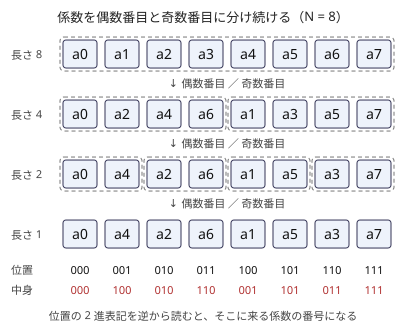

!!! abstract "要点"
    - **何ができるか**：畳み込みを自作するときや任意 mod で求めるときに、多項式を 1 の $N$ 乗根での値に変えて各点の積にし、その変換を分割統治で $O(N \log N)$ で行う。任意 mod は NTT に向く 3 つの素数で計算して CRT で戻す。
    - **いつ使うか**：
        - mod $10^9+7$ や整数のままで畳み込みたい
        - 畳み込みを自作ライブラリで実装したい・浮動小数の FFT の誤差が心配
    - **計算量**：長さ $L$（2 の冪）の変換は $O(L \log L)$。長さ $N$ と $M$ の畳み込みは、$L$ を $N + M - 1$ 以上の 2 の冪として $O(L \log L)$。任意 mod・整数のままの畳み込み（3 つの素数）はその約 3 倍
    - **前提**：[畳み込みの使い方](../math/convolution-ntt.md)

<!-- textlint-disable -->
別名：FFT・NTT・高速フーリエ変換・fast Fourier transform・数論変換・number theoretic transform・任意 mod 畳み込み・3 素数 NTT
<!-- textlint-enable -->

FFT（高速フーリエ変換）は、多項式の係数の列を「1 の $N$ 乗根での値の列」に $O(N \log N)$ で変える方法である。値の列どうしなら積は各点の掛け算で済むので、変換・各点の積・逆変換で畳み込みが求まる。複素数の代わりに素数 $p$ で割った余りの世界で同じことをするのが NTT（数論変換）で、ACL の `convolution` はこれである。

ABC では ACL の `convolution` を呼べば足り、仕組みが要る問題は見つかっていない。仕組みが要るのは、畳み込みを自作するとき、mod $10^9 + 7$ や整数のままで畳み込むとき、[形式的冪級数](../math/fps-basics.md#operations)の演算を作るときである。証明と高速な実装は[学ぶための資料](#resources)に任せ、ここでは「なぜ速いか」の筋と、自作するときの要点をまとめる。

このページで使う記法：列と多項式は 0-indexed で、$a = (a_0, \dots, a_{N-1})$ を多項式 $a(x) = \sum_i a_i x^i$ と同一視する。畳み込む入力の列の長さを $N$・$M$、変換の長さ（2 の冪）を $L$ とする。ただし、変換だけを扱う冒頭と[バタフライの節](#butterfly)・[NTT に向く素数の節](#ntt-prime)では、変換の長さ（2 の冪）を $N$ と書く（[記法と用語の約束](../start/notation.md)）。

## 点での値に直すと掛け算が O(N)（多項式の値表現） {#point-value}

次数 $d$ 以下の多項式は、異なる $d + 1$ 点での値で 1 つに決まる。そこで係数の列の代わりに、決めた点 $x_0, \dots, x_{L-1}$ での値の列 $(a(x_0), \dots, a(x_{L-1}))$ で多項式を持ってもよい。これを値表現と呼ぶ。

値表現の利点は、積が各点の掛け算になることである。$c(x) = a(x) b(x)$ なら $c(x_j) = a(x_j) \, b(x_j)$ なので、$O(L)$ で求まる。$a$ の長さが $N$、$b$ の長さが $M$ なら $c$ の次数は $N + M - 2$ なので、$L \ge N + M - 1$ 点を取れば $c$ が 1 つに決まる。

畳み込みは、次の手順で求める。

```text
1. a と b を長さ L（N + M - 1 以上の 2 の冪）まで 0 で埋める
2. 変換：係数の列 → 点 x_0, ..., x_{L-1} での値の列（a と b のそれぞれ）
3. 各点で値を掛ける：C_j = A_j × B_j
4. 逆変換：値の列 C → 係数の列 c。先頭の N + M - 1 項が答え
```

点を勝手に選ぶと、変換（各点で多項式の値を求める）も逆変換（値から係数を求める補間）も素朴には 1 点ずつ求めることになり $O(L^2)$ かかり、素朴な畳み込みと変わらない。点を **1 の $L$ 乗根** の冪 $\omega^0, \omega^1, \dots, \omega^{L-1}$ に選ぶと、どちらも $O(L \log L)$ になる。ここで $\omega$ は「$L$ 乗して初めて 1 になる数」（1 の原始 $L$ 乗根）である。

## 1 の N 乗根と分割統治（バタフライ） {#butterfly}

変換は、多項式 $a(x)$（長さ $N$）の値 $a(\omega^0), a(\omega^1), \dots, a(\omega^{N-1})$ をすべて求めることである。$\omega$ は 1 の原始 $N$ 乗根とする。係数を偶数番目と奇数番目に分けて、次の 2 つの多項式（長さ $N/2$）を作る。

$$
\begin{aligned}
a_{\text{even}}(y) &= a_0 + a_2 y + a_4 y^2 + \cdots, \\
a_{\text{odd}}(y) &= a_1 + a_3 y + a_5 y^2 + \cdots
\end{aligned}
$$

すると $a(x) = a_{\text{even}}(x^2) + x \, a_{\text{odd}}(x^2)$ が成り立つ。$x = \omega^k$ を入れると次の式になる。

$$
a(\omega^k) = a_{\text{even}}(\omega^{2k}) + \omega^k \, a_{\text{odd}}(\omega^{2k})
$$

速くなる理由は 2 つある。

- $\omega^2$ は 1 の原始 $N/2$ 乗根なので、$\omega^{2k}$（$k = 0, \dots, N-1$）は $N/2$ 個の値を 2 周するだけである。$a_{\text{even}}$ と $a_{\text{odd}}$ の値は、長さ $N/2$ の同じ問題を解けば求まる。
- $\omega^{N/2} = -1$ なので $\omega^{k + N/2} = -\omega^k$ である。偶の値を $u$、奇の値を $v$ とすると、$a(\omega^k) = u + \omega^k v$ と $a(\omega^{k+N/2}) = u - \omega^k v$ が 1 回の掛け算で同時に求まる。この 2 入力 2 出力の計算を **バタフライ** と呼ぶ。

長さ $N$ の問題が長さ $N/2$ の問題 2 つと $O(N)$ の合成になるので、$T(N) = 2T(N/2) + O(N)$ から $O(N \log N)$ である（[分割統治](../basics/divide-and-conquer.md)）。

**逆変換**は、$\omega$ の代わりに $\omega^{-1}$ で同じ変換をして、最後に $N$ で割ればよい。$\sum_{j=0}^{N-1} \omega^{jk}$ は $k$ が $N$ の倍数なら $N$、それ以外なら $0$ になる（公比 $\omega^k \ne 1$ の等比数列の和で、$\omega^{kN} = 1$ だから）。この性質から、値の列に $\omega^{-1}$ の変換を施すと、元の係数の $N$ 倍が戻る。

**再帰を使わない書き方**。偶奇に分ける操作を繰り返すと、係数は次のように並ぶ。位置の番号を 2 進表記で逆から読んだ番号の係数が、その位置に来る（ビット反転の順）。



そこで、最初に係数をビット反転の順に並べ替え、長さ 2・4・8・… の順に隣り合う 2 つのブロックをバタフライで合成する。配列 1 本をその場で書き換えるので、再帰よりメモリが少なく速い。次のコード片は mod $998244353$ の NTT（[NTT に向く素数](#ntt-prime)）で、この形を書いたものである。

```cpp
--8<-- "fft-ntt/ntt.cpp:core"
```

自作するときの要点は[ライブラリの節](#library)にまとめる。

## 複素数の FFT と誤差、NTT に向く素数（c·2^k + 1）と原始根 {#ntt-prime}

**複素数の FFT**は、1 の原始 $N$ 乗根に $\omega = e^{2\pi i/N} = \cos(2\pi/N) + i \sin(2\pi/N)$ を使う。`complex<double>` で計算するので、丸めの誤差が入る。結果の実部を最も近い整数に丸めて答えにするが、誤差が $0.5$ を超えると誤る。`double` の仮数は 53 bit なので、結果の値が $2^{53} \approx 9 \times 10^{15}$ を超えると正しく表せない。

手元で、根を `polar` で毎回計算する素朴な FFT を g++-15 -O2 で試した。値が $2^{15}$ 未満で長さ $2^{19}$ どうし（結果は $2^{49}$ 未満）なら、丸める前の誤差は最大 $0.1$ 程度で正しく丸められた。値が $2^{20}$ 未満で長さ $2^{16}$ どうし（結果が $2^{53}$ を超える）では、大半の項が誤った。値が大きいときは、値を $2^{15}$ 進の 2 桁に分けて掛ける（[convolution_ll の節](../math/convolution-ntt.md#convolution-ll)と同じ分け方）か、次の NTT を使う。

**NTT**は、法 $p$ の世界で 1 の原始 $N$ 乗根を探す。$N$ 乗して初めて 1 になる数が法 $p$ にあるのは、$N$ が $p - 1$ を割り切るときである（[原始根](../math/multiplicative-order.md#primitive-root)）。$p$ の原始根を $g$ とすると、$\omega = g^{(p-1)/N}$ がそれである。$N$ は 2 の冪なので、$p - 1$ が 2 で何回割り切れるかで、変換できる長さの上限が決まる。

- $998244353 = 119 \times 2^{23} + 1$ で、原始根は $3$ である。長さ $2^{23}$（約 $8.4 \times 10^6$）まで変換できる。
- $10^9 + 7$ は $p - 1 = 2 \times 500000003$ なので、1 の 4 乗根すらなく、NTT には使えない。
- NTT に向く素数は $c \cdot 2^k + 1$（$k$ が大きい）の形である。ほかの例と長さの上限は、[ACL の要件の表](../math/convolution-ntt.md#acl)にまとめてある。

NTT は整数の計算だけなので誤差がなく、答えを $p$ で割った余りが正確に求まる。整数の答えが要るときは、本当の値が $p$ 未満と分かっている場合を除き、次の節の方法が要る。

## 任意 mod の畳み込み（3 素数 NTT と Garner、convolution_ll） {#arbitrary-mod}

法 $m$ が NTT に向かない（$10^9 + 7$ など）ときや整数のまま欲しいときは、まず本当の値 $c_k$ の大きさを見積もる。積がそれより大きくなるだけの NTT 素数で畳み込み、[中国剰余定理](../math/crt.md)で戻す。

値が $0$ 以上 $m$ 未満なら、$c_k$ は $0$ 以上 $\min(N, M) (m - 1)^2$ 以下である。$m = 10^9 + 7$、$N, M \le 2^{19}$ なら約 $5.2 \times 10^{23}$ になる。ACL の 3 つの素数は $754974721$（$= 45 \times 2^{24} + 1$）・$167772161$（$= 5 \times 2^{25} + 1$）・$469762049$（$= 7 \times 2^{26} + 1$）である。その積は約 $5.95 \times 10^{25}$ で、これを上回る。よって 3 回の NTT で $c_k$ をそれぞれの素数で割った余りを求めれば、$c_k$ が 1 つに決まる。

戻すときは、$c_k$ そのもの（`long long` に収まらない）を作らず、[Garner のアルゴリズム](../math/crt.md#garner)で $c_k \bmod m$ を直接求める。整数のまま欲しくて、本当の値が `long long` に収まると分かっているなら、ACL の `convolution_ll` が同じ 3 つの素数で計算して整数で返す。負の値も扱える。

- **長さの上限**：3 つの素数のうち $p - 1$ が 2 で割り切れる回数が最も少ないのは $754974721$（$2^{24}$）なので、結果の長さは $2^{24}$ までである。
- **素数の個数**：必要な個数は、本当の値の上限で決まる。Library Checker の mod $2^{64}$ の問題では上限が $2^{19} \times (2^{64})^2 = 2^{147}$ になり、3 つでは足りない。30 bit 前後の素数で 5〜6 個を使う。
- **別の方法**：値を $2^{15}$ 進の 2 桁に分けると、桁どうしの積が小さくなり、複素数の FFT でも誤差が 0.5 より十分小さく収まり、正しく丸められる（長さ $2^{19}$ ほどまで。[複素数の FFT の節](#ntt-prime)の実験）。分け方と ACL だけで書く方法は[畳み込みの使い方](../math/convolution-ntt.md#convolution-ll)にある。

## ACL の convolution と自作するときの要点 {#library}

!!! info "ACL では"
    `#include <atcoder/convolution>`。`atcoder::convolution<m>(a, b)` は法 $m$（$2 \le m \le 2 \times 10^9$ の素数で、$2^c \mid m - 1$ かつ $N + M - 1 \le 2^c$）の NTT で畳み込み、`atcoder::convolution_ll(a, b)` は上の 3 つの素数で整数のまま畳み込む（$N + M - 1 \le 2^{24}$、結果が `long long` に収まること）。$n = N + M$ として、`convolution<m>` は $O(n \log n + \log m)$、`convolution_ll` は $O(n \log n)$。mod $10^9 + 7$ の関数はないので、Garner と組み合わせて自作するか、桁に分けて `convolution_ll` を使う。

自作するときの要点は次のとおりである。

- 変換の長さは、結果の長さ（入力の 2 つの列の長さの和から 1 を引いた値）以上の 2 の冪にし、足りない分は 0 で埋める。長さの和以上にする必要はない。
- 長さ `len` の段では、1 の `len` 乗根を使う。全体の長さ $N$ の根 $\omega$ を使うなら、その段では $\omega^{N/\text{len}}$ になる。
- 逆変換の $1/N$ を忘れると、答えがすべて $N$ 倍になる。小さな列で素朴な畳み込みと比べれば気づける。
- 速さが要るなら、根の冪を前計算する・基数 4 のバタフライにする・ビット反転の並べ替えを省くなどの工夫がある。並べ替えを省くには、変換をバタフライの段を長い方から行う「周波数間引き」の形にして出力をビット反転の順のまま得て、逆変換を短い方から行う「時間間引き」の形にしてその順のまま受け取る（[tayu0110 氏の記事](#resources)）。ACL の `convolution` は、基数 4 のバタフライを使い、並べ替えを省いている。

自作した変換は、小さな列で素朴な $O(NM)$ の畳み込みと比べ、[練習問題](#practice)の Library Checker の 3 問で確かめる。mod $998244353$ は Convolution、Garner や桁に分ける方法は Convolution (mod 1,000,000,007)、素数の個数の見積もりは Convolution (mod 2^64) で確かめられる。

## 学ぶための資料 {#resources}

- [51_24_11_「行列で理解するFFT（競プロ向け）」](https://qiita.com/51_24_11_/items/11c48395603670ea98d8)：変換を行列の積として書き、偶奇に分ける式の変形、逆変換、ビット反転の順と再帰を使わない実装までを追える。
- [Sen_comp「NTT(数論変換)のやさしい解説」](https://qiita.com/Sen_comp/items/9401382df736e51564c1)：複素数の FFT の弱点から入り、法 $p$ の世界の原始根、$998244353$ と $10^9 + 7$ の違い、複数の素数と Garner による任意 mod までを説明している。
- [tayu0110「爆速なNTTを実装したい」](https://tayu0110.hatenablog.com/entry/2023/05/06/023244)：再帰を使わない書き方から、周波数間引き・時間間引き、基数 4、根の前計算、Montgomery 乗算まで、自作の NTT を速くする工夫を順に試している。

## 練習問題 {#practice}

ABC で必須になる問題は確認できなかった。

### Library Checker

- [Convolution](https://judge.yosupo.jp/problem/convolution_mod)：$N, M \le 2^{19}$ の列を mod $998244353$ で畳み込む。自作の NTT（このページのコード片）の確認になる。
- [Convolution (mod 1,000,000,007)](https://judge.yosupo.jp/problem/convolution_mod_1000000007)：同じ長さで mod $10^9 + 7$。3 つの素数と Garner、または桁に分ける方法の確認になる。
- [Convolution (mod 2^64)](https://judge.yosupo.jp/problem/convolution_mod_2_64)：値が $2^{64}$ 未満で、mod $2^{64}$ で畳み込む。素数を何個使えば足りるかの見積もりから要る。

## 確認問題 {#quiz}

??? question "確認問題：長さ 3 と長さ 4 の列を NTT で畳み込むとき、変換の長さはいくつにするか"
    結果の長さは $3 + 4 - 1 = 6$ なので、6 以上の 2 の冪の $8$ にする。$4$ にすると、次数 5 の多項式を 4 点の値で表すことになり、高い次数の項が低い次数の項に重なって（$x^4 = x^0$ のように巡回して）誤る。

??? question "確認問題：法 469762049 = 7 × 2^26 + 1（原始根 3）の NTT で、結果の長さの上限と、長さ L の変換の ω は"
    長さ $L$（2 の冪）の変換には 1 の原始 $L$ 乗根が要り、それがあるのは $L \mid p - 1$ のときである。$p - 1 = 7 \times 2^{26}$ なので、$L$ は $2^{26}$ まで取れ、結果の長さの上限は $2^{26}$（約 $6.7 \times 10^7$）である。$\omega = 3^{(p-1)/L}$ とすればよい。

## 参考 {#references}

- [51_24_11_「行列で理解するFFT（競プロ向け）」](https://qiita.com/51_24_11_/items/11c48395603670ea98d8)：学ぶための資料。偶奇に分ける式の変形、逆変換、ビット反転の順と再帰を使わない実装
- [Sen_comp「NTT(数論変換)のやさしい解説」](https://qiita.com/Sen_comp/items/9401382df736e51564c1)：学ぶための資料。法 $p$ の世界の原始根、$998244353$ と $10^9 + 7$ の違い、Garner による任意 mod
- [tayu0110「爆速なNTTを実装したい」](https://tayu0110.hatenablog.com/entry/2023/05/06/023244)：学ぶための資料。周波数間引き・時間間引きと、並べ替えを省く工夫、基数 4
- [AtCoder Library「Convolution」（document_ja）](https://github.com/atcoder/ac-library/blob/master/document_ja/convolution.md)：`convolution` と `convolution_ll` の要件と計算量（v1.6 の手元の版で確かめた）
- [AtCoder Library「convolution.hpp」](https://github.com/atcoder/ac-library/blob/master/atcoder/convolution.hpp)：`convolution_ll` の 3 つの素数、基数 4 のバタフライ
- [yosupo06「library-checker-problems/convolution」](https://github.com/yosupo06/library-checker-problems/tree/master/convolution)：convolution_mod・convolution_mod_1000000007・convolution_mod_2_64 の内容と制約（$N, M \le 524288$）
