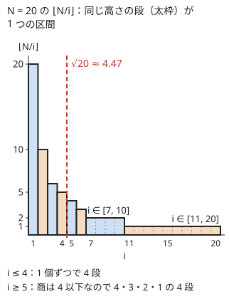

!!! abstract "要点"
    - **何ができるか**：$\sum_{i=1}^{N} f(\lfloor N/i \rfloor)$ を $O(\sqrt{N})$ で求める。$\lfloor N/i \rfloor$ の値は高々 $2\sqrt{N}$ 種類で、同じ値になる $i$ は区間をなすので、区間ごとにまとめて足せばよい。$\sqrt{N}$ を境に「$i$ が小さい側」と「商が小さい側」に分けて考える型にも使う。
    - **いつ使うか**：
        - $\sum_{i=1}^{N} \lfloor N/i \rfloor$ を求める
        - $N \le 10^{12}$ で $i$ を全部回すと間に合わない
        - $xy \le N$ となる組を数える
        - $\sum_{i=1}^{N} f(\lfloor N/i \rfloor)$ の形の和
    - **計算量**：$O(\sqrt{N})$（区間は高々 $2\sqrt{N}$ 個で、区間ごとの処理を $O(1)$ とした場合）。$N = 10^{12}$ でも区間は約 $2 \times 10^6$ 個である。
    - **前提**：[Σ の変形](../math/sigma-manipulation.md)、[整数の割り算と余り](../math/integer-division.md)

<!-- textlint-disable -->
別名：商列挙・enumerate quotients・数論分块・√N 分割・floor でまとめる・約数の個数の和
<!-- textlint-enable -->

商の列挙は、$\lfloor N/i \rfloor$ が同じ値になる $i$ をひとまとめにして、$N$ 項の和を $O(\sqrt{N})$ 個の区間の和に変える方法である。[Σ の変形](../math/sigma-manipulation.md)の「値でまとめ直す」を、$\lfloor N/i \rfloor$ という特別な形に当てはめたものと言える。根にある事実は「$i$ と $\lfloor N/i \rfloor$ の少なくとも一方は $\sqrt{N}$ 以下」で、これは $\sqrt{N}$ を境に場合分けする考え方そのものでもある。

このページで使う記法：$N$ は正の整数で、$i$ は $1$ 以上 $N$ 以下を動く（1-indexed）。商が同じになる $i$ の範囲は両端を含めた閉区間 $[l, r]$ で書き、$s = \lfloor \sqrt{N} \rfloor$ とする。ほかの記法は[記法と用語の約束](../start/notation.md)にそろえる。

## 値が O(√N) 種類である理由（i が √N 以下か、√N より大きいか） {#why-sqrt}

$\sum_{i=1}^{N} \lfloor N/i \rfloor$ は $1$ から $N$ までの各数の約数の個数の和に等しい（$\lfloor N/i \rfloor$ は $N$ 以下の $i$ の倍数の個数なので）。$N \le 10^6$ なら $i$ を全部回せば済むが、$N = 10^{12}$ では $10^{12}$ 回のループになり間に合わない。そこで、項の値の種類が少ないことを使う。

$N = 20$ で $\lfloor 20/i \rfloor$ を並べると、$20, 10, 6, 5, 4, 3, 2, 2, 2, 2, 1, 1, \dots, 1$ となる。値は 8 種類しかなく、同じ値は隣り合って並ぶ。$i$ を横軸、$\lfloor N/i \rfloor$ を縦軸にとると、次のような右下がりの階段になる。



次の動く図では、同じ $N = 20$ の階段を左の段から 1 つずつ取り、段の範囲 $[l, r]$ と、和に足す量（段の幅 × 高さ）を示す。右端 $r$ の求め方は[次の節](#block-end)で説明する。8 段を足し終えると和は 66 になる。

<div class="kp-viz" data-viz="floor-quotient-enum" data-config='{"n": 20}'></div>

階段の段の数、つまり値の種類が $O(\sqrt{N})$ である理由は、$i$ を $\sqrt{N}$ の前後で分けると分かる。

- **$i \le \sqrt{N}$ の側**：$i$ そのものが $s$ 個しかないので、値も高々 $s$ 種類である
- **$i > \sqrt{N}$ の側**：$\lfloor N/i \rfloor \le N/i < \sqrt{N}$ なので、値は $1$ 以上 $\sqrt{N}$ 未満の整数で、高々 $s$ 種類である

合わせて高々 $2s \le 2\sqrt{N}$ 種類になる。正確には $2s$ 種類で、$\lfloor N/s \rfloor = s$ のときだけ両側に同じ値 $s$ が現れて $2s - 1$ 種類になる。$N = 20$ では $s = 4$、$\lfloor 20/4 \rfloor = 5 \ne 4$ なので 8 種類、$N = 10^{12}$ では $s = 10^6$、$\lfloor N/s \rfloor = s$ なので $1999999$ 種類である。

同じ値が区間をなすのは、$\lfloor N/i \rfloor$ が $i$ について広義単調減少だからである。減少する列で同じ値を取る位置は飛び飛びにならない。

## 同じ商になる区間の右端 ⌊N/⌊N/l⌋⌋ {#block-end}

区間ごとに処理するには、区間の左端 $l$ から右端 $r$ を $O(1)$ で求める必要がある。$q = \lfloor N/l \rfloor$ とすると、右端は次の式で求まる。

$$
r = \left\lfloor \frac{N}{q} \right\rfloor = \left\lfloor \frac{N}{\lfloor N/l \rfloor} \right\rfloor
$$

**なぜこの式か**。$\lfloor N/i \rfloor = q$ は $q \le N/i < q + 1$ と同じで、$i$ について解くと $N/(q+1) < i \le N/q$ になる。$i$ は整数なので、$\lfloor N/i \rfloor = q$ となる最大の $i$ は $\lfloor N/q \rfloor$ である。$q \ge 1$ なので 0 で割ることはない。$N = 20$、$l = 7$ なら $q = 2$、$r = \lfloor 20/2 \rfloor = 10$ で、図の $i = 7$〜$10$ の段に一致する。

処理の流れは次のとおりである。

```text
l ← 1
while l ≤ N:
    q ← ⌊N / l⌋        // この区間の商
    r ← ⌊N / q⌋        // 商が q になる最大の i
    区間 [l, r] の r − l + 1 個の i について、商 q でまとめて処理する
    l ← r + 1
```

$l$ は毎回 $r + 1$ に進み、各区間は値の 1 種類に対応するので、くり返しは高々 $2\sqrt{N}$ 回である。$\sum_{i=1}^{N} \lfloor N/i \rfloor$ なら、区間の $r - l + 1$ 個の項がどれも $q$ なので $(r - l + 1) \times q$ を足す。次のコードは擬似コードをそのまま C++ にしたものである。別の和を求めるときは、足す式だけを変えればよい。

```cpp
--8<-- "floor-quotient-enum/quotient-blocks.cpp:core"
```

完全なプログラム：[`quotient-blocks.cpp`](https://github.com/yuukougun/kyopro-atlas/blob/main/snippets/floor-quotient-enum/quotient-blocks.cpp)（GitHub）
{ .kp-code-src }

**$f$ が $i$ にもよる場合**。$\sum_{i=1}^{N} g(i) \cdot f(\lfloor N/i \rfloor)$ の形でも、$g$ の区間の和 $\sum_{i=l}^{r} g(i)$ が $O(1)$ で求まれば同じ方法が使える。たとえば $g(i) = i$ なら等差数列の和 $(l + r)(r - l + 1)/2$ を $q$ 倍して足す。$N \bmod i = N - i \lfloor N/i \rfloor$ なので、余りの和 $\sum_{i=1}^{N} (N \bmod i)$ もこれで求まる。

**2 つの商を同時にまとめる場合**。$\lfloor N/i \rfloor$ と $\lfloor M/i \rfloor$ の両方を使う和では、右端を $\min(\lfloor N/\lfloor N/l \rfloor \rfloor, \lfloor M/\lfloor M/l \rfloor \rfloor)$ にする。どちらの商も変わらない範囲だけをまとめるので、区間の数は $O(\sqrt{N} + \sqrt{M})$ である。$i$ の上限は $\min(N, M)$ にする（それより先では片方の商が 0 になる）。

**商の値そのものを使う場合**。$\lfloor N/i \rfloor$ の異なる値の一覧（$N = 20$ なら $1, 2, 3, 4, 5, 6, 10, 20$）は、それ自体が DP の添字の集合として使われる。素数の個数を数える方法など、[乗法的関数](../math/multiplicative-function.md#prime-counting)の和を求める発展的な手法では、この $O(\sqrt{N})$ 個の値についてだけ表を持つ。

??? question "確認問題：N = 10 の区間"
    $N = 10$ のとき、$\lfloor 10/i \rfloor$ の値は何種類か。それぞれの値になる $i$ の範囲も答えよ。

    ??? success "答え"
        5 種類である。値 10 は $i = 1$、5 は $i = 2$、3 は $i = 3$、2 は $i \in [4, 5]$、1 は $i \in [6, 10]$ になる。$s = 3$ で $\lfloor 10/3 \rfloor = 3 = s$ なので、$2s - 1 = 5$ の式とも合う。区間の右端は、たとえば $l = 4$ で $q = 2$、$r = \lfloor 10/2 \rfloor = 5$ と求まる。

## √N を境に場合分けする（片方を √N まで全探索） {#split-at-sqrt}

区間の右端の式を使わなくても、「$i \le \sqrt{N}$ か $\lfloor N/i \rfloor \le \sqrt{N}$ のどちらかが成り立つ」という事実だけで解ける問題も多い。小さい側は $\sqrt{N}$ 通りなので全探索し、大きい側は別の見方で数える。

**$xy \le N$ の組を数える**。正の整数の組 $(x, y)$ で $xy \le N$ となるものの個数は $\sum_{x=1}^{N} \lfloor N/x \rfloor$ である。$x > s$ かつ $y > s$ なら $xy \ge (s + 1)^2 > N$ なので、条件を満たす組は $x \le s$ か $y \le s$ の少なくとも一方を満たす。$x \le s$ の組と $y \le s$ の組は対称で同じ個数あり、両方を満たす $s^2$ 組（$xy \le s^2 \le N$ なので全部が条件を満たす）を二重に数えている。よって次の式になる。

$$
\sum_{x=1}^{N} \left\lfloor \frac{N}{x} \right\rfloor = 2 \sum_{x=1}^{s} \left\lfloor \frac{N}{x} \right\rfloor - s^2
$$

区間を列挙するより短く書け、計算量は同じ $O(\sqrt{N})$ である。$s$ は浮動小数点の `sqrt` の結果をそのまま使わず、前後に直して求める（[落とし穴](#pitfalls)）。

```cpp
--8<-- "floor-quotient-enum/quotient-blocks.cpp:split"
```

完全なプログラム：[`quotient-blocks.cpp`](https://github.com/yuukougun/kyopro-atlas/blob/main/snippets/floor-quotient-enum/quotient-blocks.cpp)（GitHub）
{ .kp-code-src }

**大小を決めて小さい方を固定する**。対称な条件の組 $(a, b)$ を探すとき、$a \le b$ と決めると $a^2 \le ab$ なので、$ab \le N$ なら $a \le \sqrt{N}$ に限られる。$a$ を $\sqrt{N}$ まで全探索し、$b$ の範囲は式で決める。3 つの値の組でも、真ん中の値を固定すると同じ形になる（[ARC160 B](#arc160_b)）。

**桁数で分ける**。$N$ を $b$ 進法で書くとき、$b \le \sqrt{N}$ なら $b$ は $\sqrt{N}$ 通りしかないので全部試せる。$b > \sqrt{N}$ なら $b^2 > N$ なので、$N$ は $b$ 進法で 2 桁以下になる。2 桁なら $N = pb + q$（$1 \le p < b$、$0 \le q < b$）と書け、上の桁 $p$ は $p \le N/b < \sqrt{N}$ なので、今度は $p$ を全探索できる（[N 進法](../math/base-conversion.md)、[力試し](#challenge)の ARC060 D）。

どの場合も、境界の値（$i = s$ や $p = s$ 付近）を両側で二重に数えたり、どちらでも数えなかったりしやすい。境界を $\le s$ と $> s$ のように片方にだけ含めて書き、小さい $N$ で全探索と比べて確かめる。

## 調和級数・floor sum との使い分け {#vs-others}

$\lfloor \cdot \rfloor$ を含む和は、$i$ が式のどこにあるかと、何が欲しいかで道具を選ぶ。

| 和の形・欲しいもの | 道具 | 計算量 |
| --- | --- | --- |
| $\sum_{i=1}^{N} f(\lfloor N/i \rfloor)$ の値だけ（$i$ が分母） | 商の列挙 | $O(\sqrt{N})$ |
| $k \le N$ の各 $k$ ごとの約数の個数・和の表 | [調和級数](../math/harmonic-sum.md) | $O(N \log N)$ |
| $\sum_{i} \lfloor (ai + b)/m \rfloor$（$i$ が分子に 1 次） | [floor sum](../math/floor-sum.md) | $O(\log m)$ |

- 調和級数の倍数の列挙は、$d$ ごとに $d$ の倍数を $\lfloor N/d \rfloor$ 個たどるので、合計の回数が $\sum_d \lfloor N/d \rfloor$ になる。各数の情報を表として残せる代わりに、$N$ は $10^6$〜$10^7$ 程度までである。和の値だけが欲しく、$N$ が $10^{12}$ 程度なら商の列挙を使う
- $i$ が分子に 1 次で入る形では、商が $i$ とともにほぼ一定の割合で増え、値の種類が少なくならない。区間にまとめても速くならないので floor sum を使う
- 配列を $\sqrt{N}$ 個のブロックに分ける[平方分割](../ds/sqrt-decomposition.md)も $\sqrt{N}$ を境に考える手法だが、扱う対象はクエリと配列で、ここでの商の場合分けとは別物である

## 落とし穴 {#pitfalls}

**$\sqrt{N}$ を `double` で求めて境界がずれる**。`(long long)sqrt(n)` は、$N$ が $2^{52}$（約 $4.5 \times 10^{15}$）程度を超えると、`double` の精度が足りず 1 ずれることがある。たとえば $N = m^2 - 1$ の形では、$\sqrt{N}$ と $m$ の差が小さすぎて `double` で区別できず、$m$ に丸められる。$s$ を誤ると、場合分けの式で $s^2$ を引く量が変わり答えが合わない。`sqrtl` で近い値を出してから、`s * s > n` の間は減らし、`(s + 1) * (s + 1) <= n` の間は増やして直す。直さずに済ませたいなら、ループを `for (long long i = 1; i * i <= n; i++)` と書けば $s$ を求めなくてよい。$N \le 10^{18}$ なら $i \le 10^9$ で $i \cdot i$ は `long long` に収まる。

**区間の端の取り違え**。$r = \lfloor N/q \rfloor$ は区間に含まれる最大の $i$ である（閉区間 $[l, r]$）。個数は $r - l + 1$、次の左端は $r + 1$ になる。半開区間の癖で $r - l$ と書くと各区間で 1 個ずつ足りなくなる。

**$i$ の上限が $N$ と違う**。$\sum_{i=1}^{M} f(\lfloor N/i \rfloor)$ で $M < N$ なら、右端を $\min(r, M)$ で打ち切る。$M > N$ なら、$i > N$ では商が 0 になり $\lfloor N/0 \rfloor$ を計算してしまう。ループは $l \le \min(N, M)$ までにし、商が 0 の $i$ は別に扱う。

**切り上げの商**。$\lceil N/i \rceil$ では右端の式がそのまま使えない。$N \ge 1$ なら $\lceil N/i \rceil = \lfloor (N - 1)/i \rfloor + 1$ なので、$N - 1$ の商の列挙に直す（$i > N - 1$ では $\lfloor (N - 1)/i \rfloor = 0$ になるので、上の注意と同じく別に扱う）。切り上げの書き換えは[整数の割り算と余り](../math/integer-division.md)にまとめてある。

**和のオーバーフロー**。$\sum_{i=1}^{N} \lfloor N/i \rfloor$ はおよそ $N \ln N$ で、$N = 10^{12}$ なら約 $2.8 \times 10^{13}$ と `long long` に収まる。$N = 10^{18}$ では約 $4.2 \times 10^{19}$ になり、`long long` の上限（約 $9.2 \times 10^{18}$）を超える。$g(i) = i$ の重み付きの和も $N^2$ 程度まで大きくなる。答えを mod で求めるなら区間ごとに余りを取り、そうでなければ `__int128` を使う。

**複数のテストケース**。1 ケース $O(\sqrt{N})$ でも、ケース数 $T$ を掛けた $O(T \sqrt{N})$ が全体の計算量になる。$N = 10^9$、$T = 100$ なら約 $3.2 \times 10^6$ 回で間に合うが、$N = 10^{12}$、$T = 10^4$ では $10^{10}$ 回で間に合わない。

## 例題 {#examples}

### ABC230 E. Fraction Floor Sum {#abc230_e}

<div class="kp-problems" data-role="example" markdown>

- [ABC230 E. Fraction Floor Sum](https://atcoder.jp/contests/abc230/tasks/abc230_e)（diff 969）：i = 1..N の ⌊N/i⌋ の和を求める（N ≤ 10^12）。

</div>

求める和そのものが $\sum_{i=1}^{N} \lfloor N/i \rfloor$ なので、商が同じ区間ごとに $(r - l + 1) \times q$ を足せばよい。区間は約 $2 \times 10^6$ 個で済む。[√N を境に場合分けする](#split-at-sqrt)の式 $2 \sum_{x=1}^{s} \lfloor N/x \rfloor - s^2$ を使ってもよい。

??? note "解法の詳細"
    - $l = 1$ から始め、$q = \lfloor N/l \rfloor$、$r = \lfloor N/q \rfloor$ を求めて $(r - l + 1) \times q$ を足し、$l \leftarrow r + 1$ とする。$l > N$ で止める。
    - 和は最大で約 $2.8 \times 10^{13}$ なので `long long` に収まる。
    - 場合分けの式で書くなら、$s = \lfloor \sqrt{N} \rfloor$ を誤差なしで求めてから $x = 1, \dots, s$ について $\lfloor N/x \rfloor$ を足す。$s^2$ を引き忘れると、$x, y$ がどちらも $s$ 以下の組を二重に数えたままになる。
    - コードは[区間の右端の節](#block-end)の `sum_floor` と同じ形である。

### ARC160 B. Triple Pair {#arc160_b}

<div class="kp-problems" data-role="example" markdown>

- [ARC160 B. Triple Pair](https://atcoder.jp/contests/arc160/tasks/arc160_b)（diff 1275）：xy ≤ N、yz ≤ N、zx ≤ N をすべて満たす正の整数の組 (x, y, z) の個数を 998244353 で割った余りで求める（N ≤ 10^9、複数ケース）。

</div>

条件は $x, y, z$ について対称なので、大小の並びを決めて数え、並べ方の数を掛ける。$x \le y \le z$ と決めると、3 つの積のうち最大は $yz$ なので、条件は $yz \le N$ だけになる。真ん中の $y$ は $y^2 \le yz \le N$ より $\sqrt{N}$ 以下なので、$y$ を $1$ から $s$ まで全探索し、$x$ と $z$ の個数を式で数える。1 ケース $O(\sqrt{N})$ で、ケース数が 100 程度なら間に合う。

??? note "解法の詳細"
    - $y$ を固定する（$1 \le y \le s$）。$z$ は $y < z \le \lfloor N/y \rfloor$ を満たすものが $\lfloor N/y \rfloor - y$ 個、$x$ は $x < y$ を満たすものが $y - 1$ 個ある。
    - 値の重なり方で 4 通りに分け、並べ方の数を掛けて足す。
        - $x < y < z$：$(y - 1)(\lfloor N/y \rfloor - y)$ 組で、並べ方は 6 通り
        - $x = y < z$：$\lfloor N/y \rfloor - y$ 組で、並べ方は 3 通り
        - $x < y = z$：$y - 1$ 組で、並べ方は 3 通り（$y^2 \le N$ なので $z = y$ は条件を満たす）
        - $x = y = z$：1 組で、並べ方は 1 通り
    - 値そのものは大きくならない。$(y - 1)(\lfloor N/y \rfloor - y)$ は $N$ 程度で、答えの全体も $N = 10^9$ で約 $1.3 \times 10^{14}$ である。`long long` に収まるので、最後に 998244353 で割った余りにすればよい（modint で足し合わせてもよい）。
    - $s$ は誤差なしで求める。$y \cdot y \le N$ をループの条件にすれば $s$ を求めなくてよい。

## 練習問題 {#practice}

<div class="kp-problems" data-role="practice" markdown>

- [ABC172 D. Sum of Divisors](https://atcoder.jp/contests/abc172/tasks/abc172_d)（diff 963）：x の約数の個数を f(x) とするとき、x = 1..N の x·f(x) の和を求める（N ≤ 10^7）。
- [ABC296 D. M<=ab](https://atcoder.jp/contests/abc296/tasks/abc296_d)（diff 999）：1 ≤ a, b ≤ N を満たす a × b のうち、M 以上で最小の値を求める（N, M ≤ 10^12、なければ −1）。
- [ABC414 E. Count A%B=C](https://atcoder.jp/contests/abc414/tasks/abc414_e)（diff 1296）：1 以上 N 以下の互いに異なる整数の組 (a, b, c) で、a を b で割った余りが c になるものの個数を 998244353 で割った余りで求める（3 ≤ N ≤ 10^12）。

</div>

??? note "練習の方針"
    - **ABC172 D**：約数 $a$ ごとに倍数の和 $a \cdot k(k+1)/2$（$k = \lfloor N/a \rfloor$）を足す形に直す。$k$ が同じ $a$ の区間を等差数列の和でまとめれば $O(\sqrt{N})$ になる。$N \le 10^7$ なので $O(N)$ の全探索でも通る
    - **ABC296 D**：$a \le b$ としてよい。$a$ を決めると、$b$ は $\lceil M/a \rceil$ が最善である（ただし $b \le N$ のときだけ使える）。$A = \lceil \sqrt{M} \rceil$ とする。$A \le N$ なら $A \times A \ge M$ が候補の 1 つになり、$a > A$ では $ab \ge a^2 > A^2$ なので答えにならない。$A > N$ なら $a \le N$ がもともとの範囲である。よって $a$ は $\min(N, A)$ まで試せば十分である。$b \le N$ の判定と、$a \le b$ の確認を忘れない
    - **ABC414 E**：$b$ を固定して $c$ を数えると、答えは $\sum_{b=1}^{N} (N + 1 - b - \lfloor N/b \rfloor)$ にまとまる。残る $\sum \lfloor N/b \rfloor$ を、商が同じ区間ごとにまとめて $O(\sqrt{N})$ で求める

## 力試し {#challenge}

<div class="kp-problems" data-role="challenge" markdown>

- [ABC132 F. Small Products](https://atcoder.jp/contests/abc132/tasks/abc132_f)（diff 2143）：隣り合う 2 数の積がどれも N 以下になる、正の整数 K 個の列の個数を 10^9+7 で割った余りで求める（N ≤ 10^9、K ≤ 100）。
- [ARC060 D. Digit Sum](https://atcoder.jp/contests/arc060/tasks/arc060_b)（diff 2261）：n の b 進表記の各桁の和が s になる最小の整数 b ≥ 2 を求める（n ≤ 10^11、なければ −1）。

</div>

??? note "力試しの方針"
    - **ABC132 F**：$\sqrt{N}$ を超える数どうしは隣り合えない。右端が $\sqrt{N}$ 以下の数のときは値ごとに、$\sqrt{N}$ を超える数のときは $\lfloor N/x \rfloor$ が同じものごとにまとめて DP し、累積和で遷移して $O(K \sqrt{N})$ にする
    - **ARC060 D**：$b \le \sqrt{n}$ は $b$ を全部試して桁和を計算する（1 回 $O(\log n)$）。$b > \sqrt{n}$ では $n$ は 2 桁以下なので、2 桁なら $n = pb + q$、$p + q = s$ と書ける。上の桁 $p$ は $\sqrt{n}$ 未満なので $p$ を全探索し、$q = s - p$、$b = (n - q)/p$ が整数で、$q \ge 0$、$p < b$、$q < b$ を満たすかを確かめる。1 桁になるのは $b > n$ のときで、桁和は $n$ そのものなので、$n = s$ なら $b = n + 1$ が候補になる。$b \le \sqrt{n}$ で見つかればそれが答えで、なければ 2 桁の候補の最小、それもなければ 1 桁の候補を答え、どれもなければ $-1$ を出す

## 確認問題 {#quiz}

??? question "確認問題：$N = 10^{12}$ での値の種類"
    $N = 10^{12}$ のとき、$\lfloor N/i \rfloor$（$1 \le i \le N$）の異なる値は何個か。

    ??? success "答え"
        $s = \lfloor \sqrt{10^{12}} \rfloor = 10^6$ で、$\lfloor N/s \rfloor = 10^6 = s$ なので、$i \le s$ の側と $i > s$ の側に同じ値 $s$ が 1 回ずつ現れる。よって $2s - 1 = 1999999$ 個である。

??? question "確認問題：余りの和"
    $\sum_{i=1}^{N} (N \bmod i)$ を $O(\sqrt{N})$ で求めるにはどうすればよいか。

    ??? success "答え"
        $N \bmod i = N - i \lfloor N/i \rfloor$ なので、和は $N^2 - \sum_{i=1}^{N} i \lfloor N/i \rfloor$ である。後ろの和は、商が $q$ の区間 $[l, r]$ ごとに $q \cdot (l + r)(r - l + 1)/2$ を足せば求まる。$N^2$ は $N = 10^{12}$ で $10^{24}$ になるので、mod で求めるか `__int128` を使う。

??? question "確認問題：区間の右端を r = N / q − 1 と書いた"
    区間の右端を $\lfloor N/q \rfloor$ でなく $\lfloor N/q \rfloor - 1$ と書くと、何が起きるか。

    ??? success "答え"
        どの $N$ でもループが止まらなくなる。最初の $l = 1$ では商が $q = N$ で、商が $N$ になる $i$ は $1$ だけなので、右端が $\lfloor N/N \rfloor - 1 = 0$ になり、$l \leftarrow r + 1 = 1$ で $l$ が進まない。一般に、本当の右端 $\lfloor N/q \rfloor$ が左端 $l$ になったところで右端が $l - 1$ になり、そこで止まってしまう。式の由来（$i \le N/q$ を満たす最大の整数）を覚えておけば取り違えない。

## 参考 {#references}

- [Kazun「AtCoder Beginner Contest 230 E 問題 Fraction Floor Sum」](https://kazun-kyopro.hatenablog.com/entry/ABC/230/E)：値が $O(\sqrt{N})$ 種類である理由と、商ごとにまとめる方針（例題）
- [drken「AtCoder ARC 160 B - Triple Pair (1D, 水色, 500 点)」](https://drken1215.hatenablog.com/entry/2023/05/15/124800)：大小を決めて真ん中の値を $\sqrt{N}$ まで固定し、4 通りに分けて数える方針（例題）
- [drken「AtCoder ABC 296 D - M<=ab (1Q, 緑色, 400 点)」](https://drken1215.hatenablog.com/entry/2023/05/16/011100)：$a \le b$ として $a$ を $\sqrt{M}$ まで調べれば足りる理由（練習）
- [drken「AtCoder ABC 044 D - 桁和 (ARC 060 D) (1D, 黄色, 500 点)」](https://drken1215.hatenablog.com/entry/2024/09/14/115435)：$b \le \sqrt{n}$ の全探索と、2 桁の場合の $n = pb + q$ の式（力試し）
- [ikatakos「AtCoder Beginner Contest 172 D,E,F問題メモ」](https://ikatakos.com/pot/programming_algorithm/contest_history/atcoder/2020/0627_abc172)：練習 ABC172 D の O(N) と O(√N) の解き方（解説の部分だけを参照）
- [ikatakos「ミラティブ プログラミングコンテスト2025（AtCoder Beginner Contest 414）E,F,G問題メモ」](https://ikatakos.com/pot/programming_algorithm/contest_history/atcoder/2025/0712_abc414)：練習 ABC414 E の式変形と制約（解説の部分だけを参照）
- [nakst_hide「ABC414: Rustで解く！問題解説」](https://zenn.dev/nakst_hide/articles/f5b3e3a3473e9d)：練習 ABC414 E の商が同じ区間でまとめる実装
- [ikatakos「AtCoder Beginner Contest 132 D,E,F 問題メモ」](https://ikatakos.com/pot/programming_algorithm/contest_history/atcoder/2019/0629_abc132)：力試し ABC132 F の √N を境に 2 つに分ける DP（解説の部分だけを参照）
