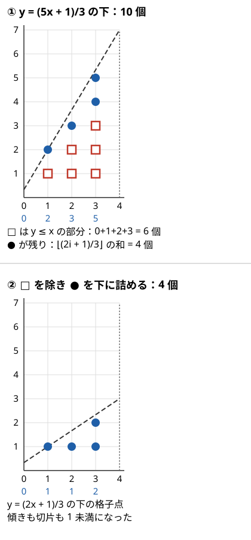
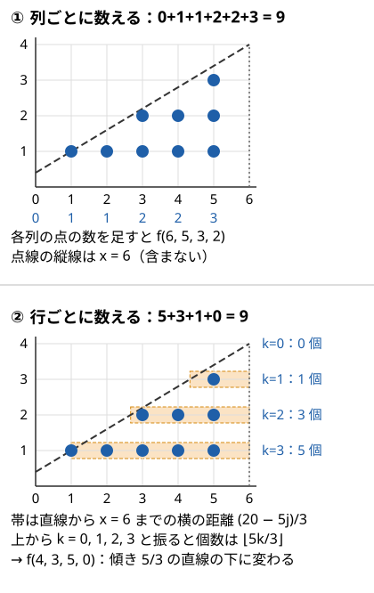

!!! abstract "要点"
    - **何ができるか**：$\sum_{i=0}^{n-1} \lfloor (ai + b)/m \rfloor$ を、互除法と同じ形の再帰により $O(\log m)$ で求める。$(ai + b) \bmod m$ の和や、一次式の条件を満たす個数もこれに帰着できる。
    - **いつ使うか**：
        - $\sum \lfloor (ai + b)/m \rfloor$ や $\sum (ai + b) \bmod m$ を求める
        - $(Ak + B) \bmod M$ が条件を満たす $k$ の個数
        - 直線の下にある格子点の数
        - $n, m \le 10^9$ 程度で $i$ を全部回せない
    - **計算量**：1 回 $O(\log m)$（ACL は $0 \le n < 2^{32}$、$1 \le m < 2^{32}$）
    - **前提**：[Σ の変形](../math/sigma-manipulation.md)、[GCD・LCM とユークリッドの互除法](../math/gcd-lcm.md)

<!-- textlint-disable -->
別名：floor_sum・類ユークリッド・sum of floor of linear・mod of linear・一次式の mod の和・直線の下の格子点
<!-- textlint-enable -->

floor sum は、一次式を $m$ で割った商の和を、項を 1 つずつ足さずに求める方法である。和を直線の下の格子点の数とみて、「$a$・$b$ を $m$ 未満にする」と「縦と横を入れ替える」をくり返すと、$(m, a)$ がユークリッドの互除法と同じように小さくなる。

このページで使う記法：$f(n, m, a, b) = \sum_{i=0}^{n-1} \lfloor (ai + b)/m \rfloor$（$n \ge 0$、$m \ge 1$）。和は $i = 0$ から $n - 1$ までの $n$ 項で、$n = 0$ なら $0$ である。ほかの記法は[記法と用語の約束](../start/notation.md)にそろえる。

## 必要になる場面 {#when}

$\lfloor (ai + b)/m \rfloor$ を $i = 0, 1, \dots, n-1$ について足すだけなら、$O(n)$ のループで済む。$n$ が $10^9$ を超えたり、この和を $10^5$ ケース答えたりすると、ループは間に合わない。

商の値ごとにまとめる[商の列挙](../math/floor-quotient-enum.md)は $\lfloor N/i \rfloor$ のように $i$ が分母にある形の道具で、$i$ が分子に一次で入るこの形には使えない。floor sum は、和の形を保ったまま引数を小さくしていき、1 回 $O(\log m)$ で答える。

和が直接問われることは少なく、たいていは次の形から帰着する。

- $(ai + b) \bmod m$ の和。$x \bmod m = x - m \lfloor x/m \rfloor$ で floor の和に直る（[書き換えの節](#mod-to-floor)）
- 「$(Ak + B) \bmod M$ が $k$ より大きい」のような、余りについての条件を満たす $k$ の個数。条件を満たすかどうかを 2 つの floor の差で書くと、個数が floor sum の差になる

## a ≥ m・b ≥ m の部分を式で取り除く {#reduce}

$a \ge m$ や $b \ge m$ のときは、整数の部分を式で足し出して $a < m$・$b < m$ にできる。$a = q_a m + a'$、$b = q_b m + b'$（$0 \le a', b' < m$）と割ると、$q_a i + q_b$ は整数なので floor の外に出せる。

$$
\left\lfloor \frac{ai + b}{m} \right\rfloor = q_a i + q_b + \left\lfloor \frac{a'i + b'}{m} \right\rfloor
$$

これを $i = 0, \dots, n-1$ で足すと、$\sum_{i=0}^{n-1} i = n(n-1)/2$ より次の式になる。

$$
f(n, m, a, b) = q_a \cdot \frac{n(n-1)}{2} + q_b \cdot n + f(n, m, a \bmod m, b \bmod m)
$$

図で見ると、和は直線 $y = (ax + b)/m$ と $x$ 軸の間にある格子点（$0 \le i < n$、$1 \le j \le \lfloor (ai+b)/m \rfloor$ の点 $(i, j)$）の数である。$a = 5, b = 1, m = 3, n = 4$ では $q_a = 1$、$q_b = 0$ で、$y \le x$ にある 6 個の点を式で数えると、残りの 4 個は直線 $y = (2x + 1)/3$ の下の格子点になる。



取り除いた後は傾き $a/m$ が 1 未満、切片 $b/m$ も 1 未満になり、$i$ 列目の点は $i$ 個以下になる。ここからは列ではなく行ごとに数える（[次の節](#swap-axes)）。

## 直線の下の格子点とみて縦横を入れ替える（互除法と同じ再帰） {#swap-axes}

$f(n, m, a, b) = \sum_{i=0}^{n-1} \lfloor (ai + b)/m \rfloor$ は、直線 $y = (ax + b)/m$ の下にある格子点（$0 \le x < n$、$y \ge 1$）の数である。$0 \le a < m$・$0 \le b < m$ のとき、この格子点を行ごとに数え直すと、$a$ と $m$ が入れ替わった同じ形の和になる。$y_{\max} = an + b$（直線の $x = n$ での高さの $m$ 倍）と置く。$y_{\max} < m$ なら、どの列にも点がないので和は $0$ で終わる。

$y_{\max} \ge m$ なら $a \ge 1$ である。高さ $j$ の行にある点は、$jm \le ai + b$ を満たす $0 \le i < n$ である。高さ $j$ で直線は $x = (jm - b)/a$ を通るので、$x = n$ の縦線までの横の距離は $n - (jm - b)/a = (y_{\max} - jm)/a$ である。点の個数はこの距離を切り捨てた値になる。

$$
\#\{\, i \mid 0 \le i < n,\ jm \le ai + b \,\} = \left\lfloor \frac{y_{\max} - jm}{a} \right\rfloor \quad (1 \le j \le J,\ J = \lfloor y_{\max}/m \rfloor)
$$

行を上から $k = J - j$（$k = 0, \dots, J-1$）と番号を振ると、$y_{\max} - jm = km + (y_{\max} \bmod m)$ なので、和は次の形に書き直せる。

$$
f(n, m, a, b) = \sum_{k=0}^{J-1} \left\lfloor \frac{mk + (y_{\max} \bmod m)}{a} \right\rfloor = f\bigl(\lfloor y_{\max}/m \rfloor,\ a,\ m,\ y_{\max} \bmod m\bigr)
$$

$f(6, 5, 3, 2)$ で確かめる。列ごとの点の数は $0, 1, 1, 2, 2, 3$ で合計 $9$ である。$y_{\max} = 20$・$J = 4$ で、行ごとの数は下から $5, 3, 1, 0$ になる。上から読んだ $0, 1, 3, 5$ は $\lfloor 5k/3 \rfloor$（$k = 0, 1, 2, 3$）である。確かに $f(4, 3, 5, 0) = 9$ になる。図の下の段を右上の角から見ると、傾き $m/a = 5/3$ の直線の下の格子点になっている。



??? note "証明：行ごとの個数が ⌊(y_max − jm)/a⌋ になること"
    $jm \le ai + b$ は $i \ge (jm - b)/a$ と同じなので、条件を満たす $i$ は $\lceil (jm - b)/a \rceil \le i \le n - 1$ である。$b < m$ と $j \ge 1$ から $jm - b > 0$ で、左端は $1$ 以上である。

    個数は $n - \lceil (jm - b)/a \rceil$ で、整数 $x$ について $\lceil x/a \rceil = -\lfloor -x/a \rfloor$ を使うと、$n + \lfloor (b - jm)/a \rfloor = \lfloor (an + b - jm)/a \rfloor = \lfloor (y_{\max} - jm)/a \rfloor$ になる。

    $j \le J$ なら $y_{\max} - jm \ge 0$ でこの値は $0$ 以上である。$j > J$ の行には点がない（$i \le n - 1$ では $ai + b < y_{\max} < jm$）。$a(n-1) + b < jm \le y_{\max}$ の行は式の値が $0$ で、実際の個数 $0$ と合う。$x = n$（範囲の外）での高さを使うのは、新しい $b$ を $y_{\max} \bmod m$ ときれいに書くためである。

## なぜ O(log m) で終わるか {#why-log}

$f(n, m, a, b) = \sum_{i=0}^{n-1} \lfloor (ai + b)/m \rfloor$ を求めるくり返しで、取り除く操作と入れ替える操作を 1 組として、$(m, a)$ の組がどう変わるかを見る。入れ替えで $(m, a) \to (a, m)$ になり、次の取り除く操作で新しい $a$（もとの $m$）が新しい $m$（もとの $a$）で割った余りになる。まとめると $(m, a) \to (a,\ m \bmod a)$ で、これはユークリッドの互除法の 1 歩そのものである。また、$y_{\max} = an + b < m(n + 1)$ から新しい $n$ は $J \le n$ で、$n$ も増えない。

互除法は 2 歩ごとに大きい方が半分未満になるので、くり返しは $O(\log m)$ 回で $a = 0$ に達する。$a = 0$ になれば $y_{\max} = b < m$ でくり返しは止まる。各回は $O(1)$ なので、全体で $O(\log m)$ である。

??? note "証明：m mod a < m/2（0 < a ≤ m）"
    $a \le m/2$ なら、$m \bmod a < a \le m/2$ である。$a > m/2$ なら、$m < 2a$ より $\lfloor m/a \rfloor = 1$ で、$m \bmod a = m - a < m/2$ である。

    したがって $(m, a) \to (a, m \bmod a) \to (m \bmod a, \dots)$ の 2 歩で、組の大きい方は $m$ から $m/2$ 未満になる。大きい方は $1$ 以上の整数なので、歩数は $2 \log_2 m + O(1)$ 以下である。

## 処理の流れと自作するときの要点 {#procedure}

$f(n, m, a, b) = \sum_{i=0}^{n-1} \lfloor (ai + b)/m \rfloor$ は、答え $s = 0$ から始めて次のようにくり返せば求まる。[取り除く操作](#reduce)と[縦横の入れ替え](#swap-axes)を交互に行う。

```text
loop:
    a >= m なら  s += (a / m) * n(n-1)/2,  a = a mod m
    b >= m なら  s += (b / m) * n,         b = b mod m
    y_max = a*n + b
    y_max < m なら  s を返す          // もう格子点がない
    (n, m, a, b) = (y_max / m, a, m, y_max mod m)   // 縦横の入れ替え
```

再帰で書いてもよいが、末尾で同じ関数を呼ぶだけなのでループにできる。C++ で書くと次のようになる（コード片の全体では、小さい値の全通りと乱数の値で愚直解と一致することを確かめている）。

```cpp
--8<-- "floor-sum/floor-sum.cpp:core"
```

完全なプログラム：[`floor-sum.cpp`](https://github.com/yuukougun/kyopro-atlas/blob/main/snippets/floor-sum/floor-sum.cpp)（GitHub）
{ .kp-code-src }

自作のライブラリにするときの要点は次のとおり。

- **型は `unsigned long long`**。答えは $n^2 a / m$ 程度になりうるので、ACL と同じく「あふれたら $2^{64}$ で割った余り」と決めておく。符号付きのあふれは[未定義動作](../cpp/cpp-integer-overflow.md)なので、符号なしで計算する
- **途中の値の範囲**。$n < 2^{32}$・$m < 2^{32}$ で、取り除いた後は $a, b < m$ なので、$an + b < 2^{64}$ に収まる。入れ替えの後も $n$ は増えず、新しい $m$（もとの $a$）は $m$ より小さいので、この範囲は保たれる。$n(n-1)$ も $2^{64}$ 未満で、偶数なので先に $2$ で割ってから掛けてよい
- **引数の順番**。ACL は `floor_sum(n, m, a, b)` の順である。資料によって $(n, a, b, m)$ の順のものもあるので、自作するなら ACL にそろえると取り違えにくい
- **負の $a$・$b$**。上の形は $a, b \ge 0$ が前提である。負を許すなら、ACL と同じく先に $a \bmod m$ へ直して差を式で引く（[ACL の節](#acl)）

## x mod m = x − m⌊x/m⌋ への書き換え {#mod-to-floor}

余りの和は、$x \bmod m = x - m \lfloor x/m \rfloor$（$x \ge 0$）で floor の和 $f(n, m, a, b) = \sum_{i=0}^{n-1} \lfloor (ai + b)/m \rfloor$ に直せる。$a, b \ge 0$ なら次のとおりである。

$$
\sum_{i=0}^{n-1} \bigl( (ai + b) \bmod m \bigr) = a \cdot \frac{n(n-1)}{2} + bn - m \cdot f(n, m, a, b)
$$

右辺の各項は $2^{64}$ を超えうるが、左辺は $nm$ 未満で小さい。`unsigned long long` で計算すれば $2^{64}$ で割った余りどうしの計算になり、途中のあふれは打ち消し合って正しい値が出る。

余りについての条件を数えるときは、次の形が基本になる。$0 \le c \le m$ とし、$x = qm + r$（$0 \le r < m$）と割る。$\lfloor (x - c)/m \rfloor = q + \lfloor (r - c)/m \rfloor$ で、$r - c$ は $-m$ 以上 $m$ 未満なので、右の floor は $r < c$ のとき $-1$、そうでなければ $0$ である。

$$
[\, x \bmod m < c \,] = \left\lfloor \frac{x}{m} \right\rfloor - \left\lfloor \frac{x - c}{m} \right\rfloor \qquad (0 \le c \le m)
$$

左辺の $[\cdot]$ は、条件が成り立つとき $1$、成り立たないとき $0$ を表す。$x$ と $c$ がどちらも $i$ の一次式なら、右辺を $i$ について足したものは floor sum 2 つの差になる。[例題の ABC443 G](#abc443_g) は、$c = k + 1$ が添字とともに動く場合である。

## 応用の型：bit ごとの popcount・一次式の mod の積 {#applications}

追加の前提：[bit 演算の基本と XOR の性質](../basics/bit-operations.md)。この節は発展の問題で使う型である。

**bit ごとの個数**。整数 $x \ge 0$ の下から $d$ 番目の bit が 1 であることは、$x \bmod 2^{d+1} \ge 2^d$ と同じである。これは $(x + 2^d) \bmod 2^{d+1} < 2^d$ と言い換えられる。[書き換えの節](#mod-to-floor)の式に $x + 2^d$・$m = 2^{d+1}$・$c = 2^d$ を入れると、bit が 1 かどうかは $\lfloor (x + 2^d)/2^{d+1} \rfloor - \lfloor x/2^{d+1} \rfloor$ になる。$x$ が等差数列 $Mt + R$ を動くなら、bit ごとに floor sum 2 回で「その bit が 1 の項の個数」が求まる。それを bit について足すと popcount の和になる。bit の数を $B$ とすると floor sum を $2B$ 回呼ぶ。法は $2^{d+1}$ なので 1 回 $O(B)$ で、全体で $O(B^2)$ である。

**一次式の mod の積・重み付きの和**。$\sum ((ai + b) \bmod m)((ci + d) \bmod m)$ のような積の和は、展開すると $\sum i \lfloor \cdot \rfloor$ や、2 つの floor の積の和が要る。縦横を入れ替える再帰は、数える量を点の個数から重み付きの和に変えても同じ形で回せる（ACL にはない）。

## 落とし穴 {#pitfalls}

- **和の範囲**。$f(n, m, a, b)$ は $i = 0$ から $n - 1$ までで、$i = n$ を含まない。$1 \le i \le N$ の和なら $i = i' + 1$ と置き、$f(N, m, a, a + b)$ にする。閉区間 $[0, N]$ なら $f(N + 1, m, a, b)$ である
- **戻り値の型**。ACL の `floor_sum` は `long long` を返すが、中身は $2^{64}$ で割った余りである。2 つの floor sum の差を取るときは、`long long` のまま引くと符号付きのあふれになりうるので、`unsigned long long` にしてから引く
- **$n$ の上限**。ACL は $n < 2^{32}$ を `assert` で確かめる。$n$ が $10^{18}$ のような問題では、そのままでは使えない。条件から範囲を絞れないかを先に考える（[ABC443 G](#abc443_g) の $\min(N, M)$ がその例である）
- **余りの式は $x \ge 0$ のとき**。$x \bmod m = x - m \lfloor x/m \rfloor$ は数学の floor で書けば負の $x$ でも成り立つが、C++ の `/` と `%` は 0 の方向に切り捨てるので、負の数では食い違う（[整数の割り算と余り](../math/integer-division.md)）

## ACL の floor_sum（引数の範囲と負の a, b） {#acl}

!!! info "ACL では"
    `#include <atcoder/math>`、`long long floor_sum(long long n, long long m, long long a, long long b)` が $\sum_{i=0}^{n-1} \lfloor (ai + b)/m \rfloor$ を返す。要件は $0 \le n < 2^{32}$・$1 \le m < 2^{32}$ で、計算量は $O(\log m)$。答えがあふれたときは $2^{64}$ で割った余りが等しい値を返す。

ドキュメントの要件は $n$ と $m$ だけで、$a$・$b$ の範囲は書かれていない。v1.6 のソースは、$a < 0$ なら $a' = a \bmod m$（$0$ 以上 $m$ 未満）に直し、$\frac{n(n-1)}{2} \cdot \frac{a' - a}{m}$ を答えから引く。$b < 0$ も同じように $b' = b \bmod m$ に直して $n \cdot \frac{b' - b}{m}$ を引き、それから非負の場合の関数を呼ぶ。そのため、[ABC443 G](#abc443_g) の $\lfloor ((A-1)k + B - 1)/M \rfloor$ のように $A - 1$ や $B - 1$ が負になる式も、場合分けせずに渡せる。

余りの和と、余りが $k$ より大きい $k$ の個数を ACL で書くと次のようになる。

```cpp
--8<-- "floor-sum/acl-usage.cpp:core"
```

完全なプログラム：[`acl-usage.cpp`](https://github.com/yuukougun/kyopro-atlas/blob/main/snippets/floor-sum/acl-usage.cpp)（GitHub）
{ .kp-code-src }

## 例題 {#examples}

### PRACTICE2 C. Floor Sum {#practice2_c}

<div class="kp-problems" data-role="example" markdown>

- [PRACTICE2 C. Floor Sum](https://atcoder.jp/contests/practice2/tasks/practice2_c)（diff なし）：T 個のケースそれぞれで Σ_{i=0}^{N−1} ⌊(A × i + B)/M⌋ を求める。

</div>

ACL の `floor_sum(N, M, A, B)` をケースごとに 1 回呼ぶだけである。$0 \le A, B < M$ なので最初の 1 回は取り除く操作が何もしない（入れ替えた後は毎回要る）。ケース数が $10^5$ でも 1 回 $O(\log M)$ で間に合う。自作したものの確かめには、ここか [Library Checker の Sum of Floor of Linear](https://judge.yosupo.jp/problem/sum_of_floor_of_linear) を使える。

### ABC443 G. Another Mod of Linear Problem {#abc443_g}

<div class="kp-problems" data-role="example" markdown>

- [ABC443 G. Another Mod of Linear Problem](https://atcoder.jp/contests/abc443/tasks/abc443_g)（diff 2268）：0 ≤ k < N の整数 k のうち、(A·k + B) mod M > k を満たすものの個数を求める（複数ケース）。

</div>

余りと $k$ を比べる条件を、[書き換えの節](#mod-to-floor)の形で floor の差に直す。$c = k + 1$ とすると「余り $\le k$」は「余り $< k + 1$」なので、条件を満たさない $k$ の個数が floor sum 2 つの差になる。答えは全体の個数からそれを引いたものである。

??? note "解法の詳細"
    $x_k = Ak + B$ と置く。$k \ge M$ なら余りは $M$ 未満で $k$ を超えないので、数えるのは $0 \le k < n$（$n = \min(N, M)$）でよい。このとき $c = k + 1 \le M$ で、条件 $0 \le c \le M$ を満たす。

    $$
    [\, x_k \bmod M \le k \,] = \left\lfloor \frac{Ak + B}{M} \right\rfloor - \left\lfloor \frac{(A-1)k + (B-1)}{M} \right\rfloor
    $$

    を $k = 0, \dots, n-1$ で足すと、条件を満たさない個数は $f(n, M, A, B) - f(n, M, A - 1, B - 1)$ である。答えは $n$ からこれを引いた値になる。

    $A = 0$ や $B = 0$ のとき $A - 1$・$B - 1$ は負になるが、ACL の `floor_sum` は負の $a$・$b$ を受け付けるので場合分けは要らない。自作の非負版を使うなら、$a$・$b$ に $M$ の倍数を足して非負にし、その分を式で引く。各ケース $O(\log M)$ である。コードは [ACL の節](#acl)の `count_mod_greater` にあたる。

## 練習問題 {#practice}

例題以外で練習に置ける AtCoder の問題は確認できなかった。

### Library Checker

- [Sum of Floor of Linear](https://judge.yosupo.jp/problem/sum_of_floor_of_linear)：$T$ 個のケースそれぞれで $\sum_{i=0}^{N-1} \lfloor (Ai + B)/M \rfloor$ を求める。自作した floor sum をそのまま確かめられる。
- [Min of Mod of Linear](https://judge.yosupo.jp/problem/min_of_mod_of_linear)：$T$ 個のケースそれぞれで $0 \le x < N$ の $(Ax + B) \bmod M$ の最小値を求める。答えが $X$ 未満かは、余りが $X$ 未満の $x$ の個数 $f(N, M, A, B) - f(N, M, A, B - X)$ が正かで判定できる（[書き換えの節](#mod-to-floor)）。$X$ を二分探索すれば 1 ケース $O(\log^2 M)$ になる。$B - X$ は負になりうるので、負の $b$ を受け付ける ACL の `floor_sum` を使うか、自作版で非負に直す（[ACL の節](#acl)）。

## 力試し {#challenge}

<div class="kp-problems" data-role="challenge" markdown>

- [ABC313 G. Redistribution of Piles](https://atcoder.jp/contests/abc313/tasks/abc313_g)（diff 2454）：石のある皿すべてから 1 個ずつ袋へ移す操作と、袋から N 個取り出して N 枚の皿に 1 個ずつ置く操作を好きなだけ行う。皿の石の数の並びとしてありうるものの個数を 998244353 で割った余りを求める。
- [ARC111 E. Simple Math 3](https://atcoder.jp/contests/arc111/tasks/arc111_e)（diff 2541）：整数 A, B, C, D が与えられ、閉区間 [A + B·i, A + C·i] に D の倍数が 1 つも入らない正の整数 i の個数を求める（複数ケース）。
- [ABC283 Ex. Popcount Sum](https://atcoder.jp/contests/abc283/tasks/abc283_h)（diff 2682）：N 以下の正の整数のうち M で割った余りが R のものについて、2 進表記の 1 の個数の和を求める（複数ケース）。

</div>

??? note "方針"
    - **ABC313 G**：石を袋へ移した回数ごとに、袋の石の数を $N$ で割った商から並びの数が決まる。並びの数を足し合わせる式が、等差数列を $N$ で割った商の和になる
    - **ARC111 E**：区間の長さ $(C - B) i$ が $D - 1$ 以上になると必ず倍数が入るので、$i$ の上限 $m$ を決める。$1 \le i \le m$ では区間に入る $D$ の倍数の個数 $\lfloor (A + Ci)/D \rfloor - \lfloor (A - 1 + Bi)/D \rfloor$ が 0 か 1 なので、その和を floor sum 2 回の差で求め、$m$ から引く
    - **ABC283 Ex**：[応用の型](#applications)の bit ごとの数え方をそのまま使う。$x = Mt + R$ と置き、bit ごとに floor sum の差を足す

## 確認問題 {#quiz}

??? question "確認問題：Σ_{i=1}^{N} (Ai) mod M を f で表すと？"
    $i = i' + 1$（$i' = 0, \dots, N-1$）と置くと $(Ai) \bmod M = (Ai' + A) \bmod M$ なので、[書き換えの節](#mod-to-floor)の式で $a = A$・$b = A$ とする。

    $$
    \sum_{i=1}^{N} (Ai) \bmod M = A \cdot \frac{N(N-1)}{2} + AN - M \cdot f(N, M, A, A) = A \cdot \frac{N(N+1)}{2} - M \cdot f(N, M, A, A)
    $$

??? question "確認問題：f(n, m, 0, b) と、b ≥ m のときのくり返しの最初の 1 回は？"
    $a = 0$ なら各項が $\lfloor b/m \rfloor$ なので、和は $n \lfloor b/m \rfloor$ である。くり返しでは、最初の取り除く操作で $s = n \lfloor b/m \rfloor$・$b \leftarrow b \bmod m$ となり、$y_{\max} = b < m$ ですぐに止まる。

??? question "確認問題：a < m にしないまま縦横を入れ替えるとどうなる？"
    入れ替えは $(m, a) \to (a, m)$ と並べ替えるだけで、それだけをくり返すと 2 回で元の組に戻り、くり返しが終わらない。互除法の「余りを取る」にあたるのが取り除く操作で、これがあるから $(m, a)$ が小さくなる。また $a \ge m$ のままでは $y_{\max} = an + b \ge mn$ なので、新しい $n = \lfloor y_{\max}/m \rfloor$ が $n$ 以上になり、項の数も減らない。

## 使い分け {#comparison}

| 和の形 | 道具 | 計算量 |
| --- | --- | --- |
| $\sum_i g(\lfloor N/i \rfloor)$（$i$ が分母） | [商の列挙](../math/floor-quotient-enum.md) | $O(\sqrt{N})$ |
| $\sum_i \lfloor (ai + b)/m \rfloor$（$i$ が分子に一次） | floor sum | $O(\log m)$ |
| 多角形の内部・辺上の格子点 | [凸包](../geometry/convex-hull.md#lattice-points)のページの Pick の定理 | $O(N \log C)$ |

表の $N$ は頂点数、$C$ は座標の絶対値の上限である。直線の下の格子点でも、端点が格子点の線分なら gcd と Pick の定理で済むことがある。傾きや切片が整数比で与えられ、$x$ の範囲で切り取られる形なら floor sum を使う。

## 参考 {#references}

- [AtCoder Library「Math」（document_ja）](https://github.com/atcoder/ac-library/blob/master/document_ja/math.md)：`floor_sum` の宣言・要件・計算量。v1.6 のソース `atcoder/math.hpp`・`atcoder/internal_math.hpp` で負の $a$・$b$ の扱いと非負版のくり返しを確かめた
- [rsk0315（えびちゃんの日記）「sum of floor of linear の解説するよ」](https://rsk0315.hatenablog.com/entry/2020/12/13/231307)：取り除く操作と縦横の入れ替えの式の導き方、くり返しの回数の考え方を照らし合わせた
- [drken「AtCoder Library Practice Contest C - Floor Sum (1D)」](https://drken1215.hatenablog.com/entry/2022/12/14/235718)：例題 Practice Contest C の問いと制約、引数の順番の違いへの注意
- [「ABC 443 A~G 詳解 (solution)」（HackMD、中国語）](https://hackmd.io/@cHW2LTvARJKGTUbciR39fQ/SyLDQFiLWl)：例題 ABC443 G の問いと、余りの条件を floor の差に直す方針
- [drken「AtCoder ABC 313 G - Redistribution of Piles (橙色, 625 点)」](https://drken1215.hatenablog.com/entry/2023/08/06/203145)：力試し ABC313 G の問いと方針
- [drken「AtCoder ABC 283 Ex - Popcount Sum (4D, 橙色, 600 点)」](https://drken1215.hatenablog.com/entry/2022/12/26/125416)：力試し ABC283 Ex の問いと、bit ごとに floor sum の差で数える方針
- [kmjp「AtCoder ARC #111 : E - Simple Math 3」](https://kmjp.hatenablog.jp/entry/2021/01/10/1000)：力試し ARC111 E の上限の絞り方と floor sum 2 回の差
- [sounansya「floor sum アルゴリズムとその一般化」（Qiita）](https://qiita.com/sounansya/items/51b39e0d7bf5cc194081)：練習の Min of Mod of Linear を、floor sum 2 つの差を判定にした二分探索で解く方針
