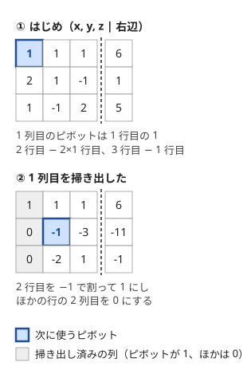
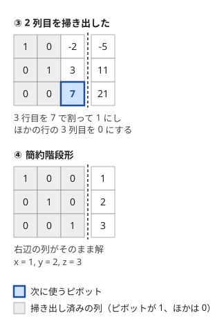
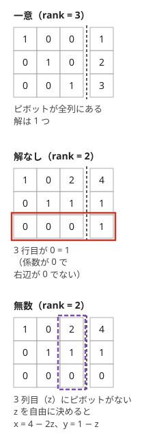

!!! abstract "要点"
    - **何ができるか**：行基本変形で連立一次方程式の係数の行列を簡約階段形にし、解なし・一意・無数を判定して、解の 1 つと[ランク](../guide/glossary.md#rank)を求める。mod 2 では行の引き算が XOR になって bitset で速くでき、解があるときの解の個数は $2^{\text{変数の数} - \text{ランク}}$ になる。
    - **いつ使うか**：
        - スイッチを押すと複数のランプが反転する・偶奇の条件が N 個ある
        - 条件を満たす押し方の数を mod で答える
        - 各頂点に書いた値の、隣接する頂点の XOR が 0 になるように決める
        - 変数・式の数が数百〜2000 程度で $O(n^3)$ や $O(n^3/64)$
        - 変数の 1 次式（mod 2 なら XOR）＝定数 の式が複数立つ
    - **計算量**：式 $n$ 本・変数 $m$ 個で $O(nm \min(n, m))$（$n = m$ なら $O(n^3)$）。mod 2 は bitset で $O(nm \min(n, m) / 64)$
    - **前提**：[逆元と mod での割り算](../math/mod-inverse.md)

<!-- textlint-disable -->
別名：ガウスの消去法・Gaussian elimination・Gauss-Jordan・連立一次方程式・ランク・ライツアウト・mod 2 の連立方程式
<!-- textlint-enable -->

掃き出し法は、連立一次方程式の係数を表に並べ、「ある行の定数倍を別の行から引く」操作で変数を 1 つずつ消していく方法である。解の有無と個数、解の 1 つ、式の本当の本数（ランク）がまとめて分かる。競技プログラミングでは、実数よりも mod $p$ と mod 2（XOR）で使うことが多い。

このページでは、式の数を $n$、変数の数を $m$ とし、変数 $x_0, \dots, x_{m-1}$（0-indexed）の式 $\sum_j a_{ij} x_j = b_i$（$0 \le i < n$）を解く。係数の $n \times m$ の表を $A$、右辺を $b$ と書き、$A$ の右に $b$ を 1 列足した表を拡大係数行列と呼ぶ（記法は[記法と用語の約束](../start/notation.md)）。

## 行基本変形と階段形、解なし（0 = 1）・一意・無数の判定 {#row-reduction}

連立一次方程式は、式を足し引きして変数を減らせば解ける。掃き出し法はこの手順を表の上で機械的に行う。拡大係数行列に次の 3 つの操作（行基本変形）をしても、解の集合は変わらない。

1. 2 つの行を入れ替える
2. ある行を 0 でない数 $c$ 倍する
3. ある行の $c$ 倍を、別の行に足す

**解が変わらない理由**：どの操作も元に戻せる。入れ替えはもう一度入れ替え、$c$ 倍は $1/c$ 倍、$c$ 倍を足すのは $c$ 倍を引けば戻る。操作の後の式は元の式から作ったものなので、元の解は操作の後の式も満たす。逆向きの操作で元の式も作れるので、操作の後の解は元の式も満たす。よって解の集合は等しい。2 の $c$ が 0 だと戻せないので、0 倍は許されない。

### 手順

列を左から 1 列ずつ見て、次のことを繰り返す。まだピボットに使っていない行を「残りの行」と呼ぶ。

```text
rank ← 0
for col = 0, 1, ..., m-1:
    残りの行（rank 行目以降）から、col 列が 0 でない行を 1 つ探す
    なければ次の列へ（この列の変数は自由変数になる）
    見つけた行を rank 行目と入れ替える            # ピボットの行
    rank 行目を a[rank][col] で割り、ピボットを 1 にする
    rank 行目以外のすべての行 i から、a[i][col] 倍の rank 行目を引く
    rank ← rank + 1
```

選んだ 0 でない成分をピボットという。各列の処理が終わると、その列はピボットだけが 1 で、ほかの行はすべて 0 になる。終わった形を簡約階段形といい、ピボットの数がランクである。下の行を消すだけで上の行を残し、最後に後ろから代入していく書き方（ガウスの消去法）もあるが、上の行まで消しておく（Gauss-Jordan）方が解を読み取りやすく、計算量の次数も同じである。

次の図は $x + y + z = 6$、$2x + y - z = 1$、$x - y + 2z = 5$ を掃き出す様子である。




最後の形では左の 3 列が対角に 1 が並ぶ形（単位行列）になり、各行が「$x = 1$」「$y = 2$」「$z = 3$」という式を表す。

### 解なし・一意・無数の判定

掃き出した後の形から、解は次のように分かる。ランクを $r$ とする。

- **解なし**：$r$ 行目以降に、係数がすべて 0 で右辺が 0 でない行が残る。その行は「$0 = 1$」のような式で、どの値でも満たせない
- **一意**：解なしでなく、$r = m$（すべての列にピボットがある）。各変数がちょうど 1 つの行で決まる
- **無数**（mod $p$ なら有限個）：解なしでなく、$r < m$。ピボットのない列の変数（自由変数）は好きな値にでき、決めるとピボットの変数が 1 つずつ決まる



解の 1 つが欲しいときは、自由変数をすべて 0 にし、ピボットのある行 $i$ について「ピボットの変数 ＝ その行の右辺」とすればよい。簡約階段形では、ピボットの行にはほかのピボットの変数が現れないので、この値で全部の式が成り立つ。

### 計算量

1 つの列の処理では、ピボットの行で $n$ 行すべてを更新し、1 行あたり $m + 1$ 個の成分を触るので $O(nm)$ かかる。ピボットが見つかる列は $\min(n, m)$ 個以下で、見つからない列は探すだけの $O(n)$ で済む。合わせて $O(nm \min(n, m))$、正方行列なら $O(n^3)$ である。$n = 500$ なら $n^3 = 1.25 \times 10^8$ 回ほどである。

## mod p の掃き出し（ピボットで割る＝逆元） {#mod-p}

法 $p$ が素数なら、掃き出し法は実数のときと同じ手順で mod $p$ のまま行える。必要な割り算は「ピボットの行をピボットの値で割る」の 1 か所だけで、ピボットは mod $p$ で 0 でないので、その[逆元](../math/mod-inverse.md)を掛ければよい。ほかは足し算・引き算・掛け算なので、途中で余りを取ってよい。

ピボットを探すときの「0 でない」は、mod $p$ で 0 でないという意味である。整数としては 0 でなくても $p$ の倍数なら使えない。入力の係数が $p$ 以上になりうるなら、まず $p$ で割った余りにしてから判定する。

```cpp
--8<-- "gaussian-elimination/mod-p.cpp:core"
```

完全なプログラム：[`mod-p.cpp`](https://github.com/yuukougun/kyopro-atlas/blob/main/snippets/gaussian-elimination/mod-p.cpp)（GitHub）。`mint` は ACL の `modint998244353`（[modint](../math/modint.md)）。
{ .kp-code-src }

`sweep` は上の[手順](#row-reduction)をそのまま書いたもので、`solve` は判定と解の読み取りである。ピボットの列は、行の中で最初に 0 でない成分の位置として探し直している（並べて持っておいてもよい）。期待値の方程式のように答えが 1 つに決まる問題でも、途中のピボットが mod $p$ でたまたま 0 になることはあるので、行の入れ替えは省かない。

法が素数でないとき（$10^9$ など）は、0 でない数でも逆元を持つとは限らないので、この手順はそのままでは使えない。法の素因数ごとに解いて[中国剰余定理](../math/crt.md)で合わせる、行どうしでユークリッドの互除法のように引き算を繰り返して消す、などの工夫が要る。

## mod 2 の掃き出しは XOR、bitset で速くする {#mod-2}

mod 2 では値が 0 と 1 だけで、足し算と引き算はどちらも [XOR](../basics/bit-operations.md) になる。$x_0 \oplus x_2 = 1$ のような「いくつかの変数の XOR が決まった値」という式は、mod 2 の 1 次式そのものである。ピボットは必ず 1 なので割る必要がなく、「行を引く」は「行を XOR する」になる。

偶奇の条件は mod 2 の式に言い換えられる。ライツアウト（ボタンを押すと自分と周りのランプが反転し、すべてのランプを消す）なら、各ボタンを押すかどうかを $x_j \in \{0, 1\}$ とする。2 回押すと元に戻るので、押す回数は偶奇だけが意味を持つ。ランプ $i$ が最後に反転している回数の偶奇は「ランプ $i$ に効くボタンの $x_j$ の XOR」で、これが「最初に点いていたら 1」と等しい、という式がランプの数だけ並ぶ。

1 行を 0 と 1 の列とみると、`bitset` に詰めて 1 行の XOR を 1 回の演算で書ける。`bitset<W>` の XOR は 64 bit ずつまとめて計算するので、`W` を変数の数 $+ 1$ 程度にとれば、1 行の更新が $O(m)$ から $O(m / 64)$ になり、全体は $O(nm \min(n, m) / 64)$ になる。$n = m = 2000$ でも $8 \times 10^9 / 64 = 1.25 \times 10^8$ ほどで、間に合う。速くなる理由は [bitset 高速化](../misc/bitset-speedup.md)を見る。

```cpp
--8<-- "gaussian-elimination/mod2-bitset.cpp:core"
```

完全なプログラム：[`mod2-bitset.cpp`](https://github.com/yuukougun/kyopro-atlas/blob/main/snippets/gaussian-elimination/mod2-bitset.cpp)（GitHub）
{ .kp-code-src }

行 `a[i]` の下位 $m$ bit が係数で、bit $m$ に右辺を入れている。右辺も同じ行に入れておけば、行の XOR で右辺も一緒に更新される。`W` はコンパイル時に決める定数なので、変数の数 $+ 1$ 以上の値にしておく。`bitset` の `[]` は範囲を確かめないので、足りないと黙って配列の外を触る。逆に大きすぎても、1 回の XOR は必ず $W / 64$ 語を処理するので、そのぶん遅くなる。

変数が 64 個以下なら、1 行を `unsigned long long` 1 つに入れても同じことができる。この形は [XOR 基底](../math/xor-basis.md)の挿入とほぼ同じで、XOR 基底は「XOR で作れる値の集合」を扱うときに、掃き出しを 1 行ずつ足しながら行うものとみなせる。

## ランクと解の個数 p^(変数の数 − ランク) {#rank}

掃き出した後のピボットの数 $r$ を、行列 $A$ のランク（階数）という。行基本変形でランクは変わらず、どの順で掃き出しても同じ値になる。ランクは「どの式も、ほかの式の定数倍の和（mod 2 なら XOR）で作れないように選べる式（[一次独立](../guide/glossary.md#linear-independence)な行）の最大の本数」で、ほかの式から作れる式を除いた本当の式の数にあたる。$r \le \min(n, m)$ である。

**解の個数**：mod $p$ で解があるとき、解はちょうど $p^{m - r}$ 個ある。自由変数は $m - r$ 個あり、それぞれに $p$ 通りの値を選べ、選ぶとピボットの変数がただ 1 つに決まるからである。mod 2 なら $2^{m - r}$ 個で、解がなければ 0 個である。指数は「変数の数 − ランク」で、式の数は関係しない。

```cpp
--8<-- "gaussian-elimination/mod2-bitset.cpp:count"
```

完全なプログラム：[`mod2-bitset.cpp`](https://github.com/yuukougun/kyopro-atlas/blob/main/snippets/gaussian-elimination/mod2-bitset.cpp)（GitHub）。`mint` は ACL の `modint998244353`（[modint](../math/modint.md)）。
{ .kp-code-src }

$2^{m-r}$ は $m - r$ が 60 を超えうるので、`1LL << (m - r)` ではなく mod で[繰り返し二乗法](../math/mod-pow.md)を使う。

**右辺によらない形**：解があるときの個数は右辺 $b$ によらず、$A$ のランクだけで決まる。2 つの解の差は $Ax = 0$ の解なので、解の集合は「解の 1 つ＋$Ax = 0$ の解の全体」と書けるからである。とくに右辺が 0 の式 $Ax = 0$ はいつも $x = 0$ を解に持ち、解はちょうど $p^{m - r}$ 個ある。

**選び方の数え上げ**：mod 2 のベクトル（0/1 の列）$v_1, \dots, v_N$ からいくつかを選んで XOR を 0 にする選び方は、空の選び方も含めて $2^{N - r}$ 通りある（$r$ はベクトルを行に並べた行列のランク）。選ぶかどうかを $x_i$ とすると、$x_1 v_1 \oplus \dots \oplus x_N v_N = 0$ は $N$ 変数の右辺 0 の式になる。この式の係数の行列は、ベクトルを列に並べたものである。行と列を入れ替えてもランクは変わらない（行のランクと列のランクは等しい）ので、ベクトルを行に並べて掃き出せばよい。積が平方数になる選び方を、素因数の指数の偶奇のベクトルで数える型（[素因数の指数ベクトル](../math/prime-exponent-vector.md)）がこれにあたる。

??? note "行のランクと列のランクが等しい理由（筋）"
    行基本変形は行の足し引きなので、行で作れる式の集合（行の張る空間）を変えない。また、どの列の組が一次独立かという関係も変えない（列どうしの関係 $\sum c_j \cdot (\text{列 } j) = 0$ は $Ac = 0$ という式で、行基本変形で解が変わらないから）。簡約階段形では、ピボットの $r$ 行が一次独立で、ピボットのある $r$ 列が一次独立、ほかの列はそれらで作れる。よって行のランクも列のランクも $r$ である。

## 実数の掃き出し（部分ピボット選択と誤差） {#real}

実数の係数で解くときは、`double` の丸め誤差に気を付ける。期待値や確率を小数で答える問題で、状態の数だけ未知数を立てる（[閉路のある期待値](../comb/expectation-linear-equations.md#linear-system)）ときに使う。

**部分ピボット選択**：ピボットには、残りの行のうちその列の絶対値が最大の行を選ぶ。小さな値をピボットにすると、ほかの行から引く倍率 $a_{i,\mathrm{col}} / (\text{ピボット})$ が大きくなり、行の中の小さな値が丸めで消えてしまうからである。

たとえば $10^{-20} x + y = 1$、$x + y = 2$ の解はほぼ $x = 1, y = 1$ である。1 行目の $10^{-20}$ をピボットにすると、2 行目から 1 行目の $10^{20}$ 倍を引き、2 行目は $(1 - 10^{20}) y = 2 - 10^{20}$ になる。`double` では両辺とも $-10^{20}$ に丸まり、$y = 1$ は正しいが、1 行目に戻すと $x = (1 - y) / 10^{-20} = 0$ になる。絶対値が最大の 2 行目をピボットにすれば、引く倍率は $10^{-20}$ で、正しく $x \approx 1$ が得られる（どちらも手元で実行して確かめた）。

```cpp
--8<-- "gaussian-elimination/real.cpp:core"
```

完全なプログラム：[`real.cpp`](https://github.com/yuukougun/kyopro-atlas/blob/main/snippets/gaussian-elimination/real.cpp)（GitHub）
{ .kp-code-src }

**0 の判定**：実数では、本当は 0 になる成分が $10^{-17}$ のような値で残る。ピボットを探すときは、絶対値が `EPS` より小さければ 0 とみなす。ランクや「解なし」の判定はこの `EPS` に左右されるので、答えが一意と保証された問題で使うのが安全である。係数が整数で、解が一意かどうかやランクだけを知りたいなら、大きな素数の mod で掃き出す方が誤差の心配がない（ただし mod $p$ のランクは実数のランク以下で、たまたま小さくなることがある）。

## 落とし穴 {#pitfalls}

- **指数を式の数にする**：解の個数は $p^{\text{変数の数} - r}$ である。$p^{n - r}$（式の数 − ランク）と書くと、式が変数より多い問題で答えがずれる
- **解なしの確かめ忘れ**：ランクだけを求めて $2^{m - r}$ を出すと、$0 = 1$ の行が残る場合にも 0 でない答えを出す。$r$ 行目以降の右辺を必ず見る
- **右辺の列をピボットに選ぶ**：拡大係数行列の最後の列（右辺）まで掃き出すと、$0 = 1$ の行が右辺の列のピボットになり、解なしを見逃す。ピボットを探すのは係数の $m$ 列だけにする
- **mod で 0 の判定**：mod $p$ の値を `long long` で持つとき、係数が負のまま・$p$ 以上のまま残っていると、0 の判定を誤る。ACL の modint なら `val()` で比べる
- **bitset の幅**：`bitset<W>` の `W` が変数の数 $+ 1$ より小さいと、範囲の外を触って未定義動作になる。制約の最大値から決める
- **すべて 0 の解しかない**：右辺が 0 の式は $x = 0$ を必ず解に持つ。「どの変数も 0 でない」「1 つ以上選ぶ」などの条件があるなら、$2^{m - r}$ から 1 を引く、変数を 1 に固定した式を足して解き直す、などで別に扱う（[力試し](#challenge)の ABC366 G）
- **実数の EPS**：`EPS` が大きすぎると 0 でないピボットを捨て、小さすぎると誤差で残った値をピボットにする。係数の大きさに合わせて決め、できれば mod で解く

## 例題 {#examples}

### ABC313 D. Odd or Even {#abc313_d}

<div class="kp-problems" data-role="example" markdown>

- [ABC313 D. Odd or Even](https://atcoder.jp/contests/abc313/tasks/abc313_d)（diff 1630）：インタラクティブ。隠された 0/1 の列を、K 個の位置を指定してその和の偶奇を聞く質問（N 回まで）から復元する（K は奇数）。

</div>

1 回の質問の答えは「指定した $K$ 個の $A_i$ の XOR」なので、mod 2 の 1 次式が 1 本手に入る。$N$ 個の未知数を $N$ 回の質問で決めるには、$N$ 本の式の係数の行列がランク $N$（解が一意）になるように質問を選べばよい。質問の選び方と復元の手順は[インタラクティブ](../misc/interactive.md#equations-crt)にあり、ここでは選び方がなぜうまくいくかを掃き出し法の言葉で確かめる。

??? note "解法の詳細"
    先頭の $K + 1$ 個 $A_1, \dots, A_{K+1}$ から 1 つずつ除いた $K + 1$ 通りの質問をする。$A_i$ を除いた質問の答えを $q_i$ とする。$q_1 \oplus \dots \oplus q_{K+1}$ では各 $A_j$ がちょうど $K$ 回（奇数回）現れるので、これは $A_1 \oplus \dots \oplus A_{K+1}$ に等しい。よって $A_i$ はこれと $q_i$ の XOR、すなわち $q_i$ 以外の答えすべての XOR である。

    同じことを行列で確かめる（行列の積の書き方は[行列累乗](../math/matrix-power.md)）。係数の行列 $B$ は「対角が 0、ほかが 1」の $(K+1) \times (K+1)$ 行列である。すべてが 1 の行列を $J$、単位行列を $I$ とすると $B = J - I$ で、$J^2 = (K + 1) J$ より $B^2 = (K + 1)J - 2J + I = (K - 1) J + I$ となる。$K$ が奇数なら $K - 1$ は偶数なので、mod 2 で $B^2 = I$ である。つまり $B$ を 2 回掛けると元に戻るので、$B$ は逆行列（自分自身）を持ち、ランクは $K + 1$ である。答えの列は $q = BA$ と書け、両辺にもう一度 $B$ を掛けると $Bq = B^2 A = A$ となって、上の復元と一致する。$K$ が偶数なら $B$ の各行の 1 の個数 $K$ が偶数なので、すべての行の XOR が 0 になり、ランクが $K + 1$ に届かない。この選び方は $K$ が奇数だから使える。

    残りの $A_i$（$i > K + 1$）は、値の分かった $K - 1$ 個と $A_i$ を合わせた質問 1 回で決まる。質問は合わせて $(K + 1) + (N - K - 1) = N$ 回である。一般の行列を作って掃き出してもよいが、$B$ の逆行列が手で求まるので、掃き出しを書かずに済む。

### 典型90 057. Flip Flap（★6） {#typical90_be}

<div class="kp-problems" data-role="example" markdown>

- [典型90 057. Flip Flap（★6）](https://atcoder.jp/contests/typical90/tasks/typical90_be)（diff なし）：N 個のスイッチがそれぞれ決まった複数のパネルを反転させるとき、すべてのパネルを目標の状態にする押し方の数を 998244353 で割った余りで求める。

</div>

スイッチ $j$ を押すかどうかを $x_j \in \{0, 1\}$ とする（2 回押すと元に戻るので偶奇だけでよい）。パネル $i$ について「パネル $i$ を反転させるスイッチの $x_j$ の XOR ＝ 目標の状態」という mod 2 の式が立つ。パネルを $M$ 枚とすると、変数 $N$ 個・式 $M$ 本の連立方程式になる。これを掃き出し、解がなければ 0、あればランク $r$ で $2^{N - r}$ が答えである。

??? note "解法の詳細"
    最初はすべてのパネルが 0 なので、パネル $i$ の最後の状態は、それを反転させるスイッチのうち押したものの個数の偶奇である。係数の行列 $A$ は、パネル $i$ がスイッチ $j$ で反転するとき $A_{ij} = 1$ の $M \times N$ 行列になる。[mod 2 の掃き出し](#mod-2)の `sweep2` に右辺（目標の状態）を bit $N$ に入れて渡し、$r$ 行目以降に右辺が 1 の行が残れば 0 を出力する。残らなければ自由変数 $N - r$ 個の選び方がすべて解なので、$2^{N - r} \bmod 998244353$ を出力する。

    作問者の解答コードは、スイッチを行（行列 $A$ の転置）に並べて掃き出し、目標の列も同じピボットで消している。行と列を入れ替えてもランクは同じなので、どちらの向きでもよい。

## 練習問題 {#practice}

<div class="kp-problems" data-role="practice" markdown>

- [ABC128 C. Switches](https://atcoder.jp/contests/abc128/tasks/abc128_c)（diff 805）：N 個のスイッチと M 個の電球があり、各電球はつながったスイッチのうち ON の個数の偶奇が決まった値のときに点く。すべての電球が点くスイッチの状態の数を求める（N, M ≤ 10）。
- [CODE-THANKS-FESTIVAL-2017 F. Limited Xor Subset](https://atcoder.jp/contests/code-thanks-festival-2017/tasks/code_thanks_festival_2017_f)（diff なし）：N 個（N ≤ 10^5）の正の整数から 0 個以上を選んで XOR が K になる選び方の数を、10^9+7 で割った余りで求める（値は 10^5 以下）。
- [JAG2013SUMMER-DAY4 F. Graph Automata Player](https://atcoder.jp/contests/jag2013summer-day4/tasks/icpc2013summer_day4_f)（diff なし）：N 頂点（N ≤ 300）の有向グラフで、各頂点の 0/1 の値が「辺の先で 1 の頂点の数が奇数なら 1」という規則で一斉に変わるとき、T 回後の値から元の値を復元し、解がなければ none、複数あれば ambiguous と答える。
- [BITFLYER2018-FINAL D. 数列 XOR](https://atcoder.jp/contests/bitflyer2018-final/tasks/bitflyer2018_final_d)（diff なし）：長さ N（N ≤ 10^5）の 60 bit の整数の列 A に、隣り合う 2 項の一方をその 2 項の XOR に置き換える操作を何度でも行って、列 B にできるかを判定する。

</div>

??? note "練習の方針"
    - **ABC128 C**：$N \le 10$ なので [bit 全探索](../basics/bit-full-search.md)で足りる。各電球の条件は「つながったスイッチの $x_j$ の XOR ＝ $p_i$」という mod 2 の式なので、掃き出してランク $r$ から $2^{N - r}$（解がなければ 0）としても求まる。$N, M$ が数百でも同じ方法で解ける
    - **CODE-THANKS-FESTIVAL-2017 F**：選ぶかどうかを $x_i$ とすると、bit ごとに mod 2 の式が十数本並ぶ。掃き出してランク $r$ を求め、矛盾があれば 0、なければ $2^{N-r}$ と数える（値の和が $10^5$ 以下という制約を使う別の解き方もある）
    - **JAG2013SUMMER-DAY4 F**：1 回の変化は隣接行列 $A$ を掛ける mod 2 の演算なので、$A^T$ を繰り返し二乗法で求める。$A^T x = (\text{T 回後の値})$ を mod 2 で掃き出し、$0 = 1$ が出れば none、ランクが $N$ 未満なら ambiguous、$N$ なら解を出す。行列の積と掃き出しは bitset で速くする
    - **BITFLYER2018-FINAL D**：操作を組み合わせると、行の入れ替えと「ある行に別の行を XOR する」ができる。各数を 60 bit の行とみると操作は mod 2 の行基本変形そのもので、逆の操作も行基本変形である。$A$ と $B$ をそれぞれ簡約階段形にして（簡約階段形は操作の順によらず一意）、一致するかで判定する

## 力試し {#challenge}

<div class="kp-problems" data-role="challenge" markdown>

- [ABC366 G. XOR Neighbors](https://atcoder.jp/contests/abc366/tasks/abc366_g)（diff 2409）：N 頂点の単純無向グラフの各頂点に 1 以上 2^60 未満の整数を書き、次数 1 以上のすべての頂点で隣接頂点の値の XOR が 0 になるようにできるかを判定し、例を示す。
- [YAHOO-PROCON2019-QUAL E. Odd Subrectangles](https://atcoder.jp/contests/yahoo-procon2019-qual/tasks/yahoo_procon2019_qual_e)（diff 2585）：N × M の 0/1 行列で、行の集合と列の集合の組のうち、交わる部分の和が奇数になるものの個数を 998244353 で割った余りで求める。

</div>

??? note "力試しの方針"
    - **ABC366 G**：XOR は bit ごとに独立なので、0/1 を書く問題を解いて bit ごとに重ねる。0/1 の問題は「各頂点 $v$ で隣接頂点の $x_u$ の XOR が 0」という右辺 0 の mod 2 の式である（$N \le 60$）。$x = 0$ は必ず解だが、値が 0 になるので使えない。頂点 $i$ ごとに「$x_i = 1$」の式を足して解き、得た解を各頂点の値の bit $i$ に書く。どれかの $i$ で解がなければ、どの書き方でも頂点 $i$ は 0 になるので不可能である。$N \le 60$ なので値は $2^{60}$ 未満に収まり、各頂点 $v$ は bit $v$ が 1 なので 0 にならない
    - **YAHOO-PROCON2019-QUAL E**：行の集合を決めると、選んだ行の XOR（長さ $M$ の 0/1 の列）$v$ が決まる。$v$ が 0 でなければ、列の集合のうちちょうど半分の $2^{M-1}$ 個で和が奇数になり、$v = 0$ なら 0 個である。$v = 0$ になる行の集合は、行列のランクを $r$ として $2^{N - r}$ 個（[ランクと解の個数](#rank)）なので、答えは $(2^N - 2^{N - r}) \cdot 2^{M - 1}$ である

## 確認問題 {#quiz}

??? question "確認問題：mod 2 で変数 10 個・式 15 本の連立方程式を掃き出したらランクが 7 で、8 行目以降の右辺はすべて 0 だった。解は何個か"
    ??? success "答え"
        $2^{10 - 7} = 8$ 個である。指数は変数の数 − ランクで、式の数 15 は関係しない。8 行目以降は係数も右辺も 0 の「$0 = 0$」なので、解なしにはならない。

??? question "確認問題：3 つの 0/1 の列 110・011・101 から、空でないいくつかを選んで XOR を 0 にする選び方は何通りか"
    ??? success "答え"
        1 通り（3 つ全部）である。$110 \oplus 011 = 101$ なので 3 本目は前の 2 本から作れ、ランクは 2 である。XOR が 0 になる選び方は空を含めて $2^{3 - 2} = 2$ 通りで、空を除くと 1 通りになる。

??? question "確認問題：mod 998244353 で掃き出すとき、係数を `long long` のまま余りを取らずに持ち、ピボットに使えるかを「整数として 0 でないか」で判定するとどうなるか"
    ??? success "答え"
        係数が 998244353 の倍数（たとえば 998244353 そのもの）だと、mod では 0 なのにピボットに選んでしまう。逆元が存在しないので、フェルマーの小定理で計算した「逆元」は 0 になり、行が全部 0 に潰れて誤った答えになる。係数は最初に mod を取り、0 の判定は余りで行う。本文のコードのように ACL の `modint` を使えば、代入のときに余りを取るので、この失敗は起きない。

??? question "確認問題：実数の掃き出しで、部分ピボット選択をしても誤差がなくならないのはどんなときか"
    ??? success "答え"
        係数の大きさがかけ離れていたり、ほとんど一次従属な式（ほぼ同じ式）が並んでいたりするときである。部分ピボット選択は倍率を 1 以下に抑えて誤差の増え方を小さくするだけで、問題そのものが誤差に弱い場合は防げない。答えが有理数なら mod で解く、整数で厳密に計算する、などを考える。

## 使い分け {#comparison}

| 状況 | 使う手法 |
| --- | --- |
| 変数が 20 個ほどまでで、全部の割り当てを試せる | [bit 全探索](../basics/bit-full-search.md) |
| XOR で作れる値の集合・その最大値・K 番目を扱う | [XOR 基底](../math/xor-basis.md) |
| 期待値の式で、戻る先が 1 か所や少数に限られる | [閉路のある期待値](../comb/expectation-linear-equations.md) |
| 行列式・全域木の個数を求める | [行列式](../math/determinant.md)（掃き出しで上三角にする） |
| 線形な遷移を K 回くり返す | [行列累乗](../math/matrix-power.md) |
| 多項式の値の組から係数や別の点の値を求める | [ラグランジュ補間](../math/lagrange-interpolation.md)（掃き出しより速い） |

## 参考 {#references}

- [drken「Gauss-Jordan の掃き出し法と、連立一次方程式の解き方」](https://drken1215.hatenablog.com/entry/2019/03/20/202800)：行基本変形と簡約階段形、ランクと解の個数（F2・mod p）、実数での部分ピボット選択と EPS、bitset による mod 2 の実装
- [drken「AtCoder ABC 313 D - Odd or Even (1D, 青色, 550 点)」](https://drken1215.hatenablog.com/entry/2023/08/06/010000)：例題 abc313_d の質問の選び方と制約（K は奇数）
- [E869120「kyopro_educational_90 sol/057.cpp」](https://github.com/E869120/kyopro_educational_90/blob/main/sol/057.cpp)：例題 typical90_be の入力の形と、mod 2 で掃き出して 2^(N − rank) を出す解法
- [drken「AtCoder ABC 128 C - Switches (3Q, 緑色, 300 点)」](https://drken1215.hatenablog.com/entry/2019/06/15/135300)：練習 abc128_c の bit 全探索と、mod 2 の連立方程式として解く別解
- [kmjp「AtCoder ABC #366 : G - XOR Neighbors」](https://kmjp.hatenablog.jp/entry/2024/08/16/1000)：力試し abc366_g の、頂点ごとに 1 に固定して解き bit に重ねる方針と制約（N ≤ 60）
- [drken「みんなのプロコン 2019 E - Odd Subrectangles (3D, 橙色, 800 点)」](https://drken1215.hatenablog.com/entry/2019/02/10/024200)：力試し yahoo_procon2019_qual_e がランクだけで決まること
- [drken「CODE FESTIVAL THANKS 2017 F - Limited Xor Subset (2D, 500 点)」](https://drken1215.hatenablog.com/entry/2019/03/20/173300)：練習 CODE FESTIVAL 2017 Thanks F の bit ごとの連立方程式とランク
- [drken「AOJ 2624 Graph Automata Player (JAG 夏合宿 2013 day4-F) (2D, 550 点)」](https://drken1215.hatenablog.com/entry/2019/03/20/192300)：練習 JAG 夏合宿 2013 Day4 F の行列累乗と mod 2 の掃き出し
- [drken「2018 codeFlyer 本選 D - 数列 XOR (3D, 600 点)」](https://drken1215.hatenablog.com/entry/2018/07/04/070000)：練習 codeFlyer 本選 D の行基本変形への言い換えと簡約階段形の比較
