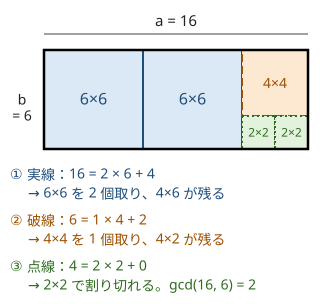

!!! abstract "要点"
    - **何ができるか**：$\gcd(a, b) = \gcd(b, a \bmod b)$ を繰り返して最大公約数を $O(\log \min(a, b))$ で求め、最小公倍数は $a / \gcd(a, b) \times b$ で求める。1 つ除いた gcd を左右からの累積 gcd で求め、分数を既約にして等しいかを比べる。
    - **いつ使うか**：
        - 全員が同時に・周期がそろう最初の時刻（lcm）。
        - 等間隔に移動してすべての点を訪れられる最大の幅（gcd）。
        - 1 つだけ書き換え（取り除い）たときの gcd の最大。
        - 分数や傾きが等しいものを同じものとして数える。
    - **計算量**：gcd・lcm 1 回は $O(\log \min(a, b))$ で、値が $10^{18}$ 以下なら割り算は 85 回以下。$N$ 個の gcd・lcm と、1 つ除いた gcd の全体は $O(N \log V)$（$V$ は値の上限）
    - **前提**：[整数の割り算と余り](../math/integer-division.md)

<!-- textlint-disable -->
別名：最大公約数・最小公倍数・互除法・Euclidean algorithm・std::gcd・既約分数
<!-- textlint-enable -->

GCD・LCM とユークリッドの互除法は、最大公約数（gcd）を割り算の余りだけで速く求め、最小公倍数（lcm）をそこから求める方法である。C++17 以降は `std::gcd`・`std::lcm` があるので、自分で書く場面は少ない。押さえるべきなのは、互除法がなぜ速いか、複数の数への広げ方と初期値、lcm のあふれ、累積 gcd と既約分数という使い方である。

このページでは $a, b$ を 0 以上の整数とし、$\gcd(0, 0) = 0$ とする。記法は[記法と用語の約束](../start/notation.md)にそろえる。

## 互除法の正しさ（公約数の集合が変わらない）と回数の上限（隣り合うフィボナッチ数） {#euclid}

ユークリッドの互除法は、$b \ne 0$ の間 $(a, b)$ を $(b, a \bmod b)$ に置き換え、$b = 0$ になったときの $a$ を gcd とする。正しい理由は、置き換えの前後で公約数の集合が変わらないことにある。

$a = qb + r$（$r = a \bmod b$）と書く。$d$ が $a$ と $b$ の公約数なら、$r = a - qb$ も $d$ で割り切れる。逆に $d$ が $b$ と $r$ の公約数なら、$a = qb + r$ も $d$ で割り切れる。公約数の集合が同じなので、その最大である gcd も同じになる。最後の $\gcd(a, 0)$ が $a$ なのは、どの整数も 0 を割り切るからである。

図でいえば、$a \times b$ の長方形から一辺 $b$ の正方形を取れるだけ取り、残った長方形で同じことを繰り返すのが互除法である。正方形を取り切ったときの一辺が、元の長方形をすき間なく敷き詰められる最大の正方形の一辺、すなわち gcd になる。



$\gcd(16, 6)$ は、$16 \bmod 6 = 4$、$6 \bmod 4 = 2$、$4 \bmod 2 = 0$ の 3 回の割り算で 2 と求まる。1 段で取る正方形の個数が商 $q$ で、残りの辺が余り $r$ である。

**回数の上限**。$a \ge b$ なら、2 回の置き換えで $a$ は半分未満になる。$a \bmod b$ は、$b \le a / 2$ なら $b$ より小さく、$b > a / 2$ なら $a - b < a / 2$ だからである。$a < b$ から始めても、1 回目で $(b, a)$ に入れ替わって $a \ge b$ になる。よって回数は $O(\log a)$ で、1 回目の後は $a$ が元の $\min(a, b)$ 以下になるので $O(\log \min(a, b))$ である。最も回数がかかるのは、商が毎回 1 になる隣り合うフィボナッチ数 $(F_{k+1}, F_k)$ で、$(F_k, F_{k-1})$ へと 1 つずつしか進まない。値の上限ごとの最悪の回数は次のとおりである（手元で数えた値）。

| 値の上限 | 最悪の組 | 割り算の回数 |
| --- | --- | --- |
| $10^9$ | $(F_{44}, F_{43})$ | 42 |
| $10^{18}$ | $(F_{87}, F_{86})$ | 85 |
| `long long` の最大 | $(F_{92}, F_{91})$ | 90 |

gcd 1 回は多くても 90 回ほどの割り算で済むので、$N = 2 \times 10^5$ 個の数に 1 回ずつ使っても気にしなくてよい。

```cpp
--8<-- "gcd-lcm/euclid.cpp:gcd"
```

??? question "確認問題：引き算の互除法"
    $\gcd(a, b) = \gcd(a - b, b)$（$a \ge b$）が成り立つことから、互除法が導けるのはなぜか。また、引き算だけで互除法を書くと何が困るか。

    ??? success "答え"
        $a$ から $b$ を引く操作を、$a < b$ になるまで $q$ 回繰り返すと $a \bmod b$ になる。各回で gcd が変わらないので、$\gcd(a, b) = \gcd(a \bmod b, b)$ が成り立つ。引き算だけだと、$\gcd(10^{18}, 1)$ で $10^{18}$ 回引くことになり終わらない。余りを取れば $q$ 回の引き算を 1 回の割り算で済ませられる。

## 複数の数の gcd・lcm と gcd(0, a) = a {#many-numbers}

3 つ以上の数の gcd は、2 つずつ順に取れば求まる。$\gcd(a, b, c) = \gcd(\gcd(a, b), c)$ で、どの順に取っても同じである。$a$ と $b$ の公約数は、ちょうど $\gcd(a, b)$ の約数だからである。互除法の各段で公約数の集合は変わらず、最後は $\gcd(a, b)$ と 0 の公約数、すなわち $\gcd(a, b)$ の約数になる。lcm も同じく $\operatorname{lcm}(a, b, c) = \operatorname{lcm}(\operatorname{lcm}(a, b), c)$ である。

順に取るときの初期値は、gcd なら 0、lcm なら 1 にする。$\gcd(0, x) = x$、$\operatorname{lcm}(1, x) = x$ なので、最初の数で初期値が上書きされ、場合分けが要らない（0 と 1 はそれぞれの演算の[単位元](../guide/glossary.md#identity-element)である）。

```cpp
--8<-- "gcd-lcm/euclid.cpp:many"
```

問題に gcd・lcm が現れる典型は次の 3 つである。

- **周期がそろう**：「全員が同時に」「すべての周期がそろう最初の時刻」は、周期の lcm である（[練習の ABC070 C](#practice)）
- **等間隔に移動する**：位置 $X$ から $\pm D$ ずつ動いて行ける位置は $X + kD$（$k$ は整数）である。点 $x_i$ をすべて訪れるには、$D$ が差 $\lvert x_i - X \rvert$ をすべて割り切ればよく、最大の $D$ は差の gcd になる（[例題](#abc109_c)）
- **同じ大きさに分ける**：いくつかの長さを同じ長さの区間（正方形・立方体）にすき間なく分けるとき、最大の一辺は長さの gcd である

## lcm のオーバーフロー（割ってから掛ける） {#lcm-overflow}

$\operatorname{lcm}(a, b) = ab / \gcd(a, b)$ だが、この順で計算すると、lcm 自体は収まるのに途中の $ab$ があふれる。$a = b = 10^{18}$ なら lcm は $10^{18}$ だが、$ab = 10^{36}$ は `long long` に入らない。$a / \gcd(a, b) \times b$ の順にすれば、$a / \gcd(a, b)$ は割り切れる整数で、掛けた結果は lcm そのものなので、lcm が収まる限りあふれない。

複数の数の lcm は急に大きくなる。たとえば $1, 2, \dots, 43$ の lcm は $10^{18}$ を超える（約 $9.4 \times 10^{18}$）。「lcm が $10^{18}$ を超えたら別の出力をする」型の問題では、掛ける前に超えるかを判定する。次の `lcm_capped` は、$x = a / \gcd(a, b)$ として $x \times b > L$ を $x > \lfloor L / b \rfloor$ で判定している（正の整数なら 2 つは同じ条件である。理由は[あふれる前に割り算で判定する](../math/integer-division.md#overflow)）。`__int128` で掛けてから比べてもよい（[整数のオーバーフローと __int128](../cpp/cpp-integer-overflow.md#int128)）。

```cpp
--8<-- "gcd-lcm/euclid.cpp:lcm"
```

答えを「lcm を 998244353 で割った余り」で出す問題では、余りを取った値どうしで gcd を取り直せないので、割ってから掛ける方法は使えない。素因数ごとに指数の最大を取る（[素因数の指数で考える](../math/prime-exponent-vector.md)）。

## 左右からの累積 gcd（1 つ除いた gcd） {#prefix-suffix-gcd}

「$A_i$ を 1 つ除いた残りの gcd」を各 $i$ で求めるには、左からと右からの累積 gcd を前計算する。gcd には引き算に当たる逆の操作がないので、累積和のように全体から $A_i$ の分を取り除くことはできない。添字は 0-indexed で $a_i = A_{i+1}$ とし、

$$
\mathrm{pre}_i = \gcd(a_0, \dots, a_{i-1}), \qquad \mathrm{suf}_i = \gcd(a_i, \dots, a_{N-1})
$$

と置く。空の範囲は単位元の 0 にし（$\mathrm{pre}_0 = \mathrm{suf}_N = 0$）、$\mathrm{pre}_{i+1} = \gcd(\mathrm{pre}_i, a_i)$ と $\mathrm{suf}_i = \gcd(a_i, \mathrm{suf}_{i+1})$ で左右から埋める。$a_i$ を除いた gcd は $\gcd(\mathrm{pre}_i, \mathrm{suf}_{i+1})$ で、端の $i = 0$・$i = N - 1$ も場合分けが要らない。前計算と各 $i$ の計算を合わせて $O(N \log V)$ で、素朴に除くたびに計算し直す $O(N^2)$ 回の gcd より速い。max・min でも同じ形が使える（[累積和の左右からの累積](../basics/prefix-sum.md#left-right)）。

「1 つを好きな値に書き換えて全体の gcd を最大にする」は、「1 つ除いた gcd の最大」と同じである。$a_i$ を書き換えると決めたとき、全体の gcd は残りの gcd $g$ の約数なので $g$ を超えず、$a_i$ を $g$ に書き換えればちょうど $g$ にできるからである。

左から累積した $\mathrm{pre}_1, \mathrm{pre}_2, \dots$ は、変わるたびに前の値の真の約数になるので、半分以下に減る。だから値は $O(\log V)$ 種類しかない。この性質は区間 gcd の問題で使う（[GCD の性質](../math/gcd-properties.md#range-gcd)）。

## 分数・傾きを既約にして map のキーにする {#reduce-fraction}

この節は `set`・`map` にキーを入れて数えることを前提にする（[コンテナの定番の書き方](../cpp/cpp-container-idioms.md)）。

分数 $p / q$ の値が等しいものをまとめて数えるとき、`double` で割った値をキーにしてはいけない。分子・分母が $10^9$ 程度だと、違う 2 つの分数の差は $1 / (q_1 q_2)$、すなわち $10^{-18}$ 程度まで小さくなり、`double` の精度（相対 $10^{-16}$ 程度）では区別できない。そこで、分数を次の手順で整数の組 $(p, q)$ に直し、組をキーにする。

1. $g = \gcd(\lvert p \rvert, \lvert q \rvert)$ で分子と分母を割り、既約にする（分子と分母の gcd が 1、すなわち[互いに素](../guide/glossary.md#coprime)な状態を既約という）
2. $q < 0$ なら、両方の符号を反転して分母を正にする

この 2 つで、値の等しい分数は同じ組になる。既約で分母が正の表し方は 1 通りしかないからである。$p / q = p' / q'$ がどちらも既約で $q, q' > 0$ なら、$pq' = p'q$ から $q \mid pq'$ で、$p$ と $q$ に共通の素因数はないので $q \mid q'$ となる。同じく $q' \mid q$ なので $q = q'$、よって $p = p'$ である。手順 2 を忘れると $-1/2$ と $1/(-2)$ が別のキーになる。$p = 0$ なら $g = \lvert q \rvert$ なので $(0, 1)$ にそろう。

```cpp
--8<-- "gcd-lcm/reduce-fraction.cpp:core"
```

大小を比べるだけなら既約にしなくてよい。$q_1, q_2 > 0$ なら $p_1 / q_1 < p_2 / q_2 \iff p_1 q_2 < p_2 q_1$ で、積が `long long` に収まるか（値が $3 \times 10^9$ 程度まで）を確かめて使う。傾き $(dx, dy)$ や直線を同じものとしてまとめるときは、$dx = 0$ の向きのそろえ方が加わる（[方向・直線の正規化](../geometry/geometry-precision.md#line-normalization)）。

??? question "確認問題：符号のそろえ方"
    $3 / (-6)$、$(-2) / 4$、$0 / (-5)$ は、上の手順でそれぞれどの組になるか。

    ??? success "答え"
        $3 / (-6)$ は 3 で割って $1 / (-2)$、分母が負なので反転して $(-1, 2)$。$(-2) / 4$ は 2 で割って $(-1, 2)$。$0 / (-5)$ は $g = 5$ で割って $0 / (-1)$、反転して $(0, 1)$。前の 2 つは同じキーになる。

## 落とし穴 {#pitfalls}

**初期値を 1 にした gcd、0 にした lcm**。gcd を 1 から始めると、何を取っても結果は 1 のままになる。lcm を 0 から始めると、$\operatorname{lcm}(0, x) = 0$ なので結果は 0 のままになる。gcd は 0、lcm は 1 から始める（[複数の数の gcd・lcm](#many-numbers)）。

**負の数を自作の gcd に渡す**。C++ の `%` は割られる数の符号を引き継ぐ（[C++ の / と %](../math/integer-division.md#cpp-vs-math)）。素朴な互除法 `b == 0 ? a : gcd(b, a % b)` に $(4, -6)$ を渡すと、手元では $-2$ が返った。差 $x_i - X$ のように負になりうる値は、絶対値にしてから渡すか、負の数を絶対値で扱う `std::gcd` を使う。

**gcd で割ると 0 除算になる**。$\gcd(0, 0) = 0$ なので、すべて 0 になりうる値を gcd で割ると 0 除算になる。分数の分母が 0 にならないこと、同じ 2 点から差を作っていないことを先に確かめる。

**lcm の型と順序**。`a * b / gcd(a, b)` は途中であふれる（[lcm のオーバーフロー](#lcm-overflow)）。`std::lcm` は `int` どうしなら `int` で返すので、片方を `long long` にする。古い解説の `__gcd` は型をそろえないと通らない（[gcd・lcm の関数](../cpp/cpp-math-functions.md#gcd-lcm)）。

## 上位の手法へのつながり {#next-steps}

互除法と gcd は、整数論の多くの手法の入口である。

- **$ax + by = \gcd(a, b)$ の解**：互除法の各段で余りを $a$ と $b$ の整数係数の和として持ち続けると、$ax + by = \gcd(a, b)$ の解が求まる。逆元や一次合同式に使う（[拡張ユークリッドの互除法](../math/ext-gcd.md)）
- **差の gcd・区間 gcd・mod の周期**：$\gcd(a + x, b + x) = \gcd(a + x, b - a)$ のように差に移す。区間 gcd をセグメント木に載せる。mod $N$ で $A$ ずつ進むと $\gcd(A, N)$ の倍数だけを回る（[GCD の性質](../math/gcd-properties.md)）
- **素因数の指数**：$\gcd$ は素因数ごとの指数の最小、$\operatorname{lcm}$ は最大である。lcm を余りで答える、積の約数を考えるときに使う（[素因数の指数で考える](../math/prime-exponent-vector.md)）
- **連分数**：互除法の商の列は $a / b$ の連分数になり、最良有理近似などにつながる（[Stern–Brocot 木と連分数](../math/stern-brocot.md)、発展）

## 例題 {#examples}

### ABC109 C. Skip {#abc109_c}

<div class="kp-problems" data-role="example" markdown>

- [ABC109 C. Skip](https://atcoder.jp/contests/abc109/tasks/abc109_c)（diff 542）：数直線上の座標 X から ±D の移動を繰り返して N 個の都市をすべて訪れたいとき、それが可能な最大の D を求める。

</div>

$X$ から $\pm D$ の移動で止まれる位置は $X + kD$（$k$ は整数）のちょうど全体で、訪れる順番は関係ない。都市 $x_i$ に止まれるのは $D \mid (x_i - X)$ のときなので、すべての都市を訪れられる条件は、$D$ がすべての差 $\lvert x_i - X \rvert$ の公約数であることである。最大の $D$ は差の gcd になる。

??? note "解法の詳細"
    - 各都市について $d_i = \lvert x_i - X \rvert$ を作る。差が負になりうるので、自作の gcd に渡すなら絶対値を取る。
    - $g = 0$ から始めて $g \leftarrow \gcd(g, d_i)$ を繰り返し、最後の $g$ を出力する。
    - gcd を $N$ 回取るので $O(N \log V)$（$V$ は座標の幅）。

## 練習問題 {#practice}

<div class="kp-problems" data-role="practice" markdown>

- [典型90 022. Cubic Cake（★2）](https://atcoder.jp/contests/typical90/tasks/typical90_v)（diff —）：A × B × C の直方体を、すべて同じ大きさの立方体に切り分けるときの最小の切断回数を求める。
- [ABC070 C. Multiple Clocks](https://atcoder.jp/contests/abc070/tasks/abc070_c)（diff 697）：N 個の時計の針がそれぞれ T_i 秒で一周するとき、すべての針が再び同時に真上を向く最初の時刻を求める。
- [ABC125 C. GCD on Blackboard](https://atcoder.jp/contests/abc125/tasks/abc125_c)（diff 1197）：N 個の整数のうち 1 つを好きな整数に書き換えたときの、全体の最大公約数の最大値を求める。

</div>

??? note "練習の方針"
    - **典型90 022**：立方体の一辺は $A$・$B$・$C$ をすべて割り切る必要があり、大きいほど切る回数が減るので、一辺は $g = \gcd(A, B, C)$ にする。各方向に $(A / g - 1)$ 回などと数えて足す
    - **ABC070 C**：答えはすべての $T_i$ の lcm である。1 から始めて、割ってから掛ける順で順に lcm を取る
    - **ABC125 C**：書き換えた値は残りの gcd にするのがよいので、1 つ除いた gcd の最大を求める。左右からの累積 gcd で各 $i$ を $O(\log V)$ で求める

## 参考 {#references}

- [drken「AtCoder ABC 109 C - Skip (4Q, 茶色, 300 点)」](https://drken1215.hatenablog.com/entry/2018/09/08/230200)：例題の方針（止まれる位置と差の gcd）
- [drken「AtCoder ABC 070 C - Multiple Clocks (4Q, 茶色, 300 点)」](https://drken1215.hatenablog.com/entry/2025/01/07/000710)：練習の方針（順に lcm を取る、割ってから掛ける）
- [drken「AtCoder ABC 125 C - GCD on Blackboard (2Q, 緑色, 300 点)」](https://drken1215.hatenablog.com/entry/2019/04/27/224100_1)：練習の方針（書き換えを除くことに直す、左右からの累積 gcd）
- [E869120「競プロ典型 90 問 022 の解答例」](https://github.com/E869120/kyopro_educational_90/blob/main/sol/022.cpp)：練習の方針（3 数の gcd を一辺にする）
