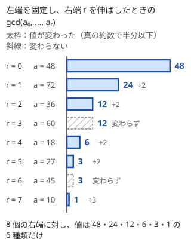

!!! abstract "要点"
    - **何ができるか**：全体に同じ数を足した値の gcd を、隣り合う項の差の gcd に直して求める。区間の gcd を Sparse Table やセグメント木で答え、左端を固定した区間 gcd が $O(\log A)$ 種類しかないことを使って全区間を数える。mod $N$ で $A$ ずつ進むと $\gcd(A, N)$ の倍数だけを回ることも使う。
    - **いつ使うか**：
        - $A_i + B_j$ を並べた矩形や、全体に $x$ を足した列の gcd を求める。
        - 区間の gcd を多数答える（$N, Q \le 2 \times 10^5$）。
        - すべての区間の gcd の和や、gcd が 1 になる区間の数を求める。
        - mod $N$ で $A$ ずつ進む操作で、すべての点に行けるか・何点に行けるかを問う。
        - 2 点を結ぶ線分の上の格子点の数や、2 種類の数の非負の和で作れない数を問う。
    - **計算量**：区間 gcd は Sparse Table で構築 $O(N \log N \log A)$、クエリ $O(\log A)$。右端を固定した区間 gcd の値の列挙は全体で $O(N \log^2 A)$（$A$ は値の最大）。
    - **前提**：[GCD・LCM とユークリッドの互除法](../math/gcd-lcm.md)

<!-- textlint-disable -->
別名：差の gcd・区間 gcd・gcd の変化は log 回・gcd と周期
<!-- textlint-enable -->

GCD の性質は、[ユークリッドの互除法](../math/gcd-lcm.md#euclid)の根拠である $\gcd(a, b) = \gcd(a, b - a)$ と、「gcd は変わるたびに半分以下になる」の 2 つから出てくる応用の型である。前者は和の gcd を差の gcd に、後者は区間の gcd の値の種類を $O(\log A)$ に抑える。さらに、mod $N$ の周期・線分上の格子点・作れない数の上限も、どれも gcd で決まる。

このページでは列を 0-indexed で $a_0, \dots, a_{N-1}$ と書き、区間は半開区間 $[l, r)$ とする。記法は[記法と用語の約束](../start/notation.md)にそろえる。$\gcd$ の単位元は 0 で、$\gcd(0, x) = x$ である。

## 差の gcd：gcd(a + x, b + x) = gcd(a + x, b − a) {#difference-gcd}

全体に同じ数 $x$ を足すと、各項の素因数はばらばらに変わり、$\gcd$ を直接追えない。ところが、差は $x$ によらない。$\gcd(u, v) = \gcd(u, v - u)$（[gcd が変わらない操作](../math/proof-patterns.md#gcd-invariant)）を $u = a + x$、$v = b + x$ に使うと次の式になる。

$$
\gcd(a + x, b + x) = \gcd(a + x, b - a)
$$

$x$ を含むのは 1 項だけになり、残りは $x$ によらない定数 $b - a$ である。項がいくつあっても同じで、隣り合う項の差を取って並べ替えると次の形になる。

$$
\gcd(a_0, a_1, \dots, a_{k-1}) = \gcd(a_0,\ a_1 - a_0,\ a_2 - a_1,\ \dots,\ a_{k-1} - a_{k-2})
$$

左から 1 つずつ $\gcd(\dots, a_i) = \gcd(\dots, a_i - a_{i-1})$ と置き換えても、$a_{i-1}$ が組に残っている限り公約数の集合は変わらないからである。全体に $x$ を足しても差の部分は変わらない。差の gcd を $D = \gcd(a_1 - a_0, \dots, a_{k-1} - a_{k-2})$ と置くと、$\gcd(a_0 + x, \dots, a_{k-1} + x) = \gcd(a_0 + x, D)$ である。$x$ を何通りも変えて聞かれても、$D$ を 1 回求めておけば 1 回の gcd で答えられる。

**$A_i + B_j$ の矩形**。行 $[h_1, h_2)$・列 $[w_1, w_2)$ の成分 $A_i + B_j$ の gcd を考える。列 $j$ を固定すると、$B_j$ は全体に足した数なので、行の方向は $A$ の隣接差に直る。

$$
\gcd_{h_1 \le i < h_2} (A_i + B_j) = \gcd\bigl(A_{h_1} + B_j,\ \Delta A\bigr), \quad \Delta A = \gcd_{h_1 \le i < h_2 - 1} (A_{i+1} - A_i)
$$

続けて $j$ を動かすと、今度は $A_{h_1}$ が全体に足した数なので、列の方向も $B$ の隣接差に直る。

$$
\gcd_{i, j} (A_i + B_j) = \gcd\bigl(A_{h_1} + B_{w_1},\ \Delta A,\ \Delta B\bigr), \quad \Delta B = \gcd_{w_1 \le j < w_2 - 1} (B_{j+1} - B_j)
$$

$\Delta A$ と $\Delta B$ は差の列の区間 gcd なので、次の節の Sparse Table で $O(\log A)$ で求まる。2 次元の問題が 1 次元の区間 gcd 2 つに分かれる（[例題 ABC254 F](#abc254_f)）。

```cpp
--8<-- "gcd-properties/rect-gcd.cpp:core"
```

差は負になりうる。`std::gcd` は引数を絶対値で扱うが、自作の gcd を使うなら絶対値にしてから渡す（[落とし穴](#pitfalls)）。行が 1 つだけ（$h_2 - h_1 = 1$）なら差の区間は空で、単位元の 0 が返るので場合分けは要らない。

応用の型：

- **全体に $x$ を足したときの gcd を $x$ ごとに答える**：$D$ を前計算し、$\gcd(a_0 + x, D)$ を答える。
- **等差数列の gcd**：$a, a + d, a + 2d, \dots$ の gcd は $\gcd(a, d)$ である（2 項以上あるとき）。
- **2 つの数から同じ数を引き続ける**：$(a, b)$ の両方から同じ数を引いても差 $b - a$ は変わらないので、途中の gcd はつねに $b - a$ の約数である。gcd の候補を $b - a$ の約数に絞れる（[約数の列挙](../math/divisor-enum.md)）。

## 区間 gcd はセグメント木・Sparse Table に載る（左端を固定すると値は O(log A) 種類） {#range-gcd}

区間の gcd を $Q$ 回聞かれたとき、毎回 $a_l, \dots, a_{r-1}$ の gcd を取ると $O(NQ)$ 回の gcd になり、$N, Q = 2 \times 10^5$ では間に合わない。gcd は結合法則を満たし、単位元 0 を持つので、[セグメント木](../ds/segment-tree.md)に載る。列が変わらないなら [Sparse Table](../ds/sparse-table.md) も使える。

**Sparse Table に載る理由**。Sparse Table は区間を長さ $2^k$ の 2 つの区間で、重なりを許して覆う。$\gcd(x, x) = x$ なので、重なった部分を 2 回数えても答えは変わらない（[重なりを許す演算](../ds/sparse-table.md#idempotent)）。だから 1 回のクエリは gcd 1 回で済み、$O(\log A)$ である。構築は $O(N \log N)$ 回の gcd で、$O(N \log N \log A)$ で上から押さえられる。列を書き換えるならセグメント木にし、更新・取得は $O(\log N)$ 回の gcd になる。

??? note "セグメント木の取得は実際には O(log N + log A)"
    互除法で $\gcd(g, x)$ を求める回数は、結果を $g'$ として $O(1 + \log(g / g'))$ で押さえられる。セグメント木の取得で左から順に $g \leftarrow \gcd(g, x)$ と合わせていくと、$\log(g / g')$ の和は $\log A$ を超えない。だから取得全体は $O(\log N + \log A)$ である。ただし `std::gcd`（libstdc++ は二進 gcd）では手数が値のビット数で決まるので、この和の評価は当てはまらない。1 回が十分速いので、見積もりでは $O(\log N \log A)$ と思っておけば足りる。

**左端を固定すると値は $O(\log A)$ 種類**。左端 $l$ を固定し、右端を伸ばすと、$g_r = \gcd(a_l, \dots, a_r)$ は $g_{r+1} \mid g_r$ を満たす。値が変わるときは $g_r$ の真の約数になるので、半分以下に減る。最初の値は $a_l \le A$ で、1 より下には減らないので、値が変わるのは高々 $\log_2 A$ 回、値の種類は $\lfloor \log_2 A \rfloor + 1$ 以下である。$A = 10^9$ なら 30 種類以下になる（$2^{29} \le 10^9 < 2^{30}$）。



右端を固定して左端を動かしても同じで、区間 $[l, r + 1)$ の gcd の値は $l$ について $O(\log A)$ 種類である。この性質から、次の 2 つの型が出てくる。

- **すべての区間を値ごとにまとめる**：右端 $r$ ごとに「(gcd の値, その値になる左端の数)」の組の列を持つ。$r + 1$ に進むときは、各組の値を $\gcd(\cdot, a_{r+1})$ に変え、新しい左端 $l = r + 1$ の組 $(a_{r+1}, 1)$ を足し、同じ値の組をまとめる。組は $O(\log A)$ 個なので全体で $O(N \log A)$ 回の gcd、各 gcd を $O(\log A)$ と見て $O(N \log^2 A)$ になる。すべての区間の gcd の和や、gcd が 1 の区間の数がこれで求まる
- **gcd が 1 になる最短の区間**：左端を固定すると $\gcd$ は右へ伸ばすほど小さくなる（約数へ下がる）ので、「gcd が 1 になる最小の右端」は左端について単調である。[尺取り法](../basics/two-pointers.md)（窓の gcd は左端から取り除けないので、Sparse Table で $O(1)$ 回の gcd として求める）か、Sparse Table の上の[二分探索](../basics/binary-search.md)で求まる

```cpp
--8<-- "gcd-properties/subarray-gcd.cpp:core"
```

組の列は、新しい左端の組を先頭に置くと gcd の大きい順に並ぶ。同じ値は必ず隣り合うので、末尾と比べるだけでまとめられる。

応用の型：

- **区間 gcd のクエリ**（$N, Q \le 2 \times 10^5$）：列が変わらなければ Sparse Table、変わるならセグメント木。
- **1 つ除いた gcd**：左右からの累積 gcd で $O(1)$ に答える（[左右からの累積 gcd](../math/gcd-lcm.md#prefix-suffix-gcd)）。区間を除いた gcd も、前と後ろの累積の gcd で求まる。
- **値ごとの区間の数**：上の組の列を使う。gcd が $d$ の倍数になる区間の数を数えて、[約数の包除](../comb/divisor-inclusion-exclusion.md)で「ちょうど $d$」に直す方法もある。

## mod N で A ずつ進むと gcd(A, N) の倍数だけを回る（周期と連結性） {#step-mod}

円に $0, 1, \dots, N - 1$ の点が並び、点 0 から $A$ ずつ進む（$x \to (x + A) \bmod N$）。$g = \gcd(A, N)$ とすると、次の 2 つが成り立つ。

- **通る点は $g$ の倍数の位置の $N / g$ 点**：通る点 $kA \bmod N$ は $g$ の倍数である（$kA$ も $N$ も $g$ の倍数なので）。逆に、$g$ の倍数 $m$ にはすべて行ける。$Ax + Ny = g$ を満たす整数 $x, y$ があるので（[拡張ユークリッドの互除法](../math/ext-gcd.md)）、$(m / g) \cdot x$ 回進めば $m$ に着く。回数が負なら $N$ の倍数を足して正にすればよい
- **周期は $N / g$**：$kA \equiv 0 \pmod{N}$ は、両辺を $g$ で割ると $k (A / g) \equiv 0 \pmod{N / g}$ になる。$A / g$ と $N / g$ は[互いに素](../guide/glossary.md#coprime)なので、$k$ が $N / g$ の倍数のときだけ成り立つ。$N / g$ 回で初めて点 0 に戻り、その間に $N / g$ 点を 1 回ずつ通る

$N = 12$、$A = 8$ なら $g = 4$ で、$0 \to 8 \to 4 \to 0$ と 3 点を回る（[並べ替え論法](../math/proof-patterns.md#rearrangement)の確認問題と同じ例）。出発点を $s$ にすると、通るのは $s$ と mod $g$ で合同な点である。円の上を前にしか進めなくても、$N / g - 1$ 回進めば 1 歩戻ったのと同じ位置に着くので、前後に動けるときと行ける点は変わらない。

**歩幅が複数あるとき**。歩幅 $A_1, \dots, A_k$ を好きな順に使えるなら、行ける点は $s$ と mod $G$ で合同な点で、$G = \gcd(N, A_1, \dots, A_k)$ である。$x$ と $(x + A_i) \bmod N$ を結ぶ辺を全部張ったグラフで考えると、連結成分は mod $G$ の余りごとに 1 つずつで、ちょうど $G$ 個になる。歩幅を 1 つ足すごとに、成分の数は $\gcd$ を取った値に減っていく。

??? note "連結成分が G 個になる理由"
    同じ成分の 2 点の差は $A_i$ の整数係数の和に $N$ の倍数を足したものなので、$G$ の倍数である。だから mod $G$ の余りが違う点は同じ成分にない。逆に、$\gcd(N, A_1, \dots, A_k) = G$ なので $N y + \sum A_i x_i = G$ となる整数がある（ベズーの等式を繰り返し使う）。各 $A_i$ を $x_i$ 回（負なら $N / \gcd(A_i, N)$ の倍数を足して正にした回数）進めば、差が $G$ の点へ行ける。よって余りが同じ点は同じ成分にある。

この性質で、「全体を連結にするのに安い歩幅から使う」問題は、使った歩幅の gcd を追うだけになる（[練習の ABC210 E](#practice)）。

**数直線の上の周期**。円ではなく数直線で「$+D$ と $-B$ を繰り返す」ような操作でも、到達する値は出発点 $s$ に $\gcd(B, D)$ の倍数を足したものに限られる。両方を何回でも使えるなら、$s$ と mod $\gcd(B, D)$ で合同な値のうち、範囲の条件を満たすものはすべて現れうる。「ある範囲に入るか」を判定する問題では、範囲の中で $s$ と合同な最大の値・最小の値を調べればよい（[練習の AGC026 B](#practice)）。

応用の型：

- **$K$ 個ずつ進んですべての点を通るか**：$\gcd(N, K) = 1$ かを判定する。
- **何回で目的の点に着くか**：一次合同式 $kA \equiv t - s \pmod{N}$ を解く（[一次合同式の応用](../math/ext-gcd.md#applications)）。
- **複数の周期が同時にそろう時刻**：[中国剰余定理](../math/crt.md)を使う。

## 線分上の格子点は gcd(|dx|, |dy|) + 1 個 {#lattice-on-segment}

格子点 $(x_1, y_1)$ と $(x_2, y_2)$ を結ぶ線分の上にある格子点（両端を含む）の数は、$dx = x_2 - x_1$、$dy = y_2 - y_1$ として次のとおりである。

$$
\gcd(\lvert dx \rvert, \lvert dy \rvert) + 1
$$

線分上の点は $(x_1 + t \cdot dx,\ y_1 + t \cdot dy)$（$0 \le t \le 1$）と書ける。$g = \gcd(\lvert dx \rvert, \lvert dy \rvert)$ とし、$dx = g p$、$dy = g q$（$p$ と $q$ は互いに素）とする。$t \cdot dx$ と $t \cdot dy$ がともに整数になるのは、$tg$ が整数のときだけである。$tgp$ と $tgq$ が整数で $\gcd(p, q) = 1$ なら、$up + vq = 1$ となる整数 $u, v$ を使って $tg = u \cdot tgp + v \cdot tgq$ も整数になるからである。$t = 0, 1/g, 2/g, \dots, 1$ の $g + 1$ 通りが格子点に当たる。

$(0, 0)$ と $(6, 4)$ なら $\gcd(6, 4) = 2$ で、$(0, 0)$・$(3, 2)$・$(6, 4)$ の 3 点である。両端が同じ点（$dx = dy = 0$）なら $\gcd(0, 0) + 1 = 1$ で、式のまま正しい。

応用の型：

- **両端を除いた格子点の数**：$g - 1$ 個である。
- **多角形の格子点**：格子点を頂点とする多角形の辺上の格子点の数 $b$ は、各辺の $\gcd(\lvert dx \rvert, \lvert dy \rvert)$ の和である。面積 $S$ と合わせると、内部の格子点の数 $i$ がピックの定理 $S = i + b / 2 - 1$ から求まる（[凸包](../geometry/convex-hull.md#lattice-points)）。
- **直線の向きの正規化**：$(dx, dy)$ を $g$ で割った $(p, q)$ は、線分が通る最小の格子の歩みで、向きが同じ線分を同じ組にまとめるのにも使う（[分数・傾きを既約にする](../math/gcd-lcm.md#reduce-fraction)）。

## ax + by（x, y ≥ 0）で表せない最大の数 ab − a − b {#frobenius}

正の整数 $a, b$ が互いに素なとき、非負の整数 $x, y$ で $ax + by$ と表せない最大の整数は $ab - a - b$ である。表せない正の整数はちょうど $(a - 1)(b - 1) / 2$ 個ある。$a = 3$、$b = 5$ なら、表せないのは $1, 2, 4, 7$ の 4 個で、最大は $15 - 3 - 5 = 7$ である。

理由は余りで分けると見える。$y = 0, 1, \dots, a - 1$ に対する $by \bmod a$ は、$b$ と $a$ が互いに素なので $0$ から $a - 1$ を 1 回ずつ取る（[並べ替え論法](../math/proof-patterns.md#rearrangement)）。整数 $n$ を $a$ で割った余りを $\rho$ とし、$by \equiv \rho \pmod{a}$ となる $y$（$0 \le y < a$）を $y_\rho$ とする。

- $n \ge b y_\rho$ なら、$n - b y_\rho$ は $a$ の非負の倍数なので、$x = (n - b y_\rho) / a$ で表せる
- $n < b y_\rho$ なら表せない。余りが合う $y$ は $y_\rho + ka$（$k \ge 0$）だけで、どれも $by \ge b y_\rho > n$ になるからである

表せない数のうち最大のものは、$b y_\rho$ が最大の余り（$y_\rho = a - 1$）での $b(a - 1) - a = ab - a - b$ である。余りが $\rho$ の表せない正の整数は $\lfloor b y_\rho / a \rfloor$ 個で、$y_\rho$ を $0$ から $a - 1$ まで足すと $(a - 1)(b - 1) / 2$ になる。

$\gcd(a, b) = g > 1$ なら、$ax + by$ は $g$ の倍数しか作れないので、表せない数は無限にある。$g$ の倍数だけを見て、$a / g$ と $b / g$ で同じことを考える。

応用の型：

- **十分大きい数は必ず作れる**：$ab - a - b$ より大きい数は必ず作れるので、それより小さい範囲だけを全探索や DP で調べればよい。
- **$n$ を作れるかの判定**：$y_\rho$（$b$ の mod $a$ での逆元を使って $y_\rho = \rho \cdot b^{-1} \bmod a$）を求め、$n \ge b y_\rho$ かを見る。$O(\log a)$ で判定できる（[逆元](../math/mod-inverse.md)）。
- **3 種類以上の数**：公式はない。最小の数を $a$ として、余り mod $a$ ごとに「作れる最小の値」を[ダイクストラ法](../graph/dijkstra.md)で求める方法がある（[同余最短路](../graph/modular-shortest-path.md#congruence)）。

## 落とし穴 {#pitfalls}

**差の符号**。$A_{i+1} - A_i$ は負になりうる。`std::gcd` は絶対値で扱うが、自作の `b == 0 ? a : gcd(b, a % b)` に負の数を渡すと負の値が返り、比較や出力を誤る（[負の数を自作の gcd に渡す](../math/gcd-lcm.md#pitfalls)）。差は `abs` を取ってから表に入れる。

**差の区間の添字のずれ**。$[h_1, h_2)$ の隣接差は、差の列 $d_i = A_{i+1} - A_i$ の $[h_1, h_2 - 1)$ である。$[h_1, h_2)$ のまま引くと、範囲の外の $A_{h_2}$ との差が混ざる。区間の長さが 1 のときは差の区間が空になり、単位元の 0 が返ることも確かめる。

**矩形の gcd で「先頭の 1 項」を忘れる**。差だけの gcd を答えにすると、全体に足した数の情報が消える。$A_{h_1} + B_{w_1}$ のように実際の成分を 1 つ必ず混ぜる。

**値の種類が少ないことと計算量の取り違え**。左端を固定した区間 gcd は $O(\log A)$ 種類だが、それは「値が変わる位置」が少ないということで、すべての区間を 1 つずつ見れば $O(N^2)$ のままである。値ごとに左端の数をまとめて持つ（[組の列](#range-gcd)）か、変わる位置を二分探索で飛ぶ。

**Sparse Table の演算を和で書く**。重なりを許して覆う Sparse Table は、gcd・max・min のように $\mathrm{op}(x, x) = x$ となる演算でだけ正しい。同じ表で和を取ると重なりを 2 回数える（[Sparse Table の落とし穴](../ds/sparse-table.md#pitfalls)）。

**通る点の数と成分の数の取り違え**。$g = \gcd(A, N)$ のとき、1 点から通る点の数は $g$ ではなく $N / g$ である。連結成分の数が $g$、各成分の大きさが $N / g$ と覚える。

## 使い分け {#comparison}

- 1 つ（または 1 区間）を除いた gcd だけなら、Sparse Table を作らず左右からの累積 gcd で足りる（[左右からの累積 gcd](../math/gcd-lcm.md#prefix-suffix-gcd)）。
- 区間 gcd で列が変わらないなら Sparse Table（クエリが gcd 1 回）、変わるならセグメント木。
- 「何回で着くか」「どの値が作れるか」を具体的な解まで求めるなら、[拡張ユークリッドの互除法](../math/ext-gcd.md)で一次合同式・一次不定方程式を解く。ここでの性質は、行けるか・何点あるかの判定に使う。
- gcd の値ごとに個数を数え、約数について足し引きする問題は[約数の包除](../comb/divisor-inclusion-exclusion.md)の範囲である。

## 例題 {#examples}

### ABC254 F. Rectangle GCD {#abc254_f}

<div class="kp-problems" data-role="example" markdown>

- [ABC254 F. Rectangle GCD](https://atcoder.jp/contests/abc254/tasks/abc254_f)（diff 1764）：N×N の行列の (i, j) 成分が A_i + B_j のとき、指定された部分長方形の成分の最大公約数を Q 個のクエリについて答える。

</div>

$N, Q \le 2 \times 10^5$ なので、矩形の成分を 1 つずつ見ることはできない。行の方向は $B_j$ を、列の方向は $A_i$ を「全体に足した数」と見る。[差の gcd](#difference-gcd) により、矩形の gcd は「左上の成分」「$A$ の隣接差の区間 gcd」「$B$ の隣接差の区間 gcd」の 3 つの gcd に分かれる。差の列は変わらないので、Sparse Table で区間 gcd を答える。

??? note "解法の詳細"
    - 0-indexed に直し、行 $[h_1, h_2)$・列 $[w_1, w_2)$ とする（入力の $1 \le h_1 \le h_2 \le N$ の閉区間から、左端は 1 引き、右端はそのまま使う）。
    - 差の列 $d^A_i = \lvert A_{i+1} - A_i \rvert$（$0 \le i < N - 1$）と $d^B_j$ を作り、それぞれに gcd の Sparse Table を作る。$O(N \log N)$ 回の gcd である。
    - 各クエリの答えは $\gcd(A_{h_1} + B_{w_1},\ d^A \text{ の } [h_1, h_2 - 1),\ d^B \text{ の } [w_1, w_2 - 1))$ で、gcd 3 回で済む。
    - 成分は $2 \times 10^9$ まで大きくなり `int` を超えるので、`long long` で持つ。
    - コードは[差の gcd](#difference-gcd)の節のものと同じ形である。全体で $O((N \log N + Q) \log A)$。

## 練習問題 {#practice}

<div class="kp-problems" data-role="practice" markdown>

- [ABC210 E. Ring MST](https://atcoder.jp/contests/abc210/tasks/abc210_e)（diff 1618）：環状に並ぶ頂点に「x と x + A_i (mod N) を費用 C_i で結ぶ」操作が何度でも使えるとき、全体を連結にする最小費用を求める。
- [AGC026 B. rng_10s](https://atcoder.jp/contests/agc026/tasks/agc026_b)（diff 1720）：在庫が A 個の店で毎日 B 個買われ、閉店時に C 個以下なら D 個補充されるとき、永遠に買い続けられるかを判定する。

</div>

??? note "練習問題の方針"
    - **ABC210 E**：[クラスカル法](../graph/minimum-spanning-tree.md#kruskal-prim)と同じく費用の小さい操作から使う。$A_i$ の辺を全部張ると、連結成分の数はそれまでの成分の数 $n$ から $\gcd(n, A_i)$ に減る（[歩幅が複数あるとき](#step-mod)）。減った数 $n - \gcd(n, A_i)$ 本の辺を費用 $C_i$ で使い、$n \leftarrow \gcd(n, A_i)$ とする。最後に $n = 1$ でなければ連結にできない。$N \le 10^9$ でも頂点を作らずに $O(M \log M)$ で済む。
    - **AGC026 B**：初日に買えない（$A < B$）か、補充が消費に追いつかない（$D < B$）なら永遠には続かない。それ以外で、閉店時の在庫が $C$ を超えたまま $B$ 未満になりうるかを調べる。在庫は $A$ に $\gcd(B, D)$ の倍数を足した値しか取らないので（[数直線の上の周期](#step-mod)）、$B$ 未満で $A$ と合同な最大の値が $C$ を超えるかで決まる。値は $10^{18}$ まで大きいので、その値を割り算で求め、ループで回さない。

## 確認問題 {#quiz}

??? question "確認問題：x を変えながらの gcd"
    $\gcd(10 + x, 16 + x, 22 + x)$ を $x = 0, 1, 2, \dots$ について求めたい。何に着目すれば、$x$ ごとに 1 回の gcd で答えられるか。

    ??? success "答え"
        隣り合う項の差 $6, 6$ は $x$ によらない。$D = \gcd(6, 6) = 6$ を前計算すれば、答えは $\gcd(10 + x, 6)$ である。$x = 0$ なら 2、$x = 2$ なら 6 になる。

??? question "確認問題：値の種類"
    $a_l = 2^{30}$ から始まり、右に伸ばすたびに gcd が変わる列で、左端を固定した区間 gcd の値の種類は最大でいくつか。

    ??? success "答え"
        31 種類である。値は変わるたびに真の約数になるので、$2^{30}, 2^{29}, \dots, 2^0$ と半分ずつ減るのが最も多く、$30 + 1 = 31$ 種類になる。$2^{30}$ は $10^9$ を超えるので、本文の「$A = 10^9$ なら 30 種類以下」より 1 つ多い。

??? question "確認問題：円を進む"
    円に $0$ から $N - 1 = 29$ の 30 点が並ぶ。歩幅 12 と 20 を好きな順に何度でも使って点 0 から進むとき、行ける点はいくつか。

    ??? success "答え"
        $\gcd(30, 12, 20) = 2$ なので、行けるのは 2 の倍数の位置の 15 点である。歩幅 12 だけなら $\gcd(30, 12) = 6$ で 5 点に限られるが、20 を足すと gcd が 2 に下がる。

??? question "確認問題：格子点と作れない数"
    (1) $(1, 2)$ と $(10, -4)$ を結ぶ線分の上の格子点（両端を含む）はいくつか。(2) 6 と 9 の非負の和で表せない最大の数はあるか。

    ??? success "答え"
        (1) $dx = 9$、$dy = -6$ で $\gcd(9, 6) = 3$ なので 4 個である。(2) ない。$\gcd(6, 9) = 3$ なので 3 の倍数しか作れず、表せない数は無限にある。3 の倍数だけを見ると $2x + 3y$ の問題になり、表せない 3 の倍数の最大は $3 \times (6 - 2 - 3) = 3$ である。

## 参考 {#references}

- [Kazun「AtCoder Beginner Contest 254 F問題 Rectangle GCD」](https://kazun-kyopro.hatenablog.com/entry/ABC/254/F)：隣接差の gcd への帰着と、Sparse Table・セグメント木での区間 gcd の計算量（例題の方針）。
- [drken「AtCoder ABC 210 E - Ring MST (1D, 青色, 500 点)」](https://drken1215.hatenablog.com/entry/2023/08/07/001608)：費用の小さい順に使い、連結成分の数が gcd に減ること（練習の方針）。
- [drken「AtCoder AGC 026 B - rng_10s (1D, 青色, 600 点)」](https://drken1215.hatenablog.com/entry/2018/07/18/083000)：在庫の取りうる値が gcd の倍数のずれに限られることと、判定の場合分け（練習の方針）。
- [Wikipedia「Coin problem」](https://en.wikipedia.org/wiki/Coin_problem)：2 数で表せない最大の数 $ab - a - b$ と、表せない数の個数 $(a - 1)(b - 1) / 2$。
