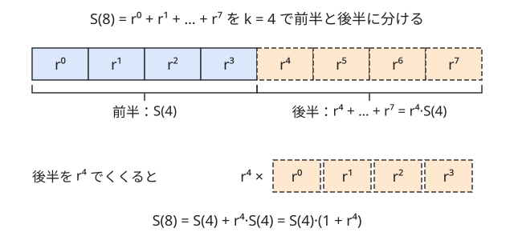

!!! abstract "要点"
    - **何ができるか**：$1 + r + \dots + r^{n-1}$ を mod で $O(\log n)$ で求める。素数 mod で $r \not\equiv 1$ なら $(r^n - 1)/(r - 1)$ を逆元で計算し、法が任意なら和を半分に割る漸化式か 2×2 行列の累乗を使う。
    - **いつ使うか**：
        - 同じ数字列を K 回並べてできる数を mod で求める。
        - 法 M が入力で与えられ、素数とは限らない。
        - 項数 N ≤ $10^{12}$〜$10^{18}$ の等比数列の和を、素数とは限らない法 M ≤ $10^9$ で求める。
        - $\sum_{i=0}^{N-1} A^i$ の形の和を立てた。
    - **計算量**：どの方法も $O(\log n)$。公式が使えるのは $\gcd(r - 1, m) = 1$ のときだけで、素数 mod なら $r \not\equiv 1$ と同じ。
    - **前提**：[逆元と mod での割り算](../math/mod-inverse.md)

<!-- textlint-disable -->
別名：等比級数・geometric series・repunit・Σ A^i・同じ数字を並べた数
<!-- textlint-enable -->

等比数列の和を mod で求めるときは、項数 $n$ が $10^{18}$ でも 1 項ずつ足さずに $O(\log n)$ で済ませる。素数 mod なら高校の公式を逆元で計算すればよく、要点は「割れない場合」をどう扱うかにある。法が素数でないときや公比が 1 と合同なときは、和を半分に割る再帰か行列の累乗に切り替える。

このページで使う記法：$S(n) = \sum_{i=0}^{n-1} r^i = 1 + r + \dots + r^{n-1}$（項数 $n$、$S(0) = 0$）。法は $m$、素数なら $p$ と書く。ほかの記法は[記法と用語の約束](../start/notation.md)に従う。

## 公式 (r^n − 1)/(r − 1) と r ≡ 1 の場合分け {#formula}

$S(n)$ に $r$ を掛けると $rS(n) = r + r^2 + \dots + r^n$ になり、$S(n)$ と引けば両端だけが残る。

$$
(r - 1) S(n) = r^n - 1
$$

$r^n$ は[繰り返し二乗法](../math/mod-pow.md)を使えば $O(\log n)$ で求まる。あとは両辺を $r - 1$ で割ればよい。ただし mod での割り算は $r - 1$ の[逆元](../math/mod-inverse.md)を掛けることであり、逆元は $\gcd(r - 1, m) = 1$ のときだけ存在する。

- **素数 mod $p$ で $r \not\equiv 1$**：$r - 1 \not\equiv 0$ なので逆元があり、$S(n) = (r^n - 1)(r - 1)^{-1}$ と計算できる。
- **素数 mod $p$ で $r \equiv 1$**：$r - 1 \equiv 0$ で割れない。このときは各項が $r^i \equiv 1$ なので、和は 1 が $n$ 個で $S(n) \equiv n$ である。
- **法 $m$ が素数でない**：$\gcd(r - 1, m) = 1$ なら拡張ユークリッドの互除法で逆元を求めれば公式が使える。そうでなければ逆元がないので、[半分に割る方法](#halving)を使う。

場合分けの判定は、$r$ を法で割った余りで行う。$r = p + 1$ や、公比が $10^d$ のように計算して作った値は、見た目が 1 でなくても $r \equiv 1$ になりうる。次のコードは法が素数 998244353 の場合である。$r$ をいったん modint に直してから 1 と比べている。

```cpp
--8<-- "geometric-series-mod/formula.cpp:core"
```

`mint(n)` は項数 $n$ を mod $p$ に直した値で、$r \equiv 1$ の答えになる。一方、`x.pow(n)` の指数 $n$ は mod $p$ に直さずにそのまま渡す。

??? question "確認問題：法が 10 のとき"
    $m = 10$ のとき、$r = 3$ では公式 $(r^n - 1)/(r - 1)$ を使えない。なぜか。$r = 4$ ならどうか。

    ??? success "答え"
        $r = 3$ では $r - 1 = 2$ で、$\gcd(2, 10) = 2$ なので 2 の逆元が mod 10 に存在しない（$2x \equiv 1 \pmod{10}$ となる $x$ がない）。$r = 4$ では $r - 1 = 3$ で $\gcd(3, 10) = 1$ なので逆元 $3^{-1} \equiv 7$ があり、公式が使える。ただしフェルマーの小定理の $a^{m-2}$ は法が素数でないと逆元にならないので、拡張ユークリッドの互除法で求める。

## 法が任意のとき：S(2k) = S(k)(1 + r^k) で半分に割る {#halving}

この節は[繰り返し二乗法](../math/mod-pow.md)と同じ「指数を半分にする」考え方を使う。割り算をまったく使わないので、法 $m$ が素数でなくても、$r \equiv 1$ でも同じ式で求まる。

長さ $2k$ の和を前半 $k$ 項と後半 $k$ 項に分けると、後半は前半のすべての項に $r^k$ を掛けたものになっている。



$$
S(2k) = S(k) + r^k S(k) = S(k)\,(1 + r^k)
$$

$n$ が奇数のときは、先頭の 1 を外して残りを $r$ でくくる。

$$
S(n) = 1 + r\,S(n - 1)
$$

この 2 つの式で、$n$ を「偶数なら半分、奇数なら 1 減らす」と小さくしていき、$S(0) = 0$ で止める。$r^k$ も同時に要るので、$S(n)$ と $r^n$ の組を返す再帰にする。組を返せば $r^k$ を毎回繰り返し二乗法で求め直さずに済む。

```cpp
--8<-- "geometric-series-mod/halving.cpp:core"
```

- **計算量**：奇数の手順の次は必ず偶数の手順になるので、2 回の呼び出しで $n$ は半分以下になる。呼び出しは高々 $2 \log_2 n + 2$ 回で、各回 $O(1)$ だから全体で $O(\log n)$ である。$r^k$ を毎回求め直す書き方でも $O(\log^2 n)$ で、$n = 10^{12}$ なら十分速い。
- **掛け算のあふれ**：値はどれも $m$ 未満なので、積は $m^2$ 未満である。$m \le 10^9$ なら `long long` に収まるが、$m$ が $3 \times 10^9$ を超えると $m^2$ が `long long` の上限（約 $9.2 \times 10^{18}$）を超えるので `__int128` で掛ける。
- **境界**：$m = 1$ ならどんな値も 0 なので、$r^0$ も `1 % m` と書いて 0 にしておく。

??? question "確認問題：法を m(r − 1) にする別の方法"
    $r \ge 3$ とする。法を $m(r - 1)$ にして $r^n$ を求め、その値から 1 を引いて $r - 1$ で（整数として）割ると $S(n) \bmod m$ が得られる。なぜか。実装で何に気をつけるか。

    ??? success "答え"
        $r^n - 1 = (r - 1) S(n)$ なので、$(r - 1)S(n)$ を $(r - 1)m$ で割った余りは $(r - 1) \cdot (S(n) \bmod m)$ に等しい。だから余りを $r - 1$ で割れば $S(n) \bmod m$ になる。$r^n \equiv 1 \pmod{r - 1}$ なので、求めた余り $x$ は $r - 1$ で割って 1 余る数で、$r - 1 \ge 2$ なら 1 以上である。だから 1 を引いても負にならない。法 $m(r - 1)$ は $10^{18}$ 近くになりうるので、繰り返し二乗法の中の掛け算は `__int128` で行う。$r = 1$ は法が 0 になるので別に扱う（答えは $n \bmod m$）。$r = 2$ では法が $m$ のままで余りが 0 になりうるので、$(x - 1 + m) \bmod m$ のように法を足してから 1 を引く（$r - 1 = 1$ で割る必要はない）。

## 2×2 行列の累乗による別解 {#matrix}

この節は[行列累乗](../math/matrix-power.md)を前提にする。$S(n)$ は「$x$ を $rx + 1$ に置き換える」操作を $x = 0$ から $n$ 回くり返した値である（$S(t + 1) = r S(t) + 1$）。定数項 1 を状態に入れて、$(S(t), 1)$ を 1 歩進める行列を作る（[定数項を状態に入れる](../math/matrix-power.md#write-as-matrix)）。

$$
\begin{pmatrix} S(t + 1) \\ 1 \end{pmatrix}
=
\begin{pmatrix} r & 1 \\ 0 & 1 \end{pmatrix}
\begin{pmatrix} S(t) \\ 1 \end{pmatrix},
\qquad
\begin{pmatrix} r & 1 \\ 0 & 1 \end{pmatrix}^{n}
=
\begin{pmatrix} r^n & S(n) \\ 0 & 1 \end{pmatrix}
$$

$n$ 乗の右上が $S(n)$、左上が $r^n$ である。右の式は $n$ についての帰納法で確かめられる（$n$ 乗にもう 1 つ掛けると、右上は $r S(n) + 1 = S(n + 1)$ になる）。2×2 の行列の累乗は $O(\log n)$ で、掛け算と足し算しか使わないので法は任意でよい。

半分に割る方法と比べると、計算の中身は同じで書き方が違うだけである。行列で書く利点は、和の形が少し変わっても行列を大きくするだけで対応できることにある。

- $\sum_{i} (i + 1) r^{n-1-i}$ のような「等差 × 等比」の和は、状態に 1 つ足した 3×3 の行列で求まる（力試しの [ABC129 F](#challenge) はこの形）。
- 行列 $A$ の和 $I + A + \dots + A^{n-1}$ は、上の式の $r$ を $A$、1 を単位行列 $I$ に置き換えたブロック行列で求まる。

## 同じ数字列を並べた数は公比 10^d の等比数列の和になる {#repeated-digits}

10 進で $d$ 桁の数字列 $T$ を $K$ 回並べた数は、$T$ を $10^d$ ずつずらして足したものである。

$$
\underbrace{TT\cdots T}_{K \text{ 回}} = T \cdot \left(1 + 10^d + 10^{2d} + \dots + 10^{(K-1)d}\right) = T \cdot S(K) \quad (r = 10^d)
$$

例えば $T = 12$（$d = 2$）を 3 回並べると $121212 = 12 \times (1 + 100 + 10000)$ である。並べる回数 $K$ が $10^{18}$ でも、公比 $r = 10^d \bmod m$ を先に求めておけば、ここまでの方法で $O(\log K)$ になる。数の連結の一般形（$x$ の後ろに $d$ 桁の $y$ を付けると $x \cdot 10^d + y$）は[桁と mod](../math/digit-and-mod.md)にある。

- **1 を $n$ 個並べた数（repunit）**：$T = 1$、$d = 1$ なので $S(n) = (10^n - 1)/9$ である。9 と互いに素な法なら 9 の逆元で割ってよい。
- **$r \equiv 1$ になる法**：$10^d \equiv 1 \pmod{m}$ だと公式で割れない。法が 998244353 なら 10 の位数（$10^k \equiv 1$ となる最小の $k \ge 1$）が $p - 1$ なので起きない。しかし、例えば $m = 11$ で $d = 2$（$100 \equiv 1$）、$m = 37$ で $d = 3$（$1000 \equiv 1$）では起きる。法が入力で与えられるなら、[半分に割る方法](#halving)で書いておけば場合分けが要らない。

## 落とし穴 {#pitfalls}

**法が素数でないのに逆元を使う**。法が入力で与えられる問題では、$(r - 1)^{m-2}$ を逆元として使うと黙って誤った値になる。フェルマーの小定理は法が素数のときだけ成り立つ。$\gcd(r - 1, m) \ne 1$ なら逆元はそもそも存在しないので、[半分に割る方法](#halving)か[行列](#matrix)にする。

**$r \equiv 1$ の場合分けを忘れる**。分母 $r - 1$ が 0 と合同になると、自分で書いた $a^{p-2}$ は 0 を返し、答えが黙って 0 になる（ACL の modint の割り算では、この場合は制約の違反で、assert が有効なら止まる。`NDEBUG` を付けると 0 になる）。比べるのは $r$ そのものではなく $r \bmod p$ で、$r = 1$ のときだけ分ければよいわけではない。

**項数を 1 つずらす**。$S(n)$ は $r^0$ から $r^{n-1}$ までの $n$ 項の和である。問題が $r^0 + \dots + r^N$ なら項数は $N + 1$ なので、$S(N + 1)$ を求める。和の最後の指数と項数を取り違えると、公式の $r^n$ の指数が 1 つずれる。

**大きな $n$ を mod の前に掛ける**。$r \equiv 1$ のときの答え $n$ や、数字列 $T$ 自体が $10^{18}$ に近いとする。mod に直す前に掛けると、その時点で `long long` があふれる。`mint(n)` のように先に法で割ってから掛ける。逆に、繰り返し二乗法に渡す指数 $n$ は法で割ってはいけない（$r^n$ と $r^{n \bmod p}$ は一般に違う）。

**引き算で負になる**。modint を使わずに書くと、$r^n - 1$ や $r - 1$ が負になりうる（$r^n \bmod p = 0$ のときなど）。`(x - 1 + p) % p` のように法を足してから余りを取る。

**桁数 $d$ を数え違える**。並べる数 $N$ の桁数は `to_string(N).size()` で数えるのが確実である。$N = 10^{18}$ は 19 桁で、`log10` を浮動小数点で計算すると境目の値で 1 ずれることがある。

## 上位の手法へのつながり {#next-steps}

等比数列の和は、より一般の手法の最も小さい例になっている。

- **行列累乗**：$S(t + 1) = rS(t) + 1$ は定数項を持つ 1 項の漸化式で、2×2 の行列にすると[行列累乗](../math/matrix-power.md)の典型の形になる。漸化式が 2 項以上になったり、和に係数が付いたりしたら行列を大きくする。
- **ダブリング**：$(S(k), r^k)$ の組は「$x \mapsto r^k x + S(k)$」という 1 次関数を表していて、半分に割る方法はこの関数の合成である。$S(2^j)$ と $r^{2^j}$ を表にして $n$ を 2 進で分解すれば、[ダブリングで途中の和を持つ](../basics/doubling.md#aggregates)のと同じ形になる。
- **位数と指数の mod**：「1 を何個並べると $K$ の倍数になるか」のように、和が 0 になる最小の項数を問う問題は、$(10^n - 1)/9$ が $K$ の倍数、つまり $10^n \equiv 1 \pmod{9K}$ となる最小の $n$ を探す問題に言い換わる（$K$ が 3 の倍数でなければ mod $K$ でよい）。[フェルマーの小定理と指数の mod](../math/exponent-mod.md)を使う。

## 確認問題 {#quiz}

??? question "確認問題：素数 mod でも r ≡ 1 になる例"
    法 $p = 998244353$ で、公比 $r = 998244354$、項数 $n = 7$ の等比数列の和はいくつか。公式 $(r^n - 1)/(r - 1)$ に入れると何が起きるか。

    ??? success "答え"
        $r = p + 1 \equiv 1$ なので、各項は 1 と合同で、和は $7$ である。公式に入れると分母 $r - 1 = p \equiv 0$ に逆元がなく、割れない。$r$ を法で割った余りで場合分けする。

??? question "確認問題：半分に割る方法で r ≡ 1 は大丈夫か"
    [半分に割る方法](#halving)は、$r \equiv 1$ や法が素数でない場合にも正しい値を返すか。

    ??? success "答え"
        返す。$S(2k) = S(k)(1 + r^k)$ と $S(n) = 1 + rS(n - 1)$ はどちらも和の並べ替えだけから出る恒等式で、割り算を使わない。整数で成り立つ式なので、両辺を $m$ で割った余りでもそのまま成り立つ。$r \equiv 1$ なら $S(n) \equiv n$ がこの漸化式から自然に出てくる。

## 使い分け {#comparison}

- 法が固定の素数（998244353・$10^9 + 7$）なら[公式](#formula)が最も短い。$r \equiv 1$ の分岐を 1 行入れる
- 法が入力で与えられる、または $r - 1$ が法と互いに素とは限らないなら[半分に割る方法](#halving)か[行列](#matrix)にする
- 和の形が等比数列から少し外れる（係数が付く・漸化式が 2 項以上）なら[行列累乗](../math/matrix-power.md)にする

## 例題 {#examples}

### ABC357 D. 88888888 {#abc357_d}

<div class="kp-problems" data-role="example" markdown>

- [ABC357 D. 88888888](https://atcoder.jp/contests/abc357/tasks/abc357_d)（diff 970）：正の整数 N を N 回並べてできる整数を 998244353 で割った余りを求める（N ≤ 10^18）。

</div>

$N$ の桁数を $d$ とすると、求める数は $N$ を $10^d$ ずつずらして $N$ 個足したものなので、$N \cdot S(N)$（公比 $r = 10^d$）になる。法は素数で、$d \le 19$ では $10^d \not\equiv 1$ なので公式と逆元がそのまま使える。$N$ が $10^{18}$ まであるので、掛ける $N$ は法で割ってから使い、指数の $N$ は割らずに繰り返し二乗法へ渡す。

??? note "解法の詳細"
    - $d$ は `to_string(N).size()` で数える（$N = 10^{18}$ は 19 桁）
    - $r = 10^d \bmod p$、$S(N) = (r^N - 1)(r - 1)^{-1}$。答えは $(N \bmod p) \cdot S(N)$
    - 998244353 では 10 の位数が $p - 1$ なので $r \equiv 1$ にはならない。それでも[公式の節](#formula)の `geo_sum` のように分岐を入れておくと、法が変わっても安全である
    - 計算量は $O(\log N)$

    ```cpp
    --8<-- "geometric-series-mod/repeat.cpp:core"
    ```

## 練習問題 {#practice}

<div class="kp-problems" data-role="practice" markdown>

- [アルゴ数学 053. Sum of 4^N](https://atcoder.jp/contests/math-and-algorithm/tasks/math_and_algorithm_as)（diff —）：4^0 + 4^1 + … + 4^N を 10^9+7 で割った余りで求める（N ≤ 10^18）。
- [ABC293 E. Geometric Progression](https://atcoder.jp/contests/abc293/tasks/abc293_e)（diff 1453）：A^0 + A^1 + … + A^(X−1) を M で割った余りを求める（A, M ≤ 10^9、X ≤ 10^12、M は素数とは限らない）。

</div>

??? note "練習の方針"
    - **アルゴ数学 053**：項数は $N + 1$ で、公比 4 は $10^9 + 7$ を法として 1 と合同でない。$(4^{N+1} - 1) \cdot 3^{-1}$ を計算する
    - **ABC293 E**：法 $M$ が素数とは限らず、$A - 1$ の逆元がないことがある。$S(2k) = S(k)(1 + A^k)$ と $S(n) = 1 + A\,S(n - 1)$ で半分に割るか、2×2 行列の累乗で求める。$M = 1$ のとき答えが 0 になることにも注意する

## 力試し {#challenge}

<div class="kp-problems" data-role="challenge" markdown>

- [ABC129 F. Takahashi's Basics in Education and Learning](https://atcoder.jp/contests/abc129/tasks/abc129_f)（diff 2621）：初項 A・公差 B・項数 L の等差数列の各項を 10 進で順に連結した整数を M で割った余りを求める（L ≤ 10^18）。

</div>

??? note "力試しの方針"
    - **ABC129 F**：項を桁数 $d$（1〜18）ごとに分ける。同じ桁数の項が続く間は「今の値を $10^d$ 倍して次の項を足す。次の項は $B$ 増える」という操作のくり返しで、状態を（連結した値、今の項、1）にした 3×3 の行列で書ける。法は素数とは限らないので逆元を使わず、桁数ごとに行列累乗する

## 参考 {#references}

- [drken「AtCoder ABC 357 D - 88888888 (1Q, 緑色, 350 点)」](https://drken1215.hatenablog.com/entry/2024/06/10/000051)：例題の式 $N \cdot (1 + 10^d + \dots)$ と、公比 ≡ 1 のときの扱い
- [Kazun「AtCoder Beginner Contest 293 E問題 Geometric Progression」](https://kazun-kyopro.hatenablog.com/entry/ABC/293/E)：練習の方針（偶数で半分・奇数で 1 減らす漸化式）
- [E869120「math-algorithm-book の解答例 prob4-6-3.cpp」](https://github.com/E869120/math-algorithm-book/blob/main/editorial/chap4-6/prob4-6-3.cpp)：練習の方針（4 の累乗の和と 3 の逆元）
- [drken「AtCoder ABC 129 F - Takahashi's Basics in Education and Learning (3D, 橙色, 600 点)」](https://drken1215.hatenablog.com/entry/2019/06/10/172000)：力試しの方針（桁数ごとの分割と、等比・等差 × 等比の和の行列）
- [AtCoder Library「modint」（document_ja）](https://github.com/atcoder/ac-library/blob/master/document_ja/modint.md)：modint の割り算の制約（$\gcd(b, \text{mod}) = 1$）
