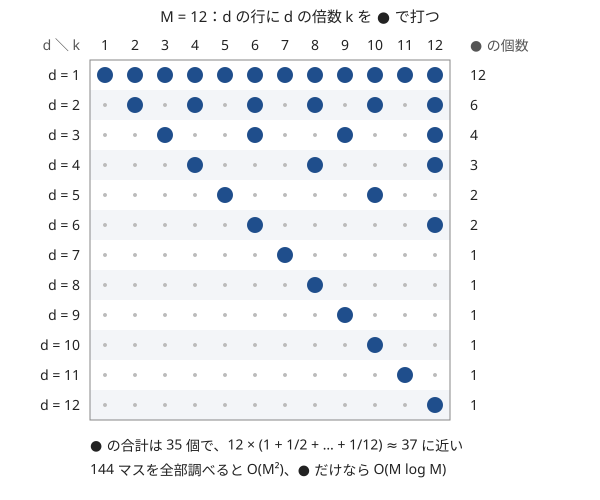

!!! abstract "要点"
    - **何ができるか**：割り切る・割り切られる関係にある組を値ごとに数えるとき、各 $d$ について $d$ の倍数をすべてたどる二重ループを使う。値の上限を $M$ とすると内側の回数は合計 $M/1 + M/2 + \dots + M/M \approx M \ln M$ で、$M = 10^6$ なら約 $1.4 \times 10^7$ 回で間に合う。
    - **いつ使うか**：
        - $A_i \le 10^6$ 程度で、値を配列の添字にできる。
        - 割り切る・割り切られる関係にある組を数える。
        - 各 $d$ について、$d$ の倍数である要素の個数や和を求める。
        - $\sum_{d=1}^{M} \sum_{k=1}^{\lfloor M/d \rfloor} f(d, kd)$ の形の二重ループ。
    - **計算量**：$O(M \log M)$（$M$ は倍数をたどる値の上限で、列の長さ $N$ ではない）。値ごとの個数の表を作るのに別に $O(N)$ かかる。
    - **前提**：[Σ の変形](../math/sigma-manipulation.md)、[計算量の見積もり](../basics/complexity-estimation.md)

<!-- textlint-disable -->
別名：harmonic series・N/1+N/2+…+N/N・O(N log N) の倍数ループ・倍数を回す
<!-- textlint-enable -->

調和級数と倍数の列挙は、「$d = 1, 2, \dots, M$ のそれぞれについて $d, 2d, 3d, \dots$ をたどる」二重ループが $O(M^2)$ ではなく $O(M \log M)$ で終わることを使って、約数・倍数の関係にある値どうしをまとめて処理する方法である。要素どうしの組を直接調べると $N^2$ 組ある。値の範囲が狭ければ、値を添字にした表の上で倍数をたどる方が速い。外側の $d$ が大きいほど内側の回数が減ることが、速さの理由のすべてである。

このページで使う記法：$N$ は列の長さ、$M$ は倍数をたどる値の上限（多くは $\max A_i$）とする。$\mathrm{cnt}[v]$ は列の中で値が $v$ の要素の個数で、表の添字は値そのもの（$1$ 以上 $M$ 以下）にする。$d \mid k$ は「$d$ が $k$ を割り切る」を表す。ほかの記法は[記法と用語の約束](../start/notation.md)にそろえる。

## M/1 + M/2 + … + M/M ≈ M ln M の根拠（M = 10^6 で約 1.4×10^7） {#why-n-log-n}

「$A_i$ がほかの要素の倍数か」を組ごとに調べると $O(N^2)$ で、$N = 2 \times 10^5$ では約 $2 \times 10^{10}$ 回になり間に合わない。一方、値が $10^6$ 以下なら、値を添字にした表の上で「$d$ の倍数」をたどれば済む。次の図は $M = 12$ で、$d$ の行に $d$ の倍数の位置を ● で打ったものである。



$d$ の行の ● は $\lfloor M/d \rfloor$ 個なので、全部の行をたどる回数は次の和である。

$$
\sum_{d=1}^{M} \left\lfloor \frac{M}{d} \right\rfloor \le M \left( 1 + \frac{1}{2} + \frac{1}{3} + \dots + \frac{1}{M} \right) = M H_M
$$

$H_M = 1 + 1/2 + \dots + 1/M$ を調和級数（の部分和）と呼ぶ。$H_M$ は $\ln M$ とほぼ同じ速さで増え、$\ln(M + 1) \le H_M \le 1 + \ln M$ が成り立つ。$M = 10^6$ なら $\ln M \approx 13.8$、$H_M \approx 14.4$ で、たどる回数は約 $1.4 \times 10^7$ 回（正確な $\sum \lfloor M/d \rfloor$ は $13970034$）である。$M = 2 \times 10^5$ なら約 $2.5 \times 10^6$ 回、$M = 10^7$ でも約 $1.6 \times 10^8$ 回で、単純な処理なら間に合う。

??? note "証明：ln(M + 1) ≤ H_M ≤ 1 + ln M"
    関数 $1/x$ は $x > 0$ で減少する。$d \ge 1$ について、区間 $[d, d + 1]$ では $1/x \le 1/d$ なので、$\int_d^{d+1} \frac{dx}{x} \le \frac{1}{d}$ である。$d = 1, \dots, M$ で足すと $\ln(M + 1) = \int_1^{M+1} \frac{dx}{x} \le H_M$ になる。

    逆に $d \ge 2$ について、区間 $[d - 1, d]$ では $1/x \ge 1/d$ なので、$\frac{1}{d} \le \int_{d-1}^{d} \frac{dx}{x}$ である。$d = 2, \dots, M$ で足して $1$ を加えると $H_M \le 1 + \int_1^{M} \frac{dx}{x} = 1 + \ln M$ になる。

    図で言えば、幅 1・高さ $1/d$ の棒を並べた階段が、曲線 $y = 1/x$ の下の面積と上の面積に挟まれている。$H_M - \ln M$ は $M$ を大きくすると約 $0.577$（オイラー定数）に近づく。

二重ループに見えても速いのは、内側のループを `k += d` で進めて ● だけを踏むからである。内側を `k++` で回して `k % d == 0` を判定すると、どの $d$ でも $M$ 回回り、$O(M^2)$ に戻る。和の形で見ると、$\sum_{d=1}^{M} \sum_{d \mid k,\ k \le M} f(d, k)$ を $k = d \cdot j$（$j = 1, \dots, \lfloor M/d \rfloor$）と付け替えた形である（[添字の付け替え](../math/sigma-manipulation.md#reindex)）。

??? question "確認問題：1 から M までの約数の個数"
    $1$ 以上 $M$ 以下のすべての整数について約数の個数を求めたい。各整数を $\sqrt{k}$ まで試し割りする方法と、倍数をたどる方法の計算量をそれぞれ答えよ。$M = 10^6$ ではどちらが速いか。

    ??? success "答え"
        試し割りは $\sum_{k=1}^{M} \sqrt{k}$ で $O(M \sqrt{M})$、$M = 10^6$ で約 $6.7 \times 10^8$ 回である。倍数をたどる方法は、$d = 1, \dots, M$ について $d$ の倍数 $k$ の約数の個数に 1 を足すので、$\sum \lfloor M/d \rfloor$ 回で $O(M \log M)$、約 $1.4 \times 10^7$ 回で済む。約数の個数の合計がちょうど $\sum_{d=1}^{M} \lfloor M/d \rfloor$ になることも分かる。

## 値の倍数に印を付ける {#mark-multiples}

「ほかの要素で割り切れるか」を判定するには、割る側を値 $d$ で固定し、$d$ の倍数の位置に印を付ける。$k$ が $d$ で割り切れることと、$k$ が $d$ の倍数であることは同じなので、割り切られる側を 1 つずつ調べる代わりに、割る側から倍数へ配ればよい。

処理の流れは次のとおりである。

```text
cnt[v] ← 値 v の出現回数（v = 1..M）
bad[v] ← false（v はほかの要素で割り切れる、の印）
for d = 1..M:
    if cnt[d] = 0: 次の d へ             // 列に d がなければ割る側にならない
    if cnt[d] ≥ 2: bad[d] ← true         // 同じ値が 2 つあれば互いに割り切る
    for k = 2d, 3d, … (k ≤ M): bad[k] ← true
答え ← bad[v] = false かつ cnt[v] > 0 の v の cnt[v] の和
```

内側のループを $2d$ から始めるのは、$d$ 自身が「ほかの要素」ではないからである。ただし同じ値が 2 つ以上あれば、互いに相手で割り切れる。この 2 つを取り違えるのが、この型で最も多いバグである（[落とし穴](#pitfalls)）。$\mathrm{cnt}[d] = 0$ の $d$ を飛ばしても、たどる回数は $\sum \lfloor M/d \rfloor$ 以下なので $O(M \log M)$ である。

```cpp
--8<-- "harmonic-sum/multiples.cpp:mark"
```

印の代わりに数を配れば、「$v$ を割り切る要素の個数」も同じループで数えられる。$\mathrm{cnt}[d]$ を $d$ の倍数すべてに足せば、各 $v$ について「列の中にある $v$ の約数の個数（重複込み）」が求まる。

## 倍数を回して集める（d の倍数である要素の個数・和） {#collect-multiples}

印を付けるのとは逆向きに、$d$ の倍数の位置から値を集めると、「$d$ の倍数である要素の個数」がすべての $d$ について求まる。

$$
c[d] = \sum_{d \mid k,\ k \le M} \mathrm{cnt}[k] = \mathrm{cnt}[d] + \mathrm{cnt}[2d] + \mathrm{cnt}[3d] + \cdots
$$

$c[d]$ は「すべて $d$ の倍数」という条件で数えた量であり、gcd の問題で効く。要素をいくつか選んだときの gcd が $d$ の倍数であることは、選んだ要素がすべて $d$ の倍数であることと同じだからである。だから「$K$ 個選んで gcd を $d$ の倍数にできるか」は「$c[d] \ge K$ か」に言い換わる。$K$ 個の gcd の最大値は、$c[d] \ge K$ となる最大の $d$ である。

```cpp
--8<-- "harmonic-sum/multiples.cpp:collect"
```

集めるものは個数に限らない。$\mathrm{cnt}[k]$ の代わりに $k \cdot \mathrm{cnt}[k]$ を集めれば「$d$ の倍数である要素の和」、最大値をとれば「$d$ の倍数である要素の最大」になる。集めた後にもう一度倍数へ配る、という 2 段の処理もよく使う。

- **集めてから配る**：各 $A_i$ について「$A_i$ の約数 $d$ のうち、条件を満たす最大のもの」を求めるとき、まず $c[d]$ を集める。次に条件を満たす $d$ を小さい順に見て、$d$ の倍数すべてに $d$ を書き込む（大きい $d$ が後から上書きする）。$A_i$ の位置に残った値が答えになる（[例題の ABC393 E](#abc393_e)）
- **約数の側から見る**：$A_i$ の約数を試し割りで列挙すると 1 つあたり $O(\sqrt{A_i})$ で、$N = 2 \times 10^5$・$A_i \le 10^6$ なら約 $2 \times 10^8$ 回になる。値の表の上で倍数をたどれば、$N$ によらず $O(M \log M)$ で済む

この「倍数の側から集める」処理は、倍数についてのゼータ変換と呼ばれるものの素朴な形である。素数の倍数だけを使って $O(M \log \log M)$ にする方法は[約数・倍数のゼータ変換とメビウス変換](../comb/zeta-mobius-divisor.md#per-prime)にある。

## 倍数の箱を後ろから決める {#decide-from-back}

各 $d$ について「$d$ の倍数の位置の値」に条件がかかるとき、$d$ の大きい順に決めると、1 つずつ確定できることがある。$d$ の倍数のうち $d$ 自身以外は $2d, 3d, \dots$ で、どれも $d$ より大きいからである。大きい順に見れば、$d$ を決める時点で $2d, 3d, \dots$ はもう決まっている。

**例：倍数の位置の和の偶奇**。番号 $1, \dots, M$ の箱にボールを入れるかどうかを決め、各 $d$ について「$d$ の倍数の番号の箱のボールの数」の偶奇を指定どおりにしたいとする。$x_d \in \{0, 1\}$ を箱 $d$ のボールの数とすると、$d$ についての条件は次の形になる。

$$
x_d + x_{2d} + x_{3d} + \cdots \equiv a_d \pmod{2}
$$

$d = M, M - 1, \dots, 1$ の順に見ると、$x_{2d}, x_{3d}, \dots$ は決まっているので、$x_d$ は $a_d$ から残りの和を引いた偶奇でただ 1 つに決まる。どの $d$ でも $x_d$ が決まるので、答えは必ずある。参照する箱の数は $d$ ごとに $\lfloor M/d \rfloor - 1$ 個なので、全体で $O(M \log M)$ である（[練習問題](#practice)の ABC134 D）。

**例：gcd がちょうど d の組の個数**。$c[d]$（$d$ の倍数である要素の個数）から $\binom{c[d]}{2}$ を作ると、これは「gcd が $d$ の倍数である組の個数」である。gcd がちょうど $d$ の組の個数を $f[d]$ とすると、gcd が $d$ の倍数の組は gcd が $d, 2d, 3d, \dots$ のどれかなので、次の式が成り立つ。

$$
f[d] = \binom{c[d]}{2} - \sum_{j \ge 2,\ jd \le M} f[jd]
$$

右辺の $f[2d], f[3d], \dots$ は $d$ より大きい添字なので、$d$ の大きい順に計算すれば決まっている。$f[1]$ が互いに素な組の個数である。$c$ を集めるのと $f$ を決めるのが、どちらも $O(M \log M)$ である。

```cpp
--8<-- "harmonic-sum/multiples.cpp:back"
```

この「数えやすい量（すべて $d$ の倍数）から、ちょうど $d$ のものを後ろから引いて求める」形は[約数包除](../comb/divisor-inclusion-exclusion.md#partition)と呼ばれる。答えを mod で求めるときは、引き算で負になった値を法に足して直す。

??? question "確認問題：前から決めるとどうなるか"
    倍数の位置の和の偶奇の例で、$d = 1, 2, \dots$ の小さい順に $x_d$ を決めようとすると何が困るか。

    ??? success "答え"
        $d = 1$ の条件は $x_1 + x_2 + \dots + x_M$ の偶奇で、まだ決めていない $x_2, \dots, x_M$ をすべて含む。小さい順では、条件に出てくる未定の変数が多すぎて 1 つに決まらない。大きい順なら、$d$ の条件に出てくる未定の変数は $x_d$ だけになる。

## 商が同じ範囲を倍数で区切って数える {#quotient-ranges}

すべての組の $\lfloor \max / \min \rfloor$ の和のように、$\lfloor y/x \rfloor$ を値ごとにまとめたいときも、$x$ の倍数で区切る。小さい方の値 $x$ を固定すると、$\lfloor y/x \rfloor = q$ となる $y$ は閉区間 $[qx, (q + 1)x - 1]$ に並ぶ。区切りの位置 $x, 2x, 3x, \dots$ は $x$ の倍数そのものである。

$$
\sum_{y > x} \mathrm{cnt}[y] \left\lfloor \frac{y}{x} \right\rfloor = \sum_{q \ge 1} q \times \bigl(\text{値が } [qx, (q+1)x - 1] \text{ にあり } x \text{ より大きい要素の個数}\bigr)
$$

区間の中の個数は、値ごとの個数の[累積和](../basics/prefix-sum.md) $s[v]$（値が $v$ 以下の要素の個数）を作っておけば $O(1)$ で求まる。$x$ ごとの区間は $\lfloor M/x \rfloor$ 個なので、すべての $x$ で合計 $O(M \log M)$ である。小さい方が $x$ の要素は $\mathrm{cnt}[x]$ 個あるので、$x$ ごとの和に $\mathrm{cnt}[x]$ を掛ける。同じ値どうしの組は $\lfloor x/x \rfloor = 1$ なので、$\binom{\mathrm{cnt}[x]}{2}$ 組として別に足す。

```cpp
--8<-- "harmonic-sum/multiples.cpp:quotient"
```

$q = 1$ の区間だけは $x$ 自身を含むので、下端を $x + 1$ に上げて同じ値を除く。区間の上端 $(q + 1)x - 1$ は $M$ を超えることがあるので、$M$ で打ち切る。

[商の列挙](../math/floor-quotient-enum.md)も「商が同じ範囲をまとめる」方法だが、向きが違う。商の列挙は分子 $N$ を 1 つ固定して分母 $i$ を動かし、$\lfloor N/i \rfloor$ が同じ $i$ の区間を $O(\sqrt{N})$ 個作る。ここでは分母 $x$ を固定して分子 $y$ を動かし、区間は $\lfloor M/x \rfloor$ 個になる。分母がすべての値を動くので、合計が調和級数になる。

## 素数の倍数だけをたどる篩（M log log M）との違い {#vs-sieve}

[エラトステネスの篩](../math/sieve-eratosthenes.md)も倍数をたどるが、たどるのは素数 $p$ の倍数だけである。回数は $\sum_{p \le M} M/p \approx M \ln \ln M$ で、$M = 10^6$ で実際に数えると約 $2.9 \times 10^6$ 回と、すべての $d$ でたどる約 $1.4 \times 10^7$ 回の 5 分の 1 ほどになる。

| たどる $d$ | 回数 | $M = 10^6$ | 使う場面 |
| --- | --- | --- | --- |
| すべての $d$ | $\sum_d M/d \approx M \ln M$ | 約 $1.4 \times 10^7$ | 約数・倍数の関係そのものを使う |
| 素数 $p$ だけ | $\sum_p M/p \approx M \ln \ln M$ | 約 $2.9 \times 10^6$（実際の回数） | 素因数で決まる量を作る |

素数だけで足りるのは、知りたい量が素因数から決まるときである。素数判定・異なる素因数の個数・最小素因数の表などがそうである。一方、「$d$ の倍数である要素の個数」をすべての $d$ について求めたり、gcd がちょうど $d$ の組を数えたりするには、合成数の $d$ も必要なので、すべての $d$ をたどる。

実際には $M \le 10^6$ なら差は数倍で、どちらも間に合うことが多い。log log にこだわるより、すべての $d$ をたどる素直な形で正しく書く方を優先してよい。$M = 10^7$ で処理が重いときや、倍数の個数を集める処理を素数ごとの段に分けられるとき（[約数・倍数のゼータ変換とメビウス変換](../comb/zeta-mobius-divisor.md#per-prime)）に、素数だけの形を考える。

## 落とし穴 {#pitfalls}

**同じ値が複数あると自分自身で割り切れる**。「ほかの要素で割り切れない」を数えるとき、内側のループを $2d$ から始めるだけでは、同じ値の要素どうしが互いに割り切ることを見落とす。たとえば $A = (3, 3)$ では、どちらも相手で割り切れるので答えは 0 である。$\mathrm{cnt}[d] \ge 2$ なら $d$ 自身にも印を付ける。逆に内側を $d$ から始めると、1 つしかない値まで自分で割り切れることになり、答えが常に 0 になる。

**ループの上限は値の最大**。倍数をたどる上限は列の長さ $N$ ではなく値の最大 $M$ である。$N = 10$ でも $A_i = 10^6$ なら、表の大きさは $10^6 + 1$ 要る。上限を $N$ にすると、大きい値の倍数を見落とす。表の大きさを $\max A_i + 1$ にするか、制約の上限の $10^6 + 1$ に固定する。

**複数のテストケースで表を毎回全部初期化する**。テストケースが $T$ 個あり、値の上限 $10^6$ の表をケースごとに作り直すと $O(T \cdot M \log M)$ になる。$T = 10^4$ なら間に合わない。ケースごとの値の最大までだけ使う、使った添字だけを戻すなどして、$M$ をそのケースの値の最大にする。

**`k++` と `k % d` で回す**。内側を倍数だけでなく全部の $k$ で回して割り切れるかを判定すると、どの $d$ でも $M$ 回回って $O(M^2)$ になる。内側は必ず `k += d` で進める。

**約数のリストを全部作ってメモリを使いすぎる**。倍数をたどって $1, \dots, M$ の約数のリストを `vector<vector<int>>` に作ると、要素数は $\sum \lfloor M/d \rfloor \approx 1.4 \times 10^7$ 個で、`int` で約 56MB になる。加えて $10^6$ 個の `vector` の管理にも時間とメモリがかかる。リストが要らない処理なら、その場で倍数をたどって集める。

**組の個数のオーバーフロー**。$\binom{c[d]}{2}$ は $c[d] = 2 \times 10^5$ で約 $2 \times 10^{10}$ になり、`int` に収まらない。$\lfloor \max / \min \rfloor$ の和はさらに大きく、$N = 2 \times 10^5$・$A_i \le 10^6$ で約 $10^{16}$ に達しうる（半分が 1、半分が $10^6$ のとき）。個数と和は `long long` で持つ。

## 例題 {#examples}

### ABC170 D. Not Divisible {#abc170_d}

<div class="kp-problems" data-role="example" markdown>

- [ABC170 D. Not Divisible](https://atcoder.jp/contests/abc170/tasks/abc170_d)（diff 1033）：長さ N の数列で、自分以外のどの要素でも割り切れない要素の個数を求める（A_i ≤ 10^6）。

</div>

組を直接調べると $O(N^2)$ なので、値を添字にした表の上で、割る側の値 $d$ から倍数へ印を付ける。[値の倍数に印を付ける](#mark-multiples)の処理そのもので、同じ値が 2 つ以上ある場合の扱いが要点である。

??? note "解法の詳細"
    - $\mathrm{cnt}[v]$ に値 $v$ の出現回数を数える。$M = \max A_i$ とする。
    - $d = 1, \dots, M$ について、$\mathrm{cnt}[d] > 0$ なら $2d, 3d, \dots$ に印を付ける。$\mathrm{cnt}[d] \ge 2$ なら $d$ 自身にも印を付ける。
    - 印のない $v$ で $\mathrm{cnt}[v] = 1$ のものの個数が答えである（印のない $v$ は $\mathrm{cnt}[v] \le 1$）。
    - 計算量は $O(N + M \log M)$。コードは[値の倍数に印を付ける](#mark-multiples)の節のものと同じ形である。

### ABC393 E. GCD of Subset {#abc393_e}

<div class="kp-problems" data-role="example" markdown>

- [ABC393 E. GCD of Subset](https://atcoder.jp/contests/abc393/tasks/abc393_e)（diff 1253）：各 i について、A_i を含むように K 個の要素を選んだときの最大公約数の最大値を求める（A_i ≤ 10^6）。

</div>

選んだ要素の gcd が $d$ の倍数であることは、選んだ要素がすべて $d$ の倍数であることと同じである。だから答えは「$A_i$ の約数 $d$ で、$d$ の倍数である要素が $K$ 個以上あるもの」の最大である。$d$ の倍数の個数 $c[d]$ を[倍数を回して集め](#collect-multiples)、条件を満たす $d$ を倍数へ配る。

??? note "解法の詳細"
    - **言い換えの正しさ**：$A_i$ を含む $K$ 個の gcd を $g$ とすると、$g$ は $A_i$ の約数で、選んだ $K$ 個はどれも $g$ の倍数なので $c[g] \ge K$ である。逆に $d \mid A_i$ かつ $c[d] \ge K$ なら、$A_i$ と、ほかの $d$ の倍数 $K - 1$ 個を選べば gcd は $d$ の倍数なので $d$ 以上になる。よって答えは $c[d] \ge K$ を満たす $A_i$ の約数 $d$ の最大である。
    - $\mathrm{cnt}$ を作り、$d = 1, \dots, M$ について $c[d] = \sum_{d \mid k} \mathrm{cnt}[k]$ を集める（$O(M \log M)$）。$c[d]$ は $A_i$ 自身も数えている。
    - $\mathrm{best}[k] = 0$ で始め、$d = 1, \dots, M$ の小さい順に、$c[d] \ge K$ なら $d$ の倍数 $k$ すべてで $\mathrm{best}[k] \leftarrow d$ とする（大きい $d$ が後から上書きするので、残るのは最大の $d$）。これも $O(M \log M)$。
    - 各 $i$ について $\mathrm{best}[A_i]$ を出力する。$d = 1$ は $c[1] = N \ge K$ なので、答えは 1 以上になる。
    - $N$ は $10^6$ を超えうるので、入出力を速くしておく。

## 練習問題 {#practice}

<div class="kp-problems" data-role="practice" markdown>

- [ABC179 C. A x B + C](https://atcoder.jp/contests/abc179/tasks/abc179_c)（diff 283）：A × B + C = N を満たす正の整数の組 (A, B, C) の個数を求める（N ≤ 10^6）。
- [ABC134 D. Preparing Boxes](https://atcoder.jp/contests/abc134/tasks/abc134_d)（diff 926）：1..N の箱それぞれにボールを入れるかを決め、各 i について i の倍数の番号の箱のボールの数の偶奇が a_i になるようにできるかを判定し、例を示す。
- [ABC356 E. Max/Min](https://atcoder.jp/contests/abc356/tasks/abc356_e)（diff 1506）：長さ N の数列のすべての組 i < j について ⌊max(A_i, A_j) / min(A_i, A_j)⌋ を足した和を求める（A_i ≤ 10^6）。
- [ABC469 F. GCD Maximum Spanning Tree](https://atcoder.jp/contests/abc469/tasks/abc469_f)（diff 1567）：互いに異なる整数 A_1, …, A_N を頂点とし、2 頂点の間の辺の重みを 2 数の最大公約数とした完全グラフで、全域木の辺の重みの和の最大を求める。

</div>

??? note "練習の方針"
    - **ABC179 C**：$C \ge 1$ なので、$AB \le N - 1$ となる $(A, B)$ の個数を数えればよい。$A$ を固定すると $B$ は $\lfloor (N - 1)/A \rfloor$ 通りで、割り算なら $O(N)$ である。組を 1 つずつ数え上げても、回数は $\sum_A \lfloor (N - 1)/A \rfloor \approx N \ln N$ で間に合う
    - **ABC134 D**：[倍数の箱を後ろから決める](#decide-from-back)の偶奇の例そのものである。番号の大きい箱から、$2i, 3i, \dots$ の箱の和と $a_i$ の偶奇から入れるかどうかを決める。答えは必ずある
    - **ABC356 E**：[商が同じ範囲を倍数で区切って数える](#quotient-ranges)の処理そのものである。値ごとの個数の累積和を作り、小さい方の値 $x$ ごとに、閉区間 $[qx, (q + 1)x - 1]$ にある値の個数に $q$ を掛けて足す。同じ値どうしの組は別に数える
    - **ABC469 F**：辺の重みの大きい順に結ぶ（[最小全域木](../graph/minimum-spanning-tree.md)のクラスカル法を最大にしたもの）。$d$ を大きい順に見て、$d$ の倍数である頂点どうしを重み $d$ でつなぐ候補にする。gcd がちょうど $d$ でない組も混ざるが、本当の gcd はもっと大きく、その段で先に結ばれているので、誤った重みで結ぶことはない。$A_i$ が相異なるので、候補を作る回数は $O(M \log M)$ に収まる

## 力試し {#challenge}

<div class="kp-problems" data-role="challenge" markdown>

- [ABC128 F. Frog Jump](https://atcoder.jp/contests/abc128/tasks/abc128_f)（diff 2464）：池の蓮の上を A 進んで B 戻る移動を繰り返して最後の蓮に着くまでに踏んだ蓮の得点の和の最大値を、A と B を選んで求める（同じ蓮を 2 回踏むと失敗）。

</div>

??? note "力試しの方針"
    - **ABC128 F**：$C = A - B$ とおくと、踏む蓮は始点側の $C, 2C, 3C, \dots$ と、終点側の $N - 1, N - 1 - C, N - 1 - 2C, \dots$ に分かれる。$C$ を固定して踏む回数を 1 つずつ増やしながら得点を足していけば、$C$ ごとの手間は約 $N/C$ で、全体は調和級数で $O(N \log N)$ になる。$C$ が $N - 1$ の約数のときは、踏む回数が多いと 2 つの列が同じ蓮で重なり失敗になる。約数でも回数が少なければ重ならないので、$C$ ごと捨てずに、$kC \ge N - 1 - kC$ になる手前で止める

## 確認問題 {#quiz}

??? question "確認問題：計算量の見積もり"
    $A_i \le 10^6$ の列について、次の処理の計算量を答えよ。(1) $d = 1, \dots, 10^6$ のそれぞれについて、$d$ の倍数 $k$ ごとに $k$ の約数 $d$ を `vector` に入れる。(2) $d = 1, \dots, 10^6$ のそれぞれについて、$d^2$ の倍数をたどる。

    ??? success "答え"
        (1) は $\sum \lfloor M/d \rfloor \approx 1.4 \times 10^7$ 回の追加で $O(M \log M)$ だが、メモリも同じだけ使う（[落とし穴](#pitfalls)）。(2) は $\sum_{d} \lfloor M/d^2 \rfloor \le M \sum 1/d^2 < M \cdot \pi^2/6 \approx 1.65 M$ なので $O(M)$ である。$d^2 > M$ の $d$ では 1 つもたどらない。

??? question "確認問題：素数だけで足りるか"
    $1, \dots, M$ の各数について「異なる素因数の個数」を求めるとき、たどる $d$ は素数だけでよいか。「約数の個数」ならどうか。

    ??? success "答え"
        異なる素因数の個数は、素数 $p$ の倍数すべてに 1 を足せば求まるので、素数だけでよい（$O(M \log \log M)$）。約数の個数は、合成数の約数も 1 つずつ数えるので、すべての $d$ をたどる（$O(M \log M)$）。素因数分解から約数の個数を計算する方法もあるが、それには最小素因数の表などの別の道具が要る。

## 使い分け {#comparison}

- 1 つの $N$（$10^{12}$ など）について $\sum_i f(\lfloor N/i \rfloor)$ を求めるなら[商の列挙](../math/floor-quotient-enum.md)を使う。値の表を作れないほど大きくても $O(\sqrt{N})$ で済む
- 1 つの数の約数だけが要るなら、試し割りの[約数列挙](../math/divisor-enum.md)で $O(\sqrt{N})$。多数の数の約数・倍数の関係をまとめて扱い、値が $10^6$ 程度までなら倍数をたどる
- 素因数で決まる量だけが要るなら[エラトステネスの篩](../math/sieve-eratosthenes.md)の形（素数の倍数だけ）で足りる
- 「ちょうど $d$」を数えるときの引き算の考え方は[約数包除](../comb/divisor-inclusion-exclusion.md)、倍数の和を高速に行き来するのは[約数・倍数のゼータ変換とメビウス変換](../comb/zeta-mobius-divisor.md)

## 参考 {#references}

- [drken「AtCoder ABC 170 D - Not Divisible (1Q, 緑色, 400 点)」](https://drken1215.hatenablog.com/entry/2020/12/30/081500)：例題の方針（値の表に倍数の印を付ける、同じ値が複数ある場合）
- [ikatakos「AtCoder Beginner Contest 393 E,F問題メモ」](https://ikatakos.com/pot/programming_algorithm/contest_history/atcoder/2025/0215_abc393)：例題の言い換えと、倍数の個数を集める方法（解法の部分だけを参照）
- [drken「AtCoder ABC 179 C - A x B + C (3Q, 灰色, 300 点)」](https://drken1215.hatenablog.com/entry/2020/09/21/070100)：練習の方針（A を固定した数え方）
- [drken「AtCoder ABC 134 D - Preparing Boxes (1Q, 緑色, 400 点)」](https://drken1215.hatenablog.com/entry/2020/12/25/175400)：練習の方針（大きい番号から決める理由と、解が必ずあること）
- [drken「AtCoder ABC 356 E - Max/Min (1D, 水色, 475 点)」](https://drken1215.hatenablog.com/entry/2024/06/08/032313)：練習の方針（値ごとの個数の累積和と、倍数で区切る数え方）
- [ikatakos「AtCoder Beginner Contest 469 D,E,F,G問題メモ」](https://ikatakos.com/pot/programming_algorithm/contest_history/atcoder/2026/0801_abc469)：練習の方針（大きい公約数から結ぶ理由。解法の部分だけを参照）
- [drken「AtCoder ABC 128 F - Frog Jump (橙色, 600 点)」](https://drken1215.hatenablog.com/entry/2019/06/15/202200)：力試しの方針（差を固定した全探索が調和級数で収まること）
