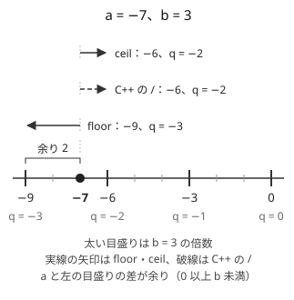
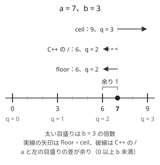

!!! abstract "要点"
    - **何ができるか**：負の数を含む割り算の商（切り捨て・切り上げ）と 0 以上の余り、区間にある倍数の個数、「$x$ 以上で余りが $r$ の最小の数」を、整数のまま正しく求める。積があふれるかどうかも、掛ける前に割り算で判定する。
    - **いつ使うか**：
        - 入力に負の数（$\lvert X \rvert \le 10^{18}$ など）があり、割り算・余り・切り上げを使う。
        - 積・lcm・累乗が $10^{18}$ を超えうる（`long long` の上限は約 $9.2 \times 10^{18}$）。
        - $x$ 以上で、$m$ で割って $r$ 余る最小の数。
        - 閉区間 $[L, R]$ にある $K$ の倍数の個数。
        - 一定の間隔で発車する・周期的に起こる出来事の、ある時刻以降で最初のもの。
    - **計算量**：どれも $O(1)$。lcm は gcd の $O(\log \min(a, b))$ を含む。
    - **前提**：なし

<!-- textlint-disable -->
別名：floor_div・floor division・切り捨て除算・切り上げ・負の数の割り算・負の数の余り・オーバーフロー判定・割り算で比較
<!-- textlint-enable -->

整数の割り算と余りは、どの分野の問題でも途中の計算に出てくる部品である。正の数だけなら C++ の `/` と `%` で足りるが、負の数・境界の 0・$10^{18}$ 付近の大きさが混ざると、1 だけずれた答えやあふれが起きる。このページは、そうした場面で使う 3 つの関数（床関数・天井関数・0 以上の余り）と、倍数の数え方・あふれの判定の決まった書き方をまとめる。

このページで使う記法：$\lfloor x \rfloor$ は $x$ 以下の最大の整数、$\lceil x \rceil$ は $x$ 以上の最小の整数、$a \bmod m$ は 0 以上 $m$ 未満の余りを表す。ほかの記法は[記法と用語の約束](../start/notation.md)にそろえる。

## C++ の / と % と、数学の floor・mod の違い {#cpp-vs-math}

数学では、整数 $a$ を正の整数 $b$ で割った商と余りを次のように決める。余りが 0 以上 $b$ 未満になるように商を選ぶ、という決め方である。

$$
q = \left\lfloor \frac{a}{b} \right\rfloor, \qquad r = a - bq \quad (0 \le r < b)
$$

数直線で見ると、$b$ の倍数に目盛りを打ったとき、$a$ を挟む左の目盛りが $bq$ で、$a$ からそこまでの距離が余り $r$ である。右の目盛りは $b \lceil a/b \rceil$ になる（$a$ が $b$ の倍数なら左右の目盛りは同じ）。




C++ の `a / b` は、実数の商を 0 の向きに切り捨てる。$a \ge 0$ なら 0 の向きは左なので floor と一致するが、$a < 0$ では 0 の向きが右になり、割り切れないときは floor より 1 大きい。`a % b` は `a - (a / b) * b` と決まっているので、$a < 0$ なら余りも 0 以下になる。$-7$ を $3$ で割ると、数学では $q = -3$・$r = 2$、C++ では `-7 / 3` が $-2$、`-7 % 3` が $-1$ である。C++ の側の振る舞いの一覧は [数・ビット・乱数の関数](../cpp/cpp-math-functions.md#integer-division)にある。

ずれが起きる条件は「割り切れず、かつ商が負」に限られる。商が負になるのは $a$ と $b$ の符号が違うときである。この条件のときだけ 1 引けば floor になる、というのが次の節の関数の中身である。

??? question "確認問題：負の数の商と余り"
    $-7$ を $3$ で割った商と余りを、数学の定義（余りは 0 以上 3 未満）で答えよ。$-9$ ではどうか。

    ??? success "答え"
        $-7 = 3 \times (-3) + 2$ なので、商は $-3$、余りは $2$ である。$-9 = 3 \times (-3) + 0$ は割り切れるので、商は $-3$、余りは $0$ で、C++ の `-9 / 3` と一致する。割り切れるときは C++ と数学がずれない。

## 負の数でも正しい floor_div・ceil_div・safe_mod {#floor-ceil}

負の数が混ざりうる割り算は、毎回 `/` を書かずに次の 3 つの関数を通す。どれも C++ の `/` と `%` を 1 回ずつ使い、ずれる条件のときだけ 1 直す。

```cpp
--8<-- "integer-division/division.cpp:core"
```

- **floor_div**：割り切れず（`a % b != 0`）、$a$ と $b$ の符号が違う（商が負）なら、C++ の商は floor より 1 大きいので 1 引く
- **ceil_div**：割り切れず、符号が同じ（商が正）なら、C++ の商は floor と同じなので 1 足して ceil にする。商が負なら C++ の商がそのまま ceil である
- **safe_mod**：`a % m` が負なら $m$ を足す。結果は floor_div と組にして $a = m \lfloor a/m \rfloor + (a \bmod m)$ を満たす

ceil を $\lceil a/b \rceil = -\lfloor -a/b \rfloor$ で作る書き方もある。式は正しいが、$a$ が `LLONG_MIN` だと `-a` があふれる。上の ceil_div は符号を反転しないので、この心配がない。ただし `LLONG_MIN / -1` は商が `long long` に収まらないので、どの書き方でも使えない。

余りだけが欲しいなら、`((a % m) + m) % m` の 1 行でも safe_mod と同じ値になる。`a % m` は $-m$ より大きいので、$m$ を足せば必ず 0 以上になるからである。$a$ と $m$ が正だと分かっている場所では、`/` と `%` をそのまま使ってよい。

## 切り上げ ⌈a/b⌉ = ⌊(a+b−1)/b⌋ が使える条件 {#ceil-formula}

正の数の切り上げは `(a + b - 1) / b` と書くことが多い。この式が正しいのは、$b > 0$ かつ $a + b - 1 \ge 0$（すなわち $a > -b$）のときである。

理由は次のとおりである。$b > 0$ なら、数学では $\lceil a/b \rceil = \lfloor (a + b - 1)/b \rfloor$ がすべての整数 $a$ で成り立つ。$a = bq - s$（$0 \le s < b$）と書くと、左辺は $q$、右辺は $\lfloor q + (b - 1 - s)/b \rfloor = q$ になるからである（$0 \le b - 1 - s < b$）。C++ の `/` は、割られる数 $a + b - 1$ が 0 以上ならこの floor と一致する。負だと、割り切れないときに floor より 1 大きくなる。

| 書き方 | 必ず正しい範囲（$b > 0$） | 誤る例（$b = 2$） |
| --- | --- | --- |
| `(a + b - 1) / b` | $a > -b$ | $a = -8$ で $-3$（正しくは $-4$） |
| `(a - 1) / b + 1` | $a \ge 1$ | $a = 0$ で $1$（正しくは $0$） |
| `ceil_div(a, b)` | すべて | なし |

2 行目の書き方は $a + b - 1$ を作らないのであふれにくいが、$a = 0$ で 1 を返す。「必要な回数」を求めていて $a = 0$（何もしなくてよい）がありうるなら、この境界で誤る。符号や 0 の可能性を 1 つずつ確かめるより、迷ったら ceil_div を呼ぶ方が確実である。

`(a + b - 1)` は $a$ と $b$ がともに $10^{18}$ 程度なら $2 \times 10^{18}$ 程度で `long long` に収まる。$a$ が `LLONG_MAX` に近い値（「十分大きい数」として置いた番兵など）だとあふれるので、番兵は $10^{18}$ や $2 \times 10^{18}$ のように余裕を持たせる。

## 区間の中の K の倍数の個数と、x 以上で m で割って r 余る最小の数 {#count-multiples}

閉区間 $[L, R]$ にある $K$ の倍数を $Kj$（$j$ は整数、$K > 0$）と書き、$j$ の範囲を数える。$Kj \le R$ は $j \le \lfloor R/K \rfloor$ と同じで、$Kj \ge L$ は $Kj > L - 1$、すなわち $j > \lfloor (L-1)/K \rfloor$ と同じである。よって $j$ は $\lfloor (L-1)/K \rfloor < j \le \lfloor R/K \rfloor$ を動き、個数は次の式になる。$L, R \ge 1$ なら「$R$ 以下の正の倍数の個数」から「$L - 1$ 以下の正の倍数の個数」を引く、と読んでもよい。

$$
\#\{\, y \in [L, R] : K \mid y \,\} = \left\lfloor \frac{R}{K} \right\rfloor - \left\lfloor \frac{L - 1}{K} \right\rfloor
$$

この式は floor で書いてあるので、$L$ が 0 や負でもそのまま使える。C++ の `/` で書くと、$L = 0$ のとき `(L - 1) / K` が $\lfloor -1/K \rfloor = -1$ ではなく $0$ になり、倍数の 0 を数え漏らす。半開区間 $[l, r)$ なら $\lceil r/K \rceil - \lceil l/K \rceil$ と書ける。

「$x$ 以上で、$m$ で割って $r$ 余る最小の数」は、$x$ から $d$（$0 \le d < m$）だけ進めて余りをそろえると考える。$x + d \equiv r \pmod{m}$ なので $d = (r - x) \bmod m$ で、答えは $x + ((r - x) \bmod m)$ である。$r - x$ は負になりうるので、ここで safe_mod が要る。「$x$ 以下で $r$ 余る最大の数」は同じ考え方で $x - ((x - r) \bmod m)$ になる。

```cpp
--8<-- "integer-division/multiples.cpp:core"
```

$r = 0$ の場合が「$x$ 以上の最小の $m$ の倍数」で、$m \lceil x/m \rceil$ とも書ける。一定の間隔 $F$ で発車する列車に時刻 $t$ に着いたなら、次の発車は $F \lceil t/F \rceil$ である。最初の発車が時刻 $S$（$S$ は $F$ の倍数）なら、$\max(S, F \lceil t/F \rceil)$ になる。

??? question "確認問題：0 を含む区間"
    閉区間 $[0, 10]$ にある 3 の倍数の個数を式で求めよ。C++ で `10 / 3 - (0 - 1) / 3` と書くと何が出るか。

    ??? success "答え"
        $\lfloor 10/3 \rfloor - \lfloor -1/3 \rfloor = 3 - (-1) = 4$ で、0・3・6・9 の 4 個である。C++ の `(0 - 1) / 3` は $0$ なので、`10 / 3 - 0` は $3$ になり、0 を数え漏らす。floor_div を使うか、$L = 0$ を別に扱う。

## あふれる前に割り算で判定する方法と __int128 への逃げ方 {#overflow}

`long long` が表せるのは約 $9.2 \times 10^{18}$ までなので、$10^{18}$ 程度の 2 数を掛けると[オーバーフロー](../cpp/cpp-integer-overflow.md#signed-overflow-ub)する。符号付き整数のあふれは未定義動作で、掛けた後に「負になったか」を調べる判定は正しく働かない。掛ける前に、割り算で判定する。

$a, b \ge 1$ と上限 $L \ge 0$ について、次が成り立つ。

$$
a \times b \le L \iff a \le \left\lfloor \frac{L}{b} \right\rfloor
$$

右から左は、$ab \le b \lfloor L/b \rfloor \le L$ による。左から右は、$ab \le L$ を $b$ で割って $a \le L/b$ となり、$a$ が整数なので $a \le \lfloor L/b \rfloor$ になることによる。$L / b$ は割り算なので、あふれずに計算できる。

```cpp
--8<-- "integer-division/overflow.cpp:core"
```

- **上限で止める**：積や累乗を何度も掛けていく計算では、超えたら $L + 1$ を返す関数にしておくと、一度超えた値を「超えた」のまま持ち回れる。$L + 1$ が `long long` に収まるように $L$ を選ぶ（$10^{18}$ なら十分）
- **lcm は割ってから掛ける**：$\operatorname{lcm}(a, b) = a / \gcd(a, b) \times b$ の順にする。$a \times b / \gcd$ の順では、答えが小さくても途中の $a \times b$ があふれる。さらに $a / \gcd$ と $b$ の積が上限を超えるかも、同じ割り算で判定する（[GCD・LCM](../math/gcd-lcm.md)）
- **累乗**：$x^k$ が $L$ を超えるかは、1 回掛けるごとに判定し、超えた時点で止める。整数の $K$ 乗根を二分探索するときの判定もこの形である（[整数の平方根・K 乗根](../math/integer-root.md)）
- **__int128 に逃げる**：$a, b \le 10^{18}$ なら積は $10^{36}$ 程度で `__int128`（約 $1.7 \times 10^{38}$ まで）に収まるので、`(__int128)a * b <= L` と書いてもよい。分数 $a/b$ と $c/d$ の大小を $ad$ と $cb$ で比べるときのように、積そのものを比べたい場面ではこちらが簡単である。注意は [__int128](../cpp/cpp-integer-overflow.md#int128) と [__int128 の入出力](../cpp/cpp-integer-overflow.md#int128-io) にある

割り算の判定は、負の数が混ざると不等号の向きと floor・ceil の選び方が変わる。$b > 0$ なら $a \times b \le L \iff a \le \lfloor L/b \rfloor$ は $a$ や $L$ が負でも成り立つが、$L$ が負なら floor_div を使う。$b < 0$ なら $ab = (-a)(-b)$ と書き直し、$-a \le \lfloor L/(-b) \rfloor$ で判定する（$a$ か $b$ が `LLONG_MIN` だと符号の反転があふれる）。積が負になりうる場面では、`__int128` で掛けて比べる方が簡単である。`__builtin_mul_overflow` で判定する書き方は [積が上限を超えるかの判定](../cpp/cpp-integer-overflow.md#overflow-check)にある。

## double で割らない（10^18 付近の誤差） {#no-double}

`floor((double)a / b)` や `ceil(a / (double)b)` で床関数・天井関数を作ると、負の数の向きは正しくなるが、値が大きいと誤る。`double` の仮数部は 53 bit なので、整数を正確に表せるのは $2^{53}$（約 $9.0 \times 10^{15}$）までである。それより大きい `long long` は、`double` に変換した時点で近くの表せる値に丸められる。

```cpp
--8<-- "integer-division/double-ng.cpp:core"
```

$10^{18} - 1$ を `double` にすると、近くの表せる値は $128$ おきにしかなく、$10^{18}$ に丸められる。そのため 10 で割った floor が $10^{17}$ になり、正しい値 $10^{17} - 1$ と 1 ずれる。$\lvert a \rvert \le 10^{18}$ の制約は、この誤差がちょうど表に出る大きさである。

- **割り算は整数のまま**：床関数・天井関数・余りは、前の節の 3 つの関数で整数のまま求める
- **大小の比較も整数で**：$a < c^b$ のような比較を $\log$ や `pow` で行うと、等号に近いときに誤る。両辺を整数のまま、上限で止める掛け算で比べる
- **平方根も同じ**：`sqrt` を `long long` の大きな値に使うと 1 ずれることがある。補正の仕方は [整数の平方根・K 乗根](../math/integer-root.md)にある

## 落とし穴 {#pitfalls}

実際に起きやすいバグを、原因と直し方の組でまとめる。

- **負の数の floor**：座標や差 $x - y$ のように負になりうる値を `/` で割り、1 ずれる。負になりうる割り算は floor_div・ceil_div を通す
- **余りが負のまま添字になる**：`v[a % m]` で `a` が負だと範囲外になる。`x % 2 == 1` も負の奇数では偽になる。余りを添字や比較に使う前に safe_mod で 0 以上に直す
- **$L = 0$ の区間**：`R / K - (L - 1) / K` は $L = 0$ で 0 を数え漏らす。floor_div で書くか、$L = 0$ を別に扱う
- **切り上げの書き方の境界**：`(a + b - 1) / b` は $a \le -b$ で、`(a - 1) / b + 1` は $a = 0$ などで誤ることがある
- **掛けてから割る**：`a * b / g` の順で lcm を作り、途中であふれる。割ってから掛ける
- **掛けた後に判定する**：`if (a * b < 0)` であふれを調べても、未定義動作なので信用できない。掛ける前に `a > L / b` で判定する
- **`int` のまま掛ける**：`int` どうしの積は `int` で計算されてからあふれる。`1LL * a * b` と書く（[整数のオーバーフロー](../cpp/cpp-integer-overflow.md#int-product)）
- **double を経る**：`floor((double)a / b)` は $2^{53}$ を超えると誤る

## 上位の手法へのつながり {#next-steps}

床関数と 0 以上の余りは、上位の手法の式の中にそのまま現れる。ここで扱った関数の約束（余りは 0 以上、商は floor）を守っておくと、上位の手法の式を負の数にもそのまま使える。

- **周期で数える**：周期 $P$ の模様で $[0, X)$ を数えると $\lfloor X/P \rfloor$ 周期と余り $X \bmod P$ に分かれる。左端が負でも floor と safe_mod で同じ式が使える（[周期性の検出](../basics/periodicity.md#periodic-patterns)）
- **mod の計算**：引き算をした後の値を 0 以上に直すのは safe_mod と同じ操作である（[mod の計算の基本](../math/mod-arithmetic.md)）。余りが等しい数をまとめる考え方は[中国剰余定理](../math/crt.md)で連立の合同式に広がる
- **floor の和**：$\sum_i \lfloor N/i \rfloor$ は[商の列挙](../math/floor-quotient-enum.md)、$\sum_i \lfloor (ai + b)/m \rfloor$ は [floor sum](../math/floor-sum.md) で速く求める。どちらも $x \bmod m = x - m \lfloor x/m \rfloor$ の書き換えで余りの和を floor の和に直して使う

## 例題 {#examples}

### ABC239 B. Integer Division {#abc239_b}

<div class="kp-problems" data-role="example" markdown>

- [ABC239 B. Integer Division](https://atcoder.jp/contests/abc239/tasks/abc239_b)（diff 57）：負の数もありうる整数 X（|X| ≤ 10^18）について ⌊X/10⌋ を求める。

</div>

$X$ が負で 10 で割り切れないとき、C++ の `X / 10` は 0 の向きに切り捨てるので floor より 1 大きい。割り切れるか、$X \ge 0$ なら `X / 10` がそのまま答えになる。$\lvert X \rvert \le 10^{18}$ は `long long` に収まるが、`double` で割ると誤差が出る大きさである。

??? note "解法の詳細"
    - `long long` で $X$ を読み、floor_div$(X, 10)$ を出力する。中身は「`X / 10` を求め、`X % 10 != 0` かつ $X < 0$ なら 1 引く」である
    - 例として $X = -13$ なら、`-13 / 10` は $-1$ で、割り切れず負なので $-2$ が答えになる。$X = -20$ なら割り切れるので $-2$ のまま
    - `floor(X / 10.0)` は $X$ が $10^{18}$ 近くで誤るので使わない（[double で割らない](#no-double)）

## 練習問題 {#practice}

<div class="kp-problems" data-role="practice" markdown>

- [ABC131 C. Anti-Division](https://atcoder.jp/contests/abc131/tasks/abc131_c)（diff 518）：A 以上 B 以下の整数のうち、C でも D でも割り切れないものの個数を求める。
- [ABC165 D. Floor Function](https://atcoder.jp/contests/abc165/tasks/abc165_d)（diff 600）：0 ≤ x ≤ N の整数 x について ⌊Ax/B⌋ − A⌊x/B⌋ の最大値を求める。
- [ABC432 C. Candy Tribulation](https://atcoder.jp/contests/abc432/tasks/abc432_c)（diff 654）：2 種類の飴（値 X と Y、X < Y）を各人に決まった個数ずつ配り、全員の合計をそろえるとき、Y の飴の個数の合計の最大値を求める（できなければ -1 を出力する）。
- [ABC048 B. Between a and b ...](https://atcoder.jp/contests/abc048/tasks/abc048_b)（diff 861）：a 以上 b 以下の整数のうち x で割り切れるものの個数を求める（0 ≤ a ≤ b ≤ 10^18）。
- [ABC084 C. Special Trains](https://atcoder.jp/contests/abc084/tasks/abc084_c)（diff 908）：駅を順に結ぶ列車がそれぞれ一定の間隔で発車するとき、各駅から出発して終点に着く最も早い時刻を求める。
- [典型90 038. Large LCM（★3）](https://atcoder.jp/contests/typical90/tasks/typical90_al)（diff —）：2 数の最小公倍数が 10^18 を超えるかを判定し、超えなければその値を出力する。

</div>

??? note "練習の方針"
    - **ABC131 C**：$f(N)$ を「$N$ 以下で $C$ でも $D$ でも割り切れない数の個数」とし、$N - \lfloor N/C \rfloor - \lfloor N/D \rfloor + \lfloor N/\operatorname{lcm}(C, D) \rfloor$ で求める。答えは $f(B) - f(A - 1)$。lcm は割ってから掛ける
    - **ABC165 D**：$x$ を $B$ 増やすと 2 つの項がどちらも $A$ 増えるので、式は周期 $B$ である。$0 \le x < B$ では第 2 項が 0 で、第 1 項は $x$ について増えるので、$x = \min(N, B - 1)$ を代入する
    - **ABC432 C**：全員の合計を $P$ とすると、各人の Y の個数は $(P - X A_i)/(Y - X)$ で決まる。これが整数になるには $X A_i \bmod (Y - X)$ が全員で等しいことが要る。個数は $P$ について増えるので、$P$ は取りうる最大（$Y \min A_i$）にし、それが $X \max A_i$ 以上かを確かめる
    - **ABC048 B**：[区間の倍数の個数](#count-multiples)の式 $\lfloor b/x \rfloor - \lfloor (a - 1)/x \rfloor$ を使う。$a = 0$ で `(a - 1) / x` が 0 になる境界に注意する
    - **ABC084 C**：各駅から順にシミュレーションする。時刻 $t$ に駅 $i$ にいるとき、次の発車は $\max(S_i, F_i \lceil t/F_i \rceil)$ で、到着は発車の $C_i$ 秒後である
    - **典型90 038**：$g = \gcd(A, B)$ として、$A/g > \lfloor 10^{18}/B \rfloor$ なら超える。超えなければ $A/g \times B$ を出力する。`__int128` で掛けてから比べてもよい

## 確認問題 {#quiz}

??? question "確認問題：x 以上で余りが r の最小の数"
    $x = -7$、$m = 5$、$r = 4$ のとき、$x$ 以上で 5 で割って 4 余る最小の数を求めよ。C++ の `%` をそのまま使って `x + (r - x) % m` と書くと何が出るか。

    ??? success "答え"
        $(r - x) \bmod m = 11 \bmod 5 = 1$ なので、答えは $-7 + 1 = -6$ である（$-6 = 5 \times (-2) + 4$）。この例では $r - x = 11$ が正なので C++ の `%` でも同じ値になる。$x = 7$、$r = 4$ なら $r - x = -3$ で、`(-3) % 5` は $-3$ になり、`7 + (-3) = 4` と $x$ より小さい数が出る。正しくは $(-3) \bmod 5 = 2$ で、答えは $9$ である。

??? question "確認問題：あふれの判定の向き"
    $a = 3$、$b = 4$、$L = 12$ のとき `a > L / b` は真か偽か。$L = 11$ ではどうか。それぞれ $a \times b > L$ と一致するか確かめよ。

    ??? success "答え"
        $L = 12$ では $L / b = 3$ で、$3 > 3$ は偽。$a \times b = 12 > 12$ も偽で一致する。$L = 11$ では $11 / 4 = 2$（切り捨て）で、$3 > 2$ は真。$12 > 11$ も真で一致する。切り捨てがあっても、$a$ が整数なので判定はずれない。

## 参考 {#references}

- [nagi0724「【ABC239】競プロ初心者のABC備忘録【C++】」](https://qiita.com/nagi0724/items/0badcef2c9d4f577a77d)：例題の場合分け（割り切れず負のときに 1 引く）
- [fjnkt98「ABC239 B - Integer Division C++解答例」](https://zenn.dev/fjnkt98/articles/adfd2398b4eeeb)：例題の裏付け
- [drken「AtCoder ABC 131 C - Anti-Division (4Q, 茶色, 300 点)」](https://drken1215.hatenablog.com/entry/2019/06/22/224100)：練習の方針（倍数の個数の包除と、lcm を割ってから掛けること）
- [drken「AtCoder ABC 165 D - Floor Function (2Q, 茶色, 400 点)」](https://drken1215.hatenablog.com/entry/2020/05/02/225600)：練習の方針（周期 B と x = min(N, B − 1)）
- [drken「AtCoder ABC 432 C - Candy Tribulation (1Q, 茶色, 350 点)」](https://drken1215.hatenablog.com/entry/2025/11/16/160322)：練習の方針（余りがそろう条件と、合計の範囲）
- [asamichiruko「ABC 432 C 問題の解き方と説明」](https://zenn.dev/asamichiruko/articles/feecf5ef8874fb)：練習の問いの向き（個数の合計の最大値）と、合計を最大に取ること
- [drken「AtCoder ABC 048 B - Between a and b ... (5Q, 灰色, 200 点)」](https://drken1215.hatenablog.com/entry/2024/05/29/023425)：練習の方針（f(b) − f(a − 1) と a = 0 の扱い）
- [drken「AtCoder ABC 084 C - Special Trains (4Q, 緑色, 300 点)」](https://drken1215.hatenablog.com/entry/2025/02/03/023357)：練習の方針（次の発車時刻を切り上げで求める式）
- [drken「競プロ典型 90 問 038 - Large LCM（5Q, ★3）」](https://drken1215.hatenablog.com/entry/2023/11/21/020301)：練習の方針（割り算による事前の判定と __int128）
- [E869120「kyopro_educational_90 sol/038.cpp」](https://github.com/E869120/kyopro_educational_90/blob/main/sol/038.cpp)：練習の方針の裏付け
- [cppreference「Arithmetic operators」](https://en.cppreference.com/w/cpp/language/operator_arithmetic)：C++ の整数の割り算が 0 の向きに切り捨てることと、% の定義
