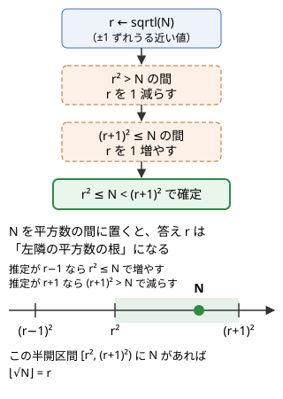

!!! abstract "要点"
    - **何ができるか**：$\lfloor \sqrt{N} \rfloor$ や $\lfloor N^{1/K} \rfloor$ を、$N \le 10^{18}$ でも誤差なく整数で求める。double の `sqrt` は 1 ずれることがあるので、$r^2 \le N < (r+1)^2$ になるまで整数で補正するか、二分探索で求める。$a^b \le N$ となる $a$ の上限や、累乗数を重複なく数えるのに使う。
    - **いつ使うか**：
        - $N \le 10^{18}$ で平方数・平方根を扱う。
        - $a^b$（$b \ge 2$）の形で表せる $N$ 以下の数を数える。
        - $2^a \times b^2$ のように累乗を組み合わせた数を数える。
    - **計算量**：平方根は `sqrtl` の後に数回の補正で $O(1)$。$K$ 乗根は二分探索で $O(\min(K, 63) \log N)$。$N$ 以下の累乗数の数え上げは $O(N^{1/3} \log N)$。
    - **前提**：[整数の割り算と余り](../math/integer-division.md)

<!-- textlint-disable -->
別名：isqrt・integer square root・整数平方根・累乗数・perfect power・誤差のない平方根・sqrt の誤差
<!-- textlint-enable -->

整数の平方根・K 乗根は、$r^2 \le N < (r+1)^2$ や $a^K \le N < (a+1)^K$ を満たす整数を、浮動小数点数の誤差の影響を受けずに求める技法である。答えの正しさは「整数の不等式を満たすか」で確かめられるので、近い値を求めてから整数で確かめて直せばよい。

このページでは $N \ge 0$ の整数とし、$\lfloor \sqrt{N} \rfloor$ を `isqrt(N)` とも書く。記法は[記法と用語の約束](../start/notation.md)にそろえる。

## sqrt の誤差と補正（r の 2 乗と r + 1 の 2 乗で N を挟む） {#sqrt-correction}

`(long long)sqrt(n)` は、$n$ が $4.5 \times 10^{15}$ ほどの大きさで、もう 1 大きい値を返すことがある。`sqrt` は double で計算し、double の仮数部は 53 bit しかない（[浮動小数点数の型](../cpp/cpp-types-literals.md#floating-point)）。$n = r^2 - 1$ の平方根は $r - \frac{1}{2r}$ ほどで、$r$ が大きいとこの差が double の刻みの半分より小さくなり、$r$ に丸められる。

```cpp
--8<-- "integer-root/sqrt-ng.cpp:core"
```

$n$ そのものは double で正確に表せるのに、平方根の値が丸められて 1 ずれる。$10^{18}$ 近くでは $n$ を double に直す時点でも丸めが起きる（[pow・sqrt は double で計算する](../cpp/cpp-math-functions.md#pow-sqrt)）。

答え $r = \lfloor \sqrt{N} \rfloor$ は、次の不等式を満たすただ 1 つの非負整数である。

$$
r^2 \le N < (r+1)^2
$$

だから、浮動小数点数で近い値を求めた後、この不等式を整数で確かめて直せば正しい答えになる。



```cpp
--8<-- "integer-root/isqrt.cpp:core"
```

- **比べ方**：$r^2 > N$ を `r > n / r`、$(r+1)^2 \le N$ を `r + 1 <= n / (r + 1)` と割り算で書いている。$a \times b \le L \iff a \le \lfloor L / b \rfloor$ を使っており（[あふれる前に割り算で判定する](../math/integer-division.md#overflow)）、$N$ が `long long` の上限近くでも 2 乗を作らずに済む
- **近い値の求め方**：`sqrtl` は long double で計算する。x86-64 の GCC では仮数部が 64 bit ある。$N < 2^{63}$ なら、ずれても 1 程度で補正のループも 0〜1 回で終わる
- **補正はやめない**：long double の精度は環境で変わる。Apple Silicon の macOS では long double が double と同じ 64 bit なので、手元で `sqrtl` だけに頼ると誤る。補正があれば、近い値がどう求まっても答えは正しい

??? question "確認問題：何を確かめればよいか"
    `sqrt` で求めた $r$ を補正するとき、何を確かめれば $r = \lfloor \sqrt{N} \rfloor$ だと言えるか。$r^2 \le N$ だけでは足りない理由も答えよ。

    ??? success "答え"
        $r^2 \le N < (r+1)^2$ の両方を確かめる。$r^2 \le N$ だけなら、$r$ が答えより小さい場合（たとえば $r = 0$）も満たしてしまう。上側の $N < (r+1)^2$ で「$r + 1$ はもう大きすぎる」ことを確かめて、はじめて最大だと言える。

## 二分探索による整数の K 乗根（途中の累乗のあふれ） {#kth-root}

$a^K \le N$ となる最大の $a$（$\lfloor N^{1/K} \rfloor$）は、$a$ について単調なので[二分探索](../basics/binary-search.md#meguru)で求められる。$a$ が大きいほど $a^K$ も大きいので、$a^K \le N$ を満たす $a$ は $0$ から答えまでの連続した範囲になる。ok を $0$（$0^K = 0 \le N$）、ng を必ず満たさない値として、判定 $a^K \le N$ で境目を探す。

難しいのは判定の中身である。$a^K$ をそのまま計算すると、$a$ が答えより大きいときに `long long` を超えてあふれる。1 回掛けるごとに「次に掛けたら $N$ を超えるか」を割り算で確かめ、超えたら打ち切る。

```cpp
--8<-- "integer-root/kth-root.cpp:core"
```

- **ng の置き場所**：$K \ge 2$ なら答えは $\sqrt{2^{63}} \approx 3.04 \times 10^9$ 未満なので、ng $= 3037000500$ とした。$K = 1$ は答えが $N$ そのものなので先に返す。ng を $N + 1$ にすると、$N$ が上限のときにあふれる
- **打ち切りの効果**：$a \ge 2$ のとき $a^{64} > 2^{63}$ だから、判定のループは $K$ と関係なく 63 回までで止まる。$a = 1$ を別に扱うのは、何乗しても 1 だからである。判定 1 回の計算量が $O(\min(K, 63))$ で、二分探索の回数が約 32 回である
- **pow で近い値を求める方法**：平方根と同じく、`pow(n, 1.0 / k)` で近い値を求めてから、$a^K \le N < (a+1)^K$ を上の判定で確かめて直してもよい。$1.0 / k$ そのものに誤差があるので、ずれは 1 より大きいこともあると考え、ループで直す

$K$ が 3 以上なら答えは $10^6$ 以下（$N \le 10^{18}$ のとき）と小さいので、「$a^K \le N$ の間 $a$ を増やす」全探索でも間に合う。累乗数の列挙はこの形で行う。

## 累乗数の数え上げ（b ≥ 3 は列挙、b = 2 は ⌊√N⌋、重複を除く） {#perfect-powers}

$a^b$（$a \ge 1$、$b \ge 2$）の形で書ける数を[累乗数](../guide/glossary.md#perfect-power)と呼ぶ。$N \le 10^{18}$ の累乗数を数えるときは、指数 2 とそれ以外で分ける。

- **平方数**：$N$ 以下の平方数は $1^2, 2^2, \dots, r^2$（$r = \lfloor \sqrt{N} \rfloor$）の $r$ 個で、1 つずつ作らずに数だけ分かる。$N = 10^{18}$ なら $10^9$ 個あり、列挙はできない
- **指数 3 以上**：$a^3 \le N$ から $a \le 10^6$ なので、$a = 2, 3, \dots$ と $b = 3, 4, \dots$ を全部列挙できる。個数はおよそ $N^{1/3} + N^{1/4} + \cdots$ で、$10^6$ 程度である
- **重複を除く**：同じ数が何通りにも書ける（$2^6 = 4^3 = 8^2$）。指数 3 以上の列挙のうち平方数であるものは、平方数の $r$ 個にすでに入っているので捨てる。残りの中の重複（$2^{15} = 8^5 = 32^3$ など）は、ソートして同じ値を 1 つにまとめる

$N = 99$ で確かめる。平方数は $1, 4, \dots, 81$ の 9 個である。指数 3 以上の列挙では $8, 16, 27, 32, 64, 81$ が出て、そのうち平方数でない $8, 27, 32$ の 3 個が残る。合わせて 12 個である。

```cpp
--8<-- "integer-root/perfect-powers.cpp:core"
```

ソートが列挙した約 $N^{1/3}$ 個に対して $O(N^{1/3} \log N)$ かかり、これが全体の計算量になる。平方数の判定も、前の節の正確な `isqrt` で行う。この範囲の累乗数では `sqrt` でもたまたま誤らないが、それを確かめるより `isqrt` を使う方が安全である。

「1 を数えるか」は問題で変わるので、定義を確かめる。$a \ge 1$ なら $1 = 1^2$ は累乗数で、`isqrt(N)` に入っている。$a \ge 2$ なら 1 は除く。

??? question "確認問題：集合で重複を除くだけでは"
    $N \le 10^{18}$ で、$a \ge 2$、$b \ge 2$ のすべての $a^b$ を `set` に入れて数える方法は間に合うか。$N \le 10^{10}$ ならどうか。

    ??? success "答え"
        $N \le 10^{18}$ では間に合わない。指数 2 だけで $10^9$ 個の平方数を入れることになる。平方数は $\lfloor \sqrt{N} \rfloor$ で数だけ求め、指数 3 以上だけを列挙する。$N \le 10^{10}$ なら $a \le 10^5$ で、入れる数は合わせて $10^5$ 程度なので、すべてを集合に入れても間に合う。

## √ を含む式の大小を整数で比べる {#compare-sqrt}

正の整数 $a, b, c$ について、$\sqrt{a} + \sqrt{b} < \sqrt{c}$ のような比較も、double で計算すると等号に近い場合を誤る。両辺が 0 以上なら、2 乗しても大小は変わらない。2 乗を繰り返して $\sqrt{}$ を消し、整数の比較にする。

$$
\sqrt{a} + \sqrt{b} < \sqrt{c}
\iff a + b + 2\sqrt{ab} < c
\iff 2\sqrt{ab} < c - a - b
$$

ここで右辺 $c - a - b$ の符号を先に見る。$c - a - b \le 0$ なら、左辺は正なので成り立たない。$c - a - b > 0$ なら両辺とも正なので、もう一度 2 乗して $4ab < (c - a - b)^2$ を整数で調べる。$a, b, c \le 10^9$ なら右辺は $10^{18}$ 程度で、`long long` に収まる。

- **2 乗してよいのは両辺が 0 以上のときだけ**：符号を確かめずに 2 乗すると、$-3 < 2$ が $9 < 4$ になって向きが変わる
- **整数と √ の比較**：$k \ge 0$ のとき、$\sqrt{x} < k \iff x < k^2$、$\lfloor \sqrt{x} \rfloor \ge k \iff x \ge k^2$ である。ループの条件を `i <= sqrt(n)` ではなく `i * i <= n` と書くのは、この言い換えである
- **値の大きさ**：2 乗するたびに桁数が倍になる。2 回 2 乗して `long long` を超えるなら `__int128`（[__int128](../cpp/cpp-integer-overflow.md#int128)）を使う

## 落とし穴 {#pitfalls}

**`(long long)sqrt(n)` をそのまま使う**。小さな入力では合うので気づきにくく、$10^{15}$ を超えるテストで 1 ずれる。`sqrt` を使ったら必ず補正するか、整数版の `isqrt` を用意しておく。

**補正の 2 乗があふれる**。$N$ が $9 \times 10^{18}$ 近くまであると、補正で作る $(r+1)^2$ が `long long` の上限を超える。$\lfloor \sqrt{2^{63} - 1} \rfloor = 3037000499$ で、$3037000500^2$ はもう収まらない。`r * r <= n` ではなく割り算で比べるか、`__int128` で比べる。

**K 乗根の判定で累乗があふれる**。二分探索の途中では答えよりずっと大きな $a$ を試すので、$a^K$ を最後まで掛けるとあふれる。あふれた値は負や小さな値になり、判定が「$N$ 以下」と誤る。1 回掛けるごとに割り算で打ち切る。

**列挙に `pow` を使う**。$a^b$ を `pow(a, b)` で作ると double の誤差で 1 ずれた値になり、ソートしても重複が消えない。整数の掛け算で作る。

**`i <= sqrt(n)` のループ**。約数の列挙などで `for (long long i = 1; i <= sqrt(n); i++)` と書くと、`sqrt` の誤差で最後の 1 回が抜けたり増えたりする。毎回の `sqrt` の呼び出しも遅い。`i * i <= n`（$i$ が大きいなら `i <= n / i`）と書く。

## 上位の手法へのつながり {#next-steps}

$\sqrt{N}$ は、整数の問題で「小さい側と大きい側の境目」として何度も現れる。

- **約数列挙**：$N$ の約数は $i$ と $N / i$ の組で、小さい方は $\sqrt{N}$ 以下にある。ループの終わりは `i * i <= n` で書く（[約数列挙](../math/divisor-enum.md)）
- **商の列挙**：$\lfloor N / i \rfloor$ の値は $2\sqrt{N}$ 種類以下で、$i \le \sqrt{N}$ と $i > \sqrt{N}$ で分けて数える（[商の列挙](../math/floor-quotient-enum.md)）
- **平方因子を除いた核**：「積が平方数」「$2^a \times b^2$ の形」のような条件は、素因数の指数の偶奇で考えると整理できる（[素因数の指数で考える](../math/prime-exponent-vector.md#squarefree-kernel)）
- **指数ごとの包除**：累乗数の個数は、$\lfloor N^{1/K} \rfloor$ を指数 $K$ ごとに求めて、同じ数を重複して数えた分を指数の倍数関係で除いても求まる（[約数の包除原理](../comb/divisor-inclusion-exclusion.md)）

## 例題 {#examples}

### ABC400 C. 2^a b^2 {#abc400_c}

<div class="kp-problems" data-role="example" markdown>

- [ABC400 C. 2^a b^2](https://atcoder.jp/contests/abc400/tasks/abc400_c)（diff 702）：N 以下の正の整数のうち、正の整数 a, b を使って 2^a × b² と書けるものの個数を求める（N ≤ 10^18）。

</div>

$(a, b)$ の組をすべて数えると、同じ数を何度も数える。たとえば $72 = 2^3 \times 3^2 = 2^1 \times 6^2$ である。$b$ に含まれる 2 を $2^a$ の側へ移せるので、$2^a \times b^2 = 2^{a+2} \times (b/2)^2$（$b$ が偶数のとき）となり、表し方を 1 つに決めれば重複なく数えられる。決め方は 2 通りある。

- $b$ を奇数に限る：各 $a$ について、$b^2 \le N / 2^a$ となる奇数 $b$ を数える
- $a$ を 1 か 2 に限る：$a \ge 3$ なら $2^a \times b^2 = 2^{a-2} \times (2b)^2$ と $a$ を 2 ずつ減らせるので、$a \in \{1, 2\}$ の表し方が必ずある。$2 \times b^2$ と $4 \times b^2$ は 2 の指数の偶奇が違うので重ならない

どちらも、$b^2 \le M$ を満たす $b$ の個数を正確な `isqrt` で求めるのが中心である。$N = 10^{18}$ のとき $\sqrt{N / 2}$ は $7 \times 10^8$ ほどで、`sqrt` では 1 ずれうる。

??? note "解法の詳細"
    - $a$ を 1 か 2 に限ると、答えは $\lfloor \sqrt{\lfloor N/2 \rfloor} \rfloor + \lfloor \sqrt{\lfloor N/4 \rfloor} \rfloor$ である。
    - $b^2 \le N/2$ と $b^2 \le \lfloor N/2 \rfloor$ は同じ条件である（$b^2$ が整数だから）。先に整数の割り算をしてから `isqrt` に渡してよい。
    - $b$ を奇数に限る方法なら、$2^a \le N$ を満たす $a$（60 個ほど）ごとに $M = \lfloor \sqrt{\lfloor N / 2^a \rfloor} \rfloor$ を求める。$1$ 以上 $M$ 以下の奇数は $\lfloor (M + 1) / 2 \rfloor$ 個あるので、これを足す。
    - `isqrt` は[補正の節](#sqrt-correction)のものをそのまま使う。全体で $O(\log N)$ である。

## 練習問題 {#practice}

<div class="kp-problems" data-role="practice" markdown>

- [ABC193 C. Unexpressed](https://atcoder.jp/contests/abc193/tasks/abc193_c)（diff 379）：1 以上 N 以下の整数のうち、a^b（a, b ≥ 2）と表せないものの個数を求める。
- [ABC361 F. x = a^b](https://atcoder.jp/contests/abc361/tasks/abc361_f)（diff 1606）：1 以上 N 以下の整数のうち、正の整数 a と 2 以上の整数 b で a^b と書けるものの個数を求める（N ≤ 10^18）。

</div>

??? note "練習の方針"
    - **ABC193 C**：$N \le 10^{10}$ なので底は $a \le 10^5$ まで。$a^2, a^3, \dots$ を $N$ 以下の間だけ整数で作って集合に入れ、重複を除いた個数を $N$ から引く。$a \ge 2$ なので 1 は表せない側に入る
    - **ABC361 F**：$N \le 10^{18}$ なので平方数を列挙できない。平方数は `isqrt(N)` 個と数だけ求め、指数 3 以上を列挙して平方数でないものだけを残し、ソートで重複を除いて足す（[累乗数の数え上げ](#perfect-powers)）。指数ごとに $\lfloor N^{1/K} \rfloor$ を求めて包除原理で重複を除く方法もある

## 力試し {#challenge}

<div class="kp-problems" data-role="challenge" markdown>

- [ABC243 G. Sqrt](https://atcoder.jp/contests/abc243/tasks/abc243_g)（diff 2032）：X だけからなる数列の末尾に、末尾の値の平方根以下の正の整数を付け加える操作を 10^100 回行うとき、できる数列の種類数を求める（X ≤ 9×10^18）。

</div>

??? note "力試しの方針"
    - **ABC243 G**：値 $x$ から始まる数列の数を $S_x$ とすると、$S_x = \sum_{y=1}^{\lfloor \sqrt{x} \rfloor} S_y$ である。もう 1 段先の値 $\alpha$ で場合分けすると、$S_X = \sum_{\alpha=1}^{\lfloor X^{1/4} \rfloor} (\lfloor \sqrt{X} \rfloor - \alpha^2 + 1) S_\alpha$ となる。$X^{1/4} \le 54772$ なので、そこまでの $S$ を累積和で前計算すれば各ケースに答えられる。$X$ が $9 \times 10^{18}$ まであるので、`isqrt` は補正の 2 乗があふれない書き方にする

## 参考 {#references}

- [yuulis「ABC400 C - 2^a b^2」](https://yuulis.hatenablog.com/entry/ABC-400-C)：例題の方針（$b$ を奇数に限って重複を除く、`sqrtl` と補正）
- [torus711「AtCoder Beginner Contest 400, C : 2^a b^2」](https://torus711.hatenablog.com/entry/2025/04/06/190653)：例題の方針（$a$ を 1 か 2 に限る、二分探索による整数の平方根）
- [drken「AtCoder ABC 193 C - Unexpressed」](https://drken1215.hatenablog.com/entry/2021/03/02/140000)：練習の方針（$\sqrt{N}$ までの底の列挙と集合による重複の除去）
- [drken「AtCoder ABC 361 F - x = a^b」](https://drken1215.hatenablog.com/entry/2024/07/07/020716)：練習の方針（指数ごとの包除原理）と、近い値から補正する K 乗根の求め方
- [kazun「AtCoder Beginner Contest 243 G問題 Sqrt」](https://kazun-kyopro.hatenablog.com/entry/ABC/243/G)：力試しの方針（1 段先で場合分けして $X^{1/4}$ まで前計算する式）
- [at274「パナソニックコン2020 C - Sqrt Inequality」](https://at274.hatenablog.com/entry/2020/03/15/122125)：√ を含む不等式を、符号を確かめて 2 乗し整数で比べる方法
- [Apple「Writing ARM64 code for Apple platforms」](https://developer.apple.com/documentation/xcode/writing-arm64-code-for-apple-platforms)：Apple Silicon の macOS では long double が double と同じであること
