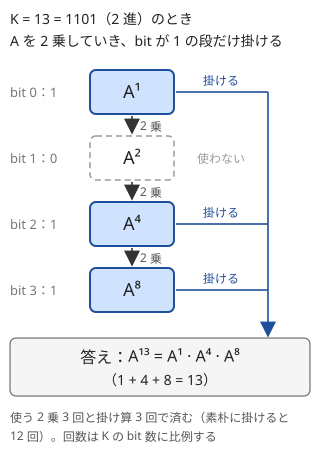
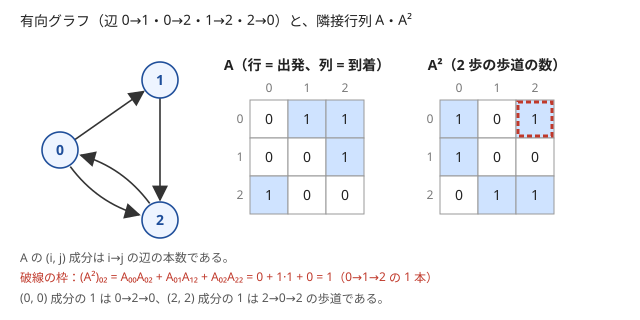

!!! abstract "要点"
    - **何ができるか**：状態のベクトルが毎回同じ線形の遷移 $v' = Av$ で変わるとき、$K$ 回後の $A^K v$ を行列の繰り返し二乗法で $O(n^3 \log K)$ で求める。DP の遷移や、足し算と掛け算を min と + に替えた行列にも使える。
    - **いつ使うか**：
        - 状態数 $n \le 100$ 程度で、繰り返しの回数 $K$ が $10^9$〜$10^{18}$
        - 漸化式の第 $N$ 項（$N \le 10^{18}$）
        - グラフでちょうど $K$ 歩の経路の数・$K$ 本の辺を使う最短路
        - 長さ $10^{18}$ の文字列のうち、禁止された部分文字列を含まないものの数
        - 幅の小さい盤を長く伸ばしたときの敷き詰め方の数
        - $\mathrm{dp}[t+1]$ の各成分が $\mathrm{dp}[t]$ の成分の線形結合で、係数が $t$ によらない
    - **計算量**：$n \times n$ 行列の $K$ 乗が $O(n^3 \log K)$（$n$ は状態数）。$n = 100$、$K = 10^{18}$ で約 $1.2 \times 10^8$ 回の掛け算になる
    - **前提**：[繰り返し二乗法](../math/mod-pow.md)、[DP の状態の設計](../dp/dp-state-design.md)

<!-- textlint-disable -->
別名：行列の累乗・matrix exponentiation・行列累乗 DP・遷移行列・隣接行列の累乗・min-plus 行列・(max,+) 行列・半環の行列
<!-- textlint-enable -->

行列累乗は、1 回の遷移を行列 $A$ で書き、$K$ 回の遷移をまとめた $A^K$ を[繰り返し二乗法](../math/mod-pow.md)で求める方法である。DP を 1 歩ずつ進めると $O(n^2 K)$ かかり、$K = 10^{18}$ では終わらない。行列の積が[結合法則](../guide/glossary.md#associativity)を満たすので、数の累乗と同じく $O(\log K)$ 回の積で $A^K$ が求まる。

このページでは、状態のベクトル $v$ を縦に並べた列ベクトルとし、1 回の遷移を $v' = Av$ と書く。$A$ の $(i, j)$ 成分 $a_{ij}$ は「状態 $j$ から状態 $i$ へ移る係数」である。添字は 0-indexed で、記法は[記法と用語の約束](../start/notation.md)に従う。

## 漸化式・状態の遷移を行列で書く（定数項を状態に入れる） {#write-as-matrix}

行列にできるのは、次の状態の各成分が、今の状態の成分の線形結合（定数倍の和）で書け、係数が $t$ によらない遷移である。

$$
v'_i = \sum_{j} a_{ij} v_j \qquad (a_{ij} \text{ は } t \text{ によらない})
$$

**例：フィボナッチ数列**。$F_{t+1} = F_t + F_{t-1}$ は、隣り合う 2 項を状態にすると次のように書ける。

$$
\begin{pmatrix} F_{t+1} \\ F_t \end{pmatrix}
=
\begin{pmatrix} 1 & 1 \\ 1 & 0 \end{pmatrix}
\begin{pmatrix} F_t \\ F_{t-1} \end{pmatrix}
$$

1 行目が $F_{t+1} = 1 \cdot F_t + 1 \cdot F_{t-1}$ で、2 行目は $F_t$ を写すだけである。$(F_1, F_0) = (1, 0)$ から $N$ 回掛ければ $(F_{N+1}, F_N)$ になる。$k$ 項の線形漸化式も同じで、直近の $k$ 項を状態にすれば $k \times k$ の行列になる。

漸化式が線形結合だけでできていないときは、足りない量を状態に足して線形にする。

| 漸化式 | 状態 | 行列 |
| --- | --- | --- |
| $f_{t+1} = 2 f_t + 3$（定数項） | $(f_t, 1)$ | $\begin{pmatrix} 2 & 3 \\ 0 & 1 \end{pmatrix}$ |
| $f_{t+1} = f_t + t$（$t$ の 1 次式） | $(f_t, t, 1)$ | $\begin{pmatrix} 1 & 1 & 0 \\ 0 & 1 & 1 \\ 0 & 0 & 1 \end{pmatrix}$ |
| $S_{t+1} = S_t + f_t$（項の和も） | $(f_t, S_t)$ に足す | $S$ の行に $f$ の係数 1 を置く |

定数 1 も「毎回 1 に写る状態」とみなせば、線形結合の一部になる。$t$ の多項式の係数も、$t, t^2, \dots$ を状態に足せば同じように扱える。一方、$f_t^2$ や $\min$ を含む遷移は、状態を足しても線形にならない（min は[半環の節](#semiring)で別の形にする）。

**なぜ $A^K v$ になるか**：$v_K = A(A(\cdots(A v_0)))$ である。行列の積は結合法則を満たすので、括弧を付け替えて $(A A \cdots A) v_0 = A^K v_0$ にできる。$A^K$ を先に求めれば、繰り返し二乗法が使える。

??? question "確認問題：$f_{t+1} = 2 f_t + 3$、$f_0 = 1$ の $f_N$ を行列で求めるには"
    状態を $(f_t, 1)$ にすると、$\begin{pmatrix} f_{t+1} \\ 1 \end{pmatrix} = \begin{pmatrix} 2 & 3 \\ 0 & 1 \end{pmatrix} \begin{pmatrix} f_t \\ 1 \end{pmatrix}$ である。$\begin{pmatrix} 2 & 3 \\ 0 & 1 \end{pmatrix}^N$ を $(1, 1)$ に掛けた第 1 成分が $f_N$ になる。2 行目が「1 を 1 に写す」ので、定数 3 が毎回足される。

## 行列の積と繰り返し二乗法（積の向き・単位行列・n³ log K の見積もり・mod の掛け算のあふれ） {#fast-power}

$n \times n$ の行列の積 $C = AB$ は $c_{ij} = \sum_k a_{ik} b_{kj}$ で、成分 $n^2$ 個にそれぞれ $n$ 回の掛け算をするので $O(n^3)$ かかる。$A^K$ は、数の[繰り返し二乗法](../math/mod-pow.md)と同じく、$K$ を 2 進数で表して $A, A^2, A^4, \dots$ を順に 2 乗で作り、bit が 1 の段だけ答えに掛ける。



```text
matpow(A, K):
    R ← 単位行列（対角が 1、ほかは 0）     # K = 0 なら A^0 = 単位行列
    while K > 0:
        K の最下位 bit が 1 なら R ← R × A
        A ← A × A
        K ← K / 2（切り捨て）
    R を返す
```

mod 998244353 で書くと次のようになる。

```cpp
--8<-- "matrix-power/matpow.cpp:core"
```

完全なプログラム：[`matpow.cpp`](https://github.com/yuukougun/kyopro-atlas/blob/main/snippets/matrix-power/matpow.cpp)（GitHub）。`mint` は ACL の `modint998244353`（[modint](../math/modint.md)）。
{ .kp-code-src }

**積の向き**：行列の積は一般に $AB \ne BA$ である。ただし同じ行列の累乗どうしは $A^a A^b = A^{a+b} = A^b A^a$ なので、`r = mul(r, a)` と `r = mul(a, r)` のどちらで書いても $A^K$ は同じになる。向きが答えを変えるのは、違う行列を掛け合わせるとき（[合成の節](#composition)）と、行ベクトル $v' = vA$ の流儀と列ベクトル $v' = Av$ の流儀を混ぜたときである。行ベクトルの流儀では $a_{ij}$ が「$i$ から $j$ へ」の係数になり、行列は列ベクトルの流儀の転置になる。解説によって流儀が違うので、どちらで書くかを最初に決める。

**単位行列**：$R$ の初期値は単位行列にする。0 で埋めた行列から始めると、何を掛けても 0 のままである。$K = 0$ のときは単位行列がそのまま答えになる。

**計算量の見積もり**：2 乗は $\lfloor \log_2 K \rfloor + 1$ 回、答えへの掛け算は $K$ の 1 の bit の数だけ行うので、積は多くて約 $2 \log_2 K$ 回である。最後の 2 乗は答えに使われないので、省けば 2 乗は $\lfloor \log_2 K \rfloor$ 回になる（図の $K = 13$ では、擬似コードは使わない $A^{16}$ も作るので 2 乗が 4 回になる）。$K = 10^{18}$ なら $\log_2 K \approx 60$ で、積は最大約 120 回になる。

| $n$ | 積 1 回（$n^3$） | $K = 10^{18}$ での合計 |
| --- | --- | --- |
| 32 | $3.3 \times 10^4$ | $3.9 \times 10^6$ |
| 64 | $2.6 \times 10^5$ | $3.1 \times 10^7$ |
| 100 | $10^6$ | $1.2 \times 10^8$ |
| 200 | $8 \times 10^6$ | $9.6 \times 10^8$ |

$n = 100$ までなら間に合う見込みが立つが、$n = 200$ では厳しい。必要なのが $A^K v$ だけなら、答えの側を行列でなくベクトルで持ち、bit が 1 の段で $v \leftarrow A^{2^i} v$（$O(n^2)$）とすれば、答えへの掛け算の $O(n^3)$ がなくなる。積の 3 重ループは i-k-j の順にすると、内側のループが $B$ と $C$ を行の向きに連続して読むので速い。

**mod の掛け算のあふれ**：$10^9$ 程度の法では、`int` どうしの積は `int` に収まらない。`long long` にしてから掛けるか、[modint](../math/modint.md) を使う。`long long` で書くときも、$a_{ik} b_{kj}$ は 1 つで約 $10^{18}$ になるので、mod を取らずに $n$ 個足すと $2^{63} \approx 9.2 \times 10^{18}$ を超える。積を 1 つ足すごとに mod を取る。

??? question "確認問題：$n = 100$、$K = 10^{18}$ の行列累乗は間に合うか"
    積 1 回が $100^3 = 10^6$ 回の掛け算で、積は最大約 120 回なので、合計約 $1.2 \times 10^8$ 回である。多くの場合は間に合うが、1 回ごとに mod を取るので余裕は大きくない。答えのベクトルだけが要るなら、ベクトルへの掛け算にして積を約 60 回に減らせる。

## 隣接行列の K 乗と長さ K の経路の数 {#adjacency-power}

有向グラフの隣接行列 $A$（$a_{ij}$ は辺 $i \to j$ の本数）について、$A^K$ の $(i, j)$ 成分は「$i$ から $j$ へちょうど $K$ 本の辺をたどるウォークの数」である。ウォークは同じ頂点や同じ辺を何度通ってもよい経路で、競技プログラミングの問題文では「パス」と呼ぶこともある。



**なぜ成り立つか**：$K$ についての帰納法で示す。$i$ から $j$ への長さ $K + 1$ のウォークは、最後の 1 本の手前の頂点 $k$ で分けると「$i$ から $k$ への長さ $K$ のウォーク」と「辺 $k \to j$」の組になる。$k$ ごとに数を掛けて足すと、$\sum_k (A^K)_{ik}\, a_{kj} = (A^{K+1})_{ij}$ である。これはちょうど行列の積の式になっている。

このページの列ベクトルの流儀で書くと、「頂点 $j$ にいるウォークの数」のベクトル $u$ は $u' = A^{\top} u$ で進む。隣接行列は「行が出発、列が到着」なので、DP の遷移行列とは転置の関係になる。ただし $(A^{\top})^K = (A^K)^{\top}$ なので、転置の流儀で累乗しても得られるのは $A^K$ の転置である。全成分の和（すべての始点・終点の組のウォークの数）は転置しても変わらず、$(i, j)$ 成分が欲しいなら $A$ をそのまま累乗して $(A^K)_{ij}$ を読めばよい。

- **始点を決めた数え上げ**：始点 $s$ からのウォークの数は $A^K$ の $s$ 行目である。列ベクトルの流儀で $A^K e_s$ を計算すると、$s$ に着くウォークの数（$s$ 列目）になるので取り違えない
- **重み付きの辺**：辺ごとの選び方の数（同じ向きの辺が 3 本なら 3）を成分にすれば、そのまま数え上げになる
- **長さ $K$ 以下**：$\sum_{t=0}^{K} A^t$ が要るので、和を状態に足す（[確認問題](#quiz)）

例題の [EDPC R](#dp_r) は、隣接行列の $K$ 乗の全成分の和をそのまま答える。

## DP の遷移を行列にする（照合の状態・末尾の数文字・グリッドの境界の状態） {#dp-transition}

DP の遷移が「状態 $j$ から状態 $i$ へ、決まった係数で配る」形なら、その係数を並べた行列 $A$ で $\mathrm{dp}[t+1] = A\,\mathrm{dp}[t]$ と書ける。行列にできるかは、[DP の状態](../dp/dp-state-design.md)を有限個（$n$ が数百まで）に収められるかで決まる。$t$ が状態に入っていると行列は $t$ ごとに変わるので、$t$ を状態から外して数えられるかを確かめる。

行列は手で書くより、1 歩分の遷移を関数に書いて作るのが確実である。状態 $j$ だけが 1 のベクトル $e_j$ を入れて 1 歩進めた結果が、$A$ の第 $j$ 列になる。遷移を書いた DP をそのまま使い回せるので、係数の置き場所を間違えにくい。

よく出る状態の作り方は次の 3 つである。

- **照合の状態**：禁止された文字列を含まない文字列を数えるとき、「今の末尾が禁止文字列のどの接頭辞まで一致しているか」を状態にする。禁止文字列が 1 つなら KMP 法、複数なら [Aho-Corasick 法](../string/aho-corasick.md#inherit-terminal)のノードが状態になり、禁止文字列を接尾辞に持つ状態への遷移を捨てる。trie の終端のノードだけでなく、fail をたどると終端に届くノードも捨てる（禁止文字列が "bc" と "abcd" なら、ノード "abc" は "bc" を含む）。状態数は禁止文字列の長さの合計 + 1 以下である（[照合オートマトン上の DP](../string/string-automaton-dp.md#multiple-patterns)）
- **末尾の数文字**：禁止文字列が短い（長さ $L$ 以下）なら、照合の状態の代わりに「末尾 $L - 1$ 文字」を状態にしてよい。1 文字足すたびに、足した文字で終わる長さ $L$ 以下の部分文字列だけを調べればよい。文字の種類が $\sigma$ なら状態は $\sigma^{L-1}$ 通りで、$\sigma = 2$、$L = 6$ なら 32 通りである（[ABC305 G](#abc305_g)）
- **グリッドの境界の状態**：幅 $H$ の盤を 1 列ずつ伸ばすとき、次の列へはみ出した部分を $H$ bit の集合で持つ。状態は $2^H$ 通りなので、$H \le 6$ 程度まで行列にできる（[プロファイル DP の節](#profile-dp)）

ランダムな操作の期待値も、操作が値の 1 次式で、選び方が値と独立なら、期待値の列が行列で変わる（[期待値の線形性](../comb/linearity-of-expectation.md#linear-operations)）。例題の [ABC199 F](#abc199_f) がこの形である。

最初の数歩だけ、遷移の形の違うことがある。たとえば「末尾 $L - 1$ 文字」は、長さが $L - 1$ に届くまでは定まらない。最初の数歩は素朴に全列挙か DP で進め、残りの回数だけ行列累乗する。累乗の回数を 1 ずらすと答えが変わるので、小さい $N$ で素朴な DP と結果を比べて確かめる。

## (min,+)・(max,+) などの半環の行列と単位元・零元 {#semiring}

行列の積の「足し算」を min に、「掛け算」を + に替えた積

$$
c_{ij} = \min_k \bigl(a_{ik} + b_{kj}\bigr)
$$

も結合法則を満たすので、繰り返し二乗法で累乗できる。隣接行列 $A$ の $a_{ij}$ を辺 $i \to j$ の重み（辺がなければ $+\infty$）にすると、この積での $A^K$ の $(i, j)$ 成分は「辺をちょうど $K$ 本使う $i$ から $j$ へのウォークの重みの最小」になる。[経路の数の節](#adjacency-power)と同じ帰納法で、和を min に、積を + に読み替えればよい。

**なぜ結合法則が成り立つか**：$((AB)C)_{ij} = \min_l \bigl(\min_k (a_{ik} + b_{kl}) + c_{lj}\bigr)$ である。$\min(x, y) + z = \min(x + z, y + z)$（+ が min に分配する）を使うと、これは $\min_{k, l} (a_{ik} + b_{kl} + c_{lj})$ になる。$(A(BC))_{ij}$ も同じ式になるので、両者は等しい。

一般に、「足し算」$\oplus$ と「掛け算」$\otimes$ が次を満たせば、行列の積が結合法則を満たし、単位行列も作れる。このような演算の組を半環と呼ぶ。

- $\oplus$ は結合法則と交換法則を満たし、[単位元](../guide/glossary.md#identity-element) $\bar 0$（零元）を持つ
- $\otimes$ は結合法則を満たし、単位元 $\bar 1$ を持つ
- $\otimes$ は $\oplus$ に分配する：$a \otimes (b \oplus c) = (a \otimes b) \oplus (a \otimes c)$（右からも同じ）
- $\bar 0 \otimes a = a \otimes \bar 0 = \bar 0$

単位行列は、対角を $\bar 1$、ほかを $\bar 0$ にした行列である。辺のない成分も $\bar 0$ で埋める。普通の行列の 1 と 0 をそのまま使うと誤る。

| $\oplus$ | $\otimes$ | $\bar 0$ | $\bar 1$ | $A^K$ の意味 |
| --- | --- | --- | --- | --- |
| min | + | $+\infty$ | 0 | ちょうど $K$ 辺の最短のウォーク |
| max | + | $-\infty$ | 0 | ちょうど $K$ 辺の最長のウォーク |
| max | min | $-\infty$ | $+\infty$ | ちょうど $K$ 辺のウォークのうち、最小の重みの最大（ボトルネック） |
| OR | AND | false | true | ちょうど $K$ 歩で到達できるか |
| XOR | AND | 0 | すべての bit が 1 | bit ごとの mod 2 の線形漸化式 |

```cpp
--8<-- "matrix-power/min-plus.cpp:core"
```

完全なプログラム：[`min-plus.cpp`](https://github.com/yuukougun/kyopro-atlas/blob/main/snippets/matrix-power/min-plus.cpp)（GitHub）
{ .kp-code-src }

(min,+) の積では、$+\infty$ を大きな数 `INF` で表すと `INF + INF` があふれる。$\bar 0$ どうしの和を飛ばすか、`INF` を $2^{60}$ 程度にして、和を `long long` の範囲に収める。重みの最大 × $K$ が `INF` を超えないかも確かめる。

- **$K$ 本以下**：各頂点に重み 0 の自己ループを足すと、残りの歩数をその場で待てるので「$K$ 本以下」の最小になる
- **mod を取らない**：(min,+) は大小を比べるので mod を取れない。値の大きさは型の範囲で見積もる
- **XOR と AND**：AND を掛け算、XOR を足し算とみると、bit ごとには mod 2 の掛け算と足し算である。$\bar 1$ は「値の bit 幅のすべての bit が 1 の数」で、1 ではない

??? question "確認問題：(min,+) の単位行列を、対角が 0 でほかも 0 の行列にするとどうなるか"
    $R \otimes A$ の成分が $\min_k (r_{ik} + a_{kj})$ なので、$r_{ik} = 0$ の成分がすべての $k$ から重みを持ち込む。結果は「どこから始めてもよい最短」になり、始点 $i$ の意味が消える。対角以外は $\bar 0 = +\infty$ にする。

## 累乗でなく合成として使う（アフィン変換の積） {#composition}

結合法則が使えるのは、同じ行列の累乗に限らない。毎回違う変換 $A_1, A_2, \dots, A_M$ を順に施すときも、それぞれを行列にすれば、何回目までの合成も行列の積 1 つで持てる。このとき積の向きが答えを変える。

**平面の点の回転・反転**：点 $(x, y)$ を $(x, y, 1)$ と 3 次の列ベクトルにすると、平行移動を含む変換（アフィン変換）が 3×3 行列で書ける。

$$
\begin{aligned}
\text{時計回りに 90 度：}\ & \begin{pmatrix} 0 & 1 & 0 \\ -1 & 0 & 0 \\ 0 & 0 & 1 \end{pmatrix} \\[1ex]
\text{直線 } x = p \text{ で反転：}\ & \begin{pmatrix} -1 & 0 & 2p \\ 0 & 1 & 0 \\ 0 & 0 & 1 \end{pmatrix}
\end{aligned}
$$

1 つ目は $(x, y) \to (y, -x)$、2 つ目は $(x, y) \to (2p - x, y)$ である。3 行目の $(0, 0, 1)$ は、定数 1 を状態に入れた[漸化式の節](#write-as-matrix)と同じ役目をする。

$k$ 回目までの合成を $M_k$ とすると、$M_0$ は単位行列で、$M_k = A_k M_{k-1}$ である。後から施す変換を左から掛ける。回転と反転は入れ替えると結果が変わるので、$M_{k-1} A_k$ と書くと誤る。$M_k$ をすべて前計算しておけば、「$k$ 回目の後の点 $(x, y)$ の位置」は $M_k (x, y, 1)^{\top}$ で $O(1)$ で答えられる。

- **1 次関数の合成**：$x \to bx + c$ は $\begin{pmatrix} b & c \\ 0 & 1 \end{pmatrix}$ である。合成 $f \circ g$ の行列は $F G$ になり、[遅延セグメント木](../ds/lazy-segment-tree.md#size-in-node)のアフィン変換の合成 $(b_f b_g, b_f c_g + c_f)$ と一致する
- **周期のある遷移**：遷移が $P$ 回ごとに同じ並び $A_1, \dots, A_P$ を繰り返すなら、1 周期を $B = A_P \cdots A_2 A_1$ にまとめる。$K = qP + r$ なら $v_K = (A_r \cdots A_1)\, B^q v_0$ である
- **区間ごとの合成**：区間 $[l, r)$ の遷移の積を何度も求めるなら、行列を[セグメント木](../ds/segment-tree-monoids.md#matrix)に載せる（積の向きに合わせて、左右の子を結ぶ順を決める）。1 点の遷移を書き換えるたびに DP の答えを求め直すなら[動的 DP](../dp/dynamic-dp.md) になる

## ダブリングで遷移を合成する（行列にすると大きすぎるとき・桁を倍々に伸ばす） {#doubling-transition}

この節は[ダブリング](../basics/doubling.md)を前提にする。行列累乗は「$2^i$ 回分の遷移を 2 つ合成して $2^{i+1}$ 回分を作る」ダブリングの一種である。行列で持つと $n^3$ が重すぎるときでも、遷移の形を使えば、合成をもっと安くできることがある。

**桁を倍々に伸ばす**：$N$ 桁（$N \le 10^{18}$）の数のうち $B$ の倍数を数える問題を考える。「余り $r$」を状態にすると、行列は $B \times B$ になる。$B = 1000$ なら $B^3 \log N$ はおよそ $6 \times 10^{10}$ で、間に合わない。

ここで、$L$ 桁の数を後ろにつなぐ遷移は、余り $r$ を $r \cdot 10^L + x$（$x$ はつないだ $L$ 桁の余り）に移す。つなぐ側の余りの分布 $\mathrm{dp}_L[x]$（$L$ 桁で余りが $x$ の数の個数）と $10^L \bmod B$ さえあれば、遷移全体が決まる。行列の $B^2$ 個の成分を持たず、長さ $B$ のベクトルで足りる。$i$ 桁と $j$ 桁を合成するときは次のようにする。

$$
\begin{aligned}
&\mathrm{dp}_{i+j}\bigl[(p \cdot 10^j + q) \bmod B\bigr] \\
&\mathrel{+}= \mathrm{dp}_i[p] \cdot \mathrm{dp}_j[q]
\end{aligned}
$$

合成 1 回は $O(B^2)$ で、$\mathrm{dp}_1, \mathrm{dp}_2, \mathrm{dp}_4, \dots$ を作り、$N$ の bit が 1 の段を合成すれば、全体で $O(B^2 \log N)$ になる。

**質問ごとに $K$ が違うとき**：同じ行列 $A$ で、$K$ の違う質問が $Q$ 個来るなら、$A, A^2, A^4, \dots, A^{2^{59}}$ を先に $O(n^3 \log K)$ で作る。各質問は、ベクトル $v$ に bit が 1 の段の $A^{2^i}$ を順に掛ければよく、$O(n^2 \log K)$ で済む。行列どうしを掛けないのがこつである。

**遷移が線形でないとき**：「次にいる位置」のように、遷移が状態から状態への関数なら、行列にしなくても関数の合成でダブリングできる（[ダブリング](../basics/doubling.md)）。

## プロファイル DP の遷移行列と状態数の見積もり {#profile-dp}

この節は [bitDP](../dp/bit-dp.md) と [プロファイル DP](../dp/broken-profile-dp.md) を前提にする。幅 $H$（小さい）・長さ $W$（$10^{12}$ など）の盤を敷き詰める数は、列ごとの遷移を行列にして $W$ 乗する。

$H \times W$ の盤に $1 \times 1$ と $1 \times 2$ の畳を敷く数を例にする。列を左から 1 列ずつ埋め、状態を「次の列のうち、横向きの畳がはみ出してすでに埋まっている行の集合」（$H$ bit）とする。遷移行列は次のように作る。

```text
for 入ってくる集合 s in 0 .. 2^H - 1:
    今の列の行 0 から順に、s で埋まっていない行を埋める（DFS）
        1×1 を置く             → 次の行へ
        1×2 を縦に置く（下の行も空いているとき） → 2 つ下の行へ
        1×2 を横に置く         → 次の列の集合 t にこの行を足して、次の行へ
    列の最後まで埋めたら、遷移 s → t の数に 1 を足す
```

始めの列の前は何もはみ出していない（集合 0）で、最後の列の後もはみ出してはいけない（集合 0）。よって答えは遷移行列の $W$ 乗の、集合 0 から集合 0 への成分である。

**状態数の見積もり**：状態は $2^H$ 個なので、積 1 回が $2^{3H}$ である。

| $H$ | 状態数 | 積 1 回 | $W = 10^{12}$ での合計（積 約 80 回） |
| --- | --- | --- | --- |
| 4 | 16 | $4.1 \times 10^3$ | $3.3 \times 10^5$ |
| 6 | 64 | $2.6 \times 10^5$ | $2.1 \times 10^7$ |
| 8 | 256 | $1.7 \times 10^7$ | $1.3 \times 10^9$ |

$H = 6$ なら余裕があるが、$H = 8$ では行列のままでは厳しい。状態を減らすには、どこからも届かない集合を除く（集合 0 から BFS して、届いた集合だけで行列を作る）。上下を反転した盤の数え方が同じになるなら、反転で移り合う状態をまとめることもできる。

## 落とし穴 {#pitfalls}

- **流儀の取り違え**：列ベクトル $v' = Av$ と行ベクトル $v' = vA$ では、行列が互いに転置になる。隣接行列（行が出発）を列ベクトルの DP にそのまま使うと、向きが逆の遷移になる。解説の式を写すときは流儀を確かめる
- **積の向き**：違う行列の合成では、後から施す変換を列ベクトルの流儀なら左から掛ける。累乗だけなら向きは関係ない
- **単位行列の作り忘れ**：答えの初期値を 0 の行列にすると、何を掛けても 0 になる。半環では対角が $\bar 1$、ほかが $\bar 0$ である
- **累乗の回数のずれ**：初期の状態が $t = 0$ か $t = 1$ かで、累乗の回数が 1 変わる。小さい $N$ で素朴な DP と比べる
- **あふれ**：`int` どうしの積、mod を取らずに足した `long long`、(min,+) の `INF + INF`。$K \le 10^{18}$ を `int` で読む誤りもある
- **関数名 `identity`**：`using namespace std;` の下で単位行列を返す関数を `identity` と名付けると、C++20 の `std::identity` と衝突して「reference to 'identity' is ambiguous」のコンパイルエラーになる（g++-15・`-std=gnu++23` で確かめた）。別の名前にする
- **状態数の見積もり忘れ**：$n^3 \log K$ を先に計算する。$n$ が数百を超えるなら、[ダブリングの節](#doubling-transition)の安い合成か、[線形漸化式の高速化](../math/linear-recurrence-fast.md#vs-matrix)を考える

## 例題 {#examples}

### EDPC R. Walk {#dp_r}

<div class="kp-problems" data-role="example" markdown>

- [EDPC R. Walk](https://atcoder.jp/contests/dp/tasks/dp_r)（diff なし）：N 頂点の有向グラフ（隣接行列で与えられる）で、長さ K の有向パス（同じ辺を何度通ってもよい）の総数を 10^9+7 で割った余りで求める（N ≤ 50、K ≤ 10^18）。

</div>

長さ $K$ のウォークの数は隣接行列の $K$ 乗の成分なので（[隣接行列の K 乗](#adjacency-power)）、$A^K$ を求めて全成分を足せばよい。$N \le 50$ なので積 1 回は $1.25 \times 10^5$ 回の掛け算で、$K = 10^{18}$ でも積は約 120 回である。

??? note "解法の詳細"
    隣接行列 $A$ をそのまま読み、`matpow(A, K)` を mod $10^9 + 7$ で求める。$\sum_{i, j} (A^K)_{ij}$ が答えである。和はすべての始点と終点の組を足すので、行列の向き（転置か）によらない。計算量は $O(N^3 \log K)$ である。

### ABC305 G. Banned Substrings {#abc305_g}

<div class="kp-problems" data-role="example" markdown>

- [ABC305 G. Banned Substrings](https://atcoder.jp/contests/abc305/tasks/abc305_g)（diff 1989）：a と b からなる長さ N の文字列のうち、与えられた M 個の文字列をどれも部分文字列に含まないものの個数を 998244353 で割った余りで求める（N ≤ 10^18）。

</div>

禁止文字列は長さ 6 以下なので、「末尾 5 文字」を状態にすれば、1 文字足すたびに調べるのは足した文字で終わる長さ 6 以下の部分文字列だけになる（[末尾の数文字](#dp-transition)）。状態は $2^5 = 32$ 通りで、遷移は毎回同じなので、$32 \times 32$ の行列を累乗する。

??? note "解法の詳細"
    **最初の 5 文字**：$N \le 5$ なら、$2^N$ 通りの文字列をすべて作り、禁止文字列を含まないものを数えれば答えである。$N > 5$ なら、長さ 5 の文字列 32 通りのうち禁止文字列を含まないものを 1 として、初期のベクトル $v$ にする。

    **遷移行列**：末尾 5 文字が $s$ の状態に文字 $c$ を足した 6 文字 $w = s + c$ を作る。$w$ の接尾辞（長さ 1〜6）がどれも禁止文字列でなければ、$w$ の末尾 5 文字の状態へ係数 1 で移る。それより前で終わる部分文字列は、前の歩ですでに調べてある。

    **累乗**：$A^{N-5} v$ の全成分の和が答えである。積 1 回は $32^3 \approx 3.3 \times 10^4$ で、$N = 10^{18}$ でも全体で $4 \times 10^6$ 程度で済む。禁止文字列を Aho-Corasick 法の状態で扱っても同じ答えになる（[照合オートマトン上の DP](../string/string-automaton-dp.md#multiple-patterns)）。

### ABC199 F. Graph Smoothing {#abc199_f}

<div class="kp-problems" data-role="example" markdown>

- [ABC199 F. Graph Smoothing](https://atcoder.jp/contests/abc199/tasks/abc199_f)（diff 2065）：N 頂点 M 辺のグラフで、辺を 1 本一様に選んで両端の値をその平均に置き換える操作を K 回行ったあとの、各頂点の値の期待値を mod 10^9+7 で求める（N ≤ 100、K ≤ 10^9）。

</div>

1 回の操作の後の値は、どの辺を選んでも各頂点の値の 1 次式で、辺は値と独立に選ばれる。よって期待値の列が 1 つの行列で変わり（[期待値の線形性](../comb/linearity-of-expectation.md#linear-operations)）、その行列を $K$ 乗すればよい。

??? note "解法の詳細"
    頂点 $v$ の次数を $d_v$ とする。選ばれた辺が $v$ を含まなければ $v$ の値は変わらず、その確率は $(M - d_v)/M$ である。$v$ と隣の $w$ を結ぶ辺が選ばれると（確率 $1/M$）、$v$ の値は $(x_v + x_w)/2$ になる。期待値をまとめると次のようになる。

    $$
    E[x'_v] = \Bigl(1 - \frac{d_v}{2M}\Bigr) E[x_v] + \sum_{w \text{ は } v \text{ の隣}} \frac{1}{2M} E[x_w]
    $$

    係数を並べた $N \times N$ の行列 $A$ を mod $10^9 + 7$ で作る（$1/(2M)$ は逆元で表す）。$A^K$ を初期値のベクトルに掛ければ、各頂点の期待値が求まる。計算量は $O(N^3 \log K)$ で、$N = 100$、$K = 10^9$ なら約 $6 \times 10^7$ 回の掛け算である。

## 練習問題 {#practice}

<div class="kp-problems" data-role="practice" markdown>

- [アルゴ数学 057. Domino Tiling](https://atcoder.jp/contests/math-and-algorithm/tasks/math_and_algorithm_aw)（diff なし）：K × N の盤（K は小さく、N は大きい）を 1 × 2 のドミノで敷き詰める方法の数を求める。
- [ABC189 E. Rotate and Flip](https://atcoder.jp/contests/abc189/tasks/abc189_e)（diff 1526）：平面上の N 個の点に回転・反転の操作を M 回行うとき、「A 回目の操作の後の点 B の座標」を Q 個のクエリについて答える。
- [ABC458 F. Critical Misread](https://atcoder.jp/contests/abc458/tasks/abc458_f)（diff 1744）：英小文字からなる長さ N（≤ 10^9）の文字列のうち、与えられた K 個の文字列をどれも部分文字列に含まないものの個数を 998244353 で割った余りで求める。
- [ABC456 F. Plan Holidays](https://atcoder.jp/contests/abc456/tasks/abc456_f)（diff 1888）：各日を費用 A_i で休日にでき、両隣が休日の日は費用なしで休日にできるとき、K 日以上続く休日を作る費用の最小を求める。
- [ABC204 F. Hanjo 2](https://atcoder.jp/contests/abc204/tasks/abc204_f)（diff 2044）：H × W（H ≤ 6、W ≤ 10^12）の部屋に 1×1 と 1×2 の畳を敷き詰める方法の数を 998244353 で割った余りで求める。
- [ABC009 D. 漸化式](https://atcoder.jp/contests/abc009/tasks/abc009_4)（diff 2213・参考値）：A_n = (C_1 AND A_(n−1)) XOR … XOR (C_K AND A_(n−K)) で定まる数列の第 M 項を求める（M ≤ 10^9）。

</div>

??? note "練習の方針"
    - **アルゴ数学 057**：列の埋まり方 $2^K$ 通りを状態にする。[プロファイル DP の節](#profile-dp)の擬似コードから 1×1 を置く枝を除いて遷移行列を作り、$N$ 乗する
    - **ABC189 E**：各操作を 3×3 のアフィン変換の行列にし、$M_k = A_k M_{k-1}$ で前計算する（[合成の節](#composition)）。累乗ではない
    - **ABC458 F**：禁止文字列から Aho-Corasick 法の状態（100 程度）を作り、禁止文字列を接尾辞に持つ状態（fail の先が終端のものも含む）を除いた遷移行列を $N$ 乗する。始めの状態からの行の和が答えである
    - **ABC456 F**：始める日を固定する。「直前の日を費用ありで休日にしたか」を状態にした DP は、(min,+) の 2×2 行列の積で書ける（[半環の節](#semiring)）。日ごとに行列が違うので、区間の積をセグメント木で取る
    - **ABC204 F**：はみ出しの集合 $2^H \le 64$ 通りの遷移行列を $W$ 乗し、集合 0 から集合 0 への成分を取る（[プロファイル DP の節](#profile-dp)）
    - **ABC009 D**：直近の $K$ 項を状態にした $K \times K$ の行列を、XOR を足し算、AND を掛け算として累乗する。単位行列の対角は、すべての bit が 1 の数にする

## 力試し {#challenge}

<div class="kp-problems" data-role="challenge" markdown>

- [ABC256 G. Black and White Stones](https://atcoder.jp/contests/abc256/tasks/abc256_g)（diff 2250）：正 N 角形の辺の上に等間隔に並べた石を白黒に塗るとき、どの辺の上の白い石の個数も等しくなる塗り方の数を求める（N は非常に大きい）。
- [典型90 005. Restricted Digits（★7）](https://atcoder.jp/contests/typical90/tasks/typical90_e)（diff なし）：使える数字が限られた N 桁（N ≤ 10^18）の正の整数のうち、B の倍数であるものの個数を求める。

</div>

??? note "力試しの方針"
    - **ABC256 G**：1 辺の白の個数 $d$ を固定すると、頂点の色（白か黒）だけを状態にした 2×2 の遷移行列になる。辺の両端の色が決まれば、辺の内側の $D - 1$ 個の白の数が決まり、選び方は二項係数である。周を 1 周して元の色に戻るので、行列の $N$ 乗の対角の和を $d$ について足す。$O(D \log N)$ である
    - **典型90 005**：余りを状態にすると $B \times B$ の行列で重すぎる。[ダブリングの節](#doubling-transition)のように、$L$ 桁の余りの分布を $O(B^2)$ で合成して、$O(B^2 \log N)$ にする

## 確認問題 {#quiz}

??? question "確認問題：長さ K 以下のウォークの総数（$\sum_{t=0}^{K} A^t$）を求めるには"
    状態を $(u_t, s_t)$ の $2n$ 次にし、$s_t$ を「これまでの $u$ の和」とする。$u_{t+1} = A u_t$、$s_{t+1} = s_t + u_t$ なので、行列は $\begin{pmatrix} A & 0 \\ I & I \end{pmatrix}$ である（$I$ は単位行列）。$K + 1$ 回進めた $s_{K+1}$ が $\sum_{t=0}^{K} u_t$ になる。等比数列の和を行列で求めるのと同じ考え方である（[等比数列の和](../math/geometric-series-mod.md)）。

??? question "確認問題：行列の積は可換でないのに、繰り返し二乗法で $A^K$ が正しく求まるのはなぜか"
    繰り返し二乗法で掛けるのは $A$ の累乗どうしだけで、結合法則から $A^a A^b = A^{a+b} = A^b A^a$ が成り立つ。違う行列を掛けることがないので、積の順序を入れ替えても結果は変わらない。

??? question "確認問題：(min,+) の行列で、辺の重みが負でも累乗してよいか"
    よい。結合法則は $\min(x, y) + z = \min(x + z, y + z)$ から成り立ち、重みの符号によらない。辺の本数が $K$ に固定されているので、負の閉路があっても値は $K$ 本ぶんで止まる。ただし値は最小で $-(\text{重みの絶対値の最大}) \times K$ まで下がるので、型に収まるかを見積もる。また `INF` との和を飛ばさないと、`INF` に負の重みを足した値が届く値に見えてしまう（コード片は `INF` を飛ばしている）。

## 使い分け {#comparison}

| 状況 | 使う手法 |
| --- | --- |
| 等比数列の和 $1 + r + \dots + r^{N-1}$ だけ | [等比数列の和](../math/geometric-series-mod.md)（2×2 の行列でもよい） |
| $k$ 項の線形漸化式で $k$ が数百以上 | [線形漸化式の高速化](../math/linear-recurrence-fast.md)（きたまさ法・Bostan-Mori） |
| 遷移が状態から状態への関数（線形でない） | [ダブリング](../basics/doubling.md) |
| 辺の本数を問わない全点対の最短路 | [ワーシャルフロイド法](../graph/warshall-floyd.md) |
| 位置ごとに違う行列の区間の積・1 点の書き換え | [セグメント木](../ds/segment-tree-monoids.md#matrix)・[動的 DP](../dp/dynamic-dp.md) |
| DP の遷移の形から高速化を選ぶ | [DP の高速化の一覧](../dp/dp-speedup-overview.md#shape-to-tool) |

## 参考 {#references}

- [Series_205「Educational DP Contest (EDPC) P ~ S 問題 解説」](https://qiita.com/Series_205/items/6bad5c32a1fce8dc2914)：例題 dp_r の制約と、隣接行列の累乗の全成分の和で答える方針
- [merom686「ABC305」](https://merom686.hatenablog.com/entry/2023/06/11/005610)：例題 abc305_g で最初の数文字を全列挙し、残りを行列累乗する方針
- [hossie「AtCoder ABC305 A～F の解説スライドを作ってみた (追記: G も)」（Qiita）](https://qiita.com/hossie/items/bb08bf6abe92b2f85269)：例題 abc305_g の末尾の数文字を状態にした遷移と行列（G のスライド画像）
- [hamayan「ABC199 F」](https://blog.hamayanhamayan.com/entry/2021/04/25/002525)：例題 abc199_f の期待値の遷移の係数と計算量
- [kmjp「AtCoder ABC #204 : F - Hanjo 2」](https://kmjp.hatenablog.jp/entry/2021/06/06/1000)：練習 abc204_f のはみ出しの集合の状態と 64 次の遷移行列
- [drken「ABC009 D」](https://drken1215.hatenablog.com/entry/2023/05/05/102300)：練習 abc009_4 の XOR・AND の行列と単位元
- [drken「ABC256 G」](https://drken1215.hatenablog.com/entry/2023/05/04/181400)：力試し abc256_g の 2×2 行列の作り方と計算量
- [drken「典型90 005」](https://drken1215.hatenablog.com/entry/2021/10/08/231200)：力試し typical90_e で行列累乗が重い理由と、$O(B^2)$ の合成によるダブリング
- [ikatakos「SMBCプログラミングコンテスト #1（AtCoder Beginner Contest 458）F,G問題メモ」](https://ikatakos.com/pot/programming_algorithm/contest_history/atcoder/2026/0516_abc458)：練習 abc458_f の状態の数と行列累乗（解法の部分だけ）
- [ikatakos「AtCoder Beginner Contest 456（Promotion of AtCoder Career Design DAY）E,F,G問題メモ」](https://ikatakos.com/pot/programming_algorithm/contest_history/atcoder/2026/0502_abc456)：練習 abc456_f の問いと (min,+) の行列（解法の部分だけ）
- [loop0919「ABC456 F - Plan Holidays 復習勉強メモ」](https://zenn.dev/loop0919/articles/f779f54ccdfedf)：練習 abc456_f の 2×2 の (min,+) 行列とセグメント木
- [oraclesqlpuzzle「ABC189-E Rotate and Flip」](https://oraclesqlpuzzle.ninja-web.net/kyoupro/05-atcoder-02-abc/kyoupro-abc189-e.html)：練習 abc189_e の変換の係数の更新（合成の向き）
- [E869120「math-algorithm-book」prob4-7-4.cpp（GitHub）](https://github.com/E869120/math-algorithm-book/blob/main/editorial/chap4-7/prob4-7-4.cpp)：練習 math_and_algorithm_aw の状態数と行列の累乗
