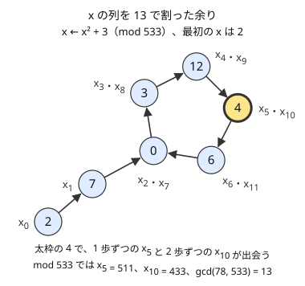

!!! abstract "要点"
    - **何ができるか**：$10^{18}$ 程度の数の素数判定を Miller-Rabin で、素因数分解を Pollard's rho で期待 $O(N^{1/4})$ で行う。64bit の法の掛け算には `__int128` か Montgomery 乗算を使う。
    - **いつ使うか**：
        - $N \le 10^{18}$ の素数判定・素因数分解（$\sqrt{N}$ の試し割りでは間に合わない）
        - 非常に大きい数が素数かを多数判定する
    - **計算量**：素数判定 $O(\log N)$（底 7 個。64bit の法の掛け算を $O(1)$ とみる）、素因数分解は期待 $O(N^{1/4})$ 回の掛け算（gcd を毎回取ると $O(N^{1/4} \log N)$）
    - **前提**：[フェルマーの小定理と指数の mod](../math/exponent-mod.md)、[素因数分解とルジャンドルの公式](../math/prime-factorization.md)

<!-- textlint-disable -->
別名：ミラー・ラビン・Miller-Rabin・ポラード・ロー・Pollard's rho・Montgomery 乗算・64bit の素数判定
<!-- textlint-enable -->

Miller-Rabin の素数判定は、フェルマーの小定理を強めた条件を数個の底で確かめて、$2^{64}$ 未満の数が素数かを $O(\log N)$ で判定する。Pollard's rho は、$x \gets x^2 + c$ の列を $N$ で割った余りが周期に入ることを使い、素因数を 1 つ期待 $O(N^{1/4})$ で見つける。2 つを組み合わせると、$10^{18}$ の数を 1 つあたり 1 秒よりずっと短い時間で素因数分解できる。

試し割りは $\sqrt{N}$ まで割るので、$N = 10^{18}$ では $10^9$ 回になって間に合わない（[試し割りの手順](../math/prime-factorization.md#procedure)）。ただし ABC でこの 2 つが必須の問題は見つかっておらず、多くは問題の構造で避けられる。たとえば $N = p^2 q$（$p$・$q$ は素数）と分かっていれば、$p$ と $q$ の小さい方は $\sqrt[3]{N}$ 以下なので、$\sqrt[3]{9 \times 10^{18}} \approx 2.1 \times 10^6$ までの試し割りで見つかる。まず構造で避けられないかを考え、それでも $10^{18}$ の数そのものを判定・分解するときにこのページの方法を使う。

このページで使う記法は、判定する数 $n$、底 $a$、$n$ の最小の素因数 $p$ である（[記法と用語の約束](../start/notation.md)）。

## Miller-Rabin の判定の仕組み（フェルマーの小定理と −1 の現れ方） {#miller-rabin}

$n$ を 3 以上の奇数とし、$n - 1 = 2^s d$（$d$ は奇数）と書く。底 $a$ について、次の $s + 1$ 個の値を順に見る。

$$
a^{d},\ a^{2d},\ a^{4d},\ \dots,\ a^{2^s d} = a^{n-1} \pmod{n}
$$

各項は前の項の 2 乗である。$n$ が素数で $a$ が $n$ の倍数でなければ、次の 2 つが成り立つ。

- 最後の項 $a^{n-1}$ は 1 である（[フェルマーの小定理](../math/exponent-mod.md#fermat)）
- 素数を法とすると、$x^2 \equiv 1$ の解は $x \equiv \pm 1$ だけである。$x^2 - 1 = (x - 1)(x + 1)$ が $n$ の倍数なら、素数 $n$ はどちらかの因数を割り切るからである

よって列を後ろからたどると、1 が続いた後に最初に 1 でなくなる項は $-1$（$n - 1$）でなければならない。すなわち、素数なら「先頭の $a^d$ が 1」か「途中のどこかに $-1$ が現れる」のどちらかが必ず起きる。どちらも起きなければ $n$ は合成数と確定し、そのときの $a$ を合成数である証拠（witness）と呼ぶ。

**フェルマーの小定理だけでは足りない例**。$n = 561 = 3 \times 11 \times 17$ は、$n$ と互いに素なすべての $a$ で $a^{560} \equiv 1$ になる合成数（カーマイケル数）で、最後の項だけを見る判定では見抜けない。$560 = 2^4 \times 35$ なので、$a = 2$ の列は次のようになる。

$$
2^{35} \equiv 263,\quad 2^{70} \equiv 166,\quad 2^{140} \equiv 67,\quad 2^{280} \equiv 1,\quad 2^{560} \equiv 1 \pmod{561}
$$

1 の直前が $67$ で、$-1 \equiv 560$ ではない。$67^2 \equiv 1$ なのに $67 \not\equiv \pm 1$ なので、561 は素数でないと分かる。

合成数 $n$ に対して、この判定をすり抜ける底は $1$ 以上 $n - 1$ 以下の $a$ の高々 $1/4$ である。底を乱択して $k$ 回試せば、合成数を素数と誤る確率は $4^{-k}$ 以下になる（[乱択の失敗確率の見積もり](../misc/randomized.md#failure-probability)）。素数を合成数と誤ることはない。

1 つの底の判定は、$a^d$ を[繰り返し二乗法](../math/mod-pow.md)で求めた後に 2 乗を高々 $s - 1$ 回くり返すだけなので、掛け算 $O(\log n)$ 回で済む。

## 決定的な底（32bit は 2・7・61、64bit は 7 個の底） {#deterministic-bases}

$n$ の範囲が決まっていれば、乱択せずに決まった底の組を試すだけで、誤りのない判定になる。範囲のすべての合成数について、組のどれかが証拠になることが計算で確かめられている。

| $n$ の範囲 | 試す底 |
| --- | --- |
| $n < 4{,}759{,}123{,}141$ | $2, 7, 61$ |
| $n < 2^{64}$ | $2, 325, 9375, 28178, 450775, 9780504, 1795265022$ |
| $n < 2^{64}$ | 最初の 12 個の素数 $2, 3, 5, \dots, 37$ |

$4{,}759{,}123{,}141 > 2^{32}$ なので、32bit の数は底 3 個で判定できる。この境界の数 $4759123141 = 48781 \times 97561$ は、底 $2$・$7$・$61$ のどれでも判定をすり抜ける合成数である（コード片の `self_check` で確かめている）。$10^{18}$ は $2^{64} \approx 1.8 \times 10^{19}$ より小さいので、64bit の組を使えばよい。7 個の組は 12 個の素数より 5 回少ない。

7 個の組を使うときは、**底が $n$ の倍数の場合を飛ばす**。$325 = 5^2 \times 13$ のように素数でない底があるので、$n = 5$ や $n = 13$ では $a \equiv 0$ になる。$0$ の累乗はずっと $0$ で、1 にも $-1$ にもならないので、そのまま判定すると素数 13 を合成数と誤る。$a \bmod n = 0$ の底は何も教えないので飛ばし、$n$ が小さい素数かは先に小さい素数で割って確かめる。

```cpp
--8<-- "miller-rabin/factorize.cpp:is-prime"
```

## Pollard's rho（x ← x² + c の周期と gcd） {#pollard-rho}

Pollard's rho は、合成数 $n$ の 1 でも $n$ でもない約数を 1 つ見つける。$n$ の最小の素因数を $p$ とする。$p$ は分からないが、次の列を $p$ で割った余りを考える。

$$
x_0 = (\text{乱数}),\quad x_{i+1} = x_i^2 + c \bmod n
$$

$x \bmod p$ の次の値は $x \bmod p$ だけで決まる（$x^2 + c$ を $p$ で割った余りは、$x$ を $p$ で割った余りから計算できる）。余りは $p$ 通りしかないので、$x_i \bmod p$ の列はいつか前と同じ値に戻り、そこから先は周期をくり返す。初めの部分と周期を描くと文字 ρ の形になるのが名前の由来である。

列が乱数のようにふるまうと仮定すると、[誕生日のパラドックス](../guide/glossary.md#birthday-paradox)により、同じ余りが現れるまでの長さは期待 $O(\sqrt{p})$ である。$x_i \equiv x_j \pmod p$ なら $p \mid x_i - x_j$ なので、$p$ を知らなくても $\gcd(\lvert x_i - x_j \rvert, n)$ が 1 より大きくなることで気づける。



図は $n = 533 = 13 \times 41$、$c = 3$、$x_0 = 2$ の例である。13 で割った余りは $2, 7$ の後、長さ 5 の周期 $0, 3, 12, 4, 6$ に入る。周期は、1 歩ずつ進む $x_i$ と 2 歩ずつ進む $x_{2i}$ を比べて見つける（Floyd の循環検出）。両方が周期に入った後は差が 1 歩ずつ縮むので、いつか同じ余りに並ぶ。図では $i = 5$ で $x_5 = 511$、$x_{10} = 433$ となり、$\gcd(78, 533) = 13$ が見つかる。

```text
x = y = 乱数、c = 乱数
繰り返す:
    x = f(x)、y = f(f(y))
    g = gcd(|x - y|, n)
    g = 1 なら続ける。1 < g < n なら g を返す。g = n なら c を変えてやり直す
```

素因数分解は、$n$ が素数なら（Miller-Rabin で判定して）そのまま返し、合成数なら rho で見つけた約数 $g$ と $n / g$ をそれぞれ再帰で分解する。$p \le \sqrt{n}$ なので、1 つの約数を見つけるのは期待 $O(\sqrt{p}) \subseteq O(n^{1/4})$ ステップである。$n = 10^{18}$ でも $\sqrt{10^9} \approx 3 \times 10^4$ ステップほどである。この見積もりは列を乱数とみなす仮定に基づくもので、厳密には証明されていない。

```cpp
--8<-- "miller-rabin/factorize.cpp:rho"
```

**素数に rho を使わない**。$n$ が素数なら 1 でも $n$ でもない約数がないので、ループが終わらない。再帰の各段で先に素数判定する。

**速くする工夫**。gcd は掛け算より重いので、$\lvert x - y \rvert$ を 100 個ほど掛け合わせた積（mod $n$）で gcd を 1 回だけ取ると速い。積が $n$ の倍数になって $g = n$ になったら、その区間だけ 1 つずつ gcd を取り直す。Floyd の代わりに Brent の循環検出を使うと、$f$ を呼ぶ回数も減る。

## 64bit の法での掛け算（128 bit 整数・Montgomery・Barrett） {#mulmod}

$n$ が $10^{18}$ 程度だと、$n$ 未満の 2 数の積は $10^{36}$ ほどになり、`unsigned long long`（$2^{64} \approx 1.8 \times 10^{19}$ 未満）に収まらない。Miller-Rabin も rho も、この「64bit の法での掛け算」を何度も行う。

- **128 bit 整数**：積を `unsigned __int128` で計算してから $n$ で割った余りを取る。最も簡単で、このページのコード片もこの方法である（書き方は[繰り返し二乗法の落とし穴](../math/mod-pow.md#pitfalls)と [`__int128`](../cpp/cpp-integer-overflow.md#int128)）。128 bit の割り算は遅いので、掛け算が非常に多いと時間がかかる
- **Montgomery 乗算**：法 $n$ が奇数のときに使える。値 $x$ を $xR \bmod n$（$R = 2^{64}$）の形で持ち、積の余りを「$n$ での割り算」の代わりに、掛け算と 64 bit の切り捨て（$R$ での割り算）で求める。最初と最後に形を変換する手間がかかるが、同じ法で掛け算を続ける累乗や rho に向く
- **Barrett 還元**：$\lfloor 2^k / n \rfloor$ を前計算し、商を掛け算とシフトで見積もって割り算を避ける。ACL の `dynamic_modint`（法は $2 \times 10^9$ 程度まで）は内部でこの方法を使っている

drken 氏の記事では、Library Checker の Primality Test で `__uint128_t` の実装が 1783 ms、Montgomery 乗算の実装が 247 ms だったと報告している。$10^{18}$ の数を数百個程度判定・分解するだけなら 128 bit 整数で足り、$10^5$ 個を判定するような場面で Montgomery 乗算を考えればよい。

## ACL の内部実装（internal::is_prime_constexpr） {#acl-internal}

ACL には 64bit の素数判定も素因数分解もない。内部の関数 `atcoder::internal::is_prime_constexpr(int n)` が、底 $2, 7, 61$ の Miller-Rabin で `int` の範囲の数を判定している。`static_modint` はこれをコンパイル時に呼び、法が素数なら逆元を $x^{m-2}$ で、そうでなければ拡張ユークリッドの互除法で求めるように切り替える。

`internal::is_prime_constexpr` はドキュメントに載っていない内部の関数で、版によって変わりうる。$10^{18}$ の判定には自作の関数を使う。

ACL の実装は $n \in \{2, 7, 61\}$ を先に素数と答えてから底を試している。底が $n$ と等しいと $a \equiv 0$ になる問題を、こうして避けている（[決定的な底](#deterministic-bases)の 7 個の組で底を飛ばすのと同じ理由）。

## 自作するときの要点と確かめ方 {#library}

- **小さい数と偶数**：$n < 2$ は素数でない。$n - 1 = 2^s d$ の分解は奇数の $n$ が前提なので、偶数と小さい素数は先に割って片付ける
- **底を飛ばす**：64bit の 7 個の組では $a \bmod n = 0$ の底を飛ばす
- **途中の値**：$a^d$ を求める前に $a$ を $n$ で割った余りにする。$x^2 + c$ は 128 bit で計算してから余りを取る（$x^2 + c$ を 64 bit で計算するとあふれる）
- **乱数の種**：$c$ と $x_0$ を固定すると、それを狙った入力で rho が遅くなる。Library Checker の Factorize には、固定の乱数を使う解を TLE にするテストがある。種は時刻などで変える（[C++ の乱数](../misc/randomized.md#cpp-random)）
- **出力の順**：rho の再帰で見つかる素因数は順不同なので、最後にソートする
- **確かめ方**：小さい $n$（数千まで）を試し割りの結果とすべて比べ、カーマイケル数 561 と、底 $2$・$7$・$61$ をすり抜ける $4759123141$ を入れる。コード片の `self_check` はこの比べ方をしている

## 学ぶための資料 {#resources}

- [drken「ミラー・ラビンの素数判定法 (Miller-Rabin 法)」](https://drken1215.hatenablog.com/entry/2023/05/23/233000)：フェルマーの小定理から判定の条件を導く流れ、数値例、`__uint128_t` と Montgomery 乗算の 2 通りの実装と速さの比較を載せている
- [cp-algorithms「Primality tests」](https://cp-algorithms.com/algebra/primality_tests.html)と [cp-algorithms「Integer factorization」](https://cp-algorithms.com/algebra/factorization.html)（英語）：64bit の決定的な底、底が $n$ の倍数の場合の扱い、rho の期待計算量と Brent の改良をまとめている
- [Wikipedia「Montgomery modular multiplication」](https://en.wikipedia.org/wiki/Montgomery_modular_multiplication)（英語）：Montgomery 形式と還元の手順を式で説明している

## 練習問題 {#practice}

ABC で必須になる問題は確認できなかった。自作の関数は Library Checker で確かめる。

### Library Checker

- [Primality Test](https://judge.yosupo.jp/problem/primality_test)：$Q \le 10^5$ 個の $N \le 10^{18}$ の素数判定（制限時間 5 秒）。Montgomery 乗算の効果が見える
- [Factorize](https://judge.yosupo.jp/problem/factorize)：$Q \le 100$ 個の $a \le 10^{18}$ の素因数分解（制限時間 10 秒）。素因数を昇順に出力する

## 確認問題 {#quiz}

??? question "確認問題：$n = 85 = 5 \times 17$、$a = 13$ では判定をすり抜ける。なぜ底を 1 つだけ試すのでは足りないのか"
    ??? success "答え"
        $84 = 2^2 \times 21$ で、$13^{21} \equiv 13$、$13^{42} \equiv 84 \equiv -1$ となり、途中に $-1$ が現れるので素数と同じふるまいをする。合成数でもこうしてすり抜ける底が最大 $1/4$ あるので、1 つの底では誤りうる。$a = 2$ なら $2^{21} \equiv 32$、$2^{42} \equiv 4$ で、1 にも $-1$ にもならず合成数と分かる。底を複数試すか、範囲で決まった底の組を使う。

??? question "確認問題：rho で $g = \gcd(\lvert x - y \rvert, n)$ が $n$ になるのはどんなときで、どうすればよいか"
    ??? success "答え"
        $x \equiv y \pmod n$ になったとき、つまり $n$ を割るすべての素数べき（$p^2$ なども含む）で同じ歩数のときに余りがそろったときである。このとき約数は得られないので、$c$（と $x_0$）を変えてやり直す。$n$ が素数のときは毎回これになり終わらないので、先に素数判定しておく。

## 参考 {#references}

- [drken「ミラー・ラビンの素数判定法 (Miller-Rabin 法)」](https://drken1215.hatenablog.com/entry/2023/05/23/233000)：判定の条件の導き方、決定的な底の範囲、`__uint128_t` と Montgomery 乗算の実装の速さの比較
- [drken「Yosupo Library Checker - Primality Test」](https://drken1215.hatenablog.com/entry/2023/05/24/003724)：Library Checker での確かめ方と Montgomery 乗算の modint の形
- [cp-algorithms「Primality tests」](https://cp-algorithms.com/algebra/primality_tests.html)：64bit の決定的な底（7 個の組と最初の 12 個の素数）、底が $n$ の倍数のときに飛ばすこと、すり抜ける底が高々 $1/4$ であること
- [cp-algorithms「Integer factorization」](https://cp-algorithms.com/algebra/factorization.html)：rho の期待計算量、Brent の改良と gcd のまとめ取り、先に素数判定すること
- [Wikipedia「Miller–Rabin primality test」](https://en.wikipedia.org/wiki/Miller%E2%80%93Rabin_primality_test)：底 $2, 7, 61$ が $4{,}759{,}123{,}141$ 未満で十分であること
- [Wikipedia「Pollard's rho algorithm」](https://en.wikipedia.org/wiki/Pollard%27s_rho_algorithm)：期待の手間が最小の素因数の平方根に比例すること、厳密な解析は未解決であること
- [Wikipedia「Montgomery modular multiplication」](https://en.wikipedia.org/wiki/Montgomery_modular_multiplication)：Montgomery 形式と還元の考え方
- [AtCoder Library のソース（internal_math.hpp）](https://github.com/atcoder/ac-library/blob/master/atcoder/internal_math.hpp)：`is_prime_constexpr` の底と `barrett`、`static_modint` の逆元の切り替え
- [yosupo「Library Checker の問題（number_theory）」](https://github.com/yosupo06/library-checker-problems/tree/master/number_theory)：制約・制限時間（info.toml）と、固定の乱数を使う解を TLE にするテスト
