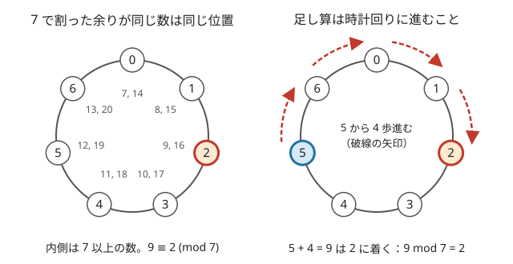

!!! abstract "要点"
    - **何ができるか**：答えを $m$ で割った余りで求めるとき、足し算・引き算・掛け算は途中で何度余りを取ってもよい。割り算と大小比較はそのままではできず、負の数とあふれにも注意が要る。
    - **いつ使うか**：
        - 引き算を含む式の値を、0 以上 $m$ 未満の余りで出力する。
        - $10^9$ 程度の値の積を何度も取り、余りを取らないと 64bit に収まらない。
    - **計算量**：足し算・引き算・掛け算は 1 回 $O(1)$。法 $m$ が $2^{31}$ 未満なら、余りどうしの積が 64bit に収まるので、`long long` の掛け算 1 回と `%` 1 回で済む。
    - **前提**：[整数の割り算と余り](../math/integer-division.md)

<!-- textlint-disable -->
別名：剰余演算・余りを取る・合同式の計算・modular arithmetic・mod 998244353・mod 1e9+7
<!-- textlint-enable -->

mod の計算は、本当の答えが巨大になる問題で、答えそのものではなく $m$ で割った余りだけを追いかける方法である。足し算・引き算・掛け算は途中で余りを取っても最後の余りが変わらないので、数を小さく保ったまま計算できる。基本は単純だが、負の数・あふれ・割り算・大小比較の 4 か所で間違えやすい。

このページで使う記法：$a \bmod m$ は $a$ を $m$ で割った 0 以上 $m$ 未満の余り、$a \equiv b \pmod{m}$ は $a - b$ が $m$ の倍数であること（[記法と用語の約束](../start/notation.md)）。法は $m$、素数なら $p$ と書く。

## 途中で余りを取ってよい理由（合同式の性質） {#why-mod}

$m$ で割った余りが等しい 2 数を「$m$ を法として[合同](../guide/glossary.md#congruence)」と言い、$a \equiv b \pmod{m}$ と書く。余りだけを見るのは、数直線を長さ $m$ の輪に巻きつけて、同じ位置に来る数を同じとみなすことである。



足し算は輪の上で時計回りに進むことなので、出発点を同じ位置の別の数に取り替えても着く位置は変わらない。式で言うと、$a \equiv a'$ かつ $b \equiv b' \pmod{m}$ なら次が成り立つ。

$$
a + b \equiv a' + b', \qquad a - b \equiv a' - b', \qquad a b \equiv a' b' \pmod{m}
$$

理由は、$a = a' + sm$、$b = b' + tm$（$s, t$ は整数）と書けることにある。和と差は $m$ の倍数 $(s \pm t)m$ だけずれる。積は $ab = a'b' + (a't + b's + stm)m$ となり、やはり $m$ の倍数だけずれる。だから式のどこで $\bmod m$ を挟んでも、最後の余りは本当の値の余りと一致する。

この性質は足し算・引き算・掛け算を何段組み合わせても成り立つ。和の式・積の式・それらを組み合わせた DP の遷移でも、各ステップの後に余りを取ってよい。成り立たないのは割り算（[割り算の節](#division)）と、大小を比べる操作（[大小比較の節](#no-compare)）である。

## 引き算の後の負の数を 0 以上に直す {#negative}

C++ の `%` は、左の数が負なら 0 以下の余りを返す。たとえば `(3 - 5) % 7` は $5$ ではなく $-2$ になる（[整数の割り算と余り](../math/integer-division.md)）。合同式としては $-2 \equiv 5$ なので計算の途中なら問題ないが、出力や配列の添字に使うと誤りになる。

直し方は値の範囲で 2 通りある。

- **両方が 0 以上 $m$ 未満のとき**：$a - b$ は $-m$ より大きいので、`(a - b + MOD) % MOD` で 0 以上に直る
- **範囲が分からないとき**（入力に負の数がある、$10^{18}$ まで来る）：`x %= MOD; if (x < 0) x += MOD;` で直す。`(x % MOD + MOD) % MOD` と書いても同じである

次のコードは、任意の `long long` を 0 以上に直す `norm` と、0 以上 $m$ 未満の値どうしの和・差・積である。

```cpp
--8<-- "mod-arithmetic/mod-ops.cpp:core"
```

引き算を含む式は、最後に 1 回だけ直しても構わない。ただし途中の値を配列の添字に使う（[余り・個数を状態に持つ DP](../dp/dp-mod-state.md)）なら、そのたびに直す。

??? question "確認問題：引き算の余り"
    `a` と `b` は 0 以上 998244353 未満の `long long` である。$(a - b) \bmod 998244353$ を求めるのに `(a - b) % MOD` と書くと、どんな入力で誤るか。どう直せばよいか。

    ??? success "答え"
        $a < b$ のとき、`a - b` は負なので結果も負になる（$a = 3$、$b = 5$ なら $-2$）。$a - b > -\mathrm{MOD}$ なので、`(a - b + MOD) % MOD` と書けば 0 以上 MOD 未満になる。

## 掛け算のあふれ（両方を mod に収めてから 64bit で掛ける） {#overflow}

余りを取ってよいのは、あふれる前に取る場合だけである。符号付き整数のあふれは未定義動作なので、あふれた後の値に `%` を取っても正しい余りは戻らない。

- **積の前に両方を $m$ 未満にする**：$m = 998244353$ のとき、$m$ 未満の 2 数の積は $(m - 1)^2 \approx 9.96 \times 10^{17}$ 以下である。これは `long long` の上限 $2^{63} - 1 \approx 9.22 \times 10^{18}$ に収まる。入力が $10^{18}$ まで来るなら、掛ける前に必ず余りを取る。$10^{18}$ どうしの積は $10^{36}$ で収まらない
- **3 つ以上の積は 1 回ごとに余りを取る**：`a * b * c % MOD` は `a * b` の時点で $10^{18}$ 近くになり、`c` を掛けるとあふれる。`a * b % MOD * c % MOD` と書く
- **`int` どうしの積は `int` で計算される**：`int a, b;` のとき、`a * b % MOD` の積は `int` の範囲であふれる。代入先を `long long` にしても間に合わないので、変数を `long long` にするか `1LL * a * b % MOD` と書く（[int どうしの積](../cpp/cpp-integer-overflow.md#int-product)）
- **足し算は 32bit でも収まる**：$m$ 未満の 2 数の和は $2m - 2 < 2^{31}$ なので、998244353 でも $10^9 + 7$ でも `int` に収まる。ただし和を 3 つ以上まとめてから余りを取ると `int` では足りない

法が $10^{18}$ 程度と大きい問題では、余りどうしの積も `long long` に収まらない。そのときは積を `__int128` で計算してから余りを取る（[__int128](../cpp/cpp-integer-overflow.md#int128)）。

## 割り算はそのままではできない（→ 逆元） {#division}

割り算は合同式の性質が成り立たない。$m = 3$ で $4 / 2 = 2$ を考える。$4 \bmod 3 = 1$、$2 \bmod 3 = 2$ なので、余りどうしで割ると $1 / 2$ になり、整数ですらない。割り切れても値が合わないことがある。$m = 4$ で $12 / 2 = 6$ を考えると、本当の余りは $6 \bmod 4 = 2$ だが、余りどうしでは $12 \bmod 4 = 0$ を $2$ で割って $0$ になる。割り算の前に余りを取ると、割り切れるかどうかの情報が失われる。

mod で割り算をしたいときの方法は 2 つある。

- **余りを取る前に割る**：$N(N+1)/2$ なら、$N$ と $N+1$ のうち偶数の方を先に 2 で割ってから余りを取って掛ける。割り切れることが分かっている小さな定数で割るときに使える
- **逆元を掛ける**：$b x \equiv 1 \pmod{m}$ となる $x$（$b$ の逆元）を掛けると、$b$ で割ったのと同じになる。逆元は $b$ と $m$ が互いに素なときだけ存在し、$m$ が素数なら $b$ が $m$ の倍数でない限り存在する（[逆元と mod での割り算](../math/mod-inverse.md)）

逆元を使えば、答えが分数になる問題でも「$P \times Q^{-1} \bmod p$ を出力」という形で答えられる（[確率・期待値を mod 998244353 で答える](../comb/rational-mod.md)）。$m$ が素数でないときや、割る数が $m$ の倍数になりうるときは逆元がないので、割り算を避ける式に直す。

## mod を取った値で大小比較・最大値を考えてはいけない {#no-compare}

余りは輪の上の位置なので、大小の順序を保たない。$9 > 6$ だが、$\bmod 7$ の余りは $2$ と $6$ で大小が逆になる。$13 > 9$ の余りは $6$ と $2$ で、たまたま順序が合うこともある。どちらになるかは余りからは分からない。

この性質から、次の書き方は誤りになる。

- **最大値を求める DP の途中で余りを取る**：「最大値を 998244353 で割った余りを出力」でも、途中で余りを取った値で `max` を取ると、本当は小さい方を選びうる。最大値の比較は本当の値で行い、本当の値が大きすぎるなら、対数や「指数の大小」など比べられる形で持つ
- **余りが 0 なら答えが 0 だと判定する**：「方法が 1 つでもあれば Yes」の判定に、mod で数えた場合の数が 0 かどうかを使うと、場合の数がちょうど $p$ の倍数のときに誤る。存在の判定は bool の DP で別に行う
- **途中の値の正負や偶奇で場合分けする**：余りは常に 0 以上なので、本当の値が負かどうかは分からない。また法が奇数（998244353 や $10^9 + 7$）だと、余りの偶奇は本当の値の偶奇と関係がない（$8$ は偶数だが $8 \bmod 7 = 1$ は奇数）。正負や偶奇が要るなら、符号や 2 で割った余りを別に持つ

mod を取ってよいのは、最後の出力に余りしか要らず、途中で値の大小・0 かどうか・偶奇を使わない計算だけである。

??? question "確認問題：途中で余りを取る最大化"
    「$N$ 個の数から何個か選んだ積の最大値を $p$ で割った余りを出力」で、積を $\bmod p$ しながら DP で最大値を取るとどうなるか。

    ??? success "答え"
        余りどうしの比較は本当の積の大小と関係がないので、本当は小さい積の方を選ぶことがある。たとえば本当の積 $p + 1$ と $2$ を比べると、余りは $1$ と $2$ になり、小さい方の $2$ を選んでしまう。比較は本当の値（大きすぎるなら対数など）で行い、余りは選んだ後に計算する。

## なぜ 998244353 か（素数で、NTT に向く形） {#why-998244353}

AtCoder でよく使う法は $998244353$ と $10^9 + 7$ で、どちらも素数である。素数を法にすると、法の倍数でない数には必ず逆元があり、割り算が使える。

2 つの違いは $p - 1$ の素因数分解にある。

| 法 $p$ | $p - 1$ | 畳み込み（NTT）の長さ |
| --- | --- | --- |
| $998244353$ | $2^{23} \times 7 \times 17$ | $2^{23}$ までできる |
| $10^9 + 7$ | $2 \times 500000003$ | 長さ 2 までしかできない |

NTT は、法 $p$ の下で 1 の $2^k$ 乗根を使って長さ $2^k$ の畳み込みを $O(N \log N)$ で行う方法で、$2^k$ が $p - 1$ を割り切ることが要る。$998244353 = 119 \times 2^{23} + 1$ は、この条件を長さ $2^{23} \approx 8.4 \times 10^6$ まで満たすように選ばれた素数である（[畳み込みの使い方](../math/convolution-ntt.md#acl)）。

どちらの法も $2^{30}$ 未満なので、余りどうしの和は `int` に、積は `long long` に収まる。$10^9 + 7$ の問題は古い ABC に多く、近年は畳み込みを使わない問題でも $998244353$ が使われる。問題ごとに法を読み、`const long long MOD = …;` を書き換え忘れないようにする。

## 落とし穴 {#pitfalls}

**最後にだけ余りを取る**。$10^9$ 以下の $N$ 個の数の積を $998244353$ で割った余りを、積を作ってから `%` で求めると、3 個目を掛けたところで `long long` があふれうる。掛けるたびに余りを取る。

**`%` の後に足して、また範囲を外れる**。`a % MOD + b % MOD` は $2m$ 近くまで届く。出力の直前や配列の添字に使う前には、もう一度 `% MOD` を取るか、`if (x >= MOD) x -= MOD;` で直す。

**法をリテラルで何度も書く**。`998244353` と `1000000007` を式ごとに書くと、書き換え漏れや桁の打ち間違いが起きる。`const long long MOD = 998244353;` と 1 か所に書く。`1e9 + 7` は `double` なので、`x % (1e9 + 7)` はコンパイルエラーになる。整数の定数として `1000000007` と書く。

**`pow` で累乗の余りを求める**。`pow(a, n)` は `double` で計算するので、$a^n$ が $2^{53}$ を超えると下の桁が失われ、余りが合わない。累乗は繰り返し二乗法で、掛けるたびに余りを取る（[繰り返し二乗法](../math/mod-pow.md)）。

## 上位の手法へのつながり {#next-steps}

mod の計算の基本は、mod 付きの数え上げ全体の土台になる。

- **[繰り返し二乗法](../math/mod-pow.md)**：$a^n \bmod m$ を $O(\log n)$ で求める。掛け算ごとに余りを取ってよいという[合同式の性質](#why-mod)をそのまま使う
- **[逆元と mod での割り算](../math/mod-inverse.md)**：[割り算の節](#division)の続きである。素数 $p$ なら、$p$ の倍数でない $b$ について $b^{p-2}$ が逆元になる
- **[フェルマーの小定理と指数の mod](../math/exponent-mod.md)**：指数は $m$ で割ってはいけない。素数 $p$ なら、底が $p$ の倍数でないときに限り、指数を $p - 1$ で割った余りに直せる
- **[modint](../math/modint.md)**：`norm`・`add`・`sub`・`mul` をまとめた型で、負の数の直しとあふれの対策を自動で行う。ACL の `modint998244353` を使えば、この節までの注意のほとんどを型に任せられる
- **[余り・個数を状態に持つ DP](../dp/dp-mod-state.md)**・**[桁と mod](../math/digit-and-mod.md)**：答えではなく「数を $m$ で割った余り」を状態にする。余りを添字に使うので、負の数の直しを毎回行う

## 例題 {#examples}

### ABC275 B. ABC-DEF {#abc275_b}

<div class="kp-problems" data-role="example" markdown>

- [ABC275 B. ABC-DEF](https://atcoder.jp/contests/abc275/tasks/abc275_b)（diff 147）：6 つの整数 A〜F（≤ 10^18）について (A×B×C) − (D×E×F) を 998244353 で割った余りを求める。

</div>

$10^{18}$ の数の積は 64bit に収まらないが、足し算・引き算・掛け算だけの式なので、途中で余りを取ってよい。各数を先に $998244353$ 未満にして、掛けるたびに余りを取る。こうすれば途中の値はどれも `long long` に収まる。最後の引き算で負になりうるので、0 以上に直してから出力する。

??? note "解法の詳細"
    - 6 つの数をそれぞれ `% MOD` で $998244353$ 未満にする。これをせずに掛けると、最初の掛け算であふれる。
    - $X = (A B \bmod p) \cdot C \bmod p$、$Y = (D E \bmod p) \cdot F \bmod p$ を求める。どの積も $p^2 < 2^{63}$ に収まる。
    - 答えは $(X - Y + p) \bmod p$。$X < Y$ のとき `(X - Y) % p` は負になる。
    - コードは[引き算の節](#negative)の `norm`・`mul`・`sub` を組み合わせた形になる。

## 練習問題 {#practice}

<div class="kp-problems" data-role="practice" markdown>

- [ABC055 B. Training Camp](https://atcoder.jp/contests/abc055/tasks/abc055_b)（diff 332）：N!（N ≤ 10^5）を 10^9+7 で割った余りを求める。
- [ARC111 A. Simple Math 2](https://atcoder.jp/contests/arc111/tasks/arc111_a)（diff 1146）：⌊10^N / M⌋ を M で割った余りを求める（N ≤ 10^18、M ≤ 10^4）。

</div>

??? note "練習の方針"
    - **ABC055 B**：1 から $N$ まで順に掛け、掛けるたびに $10^9 + 7$ で割った余りを取る。途中の値は $10^9 + 7$ 未満なので、次の掛け算も `long long` に収まる
    - **ARC111 A**：$\lfloor 10^N / M \rfloor \bmod M$ は割り算を含むので、$10^N \bmod M$ からは求まらない。法を $M^2$ に広げ、$R = 10^N \bmod M^2$ とすると答えは $\lfloor R / M \rfloor$ になる。$10^N = M^2 Q + R$ と書くと、$\lfloor 10^N / M \rfloor = MQ + \lfloor R / M \rfloor$ だからである。$R$ は[繰り返し二乗法](../math/mod-pow.md)で求め、$M^2 \le 10^8$ なので積は `long long` に収まる

## 参考 {#references}

- [drken「AtCoder ABC 275 B - ABC-DEF (5Q, 灰色, 200 点)」](https://drken1215.hatenablog.com/entry/2024/05/29/045828)：例題の方針（先に余りを取ること、負の余りの直し方）
- [drken「AtCoder ABC 055 B - Training Camp (5Q, 灰色, 200 点)」](https://drken1215.hatenablog.com/entry/2024/09/22/032616)：練習の方針（掛けるたびに余りを取る）
- [drken「AtCoder ARC 111 A - Simple Math 2 (1Q, 緑色, 300 点)」](https://drken1215.hatenablog.com/entry/2022/12/26/195928)：練習の方針（法を M² に広げて商の余りを求める）
