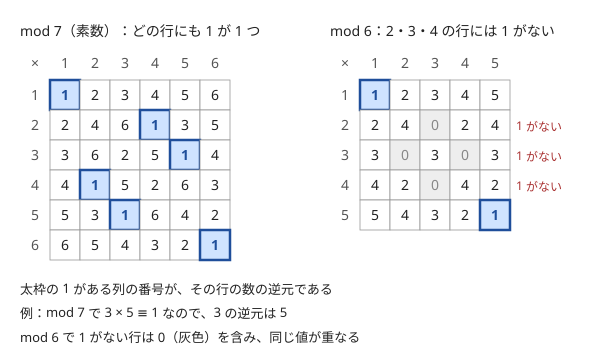

!!! abstract "要点"
    - **何ができるか**：$a x \equiv 1 \pmod{m}$ となる逆元 $x$ を求め、mod での割り算を掛け算に直す。素数 mod ならフェルマーの小定理で $a^{m-2}$、一般の法では拡張ユークリッドで求める。
    - **いつ使うか**：
        - 答えは有理数 $P/Q$ になるので $P \times Q^{-1} \bmod 998244353$ を出力する。
        - 平均・等比数列の和などを、割り算を含む式のまま mod で求める。
    - **計算量**：逆元 1 つは $O(\log m)$。$1$ から $N$ までの逆元の表は $O(N)$ で作れる（法が素数で $N < p$ のとき）。
    - **前提**：[繰り返し二乗法](../math/mod-pow.md)

<!-- textlint-disable -->
別名：モジュラ逆元・modular inverse・modinv・inv_mod・mod での割り算・逆元表
<!-- textlint-enable -->

逆元は、mod の世界で「$a$ で割る」代わりに掛ける数である。足し算・引き算・掛け算は途中で余りを取ってよいが、割り算はそのままではできない（[mod の計算の基本](../math/mod-arithmetic.md)）。$b$ の逆元 $b^{-1}$ を求めて $a \times b^{-1}$ を計算すれば、割り切れるかどうかを気にせずに mod のまま割り算ができる。このページでは法を $m$、素数のときは $p$ と書き、$a^{-1}$ は $a$ の法 $m$ での逆元を表す（記法は[記法と用語の約束](../start/notation.md)）。

## 逆元が存在する条件（gcd(a, m) = 1） {#existence}

$a$ の法 $m$ での逆元が存在するのは、$a$ と $m$ が[互いに素](../guide/glossary.md#coprime)（$\gcd(a, m) = 1$）のときだけである。逆元は法 $m$ でただ 1 つに決まり、$0 \le x < m$ の範囲で 1 つ選べる。

次の図は、mod 7 と mod 6 の掛け算の表である。行 $a$ の中に 1 があれば、その列の番号が $a$ の逆元になる。たとえば mod 7 で $3 \times 5 \equiv 1$ なので、3 の逆元は 5 である。mod 6 で 1 がない行には 0（灰色）が現れ、同じ値が重なっている。



**互いに素なら逆元がある理由**：$\gcd(a, m) = 1$ のとき、$a \cdot 0, a \cdot 1, \dots, a \cdot (m-1)$ を $m$ で割った余りはすべて異なる。もし $a x \equiv a y$ なら $m \mid a(x - y)$ で、$a$ と $m$ は互いに素なので $m \mid x - y$、すなわち $x \equiv y$ だからである。$m$ 個の余りが重ならないので $0$ から $m - 1$ が 1 回ずつ現れ、その中に 1 もある。逆元が 2 つあれば同じ理由で一致するので、ただ 1 つである。

**互いに素でなければ逆元がない理由**：$g = \gcd(a, m) > 1$ なら、$a x$ はどんな $x$ でも $g$ の倍数であり、$m$ も $g$ の倍数である。$a x = 1 + k m$ と書けたとすると、左辺と $km$ は $g$ で割り切れるので 1 も割り切れることになり、矛盾する。mod 6 の掛け算の表で 1 がない 2・3・4 の行は、どれも $\gcd(a, 6) > 1$ である。

この条件から、よくある思い込みが 2 つ外れる。

- **「法が素数でなければ割れない」は誤り**：法が 12 でも、$1, 5, 7, 11$ は 12 と互いに素なので逆元がある（例：$5 \times 5 = 25 \equiv 1$）
- **「法が素数なら必ず割れる」も誤り**：$a$ が $p$ の倍数なら $\gcd(a, p) = p$ で、逆元はない。割る数を $p$ で割った余りが 0 になる場合は、[割れないときの3つの場合](#not-invertible)で扱う

??? question "確認問題：mod 10 の逆元"
    法を 10 とするとき、3 の逆元と 4 の逆元はそれぞれ何か。

    ??? success "答え"
        $3 \times 7 = 21 \equiv 1$ なので 3 の逆元は 7 である。4 は $\gcd(4, 10) = 2$ なので逆元がない（$4x$ は常に偶数で、10 で割った余りも偶数になり 1 にならない）。

## フェルマーの小定理による a^(p−2) {#fermat}

法が素数 $p$ で $a$ が $p$ の倍数でないとき、フェルマーの小定理 $a^{p-1} \equiv 1 \pmod{p}$ が成り立つ。両辺を $a \cdot a^{p-2}$ と見れば、$a^{p-2}$ が $a$ の逆元である。

$$
a \cdot a^{p-2} = a^{p-1} \equiv 1 \pmod{p}
$$

$p - 2$ は $10^9$ 程度の大きな指数だが、[繰り返し二乗法](../math/mod-pow.md)なら掛け算 60 回ほど、$O(\log p)$ で求まる。実装は累乗の関数を 1 回呼ぶだけなので、法が 998244353 や $10^9 + 7$ のように素数と決まっていれば、これがいちばん短い。たとえば 2 の逆元は、法 998244353 で 499122177、法 $10^9 + 7$ で 500000004 である。

??? note "証明：フェルマーの小定理"
    $p$ は素数で、$a$ は $p$ の倍数でないとする。[存在の節](#existence)の理由から、$a \cdot 1, a \cdot 2, \dots, a \cdot (p-1)$ を $p$ で割った余りは $1, 2, \dots, p-1$ の並べ替えになる（どれも 0 でなく、互いに異なる）。全部を掛けると

    $$
    a^{p-1} \cdot (p-1)! \equiv (p-1)! \pmod{p}
    $$

    となる。$(p-1)!$ は $p$ と互いに素なので、両辺から消せて $a^{p-1} \equiv 1$ が出る（$(p-1)!$ に逆元があるので両辺に掛ければよい）。

```cpp
--8<-- "mod-inverse/inverse.cpp:core"
```

`inv_fermat` は、$a$ が $p$ の倍数のとき $0^{p-2} = 0$ を返し、エラーにならない。「0 で割った」ことに気づかないまま 0 が答えに混ざるので、割る数が 0 になりうる式では、呼ぶ前に確かめる。法が素数でないときに $a^{m-2}$ を使うと、逆元でない値が黙って返る（たとえば法 10 で $3^{8} \bmod 10 = 1$ だが、3 の逆元は 7）。

## 拡張ユークリッドによる逆元（法が素数でないとき） {#ext-gcd}

この節は[拡張ユークリッドの互除法](../math/ext-gcd.md)を前提にする。法 $m$ が素数とは限らないとき、$\gcd(a, m) = 1$ なら次の一次不定方程式の解 $x$ が $a$ の逆元になる。

$$
a x + m y = 1 \quad \Longrightarrow \quad a x \equiv 1 \pmod{m}
$$

右辺の $my$ は $m$ の倍数なので、mod $m$ で見ると消えるからである。拡張ユークリッドの互除法は $ax + my = \gcd(a, m)$ の解を $O(\log m)$ で求めるので、最後に得られた gcd が 1 かどうかで逆元の有無も同時に分かる。

```cpp
--8<-- "mod-inverse/inverse.cpp:extgcd"
```

`inv_extgcd` は、余りの列 $r_i$ と「$r_i \equiv x_i \cdot a \pmod{m}$」となる係数 $x_i$ を一緒に更新している。互除法が終わったとき $r = \gcd(a, m)$ で、これが 1 なら対応する係数が逆元である。

フェルマーとの違いは 2 つある。素数でない法でも使えること、互いに素でないときに「ない」と判定できることである。$g = \gcd(a, m) > 1$ で $ax \equiv b \pmod{m}$ を解きたいときは、$g$ が $b$ を割り切るときだけ解がある。そのときは両辺と法を $g$ で割ってから逆元を取る（[一次合同式](../math/ext-gcd.md#linear-congruence)）。法が素数でも、ライブラリとして 1 つ持つならこちらが汎用である。

## 逆元表を O(N) で作る（inv[i] = −⌊m/i⌋·inv[m mod i]）と階乗の逆元 {#inverse-table}

$1$ から $N$ までの逆元が全部欲しいとき、1 つずつフェルマーで求めると $O(N \log p)$ かかる。法が素数 $p$ で $N < p$ なら、次の漸化式で $O(N)$ で作れる。

$$
\mathrm{inv}[1] = 1, \qquad \mathrm{inv}[i] \equiv -\left\lfloor \frac{p}{i} \right\rfloor \cdot \mathrm{inv}[p \bmod i] \pmod{p}
$$

**なぜ成り立つか**：$p$ を $i$ で割った商を $q = \lfloor p / i \rfloor$、余りを $r = p \bmod i$ とすると、$p = qi + r$ である。mod $p$ で見ると $qi + r \equiv 0$ になる。$p$ は素数で $1 \le r < i$ なので、$i$ と $r$ はどちらも逆元をもつ（$r = 0$ なら $i$ が $p$ を割り切ってしまうが、$1 < i < p$ ではそれは起きない）。両辺に $i^{-1} r^{-1}$ を掛けると $q r^{-1} + i^{-1} \equiv 0$、すなわち $i^{-1} \equiv -q \cdot r^{-1}$ になる。$r < i$ なので、$\mathrm{inv}[r]$ は $i$ より前に求まっている。

例として $p = 7$ で表を作ると、$\mathrm{inv}[2] = -3 \cdot \mathrm{inv}[1] \equiv 4$、$\mathrm{inv}[3] = -2 \cdot \mathrm{inv}[1] \equiv 5$、$\mathrm{inv}[4] = -1 \cdot \mathrm{inv}[3] \equiv 2$ と進み、[存在の節](#existence)の mod 7 の掛け算の表の太枠と一致する。

```cpp
--8<-- "mod-inverse/inv-table.cpp:core"
```

$-q \cdot r^{-1}$ は負になるので、`p - (q * inv[r] % p)` のように $p$ から引いて 0 以上に保つ。

**階乗の逆元**：二項係数で要る $1/k!$ の表は、この漸化式を使わなくても作れる。$N!$ の逆元を 1 回だけフェルマーで求め、$1/(i-1)! = i \cdot 1/i!$ で後ろへ戻ればよい（[fact を前から、ifact を後ろから作る理由](../comb/binomial-precompute.md#fact-ifact)）。逆に、階乗の表があれば $i^{-1} = (i-1)! \cdot (1/i!)$ で各 $i$ の逆元も $O(1)$ で取れる。逆元の漸化式が役立つのは、階乗は要らず $1/i$ だけが大量に要るとき（調和数 $1 + 1/2 + \dots + 1/N$ や、期待値の式に $1/i$ が並ぶとき）である。

## 有理数 P/Q を P × Q^(−1) で表す計算 {#rational}

割り算を含む式を mod で求めるときは、分子と分母をそれぞれ mod で計算してから、分子に分母の逆元を掛ける。分母を先に $p$ で割った余り $b \bmod p$ にしてから逆元を取ってよい。$b \equiv b'$ なら $b^{-1}$ と $b'^{-1}$ は同じ値になるからである（$b \cdot b'^{-1} \equiv b' \cdot b'^{-1} \equiv 1$ なので、$b'^{-1}$ は $b$ の逆元でもあり、逆元はただ 1 つ）。

してはいけないのは、分子の余りを整数として分母で割ることである。$1 + 2 + \dots + X = X(X+1)/2$ を $X \le 10^{18}$ で求めるとき、$X(X+1)$ は 64bit に収まらないので余りを取りたくなる。しかし $X(X+1) \bmod p$ は奇数のこともあり、それを 2 で割っても答えにならない。正しい方法は 2 つある。

```cpp
--8<-- "mod-inverse/half-sum.cpp:core"
```

方法 2 のように、割り切れることが分かっている因数を **余りを取る前に** 整数のまま割る手もある。逆元が要らず、法が素数でなくても使える。ただし分母が 6 や $k!$ のように大きくなると、どの因数で割るかの場合分けが増えるので、法が素数なら逆元を掛ける方が素直である。

この計算が要る代表的な式は次のとおりである。

- **等差数列の和・平均**：$X(X+1)/2$、合計 $\div N$（[例題](#typical90_cd)）
- **等比数列の和**：$(r^n - 1)/(r - 1)$（[等比数列の和を mod で求める](../math/geometric-series-mod.md)）
- **確率・期待値**：既約分数 $P/Q$ を $P \times Q^{-1}$ で答える。分数のまま計算しても、途中をすべて mod で計算しても同じ値になる理由と、mod の値で大小を比べてはいけないことは[確率・期待値を mod 998244353 で答える](../comb/rational-mod.md)で扱う
- **二項係数**：$n!/(k!(n-k)!)$ を階乗と逆階乗の表で計算する（[二項係数の前計算](../comb/binomial-precompute.md)）

??? question "確認問題：分母を先に mod してよいか"
    $\dfrac{10^{20}}{4}$ を 998244353 で割った余りを求めたい。$10^{20} \bmod p$ を求め、それに $4^{-1}$ を掛ければよいか。$10^{20} \bmod p$ を整数として 4 で割ってもよいか。

    ??? success "答え"
        前者は正しい。分子も分母も余りに直してから逆元を掛ければ、元の有理数の mod 表現になる。後者は誤りで、$10^{20} \bmod p$ が 4 の倍数とは限らず、4 の倍数だったとしても値は一般に違う。整数として割ってよいのは、余りを取る前の $10^{20}$ を割るときだけである。

## 割れないときの3つの場合（割る数が p の倍数・公比 ≡ 1・法が素数でない） {#not-invertible}

逆元を使う式が壊れるのは、割る数が法と互いに素でないときである。実際に起きるのは次の 3 つの場合である。自作のフェルマーはエラーを出さずに誤った値を返す（割る数が $p$ の倍数なら 0、法が素数でなければ逆元でない値）ので、気づきにくい。ACL の `inv_mod` と modint は、互いに素でないと assert で止まる。

**1. 割る数が $p$ の倍数になる**：整数としては 0 でなくても、$p$ で割った余りが 0 なら割れない。

- 階乗の表を $N \ge p$ まで作ると $N!$ が $p$ の倍数になり、逆階乗が作れない。法が小さい素数なら [Lucas の定理](../comb/binomial-precompute.md#lucas)を使う
- 分母が入力の値そのもの（$1/A_i$ や、入力の確率の分母）なら、$A_i$ が $p$ の倍数かどうかを確かめる。制約が $A_i < p$ なら起きない
- 式変形で作った分母（$1 - P$ など）は、整数としては 0 でなくても mod で 0 になりうる。このとき元の式に戻り、割り算をしない形で数える

**2. 等比数列の公比が $r \equiv 1$**：公式 $(r^n - 1)/(r - 1)$ は、$r \equiv 1 \pmod{p}$ だと $0/0$ になる。このとき和は $1 + 1 + \dots + 1 = n$ なので、$r \bmod p = 1$ を先に判定して $n \bmod p$ を返す。$r$ が入力で決まる問題では、$r = 1$ だけでなく $r = p + 1$ のような値でも起きる。

**3. 法が素数でない**：$a^{m-2}$ は逆元にならない。

- $\gcd(b, m) = 1$ が保証されるなら、[拡張ユークリッド](#ext-gcd)か ACL の `inv_mod` で逆元を求める
- 保証されないなら、割り算を避ける。等比数列の和は半分に割る漸化式か行列の累乗（[等比数列の和を mod で求める](../math/geometric-series-mod.md)）、二項係数はパスカルの三角形（[法が素数でないとき](../comb/binomial-precompute.md#composite-mod)）で作る
- 割り切れることが分かっている $x / b$ なら、$x$ を $bm$ で割った余り $x \bmod bm$ を求め、それを整数として $b$ で割ると $(x / b) \bmod m$ になる。$x = bk$ なら $x \bmod bm = b \cdot (k \bmod m)$ だからである。$bm$ が 64bit で掛け算できる大きさのときに使える

??? question "確認問題：ABC357 D の公比"
    [練習の ABC357 D](#practice) は、公比 $10^d$（$d$ は $N$ の桁数で $1 \le d \le 19$）の等比数列の和を法 998244353 で求める。公比 $\equiv 1$ の場合を心配する必要はあるか。

    ??? success "答え"
        ない。$1 \le d \le 19$ のどの $d$ でも $10^d \bmod 998244353 \ne 1$ であることを計算で確かめられる（$10^d - 1$ が 998244353 で割り切れない）。公比が入力で自由に決まる問題では、$r \equiv 1$ の判定を入れる。

## ACL の inv_mod と modint::inv {#acl}

!!! info "ACL では"
    `long long y = atcoder::inv_mod(x, m);` は $xy \equiv 1 \pmod{m}$ となる $0 \le y < m$ を $O(\log m)$ で返す（`<atcoder/math>`）。要件は $\gcd(x, m) = 1$ と $1 \le m$ で、法は素数でなくてよい。modint では `x.inv()` と `a / b` が使え、要件は `gcd(b.val(), mod) == 1`、計算量は $O(\log \mathrm{mod})$ である。

```cpp
--8<-- "mod-inverse/acl.cpp:core"
```

`inv_mod` も modint の割り算も、互いに素でないと assert で止まる。止まらずに 0 が返るよりは気づきやすいが、提出では実行時エラーになる。割る数が 0 になりうるなら、呼ぶ前に分岐する。modint の詳しい使い方は [modint](../math/modint.md) にまとめる。

## 落とし穴 {#pitfalls}

**mod の値を整数として割る**。`(x % p) / 2` や `ans.val() / n` は、mod の値を整数の割り算で割っている。余りは割り切れるとは限らず、割り切れても元の値の商と一致しない。mod を取った値の割り算は、必ず逆元を掛ける（[有理数の計算](#rational)）。

**負の数のまま累乗する**。引き算の結果 $a$ が負のまま `mod_pow(a, p - 2, p)` に渡すと、C++ の `%` が負の余りを返すため、途中の値が負になって答えが狂う。累乗や逆元の関数に渡す前に `(a % p + p) % p` で 0 以上に直すか、関数の中で直す。

**int の掛け算であふれる**。$p \approx 10^9$ の余りどうしの積は $10^{18}$ 程度で、`int` には収まらない。累乗の関数の引数と途中の値は `long long` にする。

**ループの内側で逆元を毎回求めて遅くなる**。逆元 1 つは累乗 1 回で、60 回ほどの掛け算と剰余がかかる。$10^6$ 個の値の逆元を 1 回ずつ求めるだけなら約 $6 \times 10^7$ 回の剰余演算で、十分間に合う。危ないのは、$N, Q \le 2 \times 10^5$ の二重ループの内側のように、同じ数の逆元を何度も求めて回数が掛け算で増えるときである。同じ数の逆元を何度も使うなら 1 回だけ求めて変数に持ち、$1/i$ が並ぶなら[逆元表](#inverse-table)を作る。

**指数を取り違える**。逆元は $a^{p-2}$ で、$a^{p-1}$ は常に 1 である。$a^{-1}$ を `pow(a, -1)` のように書くと、繰り返し二乗法の関数では負の指数が扱えない。

**途中で約分しないといけないと思い込む**。途中のどの分母も $p$ の倍数でなければ、約分の前に逆元を掛けても後に掛けても同じ値になるので、約分してから逆元を取る必要はない。途中の分母が $p$ の倍数になるときは、[割れないときの場合 1](#not-invertible)を見る。

## 使い分け {#comparison}

- 法が素数と決まっている（998244353・$10^9 + 7$）なら、フェルマーの $a^{p-2}$ がいちばん短い。modint を使うなら `/` で済む
- 法が入力で与えられる・素数とは限らないなら、拡張ユークリッドか `inv_mod`。互いに素でなければ割れないので、割り算を避ける形（漸化式・行列・パスカルの三角形）に直す
- $1/i$ を $1 \le i \le N$ でまとめて使うなら逆元表、$1/k!$ なら逆階乗の表を後ろから作る

## 例題 {#examples}

### 典型90 082. Counting Numbers（★3） {#typical90_cd}

<div class="kp-problems" data-role="example" markdown>

- [典型90 082. Counting Numbers（★3）](https://atcoder.jp/contests/typical90/tasks/typical90_cd)（diff —）：L 以上 R 以下の各整数 x を x 回ずつ書いたときの、書いた文字数の合計を 10^9+7 で割った余りで求める（R ≤ 10^18）。

</div>

$d$ 桁の整数 $x$ を $x$ 回書くと $d \cdot x$ 文字になる。桁数が同じ範囲 $[10^{d-1}, 10^d - 1]$ ごとに分けると、その範囲の寄与は $d \times$（範囲の整数の和）である。整数の和は $1 + 2 + \dots + X = X(X+1)/2$ の差で求まり、$X$ は $10^{18}$ まであるので、$X(X+1)$ は余りを取ってから掛け、2 の逆元を掛ける。

??? note "解法の詳細"
    - $f(X) = X(X+1)/2 \bmod (10^9 + 7)$ とする。$X \bmod p$ と $(X + 1) \bmod p$ を掛けてから $2^{-1} = 500000004$ を掛ける。偶数の方を先に整数のまま 2 で割ってもよい（[有理数の計算](#rational)のコード）。
    - $d = 1, 2, \dots, 19$ について、$[L, R]$ と $[10^{d-1}, 10^d - 1]$ の共通部分 $[l, r]$ を取る。空でなければ $d \times (f(r) - f(l - 1))$ を答えに足す。引き算の後は $p$ を足して 0 以上に直す。
    - $10^{19}$ は `long long` に収まらないので、桁の境界は `unsigned long long` で持つか、$d = 19$ の上端を $R$ で打ち切る。全体で $O(\log R + \log p)$。

## 練習問題 {#practice}

<div class="kp-problems" data-role="practice" markdown>

- [アルゴ数学 053. Sum of 4^N](https://atcoder.jp/contests/math-and-algorithm/tasks/math_and_algorithm_as)（diff —）：4^0 + 4^1 + … + 4^N を 10^9+7 で割った余りで求める（N ≤ 10^18）。
- [ABC357 D. 88888888](https://atcoder.jp/contests/abc357/tasks/abc357_d)（diff 970）：正の整数 N を N 回並べてできる整数を 998244353 で割った余りを求める（N ≤ 10^18）。
- [ABC186 E. Throne](https://atcoder.jp/contests/abc186/tasks/abc186_e)（diff 1461）：N 個の椅子が円形に並び、玉座から S 個先の椅子にいる人が 1 回に K 個ずつ進むとき、玉座に着くまでの最小の回数を求める（着けないなら −1）。

</div>

??? note "練習の方針"
    - **アルゴ数学 053**：等比数列の和の公式で $(4^{N+1} - 1)/3$ になる。分子を繰り返し二乗法で求めて 1 を引き、3 の逆元を掛ける
    - **ABC357 D**：$N$ の桁数を $d$ とすると、答えは $N \times (1 + 10^d + 10^{2d} + \dots + 10^{(N-1)d})$ である。公比 $10^d$ の等比数列の和を公式で求め、$10^d - 1$ の逆元を掛ける。$N$ は先に $p$ で割った余りにしてから掛ける
    - **ABC186 E**：$x$ 回進むと位置は $S + Kx$ なので、$Kx \equiv -S \pmod{N}$ の最小の非負解を求める。法 $N$ は素数とは限らないので、$g = \gcd(N, K)$ が $S$ を割り切らなければ $-1$。割り切るなら $N, K, S$ を $g$ で割り、$K$ の逆元を拡張ユークリッドで求める

## 参考 {#references}

- [drken「「998244353 で割ったあまり」の求め方を総特集！ 〜 逆元から離散対数まで 〜」](https://qiita.com/drken/items/3b4fdf0a78e7a138cd9a)：逆元が存在する条件と 2 つの思い込み、フェルマーと拡張ユークリッドの比較、余りを取ってから割ってはいけないこと、逆元の漸化式
- [drken「フェルマーの小定理の証明と使い方」](https://qiita.com/drken/items/6b4031ccbb2cab7436f3)：並べ替えによる証明の筋道
- [AtCoder Library「Math」「modint」のドキュメント](https://github.com/atcoder/ac-library/tree/master/document_ja)：`inv_mod`・`inv()`・割り算の要件と計算量
- [E869120「kyopro_educational_90 082 の解答コード」](https://github.com/E869120/kyopro_educational_90/blob/main/sol/082a.cpp)：例題の桁数ごとの分け方と 2 の逆元
- [E869120「math-algorithm-book 4.6 節 問題 3 の解答コード」](https://github.com/E869120/math-algorithm-book/blob/main/editorial/chap4-6/prob4-6-3.cpp)：練習の方針（等比数列の和と 3 の逆元）
- [drken「AtCoder ABC 357 D - 88888888 (1Q, 緑色, 350 点)」](https://drken1215.hatenablog.com/entry/2024/06/10/000051)：練習の方針（公比 $10^d$ の等比数列の和）
- [drken「AtCoder ABC 186 E - Throne (1D, 水色, 500 点)」](https://drken1215.hatenablog.com/entry/2020/12/20/015100)：練習の方針（gcd で割ってから逆元を取る一次合同式）
