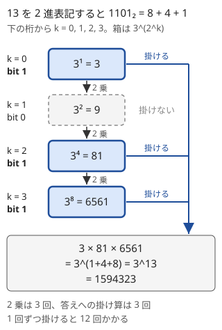

!!! abstract "要点"
    - **何ができるか**：$a^n \bmod m$ を、$n$ の 2 進表記に沿って $a, a^2, a^4, \dots$ を掛け合わせ、掛け算 $O(\log n)$ 回で求める。結合法則を満たす演算（行列の積・写像の合成など）なら、同じ方法で $n$ 回の繰り返しを計算できる。
    - **いつ使うか**：
        - 指数・繰り返しの回数が $N \le 10^{18}$
        - $a^N$ を $m$ で割った余り
        - 結合法則を満たす同じ操作を非常に多く繰り返す
    - **計算量**：掛け算 $O(\log n)$ 回。$n \le 10^{18}$ なら 2 乗と掛け算は合わせて 120 回以下。演算 1 回が $T$ なら $O(T \log n)$
    - **前提**：[mod の計算の基本](../math/mod-arithmetic.md)

<!-- textlint-disable -->
別名：二分累乗法・高速累乗・binary exponentiation・modpow・pow_mod・モノイドの累乗
<!-- textlint-enable -->

繰り返し二乗法は、$a$ を $n$ 回掛ける代わりに 2 乗を繰り返して $a^{2^k}$ を作り、そのうち必要なものだけを掛ける方法である。数の累乗だけでなく、行列や関数の合成など「同じ操作を $n$ 回」の計算を $O(\log n)$ 回の操作に縮める。

このページでは底を $a$、指数を $n$、法を $m$ と書く。記法は[記法と用語の約束](../start/notation.md)に従う。

## 指数を 2 進展開して必要な a^(2^k) だけ掛ける {#binary-expansion}

$n$ を 2 進表記して $n = 2^{k_1} + 2^{k_2} + \dots$ と書くと、指数法則から $a^n = a^{2^{k_1}} \times a^{2^{k_2}} \times \cdots$ になる。$a^{2^{k+1}} = (a^{2^k})^2$ なので、$a, a^2, a^4, \dots$ は 1 つ前を 2 乗するだけで順に作れる。次の図は $3^{13}$ の場合である。



$n$ の bit 数は $\lfloor \log_2 n \rfloor + 1$ なので、2 乗も答えへの掛け算もそれぞれ高々その回数で済む。$n < 2^{60}$（約 $1.15 \times 10^{18}$）なら、どちらも 60 回以下である。各掛け算の後に $m$ で余りを取るので、途中の値は常に $m$ 未満に収まる（余りを途中で取ってよい理由は[mod の計算の基本](../math/mod-arithmetic.md)）。

??? question "確認問題：掛け算の回数"
    $3^{13}$ を 1 回ずつ掛けると 12 回の掛け算が要る。繰り返し二乗法では、2 乗と答えへの掛け算を合わせて何回か。

    ??? success "答え"
        $13 = 1101_{(2)}$ は 4 bit で、1 の bit が 3 つある。2 乗は $3 \to 9 \to 81 \to 6561$ の 3 回、答えへの掛け算は 3・81・6561 の 3 回（最初の 1 との掛け算を数えなければ 2 回）で、合わせて 6 回である。$n$ が大きいほど差は開き、$n = 10^{18}$ では $10^{18}$ 回と 120 回以下の差になる。なお、[反復版](#recursive-iterative)のコードは最後の bit を見た後にも使わない 2 乗を 1 回するので、$n = 13$ では 2 乗が 4 回になる。それでも回数は $O(\log n)$ のままである。

## 再帰版と反復版 {#recursive-iterative}

**反復版**は、$n$ の bit を下から 1 つずつ見る。$n$ の最下位の bit が 1 なら今の $a$ を答えに掛け、$a$ を 2 乗して $n$ を右に 1 つずらす。正しさは次の不変条件で確かめられる。

$$
\mathrm{res} \times a^{n} \equiv A^{N} \pmod{m}
$$

ここで $A$・$N$ は最初の底と指数である。最初は $\mathrm{res} = 1$ で成り立つ。$n$ が奇数のとき $\mathrm{res}$ に $a$ を掛けると $a^n$ が $a^{n-1}$ になる。続けて $a \gets a^2$、$n \gets \lfloor n / 2 \rfloor$ としても $a^n$ の値は変わらない。$n = 0$ になったとき $\mathrm{res} = A^N$ である。

```cpp
--8<-- "mod-pow/pow-mod.cpp:core"
```

完全なプログラム：[`pow-mod.cpp`](https://github.com/yuukougun/kyopro-atlas/blob/main/snippets/mod-pow/pow-mod.cpp)（GitHub）
{ .kp-code-src }

**再帰版**は、$a^n = (a^{\lfloor n/2 \rfloor})^2 \times (n \text{ が奇数なら } a)$ をそのまま書く。再帰の深さは $\log_2 n$ 程度（$n \le 10^{18}$ なら 60 段ほど）なので、スタックのあふれは心配ない。

```cpp
--8<-- "mod-pow/pow-mod.cpp:recursive"
```

完全なプログラム：[`pow-mod.cpp`](https://github.com/yuukougun/kyopro-atlas/blob/main/snippets/mod-pow/pow-mod.cpp)（GitHub）
{ .kp-code-src }

再帰版で `f(a, n / 2) * f(a, n / 2)` と半分の結果を 2 回求めると、呼び出しの数が $n$ に比例して速くならない。半分の結果は 1 回だけ求めて使い回す。2 つの版の違いは書きやすさだけなので、普段は反復版を手元のライブラリに置いておけばよい。

## 結合法則を満たす演算の累乗（行列・写像の合成） {#monoid-power}

繰り返し二乗法が使ったのは、積が[結合法則](../guide/glossary.md#associativity)を満たすこと（$x^{i+j} = x^i x^j$ のように、どこで区切って計算してもよいこと）だけである。だから演算 $\circ$ が結合法則を満たせば、$x \circ x \circ \cdots \circ x$（$n$ 個）も同じ手順で求まる。$n = 0$ の答えには[単位元](../guide/glossary.md#identity-element)（数なら 1、行列なら単位行列、写像なら恒等写像）を使う。

```cpp
--8<-- "mod-pow/monoid-power.cpp:core"
```

完全なプログラム：[`monoid-power.cpp`](https://github.com/yuukougun/kyopro-atlas/blob/main/snippets/mod-pow/monoid-power.cpp)（GitHub）
{ .kp-code-src }

交換法則（$x \circ y = y \circ x$）は要らない。掛け合わせるのは同じ $x$ の累乗どうしで、$x^i \circ x^j$ はどちらも $x^{i+j}$ になるからである。ただし演算の向き（「$f$ の後に $g$」か「$g$ の後に $f$」か）は、演算を書く時点で決めて守り通す。

| 対象 | 演算 | 単位元 | 演算 1 回 | 使う場面 |
| --- | --- | --- | --- | --- |
| 数 | 積（mod $m$） | 1 | $O(1)$ | $a^N \bmod m$ |
| $k \times k$ 行列 | 行列の積 | 単位行列 | $O(k^3)$ | 線形漸化式の第 $N$ 項（[行列累乗](../math/matrix-power.md)） |
| 1 次関数 $px + q$ | 合成 | $x$ | $O(1)$ | 「$x \gets px + q$」を $N$ 回 |
| 長さ $L$ の置換・写像 | 合成 | 恒等写像 | $O(L)$ | 全員を $N$ 回移動させた後の位置（[置換の K 回合成](../basics/doubling.md#permutation-power)） |

1 次関数の例では、「$x \gets px + q$」を $N$ 回行った結果を $O(\log N)$ で求められる。関数を $(p, q)$ の組で持ち、「$f$ の後に $g$」の合成を $g(f(x)) = p_g (p_f x + q_f) + q_g$ から計算する。

```cpp
--8<-- "mod-pow/monoid-power.cpp:affine"
```

完全なプログラム：[`monoid-power.cpp`](https://github.com/yuukougun/kyopro-atlas/blob/main/snippets/mod-pow/monoid-power.cpp)（GitHub）
{ .kp-code-src }

[ダブリング](../basics/doubling.md)も、$2^k$ 回分の結果を 2 乗で作り、$N$ の 2 進表記に沿って組み合わせる点は同じである。違いは、ダブリングが $2^k$ 回分の表を残して多くの始点やクエリで使い回すのに対し、繰り返し二乗法は 1 つの $x$ の累乗だけを求め、今の $x^{2^k}$ しか持たないことにある。

??? question "確認問題：行列でも使える理由"
    $2 \times 2$ 行列 $X$ の $N$ 乗を、反復版と同じ手順で求めてよいのはなぜか。行列の積は $XY \ne YX$ になることがあるが、問題にならないのか。

    ??? success "答え"
        行列の積は結合法則 $(XY)Z = X(YZ)$ を満たすので、$X^N$ を $X^{2^{k_1}} X^{2^{k_2}} \cdots$ と区切って計算してよい。掛け合わせるのはどれも $X$ の累乗で、$X^i X^j = X^j X^i = X^{i+j}$ となるから、掛ける順番を気にしなくてよい。$n = 0$ の答えは単位行列にする。

## ACL の pow_mod と modint::pow {#acl}

!!! info "ACL では"
    `long long pow_mod(long long x, long long n, int m)` は $x^n \bmod m$ を返す。条件は $0 \le n$、$1 \le m$ で、計算量は $O(\log n)$。modint では `x.pow(n)`（$0 \le n$、$O(\log n)$）を使う。

```cpp
--8<-- "mod-pow/acl.cpp:core"
```

完全なプログラム：[`acl.cpp`](https://github.com/yuukougun/kyopro-atlas/blob/main/snippets/mod-pow/acl.cpp)（GitHub）。`mint` は ACL の `modint998244353`（[modint](../math/modint.md)）。
{ .kp-code-src }

`pow_mod` の法 $m$ は `int` なので、$2^{31}$ 以上の法には使えない。ドキュメントには書かれていないが、実装では $x$ を $m$ で割った 0 以上の余りに直すので、負の $x$ もそのまま渡せる。同じく実装では、$m = 1$ なら 0 を返し、$0^0$ は（$m \ge 2$ なら）1 を返す。法が 998244353 や $10^9 + 7$ に決まっている数え上げでは modint の `pow` が手軽で、法が入力で変わるときや、例題のように法 $M^2$ がその場で決まるときは `pow_mod` を使う。

## 落とし穴 {#pitfalls}

**指数を $m$ で割ってしまう**。底は $m$ で割った余りに置き換えてよいが、指数は置き換えられない。たとえば $2^7 = 128 \equiv 2 \pmod 7$ だが、指数を $7 \bmod 7 = 0$ にすると $2^0 = 1$ になって合わない。指数を小さくできるのは、$m$ が素数 $p$ で底が $p$ の倍数でないときに $p - 1$ で割る場合などに限られる（$2^{7 \bmod 6} = 2^1 = 2$ は合う）。指数そのものが $K^N$ のように巨大なときの扱いは[指数の mod](../math/exponent-mod.md)にある。

**$0^0$ と $n = 0$**。反復版は $n = 0$ のとき底によらず 1 を返すので、$0^0 = 1$ として扱う。数え上げでは「0 個を並べる方法は 1 通り」なので、この約束で正しい答えになることが多い。たとえば先頭の 2 個を決めた後、残りの $N - 2$ 個をそれぞれ $c$ 通りで選ぶ数え方では、$N = 2$ のとき $c^{0}$ が現れる。$c = 0$ でも $0^0 = 1$ として初めて正しい数になる。$0^0$ を 0 とする約束の問題なら場合分けする。

**$m = 1$ のときの初期値**。答えを `res = 1` で始めると、$n = 0$ のとき余りを取らないまま 1 を返してしまう。$m = 1$ ならどんな数の余りも 0 なので、初期値は `1 % m` にする。$n \ge 1$ なら 1 の bit で余りを取るので結果は同じだが、指数が 0 になりうる入力では答えが変わる。

**掛け算のあふれ**。途中の値は $m$ 未満なので、積は $m^2$ 未満になる。$m < 2^{31}$（998244353 や $10^9 + 7$）なら積は $2^{62}$ 未満で `long long` に収まるが、`int` のまま掛けるとあふれる。また最初に底を `a %= m` で $m$ 未満にしておかないと、$a = 10^{18}$ の 2 乗で最初からあふれる。$m$ が $10^{18}$ 程度なら $m^2$ が `long long` に収まらないので、積を `__int128` で計算する（[整数のオーバーフロー](../cpp/cpp-integer-overflow.md)）。

**負の底と指数の型**。C++ の `%` は負の数に対して負の余りを返すので、底が負なら $m$ を足して 0 以上に直す（[mod の計算の基本](../math/mod-arithmetic.md)）。指数を受け取る引数を `int` にすると $10^{18}$ が入らないので、`long long` にする。

**`std::pow` を使う**。`<cmath>` の `pow` は浮動小数点数で計算するので、$2^{53}$ を超える値は正確でなく、途中で余りも取れない。整数の累乗は自分で書いた関数か ACL の関数を使う。

## 繰り返し二乗法を部品にする手法 {#building-block}

繰り返し二乗法は、多くの手法の中で部品として呼ばれる。

- **逆元**：$p$ が素数で $a$ が $p$ の倍数でなければ、$a^{p-2}$ が $a$ の逆元になる（フェルマーの小定理。[逆元と割り算](../math/mod-inverse.md)）
- **指数の mod**：$a^{K^N}$ のように指数が巨大なとき、指数を $p - 1$ で割った余りに直してから累乗する（[指数の mod](../math/exponent-mod.md)）
- **等比数列の和**：$(r^n - 1) / (r - 1)$ の $r^n$ を求める。逆元がないときは和を半分に割る漸化式や行列で計算する（[等比数列の和を mod で](../math/geometric-series-mod.md)）
- **行列累乗**：線形漸化式や DP の遷移を行列で書き、その $N$ 乗を求める（[行列累乗](../math/matrix-power.md)）

## 例題 {#examples}

### ARC111 A. Simple Math 2 {#arc111_a}

<div class="kp-problems" data-role="example" markdown>

- [ARC111 A. Simple Math 2](https://atcoder.jp/contests/arc111/tasks/arc111_a)（diff 1146）：⌊10^N / M⌋ を M で割った余りを求める（N ≤ 10^18、M ≤ 10^4）。

</div>

$M$ で 2 回割るので、$10^N$ を $M^2$ で割った余りを考える。$10^N = M^2 Q + R$（$0 \le R < M^2$）と書くと、$M^2 Q$ の部分は $M$ で割った商が $M$ の倍数なので、答えには効かない。答えは $\lfloor R / M \rfloor$ で、$R = 10^N \bmod M^2$ は繰り返し二乗法で求まる。

??? note "解法の詳細"
    - $R$ をさらに $R = M Q' + R'$（$0 \le R' < M$）と書くと、$10^N = M (M Q + Q') + R'$ なので $\lfloor 10^N / M \rfloor = M Q + Q'$ になる。これを $M$ で割った余りは $Q'$ で、$0 \le Q' < M$ だから答えは $Q' = \lfloor R / M \rfloor$ である。
    - 法 $M^2 \le 10^8$ なので、途中の積は $10^{16}$ 未満で `long long` に収まる。ACL の `pow_mod(10, N, M * M)` も使える（法は `int` に収まる）。
    - $M = 1$ では法が 1 になり、$R = 0$ で答えは 0 になる。
    - 計算量は $O(\log N)$。

## 練習問題 {#practice}

<div class="kp-problems" data-role="practice" markdown>

- [典型90 069. Colorful Blocks 2（★3）](https://atcoder.jp/contests/typical90/tasks/typical90_bq)（diff なし）：一列に並んだ N 個のブロックを K 色で塗り、距離 2 以内のブロックがすべて異なる色になる塗り方の数を求める。
- [ABC228 E. Integer Sequence Fair](https://atcoder.jp/contests/abc228/tasks/abc228_e)（diff 1579）：長さ N で各項が 1 以上 K 以下の数列それぞれに 1 以上 M 以下の点数を付ける方法の数（M^(K^N)）を 998244353 で割った余りで求める（N, K, M ≤ 10^18）。

</div>

??? note "練習の方針"
    - **典型90 069**：左から色を決めると、1 個目は $K$ 通り、2 個目は $K - 1$ 通り、3 個目以降は $K - 2$ 通りの色を選べるので、答えは $K(K-1)(K-2)^{N-2}$ になる。$N \le 10^{18}$ なので累乗を繰り返し二乗法で求める。$N \le 2$ や $K \le 2$ の境界に気をつける（数え上げの考え方は[和・積の法則と順列・組合せ](../comb/counting-basics.md)）
    - **ABC228 E**：答えは $M^{K^N} \bmod 998244353$。$M$ が 998244353 の倍数でなければ、指数 $K^N$ を $998244352$ で割った余りに直してよく、累乗を 2 回使う。$M$ が 998244353 の倍数なら答えは 0 になる。指数を 998244353 で割ると誤り（[指数の mod](../math/exponent-mod.md)）

## 参考 {#references}

- [drken「AtCoder ARC 111 A - Simple Math 2 (1Q, 緑色, 300 点)」](https://drken1215.hatenablog.com/entry/2022/12/26/195928)：例題の方針（$10^N \bmod M^2$ を $M$ で割る導出）
- [E869120「kyopro_educational_90 sol/069.cpp」](https://github.com/E869120/kyopro_educational_90/blob/main/sol/069.cpp)：練習の方針（塗り方の式と境界の場合分け）
- [Kazun「AtCoder Beginner Contest 228 E 問題 Integer Sequence Fair」](https://kazun-kyopro.hatenablog.com/entry/ABC/228/E)：練習の方針（指数を $p - 1$ で割ること、底が $p$ の倍数の場合）
- [AtCoder Library「Math」（document_ja）](https://github.com/atcoder/ac-library/blob/master/document_ja/math.md)：`pow_mod` の宣言・条件・計算量
- [AtCoder Library「modint」（document_ja）](https://github.com/atcoder/ac-library/blob/master/document_ja/modint.md)：`modint::pow` の条件・計算量
