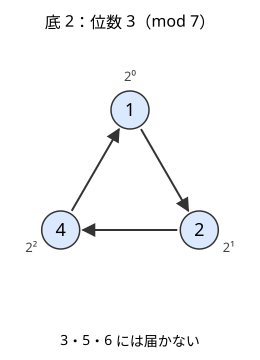
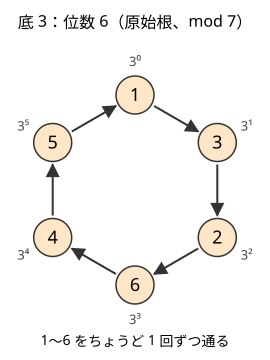
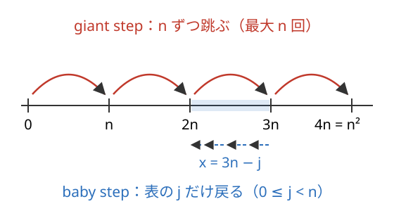

!!! abstract "要点"
    - **何ができるか**：$a^k \equiv 1$ となる最小の $k$（位数）を $\varphi(m)$ の約数から求め、原始根で掛け算を指数の足し算に直す。$a^x \equiv b$ を満たす $x$（離散対数）は Baby-step Giant-step で $O(\sqrt{m})$ で求める。
    - **いつ使うか**：
        - 同じ数字を $n$ 個並べた数が $K$ の倍数になる最小の $n$。
        - $a^x \equiv b \pmod{P}$ となる最小の $x$。
        - $X \leftarrow AX + B \pmod{P}$ を繰り返して $G$ が最初に現れる番号。
        - $x^n \equiv y \pmod{P}$ となる組を数える。
        - mod $P$ での積の値ごとに個数を数える。
        - 法 $P$ が $10^9$ 程度で、$\sqrt{P} \approx 3 \times 10^4$ 個の表なら持てる。
    - **計算量**：位数は、$\varphi(m)$ の素因数分解に $O(\sqrt{m})$、その後の累乗に $O(\log^2 m)$。原始根は、同じ分解の後で候補 1 個の判定が $O(\log^2 m)$ で、実際の素数では小さい候補で見つかる。離散対数は期待 $O(\sqrt{m})$（ハッシュ表。`map` なら $O(\sqrt{m} \log m)$）。
    - **前提**：[オイラーの φ 関数](../math/euler-phi.md)、[逆元と mod での割り算](../math/mod-inverse.md)

<!-- textlint-disable -->
別名：multiplicative order・primitive root・discrete logarithm・累乗の周期・生成元・BSGS・baby-step giant-step・平方剰余・mod の平方根・mod の K 乗根・Tonelli-Shanks・Cipolla
<!-- textlint-enable -->

位数・原始根・離散対数は、累乗 $a^0, a^1, a^2, \dots$ の余りが作る周期を調べる道具である。位数はその周期の長さで、原始根は周期が最も長い（法と互いに素な余りをすべて通る）底である。離散対数は「$b$ が周期の何番目に現れるか」を求める問題で、周期が $10^9$ 程度でも、表を $\sqrt{m}$ 個だけ持つことで $O(\sqrt{m})$ で答えが出る。

このページで使う記法：法を $m$（素数なら $p$）と書き、$\gcd(a, m) = 1$ のとき $a$ の位数を $\operatorname{ord}_m(a)$ と書く。$\varphi(m)$ は $1$ 以上 $m$ 以下で $m$ と[互いに素](../guide/glossary.md#coprime)な整数の個数、$0^0 = 1$ とする。記法全般は[記法と用語の約束](../start/notation.md)にまとめてある。

## 位数は φ(m) の約数になる理由と、累乗の列の周期 {#order}

$\gcd(a, m) = 1$ のとき、$a^k \equiv 1 \pmod{m}$ となる最小の正の整数 $k$ を $a$ の位数と呼ぶ。法 7 で 2 の累乗は $1, 2, 4, 1, 2, 4, \dots$ と 3 個の値を回るので位数は 3、3 の累乗は $1, 3, 2, 6, 4, 5, 1, \dots$ と 1〜6 のすべてを回るので位数は 6 である。




位数を $d$ とすると、次の性質が成り立つ。どれも位数を使うときの土台になる。

- **$a^k \equiv 1$ と $d \mid k$ は同じ**：$k$ を $d$ で割って $k = qd + r$（$0 \le r < d$）とすると、$a^k = (a^d)^q a^r \equiv a^r$ である。$a^r \equiv 1$ で $r < d$ なら、位数の最小性から $r = 0$ しかない
- **$d$ は $\varphi(m)$ の約数**：オイラーの定理（[オイラーの φ 関数](../math/euler-phi.md#euler-theorem)）から $a^{\varphi(m)} \equiv 1$ なので、上の性質で $d \mid \varphi(m)$ になる。$m$ が素数 $p$ なら $d \mid p - 1$ である
- **累乗の列は周期 $d$ で回り、1 周の中の値はすべて異なる**：$a^i \equiv a^j$（$0 \le i < j < d$）なら、両辺に $a^{-i}$ を掛けて $a^{j-i} \equiv 1$ となり、$0 < j - i < d$ が最小性に反する

$\gcd(a, m) \ne 1$ なら、どの $k \ge 1$ でも $a^k \equiv 1$ にはならない。なったとすると $a \cdot a^{k-1} \equiv 1$ で $a$ に逆元があることになり、[逆元が存在する条件](../math/mod-inverse.md#existence)に反する。このとき累乗の列は、最初のいくつかの項の後で周期に入る ρ 型になる（[尾と周期](../basics/periodicity.md#rho)）。たとえば法 12 での 2 の累乗は $1, 2, 4, 8, 4, 8, \dots$ と進み、1 には戻らない。

**応用の型**：「同じ数字を $n$ 個並べた数が $K$ の倍数」は $10^n \equiv 1$ の形に直せるので、位数そのものが答えになる（[例題 ABC222 G](#abc222_g)）。「何回で元に戻るか」「周期は何か」と問われたら、まず $\gcd$ が 1 かどうかを見る。

## 位数の求め方（φ(m) の約数を試す・素因数を1つずつ取り除く） {#find-order}

位数を 1, 2, 3, … と順に試すと、最悪で $\varphi(m)$ 回の掛け算がかかる。$m$ が $10^9$ なら間に合わない。位数は $\varphi(m)$ の約数なので、候補をその約数に絞れる。

**約数を小さい順に試す**：$\varphi(m)$ の約数を列挙して小さい順に並べ、[繰り返し二乗法](../math/mod-pow.md)で $a^d \equiv 1$ となる最初の $d$ を探す。約数の個数は $10^9$ 以下で最大 1344 個なので、1 回あたり $O(\text{約数の個数} \times \log m)$ で済む。

**素因数を 1 つずつ取り除く**：$d = \varphi(m)$ から始め、$\varphi(m)$ の各素因数 $q$ について「$q$ で割り切れて、$a^{d/q} \equiv 1$ である間は $d$ を $q$ で割る」を繰り返す。最後の $d$ が位数である。

```cpp
--8<-- "multiplicative-order/order.cpp:core"
```

完全なプログラム：[`order.cpp`](https://github.com/yuukougun/kyopro-atlas/blob/main/snippets/multiplicative-order/order.cpp)（GitHub）
{ .kp-code-src }

この方法が正しいのは、「$d$ は位数の倍数」という性質を保つからである。$a^{d/q} \equiv 1$ なら $d/q$ も位数の倍数なので割ってよい。$a^{d/q} \not\equiv 1$ なら、$d$ と位数で $q$ の指数が一致している（一致していなければ $d/q$ も位数の倍数のはずである）。ほかの素因数で割っても $q$ の指数は変わらないので、すべての素因数を処理し終えた $d$ は位数と各素因数の指数が一致し、位数に等しい。累乗の回数は $\varphi(m)$ の素因数の個数（重複を含めて $O(\log m)$）ほどで、全体で $O(\log^2 m)$ になる。

どちらの方法も、先に $\varphi(m)$ とその素因数分解が要る。$m = \prod p_i^{e_i}$ と[素因数分解](../math/prime-factorization.md)すると $\varphi(m) = \prod p_i^{e_i - 1}(p_i - 1)$ で、この $\varphi(m)$ をもう一度試し割りで分解する（$p_i - 1$ をそれぞれ分解して合わせてもよい）。$m \le 10^{12}$ なら試し割りの $O(\sqrt{m})$ が全体の大半を占める。

**応用の型**：同じ法で多くの数の位数を求めるときは、$\varphi(m)$ の分解を 1 回だけ行い、各数には素因数を取り除く方法を使う。1 個あたり $O(\log^2 m)$ なので、$2 \times 10^5$ 個でも間に合う（[力試し](#challenge)の ABC335 G）。

## 原始根の定義・存在条件（1, 2, 4, p^k, 2p^k）と見つけ方 {#primitive-root}

位数がちょうど $\varphi(m)$ になる $g$ を、法 $m$ の原始根と呼ぶ。原始根の累乗 $g^0, g^1, \dots, g^{\varphi(m)-1}$ は互いに異なり、どれも $m$ と互いに素なので、$m$ と互いに素な余りをちょうど 1 回ずつ通る。法 7 では 3 が原始根で、2 は原始根ではない。

原始根があるのは、$m$ が $1, 2, 4, p^k, 2p^k$（$p$ は奇素数、$k \ge 1$）のときだけで、あれば $\varphi(\varphi(m))$ 個ある。競技プログラミングで使うのはほとんどが素数 $p$ の場合で、このとき $1$ 以上 $p - 1$ 以下のすべての数が $g^k$（$0 \le k < p - 1$）とただ 1 通りに書ける。存在の証明は長いので、参考の資料に任せる。

**見つけ方**：$\varphi(m)$ の素因数を $q_1, \dots, q_s$ とすると、$g$ が原始根であることは、すべての $i$ で $g^{\varphi(m)/q_i} \not\equiv 1$ であることと同じである。位数が $\varphi(m)$ より小さければ、それは $\varphi(m)$ の真の約数なので、どれかの $\varphi(m)/q_i$ を割り切り、その累乗が 1 になるからである。$g = 2, 3, 4, \dots$ と順に試せば、実際の素数では小さい $g$ ですぐ見つかる。

```cpp
--8<-- "multiplicative-order/order.cpp:root"
```

完全なプログラム：[`order.cpp`](https://github.com/yuukougun/kyopro-atlas/blob/main/snippets/multiplicative-order/order.cpp)（GitHub）
{ .kp-code-src }

最小の原始根は、$998244353$ と $469762049$ で 3、$10^9 + 7$ で 5、$200003$ で 2 である（コード片で確かめた値）。値を覚えて決め打ちするより、この関数で求めれば法を取り違えない。ACL も `convolution` の中で同じ方法で原始根を求めている（公開の関数ではない）。

**応用の型（NTT の 2 の冪乗根）**：$g^k$ の位数は $(p-1)/\gcd(k, p-1)$ である。$2^c \mid p - 1$ なら、$\omega = g^{(p-1)/2^c}$ の位数はちょうど $2^c$ になり、$2^c$ 乗して初めて 1 になる数が得られる。NTT が法 $998244353 = 119 \times 2^{23} + 1$ を使い、長さ $2^{23}$ まで畳み込めるのはこのためである（[畳み込みの使い方](../math/convolution-ntt.md#acl)）。

## 位数が d の元は φ(d) 個 {#count-by-order}

素数 $p$ を法とし、原始根 $g$ を 1 つ取る。$1$ 以上 $p - 1$ 以下の $x$ を $x = g^k$ と書くと、$x^n \equiv 1$ は $g^{kn} \equiv 1$、つまり $(p - 1) \mid kn$ と同じである。これを満たす最小の $n$ は $(p-1)/\gcd(k, p-1)$ なので、$x$ の位数は $(p-1)/\gcd(k, p-1)$ になる。

位数が $d$（$d \mid p - 1$）になるのは $\gcd(k, p-1) = (p-1)/d$ のときで、そのような $k$（$0 \le k < p - 1$）は $k = \frac{p-1}{d} \cdot t$（$0 \le t < d$、$\gcd(t, d) = 1$）と書けるので、ちょうど $\varphi(d)$ 個ある。$d$ についての和が $p - 1$ になることは $\sum_{d \mid n} \varphi(d) = n$ の言い換えである（[約数についての φ の和](../math/euler-phi.md#divisor-sum)）。

この見方から、数え上げでよく使う次の性質が出る。

- **$x$ の累乗で届く値**：$x$ の位数を $d$ とすると、$x^1, x^2, \dots$ はちょうど $d$ 個の値を取る（[位数の性質](#order)）
- **届くかどうかは位数の割り切りで決まる**：$y \ne 0$ が $x$ の累乗で書けることは、$\operatorname{ord}_p(y) \mid \operatorname{ord}_p(x)$ と同じである。$d = \operatorname{ord}_p(x)$ とする。$x$ の累乗はどれも $z^d \equiv 1$ を満たし、$z^d \equiv 1$ は $z$ の $d$ 次式なので法 $p$ で解が $d$ 個以下しかない。$x$ の累乗が $d$ 個あるので、$z^d \equiv 1$ を満たす $z$ の全体が $x$ の累乗にちょうど一致する。よって $y$ が $x$ の累乗で書けることは $y^d \equiv 1$、すなわち $\operatorname{ord}_p(y) \mid d$ と同じである

**応用の型**：「$x^n \equiv y$ を満たす $n$ がある組 $(x, y)$ の数」は位数 $d$ ごとに $\varphi(d) \cdot d$ を足す（[練習](#practice)の ABC212 G）。「$A_i^k \equiv A_j$ となる組の数」は、各 $A_i$ の位数を求めて位数ごとに個数をまとめ、割り切る組を数える（[力試し](#challenge)の ABC335 G）。

## 掛け算を指数の足し算に直す（積の個数を畳み込みへ） {#mul-to-add}

素数 $p$ と原始根 $g$ について、$1 \le x \le p - 1$ の $x = g^k$ となる $k$ を $\log x$ と書く。$g^0, g^1, \dots, g^{p-2}$ を順に計算すれば、$\log$ の表を $O(p)$ で作れる。表があれば、$x \cdot y$ の $\log$ は $\log x + \log y$ を $p - 1$ で割った余りになり、掛け算が足し算に変わる。

「mod $p$ での積の値ごとに、組の個数を数える」問題は、この変換で[畳み込み](../math/convolution-ntt.md)に直せる。

```text
c[k] = log が k の要素の個数（0 ≤ k < p − 1）。値が 0 の要素は別に数える
e = c と c の畳み込み（長さ 2(p − 1) − 1）
積の log が t になる組の数 = e[t] + e[t + (p − 1)]   （0 ≤ t < p − 1。t + (p − 1) が範囲外なら 0）
積が g^t の組の数 = その値
```

指数は $p - 1$ を周期として回るので、畳み込んだ結果の後ろ半分を前に折り返す。値が 0 の要素は、何と掛けても積が 0 になるので、表から外して個数を別に足す。順序のない組 $i < j$ が欲しいときは、順序つきの個数から $i = j$ の分（各要素の 2 乗）を引いて 2 で割る。

畳み込みの結果は個数そのもので、$N = 2 \times 10^5$ なら $N^2 = 4 \times 10^{10}$ まで大きくなる。998244353 で割った余りしか返らない `convolution` では足りないので、`convolution_ll` を使う（[整数のまま欲しいとき](../math/convolution-ntt.md#convolution-ll)）。

**応用の型**：$p$ が $2 \times 10^5$ 程度と小さく、積の mod の分布が要るとき（[力試し](#challenge)の AGC047 C）。$p$ が大きいと $\log$ の表を作れないので、この変換は使えない。

## 離散対数：Baby-step Giant-step（表の大きさを √m にする理由） {#bsgs}

$\gcd(a, m) = 1$ のとき、$a^x \equiv b \pmod{m}$ となる最小の $x \ge 0$ を求める。答えは位数未満なので $m$ 未満にあるが、$x$ を 0 から順に試すと $O(m)$ かかる。Baby-step Giant-step（BSGS）は、[半分全列挙](../basics/meet-in-the-middle.md)と同じ考え方で、$x$ を 2 つの部分に分けて $O(\sqrt{m})$ にする。

$n = \lceil \sqrt{m} \rceil$ とし、$x = i n - j$（$1 \le i \le n$、$0 \le j < n$）と書く。$a$ には逆元があるので、

$$
a^{in - j} \equiv b \iff a^{in} \equiv b \cdot a^j \pmod{m}
$$

である。右辺の $b \cdot a^j$ を $j = 0, \dots, n - 1$ について表に入れ（baby step）、左辺の $a^{in}$ を $i = 1, 2, \dots$ の順に計算して表を引く（giant step）。



```text
x = 0 の確認：b ≡ 1 なら 0 を返す
n = ⌈√m⌉
表 T：j = 0, 1, ..., n − 1 の順に T[b·a^j] = j（同じ値は上書きして、大きい j を残す）
v = 1
for i = 1, 2, ..., n:
    v = v · a^n
    T に v があれば、x = i·n − T[v] を返す
解なし
```

- **最小の解になる理由**：$i$ を固定すると $x$ は区間 $((i-1)n, in]$ を動き、区間は $i$ の順に右へ並ぶ。同じ区間の中では $j$ が大きいほど $x$ が小さいので、表には大きい $j$ を残す。最初に当たった $i$ と残した $j$ の組が最小の $x$ になる
- **探す範囲が足りる理由**：$x$ は $1$ から $n^2 \ge m$ までを隙間なく覆う。最小の解は位数 $\operatorname{ord}_m(a) \le \varphi(m) < m$ より小さいので、必ずこの範囲にある
- **表の大きさを $\sqrt{m}$ にする理由**：表の大きさを $n$ とすると、baby step は $n$ 回、giant step は $m / n$ 回かかる。和 $n + m/n$ は $n = \sqrt{m}$ で最小の $2\sqrt{m}$ になる。$m = 10^9$ なら表は約 $3.2 \times 10^4$ 個で済む

表をハッシュ表（`unordered_map`）にすると期待 $O(\sqrt{m})$、`map` かソートと二分探索なら $O(\sqrt{m} \log m)$ である。コードは $\gcd(a, m) \ne 1$ の場合も含めて[次の節](#bsgs-details)に置いた。

**応用の型**：同じ底 $a$ で多くの $b$ を引くときは、表を $a^j$ の側に作って使い回し、giant step では $b$ に $a^{-n}$ を掛けていく（$a^{j} \equiv b \cdot a^{-in}$ を探す）。この形では $x = in + j$ なので、本節とは逆に表には小さい $j$ を残し（上書きしない）、$i = 0$ から引く。$Q$ 個の $b$ を引くなら、表を大きくして $n \approx \sqrt{Qm}$ にすると全体が $O(\sqrt{Qm})$ に釣り合う。

## gcd(a, m) ≠ 1 の場合と、最小の解の取り方 {#bsgs-details}

$\gcd(a, m) = g \ne 1$ だと $a$ に逆元がなく、BSGS の同値変形が使えない。そこで、$x \ge 1$ のとき $a^x = a \cdot a^{x-1}$ と 1 つ取り出し、両辺を $g$ で割る。

$$
a \cdot a^{x-1} \equiv b \pmod{m} \iff \frac{a}{g} \cdot a^{x-1} \equiv \frac{b}{g} \pmod{\frac{m}{g}}
$$

$b$ が $g$ で割り切れなければ、左辺は $g$ の倍数なので解はない。これを $\gcd(a, m) = 1$ になるまで繰り返すと、$\mathrm{coef} \cdot a^y \equiv b \pmod{m}$（$x = y + k$、$k$ は取り出した回数）の形になる。$a/g$ と $m/g$ は互いに素なので、$\mathrm{coef}$ は残った法と互いに素であり、giant step を $\mathrm{coef}$ から始めれば BSGS がそのまま使える。$m$ は 1 回ごとに半分以下になるので、割る回数は $O(\log m)$ である。

```cpp
--8<-- "multiplicative-order/bsgs.cpp:core"
```

完全なプログラム：[`bsgs.cpp`](https://github.com/yuukougun/kyopro-atlas/blob/main/snippets/multiplicative-order/bsgs.cpp)（GitHub）
{ .kp-code-src }

最小の解を取りこぼさないために、次の 3 点に気をつける。

- **割る前に $x = k$ を確かめる**：取り出すたびに $\mathrm{coef} \equiv b$（$y = 0$）を調べる。$k$ 回取り出した後でしか成り立たない解（法 8 で $2^3 \equiv 0$ など）も、それより小さい解もここで拾える
- **$x = 0$ と「正の最小」を区別する**：$b \equiv 1$ なら $x = 0$ が答えになる。問題が $x \ge 1$ を求めているなら、$b \equiv 1$ のときの答えは 0 ではなく位数である
- **すべての解**：$\gcd(a, m) = 1$ なら、最小の解を $x_0$、位数を $d$ として、解の全体は $x_0 + t d$（$t \ge 0$）である。「区間 $[A, B]$ に入る解があるか」は、この等差数列で判定する

**応用の型**：「$X^i \bmod P$ の、$A \le i \le B$ での最小値」は、小さい値 $v = 1, 2, \dots$ から順に離散対数を求め、解の等差数列が区間に入るかを調べる（[練習](#practice)の ARC042 D）。

## 一次漸化式を不動点で等比数列に直して離散対数に帰着する {#affine-recurrence}

$X_0 = S$、$X_{i+1} = (A X_i + B) \bmod P$（$P$ は素数）で決まる列で、$X_i = G$ となる最小の $i$ を求める。列の周期は $P$ 近くになりうるので、シミュレーションでは間に合わない。

$A \ne 0, 1$ のとき、$\gamma = A\gamma + B$ を満たす[不動点](../guide/glossary.md#fixed-point) $\gamma = B (1 - A)^{-1}$ を取る。漸化式から $\gamma$ の式を引くと $X_{i+1} - \gamma = A (X_i - \gamma)$ なので、$X_i - \gamma$ は公比 $A$ の等比数列になる。

$$
X_i - \gamma \equiv A^i (S - \gamma) \pmod{P}
$$

$S \ne \gamma$ なら、$X_i = G$ は $A^i \equiv (G - \gamma)(S - \gamma)^{-1}$ と同じで、[BSGS](#bsgs) で最小の $i$ が求まる。場合分けは次のとおりである。

| 場合 | 列の形 | $X_i = G$ となる最小の $i$ |
| --- | --- | --- |
| $G = S$ | — | 0 |
| $A = 0$ | $S, B, B, \dots$ | $G = B$ なら 1、ほかは解なし |
| $A = 1$ | $X_i = S + iB$ | $B \ne 0$ なら $(G - S) B^{-1} \bmod P$、$B = 0$ なら解なし |
| $A \ne 0, 1$、$S = \gamma$ | 定数 $\gamma$ | 解なし |
| $A \ne 0, 1$、$S \ne \gamma$ | 等比数列 | 離散対数 |

$G = S$ の判定は最初に行う。$A = 1$ では $1 - A$ の逆元が取れず、$A = 0$ では底に逆元がなく BSGS が使えない。どちらも必ず別に扱う。

**応用の型**：アフィン変換 $x \mapsto Ax + B$ の繰り返しは、不動点を引けば掛け算の繰り返しになる。「$K$ 回後の値」なら等比数列の和の公式か[行列累乗](../math/matrix-power.md)で、「初めて $G$ になる回数」ならこの節の離散対数で求める（[例題 ABC270 G](#abc270_g)）。

## 平方剰余と mod の K 乗根（オイラーの規準・Tonelli-Shanks・Cipolla） {#mod-root}

この節は発展の内容で、[原始根](#primitive-root)と[離散対数](#bsgs)を前提にする。ABC で必須になる問題は見つかっていない。

**平方剰余とオイラーの規準**：奇素数 $p$ と $p$ の倍数でない $a$ について、$x^2 \equiv a$ を満たす $x$ があるとき $a$ を平方剰余と呼ぶ。$a$ が平方剰余であることは、$a^{(p-1)/2} \equiv 1$ と同じである（そうでなければ $-1$ になる）。原始根で $a = g^k$ と書くと、平方剰余であることは $k$ が偶数であることと同じで、$a^{(p-1)/2} = g^{k(p-1)/2}$ が 1 になるのも $k$ が偶数のときだけだからである。解があれば $\pm x$ の 2 個ある。

**平方根の求め方**：$p \equiv 3 \pmod{4}$ なら $x = a^{(p+1)/4}$ が解である（2 乗すると $a^{(p+1)/2} = a \cdot a^{(p-1)/2} \equiv a$）。一般の $p$ では次のどちらかを使う。

- **Tonelli-Shanks**：$p - 1 = 2^s q$（$q$ は奇数）と分け、平方非剰余を 1 つ使って、誤差の位数を 2 の冪で 1 段ずつ下げる。$O(\log^2 p)$
- **Cipolla**：$t^2 - a$ が平方非剰余になる $t$ を乱択で探し（半分ほどが当たる）、$\sqrt{t^2 - a}$ を新しい数として加えた世界で $(t + \sqrt{t^2 - a})^{(p+1)/2}$ を計算する。期待 $O(\log p)$

**K 乗根**：$x^K \equiv y$（$y \ne 0$）は、原始根 $g$ で $y = g^t$、$x = g^s$ と書くと $Ks \equiv t \pmod{p-1}$ という一次合同式になる。$t$ は離散対数で求め、一次合同式は[拡張ユークリッドの互除法](../math/ext-gcd.md#linear-congruence)で解く。解があるのは $\gcd(K, p - 1) \mid t$、すなわち $y^{(p-1)/\gcd(K, p-1)} \equiv 1$ のときで、解は $\gcd(K, p-1)$ 個ある。離散対数を使うので 1 回 $O(\sqrt{p})$ かかる。

自作するときの動作確認には、Library Checker の [Sqrt Mod](https://judge.yosupo.jp/problem/sqrt_mod)・[K-th Root (Mod)](https://judge.yosupo.jp/problem/kth_root_mod) が使える。位数と離散対数は [Primitive Root](https://judge.yosupo.jp/problem/primitive_root)・[Discrete Logarithm](https://judge.yosupo.jp/problem/discrete_logarithm_mod) で確かめられる。

## 落とし穴 {#pitfalls}

**位数を 1 から順に探して TLE**。位数は $\varphi(m)$ まであり、$m = 10^9$ なら $10^9$ 回の掛け算になる。候補を $\varphi(m)$ の約数に絞るか、[素因数を取り除く方法](#find-order)を使う。

**$\gcd(a, m) \ne 1$ なのに位数を探す**。互いに素でなければ $a^k \equiv 1$ には決してならず、「1 に戻るまで回す」ループは止まらない。ABC222 G の言い換えでも、法が 2 か 5 の倍数なら答えはない。最初に $\gcd$ を調べる。

**$\varphi(m)$ の約数ではなく $m - 1$ の約数を試す**。$m - 1$ の約数を試してよいのは $m$ が素数のときだけである。合成数の法では $\varphi(m)$ を素因数分解から求める。

**掛け算のオーバーフロー**。法が $10^{12}$ 程度（ABC212 G）や $10^{13}$ 程度（ABC335 G）になると、2 つの余りの積が `long long` を超える。`__int128` で掛けてから余りを取る（コード片の全体にある `mul_mod`）。法が $2^{31}$ 未満なら `long long` のままでよい。

**原始根を 2 や 3 と決め打ちする**。法 7 では 2 は原始根ではない（位数 3）。法が変わる問題では[見つけ方](#primitive-root)の関数で求める。$2^k$（$k \ge 3$）のように原始根がない法もあり、たとえば法 8 では奇数の 2 乗がすべて 1 になる。

**BSGS の表で小さい $j$ を残す**。同じ $b \cdot a^j$ の値が 2 回出ると、後から入れた大きい $j$ の方が $x = in - j$ を小さくする。先に入れた値を残すと、最小でない解を返すことがある（[最小の解になる理由](#bsgs)）。

**$x = 0$ の扱い**。BSGS の giant step は $i \ge 1$ から始まるので、$b \equiv 1$ の $x = 0$ は別に確かめる。逆に「正の整数 $x$」を求める問題で $x = 0$ を返さない。

## 使い分け {#comparison}

| 求めるもの | 使う方法 |
| --- | --- |
| $a^n \bmod m$（$n$ が巨大） | [指数の mod](../math/exponent-mod.md) |
| $a^x \equiv 1$ となる最小の $x \ge 1$ | 位数（$\varphi(m)$ の約数） |
| $a^x \equiv b$ となる最小の $x$ | BSGS |
| 一般の関数の繰り返しで初めて $G$ になる回数 | [周期の検出](../basics/periodicity.md#rho)（周期が小さいとき） |
| アフィン変換の繰り返し | 不動点で等比数列に直す |

- $a^x \equiv 1$ の最小の正の解を BSGS で求めることもできるが、位数の方が $O(\log^2 m)$ で速く、表も要らない
- 関数が累乗やアフィン変換でなければ、離散対数の工夫は使えない。周期が $10^6$ 程度までなら、訪問した値を記録してシミュレーションする（[出次数 1 のグラフ](../graph/cycle-detection.md#out-degree-one)）

## 例題 {#examples}

### ABC270 G. Sequence in mod P {#abc270_g}

<div class="kp-problems" data-role="example" markdown>

- [ABC270 G. Sequence in mod P](https://atcoder.jp/contests/abc270/tasks/abc270_g)（diff 2220）：X_{i+1} = (A·X_i + B) mod P で定まる数列で、値 G が最初に現れる番号を求める（P は素数、なければ −1）。

</div>

$P \le 10^9$ の素数で、テストケースは 100 個まである。列の周期は $P$ 近くになりうるので、シミュレーションでは間に合わない。[一次漸化式の節](#affine-recurrence)のとおり、不動点 $\gamma$ を引いて $X_i - \gamma = A^i (S - \gamma)$ の形に直し、$A^i \equiv (G - \gamma)(S - \gamma)^{-1}$ を BSGS で解く。

??? note "解法の詳細"
    - $X_0 = S$ なので、最初に $G = S$ なら 0 を答える。
    - $A = 0$ なら列は $S, B, B, \dots$ なので、$G = B$ なら 1、ほかは −1 である。
    - $A = 1$ なら $X_i = S + iB$ である。$B = 0$ なら −1、そうでなければ $i = (G - S) B^{-1} \bmod P$ を答える（$0 \le i < P$ が最小の解）。
    - それ以外は $\gamma = B(1 - A)^{-1}$ を求める。$S = \gamma$ なら列は定数なので −1 である。$S \ne \gamma$ なら $c = (G - \gamma)(S - \gamma)^{-1}$ とし、$A^i \equiv c$ となる最小の $i \ge 0$ を BSGS で求める。$G \ne S$ なので $c \ne 1$ で、$i = 0$ にはならない。
    - 逆元はフェルマーの小定理で求められる。1 ケース期待 $O(\sqrt{P})$ で、表は約 $3.2 \times 10^4$ 個である。

### ABC222 G. 222 {#abc222_g}

<div class="kp-problems" data-role="example" markdown>

- [ABC222 G. 222](https://atcoder.jp/contests/abc222/tasks/abc222_g)（diff 2242）：2 を n 個並べた整数が K の倍数になる最小の n を求める（なければ −1、K ≤ 10^8）。

</div>

2 を $n$ 個並べた数は $\frac{2}{9}(10^n - 1)$ である。$K$ の倍数になる条件は $10^n \equiv 1 \pmod{L}$ の形に直せるので、答えは法 $L$ での 10 の[位数](#order)になる。位数は $\varphi(L)$ の約数なので、[約数を試すか素因数を取り除いて](#find-order)求める。

??? note "解法の詳細"
    - $K \mid \frac{2(10^n - 1)}{9}$ は $9K \mid 2(10^n - 1)$ と同じである。$K$ が奇数なら $9K$ は奇数で 2 と互いに素なので $L = 9K$、$K$ が偶数なら両辺を 2 で割って $L = 9K/2$ とする。
    - $\gcd(10, L) \ne 1$（$L$ が 2 か 5 の倍数）なら答えは −1 である。$K = 4$ なら $L = 18$ で、2 をいくつ並べても 4 の倍数にならない。
    - 互いに素なら、$L$ を試し割りして $\varphi(L)$ を求め、$\varphi(L)$ も試し割りで分解して位数を求める。$L \le 9 \times 10^8$ なので試し割りは $3 \times 10^4$ 回ほどで、テストケースが 200 個でも間に合う。
    - $K = 1$ なら $L = 9$、$10 \equiv 1$ なので答えは 1 である（2 は 1 の倍数）。

## 練習問題 {#practice}

<div class="kp-problems" data-role="practice" markdown>

- [ABC212 G. Power Pair](https://atcoder.jp/contests/abc212/tasks/abc212_g)（diff 2150）：素数 P について、0 ≤ x, y ≤ P − 1 の組 (x, y) のうち x^n ≡ y (mod P) を満たす正の整数 n があるものの個数を求める（P ≤ 10^12）。
- [ARC042 D. あまり](https://atcoder.jp/contests/arc042/tasks/arc042_d)（diff 2247）：素数 P について、A ≤ i ≤ B の範囲での X^i mod P の最小値を求める。

</div>

??? note "練習の方針"
    - **ABC212 G**：$x = 0$ なら届くのは $y = 0$ だけである。$x \ne 0$ で位数が $d$ なら届く $y$ は $d$ 個で、[位数が d の元は φ(d) 個](#count-by-order)あるので、答えは $1 + \sum_{d \mid P-1} \varphi(d) \cdot d$ になる。$P - 1$ を 1 回分解すれば、各約数の $\varphi$ は素因数の組から求まる。$d \cdot \varphi(d)$ は $10^{24}$ になりうるので、余りを取ってから掛ける。
    - **ARC042 D**：まず $X$ の位数 $r$ を求め、$[A, B]$ に $r$ の倍数があれば答えは 1 である。なければ区間の長さは $r$ 未満なので、$A$ と $B$ を $r$ で割った余りに置き換えた区間で考える。区間が短ければ全部計算し、長ければ $v = 1, 2, \dots$ の順に離散対数を求めて、解が区間に入る最初の $v$ を答える。区間が長ければ、小さい $v$ のうちに見つかる見込みが高い。同じ底で何度も引くので、表を使い回す形にする。

## 力試し {#challenge}

<div class="kp-problems" data-role="challenge" markdown>

- [AGC047 C. Product Modulo](https://atcoder.jp/contests/agc047/tasks/agc047_c)（diff 2496）：N 個の整数のすべての組 i < j について (A_i × A_j) mod P を足した和を求める（P = 200003）。
- [ABC335 G. Discrete Logarithm Problems](https://atcoder.jp/contests/abc335/tasks/abc335_g)（diff 2614）：数列 A と素数 P について、A_i^k ≡ A_j (mod P) となる正の整数 k が存在する組 (i, j) の個数を求める。

</div>

??? note "力試しの方針"
    - **AGC047 C**：余りの和なので、積の値ごとの組の数が要る。$P = 200003$ の原始根で[掛け算を指数の足し算に直し](#mul-to-add)、指数の個数の列を自分自身と畳み込む。0 の要素は除き、$i = j$ の分を引いて 2 で割る。組の数は $4 \times 10^{10}$ に達するので、`convolution_ll` を使う。
    - **ABC335 G**：各 $A_i$ の位数を、$P - 1$ の素因数を[取り除く方法](#find-order)で求め、位数ごとに個数をまとめる。$A_j$ に届くことは $\operatorname{ord}(A_j) \mid \operatorname{ord}(A_i)$ と同じなので（[届くかどうか](#count-by-order)）、位数の組で割り切るものの個数の積を足す。$P$ が $10^{13}$ 近いので積は `__int128` で計算する。

## 確認問題 {#quiz}

??? question "確認問題：mod 13 での 2 の位数"
    法 13 で 2 の位数が 12 の約数のどれかになるのはなぜか。また、位数はいくつか。

    ??? success "答え"
        フェルマーの小定理から $2^{12} \equiv 1$ で、$a^k \equiv 1$ と「位数が $k$ を割り切る」は同じなので、位数は 12 の約数になる。候補は 1, 2, 3, 4, 6, 12 で、12 の素因数 2, 3 について $2^{12/2} = 64 \equiv 12 \not\equiv 1$、$2^{12/3} = 16 \equiv 3 \not\equiv 1$ なので、位数は 12 である。2 は法 13 の原始根である。

??? question "確認問題：BSGS の表の大きさ"
    BSGS で表の大きさを $\sqrt{m}$ にするのはなぜか。表を $m^{1/3}$ 個にすると何が起きるか。

    ??? success "答え"
        表の大きさを $n$ とすると、表を作るのに $n$ 回、giant step に最大 $m/n$ 回かかる。和は $n = \sqrt{m}$ で最小になる。$n = m^{1/3}$ なら表は小さくなるが、giant step が $m^{2/3}$ 回になる。$m = 10^9$ なら $10^6$ 回で、$\sqrt{m}$ の場合の約 $6 \times 10^4$ 回に比べて約 16 倍になり、テストケースや引く $b$ が多いと効いてくる。メモリが足りないときだけ表を小さくする。

??? question "確認問題：法 8 の原始根"
    法 8 に原始根がないことを、小さな計算で確かめよ。

    ??? success "答え"
        8 と互いに素な余りは 1, 3, 5, 7 の 4 個で、$\varphi(8) = 4$ である。$3^2 = 9$、$5^2 = 25$、$7^2 = 49$ はどれも 8 で割ると 1 余るので、位数は 1 か 2 しかない。位数 4 の元がないので、原始根はない。

??? question "確認問題：gcd が 1 でない離散対数"
    $2^x \equiv 0 \pmod{8}$ となる最小の $x$ を、gcd で割る手順で求めよ。

    ??? success "答え"
        $\mathrm{coef} = 1$、$b = 0$、$m = 8$ から始める。$\mathrm{coef} \ne b$ で $\gcd(2, 8) = 2$、$b = 0$ は 2 で割り切れるので、$m = 4$、$b = 0$、$\mathrm{coef} = 1$、$k = 1$ になる。同じ手順を 2 回繰り返すと $m = 1$ になり、法 1 では $\mathrm{coef} \equiv b \equiv 0$ なので $x = k = 3$ を返す。実際 $2^3 = 8 \equiv 0$ で、$2^1, 2^2$ は 0 でない。

## 参考 {#references}

- [kazun「AtCoder Beginner Contest 270 G問題 Sequence in mod P」](https://kazun-kyopro.hatenablog.com/entry/ABC/270/G)：例題の制約と、不動点による等比数列への言い換え・場合分け
- [Kazun「AtCoder Beginner Contest 222 G 問題 222」](https://kazun-kyopro.hatenablog.com/entry/ABC/222/G)：例題の制約と、10^n ≡ 1 (mod L) への言い換え・φ の約数を試す方針
- [drken「AtCoder ABC 212 G - Power Pair (3D, 黄色, 600 点)」](https://drken1215.hatenablog.com/entry/2021/08/01/163600)：練習の方針（位数 d の元が φ(d) 個・答えの式）
- [drken「AtCoder ARC 042 D - あまり (試験管黄色)」](https://drken1215.hatenablog.com/entry/2020/11/04/045400)：練習の方針（位数の倍数の判定と、小さい値から離散対数を引く）
- [drken「AtCoder AGC 047 C - Product Modulo (3D, 橙色, 800 点)」](https://drken1215.hatenablog.com/entry/2020/11/04/155800)：力試しの方針（原始根で積を指数の和に直して畳み込む）
- [drken「AtCoder ABC 335 G - Discrete Logarithm Problems (4D, 橙色, 600 点)」](https://drken1215.hatenablog.com/entry/2024/01/07/220400)：力試しの方針（素因数を取り除いて位数を求める・位数の割り切りで数える）
- [cp-algorithms「Primitive Root」](https://cp-algorithms.com/algebra/primitive-root.html)：原始根の存在条件と個数、原始根の判定法（事実の確認だけ）
- [cp-algorithms「Discrete Logarithm」](https://cp-algorithms.com/algebra/discrete-log.html)：BSGS の x = np − q の形と、gcd が 1 でない場合の割り方（事実の確認だけ）
