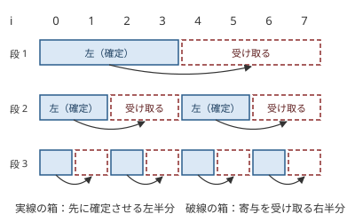

!!! abstract "要点"
    - **何ができるか**：多数の多項式の積を、隣どうし 2 つずつ畳み込む分割統治により $O(N \log^2 N)$ で求める。$\mathrm{dp}[i]$ が $\mathrm{dp}[0], \dots, \mathrm{dp}[i-1]$ と既知の列の畳み込みで決まるときは、左半分を確定させてから右半分へ寄与をまとめて足す分割統治で、同じく $O(N \log^2 N)$ で求める。
    - **いつ使うか**：
        - $\prod_i (1 + a_i x)$ のような多数の 1 次式の積の係数が要る。
        - $\mathrm{dp}[i] = \sum_{j<i} \mathrm{dp}[j] \, g[i-j]$ のように、DP の値が自分より前の値との畳み込みで決まる。
        - 遷移が「和が $s$ になる組の数」の形（多項式の積）になる。
    - **計算量**：$N$ 個の多項式の積は、次数の合計を $D$ として $O((N + D) \log (N + D) \log N)$（1 次式 $N$ 個なら $O(N \log^2 N)$）。長さ $N$ のオンライン畳み込みは $O(N \log^2 N)$。どちらも畳み込みの法の制約（[ACL の convolution の要件](../math/convolution-ntt.md#acl)）に従う。
    - **前提**：[畳み込みの使い方](../math/convolution-ntt.md)

<!-- textlint-disable -->
別名：online convolution・relaxed convolution・多項式の積の分割統治・FFT DP・多項式で DP
<!-- textlint-enable -->

分割統治 FFT は、1 回の畳み込みでは済まない多項式の計算を、分割統治で畳み込みの列に直す手法の総称である。多数の多項式を掛ける「積の分割統治」と、DP の値が決まるそばから次の値への寄与を足していく「オンライン畳み込み」の 2 つがよく使われる。ABC では G・Ex の難しい問題に現れ、どちらも ACL の `convolution` を部品にして自分で書く。

このページで使う記法：列と多項式の係数は 0-indexed で、$[x^k] f$ は多項式 $f$ の $x^k$ の係数を表す（[記法と用語の約束](../start/notation.md#math)）。

## 多数の多項式の積（次数の小さいものから掛ける・分割統治） {#product-of-many}

$N$ 個の 1 次式の積 $f(x) = (1 + a_0 x)(1 + a_1 x) \cdots (1 + a_{N-1} x)$ の係数を、すべて求めたいとする。$[x^k] f$ は「$N$ 個から $k$ 個を選んだ積の和」なので、種類の違うものを $k$ 個選ぶ方法の数などがこの形になる。

左から 1 つずつ掛けると、$i$ 回目に掛ける相手はすでに $i$ 次の多項式で、全体で $O(N^2)$ かかる。積の次数が大きくなってから小さい因子を何度も掛けるのが無駄である。

そこで、因子の列を半分に分け、それぞれの積を再帰で求めてから 2 つを畳み込む。再帰の深さは $\lceil \log_2 N \rceil$ で、同じ深さの多項式の次数を合計すると $N$ になる。1 つの深さの畳み込みは合わせて $O(N \log N)$ なので、全体は $O(N \log^2 N)$ である。各因子の係数が畳み込みに加わる回数は、深さの数の $O(\log N)$ 回で済む。

```cpp
--8<-- "online-convolution/product.cpp:core"
```

完全なプログラム：[`product.cpp`](https://github.com/yuukougun/kyopro-atlas/blob/main/snippets/online-convolution/product.cpp)（GitHub）。`mint` は ACL の `modint998244353`（[modint](../math/modint.md)）。
{ .kp-code-src }

因子の次数がばらばらでも、次数の合計を $D$ とすれば、添字で半分に分けるだけで $O((N + D) \log (N + D) \log N)$ になる（各因子の次数が 1 以上なら $D \ge N$ なので $O(D \log D \log N)$）。次数の小さい 2 つを優先度付きキューで取り出して掛ける書き方（ハフマン符号と同じ順）もよく使われ、同じ計算量で収まる。避けるべきなのは、大きくなった積に小さい因子を 1 つずつ掛ける順だけである。

応用の型（サイン：「種類の違うものを $k$ 個選ぶ」「各要素を使う・使わない」）：要素ごとの選び方を 1 つの多項式で表せるなら、答えはその積の係数になる。[例題の ABC352 G](#abc352_g) は、期待値を確率の和に直すと $\prod (1 + A_i x)$ の係数が要る。

## DP の遷移を多項式の積とみる {#dp-as-polynomial}

数え上げの DP の表 $\mathrm{dp}[0], \mathrm{dp}[1], \dots$ を、多項式 $P(x) = \sum_s \mathrm{dp}[s] x^s$ の係数とみると、「値 $v$ を使う・使わない」の更新は $(1 + x^v)$ を掛けることになる（更新と多項式の操作の対応は[母関数のページ](../comb/generating-function-counting.md#dp-as-polynomial)にまとめてある）。こうみると、DP の高速化は 3 つの形に分かれる。

- **遷移が DP の値によらない**：$N$ 段の遷移がそれぞれ既知の多項式 $g_i$ を掛けるだけなら、答えは $\prod_i g_i$ で、[前の節](#product-of-many)の分割統治で求まる。同じ $g$ を何度も掛けるなら $g^N$ で、繰り返し二乗法や[形式的冪級数](../math/fps-basics.md#operations)の累乗が使える。
- **遷移が線形で、自分より前の値を読む**：$\mathrm{dp}[i] = \sum_{j<i} \mathrm{dp}[j] \, g[i-j]$ は、$P = \mathrm{dp}[0] + P \cdot G$（$G = \sum_{s \ge 1} g[s] x^s$）と書けるので、$P = \mathrm{dp}[0] / (1 - G)$ である。FPS の逆元が使えれば $O(N \log N)$ で求まる。
- **値が決まるたびに変換が入る**：$\mathrm{dp}[i]$ を「寄与の和を $i$ で割る」「頂点ごとの複数の列が絡み合う」のように決めるときは、式を 1 つの割り算に閉じにくい。このときに[オンライン畳み込み](#online)を使う。

どの形でも、まず貰う形の式を書き、右辺が $\sum_{j} (\text{前の値}) \times (\text{差 } i - j \text{ だけで決まる係数})$ になっているかを見る。添字の差だけで係数が決まることが、畳み込みに乗るための条件である。

## オンライン畳み込み（左半分を確定させてから右半分へ寄与を足す） {#online}

$\mathrm{dp}[0] = 1$、$\mathrm{dp}[i] = \sum_{j=0}^{i-1} \mathrm{dp}[j] \, g[i-j]$（$1 \le i \le N$）で、$g$ は先にすべて分かっているとする。右辺は畳み込みの形だが、$\mathrm{dp}$ の値は左から順にしか決まらないので、全体を 1 回で畳み込めない。素朴に貰う DP を書くと $O(N^2)$ である。

**分割統治の手順**。添字の区間 $[l, r)$ を受け持つ関数 solve を、次の性質を保つように呼ぶ：呼ばれた時点で、$[0, l)$ から $[l, r)$ への寄与はすべて $\mathrm{dp}$ に足されている。

1. $r - l = 1$ なら、$\mathrm{dp}[l]$ への寄与はそろっているので確定させて戻る。
2. $m = \lfloor (l + r) / 2 \rfloor$ として、solve$(l, m)$ で左半分を確定させる。
3. 左半分 $\mathrm{dp}[l, m)$ と $g[0, r - l)$ を畳み込み、$k \in [m, r)$ の位置へ $\sum_{j \in [l, m)} \mathrm{dp}[j] \, g[k - j]$ を足す。
4. 右半分は、$[0, l)$ からの寄与（呼ばれる前から足されている）と $[l, m)$ からの寄与（手順 3）がそろったので、solve$(m, r)$ を呼ぶ。



図は $[0, 8)$ を 3 段に分けたときの、左半分（確定させる側）と右半分（寄与を受け取る側）の組である。実際の呼び出しは深さ優先で、段 1 の左半分を solve する中で段 2・段 3 の $[0, 4)$ 側を先に処理する。

**なぜ正しいか**。$j < k$ の組 $(j, k)$ は、$j$ と $k$ を初めて別々の半分に分ける区間がただ 1 つある。その区間で $j$ は左半分、$k$ は右半分に入るので、寄与 $\mathrm{dp}[j] \, g[k-j]$ は手順 3 でちょうど 1 回足される。その時点で $\mathrm{dp}[j]$ は手順 2 で確定している。したがって、$k$ の葉に着いたときには $j < k$ のすべての寄与が 1 回ずつ入っている。

**なぜ速いか**。長さ $L$ の区間の手順 3 は、長さ $L/2$ と $L$ の列の畳み込みで $O(L \log L)$ である。同じ深さの区間の長さの合計は $N + 1$ なので、1 段の計算量は $O(N \log N)$ である。深さは $O(\log N)$ なので、全体は $O(N \log^2 N)$ になる。

```cpp
--8<-- "online-convolution/online.cpp:core"
```

完全なプログラム：[`online.cpp`](https://github.com/yuukougun/kyopro-atlas/blob/main/snippets/online-convolution/online.cpp)（GitHub）。`mint` は ACL の `modint998244353`（[modint](../math/modint.md)）。
{ .kp-code-src }

自作するときの要点と Library Checker での確かめ方は[ライブラリの節](#library)にまとめる。

## ACL の convolution と自作するときの要点 {#library}

!!! info "ACL では"
    `#include <atcoder/convolution>`。`atcoder::convolution(a, b)` が 2 つの列の畳み込みを $998244353$ で割った余りで返す（長さの和を $n$ として $O(n \log n)$）。多数の積やオンライン畳み込みの機能はないので、分割統治はコード片のように自分で書く。片方の長さが 60 以下なら中で素朴な方法に切り替わるので、再帰の末端の小さな畳み込みを何度も呼んでも遅くならない（[ACL の convolution の要件](../math/convolution-ntt.md#acl)）。

オンライン畳み込みを自作するときの要点は次のとおりである（手順の番号は[オンライン畳み込みの節](#online)のもの）。

- 葉（手順 1）は、$\mathrm{dp}[l]$ を確定させる場所である。寄与の和に式を当てる（$i$ で割る、別の値を足すなど）ときはここに書く。確定前の $\mathrm{dp}[k]$ は「届いた寄与の和」の置き場として使い、確定したら値に置き換える。
- 手順 3 で使う $g$ は先頭の $r - l$ 項だけでよい。それより後ろは右半分に届かない。$g[0]$ は $k - j \ge 1$ なので結果に効かない。
- $\mathrm{dp}$ が複数の列で、互いの値を読み合うとき（頂点ごとの $\mathrm{dp}[v][t]$ など）は、手順 3 で遷移の組ごとに畳み込むだけで、骨組みは同じである。
- $g$ 自身も $\mathrm{dp}$ の値で決まるとき（$\mathrm{dp}[i] = \sum_j \mathrm{dp}[j] \, \mathrm{dp}[i-j]$ など）は、手順 3 で $g$ の先頭 $r - l$ 項がまだ決まっていないことがある。区間を 2 の冪にそろえ、$l = 0$ の区間と $l > 0$ の区間で足し方を変える。$l = 0$ の区間では左半分どうしだけを畳み込む。$l > 0$ の区間では $r - l \le l$ なので相手側の項は確定しており、左半分を $\mathrm{dp}$ 側と $g$ 側の両方に使う（同じ畳み込みを 2 倍して足す）。$l = 0$ の区間で足せなかった組は、2 つの添字を入れ替えた形で $l > 0$ の区間に現れるからである。この両側オンライン（relaxed convolution）の形は、[学ぶための資料](#resources)の実装を参考にする。
- 線形の漸化式で $g$ が既知なら、上の[逆元への書き直し](#dp-as-polynomial)のほうが速い。オンライン畳み込みは逆元や exp を自作する前の確かめにも使える。

Library Checker では次の問題で確かめられる。オンライン畳み込みそのものの問題はないので、FPS の問題を漸化式に直して解く。

- [Product of Polynomial Sequence](https://judge.yosupo.jp/problem/product_of_polynomial_sequence)：多数の多項式の積（次数の合計 $5 \times 10^5$ まで）。積の分割統治の確認。
- [Inv of Formal Power Series](https://judge.yosupo.jp/problem/inv_of_formal_power_series)：$f g = 1$ を係数の式 $g_n = -f_0^{-1} \sum_{j=1}^{n} f_j \, g_{n-j}$ に直すと、オンライン畳み込みの形になる。
- [Exp of Formal Power Series](https://judge.yosupo.jp/problem/exp_of_formal_power_series)：$g = \exp f$ は $g' = f' g$ から $n \, g_n = \sum_{k=1}^{n} k f_k \, g_{n-k}$ を満たす。葉で $n$ により割る形の確認になる。

## 学ぶための資料 {#resources}

- [Nyaan「Relaxed Convolution | Nyaan's Library」](https://nyaannyaan.github.io/library/ntt/relaxed-convolution.hpp)：$a_i$ と $b_i$ を 1 項ずつ渡すと $c_i$ を返す、両側オンラインの実装。Library Checker の逆元・exp で確かめられている。
- [けんちょん「AtCoder ABC 213 H - Stroll (4D, 赤色, 600 点)」](https://drken1215.hatenablog.com/entry/2021/08/14/184730)：素朴な DP から、なぜ 1 回の畳み込みでは済まないか、左半分から右半分へ寄与を足す分割統治までを順に説明している。
- [kmjp「AtCoder ABC #213 : H - Stroll」](https://kmjp.hatenablog.jp/entry/2021/08/15/0930)と [kmjp「AtCoder ABC #352 : G - Socks 3」](https://kmjp.hatenablog.jp/entry/2024/05/05/0900)：短い記述と実装で、2 つの使い方（オンライン畳み込みと積の分割統治）をそれぞれ確かめられる。

## 例題 {#examples}

### ABC352 G. Socks 3 {#abc352_g}

<div class="kp-problems" data-role="example" markdown>

- [ABC352 G. Socks 3](https://atcoder.jp/contests/abc352/tasks/abc352_g)（diff 2413）：N 種類の靴下が A_i 枚ずつ袋に入っており、同じ種類の 2 枚がそろうまで 1 枚ずつ取り出すときの、取り出す回数の期待値を 998244353 で割った余りで求める。

</div>

方針：取り出す回数を $T$ として $E[T] = \sum_{k \ge 0} P(T > k)$ に直す（[「〜になるまでの回数」の節](../comb/expectation-tail-sum.md#waiting-time)）。$T > k$ は「最初の $k$ 枚の種類がすべて違う」ことで、その取り出し方の数が $\prod_i (1 + A_i x)$ の $x^k$ の係数になる。$N$ 個の 1 次式の積を[分割統治](#product-of-many)で求める。

??? note "解法の詳細"
    - **確率**：靴下の総数を $S = \sum_i A_i$ とする。最初の $k$ 枚の組（順序を除く）は $\binom{S}{k}$ 通りが同じ確率で出る。種類がすべて違う組は、種類を $k$ 個選んで各種類から 1 枚ずつ選ぶので $[x^k] \prod_i (1 + A_i x)$ 通りある。よって $P(T > k) = [x^k] f \big/ \binom{S}{k}$ である。
    - **和の範囲**：種類は $N$ 個なので、$k > N$ では $P(T > k) = 0$ である。$k = 0$ の項は 1 になる。
    - **二項係数**：$S$ は大きいので階乗の表は作れない。$\binom{S}{k+1} = \binom{S}{k} \cdot \frac{S - k}{k + 1}$ で $k$ を 1 つずつ進める。
    - **計算量**：積の分割統治が $O(N \log^2 N)$、残りは逆元の計算を含めて $O(N \log p)$ である。

### ABC213 H. Stroll {#abc213_h}

<div class="kp-problems" data-role="example" markdown>

- [ABC213 H. Stroll](https://atcoder.jp/contests/abc213/tasks/abc213_h)（diff 2806）：各道について通る長さごとの通り方の数が与えられるとき、町 1 から出て合計の長さがちょうど T で町 1 に戻る散歩の数を求める。

</div>

方針：$\mathrm{dp}[v][t]$ を「町 1 から出て、合計の長さ $t$ で町 $v$ にいる方法の数」とする。最後に通った道とその長さで分けると、$\mathrm{dp}[v][t]$ は道の両端の町の $\mathrm{dp}[u][t - s]$ と、その道の長さ $s$ の通り方の数との畳み込みの和になる。長さ $t$ の値は $t$ より短い値で決まるので、[オンライン畳み込み](#online)で時間の軸を分割統治する。

??? note "解法の詳細"
    - **漸化式**：道 $e$ の長さ $s$ の通り方の数を $p_e[s]$（$s \ge 1$）とする。$\mathrm{dp}[v][t] = \sum_{e = (u, v)} \sum_{s=1}^{t} \mathrm{dp}[u][t-s] \, p_e[s]$、$\mathrm{dp}[1][0] = 1$ で、答えは $\mathrm{dp}[1][T]$ である。道は両向きに使えるので、有向の辺 2 本として扱う。
    - **素朴な計算量**：辺ごとに $O(T^2)$ で、全体 $O(M T^2)$ になり、$T$ が $4 \times 10^4$ までなので間に合わない。
    - **分割統治**：時間の区間 $[l, r)$ で、左半分を確定させた後、各有向辺 $u \to v$ について $\mathrm{dp}[u][l, m)$ と $p_e[0, r - l)$ を畳み込み、$[m, r)$ に落ちる分を $\mathrm{dp}[v]$ に足す。$p_e[0] = 0$ とみれば、[コード片](#online)の手順 3 を辺ごとに繰り返せばよい。
    - **計算量**：1 段で辺ごとに $O(T \log T)$、深さ $O(\log T)$ で、全体 $O(M T \log^2 T)$ である。

## 練習問題 {#practice}

<div class="kp-problems" data-role="practice" markdown>

- [ABC281 Ex. Alchemy](https://atcoder.jp/contests/abc281/tasks/abc281_h)（diff 3180）：レベル 1 の宝石が A 種類あり、種類の違う宝石を合成して上のレベルの宝石を作れるとき、作れるレベル N の宝石の種類数を求める。

</div>

??? note "練習の方針"
    - **ABC281 Ex**：レベルごとに「使うか・何を使うか」を 1 次式（レベル 1 だけは二項係数の多項式）で表すと、レベル $n$ の種類数は、レベル $n$ 未満の因子の積の係数になる。積の因子が前のレベルの答えで決まるので、積の分割統治をそのままは使えない。公式の解説はオンラインの分割統治 FFT で、参考の記事では、直近の因子を小さな多項式にためておき、一定の個数ごとにまとめて畳み込む平方分割で解いている。

## 確認問題 {#quiz}

??? question "確認問題：オンライン畳み込みで、左半分より先に右半分を solve するとどうなるか？"
    右半分の値を確定させる時点で、左半分からの寄与がまだ足されていないので、誤った値で確定する。さらに、その誤った値が右半分の中の後ろの位置へ寄与として運ばれる。左半分を先に確定させる順が、正しさの根拠の「$k$ の葉に着いたときに $j < k$ の寄与がそろっている」を支えている。

??? question "確認問題：$N$ 個の 1 次式の積を、左から 1 つずつ ACL の convolution で掛けると、計算量はどうなるか？"
    $i$ 回目は $i$ 次の多項式と 1 次式の畳み込みで、片方の長さが 60 以下なので ACL の中で素朴な方法になり $O(i)$ かかる。合計は $O(N^2)$ で、$N = 2 \times 10^5$ なら $4 \times 10^{10}$ 回ほどになり間に合わない。分割統治にすると、同じ長さどうしを掛けるので FFT の速さが効く。

## 参考 {#references}

- [けんちょん「AtCoder ABC 213 H - Stroll (4D, 赤色, 600 点)」](https://drken1215.hatenablog.com/entry/2021/08/14/184730)：例題の漸化式と、左半分から右半分へ寄与を足す分割統治の流れ・計算量
- [kmjp「AtCoder ABC #213 : H - Stroll」](https://kmjp.hatenablog.jp/entry/2021/08/15/0930)：例題の時間の軸の分割統治と NTT の方針
- [drken「AtCoder ABC 352 G - Socks 3 (3D, 橙色, 600 点)」](https://drken1215.hatenablog.com/entry/2024/05/05/023117)：例題の、期待値を確率の和に直して 1 次式の積を分割統治で掛ける方針
- [kmjp「AtCoder ABC #352 : G - Socks 3」](https://kmjp.hatenablog.jp/entry/2024/05/05/0900)：例題の方針。多項式をキューに入れて 2 つずつ掛ける書き方
- [けんちょん「AtCoder ABC 281 Ex - Alchemy (赤色, 600 点)」](https://drken1215.hatenablog.com/entry/2023/01/07/162412)：練習の方針。因子が前の答えで決まる積と、平方分割による解き方
- [Nyaan「Relaxed Convolution | Nyaan's Library」](https://nyaannyaan.github.io/library/ntt/relaxed-convolution.hpp)：学ぶための資料。両側オンラインの畳み込みの使い方と、Library Checker での確かめ
- [yosupo「Library Checker の問題（polynomial）」](https://github.com/yosupo06/library-checker-problems/tree/master/polynomial)：Product of Polynomial Sequence・Inv・Exp の定義と制約
- [AtCoder「AC Library のドキュメント（document_ja）」](https://github.com/atcoder/ac-library/tree/master/document_ja)：ACL の囲みの convolution の宣言と計算量
