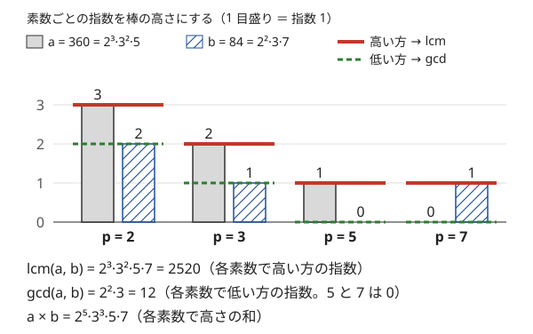

!!! abstract "要点"
    - **何ができるか**：整数を、素数ごとの指数を並べたベクトルとして扱い、素数ごとに独立に考える。積は指数の和、gcd は最小、lcm は最大、割り切れるかは全成分の大小で決まり、平方数は全成分が偶数になる。積が平方数になる組・巨大な lcm・割り切れる回数の問題が、指数の比較や数え上げに変わる。
    - **いつ使うか**：
        - 積が平方数（立方数）になる組を数える。
        - 多数の数の lcm を mod で求める。
        - 2 で割り切れる回数・各素数の指数をそろえる。
        - 素因数が P 以下の数（P-smooth 数）を数える。
    - **計算量**：1 個の数 $A$ の指数（と平方因子を除いた核）は試し割りで $O(\sqrt{A})$。値の上限 $M$ まで最小素因数の篩を作れば、前計算 $O(M \log \log M)$ の後は 1 個 $O(\log A)$。
    - **前提**：[素因数分解とルジャンドルの公式](../math/prime-factorization.md)

<!-- textlint-disable -->
別名：指数ベクトル・平方因子・squarefree・smooth 数・平方数の判定・素数ごとに独立
<!-- textlint-enable -->

素因数の指数で考えるとは、$n = 2^{e_2} 3^{e_3} 5^{e_5} \cdots$ を指数の列 $(e_2, e_3, e_5, \dots)$ とみなし、掛け算・gcd・lcm・割り切りを指数の足し算や大小比較に置き換えることである。素数どうしは互いに影響しないので、問題を素数ごとに分けて考えられる。素因数分解のやり方そのものは[素因数分解とルジャンドルの公式](../math/prime-factorization.md)に任せ、ここでは分解した後の指数の使い方を扱う。

このページで使う記法：$v_p(n)$ は正の整数 $n$ を素因数分解したときの素数 $p$ の指数（$p$ で割り切れる回数）、$a \mid b$ は $a$ が $b$ を割り切ること（[記法と用語の約束](../start/notation.md)）。

## 積は和・gcd は min・lcm は max・割り切りは全成分で ≤（算術の基本定理） {#exponent-ops}

正の整数の素因数分解はただ 1 通りに決まる（算術の基本定理）。だから正の整数 $n$ と、すべての素数 $p$ についての指数 $v_p(n)$ の列は 1 対 1 に対応し、整数の性質を指数の言葉で言い換えられる。正の整数 $a, b$ とすべての素数 $p$ について次が成り立つ。

| 整数の言葉 | 指数の言葉 |
| --- | --- |
| $ab$ | $v_p(a) + v_p(b)$ |
| $\gcd(a, b)$ | $\min(v_p(a), v_p(b))$ |
| $\operatorname{lcm}(a, b)$ | $\max(v_p(a), v_p(b))$ |
| $a \mid b$ | すべての $p$ で $v_p(a) \le v_p(b)$ |
| $a$ が平方数 | すべての $p$ で $v_p(a)$ が偶数 |
| $a$ が $k$ 乗数 | すべての $p$ で $v_p(a)$ が $k$ の倍数 |

次の図は $a = 360$ と $b = 84$ の指数を素数ごとの棒で描いたものである。各素数で高い方を取ると lcm、低い方を取ると gcd、高さを足すと積になる。



$\min + \max$ は 2 数の和に等しいので、表から $\gcd(a, b) \times \operatorname{lcm}(a, b) = ab$ がすぐに分かる。図の例でも $12 \times 2520 = 30240 = 360 \times 84$ である。3 つ以上の数の gcd・lcm も、素数ごとの最小・最大を取ればよい。

この言い換えの強みは、条件が素数ごとに分かれることである。「$a \mid b$ か」は素数ごとの比較の「かつ」になり、「積が $M$ になる数列の数」は素数ごとに指数を分ける方法の数の積になる（[素因数分解とルジャンドルの公式](../math/prime-factorization.md)）。約数の個数 $\prod (e_p + 1)$ も、各素数の指数を $0$ から $e_p$ まで独立に選ぶことから出る。

??? question "確認問題：約数の平方数"
    $N = 2^4 \cdot 3^3 \cdot 5$ の約数のうち、平方数はいくつあるか。

    ??? success "答え"
        約数の指数は各素数で $0$ 以上 $v_p(N)$ 以下で、平方数なら各指数が偶数である。2 の指数は 0・2・4 の 3 通り、3 の指数は 0・2 の 2 通り、5 の指数は 0 の 1 通りなので、$3 \times 2 \times 1 = 6$ 個である。

## 平方因子を除いた核で、積が平方数になる組を数える（0 の扱い） {#squarefree-kernel}

正の整数 $n$ から平方数の因子をできるだけ取り除いた残りを、ここでは $n$ の核と呼んで $\mathrm{core}(n)$ で表す。指数の言葉では、$v_p(n)$ が奇数の素数 $p$ だけを掛けたものである。たとえば $72 = 2^3 \cdot 3^2$ の核は $2$、$360 = 2^3 \cdot 3^2 \cdot 5$ の核は $10$ である。核は平方数の因子を持たない（[squarefree](../guide/glossary.md#squarefree)）。

正の整数 $a, b$ について、次が成り立つ。

$$
ab \text{ が平方数} \iff \mathrm{core}(a) = \mathrm{core}(b)
$$

理由は指数の偶奇だけを見ればよいことにある。$v_p(ab) = v_p(a) + v_p(b)$ が偶数になるのは、$v_p(a)$ と $v_p(b)$ の偶奇が等しいときである。これがすべての素数で成り立つことは、奇数の指数をもつ素数の集合が $a$ と $b$ で一致すること、すなわち核が等しいことと同じである。たとえば $18 = 2 \cdot 3^2$ と $50 = 2 \cdot 5^2$ はどちらも核が $2$ で、積 $900 = 30^2$ は平方数である。

これで「積が平方数になる組を数える」問題は、「核が等しい組を数える」問題になる。

1. 各要素の核を求める。試し割りで素因数分解し、指数が奇数の素数を掛ける。最後に 1 より大きい数が残れば、それは指数 1 の素数なので掛ける
2. 核ごとに個数を数える（`map` か、値の上限までの配列）
3. 個数 $c$ の核から $\binom{c}{2}$ 組ずつ足す

```cpp
--8<-- "prime-exponent-vector/square-pairs.cpp:core"
```

**0 の扱い**。0 は素因数分解できないので核がない。一方、0 と何を掛けても 0 で、0 は平方数（$0 = 0^2$）である。0 の個数を $z$ とすると、0 を含む組は $z(N - z) + \binom{z}{2}$ 組あり、これは核の数え上げとは別に足す。0 に核として 0 や 1 を割り当てると、0 でない数との組を数え損ねたり、平方数との組だけを数えたりして誤る。

**相手の形が決まる**。$a$ を固定すると、$ab$ が平方数になる $b$ はちょうど $b = \mathrm{core}(a) \cdot r^2$（$r \ge 1$ の整数）の形の数である。だから「$1 \le b \le N$ で $ab$ が平方数になる $b$ の個数」は $\lfloor \sqrt{N / \mathrm{core}(a)} \rfloor$ で求まる。平方根は浮動小数点の誤差に注意する（[整数の平方根・K 乗根](../math/integer-root.md)）。

**立方数に広げる**。積が立方数になる条件は、すべての素数で指数の和が 3 の倍数になることである。指数を 3 で割った余りに直したものを正規形とする。$a$ に掛けると立方数になる数の正規形は、$a$ の各指数 $e$ を $(3 - e) \bmod 3$ に置き換えたもの 1 つだけである。平方数では相手の核は自分の核と同じだが、立方数では自分と相手の正規形は一般に異なる。

??? question "確認問題：核が等しいことの必要性"
    正の整数 $a, b$ の積が平方数なのに、$\mathrm{core}(a) \ne \mathrm{core}(b)$ となることはあるか。

    ??? success "答え"
        ない。$\mathrm{core}(a) \ne \mathrm{core}(b)$ なら、片方だけで指数が奇数の素数 $p$ がある。その $p$ について $v_p(a) + v_p(b)$ は奇数 + 偶数で奇数になり、$ab$ は平方数でない。

## 巨大な lcm を指数の最大で持つ {#huge-lcm}

この節は [mod の計算の基本](../math/mod-arithmetic.md)と[逆元](../math/mod-inverse.md)を前提にする。多数の数の lcm は、互いに素な数が多いと急に大きくなる。$10^6$ 以下の数が $10^4$ 個あれば、lcm は数万桁になりうるので、`long long` でも多倍長でも直接は持てない。

lcm を指数の列で持てば、大きさの問題が消える。各要素を素因数分解し、素数 $p$ ごとに指数の最大 $\max_i v_p(A_i)$ を `map` で更新する。最後に $\prod_p p^{\max_i v_p(A_i)}$ を mod を取りながら掛ければ、lcm を法 $m$ で割った余りが求まる。

```cpp
--8<-- "prime-exponent-vector/lcm-mod.cpp:core"
```

lcm $L$ を使って $L / A_i$ を求めたいときは、2 つの方法がある。法が素数で $A_i$ がその倍数でなければ、$L \bmod m$ に $A_i$ の逆元を掛ければよい。逆元を使わないなら、指数の列から $v_p(A_i)$ を引いた列を作って掛け直す。こちらは法が素数でなくても使える。

lcm を 2 数ずつ $\operatorname{lcm}(x, y) = x / \gcd(x, y) \times y$ で求める方法（[GCD・LCM とユークリッドの互除法](../math/gcd-lcm.md)）は、値が収まる範囲でだけ使える。途中で mod を取ると gcd が正しく求まらなくなるので、mod を取るなら指数の最大で持つ方法に切り替える。

## 特定の素数（2 など）の指数だけを比べる {#single-prime}

この節は[割り切りの言い換え](#exponent-ops)を前提にする。条件が 1 つの素数だけに関わるときは、全部を素因数分解せず、その素数の指数 $v_p$ だけを取り出して比べればよい。$v_2(n)$ は「2 で割り切れる回数」で、`__builtin_ctzll(n)`（$n \ne 0$）でも求まる。

**奇数倍の条件は $v_2$ の一致に変わる**。$x$ が $a$ の奇数倍であることは、$a \mid x$ かつ $v_2(x) = v_2(a)$ と同じである。だから「$x$ が $a_1, \dots, a_N$ のどれの奇数倍でもある」ような $x$ があるには、$v_2(a_i)$ がすべて等しいことが必要である。等しければ、そのような $x$ は $L = \operatorname{lcm}(a_1, \dots, a_N)$ の奇数倍とちょうど一致し、$M$ 以下の個数は $\lfloor (\lfloor M / L \rfloor + 1) / 2 \rfloor$ になる。

**末尾の 0 は $v_2$ と $v_5$ の小さい方**。10 進の末尾に並ぶ 0 の個数は、$n$ が $10 = 2 \cdot 5$ で割り切れる回数なので $\min(v_2(n), v_5(n))$ である。階乗では 2 の指数の方が大きいので、5 の指数だけを数えれば済む（階乗の指数は[ルジャンドルの公式](../math/prime-factorization.md)で求める）。

**指数をそろえる操作**。「2 で割る」「3 倍する」などの操作で数を等しくする問題では、操作が動かすのは特定の素数の指数だけである。操作で変わらない部分（その素数を除いた残り）が全要素で等しくなければ不可能と分かり、等しければ指数の差の合計が操作回数になる。

??? question "確認問題：奇数倍の存在"
    $x$ が 6 の奇数倍であり、かつ 4 の奇数倍でもあるような正の整数 $x$ はあるか。

    ??? success "答え"
        ない。6 の奇数倍なら $v_2(x) = v_2(6) = 1$、4 の奇数倍なら $v_2(x) = v_2(4) = 2$ で、両立しない。

## 落とし穴 {#pitfalls}

**試し割りの後に残った素数を忘れる**。$p^2 \le x$ の範囲で割った後に $x > 1$ が残れば、それは $\sqrt{x}$ より大きい素数で、指数は 1 である。核や lcm の計算でこれを落とすと、$14 = 2 \cdot 7$ の核が 2 になるなど、大きな素因数がすべて消える。

**素因数分解が間に合わない**。試し割りは 1 個 $O(\sqrt{A})$ なので、$A \le 2 \times 10^5$ で $N = 2 \times 10^5$ 個なら約 $9 \times 10^7$ 回で間に合う。$A \le 10^9$ で同じ $N$ だと $10^{10}$ 回近くになり間に合わない。値の上限が $10^7$ 程度までなら[最小素因数の篩](../math/spf-sieve.md)を作り、1 個 $O(\log A)$ で分解する。

**lcm や積をそのまま掛けてあふれる**。lcm は要素が増えるほど大きくなり、$10^{18}$ をすぐ超える。値そのものが要るなら上限を超えた時点で打ち切り、余りだけでよいなら指数の最大で持つ。

**mod を取った lcm を比べる**。lcm を法 $m$ で割った余りは、lcm の大小を表さない。「lcm が $M$ 以下か」のような比較は、余りではなく、上限で打ち切った本当の値で行う（[mod の計算の基本](../math/mod-arithmetic.md#no-compare)）。

**組の数え方の取り違え**。$i < j$ の組か、順序付きの組 $(i, j)$ か、$i = j$ を含むかで答えが変わる。核ごとの個数 $c$ から、$i < j$ なら $\binom{c}{2}$、$i = j$ を含む順序付きなら $c^2$ を足す。

## XOR 基底・集合のハッシュ・半分全列挙へのつながり {#next-steps}

指数の列を偶奇だけ残すと、各数は「奇数の指数をもつ素数の集合」になる。積は集合の対称差（偶奇の足し算）に対応するので、上位の手法につながる。

- **いくつかを選んで積を平方数にする**：偶奇の列を 0 と 1 のベクトルとみると、積が平方数になる選び方は、ベクトルの XOR が 0 になる選び方である。ベクトルの階数を $r$ とすると、そのような空でない選び方は $2^{N - r} - 1$ 通りある（[XOR 基底](../math/xor-basis.md)・[掃き出し法](../math/gaussian-elimination.md)）
- **核を速く比べる**：素数ごとに 64bit の乱数を割り当て、奇数の指数をもつ素数の乱数を XOR すれば、核を 1 つの整数で比べられる。区間の積が平方数かを何度も判定するときに、接頭辞の XOR と組み合わせる（[集合のハッシュ](../string/hashing-for-sets.md)）
- **素因数が限られる数を列挙する**：素因数が $P$ 以下の数（$P$-smooth 数）や桁の積（$2^a 3^b 5^c 7^d$ の形）は、上限が大きくても数が少ないことが多いので、指数を全通り回して列挙できる。数が多すぎるときは、素数を 2 組に分けてそれぞれ列挙し、積が上限以下の組を数える（[半分全列挙](../basics/meet-in-the-middle.md)）

## 例題 {#examples}

### ABC342 D. Square Pair {#abc342_d}

<div class="kp-problems" data-role="example" markdown>

- [ABC342 D. Square Pair](https://atcoder.jp/contests/abc342/tasks/abc342_d)（diff 944）：長さ N の非負整数列から i < j を選んだとき、A_i × A_j が平方数になる組の個数を求める。

</div>

$A_i \le 2 \times 10^5$ と小さいので、各要素の核を試し割りで求め、核が等しい組を数える。0 は何と掛けても平方数になるので、0 を含む組は別に数えて足す。

??? note "解法の詳細"
    - 0 でない各要素の核を試し割りで求め、核ごとの個数 $c$ を数える。核が等しい組として $\binom{c}{2}$ を足す。
    - 0 の個数を $z$ として、0 を含む組 $z(N - z) + \binom{z}{2}$ を足す。
    - 計算量は値の上限を $M$ として $O(N(\sqrt{M} + \log N))$。コードは[核の節](#squarefree-kernel)のものと同じ形である。

## 練習問題 {#practice}

<div class="kp-problems" data-role="practice" markdown>

- [ABC254 D. Together Square](https://atcoder.jp/contests/abc254/tasks/abc254_d)（diff 1191）：1 ≤ i, j ≤ N で i × j が平方数になる組の個数を求める（N ≤ 2×10^5）。
- [ABC152 E. Flatten](https://atcoder.jp/contests/abc152/tasks/abc152_e)（diff 1348）：A_1 B_1 = A_2 B_2 = … = A_N B_N を満たす正の整数 B_i を選ぶとき、B_1 + … + B_N の最小値を 10^9+7 で割った余りで求める。
- [ABC150 D. Semi Common Multiple](https://atcoder.jp/contests/abc150/tasks/abc150_d)（diff 1534）：偶数の列 a について、すべての k で X = a_k × (p + 0.5) を満たす非負整数 p があるような X（半公倍数）のうち、M 以下の正の整数の個数を求める。

</div>

??? note "練習の方針"
    - **ABC254 D**：$i$ を固定すると、$j$ は $\mathrm{core}(i) \cdot r^2$ の形に限られる。$\lfloor \sqrt{N / \mathrm{core}(i)} \rfloor$ を $i = 1, \dots, N$ について足す。核は試し割りでも最小素因数の篩でも求まる
    - **ABC152 E**：共通の積は $\operatorname{lcm}(A_1, \dots, A_N)$ にするのが最小で、$B_i = L / A_i$ になる。$L$ は巨大なので、素数ごとの指数の最大で持って mod で組み立て、$L / A_i$ は逆元で求める
    - **ABC150 D**：$X$ は $a_k / 2$ の奇数倍である。$v_2(a_k / 2)$ がすべて等しくなければ 0、等しければ $L = \operatorname{lcm}(a_k / 2)$ の奇数倍のうち $M$ 以下のものを数える。$L$ が $M$ を超えた時点で打ち切る

## 力試し {#challenge}

<div class="kp-problems" data-role="challenge" markdown>

- [典型90 025. Digit Product Equation（★7）](https://atcoder.jp/contests/typical90/tasks/typical90_y)（diff —）：1 以上 N 以下の整数 m で、m − f(m) = B（f(m) は m の各桁の積）となるものの個数を求める（N ≤ 10^11）。
- [ABC300 G. P-smooth number](https://atcoder.jp/contests/abc300/tasks/abc300_g)（diff 2343）：素因数がすべて P 以下である N 以下の正の整数の個数を求める（N ≤ 10^16、P ≤ 100）。
- [AGC003 D. Anticube](https://atcoder.jp/contests/agc003/tasks/agc003_d)（diff 2608）：N 個の整数から、どの 2 つを選んでも積が立方数にならないように選べる最大の個数を求める。

</div>

??? note "力試しの方針"
    - **典型90 025**：0 を含む桁があれば $f(m) = 0$ なので $m = B$ だけを調べる。そうでなければ $f(m)$ は $2^a 3^b 5^c 7^d$ の形で、$10^{11}$ 以下でも約 1 万個しかない。各候補 $f$ について $m = f + B$ を作り、$m \le N$ かつ $m$ の桁の積が $f$ に等しいかを確かめる（桁の多重集合を列挙しても同じ候補が得られる）
    - **ABC300 G**：$P$-smooth 数を全部列挙すると多すぎる。100 以下の素数を 2 組に分け、それぞれの組の素数だけでできる $N$ 以下の数を列挙してソートし、積が $N$ 以下になる組を尺取りか二分探索で数える
    - **AGC003 D**：各数を指数 mod 3 の正規形に直すと、積が立方数になる相手の正規形はただ 1 つに決まる。正規形と相手の正規形の組ごとに、個数の多い方を選ぶ（正規形が 1、つまり立方数どうしからは 1 個だけ）。$s_i \le 10^{10}$ なので、$\sqrt[3]{10^{10}}$ 程度までの素数で割った後の残りが $1$・$p$・$p^2$・$pq$ のどれかで場合を分ける

## 参考 {#references}

- [drken「AtCoder ABC 342 D - Square Pair (1Q, 緑色, 400 点)」](https://drken1215.hatenablog.com/entry/2024/11/23/160056)：例題の方針（核が等しい組と 0 の扱い）
- [drken「AtCoder ABC 254 D - Together Square (1Q, 緑色, 400 点)」](https://drken1215.hatenablog.com/entry/2023/05/17/024900)：相手が核 × 平方数の形に決まること
- [drken「AtCoder ABC 152 E - Flatten (1Q, 水色, 500 点)」](https://drken1215.hatenablog.com/entry/2020/01/22/071000)：巨大な lcm を指数の最大で持つ方法と逆元
- [drken「AtCoder ABC 150 D - Semi Common Multiple (1D, 水色, 400 点)」](https://drken1215.hatenablog.com/entry/2020/01/12/135000)：2 の指数がそろう条件と奇数倍の数え方
- [E869120「kyopro_educational_90 sol/025.cpp」](https://github.com/E869120/kyopro_educational_90/blob/main/sol/025.cpp)：力試しの方針（桁の積の候補の列挙と 0 の場合分け）
- [drken「AtCoder ABC 300 G - P-smooth number (3D, 黄色, 600 点)」](https://drken1215.hatenablog.com/entry/2023/05/02/234200)：力試しの方針（素数を 2 組に分けた列挙）
- [drken「AtCoder AGC 003 D - Anticube (橙色, 1100 点)」](https://drken1215.hatenablog.com/entry/2018/09/29/011000)：力試しの方針（立方因子を除いた正規形と大きな素因数の場合分け）
