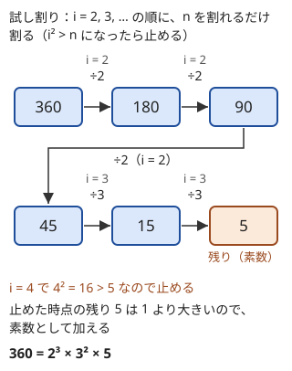

!!! abstract "要点"
    - **何ができるか**：$N$ を $2, 3, 4, \dots$ で割れるだけ割り、$i^2 > N$ になった時点の残りが 1 より大きければそれも素数として、$N = \prod p^{e_p}$ を $O(\sqrt{N})$ で求める。$N!$ の素因数 $p$ の指数は、ルジャンドルの公式 $\sum_k \lfloor N / p^k \rfloor$ で $N!$ を作らずに求める。
    - **いつ使うか**：
        - 素数ごとに独立に考えられる（積・割り切れる回数）。
        - $N!$ の末尾の 0 の個数、$N!$ が $K$ の倍数になる最小の $N$ を問われる。
        - 積が $M$ になる数列の数を問われる。
        - $N \le 10^{12}$ 程度の数を 1 つだけ素因数分解する。
    - **計算量**：1 個の素因数分解は $O(\sqrt{N})$（$N = 10^{12}$ で $10^6$ 回程度）。ルジャンドルの公式は素数 1 つあたり $O(\log_p N)$
    - **前提**：[約数列挙と素数判定](../math/divisor-enum.md)

<!-- textlint-disable -->
別名：prime factorization・Legendre's formula・階乗の素因数・末尾の 0 の個数・v_p(n!)
<!-- textlint-enable -->

素因数分解は、整数を素数の累乗の積 $N = p_1^{e_1} p_2^{e_2} \cdots$ に直すことである。分解は（素数の順を除いて）1 通りに決まるので、積・約数・最大公約数の問題を「素数ごとの指数」の問題に置き換えられる。階乗 $N!$ は大きすぎて作れないが、素数ごとの指数ならルジャンドルの公式で直接求まる。

このページでは、分解する数を $N$、素数を $p$、$N$ を割り切る $p$ の最大の指数を $v_p(N)$ と書く（$N = 360 = 2^3 \cdot 3^2 \cdot 5$ なら $v_2(N) = 3$）。記法は[記法と用語の約束](../start/notation.md)に従う。

## 割れるだけ割る手順と、残った数が素数である理由 {#procedure}

試し割りによる素因数分解は、$i = 2, 3, 4, \dots$ の順に、$N$ を $i$ で割れるだけ割り、割れた回数を $i$ の指数として記録する方法である。ループは「$i^2 \le$ 今の $N$」の間だけ回し、終わった時点で残りが 1 より大きければ、それを指数 1 の素因数として加える。次の図は $N = 360$ の場合である。



この手順が正しい理由は 2 つある。

- **見つかる $i$ は必ず素数**：$i$ が合成数なら、$i$ より小さい素因数 $q$ をもつ。$q$ ではすでに割れるだけ割ったので、今の $N$ は $q$ で割り切れず、$q$ の倍数の $i$ でも割り切れない。だから $N$ を割り切る $i$ は素数に限られ、合成数の $i$ は空振りするだけで害がない
- **残りが 1 より大きければ素数**：ループを抜けた時点で、今の $N$ は $i$ 未満の素因数をもたず、しかも $i^2 > N$ である。$N$ が合成数なら $\sqrt{N}$ 以下の素因数をもつはずだが、$\sqrt{N} < i$ なのでそれはない。よって残りは素数 $r$ そのものである。それまでに割ったのは $r$ 未満の素数だけなので、$r$ の指数は 1 になる

```cpp
--8<-- "prime-factorization/factorize.cpp:core"
```

完全なプログラム：[`factorize.cpp`](https://github.com/yuukougun/kyopro-atlas/blob/main/snippets/prime-factorization/factorize.cpp)（GitHub）
{ .kp-code-src }

ループの条件に今の $N$ を使うので、割るたびに上限が下がる。最悪は $N$ が素数か、$\sqrt{N}$ に近い 2 つの素数の積のときで、$i$ は $\sqrt{N}$ 付近まで進む。それでも $O(\sqrt{N})$ で、$N = 10^{12}$ なら $10^6$ 回程度で済む。$N = 1$ ならループに入らず、空の分解（素因数なし）を返す。

??? question "確認問題：残る素因数はいくつまでか"
    ループを抜けた後に残る「1 より大きい数」が、2 つの素数の積（たとえば $999983 \times 1000003$）になることはあるか。

    ??? success "答え"
        ない。ループの条件 $i^2 \le N$ は今の $N$ で判定する。$N = 999983 \times 1000003$ なら、$i = 999983$ の時点ではまだ $i^2 \le N$ なので、そこで割れて残りは $1000003$ になる。直後の $i = 999984$ で $i^2 > 1000003$ となってループを抜け、残りの $1000003$ を素数として加える。一般に、抜けた時点の残りは $i$ 未満の素因数をもたず、$i^2$ より小さいので、素数 1 つか 1 である。

## 素因数ごとに独立に考える（指数の組合せ） {#per-prime}

素因数分解が役に立つのは、問題が素数ごとに独立に分かれるときである。$a \mid b$ は「すべての $p$ で $v_p(a) \le v_p(b)$」と同じで、$ab$ の $p$ の指数は $v_p(a) + v_p(b)$ である。だから積や割り切りの条件は、素数ごとの指数の条件に分かれる。素数ごとに答えを求め、全体は和か積でまとめる。指数の和・最小・最大で gcd・lcm を扱う考え方は[素因数の指数で考える](../math/prime-exponent-vector.md)にまとめる。

よく出る型は次のとおりである。

- **素数ごとの答えの和**：「$p^e$ の形の数で割る操作を何回できるか」なら、$p$ ごとに指数を $1, 2, 3, \dots$ と小さい順に使うのが最善である。$1 + 2 + \dots + k \le v_p(N)$ となる最大の $k$ を足し合わせる（[例題](#abc169_d)）
- **素数ごとの選び方の積**：$N$ の約数の個数は、$p$ ごとに指数を $0$ から $v_p(N)$ まで選ぶので $\prod_p (v_p(N) + 1)$ になる（[約数列挙と素数判定](../math/divisor-enum.md)）。約数の個数が決まった数を数えるなら、$(e_p + 1)$ の積がその値になる指数の組を数える
- **指数を配る**：積が $M$ になる長さ $N$ の数列は、$p$ ごとに指数 $v_p(M)$ を $N$ 個へ配る方法の積になる（[重複組合せ](../comb/stars-and-bars.md#applications)）
- **素因数の種類数**：どの 2 つも互いに素になるように選ぶ問題は、1 以外は 1 つ選ぶごとに素因数を少なくとも 1 種類使い切ると見ると、選べる個数は素因数の種類数（1 を含めれば + 1）で上から抑えられる

指数と種類数は小さい。$N \le 10^{12}$ なら $v_p(N) \le 39$（$2^{40} > 10^{12}$）で、異なる素因数は 11 種類以下である（[約数の個数の上界](../math/divisor-count-bound.md)）。素数ごとの処理は、指数を 1 ずつ動かす素朴なループで足りることが多い。

??? question "確認問題：約数の個数が奇数"
    $N$ の約数の個数が奇数になるのは、$N$ がどんな数のときか。素因数分解を使って答えよ。

    ??? success "答え"
        約数の個数は $\prod_p (v_p(N) + 1)$ なので、奇数になるのはすべての $v_p(N)$ が偶数のとき、すなわち $N$ が平方数のときである。

## N! の素因数分解とルジャンドルの公式 {#legendre}

$N!$ は $N = 21$ で `long long` を超えるので、掛けてから分解できない。代わりに素数 $p$ ごとの指数を直接求める。ルジャンドルの公式は次の式である。

$$
v_p(N!) = \sum_{k \ge 1} \left\lfloor \frac{N}{p^k} \right\rfloor = \left\lfloor \frac{N}{p} \right\rfloor + \left\lfloor \frac{N}{p^2} \right\rfloor + \cdots
$$

**なぜ成り立つか**。$v_p(N!) = \sum_{m=1}^{N} v_p(m)$ である。$v_p(m) = j$ の数 $m$ は、$p, p^2, \dots, p^j$ の倍数として 1 回ずつ、合わせて $j$ 回数えられる。$1$ から $N$ に $p^k$ の倍数は $\lfloor N / p^k \rfloor$ 個あるので、$k$ について足せば $v_p(N!)$ になる。$p^k > N$ になると項は 0 なので、和は有限である。

たとえば $100!$ の 5 の指数は $\lfloor 100/5 \rfloor + \lfloor 100/25 \rfloor = 20 + 4 = 24$ である。25・50・75・100 は 5 を 2 つずつ含み、2 項目でその 2 つ目を数えている。

実装では $p^k$ を作らず、$N$ を $p$ で割りながら足す。$\lfloor \lfloor N / p \rfloor / p \rfloor = \lfloor N / p^2 \rfloor$ なので値は同じで、$p^k$ のオーバーフローが起きない。

```cpp
--8<-- "prime-factorization/legendre.cpp:core"
```

完全なプログラム：[`legendre.cpp`](https://github.com/yuukougun/kyopro-atlas/blob/main/snippets/prime-factorization/legendre.cpp)（GitHub）
{ .kp-code-src }

公式の使い方には次の型がある。

- **末尾の 0 の個数**：10 進の末尾の 0 は $10 = 2 \times 5$ の個数で、$\min(v_2, v_5)$ になる。$N!$ では 2 の方が多いので $v_5(N!)$ だけを数えればよい。二重階乗のように掛ける数が偏るときは、2 と 5 の両方を確かめる
- **$N!$ が $K$ の倍数になる最小の $N$**：$K = \prod p^{e_p}$ と分解し、各 $p$ で $v_p(N!) \ge e_p$ となる最小の $N$ を求め、その最大を答える。$v_p(N!)$ は $N$ について単調増加なので[答えで二分探索](../basics/binary-search-answer.md)できる。$v_p$ が増えるのは $N$ が $p$ の倍数のときだけなので、$N = p, 2p, 3p, \dots$ と順に試してもよく、$N = p \cdot e_p$ までに必ず止まる
- **$N!$ の約数の個数**：$N$ 以下の素数（[エラトステネスの篩](../math/sieve-eratosthenes.md)で列挙）ごとに $v_p(N!)$ を求め、$\prod_p (v_p(N!) + 1)$ を計算する。$N$ が小さければ、$2$ から $N$ を 1 つずつ素因数分解して指数を足してもよい

??? question "確認問題：25! の末尾の 0"
    $25!$ を 10 進で書いたとき、末尾に 0 はいくつ並ぶか。「5 の倍数の個数」だけを数えると何が起きるか。

    ??? success "答え"
        $\lfloor 25/5 \rfloor + \lfloor 25/25 \rfloor = 5 + 1 = 6$ 個である。5 の倍数の個数 5 だけを数えると、$25 = 5^2$ がもつ 2 つ目の 5 を数え忘れて 1 少なくなる。

## 使い分け：1個なら試し割り、多数なら最小素因数の篩（10^18 は大きな数の素因数分解へ） {#which-method}

素因数分解の方法は、分解する数の大きさと個数で選ぶ。

| 状況 | 方法 | 計算量 |
| --- | --- | --- |
| 1 個で $N \le 10^{12}$〜$10^{14}$ 程度 | 試し割り | $O(\sqrt{N})$ |
| 多数で、値が $10^7$ 程度以下 | [最小素因数の篩](../math/spf-sieve.md) | 値の上限 $A$ までの前計算のあと 1 個 $O(\log A)$ |
| 連続する区間 $[L, R)$ の数を全部 | [区間篩](../math/segmented-sieve.md) | $\sqrt{R}$ までの素数で篩う |
| 1 個で $N \le 10^{18}$ | [大きな数の素因数分解](../math/miller-rabin.md#pollard-rho)（Pollard's rho） | 期待 $O(N^{1/4})$ 程度 |
| $N!$ の指数 | ルジャンドルの公式 | 素数 1 つあたり $O(\log_p N)$ |

試し割りは 1 個なら速いが、多数になると積で効く。値が $10^6$ 以下の数を $2 \times 10^5$ 個分解すると、最悪 $10^3 \times 2 \times 10^5 = 2 \times 10^8$ 回の割り算になる。最小素因数の篩なら、前計算のあと 1 個あたり高々 20 回ほどの割り算で済む。逆に $N = 10^{18}$ を 1 個だけ試し割りすると $10^9$ 回で間に合わない。問題の構造で避けられない（$\gcd$ を取ってから分解するなど）かを先に考え、だめなら大きな数の素因数分解を使う。

## 落とし穴 {#pitfalls}

**残りの素因数を加え忘れる**。ループを抜けた後の `if (n > 1)` を書き忘れると、$N = 14$ の 7 や、$N$ 自身が素数のときの $N$ が落ちる。ループの上限を $\sqrt{N}$ にした以上、最後の 1 個は必ず別に処理する。

**`i * i` のオーバーフローと `sqrt`**。$i$ を `int` にすると、$N$ が $10^{12}$ 程度のとき `i * i` が `int` の範囲を超える（[整数のオーバーフロー](../cpp/cpp-integer-overflow.md)）。$i$ も `long long` にし、条件は `sqrt` を使わず整数のまま `i * i <= n` で書く（理由は[約数列挙の落とし穴](../math/divisor-enum.md#pitfalls)）。

**入力の型**。$N \le 10^{12}$ を `int` で読むと壊れる。`long long` で読み、`factorize` の引数も `long long` にする。

**ルジャンドルの公式で $p^k$ を作る**。`for (pk = p; pk <= n; pk *= p)` は、$n$ が $10^{18}$ に近いと `pk *= p` があふれて止まらないことがある。$n$ を $p$ で割りながら足せば起きない。

**階乗をそのまま計算する**。$N!$ の素因数を求めるのに $N!$ を作ると、$N = 21$ で `long long` を超える。mod を取った $N! \bmod m$ からは素因数が分からないので、指数は必ずルジャンドルの公式か、$1$ から $N$ の分解の和で求める。

## 上位の手法へのつながり {#next-steps}

素因数分解した後は、数を「素数ごとの指数の組」として扱う手法につながる。

- **素因数の指数で考える**：積は指数の和、gcd は最小、lcm は最大になるので、割り切れるか・平方数かを指数で判定する（[素因数の指数で考える](../math/prime-exponent-vector.md#exponent-ops)）。
- **オイラーの φ 関数**：$n$ と互いに素な数の個数は $n \prod (1 - 1/p)$ で、異なる素因数が分かれば求まる（[オイラーの φ 関数](../math/euler-phi.md#formula)）。
- **約数の個数の上界**：約数の個数 $\prod (e + 1)$ が最大になる数は、小さい素数の指数が単調に減る形をしている（[約数の個数の上界](../math/divisor-count-bound.md#enumerate-hcn)）。

## 例題 {#examples}

### ABC169 D. Div Game {#abc169_d}

<div class="kp-problems" data-role="example" markdown>

- [ABC169 D. Div Game](https://atcoder.jp/contests/abc169/tasks/abc169_d)（diff 732）：N（≤ 10^12）を、素数の累乗 z = p^e で割る操作（同じ z は 1 回だけ）を最大で何回できるかを求める。

</div>

$N$ を素因数分解すると、操作は「ある素数 $p$ の指数をいくつか減らす」ことになり、素数どうしは互いに影響しない。だから素数ごとに最大回数を求めて足せばよい。$p$ の指数が $e$ のとき、使う $z$ は $p^1, p^2, \dots$ のどれかで同じものは 1 回だけなので、小さい指数から順に使うのが最善である。

??? note "解法の詳細"
    - $N$ を試し割りで素因数分解する（$N \le 10^{12}$ なので $10^6$ 回程度）。
    - 各素因数の指数 $e$ について、$1 + 2 + \dots + k \le e$ を満たす最大の $k$ を求める。$k$ 回使うには異なる指数 $k$ 個の和が $e$ 以下でなければならず、最小の和は $1 + 2 + \dots + k$ だからである。$e \le 39$ なので $k$ を 1 ずつ増やすループで足りる。
    - 操作は $z$ が今の $N$ を割り切ればよく、指数が余っても条件には反しない。だから $e$ を使い切れなくても $k$ 回できる。
    - 全素数の $k$ の和が答えである。$N = 1$ なら 0 になる。

## 練習問題 {#practice}

<div class="kp-problems" data-role="practice" markdown>

- [ABC148 E. Double Factorial](https://atcoder.jp/contests/abc148/tasks/abc148_e)（diff 818）：f(n) = n·f(n−2)（f(0) = f(1) = 1）で定まる f(N) を 10 進で書いたときの末尾の 0 の個数を求める（N ≤ 10^18）。
- [ABC142 D. Disjoint Set of Common Divisors](https://atcoder.jp/contests/abc142/tasks/abc142_d)（diff 827）：A と B の正の公約数から、どの 2 つも互いに素になるように選べる最大の個数を求める。
- [ABC280 D. Factorial and Multiple](https://atcoder.jp/contests/abc280/tasks/abc280_d)（diff 880）：N! が K の倍数になる最小の正の整数 N を求める（K ≤ 10^12）。
- [ARC067 C. Factors of Factorial](https://atcoder.jp/contests/arc067/tasks/arc067_a)（diff 967）：N!（N ≤ 1000）の正の約数の個数を 10^9+7 で割った余りで求める。
- [ABC114 D. 756](https://atcoder.jp/contests/abc114/tasks/abc114_d)（diff 1337）：N!（N ≤ 100）の約数のうち、正の約数をちょうど 75 個もつものの個数を求める。

</div>

??? note "練習の方針"
    - **ABC148 E**：$N$ が奇数なら奇数だけの積で 2 を含まないので 0。偶数なら各項から 2 をくくり出すと $2^{N/2} \cdot (N/2)!$ になり、5 の指数は $(N/2)!$ のものと同じなので、$M = N/2$ にルジャンドルの公式を使う
    - **ABC142 D**：公約数は $\gcd(A, B)$ の約数と一致する。互いに素な数は素因数を共有しないので、選べるのは「1」と「素因数ごとに 1 つ」である。$\gcd$ の異なる素因数の個数 $+ 1$ が答え
    - **ABC280 D**：$K$ を素因数分解し、各 $p^{e}$ について $v_p(N!) \ge e$ となる最小の $N$ を求めて最大を取る。$N = p, 2p, \dots$ と試すか二分探索する
    - **ARC067 C**：$N$ 以下の素数ごとに $v_p(N!)$ を求め、$\prod (v_p(N!) + 1)$ を余りを取りながら掛ける。$2$ から $N$ を 1 つずつ分解して指数を足してもよい
    - **ABC114 D**：$N!$ の各素数の指数 $E_p$ を求め、約数の指数 $a_p \le E_p$ を選んで $\prod (a_p + 1) = 75$ となる組を数える。$75 = 75 = 3 \cdot 25 = 5 \cdot 15 = 3 \cdot 5 \cdot 5$ の形ごとに「指数が 74 以上・24 以上・14 以上・4 以上・2 以上の素数の個数」から数える

## 力試し {#challenge}

<div class="kp-problems" data-role="challenge" markdown>

- [ABC110 D. Factorization](https://atcoder.jp/contests/abc110/tasks/abc110_d)（diff 1695）：積が M になる長さ N の正の整数列の個数を求める。

</div>

??? note "力試しの方針"
    - **ABC110 D**：$M$ を素因数分解し、各素数 $p$ の指数 $e$ を $N$ 個の要素へ非負整数で配る方法 $\binom{e + N - 1}{N - 1}$ を掛け合わせる。$e \le 29$ なので、階乗の表は $N + 30$ 程度まであれば足りる（[二項係数の前計算](../comb/binomial-precompute.md)）

## 参考 {#references}

- [drken「AtCoder ABC 169 D - Div Game (2Q, 茶色, 400 点)」](https://drken1215.hatenablog.com/entry/2020/06/01/010800)：例題の素因数ごとの考え方と、指数を小さい順に使う理由
- [drken「AtCoder ABC 148 E - Double Factorial (2Q, 緑色, 500 点)」](https://drken1215.hatenablog.com/entry/2019/12/22/224100)：練習の方針（偶数の場合への帰着と 5 の数え方）
- [drken「AtCoder ABC 142 D - Disjoint Set of Common Divisors (2Q, 緑色, 400 点)」](https://drken1215.hatenablog.com/entry/2019/10/03/175800)：練習の方針（gcd の素因数の個数 + 1）
- [drken「AtCoder ABC 280 D - Factorial and Multiple (1Q, 緑色, 400 点)」](https://drken1215.hatenablog.com/entry/2022/12/05/160400)：練習の方針と、$p, 2p, \dots$ と順に試す方法
- [drken「AtCoder ABC 052 C - Factors of Factorial (ARC 067 C) (3Q, 緑色, 300 点)」](https://drken1215.hatenablog.com/entry/2024/05/29/044748)：練習の方針（ルジャンドルの公式と約数の個数）
- [drken「AtCoder ABC 114 D - 756 (1Q, 水色, 400 点)」](https://drken1215.hatenablog.com/entry/2019/05/13/112000)：練習の方針（指数の組合せで 75 を作る）
- [drken「AtCoder ABC 110 D - Factorization (1D, 青色, 400 点)」](https://drken1215.hatenablog.com/entry/2018/09/23/224100)：力試しの方針（素数ごとの重複組合せ）
