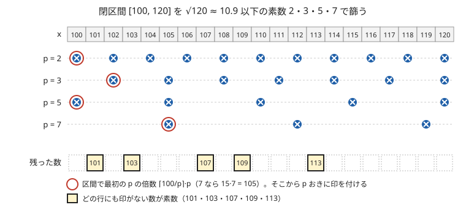

!!! abstract "要点"
    - **何ができるか**：$L$ が $10^{12}$ と大きくても $R - L$ が $10^6$ 程度なら、$\sqrt{R}$ までの素数で閉区間 $[L, R]$ だけを篩える。区間の各数の素数判定や素因数分解を、区間の長さにほぼ比例する時間で行う。
    - **いつ使うか**：
        - $L, R \le 10^{12}$ で $R - L \le 10^6$
        - 連続する区間の数をそれぞれ素因数分解する
        - 二項係数 $\binom{N}{K}$ の分子 $N-K+1, \dots, N$ を素因数分解する
    - **計算量**：素数判定・素因数分解とも $O((R - L) \log \log R + \sqrt{R} \log \log R)$。メモリは $O(R - L + \sqrt{R})$
    - **前提**：[エラトステネスの篩](../math/sieve-eratosthenes.md)

<!-- textlint-disable -->
別名：区間ふるい・segmented sieve・区間の素因数分解
<!-- textlint-enable -->

区間篩は、[エラトステネスの篩](../math/sieve-eratosthenes.md)を $1$ からではなく閉区間 $[L, R]$ の中だけで行う方法である。$R = 10^{12}$ まで普通に篩うと $10^{12}$ 要素の配列が要り、区間の各数を[試し割り](../math/prime-factorization.md)すると 1 個 $O(\sqrt{R})$ で全体 $O((R - L)\sqrt{R})$、つまり $10^{12}$ 回ほどかかる。どちらも間に合わない。区間篩では $\sqrt{R}$ までの素数を先に列挙し、それぞれの倍数に区間の中だけで印を付ける。配列は区間の長さぶんで済み、手間もほぼ区間の長さに比例する。

このページでは区間を閉区間 $[L, R]$ で書き、実装では数 $x$ を添字 $x - L$ に置く（0-indexed）。記法は[記法と用語の約束](../start/notation.md)にそろえる。

## √R までの素数で十分な理由 {#why-sqrt}

区間篩が正しいのは、$R$ 以下の合成数はどれも $\sqrt{R}$ 以下の素因数を持つからである。合成数 $x$ を $x = ab$（$2 \le a \le b$）と書くと $a^2 \le ab = x \le R$ なので $a \le \sqrt{R}$ であり、$a$ の素因数の 1 つは $\sqrt{R}$ 以下の $x$ の素因数になる。したがって、$\sqrt{R}$ 以下のどの素数の倍数にもならない区間の数（ただし 2 以上で、それ自身ではない倍数として消す。次の節）は素数である。

次の図は、閉区間 $[100, 120]$ を篩う例である。$\sqrt{120} \approx 10.95$ なので、使う素数は 2・3・5・7 の 4 つだけである。各行に素数 $p$ の倍数の印を付けると、どの行にも印の付かない 101・103・107・109・113 が残る。これで区間の素数はすべてである。



処理の流れは次のとおりである。

```text
s ← ⌊√R⌋
1. 2..s を普通の篩にかけ、s 以下の素数の列 primes を作る
2. 長さ R − L + 1 の配列 is_prime を true で埋める（is_prime[x − L] が x の結果）
3. primes の各 p について：
     start ← 区間で最初に消す p の倍数（次の節）
     x = start, start + p, start + 2p, … ≤ R の is_prime[x − L] を false にする
4. L = 1 なら is_prime[0] を false にする（1 は素数でない）
```

$s = \lfloor \sqrt{R} \rfloor$ は、$(s + 1)^2 \le R$ を確かめて整数で求めておくと安全である。$R \le 10^{12}$ なら `double` の `sqrt` でもずれないが、$R$ が $2^{53}$（約 $9 \times 10^{15}$）を超えると $R$ を `double` に直す時点で丸めが起き、$s$ が 1 小さくなることがある。$R$ がちょうど素数 $p$ の 2 乗のときにそうなると、$p$ を使い損ねて $R$ を素数と誤判定する（[整数の平方根](../math/integer-root.md)）。

??? question "確認問題：√R ではなく √L まででよいか"
    区間 $[L, R]$ を篩うとき、使う素数を $\sqrt{L}$ 以下に減らしてもよいか。

    ??? success "答え"
        よくない。区間の中で $L$ より大きい合成数は、$\sqrt{L}$ より大きく $\sqrt{R}$ 以下の素因数しか持たないことがある。たとえば $[L, R] = [100, 121]$ なら $\sqrt{100} = 10$ だが、$121 = 11^2$ は 11 で消さないと素数として残る。どの数 $x$ も $\sqrt{x}$ 以下の素因数で消せればよいので、区間の最大の $R$ に合わせて $\sqrt{R}$ まで使う。

## 区間で最初の p の倍数 ⌈L/p⌉·p の求め方と、p 自身・L = 1 の扱い {#first-multiple}

区間篩で最も間違えやすいのは、各素数 $p$ の印をどこから付け始めるかである。$L$ 以上で最初の $p$ の倍数は $\lceil L / p \rceil \cdot p$ で、整数の割り算では `(L + p - 1) / p * p` と書く（$L \ge 1$ のとき。[整数の割り算](../math/integer-division.md)）。そこから $p$ おきに $R$ まで進めば、区間の中の $p$ の倍数をちょうど 1 回ずつ通る。

ただし素数判定では、そのまま始めると $p$ 自身が区間に入っているときに $p$ を消してしまう。$L \le \sqrt{R}$ のとき、つまり区間が小さい数を含むときに起きる。そこで開始位置を $\max(p^2, \lceil L / p \rceil \cdot p)$ にする。$p^2$ 未満の $p$ の倍数 $kp$（$k < p$）は $k$ の素因数（$p$ より小さい素数）でもう消えているので、$p^2$ から始めても消し漏れはない。これは普通の篩で $p^2$ から消すのと同じ理由である。

もう 1 つの例外は 1 である。1 はどの素数の倍数でもないので印が付かず、そのままだと素数として残る。$L = 1$ のときだけ、最後に添字 0 を false にする。

```cpp
--8<-- "segmented-sieve/sieve.cpp:core"
```

素因数分解（次の節）では事情が変わる。$p$ 自身も「$p^1$」と分解したいので、開始位置は $p^2$ ではなく $\lceil L / p \rceil \cdot p$ のままにする。判定と分解で開始位置が違うことを覚えておく。

??? question "確認問題：開始位置を ⌈L/p⌉·p にしたら"
    素数判定の区間篩で、開始位置を $\max(p^2, \lceil L / p \rceil \cdot p)$ ではなく $\lceil L / p \rceil \cdot p$ にした。$[L, R] = [2, 30]$ で何が起きるか。$[L, R] = [100, 120]$ ではどうか。

    ??? success "答え"
        $[2, 30]$ では $\sqrt{30}$ 以下の素数 2・3・5 が区間に入っているので、2 の行は 2 から、3 の行は 3 から、5 の行は 5 から印を付けてしまい、2・3・5 が素数でないと判定される。$[100, 120]$ では $p \le 10$ の素数が区間に入らないので、どちらでも結果は同じである。小さい区間のテストでだけ見つかるバグなので、$L$ が小さいケースを必ず試す。

## 区間の各数の素因数分解（√R までで割った残りは素数） {#factorize-range}

区間篩は、印を付ける代わりに実際に割れば、区間の各数の素因数分解になる。区間の各数 $x$ について「まだ割っていない部分」$\mathrm{rem}[x - L]$ を $x$ で初期化しておき、$\sqrt{R}$ 以下の各素数 $p$ について、区間の中の $p$ の倍数をすべて $p$ で割れるだけ割る。割った回数が $x$ の素因数 $p$ の指数である。

すべての素数で割り終えたとき、$\mathrm{rem}[x - L]$ は 1 か、$\sqrt{R}$ より大きい素数 1 個である。理由は、残りの素因数はどれも $\sqrt{R}$ より大きく、2 個以上あると積が $R$ を超えるからである（$\sqrt{x}$ より大きい素因数は高々 1 個しかない）。だから残りが 1 より大きければ、そのまま素数として指数 1 で足せばよい。

```cpp
--8<-- "segmented-sieve/factorize.cpp:core"
```

具体例として $x = 999999999999 = 3^3 \cdot 7 \cdot 11 \cdot 13 \cdot 37 \cdot 101 \cdot 9901$ を考える。$\sqrt{R} = 10^6$ までの素数で割ると、3 で 3 回、7・11・13・37・101・9901 で 1 回ずつ割れて、残りは 1 になる。一方 $x = 999999999989$ のように素数なら、どの素数でも割れず、残りの $x$ 自身が素数として加わる。

コードでは結果を数ごとの `vector` に集めているが、実際の問題では、全体の積の指数を素数ごとに足す・約数の個数を掛けるなど、割ったその場で集計することが多い。数ごとに `vector` を持つと、$10^6$ 個で数十 MB になることがある。

## 計算量とメモリの見積もり {#complexity}

区間篩の手間は、$\sqrt{R}$ までの素数を作る部分と、区間に印を付ける部分の和である。

- **素数の列挙**：$\sqrt{R}$ までの普通の篩で $O(\sqrt{R} \log \log R)$。$R = 10^{12}$ なら $10^6$ までの篩で、素数は 78498 個ある
- **区間への印**：素数 $p$ ごとに、区間の中の倍数は $\lfloor (R - L) / p \rfloor + 1$ 個以下である。合計は $\sum_{p \le \sqrt{R}} \left( \frac{R - L}{p} + 1 \right) = O((R - L) \log \log R + \sqrt{R})$。素数の逆数和が $\log \log$ で増えることを使う（[エラトステネスの篩](../math/sieve-eratosthenes.md)と同じ根拠）
- **素因数分解の割り算**：割り算の回数は、区間の各数の素因数の個数（重複を含む）の合計である。これは $p$ の倍数の個数に $p^2$ の倍数の個数、$p^3$ の倍数の個数、…を足したものである。$k \ge 2$ の分を見積もると $(R - L) \sum_p \sum_{k \ge 2} 1/p^k$（和は 1 未満の定数）に $p^k \le R$ となる組の個数を足した程度である。全体は印の回数と同じ $O((R - L) \log \log R + \sqrt{R})$ に収まる

区間に倍数を 1 つも持たない大きな $p$ でも、開始位置の計算は 1 回ずつ要る。区間が短く $\sqrt{R}$ が大きいとき（たとえば $R = 10^{14}$ で $R - L = 10^3$）は、この $\pi(\sqrt{R})$ 回（$\pi(x)$ は $x$ 以下の素数の個数）の部分と素数の列挙が主になる。

メモリは、素数判定なら区間ぶんの `char`（1 バイト）と $\sqrt{R}$ までの篩で、$R - L = 10^6$ なら数 MB である。素因数分解の $\mathrm{rem}$ は `long long` なので $10^6$ 個で 8 MB、$10^7$ 個で 80 MB になる。区間が $10^7$ 程度に長いときは、`long long` の配列を避けられないか先に考える。

## 応用の型 {#patterns}

区間篩が答えの一部になるのは、次のように「区間の各数の素因数」が要る問題である。

- **区間の素数の個数・素数そのもの**：$L$ が大きく、区間 $[L, R]$ の素数を数える・列挙する。サインは「$R \le 10^{12}$ 程度で $R - L \le 10^6$ 程度」
- **素数の累乗の位置**：$\operatorname{lcm}(1, \dots, n)$ が変わるのは $n$ が素数の累乗 $p^k$ のときだけなので、区間の中の素数の累乗を数える問題になる。素数は区間篩で、$k \ge 2$ の累乗は $\sqrt{R}$ 以下の各素数 $p$ について $p^2, p^3, \dots$ を直接列挙して数える（[例題](#abc412_e)）
- **連続する数の積の素因数分解**：$\binom{N}{K} = \frac{N (N-1) \cdots (N-K+1)}{K!}$ の分子は連続する $K$ 個の数の積なので、区間篩で各数を分解して指数を素数ごとに足す。分母は 1〜K を同じ方法か[最小素因数の篩](../math/spf-sieve.md)で分解して指数を引く。約数の個数は指数 $e_p$ から $\prod_p (e_p + 1)$ で求まる（[素因数の指数で考える](../math/prime-exponent-vector.md)）
- **区間の各数の約数の個数・約数の和**：分解できれば、指数 $e_p$ から約数の個数 $\prod_p (e_p + 1)$ などを数ごとに計算できる

## 落とし穴 {#pitfalls}

**p 自身を消す**。素数判定で開始位置を $\lceil L / p \rceil \cdot p$ にすると、区間に入っている小さい素数を合成数と判定する。開始位置は $\max(p^2, \lceil L / p \rceil \cdot p)$ にする（[開始位置の節](#first-multiple)）。素因数分解では逆に $p$ からでよい。

**1 を素数と判定する**。$L = 1$ のとき 1 には印が付かない。最後に添字 0 を false にする。

**√R の誤差**。`(long long)sqrt(R)` は、$R$ が $2^{53}$ を超えると 1 小さくなることがあり、$R$ が素数の 2 乗のときにその素数を使い損ねる。整数で $(s + 1)^2 \le R$ を確かめて $s$ を決めるか、篩う素数の上限に余裕を持たせる（$\sqrt{R}$ より大きい素数まで篩っても結果は変わらない）。

**添字の取り違え**。配列の添字は $x - L$ である。$x$ をそのまま添字にすると範囲外を書く。素数 $p$ のループ変数を `int` にすると、$p^2$ や `(L + p - 1) / p * p` が `int` であふれるので、`long long` にする。

**割れるだけ割らない**。素因数分解で、割れるだけ割る `while` を忘れて 1 回だけ割ると、$p^2$ で割り切れる数の $\mathrm{rem}$ に $p$ が残り、「残りは素数」の前提が崩れる。最後に残った値を素数として足す前に、各 $p$ で割り切っているかを確かめる。

**残りの大きな素数を区別しない**。$\binom{N}{K}$ の分子のように指数を素数ごとに足すとき、$\sqrt{N}$ より大きい残りの素数は $10^6$ までの配列の添字に収まらない。小さい素数は配列、大きい残りは `map` で数えるなど、置き場を分ける。

## 使い分け {#comparison}

- **値が $10^7$ 程度以下**：$1$ から篩えばよい（[エラトステネスの篩](../math/sieve-eratosthenes.md)）。多数の数をそれぞれ分解するなら[最小素因数の篩](../math/spf-sieve.md)
- **大きい数が少しだけ**：$10^{12}$ 程度の数が数十個なら、1 個 $O(\sqrt{N})$ の[試し割り](../math/prime-factorization.md)で足りる
- **大きい数が連続して多数**：区間篩。区間が連続していることが要で、ばらばらの $10^6$ 個の大きな数には使えない
- **$10^{18}$ 程度の数を判定・分解する**：区間篩は $\sqrt{R} = 10^9$ までの素数が要り重い。1 個ずつなら[大きな数の素数判定と素因数分解](../math/miller-rabin.md)を使う

## 例題 {#examples}

### ABC412 E. LCM Sequence {#abc412_e}

<div class="kp-problems" data-role="example" markdown>

- [ABC412 E. LCM Sequence](https://atcoder.jp/contests/abc412/tasks/abc412_e)（diff 1496）：L ≤ n ≤ R の範囲で LCM(1, 2, …, n) が何種類の値をとるかを求める（L, R は大きく、R − L は小さい）。

</div>

$A_n = \operatorname{lcm}(1, \dots, n)$ とすると、$A_n \ne A_{n-1}$ になるのは $n$ が素数の累乗 $p^k$（$k \ge 1$）のときだけである。$n$ の素因数分解で、ある素数の指数がそれまでの最大を超えるのは、$n$ 自身がその素数の累乗のときに限るからである。値の種類数は $A_L$ の 1 種類に、$L < n \le R$ の素数の累乗の個数を足したものになる。区間が長く $R$ も大きいので、素数の累乗を区間篩で数える。

??? note "解法の詳細"
    - $\sqrt{R}$ までの素数を篩で列挙し、閉区間 $[L + 1, R]$ を区間篩にかけて、区間の素数の個数を数える。開始位置は $\max(p^2, \lceil (L+1) / p \rceil \cdot p)$ にして、区間に入る小さい素数を消さない。
    - $k \ge 2$ の累乗は、$\sqrt{R}$ 以下の各素数 $p$ について $q = p^2, p^3, \dots$ を $R$ 以下の間たどり、$L < q \le R$ のものを数える。$q \cdot p$ があふれないよう、`q <= R / p` の間だけ掛ける。$p^k$（$k \ge 2$）は区間篩で消されているので、素数の個数と重ならない。
    - 答えは $1 +$（区間の素数の個数）$+$（$k \ge 2$ の累乗の個数）。区間が長いので、配列は 1 要素 1 バイトにしてメモリを抑える。
    - 素数の数え上げに $O((R - L) \log \log R + \sqrt{R} \log \log R)$、累乗の列挙に $O(\pi(\sqrt{R}) \log R)$ かかる。

## 練習問題 {#practice}

<div class="kp-problems" data-role="practice" markdown>

- [ABC227 G. Divisors of Binomial Coefficient](https://atcoder.jp/contests/abc227/tasks/abc227_g)（diff 2207）：N 個から K 個を選ぶ組合せの数 C(N, K) の正の約数の個数を 998244353 で割った余りで求める（N ≤ 10^12、K ≤ 10^6）。

</div>

??? note "練習の方針"
    - **ABC227 G**：分子 $N-K+1, \dots, N$ は連続する $K$ 個の数なので、$\sqrt{N}$ までの素数による区間篩で各数を分解し、指数を素数ごとに足す。割り残しは $\sqrt{N}$ より大きい素数として指数 1 を足す。分母の $K!$ は 1〜K を同じように分解して指数を引く。最後に $\prod_p (e_p + 1)$ を 998244353 で割った余りを出力する

## 確認問題 {#quiz}

??? question "確認問題：割り残しが合成数になる場合"
    区間 $[L, R]$ の素因数分解で、$\sqrt{R}$ までではなく $\sqrt[3]{R}$ までの素数でしか割らなかったとする。割り残しは何になりうるか。

    ??? success "答え"
        割り残しの素因数はどれも $\sqrt[3]{R}$ より大きいので、3 個以上あると積が $R$ を超える。したがって割り残しは 1・素数・2 つの素数の積（同じ素数の 2 乗を含む）のどれかになり、素数とは言い切れない。$\sqrt{R}$ まで割ると素因数は高々 1 個に限られるので、残りを素数と判定できる。

??? question "確認問題：使う素数の個数"
    $R = 10^{12}$、$R - L = 10^6$ の区間篩で、印を付ける回数のおよその大きさを見積もれ。

    ??? success "答え"
        $\sqrt{R} = 10^6$ までの素数の逆数和はおよそ $\log \log 10^6 + 0.26 \approx 2.9$ なので、印の回数は $10^6 \times 2.9 \approx 3 \times 10^6$ に、開始位置の計算 78498 回を足した程度である。$10^6$ までの素数の列挙も同じくらいの手間で、全体は $10^7$ 回より十分少ない。

## 参考 {#references}

- [inamori「AtCoder Beginner Contest 412 E」](https://inamori.hateblo.jp/entry/2025/06/30/072920)：例題の方針（値が変わるのは素数の累乗のときで、区間篩で数え、$A_L$ の 1 種類を足す）
- [gotoki_no_joe「ABC412 A～F をHaskellで」](https://qiita.com/gotoki_no_joe/items/dbd1cf6437edd867afa3)：例題の方針（区間 $[L+1, R]$ を篩い、素数の累乗を別に数える）
- [Shizen_Tota「ABC412個人的備忘録[A-E]」](https://qiita.com/Shizen_Tota/items/c9ee7d07887c1dd0e935)：例題の実装の形（区間を $[L+1, R]$ にし、素数の累乗に印を付ける）
- [kazun「ABC227 G」](https://kazun-kyopro.hatenablog.com/entry/ABC/227/G)：練習の方針（分子の連続区間を √N までの素数で分解し、割り残しを素数とする理由）
