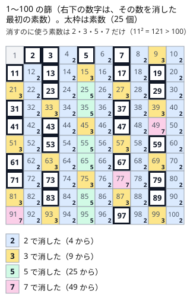

!!! abstract "要点"
    - **何ができるか**：$N$ 以下の素数を、小さい素数の倍数を順に消して $O(N \log \log N)$ で列挙する。区間にある素数の個数を何度も答えるなら、篩の結果を累積和にする。
    - **いつ使うか**：
        - $N \le 10^6$〜$10^7$ の範囲の素数を全部使う。
        - $p q^3 \le N$ を満たす素数の組を数える。
        - 区間 $[l, r]$ の素数の個数を何度も答える。
    - **計算量**：$O(N \log \log N)$。区間の素数の個数は、累積和の前計算 $O(N)$ の後、1 回 $O(1)$。
    - **前提**：[約数列挙と素数判定](../math/divisor-enum.md)

<!-- textlint-disable -->
別名：篩・sieve of Eratosthenes・素数の列挙・素数表・エラトステネスのふるい
<!-- textlint-enable -->

エラトステネスの篩は、$2$ から順に「まだ消えていない数は素数」と確定させ、その倍数を表から消していく方法である。1 つずつ[試し割り](../math/divisor-enum.md)すると $N$ 個で $O(N \sqrt{N})$ かかるところを、ほぼ線形の $O(N \log \log N)$ で全部判定できる。

このページで使う記法：$N$ は篩う範囲の上限、$p$・$q$ は素数、$\pi(x)$ は $x$ 以下の素数の個数を表す。ほかは[記法と用語の約束](../start/notation.md)に従う。

## 倍数を消す手順と、p² から消せば十分な理由 {#procedure}

篩は、長さ $N + 1$ の表 $\mathrm{is\_prime}[0..N]$ を「すべて素数かもしれない」で始め、合成数に印を付けて消していく。手順は次のとおりである。

```text
is_prime[0] = is_prime[1] = false、ほかは true
for p = 2, 3, … （p × p ≤ N の間）:
    is_prime[p] が false なら飛ばす（p は合成数）
    p は素数。j = p², p² + p, p² + 2p, … （j ≤ N）の is_prime[j] を false にする
```

この手順は 2 つの事実で正しい。

- **消えずに残った $p$ は素数である**。$p$ が合成数なら、$p$ より小さい素因数 $q$ を持ち、$q$ の番で消えている。消えていないなら、$p$ 未満のどの素数でも割り切れないので素数である
- **$p^2$ から消せば十分である**。$p$ の倍数 $kp$ で $2 \le k < p$ のものは、$k$ の素因数（$p$ より小さい）の番ですでに消えている。だから $p$ の番で新しく消える可能性があるのは $p^2$ 以上の倍数だけである

2 つ目から、外側のループは $p^2 \le N$ で止めてよい。$p > \sqrt{N}$ の素数には、消すべき $p^2$ 以上の倍数が範囲内にない。言い換えると、$N$ 以下の合成数はどれも $\sqrt{N}$ 以下の素因数を持つ（[約数列挙と素数判定](../math/divisor-enum.md)と同じ理由）。



$N = 100$ では、消し始める位置は 2 が 4、3 が 9、5 が 25、7 が 49 である。次の素数 11 は $11^2 = 121 > 100$ なので消す数がなく、ここで止めてよい。

```cpp
--8<-- "sieve-eratosthenes/sieve.cpp:core"
```

完全なプログラム：[`sieve.cpp`](https://github.com/yuukougun/kyopro-atlas/blob/main/snippets/sieve-eratosthenes/sieve.cpp)（GitHub）
{ .kp-code-src }

??? question "確認問題：p² から消す理由"
    $p = 7$ の番で、$7 \times 4 = 28$ や $7 \times 6 = 42$ を消さなくてよいのはなぜか。$7 \times 11 = 77$ はどうか。

    ??? success "答え"
        $28 = 2 \times 14$ は 2 の番で、$42 = 2 \times 21$ も 2 の番ですでに消えている。一般に $7k$（$2 \le k < 7$）は $k$ の素因数の番で消えている。$77 = 7 \times 11$ は 7 より小さい素因数を持たないので、7 の番（$49$ から始めて $49, 56, 63, 70, 77, \dots$）で初めて消える。

## 計算量 O(N log log N) の根拠と、調和級数の O(N log N) との違い {#complexity}

素数 $p$ の番で消す回数は高々 $N / p$ である。合計は $N$ 以下の素数の逆数の和で抑えられる。

$$
\sum_{p \le \sqrt{N}} \frac{N}{p} \le N \sum_{p \le N} \frac{1}{p} = N (\ln \ln N + O(1))
$$

素数の逆数の和がおよそ $\ln \ln N$ になることは、メルテンスの定理として知られている（証明は数論の教科書に任せる）。$\ln \ln N$ は $N = 10^7$ でも約 2.8 しかないので、篩は実質的に線形と思ってよい。

比べる相手は、すべての $i$ について $i$ の倍数を回す二重ループである。こちらは $\sum_{i=1}^{N} N / i \approx N \ln N$ になる（[調和級数](../math/harmonic-sum.md)）。篩が速いのは、外側のループで素数の番だけ内側を回すからである。手元で数えた内側の回数は次のとおりである（篩は $p^2$ から消したときの回数）。

| $N$ | 篩の内側の回数 | 全 $i$ の倍数の回数 $\sum N / i$ |
| --- | --- | --- |
| $10^6$ | 約 $2.1 \times 10^6$ | 約 $1.4 \times 10^7$ |
| $10^7$ | 約 $2.3 \times 10^7$ | 約 $1.6 \times 10^8$ |
| $10^8$ | 約 $2.4 \times 10^8$ | 約 $1.9 \times 10^9$ |

$p^2$ から始めても $2p$ から始めても、回数はほとんど変わらない（$10^7$ で約 3% の差）。$p^2$ から始める意味は、計算量よりも、外側を $\sqrt{N}$ で止められることにある。

## 篩の結果を累積和にして区間の素数を数える {#prefix-count}

閉区間 $[l, r]$ にある「条件を満たす数」の個数を何度も答えるときは、篩で作った 0/1 の表を[累積和](../basics/prefix-sum.md)にする。半開区間で $s_0 = 0$、$s_{i+1} = s_i + [\,i \text{ が素数}\,]$ と定める。$s_i$ は $[0, i)$ の素数の個数なので、閉区間 $[l, r]$ の個数は $s_{r+1} - s_l$ である。

```cpp
--8<-- "sieve-eratosthenes/sieve.cpp:prefix"
```

完全なプログラム：[`sieve.cpp`](https://github.com/yuukougun/kyopro-atlas/blob/main/snippets/sieve-eratosthenes/sieve.cpp)（GitHub）
{ .kp-code-src }

数える条件は素数そのものでなくてよい。「$x$ と $(x + 1) / 2$ がどちらも素数」のような条件でも、篩の表を引いて 0/1 を決めてから累積和を取ればよい。$\pi(x) = s_{x+1}$ なので、「$x$ 以下の素数の個数」を何度も引く問題（[例題](#abc250_d)の $p$ の数え方）にも同じ表が使える。

素数の一覧が欲しいときは、篩の後に $\mathrm{is\_prime}[x]$ が true の $x$ を小さい順に集める。素数の個数は $\pi(10^6) = 78498$、$\pi(10^7) = 664579$ で、一覧の上を二分探索するのは $O(\log \pi(N))$ である。

## 篩の変形（異なる素因数の個数を数える） {#variants}

篩の外側のループは素数を小さい順に 1 つずつ確定させるので、「素数 $p$ が見つかったら、$p$ の倍数に何かをする」という形で、素因数についての表をまとめて作れる。次のコードは、各 $x \le N$ の異なる素因数の個数 $\omega(x)$ を求める。

```cpp
--8<-- "sieve-eratosthenes/omega.cpp:core"
```

完全なプログラム：[`omega.cpp`](https://github.com/yuukougun/kyopro-atlas/blob/main/snippets/sieve-eratosthenes/omega.cpp)（GitHub）
{ .kp-code-src }

- **素数の見分け方**：$\omega[p] = 0$ のまま $p$ まで来たら、$p$ 未満のどの素数の倍数でもないので素数である。消すための別の表は要らない
- **倍数は $p$ から回す**：素数の判定だけなら $p^2$ から消せばよいが、ここでは $p$ の倍数すべてに「素因数 $p$ を持つ」と数える必要がある。$p^2$ から始めると、$2p$ や $3p$ に $p$ が数えられない
- **計算量**：内側を回すのは素数の番だけなので、$\sum_{p \le N} N / p = O(N \log \log N)$ のままである。外側は $p \le N$ まで回る

同じ形で、「$p$ の倍数のうち、まだ値が入っていないものに $p$ を書く」と各数の最小素因数の表になり、素因数分解が速くなる（[最小素因数の篩](../math/spf-sieve.md)）。表を全部 $1$ で始め、素数 $p$ ごとに $p$ の倍数に $-1$ を掛け、$p^2$ の倍数を $0$ にするとメビウス関数の表になる。素数の判定には篩の表を別に持つ（詳しくは[メビウス関数](../comb/mobius-function.md#sieve)）。

??? question "確認問題：変形で p² から回すと"
    $\omega$ の篩で、内側を `j = p * p` から始めると、$\omega[6]$ はいくつになるか。

    ??? success "答え"
        $p = 2$ の番は 4, 6, 8, … を数えるので $\omega[6]$ に 1 が足される。$p = 3$ の番は 9 から始まるので 6 は数えられない。$\omega[6] = 1$ になり、正しい値 2 より小さくなる。素数 $p$ 自身と $2p$〜$(p - 1)p$ に $p$ が数えられないからである。

## メモリの見積もり（10^8 までは bit で持つ） {#memory}

篩の表は $N + 1$ 要素になるので、要素の型でメモリが大きく変わる。

| 型 | 1 要素 | $N = 10^7$ | $N = 10^8$ |
| --- | --- | --- | --- |
| `vector<bool>` | 1 bit | 約 1.25 MB | 約 12.5 MB |
| `vector<char>` | 1 byte | 約 10 MB | 約 100 MB |
| `vector<int>` | 4 byte | 約 40 MB | 約 400 MB |

- **判定だけなら `vector<bool>`**：`vector<bool>` は bit 単位に詰めて持つ特別な実装で、$10^8$ でも 12.5 MB に収まる。手元の計測（g++-15、`-O2`）では $N = 10^8$ の篩が 0.3 秒ほどで、`vector<char>`（0.8 秒ほど）より速かった。表が小さくキャッシュに載りやすいからである
- **値を持つ変形は `int` になる**：$\omega$ や最小素因数の表は `vector<int>` なので、$N = 10^7$ で 40 MB、$10^8$ では 400 MB になる。$10^8$ が要るときは、本当に全部の値が要るかを考え直す
- **$N$ が $10^9$ 以上なら篩わない**：bit で持てば約 125 MB に収まるが、内側の回数が $2 \times 10^9$ を超え、時間が足りない。1 個の判定なら試し割り、$[L, R]$ の幅が小さければ[区間篩](../math/segmented-sieve.md)を使う。$p q^3 \le N$ のように、篩う範囲を $\sqrt{N}$ や $\sqrt[3]{N}$ まで小さくできないかを先に考える

## 落とし穴 {#pitfalls}

**内側の開始値 `p * p` が `int` であふれる**。外側を $p \le N$ まで回し、内側を `for (int j = p * p; …)` と書くと、$p > 46340$ で $p^2$ が `int` の範囲（約 $2.1 \times 10^9$）を超える。符号付き整数のあふれは[未定義動作](../cpp/cpp-undefined-behavior.md)で、負の添字に書き込んで落ちることがある。外側を `p * p <= n` で止めるか、`p` と `j` を `long long` にする。

**0 と 1 を素数のままにする**。表を true で初期化したら、$\mathrm{is\_prime}[0]$ と $\mathrm{is\_prime}[1]$ を必ず false にする。手順の中で 0 と 1 は消されないので、忘れると「1 は素数」として数えてしまう。$N = 0$ でも添字 1 に書き込まないよう、$N \ge 1$ を確かめてから書く。

**篩う範囲を答えの範囲と取り違える**。$p q^3 \le N$（$N \le 10^{18}$）で要るのは $q \le \sqrt[3]{N} \le 10^6$ までの素数であり、$N$ までではない。逆に、$(x + 1) / 2$ も素数かを調べるなら、表は $x$ の上限まで要る。表の範囲外を引くと範囲外アクセスになるので、引く値の最大を式で確かめてから大きさを決める。

**$p q^3$ の計算であふれる**。$q \le 10^6$ なら $q^3 \le 10^{18}$ で `long long` に収まるが、$p q^3$ を掛け算で作ると $9.2 \times 10^{18}$ を超えることがある。「$p \le N / q^3$」と割り算で比べる（[整数の割り算](../math/integer-division.md)）。

## 上位の手法へのつながり {#next-steps}

倍数を消していく篩の形は、素数に関わる表を作る手法の土台になる。

- **最小素因数の篩**：消すときに最初に消した素数を記録すると、多数の数を 1 個 $O(\log A)$ で素因数分解できる（[最小素因数の篩](../math/spf-sieve.md#build-and-factor)）。
- **区間篩**：$10^{12}$ 程度の大きな区間でも、$\sqrt{R}$ までの素数で篩えば区間の素数が分かる（[区間篩](../math/segmented-sieve.md#why-sqrt)）。
- **メビウス関数の表**：素数の倍数をたどるときに符号と平方因子を記録すると、$\mu$ の表ができる（[メビウス関数](../comb/mobius-function.md#sieve)）。
- **約数のゼータ変換**：素数ごとに倍数の向きへ累積和を取ると、約数についての和が $O(N \log \log N)$ で求まる（[約数・倍数のゼータ変換](../comb/zeta-mobius-divisor.md#per-prime)）。

## 例題 {#examples}

### ABC250 D. 250-like Number {#abc250_d}

<div class="kp-problems" data-role="example" markdown>

- [ABC250 D. 250-like Number](https://atcoder.jp/contests/abc250/tasks/abc250_d)（diff 797）：素数 p < q を使って k = p × q³ と書ける N 以下の整数 k の個数を求める（N ≤ 10^18）。

</div>

$N$ は $10^{18}$ と大きいが、$q^3 \le p q^3 \le N$ なので $q \le 10^6$ である。$10^6$ までを篩い、$q$ を固定して、条件を満たす $p$ の個数を数える。$p$ は「$q$ 未満」かつ「$N / q^3$ 以下」の素数なので、その個数は素数の個数の表から $O(1)$ か、素数の一覧の二分探索で求まる。

??? note "解法の詳細"
    - $M = 10^6$ までを篩い、$x$ 以下の素数の個数 $\pi(x)$ を引けるように累積和を作る（[累積和にする節](#prefix-count)）。
    - 素数 $q \le M$ ごとに、$q^3 > N$ なら打ち切る。$q \le 10^6$ なので $q^3 \le 10^{18}$ は `long long` に収まる。
    - $p$ の上限は $\min(q - 1, \lfloor N / q^3 \rfloor)$ である。$q - 1 < M$ なので表の範囲内に収まり、$\pi$ の値を答えに足す。
    - 全体で篩の $O(M \log \log M)$ と、$q$ のループの $O(\pi(M))$。

## 練習問題 {#practice}

<div class="kp-problems" data-role="practice" markdown>

- [ABC475 D. Alphametic Prime](https://atcoder.jp/contests/abc475/tasks/abc475_d)（diff 741）：文字列 S の各文字を、同じ文字は同じ数字、異なる文字は異なる数字に置き換えて、先頭が 0 でない素数を作れるか判定する。作れるならその素数を、作れなければ -1 を出力する。
- [ABC300 D. AABCC](https://atcoder.jp/contests/abc300/tasks/abc300_d)（diff 908）：素数 a < b < c を使って a² × b × c² と書ける N 以下の整数の個数を求める（N ≤ 10^12）。
- [ABC084 D. 2017-like Number](https://atcoder.jp/contests/abc084/tasks/abc084_d)（diff 980）：l_i ≤ x ≤ r_i を満たす奇数 x のうち、x も (x + 1)/2 も素数であるものの個数を、Q 個のクエリについて答える。
- [典型90 030. K Factors（★5）](https://atcoder.jp/contests/typical90/tasks/typical90_ad)（diff なし）：N 以下の正の整数のうち、異なる素因数を K 個以上もつものの個数を求める（N ≤ 10^7）。

</div>

??? note "練習の方針"
    - **ABC475 D**：$S$ の長さを $n$ とすると、答えは $n$ 桁の素数である。$10^n$ 未満を篩い、$n$ 桁の素数を順に見て、文字と数字の対応が両方向に矛盾しないかを調べる。文字への数字の割り当てを全探索して、篩の表で素数か判定してもよい
    - **ABC300 D**：$a^5 \le N$ と $a^2 b^3 \le N$ から、$a$ と $b$ の範囲は小さい。$c \le \sqrt{N / (a^2 b)} \le 10^6$ なので、$10^6$ までを篩う。$(a, b)$ ごとに、$c$ の個数を素数の個数の表で数える。平方根は整数で補正する
    - **ABC084 D**：$x$ の上限までを篩い、「$x$ と $(x + 1) / 2$ がどちらも素数」を 0/1 にした累積和で各クエリに答える
    - **典型90 030**：[変形の節](#variants)の $\omega$ をそのまま作り、$\omega[x] \ge K$ の $x$ を数える。表は `int` で $10^7$ 個（40 MB）

## 使い分け {#comparison}

- **1 個だけの判定・分解**：$N \le 10^{12}$ 程度なら試し割りの $O(\sqrt{N})$ で済み、篩は要らない（[約数列挙と素数判定](../math/divisor-enum.md)）
- **多数の数の素因数分解**：篩のついでに最小素因数を記録すると、1 個 $O(\log N)$ で分解できる（[最小素因数の篩](../math/spf-sieve.md)）
- **大きな区間の素数**：$R \le 10^{12}$ でも $R - L$ が $10^6$ 程度なら、$\sqrt{R}$ までの素数で $[L, R]$ だけを篩う（[区間篩](../math/segmented-sieve.md)）
- **全部の $i$ の倍数を回す必要がある**：約数の個数の表など、素数以外の $i$ でも倍数を回すなら $O(N \log N)$ の[調和級数](../math/harmonic-sum.md)の計算量になる

## 参考 {#references}

- [drken「AtCoder ABC 250 D - 250-like Number (2Q, 茶色, 400 点)」](https://drken1215.hatenablog.com/entry/2022/05/12/010600)：例題の方針（$q \le 10^6$ の篩と $p$ の数え方）
- [comet725「ABC475Dを解いた【エラトステネスの篩・DFS全探索】」](https://qiita.com/comet725/items/777d32f7cf7630a48663)：練習 ABC475 D の問いと方針（割り当ての全探索と篩）
- [Konini64「ABC475回答メモ」](https://qiita.com/Konini64/items/72cfce90cf1682c02498)：練習 ABC475 D の問いと方針（$n$ 桁の素数を順に照合）
- [hyouri「ABC475のPython解答（A~D）」](https://qiita.com/hyouri/items/8aba1a9b9c6378fcf6f1)：練習 ABC475 D の対応を両方向で確かめること
- [drken「AtCoder ABC 300 D - AABCC (1Q, 緑色, 400 点)」](https://drken1215.hatenablog.com/entry/2023/05/03/201800)：練習 ABC300 D の範囲の見積もりと累積和
- [drken「AtCoder ABC 084 D - 2017-like Number (3Q, 緑色, 400 点)」](https://drken1215.hatenablog.com/entry/2019/03/28/181318)：練習 ABC084 D の篩と累積和
- [E869120「競プロ典型 90 問 030 の解答例」](https://github.com/E869120/kyopro_educational_90/blob/main/sol/030.cpp)：練習 典型90 030 の倍数に足していく篩
- [Wikipedia「エラトステネスの篩」](https://ja.wikipedia.org/wiki/%E3%82%A8%E3%83%A9%E3%83%88%E3%82%B9%E3%83%86%E3%83%8D%E3%82%B9%E3%81%AE%E7%AF%A9)：手順（$p^2$ から消し、$\sqrt{N}$ で止める）の確認
- [Wikipedia「メルテンスの定理」](https://ja.wikipedia.org/wiki/%E3%83%A1%E3%83%AB%E3%83%86%E3%83%B3%E3%82%B9%E3%81%AE%E5%AE%9A%E7%90%86)：素数の逆数の和が $\log \log N + O(1)$ になること
