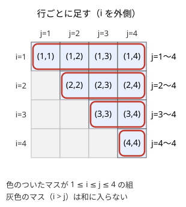
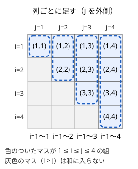

!!! abstract "要点"
    - **何ができるか**：二重和の順序交換・添字の範囲の書き換え・付け替え・線形性で、$\Sigma$ の式を計算しやすい形に変える。同じ和を別の順で計算すると、$O(N^2)$ の二重ループが $O(N)$ などに落ちる。
    - **いつ使うか**：
        - すべての組 $(i, j)$（$i < j$）について〜を足した和を求める。
        - $\sum_{i=1}^{N} \sum_{j=i}^{N} f(i, j)$ のように、内側の和の範囲が外側の添字で決まる二重和。
        - $\sum_{K=1}^{N} K \times (K \text{ の約数の個数})$ のように、約数・倍数の関係で書き換えられる和。
    - **計算量**：式変形そのものに計算量はない。変形の後は、元の式で $O(N^2)$ の二重和が $O(N)$ や $O(N \log N)$ になることが多い。
    - **前提**：なし

<!-- textlint-disable -->
別名：シグマの変形・和の順序交換・総和の変形・二重和・添字の付け替え・order of summation
<!-- textlint-enable -->

Σ の変形は、和の式を「足す順番」と「添字の名前」だけ変えて、同じ値をより速く計算できる形に直す技術である。足し算は順番を変えても結果が変わらないので、どの変形も値を保つ。難しいのは変形の規則そのものではなく、添字の範囲を正しく書き換えることと、どの形にすれば速くなるかを見抜くことである。

このページで使う記法：添字は数学の慣習どおり 1 から数え（1-indexed）、$\sum_{i=l}^{r}$ は両端を含む閉区間 $[l, r]$ の整数 $i$ について足す。$[P]$ は条件 $P$ が成り立てば 1、成り立たなければ 0 を表す。ほかの記法は[記法と用語の約束](../start/notation.md)にそろえる。

## Σ の線形性と分解（定数を外に出す・和を分ける） {#linearity}

Σ の変形でいちばん多く使うのは、次の 2 つの規則（線形性）である。

$$
\sum_{i} c\, a_i = c \sum_{i} a_i, \qquad \sum_{i} (a_i + b_i) = \sum_{i} a_i + \sum_{i} b_i
$$

競技プログラミングで効くのは、「添字 $i$ によらない量は外に出せる」という読み方である。二重和では、内側の和にとって外側の添字は定数なので外に出せる。

$$
\sum_{i=1}^{N} \sum_{j=1}^{N} a_i b_j = \sum_{i=1}^{N} a_i \Bigl( \sum_{j=1}^{N} b_j \Bigr) = \Bigl( \sum_{i=1}^{N} a_i \Bigr) \Bigl( \sum_{j=1}^{N} b_j \Bigr)
$$

左辺を素直に計算すると $N^2$ 回の掛け算だが、右辺は 2 つの和の積なので $O(N)$ で済む。$(a_i - a_j)^2$ や $(a_i + b_j)^2$ のように展開できる式も、展開して「$i$ だけの項」「$j$ だけの項」「積の項」に分ければ、それぞれをこの形にできる。

$$
\sum_{i=1}^{N} \sum_{j=1}^{N} (a_i - a_j)^2 = \sum_{i}\sum_{j} \bigl(a_i^2 - 2a_i a_j + a_j^2\bigr) = 2N \sum_{i} a_i^2 - 2 \Bigl( \sum_{i} a_i \Bigr)^2
$$

分けてよいのは和だけである。$\sum_i a_i b_i$ は一般に $(\sum_i a_i)(\sum_i b_i)$ と等しくない（添字が同じ $i$ でつながっているから）。$\max$・$\min$・$\lfloor \cdot \rfloor$・$\bmod$ も和と入れ替えられない。たとえば $\sum_i \max(a_i, b_i) \ne \max(\sum_i a_i, \sum_i b_i)$、$\sum_i \lfloor a_i / k \rfloor \ne \lfloor \sum_i a_i / k \rfloor$ である。$\sum_i\sum_j \bigl((a_i + b_j) \bmod m\bigr)$ も項に分けられず、$a_i + b_j \ge m$ になる組の個数を別に数える必要がある。

## 二重和の順序交換と添字の範囲（i ≤ j ≤ N を j の側から見る） {#swap-order}

二重和は、足す組 $(i, j)$ の集合を表のマスとして描くと見通しがよい。行ごとに足しても列ごとに足しても、同じマスを 1 回ずつ足すので結果は同じである。次の図は $N = 4$ で $1 \le i \le j \le 4$ を満たす組を塗った表である。




左の囲み方を式にすると $\sum_{i=1}^{N} \sum_{j=i}^{N}$、右の囲み方は $\sum_{j=1}^{N} \sum_{i=1}^{j}$ である。

$$
\sum_{i=1}^{N} \sum_{j=i}^{N} f(i, j) = \sum_{j=1}^{N} \sum_{i=1}^{j} f(i, j)
$$

範囲を書き換える手順は機械的にできる。

1. 両方の添字の条件を 1 つの不等式の列に書く（例：$1 \le i \le j \le N$）
2. 外側にしたい添字の範囲を、もう一方を消して読む（$j$ だけを見ると $1 \le j \le N$）
3. 外側の添字を固定したとき、残りの添字が動く範囲を読む（$j$ を固定すると $1 \le i \le j$）

順序を入れ替えると速くなるのは、新しい内側の和が外側の添字だけの式になって、まとめて計算できるときである。たとえば $\sum_{i=1}^{N} \sum_{j=i}^{N} a_j$ は、$j$ を外側にすると内側は $\sum_{i=1}^{j} 1 = j$ になり、$\sum_{j=1}^{N} j\, a_j$ と 1 重の和になる。各 $a_j$ が何回数えられるかを数えたことになり、これが[寄与](../thinking/contribution.md)（主客転倒）の考え方の式としての姿である。

条件が不等式でなく「$d$ が $K$ を割り切る」のような関係でも同じである。$K$ を外側にした $\sum_{K=1}^{N} \sum_{d \mid K}$ を $d$ を外側にすると、$d$ を固定したとき $K$ は $d$ の倍数 $d, 2d, \dots, \lfloor N/d \rfloor d$ を動く。

$$
\sum_{K=1}^{N} \sum_{d \mid K} g(d, K) = \sum_{d=1}^{N} \sum_{m=1}^{\lfloor N/d \rfloor} g(d, md)
$$

??? question "確認問題：範囲の書き換え"
    $\sum_{i=1}^{N} \sum_{j=i+1}^{N} f(i, j)$ の順序を入れ替え、$j$ を外側にせよ。また $N = 1$ のとき両辺はいくつか。

    ??? success "答え"
        条件は $1 \le i < j \le N$ なので、$j$ は $2$ から $N$ まで、$j$ を固定すると $i$ は $1$ から $j - 1$ まで動く。$\sum_{j=2}^{N} \sum_{i=1}^{j-1} f(i, j)$ である（$j = 1$ を含めても内側が空の和なので値は同じ）。$N = 1$ では組が 1 つもないので、両辺とも空の和で 0 になる。

## 添字の付け替え（i → N − i、k = i + j、約数 d と倍数） {#reindex}

添字の付け替えは、足す集合を 1 対 1 に対応させて名前を変えることである。対応が 1 対 1 なら値は変わらない。よく使う形は 3 つある。

- **逆順にする**：$i' = N + 1 - i$ と置くと、$i$ が $1$ から $N$ まで動くとき $i'$ も $1$ から $N$ まで動く。$\sum_{i=1}^{N} f(i) = \sum_{i=1}^{N} f(N + 1 - i)$ である。2 つを足して 2 で割ると、$\sum_{i=1}^{N} i = \frac{1}{2} \sum_{i=1}^{N} \bigl(i + (N + 1 - i)\bigr) = \frac{N(N+1)}{2}$ が出る
- **和を新しい添字にする**：$f(i + j)$ のように和だけに依存する式は、$k = i + j$ でまとめる。$1 \le i, j \le N$ のとき $k$ は $2$ から $2N$ まで動き、$i + j = k$ となる組は $N - \lvert k - (N + 1) \rvert$ 個あるので、$\sum_{i=1}^{N} \sum_{j=1}^{N} f(i + j) = \sum_{k=2}^{2N} \bigl(N - \lvert k - (N + 1) \rvert\bigr) f(k)$ となる。和が $k$ になる組の個数を正しく数えるのが要点である
- **約数を倍数に言い換える**：$d \mid K$ の組 $(d, K)$ は、$K = md$ と置くと $(d, m)$ の組と 1 対 1 に対応する。前の節の最後の式がこれで、$K$ の約数を列挙する代わりに $d$ の倍数を列挙できる。倍数の列挙は合計 $N/1 + N/2 + \dots + N/N \approx N \ln N$ 回で済む（[調和級数](../math/harmonic-sum.md)）

付け替えで間違えやすいのは範囲である。$k = i + j$ と置いたら、$k$ の最小値と最大値、そして $k$ を固定したときに残りの添字が取れる範囲の両方を書き直す。0-indexed で書くか 1-indexed で書くかを途中で混ぜると、端が 1 つずれる。

## 値でまとめ直す（同じ値になる添字の個数を掛ける） {#group-by-value}

$\sum_{i=1}^{N} g(A_i)$ で、$A_i$ の値の種類が少ないときは、値 $v$ ごとに「$A_i = v$ となる $i$ の個数」$c_v$ を掛けて足せばよい。

$$
\sum_{i=1}^{N} g(A_i) = \sum_{v} c_v\, g(v)
$$

これは「添字 $i$」と「値 $v$」の二重和 $\sum_{v} \sum_{i} [A_i = v]\, g(v)$ の順序を入れ替えたものである。二重和の形にすると、組の問題にも使える。$h$ が対称（$h(u, v) = h(v, u)$。$\max$・$\min$・積など）なら、値の組を $u < v$ と $u = v$ に分けて

$$
\sum_{i<j} h(A_i, A_j) = \sum_{u<v} c_u c_v\, h(u, v) + \sum_{v} \binom{c_v}{2} h(v, v)
$$

になる。同じ値どうしの組は $\binom{c_v}{2}$ 個なので、$u < v$ の組とは別に数える。$h$ が対称でないと、$i < j$ でも $A_i > A_j$ のことがあるので、この式は成り立たない。値が $10^6$ 以下なら、値を配列の添字にして、$c_v$ の[累積和](../basics/prefix-sum.md)と倍数の列挙を組み合わせられる（[練習の ABC356 E](#practice) がこの型）。

値でまとめ直す代表が $\sum_{i=1}^{N} \lfloor N/i \rfloor$ である。$\lfloor N/i \rfloor$ は高々 $2\sqrt{N}$ 種類の値しか取らず（$i \le \sqrt{N}$ の $i$ は $\sqrt{N}$ 個しかなく、$i > \sqrt{N}$ なら値は $\sqrt{N}$ 未満なので）、同じ値になる $i$ は区間をなすので、区間ごとに「値 × 区間の長さ」を足せば $O(\sqrt{N})$ で済む（[商の列挙](../math/floor-quotient-enum.md)）。

## よく使う和の公式と、異なる 2 つの積の和を和の 2 乗で表す式 {#formulas}

次の公式は、変形の最後に閉じた式へ直すときに使う。

| 和 | 値 |
| --- | --- |
| $\sum_{i=1}^{N} 1$ | $N$ |
| $\sum_{i=1}^{N} i$ | $\frac{N(N+1)}{2}$ |
| $\sum_{i=1}^{N} i^2$ | $\frac{N(N+1)(2N+1)}{6}$ |
| $\sum_{i=1}^{N} i^3$ | $\left(\frac{N(N+1)}{2}\right)^2$ |
| $\sum_{i=l}^{r} i$（等差数列） | $\frac{(l + r)(r - l + 1)}{2}$ |
| $\sum_{i=0}^{N-1} r^i$（$r \ne 1$） | $\frac{r^N - 1}{r - 1}$ |

すべての組の積の和は、2 乗の展開から得る。$\bigl(\sum_i a_i\bigr)^2$ を展開すると、$i = j$ の項 $a_i^2$ と $i \ne j$ の項 $a_i a_j$ が全部 1 回ずつ現れるので、

$$
\sum_{i \ne j} a_i a_j = \Bigl(\sum_{i} a_i\Bigr)^2 - \sum_{i} a_i^2, \qquad \sum_{i < j} a_i a_j = \frac{1}{2} \Bigl( \Bigl(\sum_{i} a_i\Bigr)^2 - \sum_{i} a_i^2 \Bigr)
$$

$i \ne j$ は順序付きの組（$(1, 2)$ と $(2, 1)$ を別に数える）、$i < j$ は順序なしの組である。$a_i a_j = a_j a_i$ だから、順序なしは順序付きの半分になる。和と 2 乗の和を求めるだけなので、$O(N^2)$ の二重ループが $O(N)$ になる。答えを素数 $p$ で割った余りで求めるときは、2 で割る代わりに 2 の逆元を掛ける。次のコードの `mint` は ACL の `modint998244353`（[modint](modint.md)）で、`mint(2).inv()` が 2 の逆元である。

```cpp
--8<-- "sigma-manipulation/pair-product.cpp:core"
```

差の絶対値の和 $\sum_{i<j} \lvert a_i - a_j \rvert$ も、昇順に並べてから同じ発想で 1 重の和にできる。昇順の $j$ 番目の値は、前の $j - 1$ 個との組では大きい側、後ろの $N - j$ 個との組では小さい側になるので、和は $\sum_{j=1}^{N} (2j - N - 1)\, a_j$ である。

## 空の和は 0・空の積は 1 と境界 {#empty-sum}

足す添字が 1 つもない和（空の和）は 0、掛ける添字が 1 つもない積（空の積）は 1 と約束する。$\sum_{i=1}^{0} a_i = 0$、$\prod_{i=1}^{0} a_i = 1$、$0! = 1$ がその例である。0 は足し算の、1 は掛け算の[単位元](../guide/glossary.md#identity-element)なので、こう決めておくと「1 つ足す」「1 つ掛ける」の漸化式がそのまま端まで成り立つ。

この約束のおかげで、公式は端でもそのまま使えることが多い。$\frac{N(N+1)}{2}$ は $N = 0$ で 0 になり、空の和と合う。等差数列の公式は $r = l - 1$ のとき分子に $r - l + 1 = 0$ が掛かって 0 になる。逆に、変形の途中で $\sum_{j=2}^{N}$ のように下端を動かしたときは、$N = 1$ で空になる場合を確かめる。

二項係数も同じ考え方で、$k < 0$ や $k > n$ の $\binom{n}{k}$ は 0 と約束すると式が場合分けなしで書ける。「$K$ 個選ぶとき、特定の 2 個を両方含む選び方」は $\binom{N-2}{K-2}$ 通りだが、$K = 1$ では $\binom{N-2}{-1} = 0$ でなければならない。前計算の表で $k < 0$ を 0 として返す実装（[二項係数の前計算](../comb/binomial-precompute.md#table-size)）にしておけば、$K = 1$ や $N = 1$ を特別扱いしなくてよい。

## 落とし穴 {#pitfalls}

**範囲の書き換えで端を落とす**。$1 \le i < j \le N$ を $j$ の側から見ると $j$ は $2$ から、$i$ は $j - 1$ までである。$\le$ と $<$ を取り違えると、対角線（$i = j$）の項が入ったり抜けたりする。変形の前と後で、$N = 2, 3$ の小さい場合を手で足して一致を確かめるのが速い。

**独立でない和を積に分ける**。$\sum_{i} \sum_{j} a_i b_j$ は積に分かれるが、$\sum_{i < j} a_i b_j$ は $j$ の範囲が $i$ に依存するので分かれない。この形は $j$ を外側にして $\sum_{j} b_j \bigl(\sum_{i<j} a_i\bigr)$ とし、括弧の中を累積和で持つ。

**公式の途中であふれる**。$N(N+1)(2N+1)/6$ は $N = 2 \times 10^6$ で分子が約 $1.6 \times 10^{19}$ になり、`long long`（約 $9.2 \times 10^{18}$ まで）を超える。2 と 3 をそれぞれ割り切る因子から先に割る（$N$・$N + 1$ の一方は偶数、$N$・$N + 1$・$2N + 1$ のどれかは 3 の倍数）か、`__int128` で計算してから割る（[整数のオーバーフロー](../cpp/cpp-integer-overflow.md#int128)）。2 だけ先に割って $\frac{N(N+1)}{2}(2N+1)$ としても、$N = 2 \times 10^6$ で約 $8.0 \times 10^{18}$ と上限に近く、少し大きい $N$ でまたあふれる。`int` どうしの積 `n * (n + 1)` が `int` のまま計算されるのも典型的なバグである。

**mod の世界で割り算をそのまま書く**。$\frac{N(N+1)}{2} \bmod p$ を `(n % p) * ((n + 1) % p) % p / 2` と書くと誤りである。余りを取った後の値は偶数とは限らない。2 の逆元を掛けるか、余りを取る前の整数で割ってから余りを取る（[有理数の mod](../comb/rational-mod.md)）。

**$\sum_{i \ne j}$ と $\sum_{i < j}$ の取り違え**。問題が順序付きの組を求めているのか、順序なしの組を求めているのかを確かめる。$(\sum a)^2 - \sum a^2$ は順序付きで、順序なしならさらに半分にする。

## 上位の手法へのつながり {#next-steps}

この変形は、多くのページで説明なしに使われる。

- **寄与・主客転倒**：「対象ごとに要素を足す」を「要素ごとに、数えられる回数を掛ける」に入れ替える考え方は、順序交換を言葉にしたものである（[寄与](../thinking/contribution.md)）
- **期待値の線形性**：期待値も和なので、$E[X + Y] = E[X] + E[Y]$ と分けたり、指示確率変数の和に直して順序を入れ替えたりできる（[期待値の線形性](../comb/linearity-of-expectation.md)）
- **調和級数・商の列挙**：約数を倍数に付け替えると調和級数の計算量になり、$\lfloor N/i \rfloor$ で値をまとめ直すと商の列挙になる（[調和級数](../math/harmonic-sum.md)・[商の列挙](../math/floor-quotient-enum.md)）
- **約数包除・メビウス関数**：$\sum_{d \mid n}$ の形の和を倍数の側に入れ替える変形を、包除原理と組み合わせて使う（[約数包除](../comb/divisor-inclusion-exclusion.md)）

## 例題 {#examples}

### ABC172 D. Sum of Divisors {#abc172_d}

<div class="kp-problems" data-role="example" markdown>

- [ABC172 D. Sum of Divisors](https://atcoder.jp/contests/abc172/tasks/abc172_d)（diff 963）：1 以上 N 以下の各 K について K × (K の約数の個数) を求め、その総和を出力する（N ≤ 10^7）。

</div>

$K$ ごとに約数を数えると、試し割りでは $O(N\sqrt{N})$ になり、$N = 10^7$ では間に合わない。$K \times (\text{約数の個数})$ は「$K$ の約数 $d$ ごとに $K$ を 1 回足したもの」なので、和は $\sum_{K=1}^{N} \sum_{d \mid K} K$ という二重和である。約数 $d$ を外側に入れ替えると、内側は $d$ の倍数の和になり、等差数列の公式で $O(1)$ で求まる。

??? note "解法の詳細"
    - 入れ替えた式：$d$ を固定すると $K$ は $d, 2d, \dots, Md$（$M = \lfloor N/d \rfloor$）を動くので、$\sum_{K=1}^{N} \sum_{d \mid K} K = \sum_{d=1}^{N} d\,(1 + 2 + \dots + M) = \sum_{d=1}^{N} d \cdot \frac{M(M+1)}{2}$ となる。
    - $d$ を 1 から $N$ まで回すだけなので $O(N)$ である。$M(M+1)/2$ は先に計算し、$d$ を掛けるのは後にする（どちらも整数のまま割り切れる）。
    - 答えは $N = 10^7$ でも $10^{15}$ 程度で、`long long` に収まる。
    - 倍数を 1 つずつたどって約数の個数の表を作る方法でも、調和級数で $O(N \log N)$ になる。入れ替えた式を使えば表も要らない。

    ```cpp
    --8<-- "sigma-manipulation/divisor-sum.cpp:core"
    ```

## 練習問題 {#practice}

<div class="kp-problems" data-role="practice" markdown>

- [ABC230 E. Fraction Floor Sum](https://atcoder.jp/contests/abc230/tasks/abc230_e)（diff 969）：Σ_{i=1}^{N} ⌊N/i⌋ を求める（N ≤ 10^12）。
- [ABC471 E. Sum of Square of Sum](https://atcoder.jp/contests/abc471/tasks/abc471_e)（diff 990）：N 個の整数から K 個を選ぶすべての選び方について、選んだ値の和の 2 乗を足し合わせ、998244353 で割った余りを求める。
- [ABC356 E. Max/Min](https://atcoder.jp/contests/abc356/tasks/abc356_e)（diff 1506）：長さ N の数列のすべての組 i < j について ⌊max(A_i, A_j) / min(A_i, A_j)⌋ を足した和を求める（A_i ≤ 10^6）。

</div>

??? note "練習の方針"
    - **ABC230 E**：$\lfloor N/i \rfloor$ が同じ値になる $i$ は区間をなすので、区間ごとに「値 × 長さ」を足す（値でまとめ直す）。$O(\sqrt{N})$ になる。詳しくは[商の列挙](../math/floor-quotient-enum.md)
    - **ABC471 E**：選んだ集合の和の 2 乗を展開し、$a_i^2$ の項と $a_i a_j$（$i \ne j$）の項に分ける。各 $i$ を含む選び方は $\binom{N-1}{K-1}$ 通り、順序付きの組 $(i, j)$ を両方含む選び方は $\binom{N-2}{K-2}$ 通りなので、答えは $\binom{N-1}{K-1} \sum a_i^2 + \binom{N-2}{K-2} \bigl((\sum a_i)^2 - \sum a_i^2\bigr)$ になる。$K = 1$ では後ろの二項係数を 0 にする
    - **ABC356 E**：値ごとの個数 $c_v$ を数え、値の組でまとめ直す。小さい側の値 $d$ を固定すると、大きい側の値が $d$ より大きく $[kd, (k+1)d)$ にある組は商が $k$ で、$c_d \times$（その区間にある値の個数）組になる。区間の個数は累積和で求める。$d$ の倍数をたどるので調和級数で $O(M \log M)$（$M$ は値の上限）。同じ値どうしの組は商が 1 で、別に $\binom{c_v}{2}$ 個を足す

## 確認問題 {#quiz}

??? question "確認問題：約数の個数の和"
    $\sum_{i=1}^{N} \lfloor N/i \rfloor = \sum_{j=1}^{N} (j \text{ の約数の個数})$ が成り立つ理由を、二重和の順序交換で説明せよ。

    ??? success "答え"
        $\lfloor N/i \rfloor$ は $N$ 以下の $i$ の倍数の個数なので、$\sum_{i=1}^{N} \lfloor N/i \rfloor = \sum_{i=1}^{N} \sum_{j=1}^{N} [i \mid j]$ である。$j$ を外側に入れ替えると $\sum_{j=1}^{N} \sum_{i=1}^{N} [i \mid j]$ となり、内側は $j$ の約数の個数である。

??? question "確認問題：組の積の和"
    $a = (1, 2, 3)$ について、$\sum_{i<j} a_i a_j$ を公式で求め、直接足した値と比べよ。

    ??? success "答え"
        $\sum a_i = 6$、$\sum a_i^2 = 14$ なので $\frac{1}{2}(36 - 14) = 11$ である。直接足すと $1 \cdot 2 + 1 \cdot 3 + 2 \cdot 3 = 2 + 3 + 6 = 11$ で一致する。

## 参考 {#references}

- [wafuwafualgorithm「ABC172 D - Sum of Divisors」](https://scrapbox.io/wafuwafualgorithm/ABC172_D_-_Sum_of_Divisors)：例題の約数ごとの入れ替えと等差数列の和
- [はまやん「Sum of Divisors [AtCoder Beginner Contest 172 D]」](https://blog.hamayanhamayan.com/entry/2020/06/27/230811)：例題の制約と、約数の個数の表を篩で作る別の方法
- [Kazun「AtCoder Beginner Contest 230 E 問題 Fraction Floor Sum」](https://kazun-kyopro.hatenablog.com/entry/ABC/230/E)：練習の方針（商の値が $O(\sqrt{N})$ 種類であること）
- [hyouri「ABC471のPython解答（A～E）」](https://qiita.com/hyouri/items/941cbb14aaf4c810fa90)：練習の方針（2 乗の展開と、各項を含む選び方の数）
- [bit_otter「Shrike-LiteでAtCoder問題を解く(35)：Interlude - ABC471の各問題をFPGA目線で見てみる」](https://qiita.com/bit_otter/items/b032b01dcf3ab95a042e)：練習の方針（$\sum_{i \ne j} a_i a_j = S_1^2 - S_2$）
- [drken「AtCoder ABC 356 E - Max/Min (1D, 水色, 475 点)」](https://drken1215.hatenablog.com/entry/2024/06/08/032313)：練習の方針（値ごとの個数、倍数で区切る、同じ値の組）
