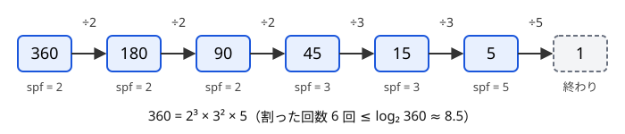

!!! abstract "要点"
    - **何ができるか**：篩のついでに各数の最小素因数を記録しておき、それで割り続けて 1 個の数を $O(\log n)$ で素因数分解する。$10^6$〜$10^7$ 以下の数がたくさんあり、それぞれを素因数分解したいときに使う。
    - **いつ使うか**：
        - $A_i \le 10^6$（〜$10^7$）の各要素を素因数分解する。
        - すべての組が互いに素か（pairwise coprime）を判定する。
        - 各要素の素因数の個数（重複込み）を求める。
    - **計算量**：値の上限を $V$ として、表を作る前計算が $O(V \log \log V)$（線形篩なら $O(V)$）、その後 1 個の素因数分解が $O(\log V)$。メモリは `int` の表で $4V$ バイト。
    - **前提**：[エラトステネスの篩](../math/sieve-eratosthenes.md)、[素因数分解とルジャンドルの公式](../math/prime-factorization.md)

<!-- textlint-disable -->
別名：osa_k 法・最小素因数・smallest prime factor・SPF・高速素因数分解・linear sieve
<!-- textlint-enable -->

最小素因数の篩は、[エラトステネスの篩](../math/sieve-eratosthenes.md)で合成数に印を付けるときに「どの素数が最初に消したか」を記録しておき、その表を使って素因数分解を速くする方法である。表を 1 回作れば、$V$ 以下のどの数も数回から 20 回程度の割り算で分解できる。線形篩はこの表を $O(V)$ で作る変形で、オイラーの φ 関数やメビウス関数の表を同時に作れる。

このページで使う記法：$n \ge 2$ の最小の素因数を $\mathrm{spf}(n)$、重複も数えた素因数の個数を $\Omega(n)$ と書く（例：$360 = 2^3 \cdot 3^2 \cdot 5$ なので $\mathrm{spf}(360) = 2$、$\Omega(360) = 6$）。ほかの記法は[記法と用語の約束](../start/notation.md)にそろえる。

## 最小素因数の表の作り方と、割るたびに半分以下になるので O(log n) で分解できる理由 {#build-and-factor}

最小素因数の表は、エラトステネスの篩を 1 か所変えるだけで作れる。素数 $p$ を小さい順に見て $p$ の倍数を消すとき、まだ何も書かれていない数にだけ $p$ を書き込む。素数は小さい順に処理されるので、ある数に最初に届いた素数がその数の最小素因数である。素数 $p$ 自身には $\mathrm{spf}(p) = p$ を書く。

倍数は $p^2$ から書き始めてよい。$p^2$ より小さい $p$ の倍数 $kp$（$2 \le k < p$）は、$k$ の素因数という $p$ より小さい素因数をもつので、すでに小さい素数が書き込んでいる。

素因数分解は、表を引いて割るだけである。$n$ の素因数を 1 つ $p = \mathrm{spf}(n)$ として取り出し、$n$ を $p$ で割れるだけ割る。残った数でまた表を引き、$n = 1$ になるまで繰り返す。



割る回数は $\Omega(n)$ に等しい。どの素因数も 2 以上なので、1 回割るごとに値は半分以下になり、$\Omega(n) \le \log_2 n$ である。$10^6$ 以下なら最大 19 回（$2^{19} = 524288$）、$10^7$ 以下でも最大 23 回で済む。試し割りが $\sqrt{n}$ までの候補を順に試すのと違い、割り切れない候補を試す無駄が 1 回もない。

```cpp
--8<-- "spf-sieve/spf.cpp:core"
```

表の大きさは「値の上限 + 1」である。要素の個数 $N$ ではない。表に載るのは $V$ 以下の数だけなので、$V$ を超える数（たとえば $10^9$）は分解できない。その場合は[試し割り](../math/prime-factorization.md#which-method)に戻る。

??? question "確認問題：書き始めを 2p にしたら"
    $\mathrm{spf}$ の表を作るとき、$p$ の倍数を $p^2$ からではなく $2p$ から書き始めても、表の中身は変わらないか。

    ??? success "答え"
        変わらない。$2p$ から $p^2 - p$ までの倍数には、より小さい素数がすでに書き込んでいて、「何も書かれていない数にだけ書く」ので上書きされない。$p^2$ から始めるのは、無駄な走査を省くためだけである。

## 多数の数をまとめて分解する（試し割りとの比較） {#many-numbers}

最小素因数の篩が効くのは、分解したい数がたくさんあるときである。試し割りとどちらを選ぶかは[素因数分解の使い分け](../math/prime-factorization.md#which-method)のとおりで、ここでは表を 1 回作って多数の数に使い回すときの見積もりをまとめる。

$N$ 個の数 $A_1, \dots, A_N$（どれも $V$ 以下）を分解する全体は $O(V \log \log V + N \log V)$ である。前計算は $V$ に比例する程度で、$V = 10^6$ なら篩の書き込みは約 $2 \times 10^6$ 回である。その後の分解は 1 個あたり高々 $\log_2 V$ 回（$V = 10^6$ なら 19 回以下）なので、$N = 2 \times 10^5$ 個でも $4 \times 10^6$ 回以下で済む。$N$ が大きいほど、表を作る手間は 1 個あたりでは小さくなる。

値が大きすぎて表を作れず、数も多いときは、$\sqrt{V}$ 以下の素数だけを篩で列挙して試し割りの候補にすると、候補の数が減る（$10^6$ 以下の素数は 78498 個）。

1 から $V$ までのすべての数を分解するときは、合計の割り算は $\sum_{n \le V} \Omega(n)$ 回で、$V = 10^6$ なら約 $3.6 \times 10^6$ 回である。$O(V \log V)$ で抑えられ、実際は篩の前計算と同じ程度で済む。$N!$ の素因数分解で $1, 2, \dots, N$ を順に分解する場面がこれに当たる。

??? question "確認問題：分解の回数の見積もり"
    $10^6$ 以下の数を $10^6$ 個、それぞれ素因数分解する。試し割りと最小素因数の篩では、割り算のおおよその回数はどれだけ違うか。

    ??? success "答え"
        試し割りは 1 個あたり最悪 $\sqrt{10^6} = 10^3$ 回なので、全体で最悪 $10^9$ 回になり間に合わない。最小素因数の篩は 1 個あたり 19 回以下なので、全体で $2 \times 10^7$ 回以下に、篩の前計算（数百万回）を足した程度で済む。

## 分解した後の使い方（異なる素因数・指数・約数） {#after-factor}

最小素因数の篩で分解した結果は、素数と指数の組 $(p, e)$ の列である。問題ではここから何を取り出すかが本体になる。

- **異なる素因数が要素の間で重なるか**：「どの 2 つも互いに素」は「どの素数も 2 個以上の要素を割り切らない」と同じである。各要素の異なる素因数ごとに $\mathrm{cnt}[p]$ を 1 増やし、2 以上になる素数があれば互いに素でない組がある。サインは「すべての組が互いに素か」で、[例題](#abc177_e)がこの型である
- **重複込みの個数 $\Omega(A_i)$**：指数の和 $\sum e$ である。「真の約数に置き換える」操作は、素因数をいくつか取り除くことと同じなので、$\Omega$ を減らす操作とみなせる。[Grundy 数](../comb/grundy-number.md)や [Nim](../comb/nim.md) の山の大きさとして使う場面がある
- **約数の個数と約数の列挙**：約数の個数は $\prod (e + 1)$ で、指数の組合せをすべて作れば約数を列挙できる。$10^6$ 以下の数の約数は最大 240 個（$720720$）なので、全要素で列挙しても重くないことが多い（[約数の列挙](../math/divisor-enum.md)）
- **指数の偶奇や最大値**：平方数の判定（指数がすべて偶数）や、LCM（素数ごとの指数の最大）を素数ごとに扱う。巨大な LCM を直接作らずに済む（[素因数の指数で考える](../math/prime-exponent-vector.md)）

どの型でも、同じ素数を要素の中で何度数えるかを決めておく。「異なる素因数」なら素数ごとに 1 回、$\Omega$ なら指数の分だけ数える。

## 線形篩：各合成数を1回だけ作り、φ・μ の表を同時に作る {#linear-sieve}

この節は[オイラーの φ 関数](../math/euler-phi.md#formula)と[メビウス関数](../comb/mobius-function.md#definition)の定義を前提にする。エラトステネスの篩では、たとえば 30 は 2・3・5 の 3 回の倍数として訪れられる。線形篩は、どの合成数 $x$ も「$x = \mathrm{spf}(x) \times i$」の形で 1 回だけ作る。

手順は次のとおりである。$i = 2, 3, \dots, V$ の順に見て、まだ作られていない $i$ は素数として素数の列に足す。そのうえで、$\mathrm{spf}(i)$ 以下の素数 $p$ について $x = p \cdot i$ を作り、$\mathrm{spf}(x) = p$ と書く。$p$ を $\mathrm{spf}(i)$ で止めるのが要点である。

- **1 回は作られる**：合成数 $x$ について $p = \mathrm{spf}(x)$、$i = x / p$ とおくと、$i$ の素因数はどれも $p$ 以上なので $p \le \mathrm{spf}(i)$ であり、$i$ を見たときに $x$ が作られる
- **2 回は作られない**：$x = p \cdot i$ と作られたなら、$p \le \mathrm{spf}(i)$ なので $p$ は $x$ の最小素因数である。$p$ が決まれば $i = x / p$ も決まるので、作り方は 1 通りしかない

各合成数を 1 回ずつ作るので、全体は $O(V)$ である。作るときに $p$ が $i$ を割り切るかどうかが分かるので、乗法的な関数の表も同時に埋まる。

- $p \mid i$（$p = \mathrm{spf}(i)$）のとき：$p$ の指数が 1 増えるだけなので $\varphi(x) = \varphi(i) \cdot p$、$\mu(x) = 0$
- $p \nmid i$（$p < \mathrm{spf}(i)$）のとき：新しい素因数が 1 つ増えるので $\varphi(x) = \varphi(i) \cdot (p - 1)$、$\mu(x) = -\mu(i)$

```cpp
--8<-- "spf-sieve/linear-sieve.cpp:core"
```

線形篩でなければ間に合わない ABC の問題は、見つかっていない。$V = 10^7$ でもエラトステネスの篩の $\log \log V$ は 3 程度で、実際の速さはほぼ変わらない。φ・μ の表も、エラトステネスの篩の変形（素数 $p$ の倍数ごとに $\varphi$ に $(1 - 1/p)$ を掛ける）で作れる。線形篩は、表を 1 回の走査でまとめて作りたいときの選択肢と考えればよい。

## メモリの見積もり（int で 10^7 個は 40 MB） {#memory}

最小素因数の表は数ごとに素数を 1 つ持つので、`int`（4 バイト）で $4V$ バイトになる。素数かどうかだけを持つ `vector<bool>` は 1 ビットなので、その 32 倍である。

| $V$ | `int` の表 | `vector<bool>`（素数の判定だけ） |
| --- | --- | --- |
| $10^6$ | 4 MB | 0.125 MB |
| $10^7$ | 40 MB | 1.25 MB |
| $10^8$ | 400 MB | 12.5 MB |

ABC の多くはメモリ制限 1024 MiB なので（[計算量の見積もり](../basics/complexity-estimation.md#how-to-estimate)）、$V = 10^7$ の表は問題ない。線形篩で φ・μ の表も持つと、表が 3 本で 120 MB になる。$V = 10^8$ は 1 本で 400 MB を使い、篩の時間もかかるので、最小素因数の表は $10^7$ までを目安にする。

メモリを減らしたいときは、次の工夫がある。

- **偶数を表から外す**：偶数の最小素因数は 2 と分かっているので、奇数だけを持てば半分になる
- **素数の列だけ持つ**：$\sqrt{V}$ 以下の素数を列挙し、それで試し割りする。表はいらないが、1 個あたり $O(\sqrt{V} / \log V)$ 回かかる

## 落とし穴 {#pitfalls}

**$p \cdot p$ のオーバーフロー**。$V = 10^7$ で $p$ を $V$ まで回し、`int j = p * p` と書くと、$p > 46340$ で $p^2$ が `int` を超えてあふれる（未定義動作）。負になれば配列の外に書き、正の値に巻き戻れば（$p = 65537$ なら 131073）$p$ の倍数でない位置に $p$ を書いて表を黙って壊す。倍数の位置は `long long` で計算する。外側のループを $p \cdot p \le V$ の範囲に限る書き方もあるが、そのときは $\sqrt{V}$ を超える素数に誰も $\mathrm{spf}(p) = p$ を書かないので、最後に 0 のままの $x$ へ `spf[x] = x` を書く。これを忘れると分解で `x % 0` になる。

**1 と表の外の値**。$\mathrm{spf}(1)$ は定義されないので、分解のループは `while (x > 1)` にして 1 を素因数なしとして扱う。表を要素数 $N$ で作ってしまうと、値が $N$ を超えた要素で配列の外を読む。表の大きさは値の上限 + 1 にする。

**「異なる素因数」と「重複込み」の取り違え**。$12 = 2^2 \cdot 3$ の素因数を 1 つずつ取り出すループで $\mathrm{cnt}[2]$ を 2 回増やすと、1 つの要素だけで「2 が 2 回出た」と判定され、互いに素なのにそうでないと答える。素数ごとに割れるだけ割ってから 1 回数える形にしておけば、この誤りは起きない。

**分解の結果を全要素ぶん保存する**。`vector<vector<pair<int,int>>>` に全要素の分解を入れると、要素数が多いときにメモリと時間を余計に使う。多くの問題では、分解しながらその場で数え上げれば足りる。

**大きな値に使う**。$A_i \le 10^9$ や $10^{12}$ では表が作れない。1 個ずつ試し割りするか、値の範囲が $[L, R]$ の連続した区間なら[区間篩](../math/segmented-sieve.md)、$10^{18}$ の数なら[大きな数の素数判定と素因数分解](../math/miller-rabin.md)を使う。

## 使い分け {#comparison}

- 数が 1 個か少数で、値が $10^{12}$ 程度まで：[試し割り](../math/prime-factorization.md#which-method)
- 数が多く、値が $10^7$ 程度まで：最小素因数の篩
- 値の連続した区間 $[L, R]$（$R \le 10^{12}$、$R - L \le 10^6$ など）を分解：[区間篩](../math/segmented-sieve.md)
- 1 個で値が $10^{18}$ 程度：[大きな数の素数判定と素因数分解](../math/miller-rabin.md)
- 素数かどうかだけ分かればよい：[エラトステネスの篩](../math/sieve-eratosthenes.md)（メモリが 32 分の 1 で済む）

## 例題 {#examples}

### ABC177 E. Coprime {#abc177_e}

<div class="kp-problems" data-role="example" markdown>

- [ABC177 E. Coprime](https://atcoder.jp/contests/abc177/tasks/abc177_e)（diff 1057）：N 個の整数が、どの 2 つも互いに素（pairwise coprime）か、全体の最大公約数だけが 1（setwise coprime）か、どちらでもないかを判定する（A_i ≤ 10^6）。

</div>

組は $N^2$ 通りあるので、すべての組の GCD を調べると間に合わない。「どの 2 つも互いに素」を「どの素数も 2 個以上の要素を割り切らない」と言い換えると、要素ごとの異なる素因数を数えるだけで判定できる。$A_i \le 10^6$ なので、最小素因数の表で各要素を分解する。

??? note "解法の詳細"
    - $10^6$ までの最小素因数の表を作る。各 $A_i$ を分解し、異なる素因数 $p$ ごとに $\mathrm{cnt}[p]$ を 1 増やす（同じ要素の中で同じ素数を 2 回数えない）。$A_i = 1$ は素因数がないので何もしない。
    - どの $\mathrm{cnt}[p]$ も 1 以下なら pairwise coprime である。
    - そうでなければ、全体の GCD を[ユークリッドの互除法](../math/gcd-lcm.md)で求め、1 なら setwise coprime、1 でなければどちらでもない。pairwise coprime なら全体の GCD も 1 なので、pairwise を先に判定する。
    - 計算量は $O(V \log \log V + N \log V)$（$V = 10^6$）。素数 $p$ ごとに「$p$ の倍数である要素の個数」を倍数をたどって数える方法でも解ける（[調和級数](../math/harmonic-sum.md)の考え方）。

## 練習問題 {#practice}

<div class="kp-problems" data-role="practice" markdown>

- [ABC368 F. Dividing Game](https://atcoder.jp/contests/abc368/tasks/abc368_f)（diff 1180）：数列の要素を 1 つ選んでその真の約数に置き換える操作を 2 人が交互に行い、操作できなくなった方が負けるとき、勝者を求める。

</div>

??? note "練習の方針"
    - **ABC368 F**：真の約数に置き換えることは、素因数を 1 個以上取り除くことと同じである。各要素の $\Omega(A_i)$ を Nim の山の大きさとみて XOR し、0 でなければ先手の勝ちである。$\Omega(A_i)$ は最小素因数の表で求める（値が小さいので試し割りでも間に合う）

## 参考 {#references}

- [drken「エラトステネスの篩の活用法を総特集！ 〜 高速素因数分解・メビウスの反転公式 〜」](https://qiita.com/drken/items/3beb679e54266f20ab63)：最小素因数の表の作り方と計算量（前計算 $O(N \log \log N)$、1 個 $O(\log N)$）、線形篩への言及
- [drken「AtCoder ABC 177 E - Coprime (1Q, 緑色, 500 点)」](https://drken1215.hatenablog.com/entry/2020/10/31/203300)：例題の言い換えと、素因数を数える方法・倍数をたどる方法の比較
- [プロひろ「ABC368 F問題（Dividing Game）を解く」](https://programming-hiroba.com/abc368-f/)：練習の方針（素因数の個数を Nim の山とみる）
- [hyouri「ABC368をPythonで（A～D,F）」](https://qiita.com/hyouri/items/f80a169412d5a969c25d)：練習の別解（Grundy 数を倍数に配って求める）
