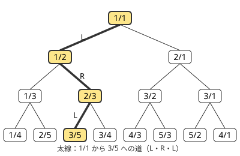

!!! abstract "要点"
    - **何ができるか**：分子・分母が $N$ 以下の分数のうち、与えられた実数に最も近いもの（実数を挟む最も近い 2 つ）などを求める。既約分数をすべて 1 回ずつ含む二分木を降り、同じ向きへの移動を 1 回の割り算でまとめて進めると、$O(\log N)$ 段で止まる。まとめた移動の回数の列が連分数にあたる。
    - **いつ使うか**：
        - 分母・分子が N 以下で、与えられた実数に最も近い分数
        - 分数の範囲を二分探索する
    - **計算量**：最良近似と、木の上の道の圧縮表現が $O(\log N)$（$N$ は分子・分母の上限）。途中の積は 64 bit を超えうるので 128 bit 整数で比べる。判定だけを使って分数を二分探索するときは、判定が $O(\log N)$ 回
    - **前提**：[GCD・LCM とユークリッドの互除法](../math/gcd-lcm.md)

<!-- textlint-disable -->
別名：Stern-Brocot tree・continued fraction・最良近似・最良有理近似・Farey 数列・有理数の二分探索
<!-- textlint-enable -->

Stern-Brocot 木は、正の有理数を二分探索木の形にすべて並べたものである。根から目的の分数へ降りる道は、左右の移動をまとめると[ユークリッドの互除法](../math/gcd-lcm.md#euclid)の商の列になる。この性質のおかげで、深い場所にある分数にも $O(\log N)$ 回の割り算で届き、分子・分母に上限のある分数での近似や、分数を答えとする二分探索ができる。

ABC での出番はまれで、黄の帯を目指すうえでは「分数の最良近似は木を降りれば求まる」と知っておけば足りる。

## Stern-Brocot 木と既約分数 {#tree}

このページで使う記法：分数は $a/b$ と書き、$1/0$ は無限大を表す番兵とする。2 つの分数 $a/b$ と $c/d$ に対し、分子どうし・分母どうしを足した $(a + c)/(b + d)$ を**中間数**（mediant）と呼ぶ。ほかの記法は[記法と用語の約束](../start/notation.md)にそろえる。

木は次のように作る。両端を $0/1$ と $1/0$ とし、隣り合う 2 つの分数の間にその中間数を挟む操作を繰り返す。最初に挟まる $1/1$ が根である。各頂点 $a/b$ には、それを挟んで作った左右の分数 $L$・$R$（左右で最も近い祖先か両端）が決まっている。左の子は $L$ と $a/b$ の中間数、右の子は $a/b$ と $R$ の中間数である。



木には次の性質がある。

- **隣り合う分数 $a/b < c/d$ は $bc - ad = 1$ を満たす。** 最初の $0/1$ と $1/0$ で $1 \cdot 1 - 0 \cdot 0 = 1$ である。中間数を挟むと、左の組は $b(a + c) - a(b + d) = bc - ad$、右の組も同様に $1$ のままになる。
- **どの頂点も既約分数である。** $bc - ad = 1$ から、$a$ と $b$ の公約数は $1$ を割り切る。
- **左から右へ値が増える。** 中間数は 2 つの分数の間の値なので、木は二分探索木になっている。
- **正の有理数はちょうど 1 回ずつ現れる。** 目的の既約分数 $p/q$ を探して降りる途中、左右の分数を $a/b$・$c/d$ とする。$p/q$ がその間にある限り $p \ge a + c$・$q \ge b + d$ が成り立つ（[最良有理近似の節](#best-approximation)）。右辺は 1 段降りるごとに増えるので、有限の段数で中間数が $p/q$ に当たる。

ただし、木は深い。$N/1$ は根から右へ $N - 1$ 回進んだ所にあり、1 段ずつ降りると $O(N)$ 回かかる。これを縮めるのが[次の節](#continued-fraction)である。

分母が $N$ 以下の $0$ 以上 $1$ 以下の既約分数を小さい順に並べた列を **Farey 数列**と呼ぶ。両端を $0/1$ と $1/1$ にして、分母が $N$ を超える中間数を挟まないで同じ操作をすると、この列ができる。そのため Farey 数列でも、隣り合う 2 つは $bc - ad = 1$ を満たす。

## 同じ方向の移動を一度に進める（連分数） {#continued-fraction}

目的の値 $x/y$（正の分数。既約でなくてよい）へ降りる途中、左右の分数を $L = a/b < x/y < R = c/d$ とする。中間数が $x/y$ より小さければ右へ進み、$L$ を中間数に置き換える。右へ $k$ 回続けて進むと $L$ は $(a + kc)/(b + kd)$ になる。これが $x/y$ より小さいままである条件を掛け算の形に直すと、次のようになる。

$$
\begin{aligned}
& (a + kc)\,y < x\,(b + kd) \\
\iff & k\,(cy - dx) < bx - ay
\end{aligned}
$$

$L < x/y < R$ なので両辺の括弧の中はどちらも正である。よって、右へ続けて進める最大の回数は $k = \lfloor (bx - ay - 1)/(cy - dx) \rfloor$ で、1 回の割り算で求まる。左へ続けて進む回数も、左右を入れ替えた同じ式で求まる。

右へ $a_0$ 回、左へ $a_1$ 回、右へ $a_2$ 回、… と進む回数の列は、$x/y$ の**連分数**

$$
\frac{x}{y} = a_0 + \cfrac{1}{a_1 + \cfrac{1}{\ddots + \cfrac{1}{a_n}}}
$$

の各項 $a_0, a_1, \dots, a_n$ に一致する（最後だけ $a_n - 1$ 回。$a_0 = 0$ もある）。各項は $x$ と $y$ に互除法を行ったときの商の列である。たとえば $3/5$ では、互除法の商が $0, 1, 1, 2$ なので、根からの移動は「右 $0$ 回・左 $1$ 回・右 $1$ 回・左 $2 - 1 = 1$ 回」となり、図の L・R・L の道に一致する。

まとめて進むと速い理由も互除法と同じである。互除法の回数は隣り合うフィボナッチ数で上から抑えられるので、項の数は $O(\log \max(x, y))$ である。分子・分母に上限 $N$ がある探索では、左右の分数の分母が 2 回の移動ごとにフィボナッチ数のように増えるので、$x/y$ がどれほど大きな分数でも $O(\log N)$ 回のまとめた移動で止まる。

目的の値が式で与えられず、「答えは分数 $f$ 以上か」という単調な判定だけが使える場合も、同じ木で分数を二分探索できる。続けて進む回数を $1, 2, 4, \dots$ と倍にしながら判定し、行き過ぎたら最後の幅を二分探索する。判定の回数は全体で $O(\log N)$ に収まる（cp-algorithms の解説に証明がある）。

## 最良有理近似と比較の精度（128 bit 整数） {#best-approximation}

分子・分母が $N$ 以下の分数で $x/y$ を近似するときは、木を降り、次に進む中間数の分子か分母が $N$ を超えた所で止まる。そのときの $L$ と $R$ が「$x/y$ 以下で最大」と「$x/y$ 以上で最小」の分数であり、最も近い分数はこの 2 つのどちらかになる。中間数が $x/y$ にちょうど等しく、範囲に入るなら、それが答えである。

理由は、隣り合う分数の間にある分数は、分子と分母がどちらも大きいことにある。$a/b < p/q < c/d$（$bc - ad = 1$）なら $bp - aq \ge 1$ と $cq - dp \ge 1$ が成り立ち、次の式が得られる。

$$
\begin{aligned}
q &= q\,(bc - ad) \\
&= b\,(cq - dp) + d\,(bp - aq) \ge b + d, \\
p &= a\,(cq - dp) + c\,(bp - aq) \ge a + c
\end{aligned}
$$

止まった時点で中間数 $(a + c)/(b + d)$ は範囲の外にあるから、$L$ と $R$ の間に範囲内の分数はない。同じ式から、2 つの分数の間で分子・分母が最も小さいのは中間数だとも分かる。

比較はすべて掛け算の整数で行う。

- **進む回数と大小**：$bx$ や $ay$ は $N \cdot y$ 程度になる。たとえば $y = 10^{18}$（小数点以下 18 桁の小数を分数に直したとき）で $N = 10^{10}$ なら、 $10^{28}$ ほどで、`long long`（約 $9.2 \times 10^{18}$）を超える。`__int128`（約 $1.7 \times 10^{38}$）で計算する。
- **どちらが近いか**：$x/y - a/b$ と $c/d - x/y$ を比べるには、$(bx - ay)\,d$ と $(cy - dx)\,b$ を比べればよい。$R - L = 1/(bd)$ なので、どちらの値も $y$ 未満に収まる。
- **double を使わない**：double の仮数部は 53 bit（10 進で 15〜16 桁）しかなく、18 桁の小数は正しく表せない。小数の入力は文字列で読み、$10$ の冪を分母とする整数の分数に直す。

$N$ と $x/y$ から $L$ と $R$ を返す関数の中心は次のとおりである（完全なプログラムは [`snippets/stern-brocot/approx.cpp`](https://github.com/yuukougun/kyopro-atlas/blob/main/snippets/stern-brocot/approx.cpp)）。

```cpp
--8<-- "stern-brocot/approx.cpp:core"
```

完全なプログラム：[`approx.cpp`](https://github.com/yuukougun/kyopro-atlas/blob/main/snippets/stern-brocot/approx.cpp)（GitHub）
{ .kp-code-src }

$L$ が存在しない（$x/y$ が $1/N$ より小さい）ときは $0/1$ が、$R$ が存在しない（$x/y$ が $N$ より大きい）ときは $1/0$ が残る。分母だけに上限がある問題では、分子の上限で回数を切る行を外す。

## 自作するときの要点と Library Checker {#library}

ACL に対応する機能はないので、使うなら自作する。保つ性質と境界は次のとおりである。

- 左右の分数 $a/b$・$c/d$ を 4 つの整数で持ち、$bc - ad = 1$ と $L < x/y < R$ を保つ。この不変条件があるので、進む回数の式で割る数はいつも正になる。
- 番兵の $0/1$ と $1/0$ から始める。$1/0$ の分母 $0$ で割らないよう、上限で回数を切るときは分子・分母が正のものだけで割る。
- 途中の積は `__int128` で計算する。入力の $x/y$ を既約にしておく必要はない。

木の上の操作も、道を「L か R と、その回数」の列（連長圧縮）で表せば、どれも $O(\log N)$ 個の項の計算になる。

- **分数から道**：互除法の商の列を作る（最後の項だけ 1 を引く）。
- **道から分数**：$L$・$R$ を $0/1$・$1/0$ から始め、各項の回数だけまとめて進めて、最後の中間数を取る。
- **2 つの分数の LCA**：2 つの道の先頭から項が一致する所までを取り、最初に食い違った項が同じ向きなら、回数の小さい方の分だけ足す。
- **深さ $k$ の祖先**：道を先頭から $k$ 回分で切る。
- **子孫の範囲**：頂点 $a/b$ の子孫は、その頂点の $L$ と $R$ を両端とする開区間の分数すべてである。

自作したものは Library Checker で確かめられる。

- [Stern–Brocot Tree](https://judge.yosupo.jp/problem/stern_brocot_tree)：分数と道の変換（ENCODE_PATH・DECODE_PATH）、LCA、深さ $k$ の祖先、子孫の範囲を、分子・分母が $10^9$ 以下で答える。
- [Rational Approximation](https://judge.yosupo.jp/problem/rational_approximation)：$N, x, y \le 10^9$ で、分子・分母が $N$ 以下の分数のうち $x/y$ 以下で最大と $x/y$ 以上で最小を答える。上のコード片はこの入出力の形に合わせてある。

## 学ぶための資料 {#resources}

- [cp-algorithms「The Stern-Brocot tree and Farey sequences」](https://cp-algorithms.com/others/stern_brocot_tree_farey_sequences.html)：木の作り方と $bc - ad = 1$ の不変条件から、道と連分数の対応、判定だけで進む対数回の探索、Farey 数列との関係までを証明とともに追える。
- [Nyaan「Stern-Brocot Tree」（Nyaan's Library）](https://nyaannyaan.github.io/library/math/stern-brocot-tree.hpp)：道の圧縮表現、LCA・祖先・左右の端などの木の上の操作をまとめた実装で、自作するときの関数の切り分けの参考になる。

## 例題 {#examples}

### ABC333 G. Nearest Fraction {#abc333_g}

<div class="kp-problems" data-role="example" markdown>

- [ABC333 G. Nearest Fraction](https://atcoder.jp/contests/abc333/tasks/abc333_g)（diff 2536）：分母・分子が N 以下の分数のうち、小数で与えられた実数 r に最も近いものを求める。

</div>

小数 $r$ を、小数点以下の桁を並べた整数 $x$ と $y = 10^{k}$ の分数に直し、分子・分母が $N$ 以下の範囲で[最良有理近似](#best-approximation)の $L$ と $R$ を求める。答えは 2 つのうち $r$ に近い方である。1 段ずつ降りると $r$ が $1/N$ に近いときなどに $O(N)$ 段かかるので、同じ向きの移動はまとめて進める。

??? note "解法の詳細"
    - $r$ は文字列で読み、double を通さずに整数の分数 $x/y$ にする。
    - 木を降りる途中で中間数が $x/y$ に等しくなれば、それが答えである。
    - 止まったら $(bx - ay)\,d$ と $(cy - dx)\,b$ を比べて近い方を出す。近さが等しいときの扱いは問題の指定に従う（参考にした解答では小さい方の $L$ を出している）。
    - $bx$ や $ay$ は 64 bit を超えるので、比較は `__int128` で行う。kmjp 氏の解答は、まとめた移動の回数を割り算で求める代わりに、100 回まとめて進めてみて行き過ぎたら 1 回ずつ進む形で書いている。

## 参考 {#references}

- [cp-algorithms「The Stern-Brocot tree and Farey sequences」](https://cp-algorithms.com/others/stern_brocot_tree_farey_sequences.html)：$bc - ad = 1$ の不変条件、道と連分数の対応、判定だけで進む対数回の探索とその回数の上限、Farey 数列との関係
- [Library Checker「Stern–Brocot Tree」](https://judge.yosupo.jp/problem/stern_brocot_tree)：木の上の操作の一覧と制約
- [Library Checker「Rational Approximation」](https://judge.yosupo.jp/problem/rational_approximation)：最良近似の問いの形と制約、存在しないときの 0/1・1/0 の約束
- [yosupo06「library-checker-problems」](https://github.com/yosupo06/library-checker-problems)：上の 2 問の問題文（task.md）と制約の値（info.toml）
- [Nyaan「Stern-Brocot Tree」（Nyaan's Library）](https://nyaannyaan.github.io/library/math/stern-brocot-tree.hpp)：自作するときの操作の一覧（LCA・祖先・左右の端）
- [kmjp「AtCoder ABC #333 (トヨタ自動車プログラミングコンテスト2023#8) : G - Nearest Fraction」](https://kmjp.hatenablog.jp/entry/2023/12/16/0900)：例題の方針（木を降りる・移動をまとめる・128 bit の比較・近い方の選び方）
- [かんプリン「競技プログラミング　典型問題メモ」](https://kanpurin.hatenablog.com/entry/2020/04/07/182948)：例題が Stern-Brocot 木の典型であることの確認
