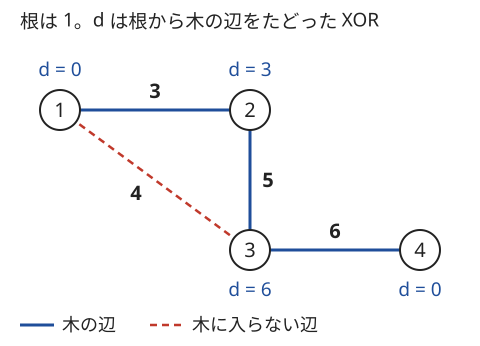

!!! abstract "要点"
    - **何ができるか**：整数の集合から XOR で作れる値の全体を、最上位 bit が互いに異なる $r$ 個の基底で表す。作れる値は $2^r$ 種類で、最大値は上の bit から貪欲に、K 番目に小さい値は簡約した基底から求まる。
    - **いつ使うか**：
        - 部分集合（部分列）の XOR として作れる値の個数・最大値・K 番目を問われる。
        - すべての値を XOR で作れるように、最小コストで選ぶ。
        - 経路の重みが辺の重みの XOR で、同じ辺を何度通ってもよい（ウォーク）。
        - $A_i < 2^{60}$ で $N \le 10^5$ 程度。
    - **計算量**：bit 数を $B$ として、挿入は 1 要素 $O(B)$（$N$ 個で $O(NB)$）。最大値・最小化は $O(B)$。K 番目は簡約に $O(B^2)$ かけた後、1 回 $O(B)$。
    - **前提**：[bit 演算の基本と XOR の性質](../basics/bit-operations.md)

<!-- textlint-disable -->
別名：XOR basis・線形基底・linear basis・F2 の基底・部分集合の XOR・XOR で作れる値・閉路基底・サイクル基底・サイクル空間・XOR 最短路
<!-- textlint-enable -->

XOR 基底は、整数をいくつか選んで XOR した値の全体を、最上位 bit が互いに異なる高々 $B$ 個の整数で表したものである。$N = 10^5$ 個から選ぶ方法は $2^N$ 通りあるが、作れる値の集合は基底だけで決まるので、個数と最大値を $O(B)$ で、K 番目を前計算 $O(B^2)$ の後に 1 回 $O(B)$ で答えられる。

このページでは、整数は $0$ 以上 $2^B$ 未満（コードでは $B = 60$）、bit は最下位を 0 番目と数え、XOR を $\oplus$ と書く（記法は[記法と用語の約束](../start/notation.md)）。「作れる値」は、何個か（0 個も含む）選んで XOR した値のことで、0 個なら $0$ である。

## 基底への挿入（最上位 bit で掃き出す。1 要素 O(bit 数)） {#insert}

$N$ 個の整数から作れる値を全部並べると $2^N$ 通りになり、$N = 60$ でも試せない。そこで、作れる値の集合を変えずに、扱いやすい少数の整数へ置き換える。置き換えに使うのは、[XOR の性質](../basics/bit-operations.md#xor-properties)の 2 つである。

- $x \oplus x = 0$ なので、同じ数を 2 回使うのは使わないのと同じ。各数は「使う・使わない」の 2 択になる。
- 集合 $\{a, b\}$ を $\{a, a \oplus b\}$ に置き換えても、作れる値の集合は変わらない（$b = a \oplus (a \oplus b)$ なので、元の数も新しい数の XOR で作れる）。

挿入では、基底を「最上位 bit が $i$ の要素 $b[i]$」の配列で持つ（なければ $0$）。新しい値 $x$ を入れるときは、上の bit から次をくり返す。

```text
for i = B-1 down to 0:
    x の bit i が 0 なら次へ
    b[i] が空なら b[i] = x として終わる（基底が 1 つ増える）
    そうでなければ x ^= b[i]（bit i が消え、それより上の bit は変わらない）
x が 0 になったら、x は今の基底で作れる値だった（基底は変わらない）
```

$x \oplus b[i]$ は、$b[i]$ の最上位 bit が $i$ なので bit $i$ が消え、それより上の bit は変わらない。だから $x$ の最上位 bit は 1 回ごとに真に下がり、ループは $B$ 回で終わる。置き換えの性質から、$x$ を $x \oplus b[i]$ にしても作れる値の集合は変わらない。

次の図は、$13, 9, 6, 11$ を順に入れたときの様子である（4 bit）。

![13 を入れると b[3] = 1101 に置く。9 = 1001 は b[3] と XOR して 0100 になり b[2] に置く。6 = 0110 は b[2] と XOR して 0010 になり b[1] に置く。11 = 1011 は b[3]・b[2]・b[1] と順に XOR して 0 になり、基底は増えない](../img/xor-basis/insert.svg)

$11$ は $13 \oplus 6$ なので、すでに作れる値であり、0 まで消えた。できた基底は $1101, 0100, 0010$ の 3 個で、作れる値は $2^3 = 8$ 種類ある。こうして残った基底の要素は、最上位 bit が互いに違う。最上位 bit が違う数どうしは、空でない組をどう選んで XOR しても $0$ にならない（選んだ中で最上位 bit が最も高い数の、その bit が消えない）。この性質を「独立」という。基底の大きさ $r$ を、元の集合のランクと呼ぶ。

```cpp
--8<-- "xor-basis/basis.cpp:core"
```

`reduce` は、$x$ に基底の要素をいくつか XOR してできる値のうち最小のものを返す。$x$ が作れる値なら $0$ になるので、「$x$ を作れるか」の判定にも使える。`max_value` は次の [#max](#max) で説明する。

!!! info "掃き出し法との関係"
    1 つの整数を 0 と 1 の列とみると、挿入は mod 2 の[掃き出し法](../math/gaussian-elimination.md#mod-2)を 1 行ずつ足しながら進めたものである。基底の大きさは、整数を行に並べた表のランクに等しい。

## 作れる値の個数 2^r と作り方の数 2^(n − r) {#count}

$n$ 個の整数のランクが $r$ なら、作れる値はちょうど $2^r$ 種類で、そのどの値も、選び方がちょうど $2^{n-r}$ 通りある。

**種類が $2^r$ である理由**。作れる値の集合は、基底 $r$ 個から作れる値の集合と同じである。基底の部分集合は $2^r$ 通りあり、異なる 2 つの部分集合の XOR は等しくならない。等しいなら、2 つの部分集合の対称差（片方だけに入る要素）の XOR が $0$ になり、独立であることに反するからである。

**作り方が $2^{n-r}$ 通りである理由**。挿入で基底に入った $r$ 個の元の数（基底の要素ではなく、入れた時点の元の値）は、それだけで作れる値をすべて作れて、かつ独立である。入らなかった $n - r$ 個は、どの組を選んでもその XOR を $y$ とすると、$x \oplus y$ を入った $r$ 個で作る方法がちょうど 1 通りある。だから $x$ を作る選び方は、入らなかった $n - r$ 個の選び方の数 $2^{n-r}$ に等しい。

- 例：$\{3, 5, 6\}$ は $3 \oplus 5 = 6$ なのでランク 2 で、作れる値は $\{0, 3, 5, 6\}$ の 4 種類。各値は $2^{3-2} = 2$ 通りで作れる（$0$ は空と $\{3, 5, 6\}$）。
- 「1 個以上選んで $0$ を作る方法」は $2^{n-r} - 1$ 通りある。$n > r$ なら必ず 1 通り以上ある。
- $n$ が大きいと $2^{n-r}$ は `long long` に収まらない。mod を取るなら[繰り返し二乗法](../math/mod-pow.md)で求める。

## XOR の最大値は上の bit から貪欲に決めてよい理由 {#max}

作れる値の最大値は、$x = 0$ から始めて、最上位 bit の高い基底から順に「$x \oplus b[i]$ の方が大きければ $x$ を置き換える」をくり返せば求まる。各 $b[i]$ は使うか使わないかの 2 択なので、$2^r$ 通りのうち最大のものを $B$ 回の比較で選んでいることになる。

貪欲でよいのは、基底の最上位 bit が互いに違うからである。$b[i]$ を使うかを決める時点で、bit $i$ より上の bit は、もう決めた（$b[i]$ より上の）基底だけで決まっている。$b[i]$ より下の基底は bit $i$ 以上に触れないので、bit $i$ は「$b[i]$ を使うか」だけで決まる。bit $i$ が 1 の値は、下の bit がどうであっても bit $i$ が 0 の値より大きい（$2^i > 2^{i-1} + \dots + 2^0$）。だから bit $i$ を 1 にできる方を選べばよく、それは $x$ と $x \oplus b[i]$ の大きい方である。

同じ理由で、最小値は「小さい方を選ぶ」貪欲で求まる。値 $v$ から始めると、$v$ に作れる値を XOR してできる最小の値になる（`reduce`）。$v = 0$ なら答えは $0$ なので、意味があるのは $v \ne 0$ のときである。「ある値 $v$ との XOR を最大・最小にする」問題は、$v$ から始めて同じ貪欲をすればよい。

- **応用の型**：2 つのグループに分けて、それぞれの XOR の和を最大にする（練習の [ABC141 F](#practice)）。全体の XOR $T$ で 1 の bit は、どう分けてもちょうど片方のグループで 1 になり、答えに $T$ の分だけ必ず加わる。$T$ で 0 の bit では両方のグループの値が等しい。したがって、片方の XOR $s$ について $s + (s \oplus T)$ を最大にするには、各数から $T$ の 1 の bit を消した値で $s$ を最大にすればよい。
- **応用の型**：上限 $K$ 以下という条件付きの最大は、上の bit から「$K$ と同じ bit で進むか、$K$ より小さくして残りを自由にするか」を場合分けする。考え方は[上の bit から決める貪欲](../basics/bitwise-independence.md#top-down)と同じである（力試しの [ABC249 G](#challenge)）。

## 簡約した基底と K 番目に小さい値 {#kth}

作れる値を小さい順に並べた K 番目は、基底をさらに整えた簡約した基底から求まる。簡約した基底とは、各要素の最上位 bit が、ほかのどの要素でも 0 になっている基底である。挿入で作った基底 $b[i]$ から、下の bit から順に「$b[i]$ の最上位 bit $i$ が立っている、上の要素 $b[j]$（$j > i$）に $b[i]$ を XOR する」をすれば作れる。$b[i]$ は自分より下の最上位 bit をもう消してあるので、XOR しても消した bit が戻ることはない。

簡約した基底を小さい順に $c_0 < c_1 < \dots < c_{r-1}$ とする。このとき、$k$（0 から数える）の 2 進表記で bit $i$ が 1 の $c_i$ をすべて XOR した値が、作れる値の中で $k$ 番目に小さい。

**理由**。$k$ と $k'$ を比べ、2 進で最も上の違う bit を $i$ とする。$c_i$ より上の基底の選び方は同じである。$c_i$ の最上位 bit $p$ は、簡約によってほかの要素では 0 で、$c_i$ より下の基底は bit $p$ より上に触れない。だから 2 つの値は bit $p$ より上が等しく、bit $p$ は $c_i$ を使った方だけが 1 になる。つまり $k$ の大小と値の大小が一致する。

図の基底 $1101, 0100, 0010$ を簡約すると、$1101$ の bit 2 を $0100$ で消して $c = (0010, 0100, 1001) = (2, 4, 9)$ になる。作れる値は小さい順に $0, 2, 4, 6, 9, 11, 13, 15$ で、たとえば $k = 5 = (101)_2$ なら $c_0 \oplus c_2 = 2 \oplus 9 = 11$ である。

```cpp
--8<-- "xor-basis/basis.cpp:kth"
```

- $k \ge 2^r$ なら $k$ 番目は存在しない。最大値は $k = 2^r - 1$、すなわち簡約した基底の全部の XOR である。
- 0 番目は $0$（0 個選ぶ）である。「1 個以上選ぶ」なら、$0$ を 1 個以上で作れるのは $n > r$ のときだけ（[#count](#count)）なので、$n = r$ なら番号を 1 つずらす。
- 簡約しない基底で $k$ の 2 進に従って選ぶと、順番が狂う（[落とし穴](#pitfalls)）。

## コストの小さい順に基底へ入れる貪欲（線形マトロイド） {#min-cost}

各整数に $0$ 以上のコストがあり、「選んだ数の XOR で、全体から作れる値をすべて作れる」ように選ぶとき、コストの和の最小は次の貪欲で求まる。コストの小さい順に挿入を試し、基底が増えたものだけ選ぶ。選ぶのはちょうど $r$ 個で、どれも独立である。

負のコストの数があるなら、それらは全部選んだ方が和が小さい。先に全部選んで基底に入れてから、残りに同じ貪欲をかける。

```cpp
--8<-- "xor-basis/min-cost.cpp:core"
```

この貪欲は、[最小全域木](../graph/minimum-spanning-tree.md)のクラスカル法と同じ形をしている。クラスカル法の「閉路を作らない辺だけ取る」が、ここでは「今まで選んだ数で作れない数だけ取る」になる。どちらも「独立な集合」が交換の性質を持つ（線形マトロイド・グラフのマトロイド）ので、軽い順の貪欲が最適になる。

??? note "証明（交換の論法）"
    貪欲が選んだ数をコストの小さい順に $g_1, g_2, \dots, g_r$ とする。最適解のうち、$g_1, \dots, g_{k-1}$ を含み $k$ が最大のもの $O$ をとる。$O$ が $g_1, \dots, g_r$ をすべて含むなら、ほかの要素のコストは $0$ 以上なので $O$ の和は貪欲の和以上で、貪欲も最適である。そうでないとき、$g_k \notin O$ である。

    $O$ は全体の値を作れるので、$g_k$ は $O$ のいくつかの要素の XOR で書ける。その中に、$g_1, \dots, g_{k-1}$ だけでは作れない要素 $o$ がある（なければ $g_k$ が $g_1, \dots, g_{k-1}$ で作れることになり、貪欲が $g_k$ を選んだことに反する）。

    もし貪欲が $o$ を $g_k$ より先に見ていたら、その時点で選んでいたのは $g_1, \dots, g_{k-1}$ の一部だけなので $o$ は作れず、$o$ を選んでいたはずである。$o$ は $g_1, \dots, g_{k-1}$ のどれでもないので矛盾する。だから $o$ は $g_k$ 以降に見られていて、コストは $g_k$ 以上である。

    $O$ から $o$ を除いて $g_k$ を足した $O'$ も全体の値を作れる（$o = g_k \oplus (\text{残りの要素の XOR})$ と書けるから）。コストは増えず、$g_1, \dots, g_k$ を含むので、$k$ の最大性に反する。

- **応用の型**：$1$ 以上 $2^N$ 未満の整数すべてにコストがあり、すべての値を作れるように買う（例題の [ABC236 F](#abc236_f)）。全体のランクは $N$ なので、ちょうど $N$ 個買うことになる。
- 同じコストの数があってもよい。並べた順に見れば、上の証明はそのまま成り立つ。

## グラフのウォークの XOR（全域木の根からの XOR と、閉路の XOR の基底） {#xor-walk}

この節は[深さ優先探索](../graph/dfs.md)を前提にする。連結な無向グラフで、[ウォーク](../guide/glossary.md#path-walk)の重みを「通った辺の重みの XOR（同じ辺を 2 回通れば打ち消す）」とする。$u$ から $v$ へのウォークの重みとしてありうる値は、次の形で書ける。

$$
d(u) \oplus d(v) \oplus (\text{閉路の値をいくつか XOR したもの})
$$

ここで $d(v)$ は、1 つの[全域木](../guide/glossary.md#spanning-tree)で根から $v$ へ木の辺だけをたどった XOR である。閉路の値は、木に入らない辺 $(a, b, w)$ ごとに $d(a) \oplus d(b) \oplus w$ と決める。これは「$a$ から木をたどって $b$ へ行き、辺 $(a, b)$ で戻る」閉路の XOR である。



図では、木に入らない辺 1–3 の閉路の値は $d(1) \oplus d(3) \oplus 4 = 0 \oplus 6 \oplus 4 = 2$ である。2 から 4 への木のパスの XOR は $d(2) \oplus d(4) = 3$ で、閉路の値 $2$ を足すと $1$ になる。実際に、ウォーク $2 \to 1 \to 3 \to 4$ の XOR は $3 \oplus 4 \oplus 6 = 1$ である。

**なぜこの形になるか**。どの辺 $(a, b, w)$ についても $w = d(a) \oplus d(b) \oplus c_e$ と書ける。$c_e$ は、木の辺なら $0$、木に入らない辺ならその閉路の値である。ウォークに沿ってこれを XOR すると、途中の頂点の $d$ は入って出るときの 2 回で打ち消し、$d(u) \oplus d(v)$ と、通った辺の $c_e$ の XOR が残る。逆に、どの閉路の値も足せる。$u$ から辺 $(a, b)$ の端まで歩き、閉路を 1 周して同じ道を戻れば、往復した部分は打ち消して閉路の値だけが加わる。

だから、閉路の値をすべて XOR 基底に入れておけば、$u$ から $v$ へのウォークの XOR の最小値は `reduce(d[u] ^ d[v])`、最大値は $d(u) \oplus d(v)$ から始めた最大化の貪欲で求まる。木の辺の閉路の値は $0$ なので、木の辺かどうかを区別せず、すべての辺の $d(a) \oplus d(b) \oplus w$ を挿入してよい。

```cpp
--8<-- "xor-basis/xor-walk.cpp:core"
```

コードは頂点 0 からスタックで訪ねてできる全域木を使うので、図の木とは違う木になることがある（図のグラフでは 1–3 が木の辺になる）。どの全域木でも答えは同じである（[確認問題](#quiz)）。全体の計算量は、探索と挿入を合わせて $O(N + M + MB)$、クエリは 1 回 $O(B)$ である。

**頂点の組を数えるときの性質**。`reduce` は XOR を保つ：$\mathrm{reduce}(x) \oplus \mathrm{reduce}(y) = \mathrm{reduce}(x \oplus y)$。

理由は次のとおりである。$\mathrm{reduce}(x)$ は、$x$ に作れる値を XOR したもののうち、基底の最上位 bit の位置がすべて 0 であるただ 1 つの値である。左辺も、基底の最上位 bit の位置がすべて 0 で、$x \oplus y$ に作れる値を XOR したものである。だから右辺と等しい。

各頂点の値を $e(v) = \mathrm{reduce}(d(v))$ に置き換えれば、ウォークの XOR の最小値は $e(u) \oplus e(v)$ になる。すると「最小値が $K$ 以下の組の数」は「XOR が $K$ 以下の 2 数の組の数」になる。これは [Binary Trie](../ds/binary-trie.md) で数えられる（練習の [ABC451 G](#practice)）。

- 辺の重みの範囲が小さい（$2^{10}$ 程度）なら、（頂点, XOR の値）を状態にした BFS でも求まる（[拡張ダイクストラ](../graph/extended-dijkstra.md)）。
- [自己ループ](../guide/glossary.md#self-loop)の閉路の値は重みそのもの、[多重辺](../guide/glossary.md#multi-edge)は 2 本の重みの XOR になる。上のコードはどちらもそのまま扱える。
- グラフが連結でないときは、連結成分ごとに根と基底を分ける。違う成分の 2 頂点を結ぶウォークはない。

## 落とし穴 {#pitfalls}

**シフトの幅と型**。bit $i$ を調べるのに `1 << i` と書くと、`1` は `int` なので $i \ge 31$ で壊れる（[シフトの幅](../cpp/cpp-integer-overflow.md#shift-width)）。`x >> i & 1` で調べるか、`1LL << i` と書く。$B$ は値の範囲に合わせ、$A_i < 2^{60}$ なら $60$ にする。$2^{63}$ 以上の値があるなら `unsigned long long` を使う。

**基底の要素を元の数と取り違える**。$b[i]$ は掃き出した後の値で、入力の数そのものではない。どの数を選べば作れるかを答える問題では、各 $b[i]$ が元のどの数の XOR かを bit 集合で別に持ち、$b[i]$ と一緒に XOR する。bit 集合は $n \le 64$ なら整数、大きければ `bitset` にする。

**簡約しないで K 番目を求める**。挿入しただけの基底 $1101, 0100, 0010$ を小さい順に並べ、$k = 4 = (100)_2$ で一番大きい $1101 = 13$ だけを選ぶと $13$ になる。正しい 4 番目（0 から数える）は $9$ である。$1101$ の bit 2 が残っているので、$k$ の大小と値の大小が一致しない。

**0 個選ぶ場合を数えてしまう**。作れる値の個数 $2^r$ と K 番目は、0 個選んだ $0$ を含む。問題が「1 個以上選ぶ」なら、1 個以上で $0$ を作れるかどうか（$n > r$ であること）を確かめる。$n = 0$ なら、作れる値はない。

**`reduce` を下の bit から回す**。最小化の貪欲は上の bit から決めるので、基底も最上位 bit の高い順に回す。下から回すと、後で上の要素を XOR したときに、一度消した下の bit が立つ。

## 例題 {#examples}

### ABC236 F. Spices {#abc236_f}

<div class="kp-problems" data-role="example" markdown>

- [ABC236 F. Spices](https://atcoder.jp/contests/abc236/tasks/abc236_f)（diff 1943）：番号 1..2^N − 1 のスパイスにそれぞれ値段があり、買ったスパイスの番号の XOR ですべての番号を作れるように買うときの、値段の和の最小値を求める。

</div>

番号を整数とみると、「買った番号の XOR ですべての番号を作れる」は「買った番号の基底の大きさが $N$」と同じである。[コストの小さい順の貪欲](#min-cost)がそのまま使え、値段の安い順に挿入を試して、基底が増えたスパイスだけ買う。

??? note "解法の詳細"
    スパイスは $2^N - 1$ 個（$N \le 16$ で約 $6.5 \times 10^4$ 個）ある。値段の安い順に並べ、番号を $N$ bit の基底に挿入する。基底が増えたら値段を足し、増えなかったら買わない。全体のランクは $N$ なので、ちょうど $N$ 個買って終わる。

    正しさは [#min-cost](#min-cost) の交換の論法による。安いスパイスで作れる値を、後から来た高いスパイスで作るために買い直す必要はない。並べ替えが $O(2^N N)$、挿入が 1 個 $O(N)$ で、全体は $O(2^N N)$ である。和は最大で $16 \times 10^9$ ほどになるので `long long` で持つ。

### ABC283 G. Partial Xor Enumeration {#abc283_g}

<div class="kp-problems" data-role="example" markdown>

- [ABC283 G. Partial Xor Enumeration](https://atcoder.jp/contests/abc283/tasks/abc283_g)（diff 2173）：数列の部分列の XOR として作れる値を小さい順に並べたとき、L 番目から R 番目までを出力する。

</div>

部分列は空でもよいので、作れる値の集合は XOR 基底で作れる値の全体（$0$ を含む）と同じである。[簡約した基底](#kth)を作り、小さい方から $L$ 番目（$0$ が 1 番目）から $R$ 番目までを順に求める。

??? note "解法の詳細"
    各 $A_i$ を挿入して基底を作り、簡約して小さい順 $c_0 < \dots < c_{r-1}$ に並べる。1 番目が $0$ なので、$L$ 番目は 0 から数えた番号 $k = L - 1$ にあたる。$k = L - 1, \dots, R - 1$ のそれぞれで、$k$ の bit $i$ が 1 の $c_i$ を XOR して出力する。

    基底の大きさは高々 $60$ なので、1 つの値は $O(B)$ で求まる。全体は挿入の $O(NB)$、簡約の $O(B^2)$、出力の $O((R - L + 1) B)$ である。$k$ は `int` の範囲を超えうるので `long long` で持ち、$2^r$ を作るときは `1LL << r` と書く。

## 練習問題 {#practice}

<div class="kp-problems" data-role="practice" markdown>

- [ABC141 F. Xor Sum 3](https://atcoder.jp/contests/abc141/tasks/abc141_f)（diff 2342）：N 個の整数を 2 つのグループに分けたとき、それぞれの XOR の和の最大値を求める。
- [ABC451 G. Minimum XOR Walk](https://atcoder.jp/contests/abc451/tasks/abc451_g)（diff 2221）：辺に重みのある無向グラフで、2 頂点を結ぶウォークの重み（通った辺の重みの XOR）の最小値が K 以下になる頂点の組の数を求める。

</div>

??? note "方針"
    - **ABC141 F**：全体の XOR $T$ で 1 の bit は、どう分けても答えに $T$ の分だけ加わる。各数から $T$ の 1 の bit を消した値で基底を作り、作れる値の最大値 $s$ を求めると、答えは $2s + T$ である（[#max](#max) の応用の型）。
    - **ABC451 G**：全域木で根からの XOR $d(v)$ を求め、すべての辺の閉路の値を基底に入れる。各頂点を $e(v) = \mathrm{reduce}(d(v))$ に置き換えると最小値は $e(u) \oplus e(v)$ になるので、XOR が $K$ 以下の組を Binary Trie で数える（[#xor-walk](#xor-walk)）。

## 力試し {#challenge}

<div class="kp-problems" data-role="challenge" markdown>

- [ABC249 G. Xor Cards](https://atcoder.jp/contests/abc249/tasks/abc249_g)（diff 2756）：N 枚のカードの表と裏に整数が書かれている。表の XOR が K 以下になるように 1 枚以上選ぶとき、裏の XOR の最大値を求める。

</div>

??? note "方針"
    表を上位、裏を下位に連結した整数（表 $\times 2^{30}$ ＋ 裏）で基底を作ると、表と裏を同時に掃き出せる。上位の部分を $K$ 以下に保ちながら、上の bit から「$K$ と同じ bit で進むか、$K$ より小さくして残りを自由にするか」を場合分けし、それぞれで下位（裏）の最大を求める。1 枚以上という条件は、空の選び方しか残らない場合（基底の大きさで判定）だけ別に扱う。

## 確認問題 {#quiz}

??? question "確認問題：作り方の数"
    $13, 9, 6, 11$ の 4 個から 1 個以上選んで XOR を $0$ にする選び方は何通りか。それはどの組か。

    ??? success "答え"
        ランクは 3 なので、$0$ を作る選び方は（0 個も含めて）$2^{4-3} = 2$ 通りで、1 個以上なら 1 通りである。$11 = 1011$ は $13 \oplus 6 = 1101 \oplus 0110$ と等しいので、組は $\{13, 6, 11\}$ である。

??? question "確認問題：最大化の貪欲"
    基底 $1101, 0100, 0010$ について、作れる値の最大値を貪欲で求めよ。また、値 $v = 0110$ に作れる値を XOR してできる最小の値は何か。

    ??? success "答え"
        $x = 0$ から $1101$ を使って $13$、$13 \oplus 4 = 9 < 13$ なので使わない、$13 \oplus 2 = 15 > 13$ なので使う。最大値は $15$ である。最小の値は、$v = 6$ から $6 \oplus 13 = 11 > 6$ で使わない、$6 \oplus 4 = 2 < 6$ で使う、$2 \oplus 2 = 0$ で使って $0$ になる。$6 = 4 \oplus 2$ は作れる値なので、最小は $0$ である。

??? question "確認問題：木の辺と閉路"
    連結なグラフの全域木を別のものに取り替えると、$d(v)$ も閉路の値も変わる。それでも $u$ から $v$ へのウォークの XOR の最小値が変わらないのはなぜか。

    ??? success "答え"
        最小値は「$u$ から $v$ へのウォークの XOR としてありうる値」の最小で、ありうる値の集合はウォークだけで決まり、全域木の選び方によらない。全域木を変えると、$d(u) \oplus d(v)$ も基底も変わるが、どちらの表し方でも同じ集合を表しているので、その最小値も同じになる。

## 使い分け {#comparison}

| 状況 | 使う手法 |
| --- | --- |
| いくつでも選んで XOR した値の個数・最大値・K 番目 | XOR 基底（このページ） |
| 集合の 1 つの要素と $x$ の XOR の最大・最小・K 番目 | [Binary Trie](../ds/binary-trie.md#xor-min-max) |
| 全部の組の XOR の和のように、bit ごとに独立に数えられる | [bit ごとの寄与](../basics/bitwise-independence.md#per-bit-contribution) |
| mod 2 の連立方程式で、解（どれを選ぶか）そのものや mod p の式を扱う | [掃き出し法](../math/gaussian-elimination.md#mod-2) |
| 山から石を取るゲームの勝敗（XOR が 0 か） | [Nim](../comb/nim.md) |
| ウォークの XOR で、値の範囲が小さい | [拡張ダイクストラ](../graph/extended-dijkstra.md)（頂点と XOR の値を状態にした BFS） |

## 参考 {#references}

- [miscalc「XOR の基底　事実・できることまとめ」](https://miscalc.hatenablog.com/entry/2024/03/21/235130)：作れる値の種類 2^r と作り方の数 2^(n − r)、簡約した基底と K 番目、v 以下の最大、例題 abc283_g・力試し abc249_g の位置づけと abc249_g の解き方
- [Kazun「AtCoder Beginner Contest 236 F 問題 Spices」](https://kazun-kyopro.hatenablog.com/entry/ABC/236/F)：例題 abc236_f の問いと、安い順に基底へ入れる貪欲が線形マトロイドで正しいこと
- [jikei「RustでABC283復習」](https://qiita.com/jikei/items/2d70d727d45ed84c78ba)：例題 abc283_g で空の部分列を含むことと、簡約した基底を番号の 2 進で選ぶ解き方
- [drken「AtCoder ABC 141 F - Xor Sum 3 (3D, 黄色, 600 点)」](https://drken1215.hatenablog.com/entry/2019/09/16/213700)：練習 abc141_f の問い・制約と、全体の XOR で 1 の bit が答えに固定で加わること
- [kmjp「AtCoder ABC #451 : G - Minimum XOR Walk」](https://kmjp.hatenablog.jp/entry/2026/03/28/0930)：練習 abc451_g の問いと、全域木の根からの XOR・閉路の XOR の基底・Binary Trie による解き方
