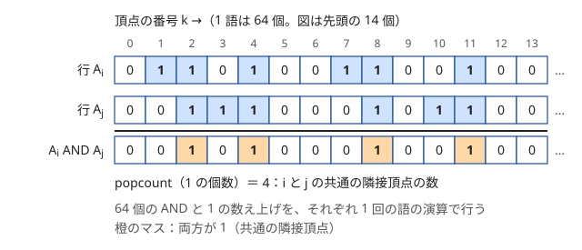
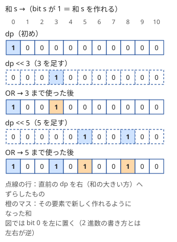

!!! abstract "要点"
    - **何ができるか**：bool を 64 個ずつ 1 語に詰め、AND・OR・XOR・シフトを語単位で行って計算量をおよそ 1/64 にする。部分和 DP のシフト OR、共通の隣接頂点・三角形の数え上げ、偶奇の集計、DAG の到達可能性に使う。
    - **いつ使うか**：
        - $N \le 2000$〜$5000$ 程度で、$O(N^3)$ や $O(N^2 M)$ が少し間に合わない。
        - 部分和として作れる値かを問われ、和の上限が $10^5$〜$10^6$ である。
        - 2 頂点の共通の隣接頂点や、三角形の数を求める。
        - 個数そのものではなく、偶奇（XOR）だけ分かればよい。
        - $u$ から $v$ へ到達できるかのクエリが大量にある。
        - $N$ が $5 \times 10^4$ 程度で、$N^2 / 64$ の計算なら間に合う。
    - **計算量**：長さ $L$ の bitset の AND・OR・XOR・シフト・`count` はどれも $O(L / 64)$。三角形の数え上げは $O(N^3 / 64)$、部分和は $O(NS / 64)$（$S$ は和の上限）、DAG の全頂点からの到達可能性は $O(N(N + M) / 64)$。計算量の次数は変わらず、定数倍が 1/64 になる。
    - **前提**：[bit 演算の基本と XOR の性質](../basics/bit-operations.md)、[計算量の見積もり](../basics/complexity-estimation.md)

<!-- textlint-disable -->
別名：bitset・ビット並列・ワード並列・1/64 倍・bitset で部分和・推移閉包・到達可能性クエリ・bitset speedup・ビットセット
<!-- textlint-enable -->

bitset による高速化は、0 か 1 の値を並べた列を 64 bit の整数に詰め、整数 1 回の演算で 64 個分を同時に計算する方法である。計算量の式は変わらないが、$O(N^3)$ が $N = 3000$ で約 $2.7 \times 10^{10}$ 回から約 $4 \times 10^8$ 回の語の演算に減り、間に合う側に入ることがある。使えるのは、計算の中身が「集合の積・和・対称差」や「ずらして重ねる」の形になっているときである。

## ワード並列の考え方と計算量の目安（N^3/64） {#word-parallel}

ワード並列とは、64 bit の整数（語）を 64 個の bool の入れ物とみて、AND・OR・XOR を 1 回行うだけで 64 か所の論理演算を同時に済ませることである。CPU は 64 bit の AND を 1 命令で行うので、1 個ずつ bool を比べるより約 64 倍速い。1 の個数を数える [popcount](../guide/glossary.md#popcount) も、1 語ずつまとめて数えられる（[popcount・最下位 bit](../basics/bit-operations.md#popcount)）。

C++ の `bitset<L>` は、長さ $L$ の 0/1 の列を $\lceil L / 64 \rceil$ 個の語に詰めて持ち、AND・OR・XOR・シフト・`count`（1 の個数）を語ごとに行う。だから 1 回の演算は $O(L / 64)$ である。



速くなる理由は、内側のループが「長さ $L$ の列を先頭から 1 つずつ見て、同じ論理演算をする」形になっていることにある。この形なら、64 個ずつまとめても答えは変わらない。逆に、1 個ごとに足し算や最小値を取る、前の位置の結果を次の位置で使う、といった計算は語にまとめられない。

計算量の目安は次のとおりである。演算の回数は式に最大値を入れた値で、1 語の演算は軽いので、[計算量の見積もり](../basics/complexity-estimation.md)の「1 秒に $10^8$〜数 $\times 10^8$ 回」の上の方で見積もってよい。

| 素朴な計算 | 例 | bitset での語の演算の回数 |
| --- | --- | --- |
| $O(N^3)$ | $N = 3000$ | $3000^3 / 64 \approx 4.2 \times 10^8$ |
| $O(N^2 M)$ | $N = M = 2000$ | $2000^3 / 64 \approx 1.25 \times 10^8$ |
| $O(NS)$ | $N = 2000$、$S = 4 \times 10^6$ | $2000 \times 4 \times 10^6 / 64 \approx 1.25 \times 10^8$ |
| $O(N(N + M))$ | $N = M = 5 \times 10^4$ | $5 \times 10^4 \times 10^5 / 64 \approx 7.8 \times 10^7$ |

$N = 3000$ の $O(N^3)$ は素朴には約 $2.7 \times 10^{10}$ 回で間に合わないが、1/64 なら届く。同じように、$N = 10^5$ の $O(N^2)$（$10^{10}$ 回）は 1/64 で約 $1.6 \times 10^8$ になり届く。しかし $N = 10^4$ の $O(N^3)$（$10^{12}$ 回）は 1/64 でも約 $1.6 \times 10^{10}$ で届かない。bitset は「あと数十倍」を埋める道具で、計算量の次数が 1 つ違う問題は救えない。

## 共通の隣接頂点・三角形の数（行の AND と popcount） {#common-neighbors}

隣接行列の行 $A_i$ を「頂点 $i$ に隣接する頂点の集合」とみると、2 頂点 $i$・$j$ の共通の隣接頂点の集合は $A_i \text{ AND } A_j$ で、その数は popcount で求まる。1 組あたり $O(N / 64)$ である。

三角形（3 頂点が互いに隣接する組）の数は、辺 $(i, j)$ ごとに共通の隣接頂点の数を足して求める。三角形 $\{i, j, k\}$ は 3 本の辺 $(i, j)$・$(j, k)$・$(i, k)$ のそれぞれで 1 回ずつ数えられるので、合計を 3 で割ればちょうど 1 回ずつになる。辺は高々 $N(N - 1) / 2$ 本なので、全体で $O(N^3 / 64)$ である。

```cpp
--8<-- "bitset-speedup/triangle.cpp:core"
```

完全なプログラム：[`triangle.cpp`](https://github.com/yuukougun/kyopro-atlas/blob/main/snippets/bitset-speedup/triangle.cpp)（GitHub）
{ .kp-code-src }

- $N = 3000$ なら、組は約 $4.5 \times 10^6$ 個、1 組は $\lceil 3000 / 64 \rceil = 47$ 語なので、約 $2.1 \times 10^8$ 回の語の演算になる。
- 3 で割る代わりに、$k > j$ の位置だけを 1 にした列とも AND を取って 1 回ずつ数えてもよい。割るほうが書くことが少ない。
- 行は $N$ 本の $N$ bit で $N^2 / 8$ バイトになる。$N = 3000$ なら約 1.1 MB で、大きさの見積もりは[メモリの節](#memory-batching)を見る。

辺が少ない疎なグラフ（$M \le 2 \times 10^5$ など）で $N$ が大きいなら、隣接行列は置けない。そのときは次数の小さい方から向きを付けて数える方法（[次数による平方分割](../graph/degree-sqrt.md#triangles)）を使う。逆に、次数の大きい頂点だけに bitset を持たせ、ほかは隣接リストで調べるという組み合わせ方もある（[練習の ABC350 G](#practice)）。

## 偶奇だけの集計（XOR） {#parity-xor}

「一致する個数が奇数か」のように偶奇だけを問われたら、個数を足す代わりに XOR で反転させればよい。1 を足すと偶奇が入れ替わり、XOR 1 も 0 と 1 を入れ替えるので、偶奇の世界では足し算と XOR が同じ演算になる（[XOR の性質](../basics/bit-operations.md#xor-properties)）。足し算は語にまとめられないが、XOR はまとめられる。

$N$ 行 $M$ 列の表で、行の組 $(i, j)$ ごとに「同じ値の列が奇数個あるか」を求める場合を考える。素朴には組ごとに $M$ 列を比べて $O(N^2 M)$ である。bitset では次のようにする。

```text
P[i] = 0（長さ N の bitset。P[i] の bit j は「行 i と行 j で値の一致した列の数」の偶奇）
for 列 k = 0 .. M-1:
    値 v ごとに、列 k の値が v の行の集合 E[v] を bitset で作る
    for 行 i:
        P[i] ^= E[ (行 i の列 k の値) ]    # 行 i と一致した行すべての偶奇を一度に反転
答え：P[i] の 1 の個数を i について足し、自分自身との組と 2 回数えた分を直す
```

1 列あたり、$N$ 回の XOR がそれぞれ $O(N / 64)$ なので、全体で $O(N^2 M / 64)$ である。使った $E[v]$ は次の列の前に空に戻す。$P[i]$ の bit $i$（自分自身との組）は、$M$ 列すべてで自分と一致するので $M$ の偶奇になる。

偶奇だけを持つ考え方は、0/1 の連立方程式（[掃き出し法](../math/gaussian-elimination.md#mod-2)を $\bmod 2$ で行う）や [XOR 基底](../math/xor-basis.md)でも同じで、どちらも行を bitset にすると行の XOR が 1/64 になる。

## 部分和 DP のシフト OR {#subset-sum-shift}

この節は[部分和](../dp/subset-sum.md)を前提にする。部分和の可否の DP「$\mathrm{dp}[t]$ ＝ ここまでの要素から選んで和を $t$ にできるか」は、要素 $a$ を足すと

$$
\mathrm{dp}'[t] = \mathrm{dp}[t] \text{ OR } \mathrm{dp}[t - a]
$$

になる。右辺の $\mathrm{dp}[t - a]$ を $t$ について並べたものは、列 $\mathrm{dp}$ を $a$ だけ大きい方へずらした列である。だから $\mathrm{dp}$ を bitset に持てば、更新は `dp |= dp << a` の 1 行で、$O(S / 64)$ になる（$S$ は和の上限）。



- **0-1 になる理由**：`dp << a` は更新前の `dp` 全体をずらした一時的な列なので、同じ要素を 2 回使う更新は起きない。配列で書くときに気にする「大きい方から回す」の向きは、bitset では考えなくてよい。
- **計算量**：$N$ 個の要素で $O(NS / 64)$。$N = 2000$・$S = 4 \times 10^6$ でも約 $1.25 \times 10^8$ 回である。
- **答えの読み方**：`dp[t]` で和 $t$ の可否、`dp.count()` で作れる和の個数、`dp._Find_next(x - 1)`（$x \ge 1$。$x = 0$ なら `_Find_first()`）で「$x$ 以上で作れる最小の和」が分かり、なければ長さ `MAXS + 1` が返る（[C++ の bitset](../cpp/cpp-math-functions.md#bitset)）。

**復元**するには、各段の bitset をすべて残す。後ろの要素から見て、「その要素を使わずに今の和が作れるなら使わない、作れないなら使う」と決めると、選んだ要素の列が 1 つ得られる。表は $N + 1$ 本の $S$ bit で、$NS / 8$ バイトかかる。

```cpp
--8<-- "bitset-speedup/subset-restore.cpp:core"
```

完全なプログラム：[`subset-restore.cpp`](https://github.com/yuukougun/kyopro-atlas/blob/main/snippets/bitset-speedup/subset-restore.cpp)（GitHub）
{ .kp-code-src }

**同じ値がたくさんあるとき**は、値 $v$ が 3 個以上あれば、そのうち 2 個を値 $2v$ の 1 個にまとめ直しても作れる和の集合は変わらない（$v$ を 2 個使う選び方を $2v$ 1 個で表せ、残した 1 個で $v$ 1 個の場合も表せる）。これを小さい値から繰り返すと、各値は 2 個以下になる。要素がすべて正の整数で総和が $S$ の列なら（和の上限も $S$ にとれる）、異なる値は $O(\sqrt{S})$ 種類しかないので、要素は $O(\sqrt{S})$ 個に減り、全体で $O(S \sqrt{S} / 64)$ になる。

??? note "証明：総和 S の列の異なる値は √(2S) 種類以下"
    異なる値が $k$ 種類あれば、その総和は少なくとも $1 + 2 + \dots + k = k(k + 1) / 2$ である。これが $S$ 以下なので $k^2 / 2 < S$、すなわち $k < \sqrt{2S}$ である。まとめ直しの後は各値が 2 個以下で、まとめ直しても総和は変わらないので、要素は $2\sqrt{2S}$ 個以下になる。

## DAG の到達可能性（逆トポロジカル順に OR、閉路は SCC で縮約） {#reachability}

この節は[トポロジカルソート](../graph/topological-sort.md)を前提にする。DAG の各頂点 $v$ から到達できる頂点の集合 $R[v]$ は、

$$
R[v] = \{v\} \cup \bigcup_{v \to w} R[w]
$$

で求まる。逆トポロジカル順（行き先が先に来る順）に計算すれば、$v$ を処理するときには行き先 $w$ の $R[w]$ がすべて完成している。$R[v]$ を bitset にすると、和集合は OR で、1 本の辺あたり $O(N / 64)$ になる。全体で $O(N(N + M) / 64)$ である。

```cpp
--8<-- "bitset-speedup/reach-dag.cpp:core"
```

完全なプログラム：[`reach-dag.cpp`](https://github.com/yuukougun/kyopro-atlas/blob/main/snippets/bitset-speedup/reach-dag.cpp)（GitHub）
{ .kp-code-src }

- **集合で持つ理由**：到達できる頂点の数を「行き先の値の和」で求めると、ひし形のように 2 通りの道で届く頂点を 2 度数える。集合の OR なら重なりは自然に 1 つになり、数は $R[v]$ の popcount で求まる（[強連結成分分解の落とし穴](../graph/scc.md#pitfalls)と同じ話）。
- **閉路があるとき**：[強連結成分分解](../graph/scc.md#condensation)で成分を 1 頂点に縮約すると DAG になる。成分の中の頂点は互いに到達できるので、成分ごとに「成分に含まれる頂点の集合」を初期値にして同じ計算をする。
- **番号の順に頂点を足す**：「番号が $k$ 以下の頂点だけを通って届くか」のように、使ってよい頂点を 1 つずつ増やす問題もある。ワーシャルフロイド法と同じ順に $k$ を増やし、「$i$ から $k$ へ届くなら $R[i] \gets R[i] \text{ OR } R[k]$」と更新すると、$k$ ごとに $O(N^2 / 64)$ で済む（[練習の ABC287 Ex](#practice)）。

## メモリの見積もりと 64 個ずつのクエリの処理 {#memory-batching}

この節は[DAG の到達可能性](#reachability)の続きである。$N$ 頂点それぞれに $N$ bit の集合を持つと $N^2 / 8$ バイトかかる。

| $N$ | $N^2 / 8$ |
| --- | --- |
| $3000$ | 約 1.1 MB |
| $2 \times 10^4$ | 50 MB |
| $5 \times 10^4$ | 約 312 MB |
| $10^5$ | 1.25 GB |

$N = 10^5$ では、時間（$N(N + M) / 64$）の前にメモリが足りない。到達可能性を $Q$ 個のクエリ $(a_k, b_k)$ で問われるだけなら、bit の意味を入れ替える。各頂点に 64 bit の整数 $\mathrm{mask}[v]$ を 1 つだけ持ち、その bit $k$ を「$k$ 番目のクエリの始点 $a_k$ から $v$ へ届くか」とする。

1. クエリを 64 個ずつの組に分ける。組ごとに $\mathrm{mask}$ を 0 にし、$\mathrm{mask}[a_k]$ の bit $k$ を立てる
2. トポロジカル順に頂点 $v$ を見て、辺 $v \to w$ ごとに $\mathrm{mask}[w] \gets \mathrm{mask}[w] \text{ OR } \mathrm{mask}[v]$ とする
3. $\mathrm{mask}[b_k]$ の bit $k$ が答えである

1 組は $O(N + M)$ で、組は $\lceil Q / 64 \rceil$ 個なので、時間は $O((N + M) Q / 64)$、メモリは $O(N + M)$ である。$N = M = Q = 10^5$ なら約 $3.1 \times 10^8$ 回の語の演算（うち OR は約 $1.6 \times 10^8$ 回）で、メモリは数 MB で済む。

```cpp
--8<-- "bitset-speedup/reach-batch.cpp:core"
```

完全なプログラム：[`reach-batch.cpp`](https://github.com/yuukougun/kyopro-atlas/blob/main/snippets/bitset-speedup/reach-batch.cpp)（GitHub）
{ .kp-code-src }

64 個ずつまとめる考え方は、到達可能性に限らない。「各クエリについて、同じ順序で同じ OR（AND・XOR）を流す」計算なら、クエリの番号を bit に割り当てて 64 個を同時に進められる。何を bit の添字にするか（頂点か、クエリか）を、メモリの見積もりで選ぶ。

## C++ の作法（大きさはコンパイル時の定数・大きな bitset をスタックに置かない） {#cpp}

`bitset` の基本の操作は [C++ の bitset](../cpp/cpp-math-functions.md#bitset) にまとめてある。ここでは高速化に使うときの作法だけを書く。

- **大きさは制約の最大値で決める**：`bitset<N>` の $N$ はコンパイル時の定数なので、`const int MAXN = 3000;` のように制約の最大値で置く。入力の $n$ が小さくても、演算は常に `MAXN / 64` 語ぶん行われる。テストケースが多い問題で $n$ の総和だけが抑えられているときは、1 ケースごとに `MAXN` の長さを処理して遅くなるので、`vector<unsigned long long>` で $\lceil n / 64 \rceil$ 語の列を自分で持つ。
- **大きな配列はグローバルか vector に**：`bitset<3000> adj[3000];` は約 1.1 MB、`bitset<5000> reach[5000];` は約 3.1 MB で、関数の中に置くとスタックに乗る。グローバル変数にするか、`vector<bitset<MAXN>>` にして中身をヒープに置く。
- **一時的な列ができる**：`(a & b).count()` や `dp << x` は長さ `MAXN` の一時的な bitset を作る。速さは $O(\mathrm{MAXN} / 64)$ のままなので気にしなくてよい。ただし長さ $10^8$ の bitset なら、一時的な列もスタックに約 12 MB 乗る。
- **1 の位置をたどる**：`_Find_first()`・`_Find_next(i)` は GCC の拡張で、1 の位置を 64 個ずつ飛ばしながら探す。共通の隣接頂点を 1 つ答えるときなどに使う。

## bitDP との違い {#vs-bit-dp}

名前が似ているが、[bitDP](../dp/bit-dp.md) と bitset による高速化は別物である。

| | bitDP | bitset による高速化 |
| --- | --- | --- |
| bit が表すもの | 選んだ要素の集合（DP の添字） | DP の表や集合の、1 マスずつの 0/1 の値 |
| 状態の数 | $2^N$（$N \le 20$ 程度） | 変わらない |
| 速くなる理由 | 集合を整数 1 つで表して表に使う | 64 マスを 1 回の演算でまとめて計算する |

bitDP の解説コードでは、集合を表す変数に `bitset` という名前を付けることがあるので、検索するときに混同しやすい。2 つは組み合わせられる。bitDP の値が bool で、ある次元についての更新が「ずらして OR」なら、その次元を bitset に詰めて 1/64 にできる。

## 落とし穴 {#pitfalls}

**範囲の外の bit が残る**。`MAXN` が実際の $n$ より大きいとき、`~a`（反転）は $n$ 以上の位置も 1 にする。そのまま `count()` を取ると、使っていない位置まで数える。反転を使うなら「$n$ 未満だけが 1 の列」と AND を取ってから数える。シフトは上にはみ出した bit を捨てるので、和の上限 `MAXS` は「答えに要る範囲の最大」で決める。$K$ 以上の和が作れるかを問うなら、`MAXS` を $K$ と要素の最大値の和まで取る（$K$ 以上のどれかが作れるなら、$K$ + 最大値 未満のどれかも作れる）。$K$ 未満の和だけを見る問題（[練習の ARC070 D](#practice)）なら $K$ で足りる。

**負の値を添字にする**。差（赤の和 − 青の和など）を bitset に持つときは、負の値に添字がない。取り得る最小値の分だけ下駄をはかせて（偏りを足して）添字にするか、対称なら絶対値だけを持つ。

**次数が下がると思い込む**。1/64 は定数倍で、$N$ が 2 倍になれば $O(N^3 / 64)$ は 8 倍になる。素朴な計算量が許容の数十倍以内かを先に見積もる。100 倍を超えるなら別の解法を探す。

**大きな bitset を関数の中に置く**。`bitset<MAXN> reach[MAXN];` を `main` の中に書くと、数 MB でもスタックを超えて実行時エラーになることがある（[C++ の作法](#cpp)）。

**数え上げに使う**。bitset で計算できるのは可否と偶奇だけである。「和が $t$ になる選び方の数」や「最小のコスト」は、1 マスに整数が要るので語にまとめられない（数え上げの部分和は[部分和](../dp/subset-sum.md)の普通の DP で行う）。

## 例題 {#examples}

### ABC258 G. Triangle {#abc258_g}

<div class="kp-problems" data-role="example" markdown>

- [ABC258 G. Triangle](https://atcoder.jp/contests/abc258/tasks/abc258_g)（diff 1944）：N ≤ 3000 頂点のグラフに含まれる三角形（3 頂点が互いに隣接する組）の数を求める。

</div>

$N = 3000$ の $O(N^3)$ は約 $2.7 \times 10^{10}$ 回で厳しいが、内側のループ「$k$ が $i$ にも $j$ にも隣接するか」は隣接行列の行の AND と popcount で 64 個ずつまとめられる。辺 $(i, j)$ ごとに共通の隣接頂点の数を足して 3 で割る。

??? note "解法の詳細"
    - 隣接行列の各行を `bitset<3000>` にしてグローバルに置く。
    - $i < j$ かつ辺 $(i, j)$ がある組について、`(adj[i] & adj[j]).count()` を足す。各三角形は 3 本の辺で 1 回ずつ数えられるので、合計を 3 で割る。
    - 語の演算は約 $2.1 \times 10^8$ 回である。合計は `long long` で持つ。
    - コードは[共通の隣接頂点・三角形の数](#common-neighbors)の節のものと同じ形である（入力の形は問題に合わせる）。

### ABC348 F. Oddly Similar {#abc348_f}

<div class="kp-problems" data-role="example" markdown>

- [ABC348 F. Oddly Similar](https://atcoder.jp/contests/abc348/tasks/abc348_f)（diff 1955）：N 行 M 列の表で、同じ値の列が奇数個ある行の組の数を求める。

</div>

問われているのは一致する列の数の偶奇だけなので、行の組ごとの偶奇を bitset に持ち、列ごとに「同じ値の行の集合」と XOR して反転させる。素朴な $O(N^2 M)$ が $O(N^2 M / 64)$ になる。

??? note "解法の詳細"
    - $P[i]$ を長さ $N$ の bitset とし、bit $j$ を「行 $i$ と行 $j$ で一致した列の数の偶奇」とする。
    - 列ごとに、値 $v$ をもつ行の集合 $E[v]$ を bitset で作り、各行 $i$ について $P[i]$ に $E[\text{行 } i \text{ の値}]$ を XOR する。列の処理が終わったら、使った $E[v]$ を空に戻す。
    - 最後に $P[i]$ の 1 の個数を合計する。自分自身の bit は $M$ が奇数のとき 1 になっているので、そのときは $N$ を引く。各組は $(i, j)$ と $(j, i)$ で 2 回数えているので 2 で割る。
    - 1 列あたり $N$ 回の XOR がそれぞれ $O(N / 64)$ で、全体で $O(N^2 M / 64)$ である。

### 典型90 059. Many Graph Queries（★7） {#typical90_bg}

<div class="kp-problems" data-role="example" markdown>

- [典型90 059. Many Graph Queries（★7）](https://atcoder.jp/contests/typical90/tasks/typical90_bg)（diff なし）：DAG で、頂点 u から v へ到達できるかを答えるクエリに大量に答える。

</div>

$N, M, Q \le 10^5$ で、全頂点の到達集合を持つと 1.25 GB かかる。クエリを 64 個ずつまとめ、各頂点に 64 bit の整数を 1 つ持たせて、トポロジカル順に OR で流す。辺はどれも番号の小さい頂点から大きい頂点へ向くので、番号の順がそのままトポロジカル順になる。

??? note "解法の詳細"
    - クエリを 64 個ずつの組に分ける。組ごとに全頂点の $\mathrm{mask}$ を 0 にし、$k$ 番目のクエリの始点の $\mathrm{mask}$ の bit $k$ を立てる。
    - 頂点を番号の小さい順に見て、辺 $v \to w$ ごとに $\mathrm{mask}[w]$ に $\mathrm{mask}[v]$ を OR する（辺を始点の番号の順に並べておけば、辺の列を 1 回なめるだけでよい）。
    - $k$ 番目のクエリの終点の $\mathrm{mask}$ の bit $k$ を見て答える。
    - 1 組 $O(N + M)$、組は約 1563 個で、全体で約 $3.1 \times 10^8$ 回の語の演算（うち OR は約 $1.6 \times 10^8$ 回）になる。コードは[メモリの見積もりと 64 個ずつのクエリの処理](#memory-batching)の節のものと同じ形である。

## 練習問題 {#practice}

<div class="kp-problems" data-role="practice" markdown>

- [ABC147 E. Balanced Path](https://atcoder.jp/contests/abc147/tasks/abc147_e)（diff 1713）：各マスに 2 つの数が書かれたグリッドを右か下に進み、各マスでどちらを赤にするか選ぶとき、赤の和と青の和の差の絶対値の最小を求める。
- [ARC070 D. No Need](https://atcoder.jp/contests/arc070/tasks/arc070_b)（diff 2015）：和が K 以上の部分集合を「良い集合」と呼ぶとき、含まれるどの良い集合から取り除いても良い集合のままになる「不要な」カードの枚数を求める。
- [ABC350 G. Mediator](https://atcoder.jp/contests/abc350/tasks/abc350_g)（diff 2058）：森に辺を 1 本ずつ足しながら、2 頂点の両方に隣接する頂点を答える質問に答える（オンライン）。
- [AGC020 C. Median Sum](https://atcoder.jp/contests/agc020/tasks/agc020_c)（diff 2259）：N 個の整数のすべての空でない部分集合の和を小さい順に並べたときの、中央値を求める。
- [ABC287 Ex. Directed Graph and Query](https://atcoder.jp/contests/abc287/tasks/abc287_h)（diff 2639）：有向グラフで、s から t へ行く道のうち、通る頂点の番号の最大値が最小になるものを選んだときの、その最大値を各クエリで求める（行けなければ -1）。

</div>

??? note "練習の方針"
    - **ABC147 E**：各マスで「ここまでに作れる差の集合」を持ち、マスの 2 つの数の差 $d$ を足すか引くかで集合をずらして OR する。差の絶対値の上限に合わせて bitset の大きさを決め、負の差は偏りを足して添字にする。普通の bool の DP でも間に合う。
    - **ARC070 D**：カード $i$ が不要なのは、ほかのカードの部分和に $[K - a_i, K)$ に入るものがないときである。カード $i$ を除いた部分和の集合を、大きさ $K$ の bitset のシフト OR で作って調べる（$K$ 以上の和は判定に要らないので、はみ出して消えてよい）。あるカードが必要なら、それより値の大きいカードも必要になる単調性があるので、値の順に並べて二分探索すれば、調べるカードは $O(\log N)$ 枚で済む。
    - **ABC350 G**：全頂点の隣接集合を bitset で持つとメモリが足りない。次数がしきい値（$\sqrt{N}$ 程度）以上になった頂点にだけ bitset を作り、質問の両端がどちらもそうなら AND を取って 1 の位置を探す。片方の次数が小さければ、その隣接リストを 1 つずつ調べる。
    - **AGC020 C**：部分集合とその補集合の和は合わせて総和 $T$ になるので、和は $T / 2$ について対称に並ぶ。中央値は「$\lceil T / 2 \rceil$ 以上で作れる最小の和」で、シフト OR の部分和で求める。
    - **ABC287 Ex**：頂点を番号の小さい順に 1 つずつ「通ってよい」に加え、到達集合をワーシャルフロイド法と同じ順に bitset の OR で更新する。$k$ を加えた直後に、$k \ge \max(s, t)$ で $s$ から $t$ へ届くようになったクエリの答えを $k$ と決める。

## 力試し {#challenge}

<div class="kp-problems" data-role="challenge" markdown>

- [ABC221 G. Jumping sequence](https://atcoder.jp/contests/abc221/tasks/abc221_g)（diff 2914）：長さ D_i の移動を順に上下左右のどれかへ行い、原点から (A, B) に着けるかを判定し、着けるなら向きの列を 1 つ出力する。

</div>

??? note "力試しの方針"
    - **ABC221 G**：座標を 45 度回して $(x + y, x - y)$ で考えると、各移動は 2 つの軸それぞれに $\pm D_i$ を独立に加える形になる。$\pm$ の和は「$D_i$ を足すか足さないか」の部分和に直せるので、bitset の部分和で解ける。2 つの軸とも同じ $D_i$ の部分和なので、全段の表は 1 つ作り、両方の軸の復元に使い回す。表は $N$ 本の $\sum D_i$ bit で 1 GB 近くになりうるので、メモリの制限と先に比べる。

## 確認問題 {#quiz}

??? question "確認問題：シフト OR が 0-1 になる理由"
    配列の部分和 DP では、`for (t = a; t <= S; t++) dp[t] |= dp[t - a];` と小さい方から回すと、同じ要素を何度も使う DP になる。`dp |= dp << a` がそうならないのはなぜか。

    ??? success "答え"
        `dp << a` は更新前の `dp` 全体をずらした一時的な列を先に作り、それと OR を取るからである。同じ更新の中で書き換えた値を読むことがないので、どの和にも $a$ は高々 1 回しか加わらない。配列で大きい方から回すのと同じ効果になる。

??? question "確認問題：語の演算の回数"
    $N = 3000$ 頂点の密なグラフで、辺 $(i, j)$（$i < j$）ごとに `(adj[i] & adj[j]).count()` を求める。語の演算はおよそ何回か。

    ??? success "答え"
        組は高々 $3000 \times 2999 / 2 \approx 4.5 \times 10^6$ 個で、1 組は AND と count がそれぞれ $\lceil 3000 / 64 \rceil = 47$ 語である。AND だけ数えて約 $2.1 \times 10^8$ 回、count を含めても約 $4.2 \times 10^8$ 回で、数秒の制限に収まる見込みが立つ。

??? question "確認問題：$N = 5 \times 10^4$ の到達可能性"
    $N = M = 5 \times 10^4$ の DAG で、全頂点の到達集合を bitset で持つと時間とメモリはどれくらいか。メモリが足りないとき、クエリが $Q$ 個与えられているならどうするか。

    ??? success "答え"
        時間は $N(N + M) / 64 \approx 7.8 \times 10^7$ 回で間に合うが、メモリは $N^2 / 8 \approx 312$ MB かかる。制限が 1024 MiB なら置けるが、制限が小さいと足りない。クエリが分かっているなら、64 個ずつまとめて各頂点に 64 bit の整数だけを持たせ、トポロジカル順に OR で流す。時間は $O((N + M) Q / 64)$、メモリは $O(N + M)$ になる。

??? question "確認問題：使えない計算"
    $N \le 3000$ 頂点のグラフで、2 頂点の組ごとに「共通の隣接頂点の重みの最大値」を求めたい。行の AND で 1/64 にできるか。

    ??? success "答え"
        そのままではできない。AND で求まるのは共通の隣接頂点の集合（0/1）までで、その中の重みの最大値は 1 個ずつ見なければならない。重みの大きい順に頂点を並べ替えて番号を付け直せば、「AND の最初の 1 の位置」（`_Find_first`）が最大の重みの頂点になる、という言い換えなら使える。

## 使い分け {#comparison}

- **辺が少ないグラフの三角形**：$N$ が大きく隣接行列を置けないなら、[次数による平方分割](../graph/degree-sqrt.md#triangles)で $O(M \sqrt{M})$ にする。
- **和が大きく要素が少ない部分和**：$N \le 40$ で和が $10^{18}$ などなら、和の値を添字にできないので[半分全列挙](../basics/meet-in-the-middle.md)を使う。
- **選び方の数を数える部分和**：bitset は使えない。[部分和](../dp/subset-sum.md)の数え上げの DP にする。
- **閉路のある有向グラフの到達可能性**：[強連結成分分解](../graph/scc.md)で縮約してから、この方法を使う。
- **0/1 の連立方程式・XOR の最大化**：行を bitset にした[掃き出し法](../math/gaussian-elimination.md#mod-2)や [XOR 基底](../math/xor-basis.md#max)を使う。
- **集合を添字にする DP**：[bitDP](../dp/bit-dp.md) を使う（[bitDP との違い](#vs-bit-dp)）。

## 参考 {#references}

- [cppreference「std::bitset」](https://en.cppreference.com/cpp/utility/bitset)：大きさがコンパイル時の定数であることと、各演算の意味
- [merom686「ABC258」](https://merom686.hatenablog.com/entry/2022/07/02/233918)：例題の ABC258 G の bitset 解と、3 倍に数えて割る方針
- [mmrz「ABC348Fのbitset解について」](https://zenn.dev/mmrz/articles/abc348-f-learning-bitset)：例題の ABC348 F の偶奇を XOR で持つ方針と、自分自身・2 回数えた分の直し方
- [E869120「競プロ典型 90 問」059 の問題文と解答例](https://github.com/E869120/kyopro_educational_90/blob/main/sol/059-02.cpp)：例題の典型90 059 の制約と、クエリを 64 個ずつまとめる実装
- [drken「AtCoder ABC 056 D - No Need (ARC 070 D) (2D, 黄色, 600 点)」](https://drken1215.hatenablog.com/entry/2020/10/06/113600)：練習の ARC070 D の言い換えと単調性
- [No_Play_Yes_Splay「AtCoder Beginner Contest 350 解题报告」](https://www.cnblogs.com/No-play-Yes-splay/p/18148245/atcoder-beginner-contest-350-sol)：練習の ABC350 G の次数で分けて大きい頂点だけ bitset を持つ方針
- [drken「AtCoder AGC 020 C - Median Sum (黄色, 700 点)」](https://drken1215.hatenablog.com/entry/2019/04/03/224800)：練習の AGC020 C の対称性とシフト OR の部分和
- [kmjp「AtCoder ABC #287 (ユニークビジョンプログラミングコンテスト2023 新春) : Ex - Directed Graph and Query」](https://kmjp.hatenablog.jp/entry/2023/01/28/0930)：練習の ABC287 Ex の、頂点を番号の小さい順に加え、到達集合を bitset で更新する方針（記事は行き先と来る元の 2 つの集合を更新する形）
- [kmjp「AtCoder ABC #221 : G - Jumping sequence」](https://kmjp.hatenablog.jp/entry/2021/10/03/1000)：力試しの ABC221 G の 45 度回転と、部分和の復元
