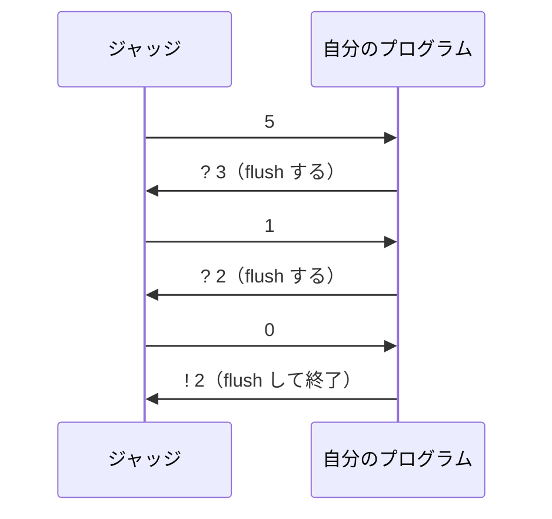
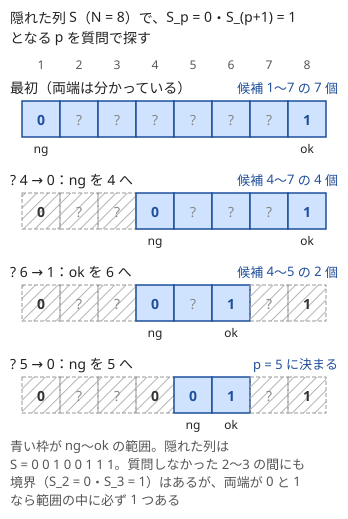

!!! abstract "要点"
    - **何ができるか**：質問を出力してジャッジの答えを受け取る形式の問題で、質問回数の上限から方針を逆算する（2 択の質問なら $\lceil \log_2 \text{候補数} \rceil$ 回）。出力のたびに flush し、二分探索や 2 進表記で質問を設計する。
    - **いつ使うか**：
        - 問題文に「インタラクティブ」「質問は Q 回まで」とある。
        - 質問の答えが入力として返ってくる・入出力例が対話の形。
        - 質問回数の上限が 20 回など $\log_2 N$ 程度。
    - **計算量**：答えが $k$ 通りの質問で $C$ 通りの候補を区別するには、最悪の場合 $\lceil \log_k C \rceil$ 回以上の質問が要る。2 択なら $\lceil \log_2 C \rceil$ 回で、二分探索がこの回数を達成する。
    - **前提**：[二分探索](../basics/binary-search.md)

<!-- textlint-disable -->
別名：対話型・インタラクティブ・ジャッジとの対話・質問回数・インタラクティブの二分探索・interactive problem
<!-- textlint-enable -->

インタラクティブ問題は、プログラムが質問を出力してジャッジが答えを返すやりとりを繰り返し、隠れた情報を当てる形式である。入力を最初に全部受け取る通常の形式とはここが違う。解き方の中身は二分探索・ビット・グラフ探索・中国剰余定理などの既知の手法で、この形式に固有なのは「質問回数の上限から方針を逆算すること」と「出力を確実にジャッジへ届ける作法」の 2 つである。

## 形式と C++ の作法（出力のたびに flush・cin.tie(nullptr) を書いたとき） {#format}

やりとりの流れは問題ごとに決まっているが、基本の形は次のとおりである。最初に $N$ などの公開された値を受け取り、質問（`? …`）を出して答えを読むことを繰り返し、最後に答え（`! …`）を出力して終わる。



この図は、$N = 5$、隠れた列 $S = 0\ 0\ 1\ 1\ 1$ の境界を 2 回の質問で見つけるやりとりの例である。自分の出力はジャッジのプログラムの標準入力に、ジャッジの出力は自分の標準入力にパイプでつながっている。

C++ の作法で必ず守るのは次の 3 つである。

- **出力のたびに flush する**：`cin` で読む前には `cout` が自動で書き出されるが、高速化の雛形で `cin.tie(nullptr)` を書くとこれが止まる。そのとき `'\n'` だけだと質問はバッファにたまってジャッジに届かず、互いに相手を待って止まり、TLE になる。雛形にかかわらず、質問を出した後、答えを読む前に `cout << endl`（または `cout << flush`）で書き出す。詳しくは [C++ の入出力のフラッシュ](../cpp/cpp-io.md#flush)を見る
- **不正の合図を受け取ったらすぐ終わる**：回数の超過や不正な質問に対して $-1$ などを返す問題では、それを読んだら直ちに終了する。続けて読もうとすると、WA ではなく TLE や別の判定になって原因が分かりにくくなる
- **デバッグの出力は `cerr` に出す**：`cout` の出力はすべてジャッジが質問として読むので、形式の誤りで不正解になる

ジャッジと交互に手を打つゲームの形式は、[ゲームの基本](../comb/game-basics.md#interactive)で扱う。

質問の部分を関数に分けておくと、[flush](../guide/glossary.md#flush) と不正の合図の処理を 1 か所にまとめられる。次は[二分探索の節](#binary-search)で使うコードの中心である。ng・ok の意味と不変条件は、その節で説明する。

```cpp
--8<-- "interactive/boundary.cpp:core"
```

完全なプログラム：[`boundary.cpp`](https://github.com/yuukougun/kyopro-atlas/blob/main/snippets/interactive/boundary.cpp)（GitHub）
{ .kp-code-src }

## 回数の上限から方針を逆算する（情報量の下界） {#query-budget}

インタラクティブ問題では、問題文を読んだら最初に「候補の数」と「質問回数の上限」を比べる。上限は、想定解の回数に少しだけ余裕を足した値になっていることが多いので、上限から想定解の形がかなり絞れる。

根拠は次の数え方である。答えが $k$ 通りの質問を $q$ 回すると、返ってくる答えの並びは高々 $k^q$ 通りしかない。答えの並びが同じなら自分のプログラムは同じ答えを出すので、$C$ 通りの候補を区別するには

$$
k^q \ge C \quad\text{すなわち}\quad q \ge \lceil \log_k C \rceil
$$

が要る。質問の選び方を前の答えで変えても、この数え方は変わらない。

| 候補の数 $C$ | 質問の答え | 必要な回数の下界 | 典型の上限と方針 |
| --- | --- | --- | --- |
| $N = 2 \times 10^5$ | 2 択 | $\lceil \log_2 N \rceil = 18$ | 20 回なら二分探索 |
| 行 $1000$ と列 $1000$ | 2 択 | $10 + 10 = 20$ | 行と列を別々に二分探索 |
| $5! = 120$ 通りの並び | 2 択（比較） | $\lceil \log_2 120 \rceil = 7$ | 1 回ごとに候補をほぼ半分にする |
| $2^N$ 通りの 0/1 の列 | 2 択（偶奇） | $N$ | 1 要素ずつ決める |

上限が $\log_2 N$ 程度なら二分探索か 2 進表記、$N$ 程度なら 1 要素ずつ決める方針、$2N$ 程度なら DFS 木の各辺を 2 回ずつ通る方針、と上限の形から型が見当づけられる。上限ちょうどの回数しか許されないときは、どの質問も残りの候補をほぼ半分に分けているかを確かめる。偏った質問が 1 つでもあると、最悪の場合に回数が足りなくなる。$5$ 個を $7$ 回の比較で並べる問題では、$2^7 = 128$ が $120$ をわずかに上回るだけなので、どの比較も残りの並びをほぼ半分に分けなければならない。

上限の中に収めるだけでなく、最少の回数そのものを求めさせる問題もある（力試しの ABC355 E）。そのときは上限から逆算できないので、どの質問の組が必要十分かを別に考える。

??? question "確認問題：ジュースの人数"
    1000 本のジュースのうち 1 本だけが腐っている。何人かの友人にそれぞれ好きな組の本数を一度に飲ませ、翌日に各人がお腹を壊したかどうかだけが分かる。腐った 1 本を必ず特定するには、最低何人が要るか。

    ??? success "答え"
        10 人である。各人の結果は 2 択なので、$M$ 人の結果の並びは $2^M$ 通りしかなく、$2^M \ge 1000$ が要る。$2^9 = 512 < 1000 \le 1024 = 2^{10}$ なので $M \ge 10$ である。10 人で足りることは、[2 進表記で質問を設計する](#binary-encoding)の方法で示せる。

## 二分探索で候補を半分ずつ減らす {#binary-search}

質問回数の上限が $\lceil \log_2 N \rceil$ をわずかに超える値なら、質問 1 回で候補を半分にする二分探索を考える。[二分探索](../basics/binary-search.md#interactive)の判定 $\mathrm{check}(\mathrm{mid})$ を「mid について質問して答えを受け取る」に置き換えればよい。

先頭が 0、末尾が 1 と分かっている 0/1 の列で、0 の直後が 1 になる位置を探す例を考える。ng を 0 の側、ok を 1 の側の端に置き、「$S_\mathrm{ng} = 0$ かつ $S_\mathrm{ok} = 1$」を保ったまま区間を縮める。中点の値が 1 なら ok を、0 なら ng を中点へ動かす。どちらに動かしても不変条件は保たれる。



図のように、列が単調でなくてもよい。区間の両端が 0 と 1 なら、区間の中のどこかで 0 から 1 に変わる位置が必ずあるからである。止まるのは ng と ok が隣り合ったときで、答えは ng である。

- **番兵は質問しない**：両端の値は問題文で分かっているので、初期の ng と ok は質問せずに置く。上限が厳しい問題では、この 1〜2 回の節約が効く
- **範囲の外を質問しない**：添字が 1-indexed なら 0 や $N + 1$ を質問しないように、mid が ng と ok の真ん中にあることを確かめる
- **2 次元は行と列に分ける**：$N \times N$ の盤面で 1 つのマスを探すとき、行の範囲と列の範囲は独立に二分探索できる。合わせて $2 \lceil \log_2 N \rceil$ 回で済む

## 2 進表記で質問を設計する {#binary-encoding}

二分探索は、前の答えを見てから次の質問を決める。質問をすべて先に出し、答えをまとめて受け取る形式（「友人たちへ一度にジュースを配る」など）では、この順番の工夫が使えない。そのときは候補の番号を 2 進表記し、ビット 1 つにつき質問を 1 つ用意する。

候補に $0$ から $N - 1$ の番号を付け、$M = \lceil \log_2 N \rceil$ 個の質問を用意する。質問 $j$ には「番号のビット $j$ が 1 である候補」を全部入れる。当たりの番号を $x$ とすると、質問 $j$ の答えは $x$ のビット $j$ そのものなので、$M$ 個の答えを並べれば $x$ の 2 進表記が読める。

```cpp
--8<-- "interactive/bits.cpp:core"
```

完全なプログラム：[`bits.cpp`](https://github.com/yuukougun/kyopro-atlas/blob/main/snippets/interactive/bits.cpp)（GitHub）
{ .kp-code-src }

この $M$ 人は[情報量の下界](#query-budget)と一致するので、人数としても最少である。候補の数が 2 の冪なら、二分探索の質問も「答えの番号のビットを上から 1 つずつ決めている」と見ることができる。前の答えで質問を変えられるかどうかが違うだけで、どちらも 1 回の質問で 1 ビットを得ている。

## 未知のグラフを探索する（DFS の行きと帰り） {#explore-graph}

今いる頂点の隣接頂点だけが答えとして返り、移動の回数に上限がある問題では、[深さ優先探索](../graph/dfs.md)をそのまま「歩いて」行う。未訪問の隣接頂点があればそこへ進み、なければ来た頂点へ戻る。

なぜ $2N$ 回で足りるのか。DFS で初めて訪れるときに使った辺だけを集めると、全域木（DFS 木）になる。歩く経路はこの木の辺を行きに 1 回、帰りに 1 回だけ通るので、移動は高々 $2(N - 1)$ 回である。木に含まれない辺は、その先が訪問済みと分かるので通らない。

実装では、戻るときにも「来た頂点を出力する」という移動が要ることに注意する。再帰で書くなら、子の探索から戻った直後に親の頂点を出力し、その頂点の隣接頂点をもう一度受け取る（受け取らないと入力がずれる）。目的の頂点に着いた時点で探索を打ち切る。

距離を質問できる木では、[木の直径](../tree/tree-diameter.md#double-sweep)の 2 回の探索がそのまま使える。ある頂点から全頂点への距離を聞いて最も遠い頂点 $u$ を見つけ、$u$ から全頂点への距離を聞けば、その最大が直径である。質問は $2(N - 1)$ 回になる。

## 連立方程式・中国剰余定理で特定する {#equations-crt}

この節は、XOR の扱い（[bit 演算](../basics/bit-operations.md)）と[中国剰余定理](../math/crt.md)を前提にする。1 回の質問で 1 つの値を直接聞けないとき、答えを式とみて連立させる。

**質問の答えが複数の値の XOR になる場合**。「ちょうど $K$ 個（$K$ は奇数）の位置を指定して、値の XOR（和の偶奇）を聞く」質問で 0/1 の列を復元するなら、先頭の $K + 1$ 個から 1 つずつ除いた $K + 1$ 通りの質問をする。各要素は $K + 1$ 回のうち $K$ 回だけ現れ、$K$ は奇数なので、全部の答えの XOR は $T = A_1 \oplus \dots \oplus A_{K+1}$ になる。$A_i$ を除いた質問の答えを $q_i$ とすると $A_i = T \oplus q_i$ で、$K + 1$ 個がすべて決まる。残りの $A_i$ は、値の分かった $K - 1$ 個と $A_i$ を合わせて聞けば 1 回ずつで決まり、合計はちょうど $N$ 回である。

**隠れた数の余りを集める場合**。隠れた整数 $N$ に対して、自分が作った関数グラフを $N$ 回たどった結果が返るなら、長さ $L$ の閉路からは $N \bmod L$ が分かる。長さが互いに素な閉路を並べて余りを中国剰余定理で合わせれば、長さの積より小さい $N$ が 1 つに決まる。頂点数の上限の中で積を大きくするには、$2, 3$ の代わりに $4, 9$ のように素数の冪を使う（$4, 9, 5, 7, 11, 13, 17, 19, 23$ は合計 $108$ で、積は約 $1.3 \times 10^9$）。

## 先に構造を出力してから答える {#output-structure-first}

前半で自分が使う「道具」を出力し、後半で次々に来る問いにその道具の組合せで答える形式がある。前半で出す量に上限があり、後半の問いには何が来ても答えられなければならない。

閉区間 $[L, R]$ を「前半に出した区間 2 つの和集合」で表す問題では、各始点 $l$ と各 $k$ について、$l$ から始まる長さ $2^k$ の区間を全部出しておく。問いが来たら $2^k \le R - L + 1$ となる最大の $k$ をとる。答えるのは、$L$ から始まる長さ $2^k$ の区間と、$R$ で終わる長さ $2^k$ の区間である。2 つは重なってもよく、合わせて $[L, R]$ をちょうど覆う。用意する区間は $O(N \log N)$ 個で、これは [Sparse Table](../ds/sparse-table.md) が持つ区間と同じ形である。

この型では、前半の構造を「後半のどんな問いにも答えられる最小の集合」として設計する。データ構造が前計算で持つものを思い出すと見当が付きやすい。

## 適応的ジャッジ（最悪の場合の回数で考える） {#adaptive-judge}

ジャッジの中には、隠れた答えを最初に固定しないものがある。それまでの答えと矛盾しない範囲で、こちらに不利な答えを選んで返してくる。これを適応的ジャッジと呼び、そうかどうかが問題文に書かれていることがある。

適応的ジャッジに対しては、「たまたま当たる」「平均すると少ない回数で済む」方針は通用しない。たとえば候補を半分に分けない質問をすると、ジャッジは候補が多く残る側の答えを返してくる。だから、方針は最悪の場合の回数で上限に収まることを確かめる。

[情報量の下界](#query-budget)は、まさにこの最悪の相手を考えたものである。ジャッジが毎回「残る候補が多い方」の答えを返せば、2 択の質問 1 回で候補は半分までしか減らない。どんな質問の仕方をしても $\lceil \log_2 C \rceil$ 回より少なくはできない。逆に二分探索のように毎回ちょうど半分に分けていれば、ジャッジがどう答えても回数は変わらないので、適応的かどうかを気にしなくてよい。

??? question "確認問題：運に頼る方針"
    候補が 8 個で質問は 3 回まで、答えは 2 択とする。「最初の質問で候補を 1 個と 7 個に分け、1 個の方なら即座に当たる」方針は、適応的ジャッジに対してどうなるか。

    ??? success "答え"
        ジャッジは 7 個が残る方の答えを返す。残り 2 回の 2 択では $2^2 = 4$ 通りしか区別できず、7 個は区別できないので失敗する。3 回で 8 個を区別するには、毎回ちょうど半分に分けるしかない。

## 手元でのテスト（ジャッジ役のプログラムとパイプでつなぐ） {#local-testing}

インタラクティブ問題は、入出力例をそのまま流し込んでも試せない。ジャッジの答えは自分の質問によって変わるからである。手元で試すには、隠れた答えを持ってルールどおりに答える「ジャッジ役のプログラム」を自分で書き、2 つのプログラムを双方向につなぐ。

ジャッジ役は、隠れた答えをコマンドライン引数などで受け取り、質問を読むたびに答えを書き出して flush し、回数の超過や誤答を検出したら標準エラーに報告する。名前付きパイプを使うと、次のようにつなげる。

```bash
mkfifo pipe
./judge 5 < pipe | ./a.out > pipe
# やりとりを記録するなら、それぞれの出力を tee でファイルにも書く
./judge 5 < pipe | tee judge.log | ./a.out | tee mine.log > pipe
```

`judge` の出力が `a.out` の入力に、`a.out` の出力がパイプを通って `judge` の入力に戻る。ジャッジ役が隠れた答えを乱数で作るようにして何度も回せば、[ストレステスト](../guide/stress-testing.md#interactive)と同じ要領で、回数の上限を超える場合や境界での誤りを探せる。

もっと手軽には、ジャッジ役を自分のプログラムの中の関数として書き、`ask` の中身だけを切り替える方法もある。この方法は質問の論理を試すのには向くが、flush の忘れは見つけられない。flush の確認には、パイプでつなぐ方法を一度は通しておく。キーボードから手で答えを打って試すときは、出し方で見え方が違う。`printf`・`println` で出すと、端末への出力は行ごとに書き出されるので、flush を忘れていても動いて見える。同期を切った `cout` では端末へもためるので、質問が画面に出ないことで忘れに気づける（[C++ の入出力のフラッシュ](../cpp/cpp-io.md#flush)）。

## 落とし穴 {#pitfalls}

**flush を忘れて TLE になる**。`cin.tie(nullptr)` を書いた雛形では、`'\n'` で改行しただけでは質問がジャッジに届かない。質問のたびに `endl` か `flush` を書く。`printf`・`println` で出して手入力で試すと気づけないので、提出前に [C++ の入出力のフラッシュ](../cpp/cpp-io.md#flush)の表を思い出す。

**`cout` にデバッグの出力を混ぜる**。途中の値を `cout` に出すと、ジャッジは質問の形式の誤りとして扱う。デバッグの出力は `cerr` に出す。

**答えを出した後や戻る移動の後の入力を読み忘れる**。ジャッジが「正解」「到着」などの合図や、戻った頂点の隣接頂点を返す問題では、それを読まないと次の入力がずれる。問題文のやりとりの順番を、入出力例の対話と 1 行ずつ照らし合わせる。

**番兵や範囲の外を質問する**。よくあるのは、答えが分かっている端を質問して 1〜2 回を無駄にする誤りと、0 や $N + 1$ のような範囲の外を質問して不正と判定される誤りである。初期の ng と ok は「質問しなくても分かる位置」に置く。mid は常にその 2 つの間の値にする。

**行と列・質問の引数の順番を取り違える**。2 次元の質問 `? a b c d` は、行の範囲と列の範囲のどちらが先かを問題文で確かめる。小さい盤面のジャッジ役を作って試すと見つけやすい。

**平均の回数で見積もる**。乱択や運に頼る方針は、[適応的ジャッジ](#adaptive-judge)に対しては最悪の場合に上限を超える。回数は最悪の場合で数える。

## 上位の手法へのつながり {#next-steps}

質問の回数を情報量で見積もる考え方は、次のような問題にも広がる。

- **ゲームの形式**：ジャッジと交互に手を打つ問題では、勝敗の DP で必勝戦略を先に求め、その戦略どおりに手を出力する（[インタラクティブ：必勝戦略を実行する](../comb/game-basics.md#interactive)）。
- **乱択の方針**：ジャッジが適応的でないと分かっているなら、ランダムな質問で候補を減らす方針も取れる。そのときは失敗する確率を見積もって回数を決める（[失敗確率の見積もりと試行回数](../misc/randomized.md#failure-probability)）。
- **木の構造を当てる**：距離を聞ける木では、直径の性質を使うと少ない質問で構造が分かる（[2 回の最遠点探索が正しい理由](../tree/tree-diameter.md#double-sweep)）。

## 例題 {#examples}

### ABC299 D. Find by Query {#abc299_d}

<div class="kp-problems" data-role="example" markdown>

- [ABC299 D. Find by Query](https://atcoder.jp/contests/abc299/tasks/abc299_d)（diff 684）：先頭が 0・末尾が 1 の隠れた 01 列について、隣と値が異なる位置を 20 回以内の質問で見つける。

</div>

$N \le 2 \times 10^5$ に対して上限は 20 回で、$\lceil \log_2 (2 \times 10^5) \rceil = 18$ をわずかに上回るので、二分探索を考える。両端の値は分かっている（先頭が 0、末尾が 1）。ng を先頭、ok を末尾に置き、「ng の値は 0、ok の値は 1」を保って区間を縮める。列が単調でなくても、両端の値が異なれば区間の中に境界が必ずある。

??? note "解法の詳細"
    - ng $= 1$、ok $= N$ から始める（どちらも質問しない）。
    - ok $-$ ng $> 1$ の間、mid $= \lfloor (\mathrm{ng} + \mathrm{ok}) / 2 \rfloor$ を質問する。答えが 1 なら ok $=$ mid、0 なら ng $=$ mid とする。
    - ng と ok が隣り合ったら、$S_\mathrm{ng} = 0$ と $S_{\mathrm{ng}+1} = S_\mathrm{ok} = 1$ が成り立つので、ng を答えとして出力する。
    - 質問は高々 $\lceil \log_2 (N - 1) \rceil \le 18$ 回である。質問のたびに flush する。コードは[形式の節](#format)に載せたものと同じ形である。

## 練習問題 {#practice}

<div class="kp-problems" data-role="practice" markdown>

- [ABC244 C. Yamanote Line Game](https://atcoder.jp/contests/abc244/tasks/abc244_c)（diff 165）：1〜2N+1 の整数を、ジャッジと交互に重複なく言い合うゲームを最後まで行う。
- [ABC269 E. Last Rook](https://atcoder.jp/contests/abc269/tasks/abc269_e)（diff 1030）：N×N の盤面で、ルークの置かれていない行と列を、長方形内のルークの数を聞く 20 回以内の質問で特定する。
- [ABC337 E. Bad Juice](https://atcoder.jp/contests/abc337/tasks/abc337_e)（diff 1155）：N 本のジュースのうち 1 本だけ腐っているとき、最少の人数の友人に飲ませて腐った 1 本を特定する。
- [ABC305 F. Dungeon Explore](https://atcoder.jp/contests/abc305/tasks/abc305_f)（diff 1420）：隣接する頂点だけが分かるグラフで、2N 回以内の移動で頂点 N に着く。
- [ABC313 D. Odd or Even](https://atcoder.jp/contests/abc313/tasks/abc313_d)（diff 1630）：ちょうど K 個（奇数）の要素の和の偶奇を聞く N 回の質問で、01 列のすべての要素を特定する。
- [PRACTICE B. Interactive Sorting](https://atcoder.jp/contests/practice/tasks/practice_2)（diff —）：2 つのボールの重さを比べる質問だけで、N 個のボールを軽い順に並べる。

</div>

??? note "練習の方針"
    - **ABC244 C**：まだ言われていない最小の整数を言い続ければよい。ジャッジの数を読んだら使用済みにし、終わりの合図（0）を読んだら終了する。形式と flush の練習である
    - **ABC269 E**：ルークのない行は 1 つだけなので、行の範囲 $[1, m]$ にあるルークの数が $m$ 未満かどうかで二分探索できる。列も同じで、$N \le 1000$ なら 10 回ずつ、合わせて 20 回に収まる
    - **ABC337 E**：番号を 0 から振り、友人 $j$ には番号のビット $j$ が 1 のジュースを飲ませる。人数は $\lceil \log_2 N \rceil$ で、情報量の下界と一致するので最少である
    - **ABC305 F**：DFS で歩き、未訪問の隣接頂点がなければ来た頂点へ戻る。通るのは DFS 木の辺だけで、各辺を 2 回ずつなので、$2(N - 1)$ 回以内に収まる
    - **ABC313 D**：先頭の $K + 1$ 個から 1 つずつ除いた質問の答えの XOR で、$K + 1$ 個の XOR が分かる（$K$ が奇数だから）。残りは、値の分かった $K - 1$ 個と合わせて 1 回ずつ聞く
    - **Practice B**：$N = 26$ で 100 回なら、マージソートの比較は最悪 99 回で収まる（$26 \cdot 5 - 2^5 + 1 = 99$）。$N = 5$ で 7 回は $\lceil \log_2 5! \rceil = 7$ の下界ちょうどなので、毎回残りの並びをほぼ半分に分ける比較を場合分けで選ぶ

## 力試し {#challenge}

<div class="kp-problems" data-role="challenge" markdown>

- [ABC282 F. Union of Two Sets](https://atcoder.jp/contests/abc282/tasks/abc282_f)（diff 1734）：先に区間をいくつか出力しておき、後から来る区間 [L, R] を、出力した区間 2 つの和集合で表す。
- [ABC286 F. Guess The Number 2](https://atcoder.jp/contests/abc286/tasks/abc286_f)（diff 1841）：関数グラフを出力し、各頂点から隠れた回数 N だけたどった結果を受け取って、N を当てる。
- [ABC355 E. Guess the Sum](https://atcoder.jp/contests/abc355/tasks/abc355_e)（diff 2299）：二進区間の和だけを聞けるとき、区間 [L, R] の和を最少回数の質問で求める。

</div>

??? note "力試しの方針"
    - **ABC282 F**：各始点から長さ $2^k$ の区間を全部出す。$N \le 4000$ なら $k$ は 12 通りで、区間は 48000 個以下に収まる。問いには最大の $k$（$2^k \le R - L + 1$）をとり、$L$ から始まる区間と $R$ で終わる区間を答える
    - **ABC286 F**：長さ $4, 9, 5, 7, 11, 13, 17, 19, 23$ の閉路を並べる（合計 108 頂点）。各閉路の始点がどこへ移ったかで $N$ の余りが分かり、中国剰余定理で $N$ を復元する
    - **ABC355 E**：区間の和を累積和の差 $S_{R+1} - S_L$ とみて、累積和の添字 $0, \dots, 2^N$ を頂点、聞ける閉区間 $[l, r]$ を $l$ と $r + 1$ を結ぶ辺とするグラフを作る。$L$ から $R + 1$ への最短路（BFS）が最少の質問の組で、和を足すだけでなく引くことも使う

## 参考 {#references}

- [Kazun「AtCoder Beginner Contest 299 D問題 Find by Query」](https://kazun-kyopro.hatenablog.com/entry/ABC/299/D)：例題の制約と、両端の値を保つ二分探索
- [oraclesqlpuzzle「ABC299-D Find by Query」](https://oraclesqlpuzzle.ninja-web.net/kyoupro/05-atcoder-02-abc/kyoupro-abc299-d.html)：例題の二分探索の不変条件
- [kyopuro-ryusuke920「インタラクティブ問題まとめ」](https://scrapbox.io/kyopuro-ryusuke920/%E3%82%A4%E3%83%B3%E3%82%BF%E3%83%A9%E3%82%AF%E3%83%86%E3%82%A3%E3%83%96%E5%95%8F%E9%A1%8C%E3%81%BE%E3%81%A8%E3%82%81)：易しい問題からの並べ方
- [drken「ABC 244 C - Yamanote Line Game」](https://drken1215.hatenablog.com/entry/2025/02/08/111105)：練習の方針（形式と終わりの合図）
- [oraclesqlpuzzle「ABC269-E Last Rook」](https://oraclesqlpuzzle.ninja-web.net/kyoupro/05-atcoder-02-abc/kyoupro-abc269-e.html)：練習の方針（行と列を 10 回ずつ二分探索）
- [merom686「ABC269」](https://merom686.hatenablog.com/entry/2022/09/17/232100)：練習の方針（行と列の取り違えの注意）
- [merom686「ABC337」](https://merom686.hatenablog.com/entry/2024/01/21/020110)：練習の方針（番号のビットを友人に割り当てる）
- [drken「ABC 305 F - Dungeon Explore」](https://drken1215.hatenablog.com/entry/2023/06/12/122200)：未知のグラフの DFS と、DFS 木の辺を 2 回ずつ通るので 2N 回に収まる理由
- [drken「AtCoder ABC 313 D - Odd or Even (1D, 青色, 550 点)」](https://drken1215.hatenablog.com/entry/2023/08/06/010000)：XOR の質問を連立する方法
- [kyopro_friends「AtCoder practice contest B問題 Interactive Sorting」](https://kyopro-friends.hatenablog.com/entry/2020/12/29/133303)：比較ソートの回数と、5 個を 7 回で並べるための情報量の議論
- [drken「AtCoder ABC 282 F - Union of Two Sets (2D, 青色, 600 点)」](https://drken1215.hatenablog.com/entry/2022/12/29/112939)：先に区間を出力する型と Sparse Table とのつながり
- [merom686「ABC286」](https://merom686.hatenablog.com/entry/2023/01/21/233759)：互いに素な長さの閉路と、素数の冪を使う工夫
- [ikatakos「AtCoder Beginner Contest 355 E 問題メモ」](https://ikatakos.com/pot/programming_algorithm/contest_history/atcoder/2024/0525_abc355)：区間の端点のグラフの最短路で最少の質問を選ぶ考え方（解説の部分だけを参照）
- [picomikan「双方向パイプを使ってAtCoderのインタラクティブ問題を実験してみた！」](https://picomikan.net/atcoder-interactive/)：名前付きパイプと tee による手元でのテスト
