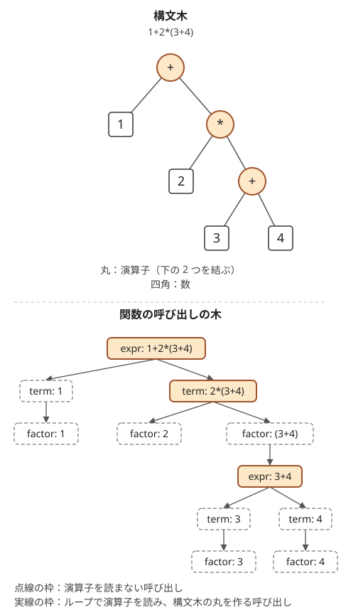

!!! abstract "要点"
    - **何ができるか**：+・\*・括弧を含む式の文字列を、演算子の優先順位どおりに評価・解析する。文法の規則（式・項・因子）ごとに関数を作り、読み取り位置を共有して再帰的に読む（再帰下降構文解析）。
    - **いつ使うか**：
        - 数式の文字列が与えられ、値を求める
        - \+ と \* と括弧の優先順位がある
        - 式として正しい部分文字列
        - 入れ子の構造を持つ文字列
        - 式の長さが 2×10^5 程度で、括弧の入れ子が深くなりうる
    - **計算量**：長さ $\lvert S \rvert$ の式の評価は $O(\lvert S \rvert)$。再帰の深さは括弧の入れ子の深さの 3 倍程度
    - **前提**：[再帰的な構造](../basics/recursion-structure.md)

<!-- textlint-disable -->
別名：再帰下降構文解析・パーサ・BNF・式の評価・逆ポーランド記法・recursive descent parsing
<!-- textlint-enable -->

構文解析は、文字列を文法の規則に沿って読み、どの部分がどの規則に当たるかを決める処理である。競技プログラミングでは、四則演算と括弧の式を優先順位どおりに評価する場面がほとんどで、規則ごとに関数を 1 つ書く再帰下降構文解析で足りる。同じ文法は、式を作る DP や、部分文字列の値を数える問題の状態の設計にもそのまま使える。

## BNF と規則ごとの関数（読み取り位置を参照で共有する） {#bnf}

`1+2*3` を左から順に計算すると $(1 + 2) \times 3 = 9$ になるが、正しい値は $1 + 2 \times 3 = 7$ である。掛け算を先にまとめ、括弧の中をさらに先にまとめる必要がある。この「何を先にまとめるか」を規則として書いたものが文法で、競技プログラミングでは次の 3 つの規則で足りることが多い。この書き方を BNF（バッカス・ナウア記法）といい、くり返しの `{ … }` を使うものは拡張 BNF（EBNF）とも呼ぶ。

```text
式   ::= 項 { ('+' | '-') 項 }
項   ::= 因子 { '*' 因子 }
因子 ::= 数 | '(' 式 ')'
```

`{ … }` は「0 回以上のくり返し」、`|` は「どちらか」を表す。式は項を + と − でつないだもの、項は因子を \* でつないだもの、因子は数か括弧で囲んだ式である。優先順位の低い演算子ほど上の規則に置く。括弧の中は再び「式」なので、規則が自分自身を含む入れ子の構造になる。

再帰下降構文解析では、規則 1 つにつき関数を 1 つ書く。各関数は「次に読む位置 $i$」から自分の規則に当たる部分をちょうど読み、その値を返し、$i$ を読み終えた直後まで進める。

- `expr`：`term` を 1 回呼び、次の文字が + か − である間、それを読んで `term` をもう 1 回呼ぶ
- `term`：`factor` を 1 回呼び、次の文字が \* である間、それを読んで `factor` をもう 1 回呼ぶ
- `factor`：次の文字が `(` なら読み、`expr` を呼び、`)` を読む。そうでなければ数字が続く間読んで数にする

次の文字を 1 つ見るだけで、どの規則のどの枝に進むかが決まる。よって後戻りがなく、各文字を 1 回ずつ読むので、長さ $\lvert S \rvert$ の式を $O(\lvert S \rvert)$ で評価できる。

```cpp
--8<-- "parsing/eval.cpp:core"
```

要は読み取り位置 $i$ をすべての関数で共有することである。$i$ を値渡しにすると、`factor` が括弧の中を読み進めても呼び出し元の $i$ は進まず、同じ部分を何度も読む。参照で渡すか、クラスのメンバ・グローバル変数に置く。`expr` と `factor` は互いに呼び合うので、先に `expr` を宣言しておく。

式の外側で `expr` を呼んだ後は、$i$ が文字列の末尾に来ていることを確かめると、読み残し（`1+2)` の余った括弧など）に気づける。

**応用の型**：値を求めるだけでなく、式の形を確かめる（文法に合わない入力で失敗を返す）・式の木を作る・変数を含む式を後で何度も評価する、のどれも同じ関数の骨組みで書ける。返す値を「数」から「木のノード」や「失敗の印」に変えるだけである。

## 優先順位と括弧が正しく読める理由（構文木と呼び出しの木） {#why-it-works}

式の計算の順は、演算子を節、数を葉とする構文木で表せる。各節は、下の 2 つの部分の値を求めてから自分の演算を施す。再帰下降構文解析の関数の呼び出しは、この構文木をそのままたどっている。

次の図は、`1+2*(3+4)` の構文木と、`expr` から始めたときの呼び出しの木である。



呼び出しの木のうち、ループで演算子を読んだ呼び出しは 3 つある。根の `expr` が + を、`term: 2*(3+4)` が \* を、括弧の中の `expr: 3+4` が + を読む。これらが構文木の 3 つの演算子にちょうど対応する。数を読む `factor` は子を持たず、構文木の葉（数）に当たる。残りの呼び出しは子を 1 つだけ持ち、構文木では辺の途中に当たる。

\* が + より先にまとまる理由は、規則の上下関係にある。`expr` が + を見つけた時点で、その左右はどちらも `term` が読み終えた「\* でつながったかたまり」になっている。`term` は + を見ると自分の役目を終えて戻るので、+ が \* のかたまりを割ることはない。括弧が最も先にまとまるのも同じ理由で、`factor` は `(` から `)` までを 1 つの因子として丸ごと読む。

同じ優先順位の演算子は、左から順に結ぶ（左結合）。`8-3-2` は $(8 - 3) - 2 = 3$ で、$8 - (3 - 2) = 7$ ではない。`expr` は項を 1 つ読むたびに値 $v$ へ結び、ループで次の項へ進むので、左から順に計算される。規則を `式 ::= 項 '-' 式` のように右側へ再帰させると、右の `8-(3-2)` を先にまとめてしまい、誤った値になる。

## 単項マイナス・空白などの例外 {#edge-cases}

実際の入力には、基本の 3 つの規則に収まらないものが混ざる。どれも規則を 1 つ書き足すか、読む前の処理を 1 か所に集めれば扱える。

- **単項マイナス**：`-3*-2` の `-` は引き算ではなく符号である。因子の規則に `因子 ::= '-' 因子` を足し、因子の頭でだけ `-` を符号として読む。2 項の − は `expr` のループで読むので、両者は「どの関数が読むか」で区別される
- **空白**：記号を読む前に空白を飛ばす関数（下の `peek`）を 1 つ作り、すべての判定でそれを使う。数の途中の空白は許さないので、数字を読むループでは飛ばさない
- **複数けたの数**：数字が続く間 $v \leftarrow 10v + d$ でまとめる。`12` を 2 つの因子にしない
- **値の範囲**：途中の値が `long long` を超えるなら、各演算の後で mod を取る。割り算があると mod では扱いにくく、問題の定義（切り捨ての向き・0 で割る場合）に合わせて別に書く
- **末尾**：$i$ が末尾に達したら `s[i]` を読まない。判定のたびに範囲を確かめるか、末尾なら `'\0'` を返す関数にまとめる

```cpp
--8<-- "parsing/eval-ext.cpp:core"
```

単項マイナスを因子に置いたので、`-2*3` は $(-2) \times 3$ と読まれる。値は $-(2 \times 3)$ と同じだが、べき乗のように符号と演算の順で値が変わる演算子を足すときは、単項マイナスをどの規則に置くかを問題の定義に合わせる。

## 深い入れ子と再帰の深さ {#deep-nesting}

再帰下降構文解析の再帰の深さは、括弧の入れ子の深さに比例する。括弧を 1 段開くたびに `factor` → `expr` → `term` → `factor` と 3 段ずつ深くなるので、長さ $2 \times 10^5$ の `((((…1…))))` では深さが $3 \times 10^5$ 程度になる。単項マイナスを因子の再帰で読むと、`----…5` でも同じように深くなる。

AtCoder ではスタックの上限が大きく、このくらいの深さなら再帰のままで通ることが多い。手元の環境では 8 MiB 程度のスタックで落ちることがあるので、試すときはスタックの上限を広げる（[AtCoder と手元の C++ 環境](../cpp/cpp-environment.md)、[再帰の深さとスタック](../basics/recursion-structure.md#stack)）。

再帰を使わずに書くなら、値のスタックと演算子のスタックを使う。演算子を積む前に、すでに積まれている「優先順位が同じか高い演算子」を先に施すのが要である。同じものも先に施すので左結合になる。`(` はそのまま積み、`)` が来たら対応する `(` まで施す。括弧の対応を取るのは[スタックで括弧の対応を取る方法](../ds/stack-techniques.md#brackets)と同じ形である。

```cpp
--8<-- "parsing/stack-eval.cpp:core"
```

このコードは 2 項の演算子だけを扱う。単項マイナスも扱うなら、直前が数か `)` でない位置の − を別の記号（優先順位が \* より高い前置の演算子）として積む。

この方法で演算子を施す順に並べた列が、逆ポーランド記法（後置記法）である。たとえば `1+2*3` は `1 2 3 * +` になる。逆ポーランド記法の式は、数を積み、演算子が来たら上の 2 つを取り出して施すだけで評価できる。入力が逆ポーランド記法で与えられたら、このスタックの計算だけで足りる。

## 文法に沿った DP {#grammar-dp}

文法の規則は、式を読むだけでなく式を作る DP の状態にも使える。「1・+・\*・括弧だけで値 $v$ を表す最短の式」を求める問題（[例題 ABC403 F](#abc403_f)）を考える。

素朴に「値 $v$ の最短の式」だけを持つと、掛け算で失敗する。`1+1` は 2 を表す最短の式だが、これに 3 を掛けるときに `1+1*(1+1+1)` とつなぐと $1 + 1 \times 3 = 4$ になってしまう。和の形の式を掛け算に使うには括弧が要り、括弧が要るかどうかは式の一番外側の演算子で決まる。これは文法の規則そのものである。

そこで規則ごとに状態を分ける（[DP の 4 つの決めごと](../dp/dp-basics.md#four-parts)）。

- **状態**：$E[v]$・$T[v]$・$F[v]$ は、値が $v$ の最短の式・項・因子の長さ（または式そのもの）
- **遷移**：規則をそのまま式にする

$$
\begin{aligned}
F[v] &= \min(\text{1 を並べた数なら その長さ},\ E[v] + 2) \\
T[v] &= \min(F[v],\ \min_{a \times b = v} T[a] + 1 + F[b]) \\
E[v] &= \min(T[v],\ \min_{a + b = v} E[a] + 1 + T[b])
\end{aligned}
$$

- **計算順序**：$v$ の小さい順に求める。和と積の遷移は $v$ より小さい値だけを使う。同じ $v$ の中では $F[v]$ と $E[v]$ が互いを参照する。括弧で囲むと必ず長くなるので、先に「1 を並べた数・積・和」から $T[v]$ と $E[v]$ を決める。その後で $F[v] = E[v] + 2$ とし、$T[v] \leftarrow \min(T[v], F[v])$ を更新すればよい
- **初期値と答え**：1 を並べた数（1・11・111・…）は因子の長さの候補になる。答えは $E[N]$

和の遷移は $v$ ごとに $O(v)$、積の遷移は約数の組だけなので、全体で $O(N^2)$ である。式そのものが要るなら、文字列を持つか、どの遷移で最小になったかを覚えて復元する。

```cpp
--8<-- "parsing/shortest-formula.cpp:core"
```

**応用の型**：「式として正しい文字列を数える」「? を埋めて式にする方法の数」のような問題は、文字列の区間ごとに規則を当てはめる。状態は「区間 $[l, r)$ を式・項・因子として読む方法の数」で、区間 DP になる。演算子の位置で区間を割る形は[区間 DP の分割点型](../dp/interval-dp.md#split-point)と同じである。

## 式の部分文字列の総和 {#substring-sum}

この節は、[寄与](../thinking/contribution.md)で数える考え方と [mod の計算](../math/mod-arithmetic.md)を前提にする。数字と + と \* からなる式 $S$ について、式として正しい部分文字列すべての値の和を求める（[力試し ABC338 G](#challenge)）。$\lvert S \rvert$ は $10^6$ 程度ある。部分文字列は $O(\lvert S \rvert^2)$ 個あり、1 つずつ評価すると $O(\lvert S \rvert^3)$ かかるので間に合わない。

鍵は、右端を 1 文字ずつ伸ばしながら「右端が今の位置の部分文字列すべて」をまとめて持つことである。左から読む途中の式の値は、文法から次の 3 つで書ける。

- $A$：すでに読み終えた項の和
- $P$：今の項の中で、読み終えた因子の積
- $x$：今読んでいる数

右端が数字なら部分文字列の値は $A + P \cdot x$ である。始まりの位置ごとに $A$・$P$・$x$ は違うが、次の文字を読んだときの変化はどの始まりでも同じ形をしている。

| 次の文字 | $A$ | $P$ | $x$ |
| --- | --- | --- | --- |
| 数字 $d$ | そのまま | そのまま | $10x + d$ |
| \* | そのまま | $P \cdot x$ | $0$ |
| + | $A + P \cdot x$ | $1$ | $0$ |

どの更新も「始まりごとの値についての 1 次式」なので、始まりについての和 $\sum A$・$\sum P$・$\sum P x$ と始まりの数 $c$ だけを持てば、和のまま更新できる。たとえば数字 $d$ を読むと $\sum P x$ は $10 \sum P x + d \sum P$ になり、+ を読むと $\sum P$ は $c$ になる。数字の位置では「ここから始まる部分文字列」（$A = 0$・$P = 1$・$x = d$）を 1 つ足し、そのうえで $\sum A + \sum P x$ を答えに足す。

```cpp
--8<-- "parsing/substring-sum.cpp:core"
```

1 文字ごとに $O(1)$ の更新なので、全体で $O(\lvert S \rvert)$ である。数の途中から始まる部分文字列（`34` の `4`）も、数字の位置で始まりを足すので数えられる。演算子から始まる部分文字列は式にならないので、始まりは数字の位置だけに置く。演算子が 2 つ並ぶ入力では、そこより前の始まりはどれも式にならないので、状態を空に戻す。

## 落とし穴 {#pitfalls}

- **読み取り位置を値渡しにする**：`int i` を値で渡すと、呼び出した先で進めた位置が戻ってこない。同じ部分を何度も読んで値が狂うか、無限ループになる。参照（`int& i`）で渡すか、クラスのメンバにする
- **右再帰で書いて左結合を壊す**：`式 ::= 項 '-' 式` と書くと `8-3-2` が $7$ になる。同じ優先順位の演算子はループで左から結ぶ
- **末尾を越えて読む**：`while (isdigit(s[i]))` の前に $i$ が範囲内かを確かめない。`std::string` の `s[s.size()]` は規格で `'\0'` を返すと決まっているので止まるが、`s[s.size() + 1]` は未定義動作で、`vector<char>` なら `s[s.size()]` も範囲外である。末尾の扱いを 1 つの関数にまとめる
- **単項マイナスを `expr` で読む**：式の頭の − だけを `expr` で符号として扱うと、`-3` は読めても `2*-3` では `term` のループの後の `factor` が − を見て失敗する。単項マイナスは `factor` の頭で読む
- **mod を取った値で比べる**：mod を取った後の式の値は大小比較できない。最短の式・最大の値を求める問題では、比べる量（長さなど）を値と別に持つ
- **深い入れ子で落ちる**：長い `((((…))))` を手元で試して落ちても、アルゴリズムの誤りとは限らない。スタックの上限を確かめる（[深い入れ子と再帰の深さ](#deep-nesting)）

## 例題 {#examples}

### ARC061 C. Many Formulas {#arc061_a}

<div class="kp-problems" data-role="example" markdown>

- [ARC061 C. Many Formulas](https://atcoder.jp/contests/arc061/tasks/arc061_a)（diff 1089）：数字の列の間に + を入れる全通りの式について、値の合計を求める。

</div>

文字列の長さ $N$ は高々 10 なので、数字の間は高々 9 か所である。そこで、+ を入れるかどうかを [bit 全探索](../basics/bit-full-search.md#bitmask)で $2^{N-1}$ 通り試す。式に現れる演算子は + だけなので、文法は `式 ::= 数 { '+' 数 }` の 1 段で済む。式の文字列を作らずに、左から読みながら「今の数」と「読み終えた数の和」の 2 つを持てば評価できる。

??? note "解法の詳細"
    - 各 mask について、今の数 $x = 0$、和 $A = 0$ から始める。$k$ 文字目を読むたびに $x \leftarrow 10x + d$ とし、$k$ 文字目の後ろに + を入れる（mask の $k$ ビット目が 1）なら $A \leftarrow A + x$、$x \leftarrow 0$ とする。最後に $A + x$ を足す。
    - これは `expr` のループで項を読むたびに和へ結ぶのと同じ処理で、[式の部分文字列の総和](#substring-sum)の $A$ と $x$ の更新の、\* がない場合に当たる。
    - 全体で $O(N 2^N)$。値は $10^{10}$ を超えうるので `long long` で持つ。

### ABC403 F. Shortest One Formula {#abc403_f}

<div class="kp-problems" data-role="example" markdown>

- [ABC403 F. Shortest One Formula](https://atcoder.jp/contests/abc403/tasks/abc403_f)（diff 1733）：1・+・*・括弧だけを使って N を表す、最も短い式を求める。

</div>

値 $v$ ごとに最短の式を 1 つだけ持つと、和の形の式を掛け算に使う場面で、括弧が要るかどうかが分からない。式・項・因子の 3 つの規則ごとに最短の長さを持てば、括弧が要る場合（式を因子にする）を遷移の 1 つとして書ける。DP の状態・遷移・計算順序は[文法に沿った DP](#grammar-dp)の節のとおりである。

??? note "解法の詳細"
    - $v = 1, 2, \dots, N$ の順に、1 を並べた数 → 積 $T[a] + 1 + F[b]$（$ab = v$）→ 和 $E[a] + 1 + T[b]$（$a + b = v$）→ 括弧 $F[v] = E[v] + 2$ の順で更新する。掛け算は順を入れ替えてよいので、約数の組 $(a, b)$ と $(b, a)$ の両方を試す。
    - 長さは $O(\log N)$ 程度にしかならないので、最短の式を文字列のまま持っても足りる。和の遷移は長さだけを先に比べ、短くなるときだけ文字列を作る。
    - 計算量は和の遷移が支配的で $O(N^2)$。コード片では長さ 9 以下のすべての文字列を試した結果と DP の長さが一致することを確かめている。

## 練習問題 {#practice}

<div class="kp-problems" data-role="practice" markdown>

- [ABC380 B. Hurdle Parsing](https://atcoder.jp/contests/abc380/tasks/abc380_b)（diff 27）：| と - からなる記号列を区切り、各区間の - の数を順に出力する。

</div>

??? note "方針"
    - **ABC380 B**：先頭の | を飛ばして左から読み、- なら数を 1 増やし、| なら数を出力して 0 に戻す。区切り記号で文字列を分ける字句解析の最小の形で、`factor` が数字を読むループと同じ書き方になる。

## 力試し {#challenge}

<div class="kp-problems" data-role="challenge" markdown>

- [ABC338 G. evall](https://atcoder.jp/contests/abc338/tasks/abc338_g)（diff 2573）：数字と + と * からなる式で、式として正しい部分文字列すべての値の和を求める。

</div>

??? note "方針"
    - **ABC338 G**：右端を伸ばしながら、右端が今の位置の部分文字列すべてについて「済んだ項の和 $A$」「今の項の済んだ因子の積 $P$」「今の数 $x$」の和を持つ。どの更新も始まりごとの値の 1 次式なので、和のまま $O(1)$ で更新できる（[式の部分文字列の総和](#substring-sum)）。全体で $O(\lvert S \rvert)$。

## 確認問題 {#quiz}

??? question "確認問題：1+2\*3 で、なぜ 2\*3 が先にまとまるのかを規則から説明せよ"
    `expr` は最初に `term` を呼び、`term` は `factor` で 1 を読んだ後、次の文字が + なので戻る。`expr` は + を読み、もう一度 `term` を呼ぶ。この `term` は 2 を読み、\* を見てループを回し、3 を読んで $2 \times 3 = 6$ を返す。`expr` が + で結ぶのは、`term` が \* をまとめ終えた後の値なので、$1 + 6 = 7$ になる。

??? question "確認問題：読み取り位置 i を値渡しにすると、(1+2)\*3 はどう読まれるか"
    `factor` が `(` を読み、`expr` に $i$ の写しを渡す。`expr` は写しの上で `1+2` を読み進めるが、戻った後の `factor` の $i$ は `(` の直後のままである。そこで `)` を期待した位置に `1` があり、検査で失敗する（検査がなければ同じ部分を読み直して値が狂う）。

??? question "確認問題：(1+1)\*(1+1) と 1+1+1+1 はどちらも 4 を表す。短いのはどちらか"
    `1+1+1+1` は 7 文字、`(1+1)*(1+1)` は 11 文字で、和のほうが短い。4 を表す最短の式は 7 文字である。積が得になるのは、括弧を付けても因数の式が十分短いときで、たとえば 9 は和なら 17 文字だが `(1+1+1)*(1+1+1)` なら 15 文字になる。どちらが短いかは値ごとに違うので、規則ごとの状態で DP する。

??? question "確認問題：逆ポーランド記法で 2 3 + 4 \* はいくつか。また、ふつうの式ではどう書くか"
    2 と 3 を積み、+ で取り出して 5 を積む。4 を積み、\* で取り出して 20 を積む。答えは 20 で、ふつうの式では `(2+3)*4` と書く。逆ポーランド記法では演算子を施す順が並びで決まるので、括弧が要らない。

## 使い分け {#comparison}

| 状況 | 使う手法 |
| --- | --- |
| 括弧の対応を取るだけ・括弧列が正しいかを判定する | [スタック](../ds/stack-techniques.md#brackets)・[括弧列](../patterns/bracket-sequence.md) |
| 演算子が 1 種類だけ・式の形が決まっている | 左から読むループ（例題の [ARC061 C](#arc061_a)） |
| 優先順位と括弧のある式を評価する | 再帰下降構文解析（この手法） |
| 入れ子が深く、再帰を避けたい | 値と演算子の 2 本のスタック（[深い入れ子と再帰の深さ](#deep-nesting)） |
| 式を作る・数える・部分文字列について集める | 文法の規則を状態にした DP（[文法に沿った DP](#grammar-dp)） |

## 参考 {#references}

- [drken「AtCoder ARC 061 C - たくさんの数式 (300 点)」](https://drken1215.hatenablog.com/entry/2020/04/11/171900)：例題 arc061_a の制約と、bit 全探索で式を作りながら評価する方法
- [Qiita Shizen_Tota「ABC403個人的備忘録[A-D,F]」](https://qiita.com/Shizen_Tota/items/21f5f4f1bdfb55e26055)：例題 abc403_f の制約と出力の形、和の形の式を掛けるときだけ括弧が要ること
- [merom686「ABC403」](https://merom686.hatenablog.com/entry/2025/04/28/015126)：例題 abc403_f で長さだけを持てば足りることと、積に使える形を別に持つ考え方
- [Melville「ABC403」](https://www.cnblogs.com/Melville/p/18850810)：例題 abc403_f の式・項・因子の 3 つの表と更新の順
- [drken「AtCoder ABC 338 G - evall (赤色, 600 点)」](https://drken1215.hatenablog.com/entry/2024/01/29/231906)：力試し abc338_g の制約（長さ $10^6$・mod 998244353）と、寄与に分けて数える方針
- [drken「AtCoder ABC 380 B - Hurdle Parsing (灰色, 200 点)」](https://drken1215.hatenablog.com/entry/2024/11/17/011832)：練習 abc380_b の問いと、区切り記号で数を出す処理
