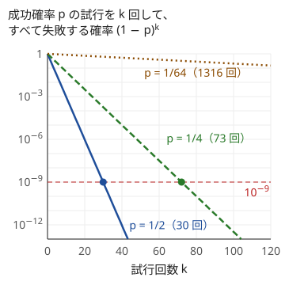
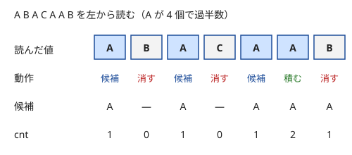

!!! abstract "要点"
    - **何ができるか**：乱数を使って、一定の確率で誤るが速い方法（モンテカルロ法）や、常に正しいが時間が確率的な方法（ラスベガス法）を作る。成功確率 $p$ の試行を $k$ 回繰り返すと失敗確率は $(1 - p)^k$ になるので、回数を見積もって決める。
    - **いつ使うか**：
        - 半数を超える要素が条件を満たす（過半数）。
        - $K \le 10$ 程度の少数の要素を選ぶ条件で、要素の種類が多い。
        - 決定的な方法は重いが、確率的に正しければ十分に速い。
        - 固定の mod・係数のハッシュが、作為的な入力で衝突させられる。
    - **計算量**：（試行 1 回の時間）×（試行回数 $k$）。失敗確率を $\delta$ 以下にするには $k \ge \ln(1/\delta) / p$ 回で足りる（$p = 1/4$・$\delta = 10^{-9}$ なら 83 回。$(1 - p)^k \le \delta$ を正確に解けば 73 回）
    - **前提**：[確率の基本](../comb/probability-basics.md)

<!-- textlint-disable -->
別名：乱択・ランダム化・モンテカルロ法・ラスベガス法・過半数・Boyer-Moore の投票・Color Coding・randomized algorithm
<!-- textlint-enable -->

乱択アルゴリズムは、途中で乱数を使って選び方を決め、「どの入力に対しても、高い確率で正しい答えを速く出す」方法である。乱数で決まるのは入力ではなく自分の選び方で、ここが要になる。そのため、入力を作る側が最悪の場合を狙っても、失敗する確率は見積もった値を超えない。ABC では過半数の条件と、ハッシュの mod・基数を実行時に決める場面で特によく使う。

## モンテカルロ法とラスベガス法 {#monte-carlo-las-vegas}

乱択アルゴリズムは、誤りを許すか時間のぶれを許すかで 2 つに分かれる。

| 種類 | 答え | 時間 | 例 |
| --- | --- | --- | --- |
| モンテカルロ法 | 一定の確率で誤る | 決まっている | ハッシュでの比較、行列積の検査、過半数の乱択 |
| ラスベガス法 | 常に正しい | 確率的にぶれる | 乱択クイックソート、ランダムな順序で加える最小包含円 |

**モンテカルロ法**の典型は、行列の積 $AB = C$ の検査（Freivalds の方法）である。$N \times N$ の積をそのまま計算すると $O(N^3)$ かかる。各成分が 0 か 1 のランダムなベクトル $r$ を選び、$A(Br)$ と $Cr$ を比べるとベクトルと行列の積 3 回の $O(N^2)$ で済む。$AB = C$ なら必ず一致し、$AB \ne C$ なら一致してしまう確率は $1/2$ 以下である。「一致しない」と出たら確実に $AB \ne C$ で、誤るのは「一致する」と答えたときだけである。このように片方の答えだけが誤りうる性質を片側誤りという。誤る側が分かっていれば、繰り返して誤る確率だけを下げられる。

ハッシュによる比較も同じ形である。長さ $n$ の 2 つの列のローリングハッシュは、基数 $x$ の $n - 1$ 次以下の多項式の値を素数 $p$ を法として比べている。列が違えば差の多項式は 0 でなく、根は高々 $n - 1$ 個しかないので、$x$ をランダムに選べば衝突の確率は $(n - 1)/p$ 以下になる（[ローリングハッシュ](../string/rolling-hash.md#collision-bound)）。この見積もりは $x$ を入力と無関係に選んだときだけ成り立つ。そのため mod や基数を固定すると、それを狙った入力で衝突させられる（[ハッシュの衝突確率と安全な設計](../string/hash-safety.md#what-to-randomize)）。

**ラスベガス法**は、答えを確かめられるときに「当たるまで試す」形で作れることが多い。1 回の試行が確率 $p$ で当たるなら、当たるまでの回数の期待値は $1/p$ 回である（[幾何分布](../comb/coupon-collector.md#geometric)）。乱択クイックソートは、軸をランダムに選ぶと、どの入力でも比較の回数の期待値が $O(N \log N)$ になる。最小包含円も、点をランダムな順に加えると期待 $O(N)$ になる（[最小包含円](../geometry/circle-geometry.md#min-enclosing-circle)）。

2 つは互いに作り直せる。ラスベガス法は、時間の上限で打ち切って「見つからない」と答えればモンテカルロ法になる。モンテカルロ法の答えが確かめられるなら、確かめて誤りなら試し直すとラスベガス法になる。

## 失敗確率の見積もりと試行回数（(1 − p)^k） {#failure-probability}

1 回の試行の成功確率が $p$（入力によらない下限）なら、乱数を毎回選び直した $k$ 回の試行は[独立](../comb/probability-basics.md#independence)で、すべて失敗する確率は

$$
(1 - p)^k \le e^{-pk}
$$

である（$1 - p \le e^{-p}$ を使った）。失敗確率を $\delta$ 以下にするには、$k \ge \ln(1/\delta)/p$ 回あれば足りる。必要な回数は $1/p$ に比例し、$\delta$ には対数でしか効かない。



片対数のグラフでは $(1 - p)^k$ は直線になり、傾きは $\log_{10}(1 - p)$ である。$p = 1/2$ と $1/4$ では 30〜80 回ほどで $10^{-9}$ を下回るが、$p = 1/64$ では 120 回でもまだ 0.15 ほど残る。

| 1 回の成功確率 $p$ | $10^{-9}$ 以下にする回数 | 100 回での失敗確率 |
| --- | --- | --- |
| $1/2$ | 30 | 約 $8 \times 10^{-31}$ |
| $1/4$ | 73 | 約 $3 \times 10^{-13}$ |
| $1/64$ | 1316 | 約 $0.21$ |

回数を決めるときは、次の 3 つを確かめる。

- **成功確率の下限を証明する**：「たぶん当たる」ではなく、最悪の入力でも $p$ 以上であることを示す。過半数なら $1/2$ や $1/4$、Color Coding なら $K!/K^K$ のように、入力によらない値にする
- **全体の失敗確率を足し合わせる**：1 つの実行で乱択を $Q$ 回使うなら、どれか 1 つでも失敗する確率は高々 $Q\delta$ である（和の上界）。テストケースが 100 個なら、さらに 100 倍する。クエリ $2 \times 10^5$ 個ごとに乱択を使うなら、各回の失敗確率は $10^{-15}$ 程度まで下げる
- **時間に収まるかを確かめる**：（試行 1 回の時間）×（回数）が制限時間に収まるかを[計算量の見積もり](../basics/complexity-estimation.md)で確かめる。収まらないなら、1 回の試行を軽くするか、成功確率を上げる工夫をする

時間の許す限り試行を繰り返す書き方もある。経過時間の測り方は [C++ の乱数](#cpp-random)の節で触れる。

## 過半数の扱い（ランダムな 2 つを選ぶ・Boyer-Moore の投票） {#majority}

「$N$ 個のうち半数を超える要素が条件を満たす」とあれば、ランダムに 1 つ選ぶとその要素が条件を満たす確率は $1/2$ を超える。条件を満たす要素を 1 つか 2 つ当てれば答えが決まる問題では、これで成功確率の下限が入力によらず決まる。

### ランダムな 2 つから性質を当てる

「過半数の点を通る直線」や「過半数の要素が合同になる法」のように、性質が 2 つの要素から決まるときは、異なる 2 つをランダムに選ぶ。条件を満たす要素が $m > N/2$ 個あるとき、2 つとも当たる確率は

$$
\frac{m(m - 1)}{N(N - 1)} \ge \frac{\frac{N + 1}{2} \cdot \frac{N - 1}{2}}{N(N - 1)} = \frac{N + 1}{4N} > \frac{1}{4}
$$

である（$m \ge (N + 1)/2$ を使った）。異なる 2 つを選ぶと $m - 1$ の分だけ確率が下がるが、それでも $1/4$ を超える。100 回試せば失敗確率は $(3/4)^{100} \approx 3 \times 10^{-13}$ 以下になる。

各試行では、選んだ 2 つから性質を決め、全要素を調べて本当に過半数が満たすかを確かめる。確かめてから「ある」と答えるので、「ある」は必ず正しく、誤りうるのは「ない」と答えるときだけである。1 回の試行は $O(N)$ なので、全体で $O(kN)$ になる。

```cpp
--8<-- "randomized/random-pair.cpp:core"
```

2 つ目の添字は、1 つ目を除いた $N - 1$ 個から一様に選ぶ（`j >= i` なら 1 つずらす）。2 つを独立に選んで同じなら飛ばす書き方では、飛ばした回も回数に数えると成功確率が $1/4$ を下回ることがある（$N = 3$、$m = 2$ なら $2/9$）。

### Boyer-Moore の投票

性質が「値が等しい」なら、乱択は要らない。Boyer-Moore の投票は、過半数の値の候補を 1 回の走査・追加の記憶 $O(1)$ で求める。候補 $c$ と個数 $\mathrm{cnt}$ を持ち、読んだ値 $x$ について次のようにする。

- $\mathrm{cnt} = 0$ なら $c = x$、$\mathrm{cnt} = 1$ とする
- $x = c$ なら $\mathrm{cnt}$ を 1 増やす
- $x \ne c$ なら $\mathrm{cnt}$ を 1 減らす（$c$ と $x$ を 1 組打ち消す）



図の列では、(A, B)・(A, C)・(A, B) の 3 組が打ち消され、最後に A が 1 個残る。

なぜ正しいか。保つ性質は「読んだ部分は、値の異なる 2 つの組と、$\mathrm{cnt}$ 個の $c$ に分けられる」である。過半数の値 $v$ があるとすると、値の異なる組には $v$ が高々 1 個しか入らない。組の数は読んだ個数の半分以下なので、組に入る $v$ はすべての $v$ より少なく、$v$ は残りの $\mathrm{cnt}$ 個の中にある。よって最後の候補は $v$ である。

ただし過半数がないときも候補は何かの値になる。最後に候補の個数を数え直して、$N/2$ を超えるかを確かめる。

```cpp
--8<-- "randomized/majority-vote.cpp:core"
```

- **応用の型（区間の過半数）**：「区間 $[l, r)$ に過半数の値があるか」のクエリには、(候補, 個数) の組を[セグメント木](../ds/segment-tree.md)に載せる。2 つの組は、候補が同じなら個数を足し、違えば多い方から少ない方を引いてまとめる。違う候補どうしを打ち消すだけなので、どの順にまとめても上の性質は保たれる。こうして区間の候補が得られる。候補の本当の個数は、値ごとの出現位置の列を二分探索して数える
- **乱択での区間の過半数**：区間からランダムに 20 か所を選び、各値の区間内の個数を出現位置の二分探索で数えてもよい。過半数があれば 1 回で当たる確率は $1/2$ を超えるので、見逃す確率は $(1/2)^{20} \approx 10^{-6}$ 以下である。クエリが多いなら、[和の上界](#failure-probability)で回数を増やす
- **応用の型（$N/k$ を超える値）**：候補を $k - 1$ 個持つように広げると（Misra-Gries の方法）、$N/k$ 回を超えて現れる値の候補をすべて残せる。これも最後に数え直す

「値が等しい」ではない性質（同じ直線上にある・同じ余りになる）は、2 つずつの比較では打ち消しの性質が成り立たないので、投票は使えない。そのときは前の小節のように、ランダムな 2 つから性質を当てる。

## Color Coding {#color-coding}

この節は [bitDP](../dp/bit-dp.md) を前提にする。

「互いに異なる $K$ 個を選ぶ」条件を DP で扱うには、使った要素の集合を状態に持ちたい。しかし要素が $N$ 種類あると集合は $2^N$ 通りで、$N$ が大きいと持てない。Color Coding は、各要素に $K$ 色のどれかをランダムに塗り、「色が互いに異なる」という強い条件に置き換える。使った色の集合なら $2^K$ 通りで済む。

色が異なれば要素も異なるので、色の条件で見つけた解は元の条件も満たす。逆に、最適解の $K$ 個がたまたますべて違う色に塗られていれば、その解は色の条件の DP で見つかる。$K$ 個が異なる色になる確率は

$$
\frac{K!}{K^K} \ge e^{-K}
$$

である（$K = 4$ で $3/32$、$K = 6$ で約 $1/65$）。そこで塗り直しと DP を $(K^K/K!) \ln(1/\delta)$ 回（$e^K \ln(1/\delta)$ 回以下）繰り返し、最もよい値を答える。$K = 6$・$\delta = 10^{-9}$ なら約 1340 回である。これはモンテカルロ法で、見つけた値は常に実在する解の値なので、誤るのは最適より悪い値を答えるときだけである。

例として、無向グラフで $K$ 頂点を通る単純パスの、頂点の重みの和の最大を求める。$\mathrm{dp}[S][v]$ を「使った色の集合が $S$ で、頂点 $v$ で終わる、色がすべて異なるパスの頂点の重みの和の最大」とする。$v$ から隣の $u$ へは、$u$ の色が $S$ になければ進める。1 回の試行は $O(2^K (N + M))$ である。

```cpp
--8<-- "randomized/color-coding.cpp:core"
```

- **成功確率を上げる工夫**：解の中で互いに異なればよい組が限られているなら、色の数を減らせる。たとえば「グループ A の要素とグループ B の要素は必ず別物」と言えれば、2 色で塗り分けて A を色 0、B を色 1 に限ると、残りの「異なる」条件が少なくなる。成功確率は、関わる要素の数を $t$ として $2^{-t}$ になる
- **サイン**：$K \le 6$〜$7$ 程度で、選ぶ $K$ 個が互いに異なる条件がある。しかも要素の種類（値・頂点・ジャンル）が多く、集合を状態に持てない。$K$ が 1 増えると、回数はおよそ $e$ 倍、1 回の手間は 2 倍になる（$K = 7$ で約 3400 回 × $2^7$）

## C++ の乱数（mt19937_64・時間計測） {#cpp-random}

乱数は `mt19937_64` と `uniform_int_distribution` で作り、種は `random_device{}()` にする。書き方と落とし穴（`rand()` の偏り、閉区間であること）は [C++ の数学関数の乱数の節](../cpp/cpp-math-functions.md#random)にまとめてある。乱択アルゴリズムで特に気をつけるのは次の 3 点である。

- **種を固定しない**：種を定数にすると、乱数の列は毎回同じになる。その列と相性の悪いテストケースがあれば、何度出しても同じように落ちる。固定した mod や基数のハッシュ（[何を乱択するか](../string/hash-safety.md#what-to-randomize)）と同じで、乱択の確率の見積もりは「乱数を入力と無関係に選ぶ」ことが前提である
- **範囲を正しく取る**：`rng() % n` は $n$ が 2 の冪でなければわずかに偏る。$n$ が小さければ偏りは無視できるが、`uniform_int_distribution<int>(0, n - 1)` を使えば考えなくてよい
- **時間いっぱい繰り返す**：試行回数を事前に決めにくいときは、`chrono::steady_clock` で経過時間を測り、制限時間の手前まで繰り返す（[時間計測](../cpp/cpp-math-functions.md#chrono)）。ただし失敗確率を見積もるには、最悪でも何回試せるかを確かめる

## 焼きなましなどのヒューリスティックは ABC の範囲外（AHC） {#heuristics}

焼きなまし法・山登り法・ビームサーチなどは、乱数を使って解を少しずつ改善する方法である。ただし正しさの保証がなく、最適解が得られる確率も見積もれない。これらは得点を競う AtCoder Heuristic Contest（AHC）の道具で、ABC の正解を出す方法としては扱わない。

ABC で「山登りで解けそう」に見える最適化は、ほとんどが目的関数の性質を使って決定的に解ける。凸なら[三分探索](../basics/ternary-search.md)、最適解の形が 2 点・3 点で決まるなら候補の列挙（[最小包含円](../geometry/circle-geometry.md#min-enclosing-circle)）、判定が単調なら[答えで二分探索](../basics/binary-search-answer.md)である。乱数を使っても、この節の「失敗確率を見積もれる」方法とは別物である。

## 落とし穴 {#pitfalls}

- **成功確率を見積もらずに回数を決める**：「100 回くらい」で済ませると、$p$ が小さい問題（Color Coding の $K!/K^K$ など）では全く足りない。$p$ の下限を式で示し、$\ln(1/\delta)/p$ から回数を決める
- **確かめずに答える**：ランダムな 2 つが過半数に入ったと仮定して出した答えは、全体を数え直して確かめる。確かめないと、外れた試行の答えをそのまま出してしまう
- **Boyer-Moore の候補を数え直さない**：過半数がない列でも候補は何かの値になる（1 2 3 では候補は 3、cnt は 1 だが、3 は過半数ではない）
- **同じ 2 つを選ぶ**：異なる 2 つが要るのに添字を独立に選ぶと、$i = j$ の試行が混ざる。$i = j$ の回を飛ばしたうえで試行 1 回に数えると、成功確率が $1/4$ を下回る（$N = 3$、$m = 2$ なら $2/9$）
- **全体の失敗確率を足し忘れる**：クエリごと・テストケースごとの失敗確率を合計すると、1 回あたりの見積もりより何桁も大きくなる

## 例題 {#examples}

### ABC422 E. Colinear {#abc422_e}

<div class="kp-problems" data-role="example" markdown>

- [ABC422 E. Colinear](https://atcoder.jp/contests/abc422/tasks/abc422_e)（diff 1580）：平面上の N 点のうち過半数を通る直線があるか判定し、あれば 1 つ答える。

</div>

過半数を通る直線があれば、異なる 2 点をランダムに選ぶと、2 点ともその直線上にある確率は $1/4$ を超える（[過半数の節](#majority)）。選んだ 2 点を通る直線の上にある点を数え、過半数なら答える。100 回試して見つからなければ「ない」と答える。

??? note "解法の詳細"
    2 点 $(x_i, y_i)$・$(x_j, y_j)$ を通る直線上に点 $(x, y)$ があるかは、外積 $d_x (y - y_i) - d_y (x - x_i) = 0$ で整数のまま判定する（$d_x = x_j - x_i$、$d_y = y_j - y_i$）。直線を $ax + by + c = 0$ の形で答えるなら、$a = d_y$、$b = -d_x$、$c = d_x y_i - d_y x_i$ とすればよい。この係数は出力の上限 $10^{18}$ に収まるので、約分しなくてよい。

    1 回の試行は $O(N)$ で、100 回で $O(100N)$ である。「ある」と答えるのは数えて確かめたときだけなので、誤りうるのは「ない」と答えるときで、その確率は $(3/4)^{100} \approx 3 \times 10^{-13}$ 以下である。点を半分ずつに分け、それぞれの過半数の直線の候補を持ち寄る分割統治の決定的な解法もある。

### ABC272 G. Yet Another mod M {#abc272_g}

<div class="kp-problems" data-role="example" markdown>

- [ABC272 G. Yet Another mod M](https://atcoder.jp/contests/abc272/tasks/abc272_g)（diff 2187）：半数を超える要素が mod M で合同になるような 3 以上の整数 M を 1 つ求める（なければ −1）。

</div>

過半数の要素が $M$ で合同なら、その中の 2 つの差は $M$ の倍数である。ランダムに選んだ異なる 2 つが両方その中にある確率は $1/4$ を超えるので、2 つの差 $d$ から $M$ の候補を作って確かめる。

??? note "解法の詳細"
    候補をすべての約数にすると多すぎるが、$M$ で合同なら $M$ の約数でも合同なので、3 以上で最も小さい形だけを試せばよい。3 以上の整数は必ず「4」か「奇素数」を約数に持つ。そこで $d$ を素因数分解し、$d$ の奇素因数と、$d$ が 4 の倍数なら 4 だけを候補にする。値の差が $10^9$ 程度なら、素因数分解は $O(\sqrt{d})$ で、異なる素因数は 9 個以下である。

    各候補 $M$ について、選んだ要素と $M$ で合同な要素を数え、半数を超えれば答える。100 回試して見つからなければ $-1$ を答える。要素が互いに異なるので $d > 0$ である。

    決定的な解法もある。過半数の要素があれば、列を円に並べたとき隣り合う 2 つがともに過半数側である組が必ずある。そこで隣り合う組の差だけを試せばよい。

## 練習問題 {#practice}

<div class="kp-problems" data-role="practice" markdown>

- [ABC339 F. Product Equality](https://atcoder.jp/contests/abc339/tasks/abc339_f)（diff 1716）：最大 1000 桁の整数の列で、A_i×A_j = A_k となる組 (i, j, k) の数を求める。
- [ABC238 G. Cubic?](https://atcoder.jp/contests/abc238/tasks/abc238_g)（diff 2254）：区間の積が立方数かの質問に答える。

</div>

??? note "練習問題の方針"
    - **ABC339 F**：値を大きな素数の mod で比べる。固定の mod はそれを狙ったテストで衝突するので、mod を実行時にランダムに選ぶ（[ハッシュの衝突確率と安全な設計](../string/hash-safety.md#what-to-randomize)）。
    - **ABC238 G**：素因数ごとにランダムな値を割り当て、指数を 3 で割った余りを符号化したハッシュの累積で区間を判定する（[集合・多重集合のハッシュ](../string/hashing-for-sets.md#multiplicity-mod-k)）。

## 力試し {#challenge}

<div class="kp-problems" data-role="challenge" markdown>

- [ABC447 G. Div. 1 & Div. 2](https://atcoder.jp/contests/abc447/tasks/abc447_g)（diff 2391）：番号順に 6 問を選び、前の 4 問のジャンルが互いに異なり、後ろの 4 問のジャンルも互いに異なるようにして、面白さの和を最大にする。

</div>

??? note "方針"
    中央の 2 問（3・4 番目）のジャンルは、ほかの 5 問のどれとも異なる必要がある。一方、外側の 4 問（1・2・5・6 番目）では、1 番目と 5 番目のように離れた組は同じジャンルでもよい。そこでジャンルごとにランダムに 2 色を塗り、中央の 2 問は色 1、外側の 4 問は色 0 のジャンルから選ぶと決める。色が違えばジャンルも違うので、残る条件は隣り合う 2 問（1 と 2、3 と 4、5 と 6）のジャンルが異なることだけになる。

    この条件なら、選んだ問数ごとに「値の大きい方から、直前のジャンルが異なる上位 2 つ」を持つ DP で、1 回 $O(N)$ で解ける。最適解の 6 問に現れるジャンルは高々 6 種類なので、それが望みの色に塗られる確率は $2^{-6} = 1/64$ 以上である。失敗確率を $10^{-9}$ 以下にするには約 1316 回繰り返す（[失敗確率の見積もり](#failure-probability)）。1 回の DP は段が 6 つで各段に値を 2 つ持つだけと軽いが、1316 回 × $O(N)$ が制限時間に収まるかは $N$ の上限で確かめる（$N = 10^5$ なら $1.3 \times 10^8$ × 定数ほど）。

## 確認問題 {#quiz}

??? question "確認問題：成功確率 1/4 の試行を何回繰り返せば、失敗確率が 10^-9 以下になるか"
    ??? success "答え"
        73 回である。$(3/4)^k \le 10^{-9}$ を解くと $k \ge 9 / \log_{10}(4/3) \approx 72.03$ になる。上界 $e^{-k/4}$ を使うと $k \ge 4 \ln 10^9 \approx 82.9$ で、少し多めの 83 回になる。

??? question "確認問題：Boyer-Moore の投票で得た候補を、最後に数え直すのはなぜか"
    ??? success "答え"
        投票が保証するのは「過半数の値があれば、それが候補になる」ことだけだからである。過半数がない列でも候補は何かの値になる。例えば 1 2 3 では候補は 3 だが、3 は過半数ではない。

??? question "確認問題：過半数の点を通る直線を探すのに、Boyer-Moore の投票を使えないのはなぜか"
    ??? success "答え"
        「同じ直線上にある」は 2 点だけでは決まらない関係で、値の等しさのように要素を組に分けて打ち消すことができないからである。どの 2 点も何かの直線上にあるので、「異なる 2 つを打ち消す」の「異なる」が定まらない。そこで 2 点から直線を決めて全体で確かめる乱択を使う。

??? question "確認問題：クエリが 2×10^5 個あり、各クエリで失敗確率 10^-9 の乱択を使う。1 つのテストケースで 1 つでも誤る確率はどれくらいか"
    ??? success "答え"
        和の上界から、高々 $2 \times 10^5 \times 10^{-9} = 2 \times 10^{-4}$ である。テストケースが 100 個あれば $2 \times 10^{-2}$ まで上がり、無視できない。各クエリの失敗確率を $10^{-15}$ 程度まで下げる（回数を 2 倍ほどにする）とよい。

## 使い分け {#comparison}

- **乱択か決定的か**：同じ計算量の決定的な解法が書けるなら、そちらを選ぶ方が安心である。乱択は、決定的な解法が重いか複雑なときに、短い実装で済ませる手段として使う。例題の 2 問にも決定的な解法がある
- **ハッシュ**：列・文字列の比較は[ローリングハッシュ](../string/rolling-hash.md)、集合・多重集合の比較は[集合・多重集合のハッシュ](../string/hashing-for-sets.md)、mod と基数の選び方は[ハッシュの衝突確率と安全な設計](../string/hash-safety.md#what-to-randomize)に任せる
- **Color Coding と bitDP**：要素が 20 個程度までなら、要素の集合をそのまま状態にする [bitDP](../dp/bit-dp.md) で決定的に解ける。要素が多く、選ぶ数 $K$ だけが小さいときに Color Coding を使う
- **期待値の計算**：乱数で答えを探すのではなく、確率や期待値そのものを求める問題は[確率の基本](../comb/probability-basics.md)や期待値 DP の範囲である

## 参考 {#references}

- [Wikipedia「Boyer–Moore majority vote algorithm」](https://en.wikipedia.org/wiki/Boyer%E2%80%93Moore_majority_vote_algorithm)：投票の手順、正しさの不変条件、数え直しが要ること、Misra-Gries の方法への一般化
- [Wikipedia「Freivalds' algorithm」](https://en.wikipedia.org/wiki/Freivalds%27_algorithm)：0/1 のランダムなベクトルによる行列積の検査と、片側誤りの確率 1/2 以下
- [merom686「ABC422」](https://merom686.hatenablog.com/entry/2025/09/08/001908)：ABC422 E を異なる 2 点の乱択で解き、100 回で見逃す確率を見積もった記録
- [bfs「【Rust】ABC422まとめ（A~E）」](https://qiita.com/bfs/items/a9f3d319fd5cb371de5d)：ABC422 E の乱択の手順と、2 点から直線の係数を作る方法
- [gotoki_no_joe「ABC422 A～F をHaskellで」](https://qiita.com/gotoki_no_joe/items/7f564f443dbfc0f678f4)：ABC422 E の係数の大きさと、分割統治による決定的な解法
- [merom686「ABC272」](https://merom686.hatenablog.com/entry/2022/10/09/013149)：ABC272 G で約数が上位互換になること、ランダムな 2 要素の差の約数を試す方針、円に並べて隣り合う組を見る決定的な解法
- [kmjp「AtCoder ABC #447 : G - Div. 1 & Div. 2」](https://kmjp.hatenablog.jp/entry/2026/02/28/0900)：ABC447 G の問いの確認（解法は別の方法）
