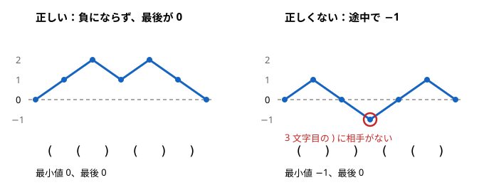

!!! abstract "要点"
    - **何のページか**：括弧列が出てくる問題で、判定・数え上げ・区間の判定・並べる順序・価値の最大化の手法を引ける。`(` を +1、`)` を −1 とした累積和が、途中で負にならず最後が 0 なら正しい。この言い換えが共通の出発点になる。
    - **いつ使うか**：
        - `(` と `)` からなる文字列が正しい括弧列か判定する。
        - `?` を `(` か `)` に置き換えて正しい括弧列にする方法の数。
        - 文字の入れ替えのたびに、区間が正しい括弧列かを答える。
        - 複数の括弧列を並べて連結し、正しい括弧列にできるか。
        - 長さ 2N の正しい括弧列の個数。
    - **使い方**：問われ方を[一覧の表](#overview)で探し、行の節で条件の言い換えを確かめてから手法のページへ進む。
    - **計算量**：判定 $O(N)$、更新ありの区間の判定は更新・取得とも 1 回 $O(\log N)$
    - **前提**：[累積和](../basics/prefix-sum.md)

<!-- textlint-disable -->
別名：正しい括弧列・カッコ列・parentheses・バランスの取れた括弧列・bracket sequence
<!-- textlint-enable -->

括弧列は、`(` と `)` からなる文字列である。対応の取れたものを正しい括弧列と呼ぶ。問われ方は多いが、ほとんどは「累積和が負にならず、最後が 0」という 1 つの言い換えから始まる。

## 題材の性質 {#properties}

括弧列の性質は、`(` を +1、`)` を −1 とした累積和で見る。ここでは 0-indexed で、$S$ の長さを $N$、$P_0 = 0$、$P_{i+1} = P_i + (S[i] \text{ が '(' なら } 1 \text{、')' なら } -1)$ とする。$P_i$ は先頭 $i$ 文字を読んだ時点で開いたままの括弧の数である。

- **正しい括弧列の条件**：すべての $i$ で $P_i \ge 0$、かつ $P_N = 0$。途中で負になるのは、相手のいない `)` を読んだときである。最後が正なら、閉じていない `(` が残っている
- **対応する括弧**：位置 $i$ の `(` の相手は、$i$ より後で初めて $P_{j+1} = P_i$ になる位置 $j$ の `)` である。スタックに `(` の位置を積み、`)` で取り出しても同じ対応が得られる
- **要約と連結**：括弧列を（合計 $s$, 累積和の最小値 $m$）の 2 つの数に要約できる（$m$ は空の接頭辞の 0 も含めて取る）。$A$ の後ろに $B$ をつないだ列の合計は $s_A + s_B$ である。最小値は $\min(m_A, s_A + m_B)$ になる。$B$ の部分が高さ $s_A$ から始まるからである。正しい括弧列であることは、$s = 0$ かつ $m = 0$ と同じ

累積和を折れ線にすると、`(` で 1 段上がり `)` で 1 段下がる山脈になる。正しい括弧列は 0 の線を下回らずに 0 へ戻る折れ線である。



この図で、下の列は最後の値だけを見ると正しく見える。途中の最小値まで見て初めて誤りが分かる。合計だけでなく最小値も要るのは、このためである。

??? question "確認問題：`(` と `)` の個数が等しくても正しくないことがあるのはなぜか"
    個数が等しいことは $P_N = 0$ だけを言う。`)(` は個数が等しいが、1 文字目で $P_1 = -1$ になり、`)` の相手がない。途中で負にならないことも要る。

## 問われ方と手法の一覧 {#overview}

問題文の形から行を探し、手法のページへ進む。代表の問題は、このページに載せたものだけを書いた。

| よく出る問われ方 | 使う手法 | ページ | 代表の問題 |
|---|---|---|---|
| 1 種類の括弧が正しいか | ±1 の累積和 | [累積和](../basics/prefix-sum.md) | — |
| 複数種類の括弧・入れ子の構造・対応する部分を取り除く・置き換える | スタック | [スタック・キュー・deque の使いどころ](../ds/stack-techniques.md) | ABC394 D、ABC454 D |
| ? の埋め方の数・長さ 2N の個数 | 開いている数を状態にした DP、カタラン数 | [DP の状態の設計](../dp/dp-state-design.md)、[鏡像法とカタラン数](../comb/reflection-principle.md#catalan) | — |
| 更新ありで区間が正しいか | 区間加算と区間の最小値 | [遅延セグメント木](../ds/lazy-segment-tree.md) | — |
| 同上（点の更新で済ませる） | （合計, 最小値）を載せる | [セグメント木に何を載せるか](../ds/segment-tree-monoids.md#pattern-table) | — |
| 複数の括弧列を並べてつなぐ | 要約して 2 組に分けてソート | [交換論法と比較関数の設計](../basics/exchange-argument.md) | ABC167 F |
| 価値が最大の正しい括弧列 | 接頭辞の条件と優先度付きキュー | [優先度付きキューを使う貪欲](../basics/greedy-priority-queue.md) | ABC407 E |
| 数式・入れ子の構造を読む | 構文解析 | [構文解析](../misc/parsing.md) | — |

問題へのリンクは、[例題](#examples)と[練習問題](#practice)の囲みにある。

## 1 種類の括弧の判定 → ±1 の累積和（prefix-sum） {#check}

括弧が 1 種類なら、[題材の性質](#properties)の条件をそのまま確かめればよい。先頭から読みながら開いている数を数え、負になった時点で失敗とする。$O(N)$ で済む。

```text
open = 0
for c in S:
    open += (c == '(') ? 1 : -1
    if open < 0: return 正しくない
return open == 0
```

最後の `open == 0` を忘れると、`((` のような列を正しいと答えてしまう。

## 複数種類の括弧・入れ子の構造 → スタック（stack-techniques） {#stack}

`(` と `[` のように括弧が複数種類あると、開いている数だけでは判定できない。`([)]` は種類ごとに数えるとどちらも条件を満たすが、正しくない。閉じ括弧の相手は直前に開いた括弧でなければならないからである。

開き括弧をスタックに積み、閉じ括弧を読んだら先頭と種類が合うかを確かめて取り出す。途中で空のスタックから取り出そうとするか種類が合わなければ失敗で、最後にスタックが空なら正しい。各文字はスタックに 1 回だけ積まれ、1 回だけ取り出されるので $O(N)$ である。

開き括弧の位置を積めば、対応する括弧の組や、ある括弧の内側の範囲も同じ走査で分かる。対応する組を取り除く、決まった形の部分を置き換える、といった操作を繰り返した結果も、スタックの末尾を照合しながら作れる。詳しくは[スタック・キュー・deque の使いどころ](../ds/stack-techniques.md)に任せる。

## ? の埋め方の数・条件を満たす括弧列の数 → 開いている数を状態にした DP（dp-state-design） {#counting}

正しい括弧列の条件は、累積和が途中で負にならず、最後が 0 になることだった。先頭から作るとき、先の選び方に効くのは開いている数 $P_i$ だけである。そこで次の DP を立てる。

- 状態：$\mathrm{dp}[i][j]$ ＝ 先頭 $i$ 文字を決めて、開いている数が $j$ になる決め方の数
- 遷移：$S[i]$ が `(` になりうるなら、$\mathrm{dp}[i][j]$ を $\mathrm{dp}[i+1][j+1]$ へ足す。`)` になりうるなら、$j \ge 1$ のときだけ $\mathrm{dp}[i+1][j-1]$ へ足す
- 初期値と答え：$\mathrm{dp}[0][0] = 1$、答えは $\mathrm{dp}[N][0]$

状態数 $O(N^2)$ に対して遷移は 2 通りなので、全体で $O(N^2)$ である。$j \ge 1$ の制限が「途中で負にならない」を表す。状態の設計は [DP の状態の設計](../dp/dp-state-design.md)にある。

? だけからなる長さ $2n$ の列、つまり長さ $2n$ の正しい括弧列の個数は、カタラン数 $\frac{1}{n+1}\binom{2n}{n}$ になる。式の導き方（鏡像法）は[鏡像法とカタラン数](../comb/reflection-principle.md#catalan)で扱う。

## 区間が正しい括弧列か（更新あり）→ 累積和の区間加算と区間の最小値（lazy-segment-tree） {#range-check}

`(` を +1、`)` を −1 とした累積和を $P$ とする（$P_i$ は先頭 $i$ 文字の和で、$P_0 = 0$）。部分文字列 $S[l, r)$ が正しい括弧列であることは、$P$ で次のように言える。

$$
P_r = P_l \quad\text{かつ}\quad \min_{l \le i \le r} P_i \ge P_l
$$

区間の中だけで数え直すと、高さは $P_l$ から始まる。そのため、区間の最小値は 0 ではなく $P_l$ と比べる。

2 文字の入れ替えなどで $S$ が変わると、累積和は後ろ側がまとめて変わる。0-indexed で $S[a]$ が `(` から `)` に変わると、$P_{a+1}, \dots, P_N$ がすべて 2 減る。そこで長さ $N+1$ の列 $P$ を[遅延セグメント木](../ds/lazy-segment-tree.md)に載せ、区間加算と区間の最小値で答える。$P_l$・$P_r$ は 1 点の取得で、最小値は半開区間 $[l, r+1)$ の取得で得る（閉区間 $[l, r]$ なので右端は $r+1$ になる）。更新と判定はどちらも 1 回 $O(\log N)$ である。

## （合計, 最小値）をセグメント木に載せる → モノイドの設計（segment-tree-monoids） {#monoid}

[区間の判定](#range-check)は、累積和を持たずに文字そのものをセグメント木に載せても解ける。各文字を（合計 $s$, 最小値 $m$）に要約し、[題材の性質](#properties)の連結の式でまとめる。

$$
(s_A, m_A) \cdot (s_B, m_B) = (s_A + s_B,\ \min(m_A,\ s_A + m_B))
$$

- `(` を $(1, 0)$、`)` を $(-1, -1)$ とする。空の列 $(0, 0)$ は、どちらにつないでも相手を変えない[単位元](../guide/glossary.md#identity-element)である
- 区間 $[l, r)$ をまとめた結果が $(0, 0)$ なら正しい括弧列である
- 文字の更新は点の更新だけで済む。区間加算が要らないので、遅延セグメント木より簡単に書ける

この演算は[結合法則](../guide/glossary.md#associativity)を満たすので、セグメント木に載る。載せ方の考え方は[セグメント木に何を載せるか](../ds/segment-tree-monoids.md#design-steps)にある。

## 複数の括弧列を並べる順序 → 要約して 2 組に分けてソート（exchange-argument） {#ordering}

いくつかの括弧列をすべて好きな順につなぐ問題では、各列を（合計 $s$, 最小値 $m$）に要約すれば中身は要らない。つないだ全体が正しいのは、合計が 0 で、各列を置いた時点の高さ $h$ に対して $h + m \ge 0$ が保たれるときである。

並べ方は、合計が 0 以上の列と負の列に分けて決める。

- **合計が 0 以上の列**：先に置き、最小値 $m$ の大きい順に並べる。高さを上げる列を先に全部使えば、どの列を置く時点でも高さが最も高くなる。負の列を途中に挟むと、後の列を置ける高さが下がるだけである
- **合計が負の列**：後に置き、$s - m$ の大きい順に並べる。右から読むと `(` と `)` の役目が入れ替わり、この列は合計 $-s$、最小値 $m - s$ の列とみなせる。右から見て $m - s$ の大きい順に置くので、左からは $s - m$ の大きい順になる

1 つの基準だけでソートすると誤る。正の列は最小値だけで、負の列は合計との差で順が決まり、基準が違うからである。並べ方が正しいことは、隣り合う 2 列を入れ替えても悪くならないことで示す（[交換論法と比較関数の設計](../basics/exchange-argument.md#adjacent-swap)）。

## 価値が最大の正しい括弧列 → 先頭からの条件に言い換えて優先度付きキュー（greedy-priority-queue） {#max-value}

位置ごとに価値があり、`(` を置いた位置の価値の和を最大にする問われ方がある。累積和の条件を、`(` の個数の条件に言い換えると扱いやすい。

先頭 $i$ 文字にある `(` の個数を $c$ とすると、$P_i = c - (i - c) = 2c - i$ である。$P_i \ge 0$ は $c \ge \lceil i/2 \rceil$ と同じになる。偶数の $i = 2k$ での条件 $c \ge k$ は、その手前の $i = 2k-1$ での条件から従う。よって、`(` がちょうど半分あるという前提のもとで、正しい括弧列であることは次と同じになる。

- 1-indexed で、各 $k = 1, \dots, n$ について、先頭 $2k-1$ 文字に `(` が $k$ 個以上ある（全体の長さは $2n$）

これは「$k$ 回目の締め切りまでに $k$ 個選ぶ」形の条件で、優先度付きキューの貪欲が使える（[例題](#abc407_e)）。

## 数式・入れ子の構造の解析 → 構文解析（parsing） {#parsing}

括弧が数式や入れ子のデータの一部として出てくるときは、括弧の対応だけでなく文法に沿って読む必要がある。演算子の優先順位と括弧を、文法の規則ごとの関数で再帰的に読むのが[構文解析](../misc/parsing.md#bnf)である。括弧の対応を取るだけなら、[スタック](#stack)で足りる。

## 落とし穴 {#pitfalls}

- **複数種類の括弧を累積和だけで判定する**：種類ごとの累積和がどれも条件を満たしても、`([)]` のように交差していれば正しくない。種類が 2 つ以上ならスタックで対応を確かめる
- **並べる順序を 1 つの基準でソートする**：合計が正の列と負の列では、先に置くべきものが逆になる。2 組に分けてから、それぞれの基準で並べる
- **区間の判定で始点の累積和を引き忘れる**：区間 $[l, r)$ の最小値は 0 ではなく $P_l$ と比べる。終点も $P_r = P_l$ で確かめ、$P_r = 0$ と比べない
- **累積和の添字のずれ**：$P_i$ は先頭 $i$ 文字を読んだ後の値である。$S[a]$ を変えたとき、値が変わるのは $P_{a+1}$ 以降になる。区間加算の範囲を 1 つずらすと、ほかの区間の判定まで誤る

## 例題 {#examples}

### ABC407 E. Most Valuable Parentheses {#abc407_e}

<div class="kp-problems" data-role="example" markdown>

- [ABC407 E. Most Valuable Parentheses](https://atcoder.jp/contests/abc407/tasks/abc407_e)（diff 1531）：長さ 2N の数列が与えられ、長さ 2N の正しい括弧列のうち、`(` を置いた位置の値の和の最大値を求める。

</div>

方針：[価値が最大の正しい括弧列](#max-value)の言い換えにより、「先頭 $2k-1$ 個の中から $k$ 個以上選ぶ」条件のもとで、ちょうど $N$ 個の位置を選び、値の和を最大化する問題である。$k = 1, 2, \dots, N$ の順に、新しく選べるようになった位置の値を優先度付きキューに入れ、最大のものを 1 つ取り出して選ぶ。全体で $O(N \log N)$ である。

??? note "解法の詳細"
    1-indexed で、値を $A_1, \dots, A_{2N}$ とする。

    ```text
    heap = 空の最大ヒープ
    ans = 0
    for k = 1 .. N:
        k == 1 なら A_1 を、k >= 2 なら A_{2k-2} と A_{2k-1} を heap に入れる
        ans += heap から取り出した最大値
    return ans
    ```

    - $k$ 回目の時点で heap に入ったことがあるのは先頭 $2k-1$ 個で、そこから $k$ 個を選んでいるので条件を満たす。最後の位置 $2N$ は入れないので、必ず `)` になる
    - 正しさ（交換論法）：$k-1$ 回目までは貪欲と同じ位置を選ぶ最適解が、$k$ 回目に貪欲が取った位置 $p$ を選んでいないとする。最適解は先頭 $2k-1$ 個から $k$ 個以上選ぶので、貪欲がまだ取っていない位置 $q$ をその中に含み、$A_q \le A_p$ である
    - $q$ を $p$ に替えても、どちらも先頭 $2k-1$ 個の中なので締め切りの条件は崩れず、和は減らない。これを繰り返すと、貪欲の選び方も最適になる
    - 締め切りつきの選び方の貪欲は[優先度付きキューを使う貪欲](../basics/greedy-priority-queue.md)で扱う

## 練習問題 {#practice}

<div class="kp-problems" data-role="practice" markdown>

- [ABC394 D. Colorful Bracket Sequence](https://atcoder.jp/contests/abc394/tasks/abc394_d)（diff 253）：3 種類の括弧からなる文字列が、正しい括弧列か判定する。
- [ABC454 D. (xx)](https://atcoder.jp/contests/abc454/tasks/abc454_d)（diff 706）：`(`・`x`・`)` からなる 2 つの文字列について、`(xx)` を `xx` に置き換える操作を繰り返して、同じ文字列にできるか判定する。
- [ABC167 F. Bracket Sequencing](https://atcoder.jp/contests/abc167/tasks/abc167_f)（diff 1961）：N 個の括弧列をすべて好きな順に連結して、正しい括弧列にできるか判定する。

</div>

??? note "練習の方針"
    - **ABC394 D**：[複数種類の括弧](#stack)の判定そのものである。開き括弧を積み、閉じ括弧で種類を確かめる
    - **ABC454 D**：両方の文字列を、それ以上置き換えられない形まで縮めて比べる。左から 1 文字ずつスタックへ積み、末尾の 4 文字が `(xx)` となるたび `xx` へ縮めれば、線形時間で済む。`(xx)` は `(` で始まり `)` で終わるので、2 か所の `(xx)` は重なり合えない。そのため、どこから縮めても最後の形は同じになる。同じ文字列にできるなら共通の形から縮めても同じ形に着くので、縮めた形が違えば No である
    - **ABC167 F**：各列を（合計, 最小値）に要約し、[並べる順序](#ordering)の節の 2 組に分ける。合計が負の列は、（合計 − 最小値）の大きい順に並べる。これは列を右から見たときの最小値の大きい順にあたる

## 参考 {#references}

- [ikatakos「AtCoder Beginner Contest 407」](https://ikatakos.com/pot/programming_algorithm/contest_history/atcoder/2025/0524_abc407)：ABC407 E の言い換え（先頭 $i$ 文字の `(` の個数）と優先度付きキューの貪欲
- [ikatakos「AtCoder Beginner Contest 167」](https://ikatakos.com/pot/programming_algorithm/contest_history/atcoder/2020/0510_abc167)：ABC167 F の要約と並べ方
- [merom686「ABC394」](https://merom686.hatenablog.com/entry/2025/02/23/001649)：ABC394 D のスタックによる判定
- [chiaoi「ABC454」](https://zenn.dev/chiaoi/articles/abc454_solution)：ABC454 D の、縮めきった形どうしを比べる方針
- [comet725「ABC454Dを解いた【stack】」](https://qiita.com/comet725/items/1e168acdfcf992d2170e)：ABC454 D のスタックで末尾を照合する実装
