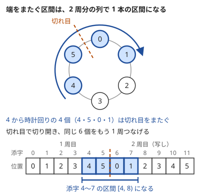

!!! abstract "要点"
    - **何のページか**：円形に並ぶ列のように、最後と最初も隣り合う並びを含む問題で、問われ方から使う手法を引ける。2 周分に伸ばす、1 か所で切って固定する、回転を 2 周分の窓とみる、の 3 つの言い換えが共通の出発点になる。
    - **いつ使うか**：
        - $N$ 個が円形に並び、$N$ 番目と 1 番目も隣り合う。
        - 円環上の連続する区間の和・個数（端をまたぐ区間も含む）。
        - 円形に並ぶものを、隣どうしが違う色で塗る方法の数。
        - 列を何回回転させると、もう一方の列に一致するか。
        - 円周上に点が並び、時計回りに進む・点どうしを弦で結ぶ。
    - **使い方**：問われ方を[一覧の表](#overview)で探し、行の節で言い換えを確かめてから手法のページへ進む。
    - **計算量**：手法による。2 周分に伸ばした累積和は前計算 $O(N)$ で 1 回 $O(1)$、1 か所で切る DP は一列の DP を最初の状態の数だけ回す
    - **前提**：なし

<!-- textlint-disable -->
別名：環状・円形に並ぶ・円周上に並ぶ・最後と最初が隣り合う・2 周分に伸ばす・輪・リング・circular・cyclic・ring
<!-- textlint-enable -->

円環は、$N$ 個のものが輪の形に並び、最後と最初も隣り合う並びである。数列・文字列・円周上の点・グラフの閉路と、現れる形はさまざまである。多くの問題は「2 周分に伸ばす」か「1 か所で切る」で一列の問題に戻してから、一列の手法で解く。

## 題材の性質 {#properties}

ここでは、円環に並ぶ $N$ 個を 0-indexed で $a_0, a_1, \dots, a_{N-1}$ と書き、番号が増える向きを時計回りと呼ぶ。位置 $i$ の次を $(i + 1) \bmod N$、前を $(i - 1 + N) \bmod N$ とし、$a_{N-1}$ と $a_0$ も隣り合うとみる。問題文の 1-indexed の番号からは 1 を引いて使う。

円環の問題の多くは、次の 3 つの言い換えで一列の問題に戻してから解く。

- **2 周分に伸ばす**：$b_j = a_{j \bmod N}$（$0 \le j < 2N$）とする。位置 $i$ から時計回りに $k$ 個（$1 \le k \le N$）の区間は、$b$ の[半開区間](../guide/glossary.md#half-open-interval) $[i, i + k)$ になる。端をまたぐ区間も普通の区間になるので、累積和・二分探索・尺取り法がそのまま使える。始点を $0 \le i < N$ に、長さを $N$ 以下に限れば、円環上の区間（始点と長さの組）と 1 対 1 に対応する。
- **1 か所で切る**：$a_{N-1}$ と $a_0$ の間で切り開くと一列になる。失うのは「最後と最初が隣り合う」という 1 つの関係だけである。境目をまたぐもの（最初の要素の状態など）を固定するか場合分けしてから一列の手法を使い、最後に境目の関係を確かめる。
- **回転は 2 周分の窓**：先頭を末尾へ移す操作を $k$ 回行った列を、$k$ 回の回転と呼ぶ。これは $b$ の位置 $k$ から始まる長さ $N$ の窓である。回転は $0 \le k < N$ の $N$ 通りしかなく、すべてが $b$ の中に並ぶ。

図の 4 個は、円環のままでは切れ目をまたぐので、1 本の累積和の引き算 1 回では和が書けない。2 周分の列では、同じ 4 個が添字 4〜7 の連続した区間になる。

2 点の間は 2 つの向きでつながる。1 周の長さを $L$、時計回りの距離を $d$ とすると、反時計回りの距離は $L - d$ で、近い方は $\min(d, L - d)$ である。位置 $i$ から $i + 1$ への長さを $w_i$ とし、$S_i = w_0 + \dots + w_{i-1}$（$S_0 = 0$）とおく。$s$ から $t$ への時計回りの距離は、$s \le t$ なら $S_t - S_s$、$s > t$ なら $L - (S_s - S_t)$ である。

円環には端がない。直線なら端の外へ逃がせた操作や条件が、円環ではどこか 2 点に必ずかかる。その代わり、どの位置から読み始めても同じ形になるので、始点を 1 つに決めてよいことが多い。円順列で 1 人の位置を固定するのも、弦の交差をどこで切っても同じに判定できるのも、このためである。

グラフで円環にあたるのは閉路である。$N$ 頂点 $N$ 辺の連結なグラフは閉路をちょうど 1 つ持つ。閉路を取り出すと、閉路の頂点を並べた円環の問題と、ぶら下がる木の問題に分かれる（[なもりグラフの節](#namori)）。

??? question "確認問題：円環上の区間の数"
    2 周分の列で、始点が 0 以上 $N$ 未満、長さが 1 以上 $N$ 以下の区間はいくつあるか。中身（含む位置の集合）が同じものを 1 つと数えると、いくつになるか。

    ??? success "答え"
        始点が $N$ 通り、長さが $N$ 通りで $N^2$ 個ある。長さ $N$ 未満の区間は、始点か長さが違えば位置の集合も違う。長さ $N$ の区間は始点によらずすべての位置を含むので、位置の集合として数えると $N(N-1) + 1$ 個になる。全体を $N$ 回数えないように、長さ $N$ の区間をどう数えるかは問題に合わせて決める。一列の区間の $N(N+1)/2$ 個と比べると、およそ 2 倍である。

## 問われ方と手法の一覧 {#overview}

問題文の形から行を探し、問われ方のリンクから行の節へ移る。節で言い換えを確かめてから、手法のページへ進む。代表の問題は行き先のページの例題・練習にあるもので、問題へのリンクもそこにある。

**列が円形に並ぶ**：列の最後と最初が隣り合い、区間が端をまたぐ。

| よく出る問われ方 | 使う手法 | ページ | 代表の問題 |
|---|---|---|---|
| [円環上の区間の和・和が条件を満たす区間](#sum) | 2 周分に伸ばした累積和 | [累積和](../basics/prefix-sum.md#circular) | 典型90 076 |
| [時計回りの距離が $M$ の倍数になる 2 点の組の数](#count-pairs) | 端をまたぐかで分けて余りを数える | [累積和と連想配列で区間を数える](../basics/prefix-sum-counting.md#circular) | ABC367 D |
| [円環の区間への加算と 1 点の取得が交互に来る](#range-add) | 端で 2 つの区間に分ける | [BIT](../ds/fenwick-tree.md#variants)、[双対セグメント木](../ds/lazy-segment-tree.md#dual-segment-tree) | ABC340 E |
| [円環で一斉に行う操作の回数・可否](#difference) | 円環の差分列 | [差分列への言い換え](../basics/difference-sequence.md#circular) | AGC010 B |

**最後と最初がつながる数え上げ・DP・期待値**：最後の 1 個が最初の 1 個とつながるので、隣どうしの条件や状態の遷移が 1 周して戻ってくる。

| よく出る問われ方 | 使う手法 | ページ | 代表の問題 |
|---|---|---|---|
| [隣どうしが違う色になる塗り方の数](#coloring) | 両端の色で場合分けした漸化式 | [和・積の法則と順列・組合せ](../comb/counting-basics.md#coloring) | ABC307 E |
| [最後と最初も隣り合う条件での DP](#cut) | 1 か所で切り、最初の状態を固定する | [DP の状態の設計](../dp/dp-state-design.md#dp-cyclic) | ABC307 E |
| [状態が円環に依存し合う確率・期待値](#cyclic-dependency) | 1 つを未知数にして 1 周させる | [閉路のある期待値](../comb/expectation-linear-equations.md#cycle) | ABC333 F |
| [全体が毎回 1 つずつ回る遷移の数え上げ](#shift) | 添字のずらし | [インライン DP](../dp/inline-dp.md#global-shift) | ABC372 F |

**回転（巡回シフト）**：先頭を末尾へ移す操作で作れる $N$ 通りの列を、比べる・まとめて調べる・同じとみなして数える。

| よく出る問われ方 | 使う手法 | ページ | 代表の問題 |
|---|---|---|---|
| [何回回転すると一致するか・回転と書き換えの最小コスト](#rotation-match) | $A + A$ の中で $B$ を探す、回転の回数の全探索 | [文字列の基本操作と辞書順](../string/string-basics.md#rotation)、[Z-algorithm](../string/z-algorithm.md#cyclic-shift) | ABC286 C、ABC430 E |
| [回転どうしの辞書順・最小の回転](#rotation-order) | $S + S$ の Suffix Array | [Suffix Array と LCP 配列](../string/suffix-array.md#rotations) | ABC272 F |
| [すべての回転についての転倒数・積や OR の和](#all-rotations) | 1 回ずつの差分、2 周分と反転の畳み込み（OR などは bit ごとに分ける） | [転倒数](../ds/inversion-number.md#incremental)、[畳み込みの使い方](../math/convolution-ntt.md#reverse) | ABC190 F、ABC291 G |
| [回転して重なるものを同じとみなす数](#up-to-rotation) | 円順列、Burnside の補題 | [和・積の法則と順列・組合せ](../comb/counting-basics.md#permutations)、[Burnside の補題](../comb/burnside-lemma.md#necklace) | ABC428 G |

**円周上の点・弦・閉路**：原点から見た方向、円周上の弦や移動、閉路が 1 つのグラフ。

| よく出る問われ方 | 使う手法 | ページ | 代表の問題 |
|---|---|---|---|
| [方向が範囲に入る点の数](#angles) | 偏角の順の累積和、境目をまたぐなら 2 つに分ける | [偏角ソート](../geometry/argument-sort.md#range-count) | ABC442 E |
| [原点を含む三角形の数・各点から半周未満にある点の数](#angles) | 偏角の列を 2 周分にして尺取り | [偏角ソート](../geometry/argument-sort.md#wrap-around) | — |
| [ベクトルをいくつか選んで和の長さを最大にする](#angles) | 2 周分の列の連続する範囲をすべて試す | [偏角ソート](../geometry/argument-sort.md#angular-intervals) | ABC139 F |
| [円周上の弦が交わるか](#chords) | 1 か所で切って区間・括弧列にする | [スタック・キュー・deque の使いどころ](../ds/stack-techniques.md#chords) | ABC338 E |
| [円周を $K$ ずつ進む・着くまでの回数](#step) | gcd と一次合同式 | [GCD の性質](../math/gcd-properties.md#step-mod)、[拡張ユークリッドの互除法と一次合同式](../math/ext-gcd.md#applications) | ABC186 E、ABC210 E |
| [$N$ 頂点 $N$ 辺の連結グラフ](#namori) | 閉路とぶら下がる木に分ける | [なもりグラフ](../graph/namori-graph.md#hanging-trees) | ABC266 F |

## 円環上の区間の和 → 2 周分に伸ばした累積和（prefix-sum） {#sum}

円環に並ぶ値の区間の和は、列を 2 周分に伸ばしてから累積和を取ると、端をまたぐ区間でも引き算 1 回で求まる。0-indexed で $b_j = a_{j \bmod N}$（$0 \le j < 2N$）とし、累積和を $T_0 = 0$、$T_{j+1} = T_j + b_j$ とする。位置 $i$（$0 \le i < N$）から時計回りに $k$ 個（$1 \le k \le N$）の和は $T_{i+k} - T_i$ である（[円環は 2 周分に伸ばす](../basics/prefix-sum.md#circular)）。

和が決まった値になる区間や、和が $X$ 以下の最長の区間を探すときも、伸ばした列の上で探す。値がすべて正なら $T$ は狭義に増えるので、始点ごとに終点を二分探索でき、尺取り法も使える（[累積和の上で二分探索・尺取り](../basics/prefix-sum.md#with-binary-search)）。始点は $0 \le i < N$ に、長さは $N$ 以下に限る。長さが $N$ を超える区間は円環を 2 度通るので、円環上の区間ではない。

2 点の間の距離のように近い向きを問われるなら、時計回りの和 $d$ と 1 周の和 $L$ から $\min(d, L - d)$ を取る。

## 時計回りの距離が M の倍数になる組 → 端をまたぐかで分けて数える（prefix-sum-counting） {#count-pairs}

円周上の 2 地点 $(s, t)$ のうち、時計回りの距離が条件を満たす組を数えるときは、端をまたがない $s < t$ と、またぐ $s > t$ に分ける。地点 $i$ から $i + 1$ への距離を $w_i$、1 周の長さを $L$ とし、$S_i = w_0 + \dots + w_{i-1}$（$S_0 = 0$）とおく。距離は、$s < t$ なら $S_t - S_s$、$s > t$ なら $L - S_s + S_t$ である。どちらも 2 つの添字の累積和の関係になる。

$M$ の倍数かを問うなら、条件は $S_s \equiv S_t \pmod{M}$ と $S_t + L \equiv S_s \pmod{M}$ になる。大きい方の添字を左から動かし、それより前の $S$ の余りの個数を連想配列に記録する。添字ごとに条件 1 つにつき 1 回、合わせて 2 回検索すれば数えられる（[円環上の組を数える](../basics/prefix-sum-counting.md#circular)）。

2 周分に伸ばして数えることもできる。そのときは区間の長さを 1 以上 $N - 1$ 以下に限る。長さが $N$ 以上の区間は 1 周以上回るので、2 地点の組に対応しない。

## 更新のある円環の区間加算 → 端で 2 つに分ける（fenwick-tree, lazy-segment-tree） {#range-add}

円環の区間への加算と 1 点の取得が交互に来るなら、2 周分に伸ばすより、端をまたぐ区間を 2 つに分ける方が簡単である。伸ばした列では 1 つの位置が 2 か所に現れ、更新のたびに両方を書き換える必要があるからである。位置 $l$ から時計回りに $k$ 個の区間が端をまたぐ（$l + k > N$）なら、半開区間 $[l, N)$ と $[0, l + k - N)$ の 2 つに分けて加算する。区間加算と 1 点の取得は、どちらも 1 回 $O(\log N)$ でできる（[差分の BIT](../ds/fenwick-tree.md#variants)・[双対セグメント木](../ds/lazy-segment-tree.md#dual-segment-tree)）。

1 周以上回る操作は、1 周分ずつを全体への加算にまとめる。位置 $s$ の次から $x$ 個を 1 つずつ配るなら、全体に $\lfloor x / N \rfloor$ を足し、残りの $x \bmod N$ 個だけを区間に足す。

## 円環で一斉に行う操作の回数・可否 → 円環の差分列（difference-sequence） {#difference}

区間に足す・引く操作を繰り返して目標の列にできるか、何回でできるかは、差分列 $d_i = a_i - a_{i-1}$ の操作に言い換えると見通しがよい。円環では添字を $\bmod N$ で取り、$d_0 = a_0 - a_{N-1}$ も含めた $N$ 個を見る。直線との違いは次の 2 つである（[円環で一斉に行う操作](../basics/difference-sequence.md#circular)）。

- **全体への一律の加算が見えない**：全体に $+1$ しても差分列は変わらない。元の列に戻すには、1 つの値か全体の和を別に持つ。
- **端へ逃がせない**：全体でない区間への加算は、必ず円環上の 2 点の差分を変える。直線のように片方を列の外へ逃がすことはできない。

$1, 2, \dots, N$ を起点から一斉に足す・取り除くような操作では、1 回で全体の和が一定量だけ変わるので、全体の和から操作の回数が決まる。一律の分を除くと、1 回の操作は切れ目の 1 点の差分を変えるだけになり、各位置が切れ目になった回数から可否が分かる。

## 隣どうしが違う色になる塗り方の数 → 両端の色で場合分け（counting-basics） {#coloring}

円形に並ぶ $N$ 個を $K$ 色で塗る方法のうち、隣どうしが違う色のものの数は、一列の式 $K(K-1)^{N-1}$ では求まらない。$N$ 個目は $N - 1$ 個目とも 1 個目とも隣り合い、その 2 つが同じ色か違う色かで選択肢の数が変わる。そのため積の法則が使えない。

一列の塗り方を、両端の色が同じか違うかで分ける。違うものは、そのまま円環の答え $C_N$ にあたる。同じものは、両端を 1 個にまとめた $N - 1$ 個の円環の塗り方と 1 対 1 に対応する（$N \ge 3$）。よって $C_N = K(K-1)^{N-1} - C_{N-1}$（$C_2 = K(K-1)$）で、これを解くと $C_N = (K-1)^N + (-1)^N (K-1)$ になる（[一列の塗り分けと円環の塗り分け](../comb/counting-basics.md#coloring)）。$K = 3$、$N = 3$ なら $8 - 2 = 6$ 通りで、3 色を 1 回ずつ使う並べ方の数と合う。

両端で場合分けせずに、「1 個目と同じ色か」を状態にした DP でも数えられる（[最後と最初の両方に条件がかかる DP](#cut)）。

## 最後と最初の両方に条件がかかる DP → 1 か所で切り、最初の状態を固定する（dp-state-design） {#cut}

隣り合う要素の関係に条件がある DP を円環で回すと、最後の要素を決めるときに最初の要素の情報が要る。そこで最初の要素の前で円環を切り開き、最初の要素について何かを固定してから一列の DP を回す。最後に、最後の要素が最初の要素と矛盾しない状態だけを答えに入れる（[環状の列の DP](../dp/dp-state-design.md#dp-cyclic)）。

- **最初の状態を全通り試す**：「1 個目を選ぶ・選ばない」のように最初の状態が少ないなら、それぞれに固定して DP を回す。計算量は最初の状態の数の倍になる。
- **最初との関係だけを状態に持つ**：色のように選択肢が多いなら、「今の要素が 1 個目と同じか」を状態に足す。選択肢がいくつあっても 2 通りで済む。

数え上げの式を立てるときも、同じく 1 か所で場合分けする。円形に並ぶ $N$ 席から隣り合わない $K$ 席を選ぶ数は、1 番目の席を選ぶかどうかで分けると、一列の数え上げ 2 つになる（[隣り合わない選び方](../comb/stars-and-bars.md#gaps)の確認問題）。

??? question "確認問題：隣り合わないように選んで和を最大にする"
    円形の $N$ 個（$N \ge 3$）からいくつか選んで、値の和を最大化する。ただし、隣り合う 2 個を両方は選べない。1 個目を選ぶ場合と選ばない場合に分けて一列の DP を 2 回回すとき、それぞれの回で答えから外す状態は何か。

    ??? success "答え"
        1 個目を選ぶ回では、$N$ 個目を選んだ状態を外す（$N$ 個目は 1 個目と隣り合う）。1 個目を選ばない回では、外す状態はない。$N$ 個目を選んでも、1 個目と同時に選んだことにはならないからである。1 個目を選ぶ回で 2 個目を選べないことは、一列の DP の遷移がすでに守っている。

## 円環状に依存し合う確率・期待値 → 1 つを未知数にして解く（expectation-linear-equations） {#cyclic-dependency}

状態が円環に並び、各状態の値が 1 つ前の状態の値で決まる（$f_i = c_i + d_i f_{(i-1) \bmod N}$）とき、どこから計算を始めても 1 周して自分に戻る。そこで $f_0 = x$ とおき、$f_1, f_2, \dots, f_{N-1}$ を $x$ の 1 次式 $a_i + b_i x$ として順に求める。1 周して $f_0$ の式に戻ったところで、$x$ の 1 次方程式を解けばよい。係数の積 $d_0 d_1 \cdots d_{N-1}$ が 1 でなければ、解はただ 1 つに決まる（[円環状の依存を 1 周させて閉じる](../comb/expectation-linear-equations.md#cycle)）。

人数のようにほかの量が減るだけの過程なら、その量の小さい順に求め、同じ量の中で 1 周させる。先頭の人が確率で列から抜けるか末尾へ回る過程などが、この形になる。

## 全体が毎回 1 つずつ回る遷移 → 添字のずらし（inline-dp） {#shift}

円環の上の全員が毎回 1 つ先へ進む遷移は、配列の中身を動かさずに、読み方をずらせば手間がかからない。1 本の配列 $a$ と時刻 $t$ を持ち、本当の値 $\mathrm{dp}[t][v]$ を $a[(v - t) \bmod N]$ と読む約束にする。すると、$t$ を 1 増やすだけで全体が 1 つ先へ進む（[全体のシフトを添字のずらしで表す](../dp/inline-dp.md#global-shift)）。各時刻に残る仕事は、全体の移動のほかの少数の遷移（追加の辺など）の足し込みだけになる。

## 何回回転すると一致するか → A+A の中で B を探す（string-basics, z-algorithm） {#rotation-match}

長さ $N$ の文字列 $A$ で、先頭の文字を末尾へ移す操作を $k$ 回行ったもの（$k$ 回の回転）は $A[k, N) + A[0, k)$ である。これは $A + A$ の位置 $k$ から始まる長さ $N$ の窓と同じである。よって「$B$ は $A$ の回転か」「何回で $B$ に一致するか」は、$A + A$ の中で $B$ の出現位置を探す問題になる（長さが違えば回転ではない）。考え方は[回転の入口](../string/string-basics.md#rotation)にある。$N$ が大きければ、[Z-algorithm](../string/z-algorithm.md#cyclic-shift) などの線形時間の検索を使う。

開始位置が $N$ の窓は 0 回の回転と同じなので、開始位置は $0 \le k < N$ に限る。回転と 1 文字の書き換えを組み合わせる問題では、書き換えた文字は回転してもそのまま動くので、回転を先にすべて行うと考えてよい。回転の回数を全探索し、それぞれで書き換えの数を数える。

??? question "確認問題：同じ文字だけの文字列"
    $A$ と $B$ がどちらも `aaaa` のとき、$A$ の回転で $B$ に一致するものは何通りか。$A + A$ の中の $B$ の出現はいくつあるか。

    ??? success "答え"
        回転は $k = 0, 1, 2, 3$ の 4 通りで、どれも $B$ に一致する。$A + A$ の中の出現は開始位置 0〜4 の 5 個あるが、開始位置 4 は 0 回の回転と同じなので数えない。

## 回転どうしの辞書順・最小の回転 → S+S の Suffix Array（suffix-array） {#rotation-order}

回転どうしを辞書順で比べるときも、回転を $S + S$ の長さ $N$ の窓とみる。$N$ が数千までなら、回転の回数を全探索し、添字 $(k + i) \bmod N$ で元の文字列を読んで比べれば $O(N^2)$ で済む（[回転の入口](../string/string-basics.md#rotation)）。$N$ が大きいなら $S + S$ の Suffix Array を作り、開始位置が $N$ 未満の接尾辞のうち最初に来るものを最小の回転とする。

$S$ の回転と $T$ の回転（長さはどちらも $N$）を比べて組を数えるなら、$S + S + T + T$ の Suffix Array を作る。先頭 $N$ 文字が等しい回転を 1 つのまとまりにしてから数えないと、「以下」と「より小さい」を取り違える（[回転どうしの比較](../string/suffix-array.md#rotations)）。

## すべての回転についての値 → 差分の更新・畳み込み（inversion-number, convolution-ntt） {#all-rotations}

$N$ 通りの回転のすべてについて値を答えるとき、回転ごとに数え直すと $N$ 倍の時間がかかる。1 回の回転で変わる分だけを足し引きするか、すべての回転を 1 回の畳み込みにまとめる。

- **転倒数**：先頭の値 $x$ を末尾へ移すと、転倒が変わるのは $x$ とほかの要素の組だけである。$0$〜$N - 1$ の順列なら、転倒数は $N - 1 - 2x$ だけ変わる。最初の転倒数を BIT で 1 回数えれば、残りの回転は 1 回 $O(1)$ で求まる（[差分で更新する](../ds/inversion-number.md#incremental)）。
- **ずらして重ねた積の和**：$\sum_i A_{(i+p) \bmod N} B_i$ をすべての $p$ について求めたいとする。$A$ を 2 周並べた長さ $2N$ の列と、反転した $B$ を畳み込めばよい（[i − j = k の形は片方を反転する](../math/convolution-ntt.md#reverse)）。OR の和のように積でないものは、bit ごとに分けてから畳み込む（[bit ごと・文字ごとに分けて畳み込む](../math/convolution-ntt.md#split-by-bit)）。

## 回転で同一視して数える → 円順列・Burnside の補題（counting-basics, burnside-lemma） {#up-to-rotation}

円形に並べたものを、回して重なれば同じとみなして数えるとき、$n$ 個がすべて違うなら答えは $(n-1)!$ である。どの並べ方も、切り開く位置を変えるとちょうど $n$ 本の違う一列の並べ方になるので、$n!$ を $n$ で割ればよい（[円順列](../comb/counting-basics.md#permutations)）。1 個の位置を固定して残りを並べる、と見ても同じ数が出る。

同じものを含むと、この割り算は使えない。赤 2 個・青 2 個の輪で、赤青赤青の並びは 2 個ずらすと元に戻るので、切り開いても 2 本の列にしかならない。このように回転で変わらない並べ方が混ざるときは、回転ごとに「その回転で変わらない並べ方」を数えて平均する（[Burnside の補題の数珠の式](../comb/burnside-lemma.md#necklace)）。$n$ 個の玉の輪を $k$ 色で塗る数は $\frac{1}{n} \sum_{d \mid n} \varphi(d)\, k^{n/d}$ である。裏返しも同じとみなすなら、裏返しの操作も加えて平均する。

最短周期で分けて割る方法もある。最短周期がちょうど $d$ の列は、回すとちょうど $d$ 種類の列になる。そこで最短周期ごとに列の数を数え、それぞれ $d$ で割って足す。列の長さが決まっていないときや、積・和の条件があるときは、回転ごとに数えるよりこちらの方が立式しやすい（[最短周期で分類して割る方法](../comb/burnside-lemma.md#by-period)）。[Burnside の補題の例題 ABC428 G](../comb/burnside-lemma.md#abc428_g) は、この形で解ける。

## 方向が範囲に入る点・半周未満の点・ベクトルの和の長さの最大 → 偏角の列を 2 周分にする（argument-sort） {#angles}

原点から見た点の方向（偏角）は 1 周で元に戻るので、偏角の順に並べた点の列も円環になる。偏角は数学の習慣どおり反時計回りに増えるとする。偏角の比較は `atan2` の値ではなく、半平面に分けてから外積の符号で行う（[半平面に分けて外積で比べる](../geometry/argument-sort.md#half-plane-compare)）。

- **方向が範囲に入る点の数**：範囲が 1 周の境目をまたぐときは、列の末尾の部分と先頭の部分を足す（[角度の範囲の点の数](../geometry/argument-sort.md#range-count)）。2 周分の累積和を作り、またぐときは右端に $N$ を足してもよい。
- **各点から半周未満にある点の数**：各点から反時計回りに半周（$\pi$）未満の範囲にある点をまとめて求めるなら、偏角の列を 2 周分につなげて尺取りする。範囲の右端は、左端を進めても戻らないので、並べた後は全体で $O(N)$ である（[一周を扱う](../geometry/argument-sort.md#wrap-around)）。点 $i$ から半周未満にある点の数を $k_i$ とする。どの 2 点も原点と一直線上にないなら、原点を含む三角形の数は、$\binom{N}{3}$ から $\binom{k_i}{2}$ の和を引いた値になる。
- **和の長さが最大になるベクトルの選び方**：最適な選び方は、原点を通るある直線の片側（直線上を含む）に入るベクトルすべてである。長さ 0 のベクトルを除いて偏角の順に並べると、この選び方は列の連続した範囲（端をまたいでもよい）になる。2 周分の列の、長さ $N$ 以下の連続する範囲をすべて試す。和を累積和で求めれば $O(N^2)$ で済む（[連続する範囲だけを試す最適化](../geometry/argument-sort.md#angular-intervals)）。

## 円周上の弦が交わるか → 1 か所で切って区間にする（stack-techniques） {#chords}

円周上の点を結ぶ弦は、円周を 1 か所で切って点を一列に並べると、区間とみなせる。2 本の弦が交わるのは、2 つの区間が入れ子でも離れてもいないとき、つまり一方の区間に他方の端点がちょうど 1 つ入るときである。弦が交わるかどうかは円周上の端点の並び順だけで決まるので、どこで切っても判定は変わらない。

- **交わる組があるか**：各弦の先に現れる端点を開き括弧、後に現れる端点を閉じ括弧とした列が、組の対応まで含めて正しい括弧列かをスタックで調べる（[円を切り開いて弦の交差判定に帰着する](../ds/stack-techniques.md#chords)）。
- **ある弦と交わる弦の数**：区間の中にある端点のうち、相手の端点が区間の外にあるものを数える。2 次元の範囲の数え上げになり、[マージソート木](../ds/merge-sort-tree.md#query)などで答えられる。
- **弦を加えながら判定する**：弦の両端に同じ乱数を XOR しておくと、区間の XOR が 0 かどうかで、区間をまたぐ弦がないかを高い確率で判定できる（[集合・多重集合のハッシュ](../string/hashing-for-sets.md#with-fenwick)）。
- **切る場所で形が変わる**：入れ子の深さのように切る場所で答えが変わるなら、円を 2 周分に開く。円周上の点が $P$ 個のとき、弦 $(x, y)$（$x < y$）を 2 つの区間 $[x, y)$ と $[y, x + P)$ として入れる。これで切る場所をすべて試したことになる（[セグメント木・スライド最小値による DP の高速化](../dp/dp-segment-tree.md#challenge)の力試し）。

## 円周を K ずつ進む → gcd と一次合同式（gcd-properties, ext-gcd） {#step}

円に並ぶ $N$ 個の位置を $K$ ずつ進む（$x \to (x + K) \bmod N$）とし、$g = \gcd(N, K)$ とおく。通る位置は出発点と $\bmod g$ で合同な $N / g$ 個だけで、$N / g$ 回で初めて出発点に戻る。すべての位置を通るのは $g = 1$ のときだけである（[mod N で A ずつ進む](../math/gcd-properties.md#step-mod)）。歩幅が何種類もあって好きな順に使えるなら、$g$ を $N$ とすべての歩幅の gcd に置き換える。

位置 $S$ から位置 $T$ に着く最小の回数は、一次合同式 $Kx \equiv T - S \pmod{N}$ の最小の非負解である。$g$ が $T - S$ を割り切らなければ着かない。割り切るなら、式全体を $g$ で割ってから逆元で解く（[一次合同式の応用の型](../math/ext-gcd.md#applications)）。

## N 頂点 N 辺の連結グラフ → 閉路とぶら下がる木に分ける（namori-graph） {#namori}

$N$ 頂点 $N$ 辺の連結な無向グラフ（なもりグラフ）は、閉路をちょうど 1 つ持ち、閉路の各頂点から木がぶら下がる。次数 1 の頂点を削り続けると閉路だけが残るので、閉路を取り出してから、問いを木の中と閉路の上に分ける。分け方は[なもりグラフの木への分け方](../graph/namori-graph.md#hanging-trees)にある。

- **2 点の距離**：同じ木の中なら木の距離である。違う木なら、それぞれの根（閉路の頂点）までの深さと、閉路を近い向きに進む距離の和になる。閉路の長さを $L$、2 つの根の閉路上の番号の差を $k$ とすると、閉路の部分は $\min(k, L - k)$ である。
- **閉路の上の問題**：木ごとに値をまとめた後は、閉路の頂点を並べた円環の問題になる。2 周分に伸ばす・1 か所で切るといった、このページの言い換えがそのまま使える。
- **有向版**：各頂点から辺がちょうど 1 本出る有向グラフ（[Functional graph](../graph/functional-graph.md)）も、向きを無視した成分ごとに同じ形をしている。

## 落とし穴 {#pitfalls}

- **負の数の余り**：C++ の `%` は、左の数が負なら 0 以下の余りを返す。前の位置を `(i - 1) % n` と書くと、`i = 0` で −1 になる。`(i - 1 + n) % n` のように $n$ を足してから余りを取るか、`(x % n + n) % n` で 0 以上に直す。C++ の `%` の振る舞いは[整数の割り算と余り](../math/integer-division.md#cpp-vs-math)にある。
- **長さ $N$ 以上の区間・$N$ 回目の回転を数える**：2 周分の列では、長さが $N$ を超える区間や、開始位置が $N$ 以上の窓も作れてしまう。始点は 0 以上 $N$ 未満、長さは $N$ 以下（2 点の組なら $N - 1$ 以下）に限る。長さ $N$ の区間はどれも全体なので、何回数えるかを問題に合わせて決める。
- **小さい $N$**：$N = 2$ では、ある要素の前と次が同じ要素になる。隣り合う組を数えるときに同じ組を 2 回数えないか、問題の定義を確かめる。$N = 1$ で自分が自分の隣になるかも問題による。式を使う前に、$N = 1, 2, 3$ を全列挙して確かめる。
- **固定した最初の状態との整合を確かめ忘れる**：1 か所で切った DP の答えをそのまま足すと、最後と最初が同じ色の塗り方なども数えてしまう。答えに入れるのは、最後の状態が最初の固定と矛盾しないものだけである。
- **更新のある列を 2 周分に伸ばす**：1 つの位置が伸ばした列の 2 か所に現れるので、片方だけ書き換えると値が食い違う。更新があるなら、端をまたぐ区間を 2 つに分ける。

## 参考 {#references}

- [Reputeless「tenkei_90 076.md」](https://github.com/Reputeless/tenkei_90/blob/main/076.md)：円環を 2 周分に伸ばした累積和と、始点を元の位置に限った二分探索
- [drken「AtCoder ABC 307 E - Distinct Adjacent (1Q, 水色, 475 点)」](https://drken1215.hatenablog.com/entry/2024/06/10/024932)：両端をまとめて $N - 1$ 個の円環に帰着する漸化式と、1 人目と同じ色かを状態にした DP
- [drken「AtCoder ABC 367 D - Pedometer (1Q, 緑色, 400 点)」](https://drken1215.hatenablog.com/entry/2024/08/21/084614)：円環を 2 周分に伸ばし、添字の差を $N$ 未満に限って余りの一致する組を数える方針
