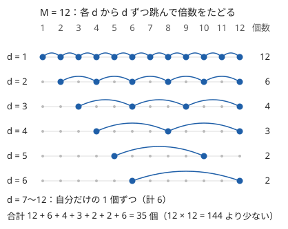

!!! abstract "要点"
    - **何のページか**：約数・倍数・gcd が出てくる問題で、問われ方から使う手法を引ける。約数の列挙、倍数を回して集める調和級数、素因数分解、gcd がちょうど g の数え上げ、約数の個数の上限の問われ方に分ける。
    - **いつ使うか**：
        - $N \le 10^{12}$ で、$N$ の約数や素因数を使う。
        - 1 以上 $N$ 以下のすべての整数について、約数や倍数に関する値の総和を求める。
        - gcd がちょうど $g$ になる組・部分集合の個数。
        - 積がちょうど $N$ になる列の個数。
        - 積が平方数になる組の個数。
    - **使い方**：「1 つの数か、1〜M のすべての数か」と「値の大きさ」で[一覧の表](#overview)の行を探し、行の節で言い換えを確かめてから手法のページへ進む。
    - **計算量**：約数の列挙と 1 個の素因数分解は $O(\sqrt{N})$、1〜M の倍数をすべてたどると $O(M \log M)$、最小素因数の篩は前計算 $O(M \log \log M)$ の後 1 個 $O(\log M)$

<!-- textlint-disable -->
別名：約数・倍数・divisor・multiple
<!-- textlint-enable -->

約数と倍数は、割り切る・割り切られるの関係である。$d \mid n$ のとき、$d$ は $n$ の約数、$n$ は $d$ の倍数という。問われ方は多いが、「1 つの大きな数を相手にするか、1〜M の小さな数すべてを相手にするか」で使う道具がほぼ決まる。

このページで使う記法：$d(n)$ は $n$ の正の約数の個数、$\sigma(n)$ は正の約数の和、$v_p(n)$ は $n$ を素因数分解したときの素数 $p$ の指数である。$N$ は 1 つの数、$M$ はすべての数を扱うときの値の上限を表す。ほかの記法は[記法と用語の約束](../start/notation.md)にそろえる。

## 題材の性質 {#properties}

約数と倍数の問題の手法は、次の 4 つの性質のどれかから出てくる。

- **約数は組になる**：$d \mid N$ なら $N/d \mid N$ で、$d$ と $N/d$ の少なくとも一方は $\sqrt{N}$ 以下である。だから $\sqrt{N}$ 以下の数で割ってみれば、約数がすべて見つかる。$N = 10^{12}$ でも $10^6$ 回で済む。
- **約数の個数は少ない**：$N \le 10^9$ なら $d(N) \le 1344$、$N \le 10^{12}$ なら $d(N) \le 6720$、$N \le 10^{18}$ でも $d(N) \le 103680$ である。$\sqrt{N}$ よりずっと少ないので、約数を全部試す解法や、約数を状態にする DP が間に合う。
- **倍数の個数の和は $M \log M$**：$d = 1, 2, \dots, M$ のそれぞれについて $M$ 以下の倍数をたどると、回数は $M/1 + M/2 + \dots + M/M \approx M \ln M$ になる。$M = 10^6$ で約 $1.4 \times 10^7$ 回である。
- **素因数分解で素数ごとに分かれる**：$N = p_1^{e_1} \cdots p_k^{e_k}$ と一意に書ける。約数は指数の組 $(f_1, \dots, f_k)$（$0 \le f_i \le e_i$）と一対一に対応する。積は指数の和、gcd は指数の最小、lcm は指数の最大になり、$a \mid b$ はすべての素数で $v_p(a) \le v_p(b)$ になる。

3 つ目の性質を $M = 12$ で描くと次のようになる。各 $d$ の行で、$d$ から $d$ ずつ跳んで倍数をたどる。右の数は、その行で訪れる倍数の個数である。



$d$ が大きい行ほど訪れる倍数が少なくなる。行ごとに処理する倍数の個数 $\lfloor M/d \rfloor$ の和が調和級数 $M(1 + 1/2 + \dots + 1/M)$ でほぼ表せるので、全体は $O(M \log M)$ になる。逆に、各 $n$ についてその約数を割り算で探すと $1$ 個あたり $O(\sqrt{n})$ かかり、全体で $O(M \sqrt{M})$ になる。「1〜M のすべての数の約数」は、約数の側から倍数を回して集めるほうが速い。

## 問われ方と手法の一覧 {#overview}

問題文の形から行を探し、手法のページへ進む。代表の問題は、このページに載せたものだけを書いた。

| よく出る問われ方 | 使う手法 | ページ | 代表の問題 |
|---|---|---|---|
| 1 つの数 $N \le 10^{12}$ の約数をすべて | $\sqrt{N}$ までの割り算 | [約数列挙と素数判定](../math/divisor-enum.md#enumerate) | ABC180 C |
| 約数（の組）を全部試して間に合うか | 約数の個数の上限 | [約数の個数の上界](../math/divisor-count-bound.md#table) | — |
| 1〜M の各数について、約数・倍数から値を集める | 倍数を回す | [調和級数](../math/harmonic-sum.md#collect-multiples) | — |
| 1 つの数の素因数分解 | 試し割り | [素因数分解](../math/prime-factorization.md#procedure) | 典型90 075 |
| 多数の数の素因数分解 | 最小素因数の篩 | [最小素因数の篩](../math/spf-sieve.md#many-numbers) | — |
| 約数の個数・約数の和 | 素因数の指数の公式 | [約数列挙と素数判定](../math/divisor-enum.md#count-and-sum) | — |
| gcd がちょうど $g$ の組・部分集合の数 | 倍数で数えて大きい方から引く | [約数包除](../comb/divisor-inclusion-exclusion.md#order) | — |
| 約数・倍数の向きの和、GCD 畳み込み | 約数のゼータ変換・メビウス変換 | [約数のゼータ変換](../comb/zeta-mobius-divisor.md#per-prime) | — |
| 積が平方数・積がちょうど $N$ | 素因数の指数で考える | [素因数の指数で考える](../math/prime-exponent-vector.md#squarefree-kernel) | — |
| 全体に足した数との gcd・区間の gcd | gcd の性質 | [gcd の性質](../math/gcd-properties.md#difference-gcd) | — |
| $N \le 10^{12}$ で $\lfloor N/i \rfloor$ の和 | 商の列挙 | [商の列挙](../math/floor-quotient-enum.md#block-end) | — |

問題へのリンクは、[練習問題](#practice)の囲みにある。

## 1 つの数の約数を列挙 → √N までの割り算（divisor-enum） {#enumerate}

$N$ の約数をすべて求めるには、$i = 1, 2, \dots$ を $i \cdot i \le N$ の範囲で調べ、$i \mid N$ なら $i$ と $N/i$ を集める。[題材の性質](#properties)の組の性質により漏れはなく、$O(\sqrt{N})$ で済む。$N \le 10^{12}$ が目安で、$10^{18}$ では $10^9$ 回になり間に合わない。

- 集めた順は小さい順ではないので、順に使うならソートする。
- $N$ が平方数のとき、$i = N/i$ を 2 回入れないようにする。
- 終了条件は `double` の `sqrt` ではなく、整数の `i * i <= n` で書く。

手順の詳細と落とし穴は[約数列挙と素数判定](../math/divisor-enum.md#enumerate)にある。答えの候補が $N$ の約数に限られる問題（gcd の最大値、$N$ を割った商と余りの条件など）も、この列挙から始まる（[答えの候補が約数に限られる型](../math/divisor-enum.md#candidates)）。

## 約数の個数で計算量を見積もる → 約数の個数の上限（divisor-count-bound） {#count-bound}

約数を列挙した後で、約数ごとに何かを試す・約数の組を全部試す解法は、$d(N)$ の上限で見積もる。$d(N)$ は $\sqrt{N}$ よりずっと小さく、$N \le 10^{12}$ なら $6720$ 以下である。約数の組を全部試しても、$N \le 10^9$ なら $1344^2 \approx 1.8 \times 10^6$ 組で済む。

- 値そのものは大きくても、途中に現れる値がすべて $N$ の約数なら、約数の番号を DP の状態にできる（[約数を状態にした DP](../math/divisor-count-bound.md#divisor-dp)）。
- 上限の値は、小さい素数の指数が単調に減る数（高度合成数の候補）を DFS で列挙して確かめられる（[高度合成数の列挙](../math/divisor-count-bound.md#enumerate-hcn)）。

覚える値と表は[約数の個数・素因数の種類数の最大値の表](../math/divisor-count-bound.md#table)にある。「約数の個数はだいたい $\sqrt{N}$」と見積もると、間に合う解法を捨ててしまう。

## 1〜M の各数の約数・倍数を集める → 倍数を回す調和級数（harmonic-sum） {#harmonic}

値の上限を $M$ とする。「各 $d$ について、$d$ の倍数である要素の個数・和」「各 $n$ について、約数にわたる和」のように、1〜M のすべての数で約数や倍数を見る問題がある。このときは各 $d$ から倍数 $d, 2d, 3d, \dots$ をたどる二重ループを書く。回数は[題材の性質](#properties)のとおり $O(M \log M)$ である。

```text
for d = 1 .. M:
    for k = d, 2d, 3d, ... (k <= M):
        d と k の組を処理する（c[d] += cnt[k]、または f[k] += g[d] など）
```

使い方は 2 つの向きに分かれる。

- **倍数から集める**：$c[d] = \mathrm{cnt}[d] + \mathrm{cnt}[2d] + \cdots$ で、「すべて $d$ の倍数」という条件の個数が求まる。選んだ要素の gcd が $d$ の倍数であることと同じなので、gcd の問題の出発点になる（[倍数を回して集める](../math/harmonic-sum.md#collect-multiples)）。
- **約数へ配る**：$f[k] \mathrel{+}= g[d]$ とすれば、$f[n] = \sum_{d \mid n} g[d]$ が求まる。$g = 1$ なら $f[n] = d(n)$、$g[d] = d$ なら $f[n] = \sigma(n)$ である。

$M$ は配列に置ける大きさ（$10^6$〜$10^7$）が上限である。$M = 10^{12}$ のように大きいなら、[⌊N/i⌋ の値ごとにまとめる](#floor-sums)方法を考える。素数の倍数だけをたどれば $O(M \log \log M)$ になる違いは[篩との違い](../math/harmonic-sum.md#vs-sieve)にある。

## 素因数分解 → 多数なら最小素因数の篩、1 つなら試し割り（spf-sieve, prime-factorization） {#factorize}

素因数分解の方法は、分解する数の個数と大きさで決まる。

- **1 つの数（$N \le 10^{12}$ 程度）**：$\sqrt{N}$ までの数で割れるだけ割り、最後に 1 より大きい数が残ればそれも素数である。$O(\sqrt{N})$ で、$\sqrt{N}$ を超える素因数は高々 1 つしかないことが残りを素数と言える理由になる（[素因数分解の手順](../math/prime-factorization.md#procedure)）。
- **多数の数（値が $10^6$〜$10^7$ 以下）**：篩で各数の最小素因数を記録しておき、それで割り続ける。割るたびに半分以下になるので 1 個 $O(\log M)$ で分解できる（[最小素因数の篩](../math/spf-sieve.md#build-and-factor)）。$2 \times 10^5$ 個の数を試し割りで分解すると、値が $10^6$ なら最大 $2 \times 10^8$ 回になり危ない。
- **$10^{18}$ 程度の数**：試し割りは間に合わない。大きな数の素因数分解の方法が要る（[使い分け](../math/prime-factorization.md#which-method)）。

分解した後は、素数ごとに独立に考えるのが基本である（[素因数ごとに独立に考える](../math/prime-factorization.md#per-prime)）。$N \le 10^{12}$ なら、異なる素因数は 11 種類以下、指数は 39 以下と小さい。

## 約数の個数・約数の和 → 素因数分解の指数から（multiplicative-function） {#divisor-functions}

$N = p_1^{e_1} \cdots p_k^{e_k}$ なら、約数の個数と和は指数から求まる。

$$
d(N) = \prod_{i=1}^{k} (e_i + 1), \qquad \sigma(N) = \prod_{i=1}^{k} (1 + p_i + \cdots + p_i^{e_i})
$$

約数が指数の組と一対一に対応し、素数ごとに独立に選べるからである（[約数の個数と総和の公式](../math/divisor-enum.md#count-and-sum)）。$N = 12 = 2^2 \cdot 3$ なら $d(12) = 3 \cdot 2 = 6$、$\sigma(12) = 7 \cdot 4 = 28$ である。

求める範囲によって手法が変わる。

- **1 つの数**：素因数分解して上の式に入れる。$O(\sqrt{N})$。
- **1〜M のすべての数**：[倍数を回す](#harmonic)と $O(M \log M)$ で求まる。線形篩なら $\varphi$・$\mu$ の表を $O(M)$ で作れる（[線形篩](../math/spf-sieve.md#linear-sieve)）。$d$ も、最小素因数の指数を別に持てば同じように作れる。オイラーの φ 関数は[φ の公式](../math/euler-phi.md#formula)にある。
- **$M \le 10^{10}$ 程度までの和**：$d$・$\sigma$・$\varphi$ のような乗法的関数（互いに素な $a, b$ で $f(ab) = f(a) f(b)$ となる関数）の和は、配列に置けない大きさでも求められる。商の列挙を使う。$\sum_{n \le M} d(n)$ は[⌊N/i⌋ の値ごとにまとめる](#floor-sums)だけで済む。一般の場合は発展の内容で、[和の求め方の概要](../math/multiplicative-function.md#prefix-sums)にある。

## gcd がちょうど g の組の数 → 倍数で数えて大きい方から引く・メビウス関数 {#exact-gcd}

「gcd がちょうど $g$」は直接数えにくいが、「すべて $g$ の倍数」なら数えやすい。$g$ の倍数である要素の個数 $c[g]$ は[倍数を回して](#harmonic)求まり、その中から組を選ぶ数 $F(g)$ は $\binom{c[g]}{2}$（部分集合なら $2^{c[g]} - 1$）である。

すべて $g$ の倍数の組は、gcd が $g, 2g, 3g, \dots$ のどれかにちょうど 1 つ当てはまる。そこで、gcd がちょうど $g$ の数 $f(g)$ は次の式で求まる。

$$
f(g) = F(g) - f(2g) - f(3g) - \cdots
$$

右辺には $g$ より大きい値の $f$ しか出てこないので、$g = M, M-1, \dots, 1$ と大きい順に計算する。引く回数は調和級数で、全体は $O(M \log M)$ である（[大きい g から引く理由と計算量](../comb/divisor-inclusion-exclusion.md#order)）。

- gcd の総和 $\sum g \cdot f(g)$ や互いに素な組の数 $f(1)$ も同じ表から出る（[gcd の総和・互いに素な組](../comb/divisor-inclusion-exclusion.md#gcd-sum)）。互いに素は gcd が 1 であることをいう（[互いに素](../guide/glossary.md#coprime)）。
- $f(1)$ だけが欲しいなら、メビウス関数 $\mu$ で $f(1) = \sum_{d} \mu(d) F(d)$ と書ける。和の順序を入れ替える式変形と組み合わせるときはこちらを使う（[「gcd が 1」の条件の置き換え](../comb/mobius-function.md#gcd-one)、書き換えの対応は[約数包除との書き換え](../comb/mobius-function.md#vs-divisor-ie)）。

## 約数・倍数の向きの累積和 → 約数のゼータ変換・メビウス変換（zeta-mobius-divisor） {#zeta}

すべての $d$ について「$d$ の倍数にわたる和」や「$d$ の約数にわたる和」を求める操作を、約数のゼータ変換という。逆に、累積した値から元の値を戻す操作がメビウス変換である。

- [倍数を回す](#harmonic)二重ループでも $O(M \log M)$ で求まる。素数 $p$ ごとに「$p$ 倍の方向への累積和」を取れば $O(M \log \log M)$ になる（[素数ごとの累積和](../comb/zeta-mobius-divisor.md#per-prime)）。
- 倍数の向きのゼータ変換で両方の列を変換し、添字ごとに掛けて戻すと、$\gcd(i, j) = k$ となる組の積の和（GCD 畳み込み）が求まる。約数の向きなら LCM 畳み込みである（[GCD 畳み込み・LCM 畳み込み](../comb/zeta-mobius-divisor.md#gcd-lcm-convolution)）。
- 戻す向きと計算の順序を間違えやすい。[逆変換と回す向き](../comb/zeta-mobius-divisor.md#inverse)で確かめる。

[gcd がちょうど g](#exact-gcd) の式は、倍数の向きのメビウス変換を大きい順に 1 つずつ行ったものと同じである。

## 積が平方数・積がちょうど N → 素因数の指数で考える（prime-exponent-vector） {#products}

積の条件は、[題材の性質](#properties)の「積は指数の和」で素数ごとの条件に分ける。

- **積が平方数になる組**：平方数は、すべての素数の指数が偶数の数である。各数から平方数の因子を除いた残り（[核](../guide/glossary.md#squarefree)。指数が奇数の素数だけの積）を求めると、$ab$ が平方数であることは核が等しいことと同じになる。核ごとに個数を数えれば、組の数は $O(1)$ ずつ足せる。0 は何と掛けても平方数 0 になるので別に数える（[平方因子を除いた核](../math/prime-exponent-vector.md#squarefree-kernel)）。
- **積がちょうど $N$ の長さ $K$ の列**：素数 $p$ ごとに、指数 $v_p(N)$ を $K$ 個の項へ配る方法は $\binom{v_p(N) + K - 1}{K - 1}$ 通りで、素数ごとの積が答えになる（[指数を配る](../math/prime-factorization.md#per-prime)、[重複組合せ](../comb/stars-and-bars.md#applications)）。
- **2 以上の因数への分け方・途中の値が $N$ の約数に限られる DP**：約数の番号を状態にした DP にする（[約数を状態にした DP](../math/divisor-count-bound.md#divisor-dp)）。
- **巨大な lcm・特定の素数の指数の比較**：lcm を値ではなく素数ごとの指数の最大で持つ（[巨大な lcm](../math/prime-exponent-vector.md#huge-lcm)）。

## 差の gcd・区間の gcd の値の種類 → gcd の性質（gcd-lcm, gcd-properties） {#gcd}

gcd の計算そのものはユークリッドの互除法で $O(\log \min(a, b))$ である（[互除法の正しさ](../math/gcd-lcm.md#euclid)）。lcm は $a / \gcd(a, b) \times b$ の順に計算してあふれを避ける（[lcm のオーバーフロー](../math/gcd-lcm.md#lcm-overflow)）。問われ方に応じて、次の性質を使う。

- **全体に同じ数を足した gcd**：$\gcd(a + x, b + x) = \gcd(a + x, b - a)$ である。よって、列 $A$ の各要素に $x$ を足した gcd は $\gcd(A_1 + x, A_2 - A_1, \dots, A_N - A_{N-1})$ になる。差の gcd を先に求めておけば、$x$ ごとに 1 回の gcd で済む（[差の gcd](../math/gcd-properties.md#difference-gcd)）。
- **区間の gcd**：左端を固定して右端を伸ばすと、gcd は値が変わるたびに半分以下になるので、値は $O(\log A)$ 種類しかない（$A$ は値の上限）。区間の gcd はセグメント木や Sparse Table に載る（[区間 gcd](../math/gcd-properties.md#range-gcd)）。
- **1 つ除いた gcd**：左右からの累積 gcd を取る（[左右からの累積 gcd](../math/gcd-lcm.md#prefix-suffix-gcd)）。
- **mod $N$ で $A$ ずつ進む**：$\gcd(A, N)$ の倍数だけを回り、周期は $N / \gcd(A, N)$ である（[mod N で A ずつ進む](../math/gcd-properties.md#step-mod)）。

## ⌊N/i⌋ の値ごとにまとめる → floor の値の列挙（floor-quotient-enum） {#floor-sums}

約数の個数の和は、倍数の個数の和に言い換えられる。$n \le N$ の各 $n$ の約数 $i$ を数えることは、各 $i$ について $N$ 以下の倍数を数えることと同じだからである。

$$
\sum_{n=1}^{N} d(n) = \sum_{i=1}^{N} \left\lfloor \frac{N}{i} \right\rfloor
$$

$N \le 10^6$ 程度なら右辺をそのまま足せばよいが、$N = 10^{12}$ では足せない。$\lfloor N/i \rfloor$ の値は高々 $2\sqrt{N}$ 種類で、同じ値になる $i$ は区間をなす。値 $q = \lfloor N/l \rfloor$ になる区間の右端は $\lfloor N/q \rfloor$ なので、区間ごとにまとめて足せば $O(\sqrt{N})$ で済む（[同じ商になる区間の右端](../math/floor-quotient-enum.md#block-end)）。

調和級数の二重ループ・商の列挙・floor sum のどれを使うかは、[調和級数・floor sum との使い分け](../math/floor-quotient-enum.md#vs-others)にある。

## 落とし穴 {#pitfalls}

- **平方数で約数を二重に数える**：$N = 36$ で $i$ と $N/i$ を両方入れると、$6$ が 2 回入る。$i \ne N/i$ のときだけ $N/i$ を足す。
- **`i * i` のオーバーフロー**：`int i` で `i * i <= n` を回すと、$N \ge 46340^2$ で `i * i` があふれる。`i` は `long long` にする（[約数列挙の落とし穴](../math/divisor-enum.md#pitfalls)）。
- **約数の個数を $\sqrt{N}$ と見積もる**：$N = 10^{12}$ でも $d(N) \le 6720$ である。約数の組を全部試す解法を、見積もりの誤りで捨てない。
- **gcd がちょうど $g$ を小さい順に計算する**：倍数の値から引く式 $f(g) = F(g) - f(2g) - \cdots$ は、大きい $g$ から計算しないと、まだ求めていない値を引いてしまう。
- **1 と 0 の扱い**：1 は素数ではないが、どの数の約数でもある。0 はすべての数の倍数で、$\gcd(0, a) = a$ である（[複数の数の gcd と gcd(0, a)](../math/gcd-lcm.md#many-numbers)）。積が平方数の問題では 0 を核の計算に入れない。
- **負の数の割り算と余り**：C++ の `/` と `%` は 0 に向かって切り捨てるので、負の数の倍数判定や $\lfloor a/b \rfloor$ を誤る（[C++ の / と % と、数学の floor・mod の違い](../math/integer-division.md#cpp-vs-math)）。

## 練習問題 {#practice}

<div class="kp-problems" data-role="practice" markdown>

- [ABC180 C. Cream puff](https://atcoder.jp/contests/abc180/tasks/abc180_c)（diff 142）：N 個の品物を何人かで余りなく等しく分けるとき、分けられる人数をすべて小さい順に出力する。
- [典型90 075. Magic For Balls（★3）](https://atcoder.jp/contests/typical90/tasks/typical90_bw)（diff —）：整数 N が書かれたボールがあり、1 回の魔法で、素数でないボールをすべて同時に、積が元の数になる 2 以上の 2 つの整数のボールに分ける。すべてのボールが素数になるまでの最小の回数を求める。

</div>

??? note "練習の方針"
    - **ABC180 C**：答えは $N$ の約数そのものである。[1 つの数の約数を列挙](#enumerate)し、ソートして出力する。$N \le 10^{12}$ なので $10^6$ 回で済む。
    - **典型90 075**：$N$ を[素因数分解](#factorize)し、素因数の個数を重複を含めて $k$ とする。1 回の魔法でボールの数は高々 2 倍にしかならないので、$t$ 回後のボールは $2^t$ 個以下で、$2^t \ge k$ が要る。逆に、素因数をほぼ半分ずつに分けていけばこの回数で済む。答えは $2^t \ge k$ となる最小の $t$ で、$k = 1$（$N$ が素数）なら 0 である。

## 確認問題 {#quiz}

??? question "確認問題：約数を数える 2 通りの方法"
    $M = 10^6$ のとき、1〜M のすべての $n$ について $d(n)$ を求めたい。各 $n$ を $\sqrt{n}$ まで割って数える方法と、各 $d$ の倍数に 1 を足す方法の回数を見積もれ。

    ??? success "答え"
        割って数える方法は $\sum_{n \le M} \sqrt{n} \approx \frac{2}{3} M^{3/2} \approx 6.7 \times 10^8$ 回で、制限時間によっては間に合わない。倍数に 1 を足す方法は $\sum_{d \le M} \lfloor M/d \rfloor \approx 1.4 \times 10^7$ 回で済む。

## 参考 {#references}

- [drken「AtCoder ABC 180 C - Cream puff (5Q, 灰色, 300 点)」](https://drken1215.hatenablog.com/entry/2020/10/21/194700)：ABC180 C の √N までの約数列挙と、平方数での重複
- [E869120「kyopro_educational_90 sol/075.cpp」](https://github.com/E869120/kyopro_educational_90/blob/main/sol/075.cpp)：典型90 075 の、素因数の個数から回数を求める解答
- [ebisuke「Pythonで取り組む 競プロ典型 90 問 #星3」](https://ebisuke33.hatenablog.com/entry/typical90-3)：典型90 075 の問題の設定（魔法 1 回ですべてのボールを同時に叩く）と、素因数の個数から回数を出す解答
- [samekard「競プロ典型90問 075 Magic For Balls（★3）」](https://zenn.dev/samekard_dev/articles/417f487b654394)：典型90 075 の、√N を超える素因数が高々 1 つであることの確かめ方
