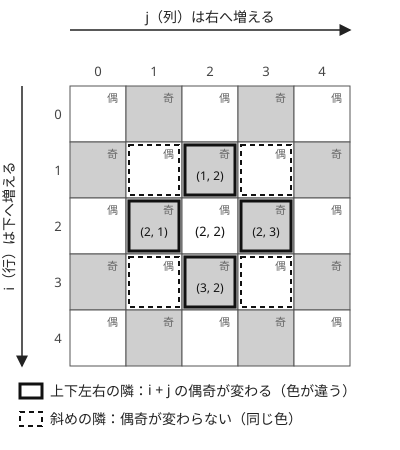

!!! abstract "要点"
    - **何のページか**：H×W のマス目が出てくる問題で、問われ方から使う手法を引ける。マスを頂点とする最短路、右・下に進む DP、長方形の累積和、行と列の独立、[市松模様](../guide/glossary.md#checkerboard)の偶奇、45 度回転、盤面の回転へつなぐ。
    - **いつ使うか**：
        - H×W のマス目で、スタートからゴールへの最小の移動回数。
        - 右か下にだけ進む経路の数・経路上の値の最大。
        - 長方形の範囲の和・黒マスの個数を多数答える。
        - 1×2 のタイル（ドミノ）を敷き詰める・置く。
        - 盤面を 90 度回転・反転させて一致させる。
        - 斜めに動く駒・マンハッタン距離・ひし形の範囲。
    - **使い方**：問われ方を[一覧の表](#overview)で探し、行の節で言い換えを確かめてから手法のページへ進む。
    - **計算量**：マスの数 $HW$ に対して、探索・DP・累積和の前計算は $O(HW)$、前計算の後の長方形の和は 1 回 $O(1)$

<!-- textlint-disable -->
別名：マス目・盤面・H×W・二次元配列・grid
<!-- textlint-enable -->

グリッドは、$H$ 行 $W$ 列のマス目である。同じマス目でも、移動の最小回数を問うならグラフの探索、右と下にだけ進むなら DP、長方形の範囲を問うなら累積和と、使う手法は問われ方で決まる。どれも「マス $(i, j)$ の添字をどう扱うか」と「隣り合うマスの関係」という共通の性質の上に立つ。

## 題材の性質 {#properties}

このページでは、マス $(i, j)$ を「上から $i$ 行目・左から $j$ 列目」とし、$0 \le i < H$、$0 \le j < W$ の 0-indexed で書く。$i$ は下へ、$j$ は右へ増える。問題文が 1-indexed なら、読み込みで 1 を引く。$(x, y)$ を「横、縦」の順で書く問題なら、$i = y$、$j = x$ と読み替える。隣のマスへの移動量は、行と列の取り違えを避けて di・dj と書く。

グリッドの問題で繰り返し使う性質は、次の 4 つである。

- **マスを頂点とするグラフ**：マスを頂点、上下左右に隣り合う 2 マスを辺とすると、頂点は $HW$ 個、辺は高々 $2HW$ 本のグラフになる。隣は移動量の配列から毎回計算できるので、隣接リストを作らずに探索できる（[グリッドグラフ](../graph/grid-graph.md#neighbors)）
- **1 次元の番号**：マス $(i, j)$ に番号 $i \times W + j$ を振ると、頂点を整数で受け取る道具（Union-Find など）がそのまま使える。掛けるのは列の数 $W$ である（[1 次元化と番兵](../graph/grid-graph.md#flatten)）
- **市松模様**：$i + j$ の偶奇で 2 色に塗ると、上下左右の移動は $i$ か $j$ の一方を 1 だけ変えるので、必ず色が変わる。[4 近傍](../guide/glossary.md#neighborhood)のグリッドは[二部グラフ](../graph/bipartite-graph.md#always-bipartite)である。斜めの移動は $i + j$ を $0$ か $\pm 2$ だけ変えるので、色が変わらない
- **行と列の独立**：右と下だけの移動、長方形の範囲、マンハッタン距離 $\lvert \Delta i \rvert + \lvert \Delta j \rvert$ は、どれも行の方向と列の方向に分けて考えられる。2 次元の問題を 1 次元の問題 2 つに分けられるかを、まず確かめる

制約の目安は $HW \le 4 \times 10^6$ 程度で、これは各マスを定数回だけ見る $O(HW)$ の解法を想定している。$H, W$ が $10^9$ のように巨大なら、マスを 1 つずつ見る解法は使えない。障害物や点の数だけに比例する解法（障害物の側を調べる、座標圧縮する、二項係数で数える）を探す。

??? question "確認問題：8 近傍のグリッドは二部グラフか"
    斜めの隣も辺にした 8 近傍のグリッドは、二部グラフになるか。

    ??? success "答え"
        ならない（$H, W \ge 2$ のとき）。$(0, 0)$・$(0, 1)$・$(1, 1)$ の 3 マスは互いに 8 近傍で隣り合うので、長さ 3 の閉路ができる。二部グラフは奇数の長さの閉路を持たない。市松模様の偶奇が使えるのは 4 近傍のときだけである。

## 問われ方と手法の一覧 {#overview}

問題文の形から行を探し、手法のページへ進む。代表の問題は行き先のページにあるもので、このページの練習問題は[練習問題](#practice)の囲みにある。

| よく出る問われ方 | 使う手法 | ページ | 代表の問題 |
|---|---|---|---|
| スタートからゴールへの最小の移動回数 | BFS・01-BFS | [幅優先探索（BFS）と無重み最短路](../graph/bfs.md)、[01-BFS](../graph/zero-one-bfs.md) | ABC007 C、ABC176 D |
| 向き・壁を壊した回数・2 人の位置で次の動きが変わる | 状態を頂点にする | [状態を頂点にする](../graph/extended-dijkstra.md) | ABC339 D |
| つながったまとまりの数・塗りつぶし | DFS・BFS・Union-Find | [連結成分](../graph/connected-components.md)、[Union-Find](../ds/union-find.md)、[グリッドグラフ](../graph/grid-graph.md) | ABC325 C |
| 右か下にだけ進む経路の数・最大値 | グリッドの DP・格子路 | [グリッド上の DP](../dp/dp-grid.md)、[格子路の数え上げ](../comb/lattice-paths.md) | EDPC H |
| 長方形の和・長方形への加算 | 2 次元累積和・2 次元いもす法 | [2 次元累積和](../basics/prefix-sum-2d.md)、[いもす法](../basics/imos.md#imos-2d) | ABC331 D |
| 行と列を選ぶ・行や列への操作 | 行と列を独立に考える | [座標圧縮](../basics/coordinate-compression.md)、[マンハッタン距離](../geometry/manhattan-chebyshev.md#axis-independence) | ABC213 C |
| すべてのマスを通れるか・敷き詰められるか | 市松模様の偶奇 | [偶奇](../thinking/parity.md#checkerboard) | ABC454 E |
| 斜めの移動・ひし形の範囲 | 45 度回転・斜めの番号 | [マンハッタン距離とチェビシェフ距離](../geometry/manhattan-chebyshev.md) | ABC178 E |
| 回転・平行移動させて一致させる | 添字の式・全部試す | [回転と座標変換](../geometry/rotation-transform.md#grid-rotation)、[全探索](../basics/brute-force.md#move-board) | ABC322 D |
| ドミノの最大配置・隣り合わないマスの選び方 | 二部マッチング・プロファイル DP | [二部マッチング](../graph/bipartite-matching.md)、[プロファイル DP](../dp/broken-profile-dp.md) | ABC204 F |

問題へのリンクは、各ページの例題・練習問題の囲みにある。

## 最小の移動回数 → グリッドの BFS・01-BFS（grid-graph, bfs, zero-one-bfs） {#shortest}

上下左右に 1 歩ずつ動き、スタートからゴールまでの最小の歩数を問われたら、マスを頂点とするグラフで [BFS](../graph/bfs.md#why-shortest) をする。各マスは 1 回だけキューに入るので $O(HW)$ である。実装の型（移動量の配列・範囲の判定・番兵）は[グリッドグラフ](../graph/grid-graph.md#neighbors)にまとめてある。

移動のコストが 1 種類でないときは、コストの種類で手法を替える。

- **すべて同じコスト**：BFS。距離の配列を −1 で初期化して訪問済みの印を兼ね、印はキューに入れるときに付ける（[印を付ける時点](../graph/bfs.md#mark-on-push)）
- **コストが 0 と 1**：「歩くのは 0、壁を壊す・ワープするのは 1」のような形は [01-BFS](../graph/zero-one-bfs.md#cost-modeling) で $O(HW)$ に収まる
- **コストが一般の非負の値**：[ダイクストラ法](../graph/dijkstra.md)で $O(HW \log(HW))$ になる
- **始点が複数**：「どれかの始点から何歩で行けるか」は、始点をすべて距離 0 でキューに入れて 1 回だけ BFS する（[多始点 BFS](../graph/bfs.md#multi-source)）。毎秒広がる様子のシミュレーションも、多始点 BFS の距離がそのまま時刻になる

経路そのものを出力するなら、見つけたときの親を記録して終点からたどる（[経路復元](../graph/bfs.md#path-restoration)）。

## 向き・残り回数などの状態がある・盤面全体が状態 → 状態を頂点にする（extended-dijkstra） {#states}

「直前と同じ向きにしか進めない」「壁を 2 回まで壊せる」のように、次に動けるマスが位置だけで決まらないときは、位置に情報を足した組を頂点にする（[状態を頂点にする](../graph/extended-dijkstra.md#choose-state)）。$(i, j, \text{向き})$ なら頂点は $4HW$ 個、壊した回数を上限 $K$ 回まで持つなら $(K+1)HW$ 個になる。

- **向きを持つ**：方向転換の回数を数えるなら、向きを状態にして「同じ向きに進むのは 0、曲がるのは 1」の 01-BFS にする（[向きを状態に持つ](../graph/zero-one-bfs.md#direction-state)）
- **偶奇・残り回数を持つ**：ちょうど $K$ 歩、$3$ 歩ごとに区切る、のような条件は、歩数の偶奇や余りを状態に足す（[偶奇・mod・向き](../graph/extended-dijkstra.md#parity-mod-direction)）
- **2 人の位置の組**：2 人が同時に動くなら、2 人の位置の組を 1 つの頂点にする。頂点は $(HW)^2$ 個になるので、$HW$ が小さいことを確かめる（[2 つの位置の組](../graph/extended-dijkstra.md#pair-state)）
- **盤面全体**：$3 \times 3$ のパズルのように盤面そのものが状態のときは、状態数が配置の数（$9!$ など）になる。先に見積もり、整数に詰めて配列で引くか map で持つかを決める（[状態数の見積もり](../graph/extended-dijkstra.md#state-count)）。2 人で交互に打つゲームなら、盤面を状態にしたメモ化探索になる（[ミニマックス法](../comb/minimax.md#states)）

訪問済みの印も状態ごとに持つ。位置だけで印を付けると、ある状態で先に来た経路が、別の状態で後から来る経路を締め出してしまう。

## 連結成分・塗りつぶし → DFS・BFS・Union-Find（union-find） {#components}

「つながった黒マスのまとまりの数」「ある範囲を塗りつぶす」は、マスを頂点とするグラフの[連結成分](../graph/connected-components.md#three-methods)を求める問題である。どの近傍でつながるか（4 近傍か 8 近傍か）を問題文から読み取り、移動量の配列を選ぶ。

- **1 回だけ調べる**：DFS か BFS で、まだ訪れていないマスから探索するたびに成分を 1 つ数える。全体で $O(HW)$
- **マスが順に通れるようになる**：塗るたびに「2 マスがつながったか」を問われるなら、マスを $i \times W + j$ に 1 次元化して [Union-Find](../ds/union-find.md#what-it-does) で併合する。塗るたびに上下左右の塗られたマスと併合するだけで済む（[Union-Find で連結性を扱う](../graph/union-find-connectivity.md)）
- **マスが順に通れなくなる**：削除は Union-Find でできないので、逆順に見て追加にする（[削除を逆順の追加にする](../graph/union-find-connectivity.md#reverse-deletion)）
- **入ると止まるマスがある**：止まるマスは複数の成分から数えられるので、訪問の印に成分の番号を書く（[止まるマスの数え方](../graph/grid-graph.md#boundary-cells)）
- **グリッドが巨大で障害物が少ない**：通れるマスではなく障害物の側を 8 近傍でつなぎ、障害物の鎖が盤面を分断するかで判定する（[障害物の連結](../graph/grid-graph.md#obstacle-dual)）

再帰の DFS は、蛇行する通路で深さがマスの数近くになる。手元の環境でスタックがあふれるなら、BFS か自分で持つスタックにする（[非再帰の DFS](../graph/dfs.md#iterative)）。

## 右か下にだけ進む → グリッドの DP・格子路（dp-grid, lattice-paths） {#right-down}

移動が右と下だけなら、経路は必ず左上から右下へ進み、同じマスに戻らない。マスの依存関係に閉路がないので、探索ではなく DP で数えたり最適化したりできる。$\mathrm{dp}[i][j]$ ＝「$(i, j)$ までの経路の数（または値の最大）」とし、上と左から貰う。行の小さい順、同じ行では列の小さい順に計算すれば、貰う相手は必ず計算済みである（[計算順序と初期化](../dp/dp-grid.md#order-and-init)）。

- **障害物がなく経路を数える**：右に $W - 1$ 回、下に $H - 1$ 回動く列の並べ方なので、$\binom{H + W - 2}{H - 1}$ 通りである。表を作らずに二項係数で求まる（[格子路の基本](../comb/lattice-paths.md#basic)）
- **巨大なグリッドに障害物が少しある**：表が作れないので、障害物のない経路の数から、最初に踏む障害物で分類して引く。障害物の数 $N$ に対して $O(N^2)$ になる（[最初に踏む障害物で分類する](../comb/inclusion-exclusion-dp.md#first-obstacle)）
- **行ごとの個数や差の値が効く**：「各行で 3 個まで拾える」のような条件は、拾った個数を状態に足す（[状態を足す](../dp/dp-grid.md#extra-state)）
- **正方形・長方形の大きさを問う**：「穴を含まない最大の正方形」は、左・上・左上の値の最小に 1 を足す DP で求まる（[最大の正方形](../dp/dp-grid.md#largest-square)）
- **何マスでも進める・飛んで進む**：同じ向きの直前までの和を累積和で持つと、遷移を $O(1)$ にまとめられる（[方向ごとの累積和](../dp/dp-grid.md#directional-prefix)）

移動が右・下以外の向きも含むときは、DP の計算順序が決まらない。そのときは[最小の移動回数](#shortest)の探索に戻る。

## 長方形の和・長方形への加算 → 2 次元累積和・2 次元いもす法（prefix-sum-2d, imos） {#rectangles}

長方形の範囲の和を多数答えるなら、[2 次元累積和](../basics/prefix-sum-2d.md#formula)を $O(HW)$ で前計算し、4 項の足し引きで 1 回 $O(1)$ で答える。逆に、長方形にまとめて値を足す操作を多数行い、最後に全マスの値を求めるなら [2 次元いもす法](../basics/imos.md#imos-2d)で、四隅に $\pm 1$ を置いてから横と縦に累積する。

- **長方形を全部試す**：行の組 $(i_1, i_2)$ を固定すると、列の方向の 1 次元の問題になる。$O(H^2 W)$ で、1 次元の尺取り法や累積和と組み合わせる（[行の組を固定する](../basics/prefix-sum-2d.md#fix-rows)）
- **周期的な盤面**：同じ模様を敷き詰めた巨大な盤面は、周期で分割して、完全な周期の部分と端の部分に分けて数える（[周期的な盤面](../basics/prefix-sum-2d.md#periodic-board)）
- **座標が巨大で点が少ない**：表が作れないので、一方の座標で並べ、もう一方を BIT などのデータ構造で持つ平面走査にする（[長方形内の点の数](../ds/sweep-line-2d.md#rectangle-count)）
- **更新と質問が交互に来る**：途中の値を読むなら累積和は使えない。BIT やセグメント木に替える（[途中で値を読むなら](../basics/imos.md#online)）

和ではなく最大値で累積するときは、包除の引き算が要らない。最大値は同じ値を 2 回数えても結果が変わらないので、上と左の 2 方向から max を取るだけで、$(0, 0)$ を左上の角とする長方形の最大値になる。ただし max には引き算がないので、累積和のように任意の長方形の最大値を $O(1)$ で引くことはできない。向きを逆にして右下から上と左へ伝えると、各マスには「そのマスを含み、左上の角を含む長方形への操作」の最大が集まる（[練習問題](#practice)の ABC464 E）。

## 行と列を選ぶ・行と列への操作 → 行と列を独立に考える・別々に座標圧縮 {#rows-cols}

行の性質と列の性質が別々に決まる問題では、2 次元の表を作らずに、行ごとの値と列ごとの値を 1 次元の配列で持つ。$H \times W$ の表を毎回走査すると $O(HW(H + W))$ になるところが、前計算 $O(HW)$ と 1 マス $O(1)$ の判定で済む。

- **行と列の条件の組合せ**：「その行にも列にも障害物がないマス」は、行ごとと列ごとに障害物の有無を先に数えれば、1 マス $O(1)$ で判定できる（[練習問題](#practice)の ABC472 D）
- **行と列を 1 つずつ選ぶ**：対象のマスが $M$ 個あり、行 $r$ と列 $c$ を 1 つずつ選んで覆う対象のマスの数を最大にするとする。行 $r$ にある対象のマスの数を $R_r$、列 $c$ にある数を $C_c$ とすると、覆う数は $R_r + C_c$ から、交点 $(r, c)$ が対象のマスのときだけ 1 を引いたものである。$R_r$ が最大の行と $C_c$ が最大の列の組のうち、交点が対象のマスでない組が 1 つでもあれば、答えは最大の和になる。交点が対象のマスである組は $M$ 個以下なので、組を順に調べても $O(M)$ 回で見つかるか、ないと分かる
- **使われている行と列だけを残す**：値のある行と列だけを詰めるなら、行の座標と列の座標を別々に[座標圧縮](../basics/coordinate-compression.md#three-steps)する。行の圧縮と列の圧縮は互いに影響しない
- **距離の和を軸ごとに分ける**：マンハッタン距離の和は、行の差の和と列の差の和に分かれる（[x と y を独立に扱う](../geometry/manhattan-chebyshev.md#axis-independence)）
- **行や列を塗り替える操作**：後の操作が前の操作を上書きするので、最後に効く操作だけが残る。後ろから見て、まだ決まっていない行と列だけを数える（[操作列とクエリ](../patterns/operation-sequence.md)）

右と下の移動の回数が独立になる格子路も、同じ考え方の一例である（[移動を軸ごとに分ける](../comb/lattice-paths.md#independent-axes)）。

## 到達・敷き詰めの可否 → 市松模様の偶奇（parity） {#checkerboard}

[題材の性質](#properties)の市松模様から、上下左右の移動は 2 色を交互に踏む。この性質は主に「できない」ことを示す必要条件として使う。

- **ちょうど $K$ 歩で着けるか**：歩数の偶奇は、始点と終点の色の組で決まる。同じマスを何度通ってもよく、動けるマスが隣に 1 つでもあれば、最短の歩数が $K$ 以下で偶奇が合えば着ける。余った歩数は往復で使う（[ちょうど K 回なら偶奇がそろう](../thinking/parity.md#exactly-k)）
- **すべてのマスを 1 回ずつ通れるか**：道筋は 2 色を交互に通るので、始点と終点の色から、2 色のマスの数の差が決まる。$N$ が偶数の $N \times N$ で左上から右下へ全マスを通る道筋はない（[市松模様の偶奇](../thinking/parity.md#checkerboard)）
- **ドミノで敷き詰められるか**：1 枚のドミノは 2 色を 1 つずつ覆うので、2 色のマスの数が等しいことが必要である

偶奇の条件は必要条件なので、満たしても可能とは限らない。条件を満たすときの道筋や配置を実際に作るのは[構築](../thinking/construction.md)の仕事である。小さい盤面で全探索して、条件が十分かを確かめてから構築を考える。

## 斜めの移動・マンハッタン距離・ひし形の範囲 → 45 度回転・斜めの座標（manhattan-chebyshev） {#diagonal}

斜めの方向が出てきたら、$u = i + j$、$v = i - j$ と置き直す（[45 度回転](../geometry/manhattan-chebyshev.md#rotate-45)）。右上がりの斜めの線では $i + j$ が、右下がりの斜めの線では $i - j$ が一定なので、この値を斜めの線の番号にできる。

- **斜めの利き・ビショップの移動**：斜めの線に番号を付けると、斜めの利きを行や列と同じく「同じ番号の線」として扱える。$i - j$ は負になるので、添字にするときは $W - 1$ を足す（[斜めの線に番号を付ける](../geometry/manhattan-chebyshev.md#diagonal-coordinates)）
- **マンハッタン距離の最大・ひし形の範囲**：$\lvert \Delta i \rvert + \lvert \Delta j \rvert = \max(\lvert \Delta u \rvert, \lvert \Delta v \rvert)$ なので、ひし形の範囲は回転後の正方形になる。正方形なら[2 次元累積和](#rectangles)が使える（[ひし形の範囲を正方形にする](../geometry/manhattan-chebyshev.md#diamond-range)）
- **回転後の格子点**：$u$ と $v$ の偶奇がそろう点だけが元のマスに対応する。回転後の正方形を数えるときは、この偶奇の条件を落とさない（[回転後の偶奇](../geometry/manhattan-chebyshev.md#parity-after-rotation)）

斜めにしか動けない駒は $i + j$ の偶奇を変えないので、色の違うマスへは行けない。これも[市松模様の偶奇](#checkerboard)の一例である。

## 盤面の回転・反転・平行移動 → 添字の対応の式・全部試す（rotation-transform, brute-force） {#rotation}

盤面を回すときは、点の回転の式ではなく添字の対応で書く。$H$ 行 $W$ 列の盤面を時計回りに 90 度回すと、マス $(i, j)$ は $W$ 行 $H$ 列の盤面の $(j, H - 1 - i)$ に移る（[グリッドの回転の添字](../geometry/rotation-transform.md#grid-rotation)）。$(0, 0)$ が右上の角 $(0, H - 1)$ に行くかで向きを確かめる。

- **回して一致させられるか**：回転は 0・1・2・3 回の 4 通りしかないので、全部試す
- **回転と平行移動で重ねる・敷き詰める**：小さい盤面なら、型ごとの「回転 4 通り × 平行移動」を全部試す。型を左上に詰めてから動かすと通り数が減る（[盤面を動かして全部試す](../basics/brute-force.md#move-board)）
- **向きを固定して解き、盤面を回してもう一度**：「左上から右下へ」の向きだけで解ける処理を用意する。盤面を反転・回転させて 4 回使えば、すべての向きを扱える（[向きを反転してもう一度](../dp/dp-grid.md#flip-direction)、[絶対値の外し方](../geometry/manhattan-chebyshev.md#remove-abs)）

回した盤面は新しい配列に書く。同じ配列の中で入れ替えると、まだ読んでいないマスを先に書き換えてしまう。

## ドミノの配置・隣り合わないマスの選び方 → 二部マッチング・プロファイル DP {#tiling}

ドミノ（隣り合う 2 マス）を置く問題は、何を問われるかで手法が分かれる。

- **重ならないように最も多く置く**：市松模様で 2 色に分けると、ドミノ 1 枚は 2 色のマスを結ぶ辺 1 本になる。置ける最大の枚数は二部グラフの最大マッチングで、最大流で求まる（[市松模様で二部グラフになる](../graph/grid-graph.md#checkerboard)、[最大流への帰着](../graph/bipartite-matching.md#reduction)）
- **隣り合わないマスを最も多く選ぶ**：4 近傍のグリッドは二部グラフなので、最大独立集合の大きさは「選べるマスの数 − 最大マッチング」で求まる（[二部グラフに作り直す](../graph/konig-theorem.md#make-bipartite)）
- **敷き詰め方・塗り方の数を数える**：一方の辺が小さい（$H \le 6$ など）なら、境界のマスの状態を bit で持って 1 行ずつ、または 1 マスずつ進める（[1 行ずつ進める](../dp/broken-profile-dp.md#row-by-row)、[1 マスずつ進める](../dp/broken-profile-dp.md#cell-by-cell)）。長さが巨大なら行列累乗と組み合わせる
- **隣り合うマスの値の組にコストが付く**：片方の色のマスだけ値の意味を入れ替えると、最小カットで扱える形になることがある（[燃やす埋める](../graph/project-selection.md#flip-side)）

プロファイル DP の状態数は、短い辺の長さを $w$ として $2^w$ 程度になる。$H, W$ がどちらも大きいなら数え上げは難しく、問われているのが最大の枚数なら、マッチングで解けないかを先に考える。

## 落とし穴 {#pitfalls}

- **H と W の取り違え**：$H$ は行の数（縦）、$W$ は列の数（横）である。配列を `[W][H]` で確保したり、1 次元化で $i \times H + j$ と書いたりすると、正方形の入力では正しく動き、$H \ne W$ のときだけ誤る。手元のテストに必ず長方形の入力を入れる
- **x・y と行・列の対応**：問題文の $(x, y)$ が「横、縦」の順か「縦、横」の順かは問題ごとに違う。読み込みの所で 1 回だけ $(i, j)$ に直し、その後は $(i, j)$ だけで書く
- **範囲の判定より先に配列を引く**：`&&` は左から評価するので、範囲の判定を左に書く。外周に番兵を置けば判定自体が要らない（[番兵](../graph/grid-graph.md#flatten)）
- **BFS の距離の初期値と印の時点**：距離を 0 で初期化すると、始点と未訪問の区別がつかない。−1 で初期化し、印はキューに入れるときに付ける。取り出すときに付けると、同じマスが何度もキューに入る
- **状態が足りない訪問済みの配列**：位置に向きや回数を足した状態で探索するなら、印も状態ごとに持つ
- **回転で行と列の数が入れ替わる**：長方形の盤面を 90 度回すと $W$ 行 $H$ 列になる。元と同じ大きさの配列に書き込むと範囲外になる

## 練習問題 {#practice}

- [ABC472 D. Bomber Mad](https://atcoder.jp/contests/abc472/tasks/abc472_d)（diff 605）：爆弾のマスがあるグリッドで、爆弾のマスを通らずに上下左右に K 回以内動いて、爆弾が 1 つもない行と列の交わるマスへ行けるマスの数を求める。
- [ABC464 E. Fill-Rect Query](https://atcoder.jp/contests/abc464/tasks/abc464_e)（diff 1075）：はじめはすべて同じ文字のグリッドに、左上の角から指定のマスまでの長方形を指定の文字で塗る操作を順に行った後の、各マスの文字を求める。

??? note "練習の方針"
    - **ABC472 D**：行ごと・列ごとに爆弾があるかを先に調べると、「爆弾のない行と列の交わるマス」が 1 マス $O(1)$ で分かる（[行と列を独立に考える](#rows-cols)）。それらのマスをすべて距離 0 でキューに入れて多始点 BFS をし、距離が $K$ 以下のマスを数える（[最小の移動回数](#shortest)）。全体で $O(HW)$。$K = 0$ のとき、始点のマス自身だけを数える
    - **ABC464 E**：各マスの文字は、そのマスを覆う操作のうち最後のものの文字である。$k$ 番目の操作の番号 $k$ を、長方形の右下のマスに書く（同じマスなら大きい番号を残す）。右下から左上へ、各マスの値を上と左のマスへ max で伝える。すると各マスには、そのマスより右下に右下の角がある操作、つまりそのマスを覆う操作の番号の最大が残る。最大値は二重に数えても変わらないので、累積和のような引き算は要らない（[長方形の和・長方形への加算](#rectangles)）。番号 0 を「操作なし」とすれば、はじめの文字もそのまま扱える

## 参考 {#references}

- [comet725「ABC472Dを解いた【多始点BFS】」](https://qiita.com/comet725/items/630641329b8edc669f8f)：ABC472 D の、爆弾のない行と列のマスを始点にした多始点 BFS
- [konan-compro「ABC472 （2026/08/22）」](https://scrapbox.io/konan-compro/ABC472_%EF%BC%882026%2F08%2F22%EF%BC%89)：ABC472 D の始点の決め方（行と列に分けて調べる）と、$K = 0$ の扱いの注意
- [comet725「ABC464Eを解いた【imos法】」](https://qiita.com/comet725/items/94922f79d708c74ca829)：ABC464 E の、操作の番号を右下の角に置いて右下から max で伝える方針
- [konan-compro「ABC464 （2026/06/27）」](https://scrapbox.io/konan-compro/ABC464_%EF%BC%882026%2F06%2F27%EF%BC%89)：ABC464 E の、左上の角を含む長方形と、番号を上と左へ max で広げる方針
