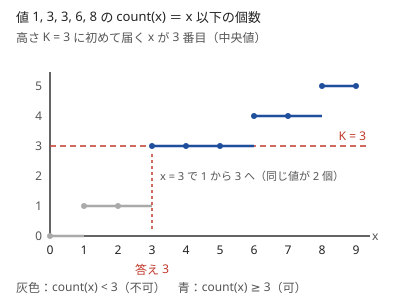

!!! abstract "要点"
    - **何のページか**：K 番目に小さい値・上位 K 個の和・中央値を問う問題で、データの動き方から手法を引ける。構造で保つか、「$x$ 以下が $K$ 個以上か」で答えを二分探索するか、小さい順に取り出すかを選ぶ。
    - **いつ使うか**：
        - $K$ 番目に小さい（大きい）値を答える。
        - $N^2$ 個の積・和・差の中で $K$ 番目。
        - 値の追加・更新のたびに、大きい方から $K$ 個の和を答える。
        - 中央値の最大値・最小値。
        - $\sum_i \lvert x - a_i \rvert$ を最小にする $x$。
        - 辞書順で $K$ 番目のもの。
    - **使い方**：問われ方を[一覧の表](#overview)で探し、行の節で「データがどう動くか」を確かめてから手法のページへ進む。
    - **計算量**：答えの二分探索は（$x$ 以下の個数を数える計算量）$\times O(\log V)$、構造で保つなら 1 回 $O(\log N)$、小さい順に $K$ 個取り出すなら $O(K \log K)$（$V$ は値の範囲の幅）

<!-- textlint-disable -->
別名：K 番目・中央値・メディアン・上位 K 個・median
<!-- textlint-enable -->

K 番目と中央値は、値を小さい順に並べたときの順位を問う題材である。並べれば終わりに見える。しかし、候補が多すぎる・値が変わり続ける・区間ごとに聞かれる、のどれかに当たると素朴な方法は間に合わない。どれに当たるかで手法が分かれる。

## 題材の性質 {#properties}

順位の問題は、ほとんどが次の 1 つの言い換えから始まる。値の[多重集合](../guide/glossary.md#multiset) $S$（同じ値を何個も含んでよい）について、$\mathrm{count}(x)$ を「$S$ の中で $x$ 以下の値の個数」とする。

$$
(K \text{ 番目に小さい値}) \le x \iff \mathrm{count}(x) \ge K
$$

$\mathrm{count}(x)$ は $x$ について広義単調増加なので、$K$ 番目の値は「$\mathrm{count}(x) \ge K$ となる最小の $x$」である。理由は [K 番目の値](../basics/kth-value.md#why-count)にある。

この図の値は 5 個なので、中央値は小さい方から 3 番目である。$\mathrm{count}$ は $x = 3$ で 1 から 3 へ飛ぶので、$\mathrm{count}(x) = 2$ となる $x$ はない。順位を「ちょうど $K$」で探さず「$K$ 以上」で探すのは、このためである。

この言い換えから、題材に共通する性質が出てくる。

- **大きい方から $K$ 番目**：「$x$ 以上の個数 $\ge K$」となる最大の $x$ である。全体の個数 $T$ が分かるなら、小さい方から $T - K + 1$ 番目と言い換えてもよい。
- **中央値**：$m$ 個の[中央値](../guide/glossary.md#median)を小さい方から $\lceil m/2 \rceil$ 番目とすると、「中央値 $\ge x$」は「$x$ 以上の個数 $>$ $x$ 未満の個数」と同じになる。偶数個のときに中央の 2 つのどちらを取るかで、不等号が変わる（[中央値の言い換え](../basics/fractional-binary-search.md#median)）。
- **上位 $K$ 個の和**：$K$ 番目に大きい値 $t$ が分かれば決まる。$t$ より大きい値の個数を $c$ とすると、和は「$t$ より大きい値の和 $+ (K - c) \times t$」である（[上位 M 個の和](../basics/kth-value.md#top-m-sum)）。
- **同じ値の順位**：同じ値が複数あると、1 つの値が連続した順位をまとめて占める。図の 3 は 2 番目と 3 番目の両方である。

## 問われ方と手法の一覧 {#overview}

問題文の形とデータの動き方から行を探し、問われ方のリンクから行の節へ移る。節で言い換えを確かめてから、手法のページへ進む。代表の問題は、行き先のページの例題・練習にある。

| よく出る問われ方 | 使う手法 | ページ | 代表の問題 |
|---|---|---|---|
| [$N^2$ 個の積・和の $K$ 番目、条件を満たす整数の $K$ 番目](#count-and-search) | $x$ 以下の個数で答えを二分探索 | [K 番目の値](../basics/kth-value.md) | ABC155 D |
| [値を追加しながら $K$ 番目（$K$ は固定）](#streaming) | 大きさ $K$ のヒープ | [優先度付きキュー](../ds/priority-queue.md#patterns) | ABC234 D |
| [更新のたびに上位 $K$ 個の和・中央値](#streaming) | 2 つの multiset | [上位 K 個の和と中央値の管理](../ds/top-k-multiset.md) | ABC306 E |
| [追加と削除があり、毎回違う $K$ を聞く](#dynamic) | BIT 上の二分探索・値を添字にするセグメント木 | [K 番目の値を求めるデータ構造](../ds/kth-element.md) | ARC033 C |
| [小さい方から $K$ 個を列挙する（$K$ が小さい）](#k-best) | 最小を取り出して次の候補を入れる | [優先度付きキューを使う貪欲](../basics/greedy-priority-queue.md#k-best)、[優先度付きキュー](../ds/priority-queue.md#patterns) | ABC123 D（大きい方から） |
| [列の区間の $K$ 番目・$x$ 以下の個数](#range-kth) | 先読みして BIT、Wavelet Matrix | [クエリの先読み](../ds/offline-queries.md#threshold)、[Wavelet Matrix](../ds/wavelet-matrix.md) | ABC324 G |
| [中央値・平均の最大化・最小化](#maximize-median) | 値を引く・±1 にして符号で判定 | [平均・中央値の最大化](../basics/fractional-binary-search.md) | ABC203 D |
| [$\sum_i \lvert x - a_i \rvert$ の最小](#absolute-sum) | 中央値を選ぶ | [絶対値の和の最小化と中央値](../basics/median-absolute.md) | ARC100 C |
| [辞書順で $K$ 番目の文字列・順列](#lexicographic-kth) | 先頭ごとの個数と $K$ を比べる | [辞書順最小を前から決める貪欲](../basics/lexicographic-greedy.md#kth) | ABC202 D |
| [XOR で作れる値の $K$ 番目](#xor-kth) | 簡約した基底 | [XOR 基底](../math/xor-basis.md#kth) | ABC283 G |

迷ったら、次の 3 つを順に確かめる。

1. **候補を全部持てるか**：持てないほど多い（$10^{10}$ 個など）なら、[答えの二分探索](#count-and-search)か[小さい順の列挙](#k-best)になる。
2. **集合が変わるか**：変わらないならソートで済む。追加だけなら[ヒープ](#streaming)、削除もあるなら[個数の BIT](#dynamic)を使う。
3. **区間ごとに聞かれるか**：列の一部分の $K$ 番目なら、[区間の構造](#range-kth)が要る。

## 候補が多すぎて並べられない → x 以下の個数で答えを二分探索（kth-value, binary-search-answer） {#count-and-search}

$N = 2 \times 10^5$ 個から 2 つ選んだ積は約 $2 \times 10^{10}$ 個あり、並べることはできない。それでも「$x$ 以下の積は何個か」なら、ソートと[尺取り法](../basics/two-pointers.md)などで $O(N)$〜$O(N \log N)$ で数えられる。そこで[題材の性質](#properties)の言い換えを使い、$\mathrm{count}(x) \ge K$ となる最小の $x$ を[答えで二分探索](../basics/binary-search-answer.md)する。

全体の計算量は、$\mathrm{count}$ を 1 回数える計算量 $\times O(\log V)$ である。二分探索の部分は決まった形なので、問題の本体は数え方になる。

- **2 つの列の積・和**：片方をソートし、もう片方の各要素について境目を二分探索か尺取りで探す。負の数を含む積は符号で場合分けする（[数え方の型](../basics/kth-value.md#counting-patterns)）。
- **倍数や欠けた数**：「$N$ か $M$ のちょうど一方で割り切れる数」なら、$\lfloor x/N \rfloor$ などの式の足し引き（包除）で $O(1)$ で数えられる（[K 番目の値の例題](../basics/kth-value.md#abc341_d)）。
- **上位 $K$ 個の和**：$K$ 番目の値 $t$ を二分探索で求め、$t$ より大きいものの個数と和を数えてから、$t$ ちょうどの分を足す。

この方法が使えるのは、$\mathrm{count}(x)$ を速く数えられるときだけである。数える式が立たず、$K$ が小さいなら、[小さい順に取り出す](#k-best)方が向いている。

## 値を追加しながら K 番目・上位 K 個 → 優先度付きキュー・2 つの multiset {#streaming}

列を前から読み、値が 1 つ増えるたびに順位の答えを出す型である。毎回ソートすると 1 回 $O(N \log N)$ かかるので、答えに要る部分だけを構造に持つ。

- **$K$ が固定で、追加だけ**：上位 $K$ 個だけを最小ヒープに持ち、$K + 1$ 個になったら最小を捨てる。残った最小が $K$ 番目に大きい値である。捨てた値は、後から何が来ても上位 $K$ 個に戻らない（[大きさ K のヒープ](../ds/priority-queue.md#patterns)）。
- **上位 $K$ 個の和を、更新しながら答える**：「上位 $K$ 個」と「残り」を 2 つの multiset に分け、上位側の和を持つ。追加・削除の 1 回ごとに境界をまたいで動くのは高々 1 個なので（書き換えは削除と追加の 2 回とみる）、和を差分で直せる（[2 つに分けて持つ](../ds/top-k-multiset.md#two-sets)）。
- **中央値を、追加しながら答える**：小さい側の個数を全体の半分（切り上げ）に保てば、小さい側の最大が中央値になる。追加だけならヒープ 2 本で足りる（[中央値を保つ](../ds/top-k-multiset.md#median)）。

どれも 1 回の操作は $O(\log N)$ である。削除が混じるならヒープを multiset に替える。聞かれる $K$ が毎回変わるなら、[次の節](#dynamic)の方法に進む。

## 追加と削除がある K 番目 → BIT 上の二分探索・値を添字にするセグメント木 {#dynamic}

値の追加・削除が続き、クエリごとに違う $K$ で「小さい方から $K$ 番目」を聞かれる型である。値ごとの個数を配列に持ち、接頭辞の和が初めて $K$ 以上になる添字を探す。

- **個数の BIT と BIT 上の二分探索**：1 回 $O(\log N)$ で、定数倍が軽い。値は添字にするので、値が大きければクエリを先に読んで[座標圧縮](../basics/coordinate-compression.md)する（[BIT 上の二分探索](../ds/kth-element.md#bit-binary-search)）。
- **値を添字にするセグメント木**：（個数, 和）を載せれば、小さい方から $K$ 個の和も 1 回 $O(\log N)$ で答えられる（[上位 K 個の和](../ds/segment-tree-on-values.md#top-k-sum)）。
- **$K$ が 5 程度と小さい、または「$x$ 以上の中で $K$ 番目」のように基準の近くを聞かれる**：multiset の `begin()` や `lower_bound(x)` からイテレータを $K$ 歩ほど動かせば足りる（[K 番目付近](../ds/ordered-set.md#near-kth)）。
- **値が大きく、先読みもできない**：GCC の拡張の pb_ds の `tree` か、[平衡二分探索木](../ds/balanced-bst.md#pbds)を使う。

どれを選ぶかの比較の表は、[K 番目の値を求めるデータ構造の使い分け](../ds/kth-element.md#comparison)にある。集合が $10^{10}$ 個のように大きすぎて個数の配列に入らないなら、[答えの二分探索](#count-and-search)に戻る（[2 つの方法の違い](../ds/kth-element.md#vs-kth-value)）。

## 小さい方から K 個の解を列挙 → 優先度付きキューで最小を取り出す（greedy-priority-queue） {#k-best}

「3 つの数列から 1 つずつ選んだ和の、大きい方から $K$ 個」のように、候補は多すぎるが $K$ は $10^5$ 程度という型である。最良の候補から始め、取り出した候補から作れる次の候補だけを優先度付きキューに入れる。取り出した順がそのまま良い順になる。以下は小さい方から取り出す向きで書く。大きい方からなら、値の大小を逆にして同じことをする。

正しく動くには、各候補について「自分以下の値を持つ親」を決め、最良の候補から親子をたどってすべての候補に届くようにする。まだ出ていない候補は、値が自分以下の祖先を必ずキューの中に持つので、順が狂わない。同じ候補が別の親から何度も入らないよう、親を 1 つに決めるか、入れた組を `set` で覚える（[小さい順に K 個を列挙する](../basics/greedy-priority-queue.md#k-best)）。

計算量は、1 回に入れる子の数を定数とすれば $O(K \log K)$ である。$K$ が $N^2$ 程度まで大きいと 1 つずつ取り出すのでは間に合わないので、[個数を数える二分探索](#count-and-search)にする。

## 区間の K 番目・x 以下の個数 → クエリの先読みと BIT、Wavelet Matrix {#range-kth}

列 $A$ は変わらず、多数のクエリで区間 $[l, r)$ の中の $x$ 以下の個数や $K$ 番目を聞かれる型である。区間ごとにソートすると 1 回 $O(N \log N)$ かかる。

- **$x$ 以下の個数・和で、先読みできる**：要素を値の順に、クエリを $x$ の順に並べる。値が $x$ 以下の要素をその位置に BIT で足していけば、各クエリは区間の和で答えられる（[しきい値でソート](../ds/offline-queries.md#threshold)）。
- **区間の $K$ 番目、または前の答えで次のクエリが決まる**：前処理した Wavelet Matrix で、$K$ 番目も $x$ 未満の個数も 1 回 $O(\log V)$ で答えられる（[Wavelet Matrix でできること](../ds/wavelet-matrix.md#what-it-does)）。
- **先読みできる区間の $K$ 番目**：区間の $x$ 以下の個数で答えを二分探索する。全クエリの二分探索を一斉に進めれば、上の BIT の方法が使える（[並列二分探索](../ds/parallel-binary-search.md#what-it-does)）。

列に更新があると Wavelet Matrix は作り直しになる。更新もあるときの構造は[オンライン強制の見分け方](../ds/offline-queries.md#online)にまとめてある。

## 中央値・平均の最大化 → 値を引く・±1 にして符号で判定する二分探索（fractional-binary-search） {#maximize-median}

選び方を決めて、選んだものの中央値や平均を最大にする型である。中央値は並べ替えないと決まらないので、選び方の DP や貪欲に直接は載らない。答えを $x$ に決めて「中央値を $x$ 以上にできるか」を判定し、[答えで二分探索](../basics/binary-search-answer.md)する。

- **中央値**：$x$ 以上の値を $+1$、未満を $-1$ に置き換える。小さい方の中央値（$\lceil m/2 \rceil$ 番目）なら「中央値 $\ge x$」は和が正であることと同じで、大きい方の中央値なら和が 0 以上になる（[中央値の言い換え](../basics/fractional-binary-search.md#median)）。
- **平均**：各値から $x$ を引く。「平均 $\ge x$」は、引いた後の和が 0 以上であることと同じになる（[平均の言い換え](../basics/fractional-binary-search.md#average)）。

どちらも、置き換えた後は「和の最大が条件を満たすか」を調べればよい。連続部分列なら累積和、領域なら 2 次元累積和、選び方に制約があれば DP で判定する。中央値の答えは必ずどれかの要素の値なので、整数の二分探索で済む。平均は実数の二分探索になることが多い。

## Σ|x − a_i| の最小 → 中央値を選ぶ（median-absolute） {#absolute-sum}

$f(x) = \sum_i \lvert x - a_i \rvert$ を最小にする $x$ は、$a$ の中央値である。$x$ がどの点とも重ならない位置にあるとき、$x$ を右へ少し動かすと、$f$ の傾きは（$x$ より左の点の数）−（$x$ より右の点の数）になる。中央値では左右の点の数が釣り合い、そこで傾きの符号が変わる（[なぜ中央値か](../basics/median-absolute.md#why-median)）。

- **偶数個**：中央の 2 つの間ならどこでも最小になるので、平均を取る必要はない（[偶数個のとき](../basics/median-absolute.md#even-count)）。
- **式の形を合わせる**：$\sum_i \lvert A_i - (b + i) \rvert$ は $a_i = A_i - i$ と置けば同じ形になる（[変数変換で帰着する](../basics/median-absolute.md#change-variables)）。マンハッタン距離の和は $x$ と $y$ に分けて別々に中央値を取る。
- **値が増えていく**：中央値をヒープ 2 本で保てば、最小値も小さい側と大きい側の和から $O(1)$ で求まる（[中央値を保つ](../ds/top-k-multiset.md#median)）。関数に $\lvert x - a \rvert + b$ を足していく型も同じ構造で扱える（[足していく関数の最小値](../ds/top-k-multiset.md#absolute-sum-function)）。

二乗の和 $\sum_i (x - a_i)^2$ の最小は中央値でなく平均になる。

## 辞書順で K 番目の文字列・順列 → 残りの個数を数えて先頭から決める {#lexicographic-kth}

条件を満たすものを辞書順に並べた $K$ 番目は、先頭から 1 文字ずつ決める。各位置で候補の文字を小さい順に見て、「その文字を置いたときに完成させられる個数」と $K$ を比べる。$K$ が個数以下ならその文字に決め、そうでなければ $K$ から個数を引いて次の候補を見る（[辞書順 K 番目](../basics/lexicographic-greedy.md#kth)）。

個数の数え方で、行き先のページが分かれる。

- **式で数えられる**：a が $A$ 個・b が $B$ 個の並べ方なら二項係数で数える（[二項係数の K 番目](../comb/binomial-coefficient.md#kth)）。順列なら、残りの $r$ 個の並べ方 $r!$ が個数になる（[順列](permutation.md#lexicographic)）。
- **式がない**：後ろからの DP で「残りの完成のさせ方の数」を数える（[数え上げで決める](../dp/dp-reconstruction.md#dp-kth-lexicographic)）。

個数はすぐに `long long` を超える。比べたいのは「$K$ 以上か」だけである。足し算のたびに $\min(K, \cdot)$ を取って頭打ちにすればよい。

## XOR で作れる値の K 番目 → XOR 基底（xor-basis） {#xor-kth}

いくつかの整数から好きなものを選んだ XOR として作れる値の、小さい方から $K$ 番目を問う型である。作れる値は基底の大きさを $r$ として $2^r$ 個あり、全部は並べられないことが多い。

基底を、各要素の最上位 bit がほかの要素では 0 になるように整える（簡約した基底）。簡約した基底を小さい順に $c_0 < c_1 < \dots < c_{r-1}$ とすると、0 から数えた $k$ の 2 進表記で bit $i$ が 1 の $c_i$ をすべて XOR した値が $k$ 番目になる。$k$ の大小と値の大小が一致するからである（[簡約した基底と K 番目](../math/xor-basis.md#kth)）。

0 番目は 0（何も選ばない）である。「1 個以上選ぶ」問題では、0 を作れるかどうかで番号が 1 つずれる。

## 落とし穴 {#pitfalls}

- **「ちょうど $K$」で探す**：同じ値が複数あれば、$\mathrm{count}(x) = K$ となる $x$ は存在しないことがある。値 1, 3, 3, 6, 8 で $K = 2$ とすると、$\mathrm{count}$ は 1 から 3 へ飛ぶ（[題材の性質](#properties)）。判定は必ず「$\ge K$」にする。
- **「以下」と「未満」の取り違え**：「$x$ 未満の個数」で数えたなら、答えは「$x$ 未満の個数 $< K$」となる最大の $x$ である。判定の形と、答えが最小の ok か最大の ok かを組で決める。迷ったら $K = 1$ と $K = T$ を手で確かめる。
- **$K$ の数え始め**：問題の $K$ は 1-indexed が多いが、pb_ds の `find_by_order` や Wavelet Matrix のライブラリは 0-indexed のことが多い。境目で 1 を足し引きする。
- **偶数個の中央値**：中央の 2 つの小さい方・大きい方・平均のどれを取るかで、判定の不等号が変わる。問題文の定義を確かめ、偶数個の小さな例で判定を手で回す。
- **個数のオーバーフロー**：$N^2$ 個の候補の個数や、辞書順の数え上げの個数は `int` を超える。個数は `long long` で持ち、数え上げは $K$ で頭打ちにする。

## 参考 {#references}

- [betrue12「「答えを決め打つ」タイプの二分探索を使いこなそう」](https://betrue12.hateblo.jp/entry/2019/05/11/013403)：K 番目の値が x 以下であることと、x 以下の値が K 個以上あることの同値。判定を「ぴったり」にすると単調性が崩れるという注意（別の問題の解説の中）
