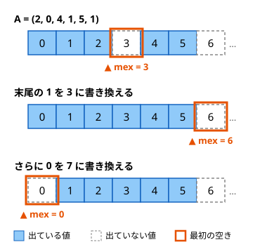

!!! abstract "要点"
    - **何のページか**：集合に含まれない最小の非負整数 mex を求める・更新する・総和を取る問題で、問われ方から使う手法を引ける。「N 要素の mex は N 以下」「mex ≥ k+1 ⇔ 0〜k をすべて含む」の 2 つの性質から考える。
    - **いつ使うか**：
        - 含まれない最小の非負整数（mex）を答える。
        - 1 点を書き換えるたびに数列の mex を答える。
        - 長さ M の全区間の mex の最小値。
        - 全区間・全パスの mex の総和。
    - **使い方**：問われ方を[一覧の表](#overview)で探し、行の節で性質の使い方を確かめてから手法のページへ進む。
    - **計算量**：1 回の計算 $O(N)$、更新のたびに答えるなら 1 回 $O(\log N)$

<!-- textlint-disable -->
別名：minimum excluded・含まれない最小の非負整数・まだ出ていない最小の値
<!-- textlint-enable -->

mex は、非負整数の集合に含まれない最小の非負整数である。問われ方は「1 回求める」「更新のたびに答える」「区間ごとの最小値」「総和」「ゲーム」「構築」と多い。どれも、値の上限と「0 から順にそろっているか」という 2 つの性質から手法が決まる。

## 題材の性質 {#properties}

集合 $S$ の mex を $\mathrm{mex}(S)$ と書く。$\mathrm{mex}\{0, 1, 3\} = 2$、$\mathrm{mex}\{1, 2\} = 0$ で、空集合なら $\mathrm{mex}\{\} = 0$ である。数列の mex は、その要素の集合の mex とする（同じ値が何個あっても変わらない）。

- **値の上限**：$N$ 個の要素からなる列の mex は $N$ 以下である。mex が $N + 1$ 以上なら $0, 1, \dots, N$ の $N + 1$ 種類がすべて出ているはずだが、要素は $N$ 個しかない。よって $N$ より大きい値は mex に関係せず、無視してよい。1 回の計算は、大きさ $N + 1$ の印の配列を作り、印のない最小の値を探せば $O(N)$ で済む
- **0 から順にそろっているか**：$\mathrm{mex}(S) \ge k$ は、$0, 1, \dots, k - 1$ がすべて $S$ に含まれることと同じである。添字をずらせば、$\mathrm{mex}(S) \ge k + 1$ は $0, \dots, k$ をすべて含むことと同じになる。ここから 2 つのことが従う
    - **単調性**：$S \subseteq T$ なら $\mathrm{mex}(S) \le \mathrm{mex}(T)$ である。区間を広げても mex は減らない
    - **最小の欠けた値**：$\mathrm{mex}(S) \le k$ は、$0, \dots, k$ のどれかが $S$ に欠けていることと同じである。mex は欠けた値の最小値なので、「mex の最小値」は「欠けた値の最小値」に言い換えられる
- **追加と削除で mex がどう動くか**：値 $x$ を加えて mex が変わるのは $x = \mathrm{mex}(S)$ のときだけで、そのとき mex は次の空きまで一気に上がる。値 $x$ を取り除いて個数が 0 になると、$x < \mathrm{mex}(S)$ なら mex は $x$ に下がる。追加だけなら mex は増える一方だが、削除があると大きく戻る

数直線に出ている値を塗ると、mex は 0 から見て最初の空きのマスである。



この図では、1 回の書き換えで mex が 3 から 6 へ飛び、次の書き換えで 0 に戻っている。mex を変数 1 つで追いかけるだけでは、この動きに対応できない。空きの集合を持つ必要があるのは、このためである。

1 回だけ mex を求めるコードは次のとおりで、印の配列の大きさを $N + 1$ にするのが要点である。

```cpp
--8<-- "mex/window-min.cpp:mex"
```

??? question "確認問題：長さ 5 の列の mex が 5 になるのはどんなときか"
    mex が 5 なら、$0, 1, 2, 3, 4$ の 5 種類がすべて出ている。要素は 5 個しかないので、列は $0, 1, 2, 3, 4$ を 1 個ずつ並べ替えたものに限られる。値の上限 $N$ がちょうど達成されるのは、この場合だけである。

## 問われ方と手法の一覧 {#overview}

問題文の形から行を探し、手法のページへ進む。代表の問題は、このページかリンク先のページに載せたものだけを書いた。

| よく出る問われ方 | 使う手法 | ページ | 代表の問題 |
|---|---|---|---|
| 1 点を書き換えるたびに mex | 出現回数 0 の値の set、個数のセグメント木の上の二分探索 | [set・multiset・map の応用](../ds/ordered-set.md#mex)、[セグメント木上の二分探索](../ds/segment-tree-binary-search.md#predicate-patterns) | ABC330 E |
| 値の範囲が大きい・区間でまとめて入る | 出ている値を区間の集合で持つ | [区間を set で管理する](../ds/interval-set.md#applications) | — |
| 長さ M の窓の mex の最小値 | 値を固定し、出現位置の間隔を見る | [変数を固定する](../thinking/fix-variable.md) | ABC194 E |
| 長さ M の窓の mex の最大値 | 答えで二分探索と窓の個数の管理 | [答えで二分探索](../basics/binary-search-answer.md#monotonicity)、[尺取り法](../basics/two-pointers.md#fixed-window) | — |
| 全区間・全パスの mex の総和 | mex が k+1 以上の数を k について足す | [主客転倒](../thinking/contribution.md#swap-roles)、[遅延セグメント木の使い方の型](../ds/lazy-segment-tree-patterns.md#reformulate) | ABC438 F、ABC470 G |
| ゲームの勝敗 | 行き先の値の mex（Grundy 数） | [Grundy 数](../comb/grundy-number.md#definition) | ABC368 F |
| mex を指定した値にする | 0〜k−1 を入れて k を入れない | [構築](../thinking/construction.md#necessary-conditions) | — |

このページの問題へのリンクは[例題](#examples)と[練習問題](#practice)の囲みにある。ABC330 E は [set の応用の練習](../ds/ordered-set.md#practice)、ABC470 G は[遅延セグメント木の使い方の型の力試し](../ds/lazy-segment-tree-patterns.md#challenge)、ABC368 F は [Grundy 数の例題](../comb/grundy-number.md#abc368_f)に載せた。

## 更新のたびに mex を答える → 出現回数 0 の値の set・セグメント木上の二分探索 {#online-mex}

長さ $N$ の数列で 1 点を書き換えるたびに mex を答えるとき、毎回 $O(N)$ で数え直すと全体で $O(NQ)$ になり、$N = Q = 2 \times 10^5$ では間に合わない。値の上限の性質から、見るのは値 $0, \dots, N$ だけでよい。値ごとの出現回数 $\mathrm{cnt}[v]$ を持ち、「個数が 0 の値の最小」を速く取れる形にする。

- **出現回数 0 の値の set**：$\mathrm{cnt}[v] = 0$ の $v$ を set に入れておく。mex は set の最小である。書き換えで個数が 0 になった値を入れ、0 から 1 になった値を消す。更新と取得はどちらも $O(\log N)$ である。$0, \dots, N$ の $N + 1$ 個の値を $N$ 個の要素で埋めきれないので、set は空にならない（[set・multiset・map の応用](../ds/ordered-set.md#mex)）
- **個数のセグメント木の上の二分探索**：$\mathrm{cnt}[0], \dots, \mathrm{cnt}[N]$ を最小値のセグメント木に載せ、「個数の最小値が正」の間だけ真になる条件で `max_right(0, f)` を呼ぶ。返り値が mex である（[条件の書き方の型](../ds/segment-tree-binary-search.md#predicate-patterns)）。「$x$ 以上で個数 0 の最小の値」のように探し始めを変える問い合わせにも、同じ形で答えられる

書き換えは「古い値の個数を 1 減らす」と「新しい値の個数を 1 増やす」の 2 つに分ける。$N$ より大きい値は、個数を数えずに読み飛ばす。

??? note "追加だけなら、戻らないポインタで足りる"
    値を加えるだけで取り除かないなら、mex は増える一方である。現在の mex を変数 $m$ に持ち、値を加えるたびに「$\mathrm{cnt}[m] > 0$ の間 $m$ を 1 増やす」とすればよい。$m$ は要素の数（初めの $N$ 個と加えた $Q$ 個）を超えないので、全体で $N + Q$ 回しか増えず、合計は[ならし計算量](../guide/glossary.md#amortized-complexity)で $O(N + Q)$ になる。削除が混ざると $m$ を戻す必要があり、この議論は崩れる（[ならし計算量の節](../basics/complexity-estimation.md#amortized)）。

## 値が区間でまとめて入る → 区間を set で管理（interval-set） {#interval-values}

「$l$ 以上 $r$ 未満の整数をすべて集合に加える」「まとめて取り除く」のように、値が区間で出入りする問題では、値ごとの個数を持てない。範囲が $10^9$ まであれば配列も作れない。このときは、出ている値を互いに重ならない半開区間の集合として持つ。

- mex は「0 以上で覆われていない最小の値」である。0 を含む区間 $[0, r)$ があるときはその右端 $r$ で、ないときは 0 になる
- 区間を加えるときに隣とつながる区間を 1 つにまとめておけば、0 を含む区間を 1 回の検索で見つけられる。まとめないと、$[0, 3)$ と $[3, 5)$ に分かれたまま 3 を答えてしまう

区間の追加・削除はならし $O(\log K)$（$K$ を持っている区間の数とする）で、持ち方と境界は[区間を set で管理する](../ds/interval-set.md#applications)に任せる。1 点の書き換えでも、値ごとの個数と合わせて持てば同じ形で解ける。個数が 0 から 1 になったら長さ 1 の区間を加え、1 から 0 になったら取り除く（[set の応用の練習](../ds/ordered-set.md#practice)の ABC330 E の別解）。

## 区間・窓の mex の最小値・最大値 → 値を固定して出現位置の間隔を見る（fix-variable） {#window-mex}

長さ $N$ の列で、長さ $M$ の連続部分列（窓）すべての mex の最小値を求める問われ方がある。窓は $N - M + 1$ 個あり、それぞれ $O(M)$ で数えると $O(NM)$ かかる。

**最小値**：窓ではなく値を[固定する](../thinking/fix-variable.md)。性質の「最小の欠けた値」から、窓の mex の最小値は「どれかの窓に欠けている値」の最小値に等しい。値 $k$ がどれかの窓に欠けているのは、$k$ の出現位置の間（先頭の前の $-1$ と末尾の後の $N$ を番兵にする）に、長さ $M$ 以上の隙間があるときである。

- 0-indexed で、値 $k$ の出現位置を $p_1 < p_2 < \dots < p_c$ とし、$p_0 = -1$、$p_{c+1} = N$ とする。$k$ を含まない最長の連続部分の長さは $\max_j (p_{j+1} - p_j - 1)$ である
- この長さが $M$ 以上になる最小の $k$ が答えである。値の上限から $k$ は $0, \dots, N$ だけ調べればよく、出現位置の合計は $N$ 個なので全体で $O(N)$ になる

なぜ等しいか：最小の欠けた値を $k^\ast$、それが欠けた窓を $W^\ast$ とする。$W^\ast$ の mex は $k^\ast$ 以下である。逆に、どの窓 $W$ の mex も $W$ に欠けた値なので、$k^\ast$ 以上である。

```cpp
--8<-- "mex/window-min.cpp:gaps"
```

**最大値**：長さ $M$ の窓の mex の最大値は、[答えで二分探索](../basics/binary-search-answer.md#monotonicity)する。「mex が $x$ 以上の窓があるか」は、$0, \dots, x - 1$ をすべて含む窓があるかと同じで、$x$ について単調である。判定は[固定長の窓をずらし](../basics/two-pointers.md#fixed-window)ながら、$x$ 未満の値の種類数を個数の配列で保てば $O(N)$ で、全体は $O(N \log N)$ になる。長さを決めない区間なら、単調性から列全体の mex が最大である。

区間 $[l, r)$ の mex を多数聞かれるときは、右端 $r$ の小さい順にクエリを並べて先読みする。位置 $r$ より前での値 $v$ の最後の出現位置を $\mathrm{last}[v]$（なければ $-1$）とし、値 $0, \dots, N$ について最小値のセグメント木に載せる。$[l, r)$ の mex は、$\mathrm{last}[v] < l$ となる最小の $v$ である。この $v$ は[セグメント木上の二分探索](../ds/segment-tree-binary-search.md#predicate-patterns)により 1 回 $O(\log N)$ で求まる。

## 全区間・全パスの mex の総和 → mex が k+1 以上の数を足す主客転倒 {#sum-of-mex}

すべての区間（木ならすべてのパス）の mex の総和を、区間ごとに数えると区間の数だけかかる。性質の「0 から順にそろっているか」を使って[主客転倒](../thinking/contribution.md#swap-roles)する。mex の値 $m$ は、$[m \ge 1] + [m \ge 2] + \cdots$ と 1 の和に分けられる。$\mathrm{mex} \ge k + 1$ は $0, \dots, k$ をすべて含むことなので、次のように書き直せる。

$$
\sum_{\text{対象}} \mathrm{mex} = \sum_{k \ge 0} \#\{\text{対象} : 0, \dots, k \text{ をすべて含む}\}
$$

区間ごとの和を、$k$ ごとに「$0, \dots, k$ をすべて含む区間の数」を数える問題に変えた。$k$ を増やすと条件は厳しくなる一方なので、含む対象がなくなった時点で打ち切れる。mex がちょうど $k$ の対象の数が要るときは、「mex が $k$ 以上の数」から「$k + 1$ 以上の数」を引けばよい。

- **列の全区間**：1 つの $k$ について「$0, \dots, k$ をすべて含む区間の数」は、区間を広げても条件が崩れないので[尺取り法](../basics/two-pointers.md#two-types)で $O(N)$ で数えられる。$k$ ごとに数え直すと $O(N^2)$ である。速くするには、左端 $L$ ごとの「$0, \dots, k$ をすべて含む最小の右端」を持ち、$k$ を増やしながら更新する。値 $k$ を加えると、左端 $L$ の最小の右端は「今の値」と「$L$ 以降で最初に $k$ が出る位置」の大きい方になる。今の値は $L$ について単調なので、この max で値が変わるのは $L$ の範囲の一部（$k$ の出現の間ごとに、今の値が小さい側）だけで、そこへの区間代入になる（[言い換えてから載せる](../ds/lazy-segment-tree-patterns.md#reformulate)）。全体 $O(N \log N)$ になる
- **木の全パス**：$0, \dots, k$ をすべて含むパスがあるのは、$0, \dots, k$ が 1 本のパスの上に並ぶときだけである。$k$ を増やしながら、その最短のパスの両端を更新する。両端の外側に伸ばしたパスがすべて条件を満たすので、数はそれぞれの側の頂点数の積になる。1 本のパスに並ばなくなったら、それより大きい $k$ はすべて 0 なので打ち切る（[練習](#practice)の ABC438 F）

## ゲームの局面の値 → Grundy 数（grundy-number） {#grundy}

不偏ゲームの局面に、1 手で移れる局面の値の mex を割り当てたものが Grundy 数である。$g = 0$ の局面がちょうど負けの局面になり、独立なゲームの和は XOR で求まる。定義と正しさは [Grundy 数の定義](../comb/grundy-number.md#definition)に任せる。

mex の性質がそのまま効くのは、表を作るときである。行き先が $k$ 個なら、値の上限から mex は $k$ 以下になる。印の配列は大きさ $k + 1$ で足り、$k$ より大きい値は無視してよい。局面ごとに大きな配列を初期化し直すと遅くなる。配列は行き先の数に合わせた大きさで作る（[Grundy 数を DP で求める](../comb/grundy-number.md#dp)）。

## mex を指定した値にする構築 → 0〜k−1 を入れて k を入れない（construction） {#construction}

mex がちょうど $k$ になる列や集合を作る問題では、「$0, \dots, k - 1$ をすべて入れ、$k$ を入れない」が条件のすべてである。ほかの値（$k$ より大きい値や重複）は mex を変えないので、残りの要素の調整に使える。

[構築](../thinking/construction.md#necessary-conditions)では、先に必要条件を挙げる。mex の問題でよく効くのは次の 3 つである。

- **要素の数**：mex を $k$ にするには、少なくとも $k$ 個の要素が要る。$K$ 個を選んで mex を最大にするなら、答えは $K$ と元の集合の mex の小さい方を超えない
- **接頭辞の mex は単調**：列の先頭 $i$ 個の mex は、$i$ について広義単調増加で、$i$ 以下である。指定された接頭辞の mex の列がこれを破れば、作れない
- **0 の有無**：0 を含まない集合の mex は必ず 0 である。mex を 1 以上にしたいなら、まず 0 を入れる

出力が正しいかは、作った列の mex を[1 回の計算](#properties)で求め直せば確かめられる（[出力を検査するプログラム](../thinking/construction.md#checker)）。

## 落とし穴 {#pitfalls}

- **印の配列を大きさ $N$ で作る**：長さ $N$ の列の mex は $N$ になりうる。$0, \dots, N - 1$ がすべて出ているとき、大きさ $N$ の配列では添字 $N$ を読んではみ出す。大きさは $N + 1$ にする
- **$N$ より大きい値で配列をはみ出す**：値が $10^9$ まであると、そのまま添字にできない。mex に関係しないので、印を付ける前に読み飛ばす。ただし窓の長さや要素の数には数える
- **削除があるのに、mex のポインタを戻さずに使う**：追加だけなら mex は増える一方だが、削除で個数が 0 になった値が mex より小さければ、mex はその値に戻る。削除があるなら、出現回数 0 の値の set か個数のセグメント木を使う
- **主客転倒の添字のずれ**：$\mathrm{mex} \ge k$ は $0, \dots, k - 1$ を含むことで、$0, \dots, k$ を含むことではない。$\{0, 1\}$（mex は 2）で、$k = 0$ と $k = 1$ の 2 回だけ数えられるかを確かめる
- **空の区間や空集合を数えるか**：空集合の mex は 0 なので、総和には効かない。最小値を求めるときは、空の区間を候補に入れると答えが 0 になる。問題が空の区間を含むかを確かめる

## 例題 {#examples}

### ABC194 E. Mex Min {#abc194_e}

<div class="kp-problems" data-role="example" markdown>

- [ABC194 E. Mex Min](https://atcoder.jp/contests/abc194/tasks/abc194_e)（diff 1088）：長さ N の数列の、長さ M の連続部分列すべてについての mex の最小値を求める。

</div>

方針：[窓の mex の最小値](#window-mex)の言い換えにより、「どれかの長さ $M$ の窓に欠けている値」の最小値を求める。値 $k$ ごとに出現位置の隙間の最大を、両端の番兵を入れて求め、隙間が $M$ 以上になる最小の $k$ を答える。全体で $O(N)$ である。

??? note "解法の詳細"
    0-indexed で、値 $k$ の直前の出現位置 $\mathrm{last}[k]$（初めは番兵の $-1$）と、$k$ を含まない最長の長さ $\mathrm{gap}[k]$ を持つ。

    ```text
    for i = 0 .. N-1:
        k = A[i]
        gap[k] = max(gap[k], i - last[k] - 1)
        last[k] = i
    for k = 0 .. N:
        gap[k] = max(gap[k], N - last[k] - 1)   # 末尾の番兵 N までの隙間
        if gap[k] >= M: return k
    ```

    - 答えは $N$ になりうる（$M = N$ で列が $0, \dots, N - 1$ の並べ替えのとき）。配列の大きさは $N + 1$ にする
    - 末尾の隙間を忘れると、最後に出た位置より後ろの窓で欠ける値を見落とす
    - 別の解き方：窓を 1 つずつずらし、値ごとの個数を保つ。最初の窓の mex と、窓から出て個数が 0 になった値のうち、最小のものが答えである。どの窓の欠けた値も、最初の窓で欠けているか、どこかで個数が 0 になった値だからである。答えで二分探索し、各判定で窓をずらしてもよい（$O(N \log N)$）

## 練習問題 {#practice}

<div class="kp-problems" data-role="practice" markdown>

- [ABC438 F. Sum of Mex](https://atcoder.jp/contests/abc438/tasks/abc438_f)（diff 1852）：木のすべてのパスについての mex の総和を求める。

</div>

??? note "練習の方針"
    - **ABC438 F**：[全パスの mex の総和](#sum-of-mex)の主客転倒で、「頂点 $0, \dots, k$ をすべて含むパスの数」を $k = 0, 1, \dots$ について足す。頂点 0 を根にして部分木の大きさを前計算する。$k = 0$ は 0 を通るパスを直接数える。$k \ge 1$ では、$0, \dots, k$ を含む最短のパスの両端 $a$・$b$ を持ち、両端の外側の頂点数の積を足す。端が 0 のときは、もう一方の端へ向かう子の部分木を除いた頂点数を使う。頂点 $k$ が今のパスの上になければ親をたどり、たどり着いた先が端なら端を $k$ に延ばし、端以外のパスの頂点なら打ち切る。各頂点は高々 1 回たどられるので、全体で $O(N)$ である

## 参考 {#references}

- [ikatakos「AtCoder Beginner Contest 194」](https://ikatakos.com/pot/programming_algorithm/contest_history/atcoder/2021/0306_abc194)：例題 ABC194 E の、値を固定して出現位置の間隔を見る方針と、答えが N になりうる点
- [hamayan「Mex Min [AtCoder Beginner Contest 194 E]」](https://blog.hamayanhamayan.com/entry/2021/03/07/000832)：例題 ABC194 E の、答えで二分探索して窓をずらす別解
- [ikatakos「AtCoder Beginner Contest 438」](https://ikatakos.com/pot/programming_algorithm/contest_history/atcoder/2025/1227_abc438)：練習 ABC438 F の主客転倒と、両端を更新して打ち切る方法
- [drken「AtCoder ABC 330 E - Mex and Update (1Q, 緑色, 475 点)」](https://drken1215.hatenablog.com/entry/2023/11/26/233800)：mex が N 以下であることと、まだ出ていない値の set
