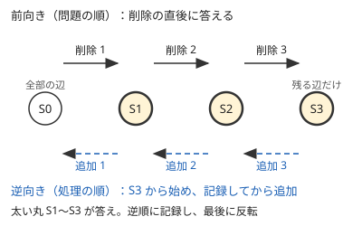

!!! abstract "要点"
    - **何のページか**：操作やクエリが $Q$ 個続く問題で、問われ方から処理の仕方を引ける。全体の操作を変数で持つ、後ろから見る、削除を逆順の追加にする、先読みして並べ替える、過去の版に戻る、周期で打ち切る、などの型に分ける。
    - **いつ使うか**：
        - 辺や頂点を 1 つずつ削除するたびに、連結成分の数を答える。
        - 全体に加算する・全体を反転する操作が混ざる。
        - 過去の状態に戻す・ある時点の状態をコピーする。
        - 行や列・区間を塗り替える操作の後の最終状態。
        - 同じ操作を $10^{18}$ 回繰り返した後の状態。
    - **使い方**：[題材の性質](#properties)の 4 つの問いで型を絞り、[一覧の表](#overview)の行から手法のページへ進む。
    - **計算量**：型ごとに行き先のページによる。全体への操作は 1 回 $O(1)$、区間の更新と取得は 1 回 $O(\log N)$ が多い
    - **前提**：なし

<!-- textlint-disable -->
別名：クエリの列・操作の列・逆順処理・シミュレーション
<!-- textlint-enable -->

操作列とクエリの問題は、長さ $N$ の列や盤面に $Q$ 個の操作を順に施し、途中や最後の状態を問う。1 回の操作で $O(N)$ 個の要素を書き換える素朴なシミュレーションは $O(NQ)$ で、$N, Q \le 2 \times 10^5$ では間に合わない。どの型に当たるかは、操作の範囲・答える時点・先読みの可否・時間の向きで決まる。

## 題材の性質 {#properties}

操作列の問題は、次の 4 つを問題文から読み取ると型が絞れる。

- **操作が触れる範囲**：全体・区間・1 点のどれか。全体への操作は、要素を書き換えずに変数 1 つで表せることが多い。区間への操作は、区間を丸ごと扱うデータ構造（セグメント木・区間の set）が要る
- **答える時点**：操作のたびに答えるのか、最後の状態だけを答えるのか。最後だけなら、各要素について最後に効いた操作だけを見ればよい
- **先読みできるか**：操作とクエリが最初に全部与えられ、前の答えで次のクエリが変わらないなら、[オフライン](../guide/glossary.md#offline)で並べ替えてよい。前の答えで次の入力を復号する形は[オンライン強制](../guide/glossary.md#forced-online)で、並べ替えは使えない
- **時間の向き**：データ構造の多くは、足すのは得意でも消すのは苦手である。Union-Find は併合できても分割できない。消す操作は、時間を逆にすると足す操作になる

ほかに、過去の状態を参照するか（版）、同じ操作を非常に多く繰り返すか（周期・合成）も手がかりになる。

??? question "確認問題：先読みしてよいかの見分け方"
    グラフの辺を 1 本ずつ削除するクエリが $Q$ 個、入力に全部書かれている。ただし $i$ 番目に削除する辺の番号は、入力の値と直前の答え（連結成分の数）の XOR で与えられる。削除を逆順の追加に直して Union-Find で解けるか。

    ??? success "答え"
        解けない。逆順に処理するには、最後に削除する辺から先に知る必要がある。しかしその辺の番号は、直前のクエリの答えが出るまで分からない。入力が全部書かれていても、前の答えで次のクエリが決まる形はオンライン強制で、先読みも時間の逆転も使えない。

## 問われ方と手法の一覧 {#overview}

問題文の形から行を探し、手法のページへ進む。代表の問題は、行き先のページの例題か練習にある。

| よく出る問われ方 | 使う手法 | ページ | 代表の問題 |
|---|---|---|---|
| 全体に足す・全体を反転・回転する | オフセット・反転フラグ・先頭位置の変数 | [全体への操作を変数で持つ](../ds/global-offset.md) | ABC212 D |
| 値の直後に挿入・削除し、最後の列を出力する | 配列で持つ連結リスト | [配列で作る連結リスト](../ds/linked-list.md) | ABC344 E |
| 直前と打ち消し合うものを消す・直前を取り消す | スタック・deque | [スタック・キュー・deque の使いどころ](../ds/stack-techniques.md) | ABC328 D |
| 区間を塗るたびに塗られた数を答える | 区間を set で管理 | [区間を set で管理する](../ds/interval-set.md) | ABC435 E |
| 最後の状態だけを問う・後の操作が上書きする | 後ろから見て確定させる | [後ろから・逆順に考える](../thinking/reverse-thinking.md) | ABC466 D（このページの[練習](#practice)） |
| 辺や頂点を順に削除し、連結成分を答える | 逆順の追加と Union-Find | [Union-Find で連結性を扱う](../graph/union-find-connectivity.md) | ABC229 E |
| クエリが独立で、全部を先に読める | 並べ替えてまとめて処理 | [クエリの先読み](../ds/offline-queries.md) | ABC174 F |
| 更新と区間の質問が交互に来る | セグメント木・遅延セグメント木 | [セグメント木](../ds/segment-tree.md)、[遅延セグメント木](../ds/lazy-segment-tree.md) | ABC341 E |
| 保存した状態に戻る・版をコピーする | 版の木・永続データ構造 | [永続データ構造](../ds/persistent-data-structures.md) | ABC273 E |
| 同じ操作を $10^{18}$ 回繰り返す | 周期で打ち切る・ダブリング | [周期性の検出](../basics/periodicity.md)、[ダブリング](../basics/doubling.md) | ABC167 D |

ページの欄に複数の手法がある行は、行の節で使い分けを確かめてから進む。

## 全体への加算・反転・回転 → 全体の操作を変数で持つ（global-offset） {#global-ops}

「全要素に $x$ を足す」を毎回 $O(N)$ で行うと、$Q$ 回で $O(NQ)$ になる。要素を書き換えずに、これまでに全体へ足した量 $\mathrm{add}$ を変数 1 つで持てば 1 回 $O(1)$ で済む。

- 保つ性質：実際の値 ＝ 格納した値 ＋ $\mathrm{add}$
- 要素を入れるときは $x - \mathrm{add}$ を格納し、取り出すときに $\mathrm{add}$ を足す

例として、$\mathrm{add} = 0$ で 5 を入れ（格納 5）、全体に 3 を足し（$\mathrm{add} = 3$）、2 を入れる（格納 $-1$）。最小値を取り出すと格納値 $-1$ に 3 を足して 2 になり、5 は 8 として残る。後から入れた要素は、入れる前の加算を受けていない。入れるときに引くのは、このためである。

同じ考え方で、反転は向きのフラグ（[反転フラグ](../ds/global-offset.md#flip-flag)）、回転は先頭の位置の添字（[回転](../ds/global-offset.md#rotation)）で表す。全体への代入が混ざるときは、代入の値と個別の差分の map に分け、代入のたびに map を空にする。空にする手間は全体で $O(N + Q)$ 回に収まる（[全体代入と個別の差分](../ds/global-offset.md#assign-all)）。

操作が全体ではなく区間に効くなら、変数 1 つでは表せない。区間ごとに同じ保留を持たせたものが[遅延セグメント木](../ds/global-offset.md#to-lazy-segment-tree)である。

## 列の途中への挿入・削除・付け替え → 配列で持つ連結リスト・deque（linked-list, stack-techniques） {#insert-delete}

`vector` の途中への挿入・削除は、後ろの要素をずらすので 1 回 $O(N)$ かかる。「値 $x$ の直後に $y$ を入れる」「値 $x$ を消す」のように、位置を値で指定する操作なら、各要素の前と次を配列で持つ双方向の連結リストで 1 回 $O(1)$ にできる。

- 値から要素の位置へは、値を添字にした配列（値が大きければ map）で直接たどる
- 先頭と末尾に番兵を置けば、端での場合分けが要らない（[prev・next の配列と番兵](../ds/linked-list.md#arrays)）
- 最後に先頭から次をたどって列を出力する（[最後に先頭からたどって出力する](../ds/linked-list.md#output)）

連結リストは「先頭から $k$ 番目」へ速く飛べない。位置を番号で指定する挿入では、たどるのに $O(N)$ かかるので別の方法が要る。操作が全部先に分かり最後の列だけを問うなら、逆順に処理して空きの位置に置く（[逆順に処理して空きの P 番目に置く](../ds/kth-element.md#reverse-insertion)）。先読みできないなら平衡二分探索木か平方分割を使う（[平衡二分探索木の代わりの手](../ds/balanced-bst.md#alternatives)）。

両端だけに足す・消すなら deque で足りる。真ん中への挿入をくり返すなら、前半と後半を 2 本の deque に分ける（[deque](../ds/stack-techniques.md#deque)）。末尾と打ち消し合うものを消す操作は、スタックの末尾を見て降ろせば全体で $O(N)$ になる（[直前と打ち消し合うものを消す](../ds/stack-techniques.md#cancel)）。直前の操作の取り消しは、変更前の値をスタックに積んで戻す（[直前の操作を取り消す](../ds/stack-techniques.md#undo)）。

## 区間を塗る・同じ値の区間をつなぐ → 区間を set で管理・次の空きへ飛ぶ Union-Find {#paint}

区間を塗る操作が続くとき、マスを 1 つずつ塗ると 1 回 $O(N)$ かかる。塗り方の性質で、2 つの方法を使い分ける。

- **後の塗りが前の塗りを上書きする**：同じ値が続く区間を左端をキーにした set・map で持つ。塗るたびに両端で区間を分割し、中の区間を消して 1 つにまとめる。新しくできる区間は 1 回に $O(1)$ 個で、各区間が消えるのは一度だけなので、[ならし計算量](../guide/glossary.md#amortized-complexity)で 1 回 $O(\log N)$ になる（[なぜならしで速いか](../ds/interval-set.md#amortized)）。座標が $10^9$ でもそのまま扱える
- **まだ塗っていないマスだけを塗る**：各マスが「自分以降で最初の空きのマス」を指す Union-Find を持ち、塗ったマスを右隣と併合する。各マスは一度しか塗られないので、全体で $O((N + Q) \log N)$ になる（[次の空きへ飛ぶ Union-Find](../ds/union-find-applications.md#next-pointer)）

塗られたマスの数や色ごとのマスの数は、区間を足す・消すたびに差分で更新する（[応用](../ds/interval-set.md#applications)）。区間への加算のように、区間をたどるだけで消さない操作が混ざると、ならしの評価は崩れる。その場合は遅延セグメント木を使う。

上書きの塗りで最後の状態だけを問うなら、後ろから見て「まだ確定していないマスだけを塗る」形に直せる。[後ろから見る](#overwrite)方法である。

## 後の操作が前の操作を上書きする → 後ろから見る（reverse-thinking） {#overwrite}

上書きの操作が続くとき、各要素の最後の値は、その要素を最後に書き換えた操作だけで決まる。そこで操作を後ろからたどり、各要素を最初に当たった操作で確定させる。確定した要素は、それより前の操作では飛ばす。

例として、長さ 3 の列に「区間 $[0, 3)$ を赤」「$[1, 2)$ を青」「$[0, 1)$ を緑」の順に塗る。後ろから見ると、緑で位置 0 が確定し、青で位置 1 が確定する。赤は位置 0〜2 に当たる。そのうち未確定なのは位置 2 だけなので、位置 2 だけが赤になる。結果は（緑, 青, 赤）である。

- 各要素は 1 回しか確定しないので、確定の処理は全体で $N$ 回である
- 確定済みの要素を飛ばす仕組みが要る。行・列のように 1 回で丸ごと確定するものは、確定したかの印の配列で足りる。区間なら[次の空きへ飛ぶ Union-Find](#paint) か set で、次の未確定の位置を探す
- 詳しくは[最後の操作を特定して逆再生する](../thinking/reverse-thinking.md#undo-last)で扱う。後ろから決めると選び方が一意になる型は、[後ろから決めると一意になる](../thinking/reverse-thinking.md#decide-from-back)を見る

途中の答えも要るなら、後ろから見るだけでは足りない。上書きの時刻を記録し、時刻を添字にしたデータ構造で数える型がある。ABC461 E（[セグメント木の練習](../ds/segment-tree.md#practice)）がこの型である。上書きと加算が混ざるなら、上書きの時刻での値を先読みで記録して差を取る（[答えを 2 時点の差に分ける](../ds/offline-queries.md#difference-of-times)、[例題の ABC253 F](../ds/offline-queries.md#abc253_f)）。

## 削除が難しい → 逆順にして追加にする（union-find-connectivity） {#reverse-deletion}

「辺を 1 本ずつ削除し、そのつど連結成分の数を答える」問題は、そのままでは Union-Find で扱えない。Union-Find は併合できても分割できないからである。クエリを全部先に読めるなら、時間を逆にして「辺を 1 本ずつ追加する」問題に直す。

$i$ 回の削除をした直後の状態を $S_i$ とする（$S_0$ はすべての辺がある状態）。答えるのは $S_1, \dots, S_Q$ である。$S_Q$ は一度も削除されない辺だけを持つので、そこから始めて、$i = Q, Q-1, \dots, 1$ の順に「$S_i$ の答えを記録してから、$i$ 回目に削除された辺を足して $S_{i-1}$ にする」。

この図で、答えにあたる太い丸は逆向きの処理では右から順に現れる。記録した答えは最後に反転して出力する。記録と追加の順を入れ替えると、すべての答えが 1 時点ずれる。手順の詳細と頂点を削除する場合は[処理の流れと時点の対応](../graph/union-find-connectivity.md#reverse-steps)にある。

- Union-Find に限らず、足すのは速いが消すのは遅い構造なら同じ手が使える（[時間を逆にする](../ds/offline-queries.md#reverse-time)）
- 追加と削除が混ざるときは逆順にしても削除が残る。取り消せる Union-Find と時間軸のセグメント木を組む（[辺の追加と削除が混ざるとき](../graph/union-find-connectivity.md#mixed-updates)）
- オンライン強制の問題では使えない

## 先読みしてよい → 並べ替えてまとめて処理・Mo・イベントにして走査 {#offline}

クエリどうしが独立で全部を先に読めるなら、答えやすい順に並べ替えて処理し、最後に元の順へ戻して出力する。各クエリに元の番号を持たせておくのが要点である（[考え方](../ds/offline-queries.md#idea)）。並べ替えの軸で 3 つに分かれる。

- **値やしきい値・右端の順**：右端の順に処理して BIT で区間の種類数を数える（[右端でソートして BIT](../ds/offline-queries.md#distinct-count)）。重み $w$ 以下の辺だけでの連結を、辺とクエリを重みの順に混ぜて Union-Find で答える（[しきい値でソート](../ds/offline-queries.md#threshold)）
- **区間の伸び縮みの総量が小さい順**：更新のない列への区間クエリで、1 要素の出入りで答えを差分更新できるなら Mo's algorithm が使える。伸縮は合計 $O(N\sqrt{Q})$ 回である（[クエリの並べ方と計算量](../ds/mo-algorithm.md#ordering)）
- **座標の順**：区間の始まりと終わり、時刻のクエリを（座標, 種類）の組にして並べ、左から走査する。同じ座標での処理順を決めておく（[イベントの作り方と同じ座標での処理順](../basics/event-sort.md#make-events)）

先読みで値を全部集めれば、座標圧縮して BIT やセグメント木の添字にできる（[先に全部読んで座標圧縮する](../ds/offline-queries.md#compress)）。オンライン強制なら、永続データ構造などの 1 回ずつ答える構造に替える（[オンライン強制の見分け方](../ds/offline-queries.md#online)）。

## 更新と質問が交互で区間を扱う → セグメント木・遅延セグメント木・平方分割 {#online}

区間への質問と更新が交互に来て、毎回答える必要があるなら、区間をまとめて扱う構造を使う。更新と質問の範囲で選ぶ。

- **1 点の更新と区間の質問**：[セグメント木](../ds/segment-tree.md#what-it-does)。区間の答えを結合法則を満たす演算でまとめられることが条件で、何を載せるかは[セグメント木に何を載せるか](../ds/segment-tree-monoids.md)で設計する
- **区間の更新と区間の質問**：[遅延セグメント木](../ds/lazy-segment-tree.md#what-it-does)。区間加算と 1 点の質問だけなら、加算を両端の差分に直して BIT で済む（[途中で値を読むなら BIT・遅延セグ木](../basics/imos.md#online)）
- **どちらにも載らない**：区間加算と「区間内の $x$ 以上の個数」のように、まとめた値を作れない組は、ブロックに分けて端だけ要素ごとに処理する（[配列のバケット分割](../ds/sqrt-decomposition.md#buckets)）。1 回 $O(\sqrt{N} \log N)$ 程度（ブロックの大きさを工夫すると $O(\sqrt{N \log N})$）になる

どれも 1 回の操作の計算量が上限として決まっているので、オンライン強制でも使える。区間への更新が最後にだけ読まれるなら、データ構造は要らず[いもす法](../basics/imos.md)で足りる。

## 過去の版に戻る・版をコピーする → 版の木・永続データ構造 {#versions}

「状態を保存し、後で読み込んで続きの操作をする」問題では、過去の状態を丸ごとコピーすると 1 回 $O(N)$ かかる。戻り方で 3 つに分ける。

- **直前の操作を取り消すだけ**：変更前の値をスタックに積み、取り消すときに降ろして戻す（[直前の操作を取り消す](../ds/stack-techniques.md#undo)）
- **保存した任意の版に戻る**：各版を木の頂点にする。追加は子を作り、末尾の削除は親へ戻り、保存は今の頂点を覚え、読み込みはその頂点へ移る。列の末尾を答えるだけなら 1 操作 $O(1)$ である。保存の名前を map で持てば、保存と読み込みは $O(\log Q)$ になる（[版の木](../ds/persistent-data-structures.md#version-tree)、[例題の ABC273 E](../ds/persistent-data-structures.md#abc273_e)）
- **版をコピーし、配列の 1 点更新や区間和も要る**：セグメント木の、更新で変わる根からの経路だけを作り直し、残りは古い版と共有する。1 回の更新でノードが $O(\log N)$ 個増える（[経路コピー](../ds/persistent-data-structures.md#path-copying)）

クエリを全部先に読めるなら、版の木を作ってから DFS し、入るときに操作を適用して出るときに取り消してもよい（[操作の版を木にしてオフラインで処理する](../ds/persistent-data-structures.md#offline-version-tree)、[変更の記録と巻き戻し](../tree/root-path-dfs.md#undo-log)）。このとき Union-Find を使うなら、経路圧縮をしない取り消せる Union-Find にする（[木の DFS と組む](../ds/rollback-union-find.md#with-dfs)）。

## 同じ操作を非常に多く繰り返す → 周期で打ち切る・操作の合成をダブリング（periodicity, doubling） {#repeat}

操作を $K \le 10^{18}$ 回繰り返すとき、1 回ずつ進めることはできない。次の状態が今の状態だけで決まるなら、2 つの方法がある。

- **状態の種類が少ない**：状態が $S$ 種類なら、$S$ 回進むまでに同じ状態が再び現れる。初めて訪れた時刻を記録して尾の長さ $\mu$ と周期 $\lambda$ を求め、$K \ge \mu$ なら $K$ を $\mu + ((K - \mu) \bmod \lambda)$ に縮める（[尾と周期](../basics/periodicity.md#rho)、[例題の ABC179 E](../basics/periodicity.md#abc179_e)）
- **始点やクエリが多い**：「$2^k$ 回進んだ先」の表を作り、$K$ を 2 進展開して跳ぶ。前計算 $O(N \log K)$、1 回の問い合わせ $O(\log K)$ である（[表の作り方と K の 2 進展開](../basics/doubling.md#table)）

$Q$ 個の操作の列全体を何度も繰り返すときは、列全体を 1 つの写像（位置の置換や、状態から次の状態への表）にまとめてから、その写像を $K$ 回合成する（[置換の K 回合成](../basics/doubling.md#permutation-power)）。写像が線形なら行列にして累乗する（[漸化式・状態の遷移を行列で書く](../math/matrix-power.md#write-as-matrix)）。2 つの方法の使い分けは[ダブリング・行列累乗との使い分け](../basics/periodicity.md#vs-doubling)にある。

## 落とし穴 {#pitfalls}

- **オンライン強制の問題に先読みを使う**：前の答えで次のクエリが決まる問題では、並べ替えも時間の逆転もできない。問題文の入力の形を最初に確かめる
- **逆順の処理で答えが 1 時点ずれる**：「削除の直後」か「削除の前」かで、記録と追加の順が変わる。答える状態に含まれる辺の集合を書き出して決める
- **並べ替えた答えを元の順に戻し忘れる**：クエリに元の番号を持たせ、答えをその番号の位置へ書いてから出力する
- **全体の加算を、後から入れた要素に効かせてしまう**：入れるときに $\mathrm{add}$ を引かないと、入れる前の加算まで受けたことになる
- **区間の set のならしを当てにして、走査だけの操作を混ぜる**：区間を消さずにたどるだけの操作は何度でも同じ区間を見るので、1 回 $O(N)$ に戻る
- **経路圧縮つきの Union-Find を巻き戻す**：経路圧縮は 1 回の find で多くの親を書き換えるので、取り消しの記録が膨らむうえ、ならしの評価も成り立たない。版の木の DFS では経路圧縮をしない
- **周期の前の尾を忘れる**：最初の状態が周期に入っているとは限らない。$K$ が尾の長さ $\mu$ より小さいときは、縮めずにそのまま進める

## 練習問題 {#practice}

- [ABC466 D. Placing Rooks](https://atcoder.jp/contests/abc466/tasks/abc466_d)（diff 494）：N×N のマス目で、指定したマスと同じ行・同じ列にあるコマを取り除いてからそのマスにコマを置く操作を繰り返した後、残っているコマの数を求める。

??? note "練習の方針"
    - **ABC466 D**：[後ろから見る](#overwrite)。ある操作で置いたコマは、それより後の操作がその行か列に触れると消える。操作を後ろからたどり、触れた行と列に印を付ける。行も列もまだ印のない操作のコマだけが残る。全体で $O(N + M)$（$M$ は操作の数）である

## 参考 {#references}

- [Wakako19972899「【AtCoder】ABC466-D Placing Rooks（Python）」](https://qiita.com/Wakako19972899/items/58622774de0fe5e24616)：練習 ABC466 D の、後ろから見て行と列の印で残るコマを数える方針
- [comet725「ABC466Dを解いた【行列管理】」](https://qiita.com/comet725/items/754d920467029090b165)：練習 ABC466 D の問いの確認と、行・列ごとに置かれたコマを持つ前向きの実装
