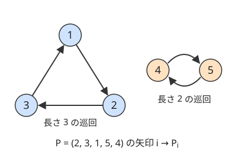

!!! abstract "要点"
    - **何のページか**：1〜N の順列が与えられる問題で、問われ方から使う手法を引ける。$i \to P_i$ の矢印でできる巡回、swap の回数と偶奇、置換の繰り返し、順列の数え上げ、辞書順の問われ方に分ける。
    - **いつ使うか**：
        - $(1, 2, \dots, N)$ の順列 $P$ が与えられる。
        - 任意の 2 要素の swap を繰り返してソートする最小回数を問われる。
        - 隣り合う 2 要素の swap でソートする最小回数を問われる。
        - ちょうど $K$ 回の swap（$10^{100}$ 回など）で作れる列を問われる。
        - 置換を $K$ 回（$K \le 10^{18}$）適用した結果を求める。
        - 条件を満たす順列の個数を問われる。
    - **使い方**：問われ方を[一覧の表](#overview)で探し、行の節で言い換えを確かめてから手法のページへ進む。
    - **計算量**：巡回分解と[逆置換](../guide/glossary.md#inverse-permutation)の構築は $O(N)$、転倒数は $O(N \log N)$、辞書順の順位は素朴に $O(N^2)$（BIT を使えば $O(N \log N)$）
    - **前提**：なし

<!-- textlint-disable -->
別名：permutation・置換・1〜N の順列
<!-- textlint-enable -->

順列は、$1$〜$N$ を 1 回ずつ並べた列である。「位置 $i$ に値 $P_i$ がある並び」と「$i$ を $P_i$ へ送る写像（置換）」の 2 通りに読める。問われ方は多いが、ほとんどは $i \to P_i$ の矢印の巡回か、位置と値の入れ替え（逆置換）のどちらかの見方から始まる。

## 題材の性質 {#properties}

このページでは、問題文に合わせて 1-indexed で書く。コードでは $p_i = P_{i+1} - 1$ と直して 0-indexed にする。順列の性質は、次の 4 つの見方でとらえる。

- **矢印の巡回**：$i$ から $P_i$ へ矢印を引くと、どの頂点からも出る矢印と入る矢印が 1 本ずつになる。そのため、矢印をたどると必ず出発点に戻り、全体は互いに交わらない巡回に分かれる。$P_i = i$ の位置（[固定点](../guide/glossary.md#fixed-point)）は長さ 1 の巡回である
- **逆置換**：値 $v$ のある位置を $Q_v$ とすると、$Q_{P_i} = i$ が成り立つ。$Q$ も順列で、これを $P$ の逆置換と呼ぶ。矢印の向きを逆にしたものなので、巡回の分け方と長さは $P$ と同じになる
- **転倒**：$i < j$ かつ $P_i > P_j$ となる組を転倒と呼び、その個数が転倒数である。ソート済みの列（[恒等置換](../guide/glossary.md#identity-permutation) $P_i = i$）だけが転倒数 0 を持つ
- **偶奇**：巡回の個数を $c$ とすると、$N - c$ の偶奇は、$P$ を作る swap の列によらず一定である。$N - c$ と転倒数の偶奇は一致する

次の図は、$P = (2, 3, 1, 5, 4)$ の矢印である。



巡回は $1 \to 2 \to 3 \to 1$ と $4 \to 5 \to 4$ の 2 つで、$c = 2$ である。逆置換は矢印を逆にした $Q = (3, 1, 2, 5, 4)$ になる。swap や繰り返しの操作は巡回ごとに分けて考えられるので、問題が巡回の個数と長さの話になることが多い。

??? question "確認問題：$P = (2, 3, 1, 5, 4)$ の転倒数と、$N - c$ の偶奇は一致するか"
    転倒は $(1, 3)$・$(2, 3)$・$(4, 5)$ の位置の組の 3 個である（値は $2 > 1$・$3 > 1$・$5 > 4$）。$N - c = 5 - 2 = 3$ で、どちらも奇数なので一致する。

## 問われ方と手法の一覧 {#overview}

問題文の形から行を探し、手法のページへ進む。

| よく出る問われ方 | 使う手法 | ページ | 代表の問題 |
|---|---|---|---|
| 任意の 2 要素の swap でソートする最小回数・手順 | 巡回の個数 $c$ から $N - c$ | [置換の巡回分解](../comb/permutation-cycles.md#min-swaps)、[構築問題の考え方](../thinking/construction.md) | ABC436 E、ABC350 C |
| 隣り合う 2 要素の swap でソートする最小回数 | 転倒数を BIT で数える | [転倒数](../ds/inversion-number.md#adjacent-swaps) | ABC190 F |
| ちょうど $K$ 回の swap で作れるか・作れる列の数 | 最小回数と偶奇の両方を確かめる | [置換の偶奇](../comb/permutation-parity.md#exactly-k) | ABC470 F |
| 置換・写像を $K$ 回適用した結果 | 巡回ごとに $K \bmod \ell$ 歩、一般の写像はダブリング | [置換の巡回分解](../comb/permutation-cycles.md#power)、[ダブリング](../basics/doubling.md#permutation-power) | ABC377 E、ABC367 E |
| 位置の入れ替えと値の入れ替え・逆置換が混ざる | 位置 → 値と値 → 位置の 2 つの配列 | このページの[節](#inverse) | ABC470 D |
| 隣の大小・位置と値のずれの条件を満たす順列の数 | 相対順位・未定の数を状態にした DP | [挿入 DP・箱根駅伝 DP](../dp/insertion-dp.md) | EDPC T |
| 固定点のない順列の数 | 包除原理 | [包除原理](../comb/inclusion-exclusion.md#derangement) | — |
| 辞書順で何番目か・$K$ 番目の順列 | 残りの並べ方の数を足す、小さければ全列挙 | このページの[節](#lexicographic)、[順列全探索](../basics/bit-full-search.md#permutations) | ABC150 C |
| 最長の増加部分列・増加部分列への最小の分割 | LIS と Dilworth の定理 | [最長増加部分列](../dp/lis.md#dilworth) | ABC134 E |

代表の問題へのリンクは、行き先のページの例題・練習にある。このページの[練習問題](#practice)に載せたのは ABC150 C と ABC470 D だけである。

## 任意の swap でソートする最小回数・手順 → 置換の巡回分解（permutation-cycles, construction） {#any-swap}

任意の 2 要素を入れ替えてよいとき、ソートの最小回数は $N - c$（$c$ は巡回の個数）である。1 回の swap で巡回の個数がちょうど 1 だけ増えるか減るかする。ソート済みの列は巡回が $N$ 個ある状態なので、$N - c$ 回より少なくはできない。同じ巡回の 2 か所を swap すると巡回が割れ、別の巡回の 2 か所ならつながる。証明と図は[置換の巡回分解](../comb/permutation-cycles.md#min-swaps)にある。

手順を出力する問題では、$i = 1, 2, \dots, N$ の順に「値 $i$ を位置 $i$ に持ってくる swap」を行えばよい。位置 $i$ に値 $i$ がなければ、値 $i$ のある位置 $Q_i$ と位置 $i$ を swap する。どの swap も同じ巡回の 2 か所を入れ替えるので、回数は $N - c$ で最小になる。値の位置 $Q$ を[逆置換](#inverse)として同時に更新すれば、全体で $O(N)$ である。毎回値 $i$ を探して走査すると $O(N^2)$ になる。

- **最初の 1 回として選べる swap の数**：最小回数のまま進めるのは、同じ巡回の中の 2 か所の swap だけである。長さ $\ell$ の巡回ごとに $\binom{\ell}{2}$ を足す（[例題](../comb/permutation-cycles.md#abc436_e)）
- **手順の構築の一般論**：1 回の操作で 1 つを正しい位置に確定させ、確定したものを二度と動かさない形は、[構築問題の考え方](../thinking/construction.md#abc-patterns)にある

## 隣接 swap でソートする最小回数 → 転倒数（inversion-number） {#adjacent-swap}

隣り合う 2 要素だけを入れ替えてよいとき、ソートの最小回数は巡回ではなく転倒数になる。隣接 swap 1 回で転倒数はちょうど 1 だけ増減し、ソートされていない列には必ず $P_i > P_{i+1}$ となる隣の組があるからである（[転倒数](../ds/inversion-number.md#adjacent-swaps)）。バブルソートの交換回数も転倒数に等しい。

転倒数は、左から値を見ながら「すでに出た値のうち自分より大きいものの個数」を BIT で足せば $O(N \log N)$ で求まる（[BIT で数える手順](../ds/inversion-number.md#count-with-bit)）。

- **順列 $P$ を順列 $R$ に並べ替える隣接 swap の回数**：各値を $R$ での位置に置き換えた列の転倒数になる（[言い換え](../ds/inversion-number.md#reformulation)）
- **巡回シフトなどで列が少しずつ変わる**：変わった分の増減だけを足す（[差分で更新する](../ds/inversion-number.md#incremental)、例題は[ABC190 F](../ds/inversion-number.md#abc190_f)）

問題文が「任意の 2 要素」か「隣り合う 2 要素」かで答えがまったく変わる。$(3, 2, 1)$ なら任意の swap は 1 回、隣接 swap は 3 回である。最初に読み分ける（[違いの表](../comb/permutation-cycles.md#vs-adjacent)）。

## ちょうど K 回の swap で作れるか → 置換の偶奇（permutation-parity） {#swap-parity}

回数がちょうど $K$ 回と決まっているときは、最小回数と偶奇の両方を確かめる。値がすべて異なり、任意の 2 か所を swap できるなら、ちょうど $K$ 回で作れる条件は次のとおりである（$N \ge 2$）。

$$
N - c \le K \quad\text{かつ}\quad K \equiv N - c \pmod{2}
$$

最小回数で作った後に同じ swap を 2 回ずつ足せば、回数を 2 ずつ増やせる。そのため、$K$ が最小回数以上で偶奇が合えば作れる。$K = 10^{100}$ のように大きければ、偶奇の条件だけが残る（[置換の偶奇](../comb/permutation-parity.md#exactly-k)）。

- **隣接 swap でちょうど $K$ 回**：最小回数を転倒数に替えて、同じ 2 つの条件を確かめる
- **3 要素の巡回だけで並べ替える**：3 要素の巡回は偶置換なので、偶置換だけが作れる（[3 要素の巡回](../comb/permutation-parity.md#three-cycle)）
- **同じ値がある**：同じ値どうしの swap は列を変えないので、偶奇の制約が消える（[同じ値があれば](../comb/permutation-parity.md#duplicates)、例題は[ABC470 F](../comb/permutation-parity.md#abc470_f)）

## 置換を K 回適用した結果 → 巡回ごとの周期・ダブリング（functional-graph, doubling） {#repeat}

置換を $K$ 回適用した後の位置は、各頂点が属する巡回の上を $K$ 歩進んだ頂点である。長さ $\ell$ の巡回では $\ell$ 歩で元に戻るので、$K \bmod \ell$ 歩だけ進めればよい。巡回を配列に並べておけば、$K \le 10^{18}$ でも全体を $O(N)$ で求められる（[K 回の合成](../comb/permutation-cycles.md#power)）。

- **行き先が順列とは限らない（一般の写像）**：同じ値が何度も現れると、巡回に入る前の部分（しっぽ）ができる。[ダブリング](../basics/doubling.md#permutation-power)で $O(N \log K)$ か、[しっぽと周回に分ける](../graph/functional-graph.md#k-steps)方法を使う
- **$P_i$ を $P_{P_i}$ に同時に置き換える操作**：1 回で $P$ が $P^2$ になり、$K$ 回で $P^{2^K}$ になる。巡回ごとに $2^K \bmod \ell$ 歩を[繰り返し二乗法](../math/mod-pow.md)で求める
- **元に戻るまでの回数**：すべての巡回の長さの $\operatorname{lcm}$ である。巨大になりうるので、mod で答えるなら素因数ごとの最大の指数から計算する

数列の操作「$B_i = A_{X_i}$」を $K$ 回行うと、第 $i$ 項は $A_{X^K(i)}$ になる。値が動く向きではなく、添字がどこから来たかを $X$ でたどる向きである。操作が「$B_{X_i} = A_i$」なら、逆置換でたどる向きになる（[逆置換](#inverse)）。

## 位置と値の両方から引く操作 → 逆置換を同時に持つ {#inverse}

位置から値を引く配列 $P$ だけを持つと、「値 $v$ はどこにあるか」に答えるたびに $O(N)$ の走査が要る。値から位置を引く配列 $Q$（逆置換、$Q_{P_i} = i$）も一緒に持てば、どちらの向きも $O(1)$ で引ける。2 つの配列は、操作のたびに $Q_{P_i} = i$ が崩れないよう、両方を書き換える。

- **位置 $x$ と位置 $y$ の値を入れ替える**：$P_x$ と $P_y$ を入れ替え、入れ替えた後の値について $Q_{P_x} = x$、$Q_{P_y} = y$ と書き直す
- **値 $a$ と値 $b$ の置き場所を入れ替える**：$Q_a$ と $Q_b$ を入れ替え、$P_{Q_a} = a$、$P_{Q_b} = b$ と書き直す。$Q$ の側から見ると、位置の入れ替えと同じ形になる
- **列を逆置換に置き換える**：$P$ と $Q$ の役目を入れ替えるだけで $O(1)$ である。配列を作り直すと 1 回 $O(N)$ かかる

```cpp
--8<-- "permutation/inverse.cpp:core"
```

コードでは $Q$ を `pos` と書く。`swap(p, pos)` は `vector` どうしの中身を交換するだけで、要素はコピーしない。そのため $O(1)$ である。

この 2 つの配列は、ほかの問われ方でもよく使う。

- **値の小さい順に位置を見る**：「値 $1$〜$k$ の位置が連続しているか」は、$Q_1, \dots, Q_k$ の最大と最小の差が $k - 1$ かで判定できる。$k$ を 1 つずつ増やせば、最大と最小を更新するだけで済む
- **ソートの手順を作る**：[任意の swap の手順](#any-swap)で値 $i$ の位置を引くのに使う

??? question "確認問題：$P = (2, 3, 1)$ を逆置換に置き換えてから位置 1 と 2 を swap すると、どうなるか"
    逆置換は $Q = (3, 1, 2)$ である（値 1 は位置 3、値 2 は位置 1、値 3 は位置 2）。位置 1 と 2 を swap すると $(1, 3, 2)$ になる。順序を逆にして先に swap すると $(3, 2, 1)$ になり、その逆置換は $(3, 2, 1)$ のままである。操作の順で結果が変わる。

## 条件を満たす順列の数 → 挿入 DP・撹乱順列（insertion-dp, inclusion-exclusion） {#counting}

条件を満たす順列を数える問題は、条件の形で手法が分かれる。$N!$ 通りを全部試せるのは $N \le 10$ 程度までである（[順列の数の目安](../basics/bit-full-search.md#permutations)）。

| 条件の形 | 手法 | ページ |
|---|---|---|
| 隣り合う要素の大小（$<$ と $>$）が指定される | 最後の要素の相対順位を状態にした DP | [相対順位を状態にする](../dp/insertion-dp.md#relative-rank) |
| $\lvert P_i - i \rvert$ の和がちょうど $K$ | 相手が未定の位置と値の数を状態にした DP | [箱根駅伝 DP](../dp/insertion-dp.md#hakone-ekiden-dp) |
| すべての $i$ で $P_i \ne i$ | 包除原理（撹乱順列） | [撹乱順列](../comb/inclusion-exclusion.md#derangement) |
| 巡回がちょうど $k$ 個 | 第 1 種スターリング数 | [第 1 種スターリング数](../comb/stirling-first.md) |
| 禁止された組（位置, 値）が少ない | 破る条件の組を全探索する包除 | [条件の組を bit 全探索する](../comb/inclusion-exclusion.md#bit-enumeration) |
| $N \le 20$ 程度で条件が一般的 | 使った値の集合を状態にした DP | [bitDP](../dp/bit-dp.md) |

隣の大小のように条件が大小関係だけで決まるなら、使った値の集合ではなく最後の要素の相対順位で足りる。位置と値のずれなら、相手の決まっていない位置と値の数で足りる。どちらも $N = 3000$ 程度まで扱える（[例題の EDPC T](../dp/insertion-dp.md#dp_t)）。条件が「この位置にこの値を置かない」の形なら、破る条件を指定して残りを自由に並べる包除になる。ちょうど $k$ 個の固定点を持つ順列の数は、固定点の選び方と残りの撹乱順列の数の積 $\binom{N}{k} D_{N-k}$ である。

## 辞書順で何番目・K 番目の順列 → 残りの並べ方の数・順列全探索 {#lexicographic}

$N \le 10$ 程度なら、`next_permutation` で全順列を辞書順に列挙し、何番目かを数えればよい（[順列全探索](../basics/bit-full-search.md#permutations)、[next_permutation](../cpp/cpp-algorithms.md#next-permutation)）。$N$ が大きいときは、前にある順列の個数を先頭から数える。

辞書順では、先頭の値が小さい順列がすべて前に来る。位置 $1$〜$i-1$ が $P$ と同じで、位置 $i$ に $P_i$ より小さい未使用の値を置いた順列を考える。これらはすべて $P$ より前にある。その値の候補の数を $s_i$ とすると、残りの $N - i$ 個は自由に並ぶので $s_i \cdot (N - i)!$ 個ある。$P$ の 1-indexed の順位は次のとおりである。

$$
1 + \sum_{i=1}^{N} s_i \cdot (N - i)!
$$

$P = (2, 4, 1, 3)$ なら $s = (1, 2, 0, 0)$ となり、順位は $1 + 1 \cdot 3! + 2 \cdot 2! = 11$ である。前にあるのは、先頭が 1 の 6 個と、先頭が 2 で 2 番目が 1 か 3 の 4 個である。

$K$ 番目の順列は、この逆に先頭から決める。$K$ は 0-indexed で数える。位置 $i$（1-indexed）では、残りの $K$ を $(N - i)!$ で割った商を $k$ とし、未使用の値のうち小さい方から $k$ 番目（0-indexed）を置く。余りを新しい $K$ にして、次の位置へ進む。

```cpp
--8<-- "permutation/rank.cpp:core"
```

- **計算量**：$s_i$ を素朴に数えると $O(N^2)$ である。値を添字にした BIT で「未使用の値のうち $P_i$ より小さいもの」を数えれば $O(N \log N)$ になる（[値を添字にして数える](../ds/fenwick-tree.md#count-by-value)）
- **型の範囲**：$20! \approx 2.4 \times 10^{18}$ は `long long` に収まるが、$21! \approx 5.1 \times 10^{19}$ は収まらない。$N \ge 21$ で順位を問われたら、mod で答える形のはずである
- **0/1 列や重複のある列の $K$ 番目**：0/1 列なら、残りの並べ方の数が二項係数になる（[辞書順 K 番目の組合せ](../comb/binomial-coefficient.md#kth)）。値が 3 種類以上で重複があれば、残りの並べ方の数は[多項係数](../comb/multinomial-coefficient.md#meaning)になる。条件を満たす中で辞書順最小を作るなら、[辞書順の貪欲](../basics/lexicographic-greedy.md)にある

## 増加部分列・いくつの増加部分列に分けるか → LIS（lis） {#increasing}

順列の最長の増加部分列の長さは、[最長増加部分列](../dp/lis.md#binary-search)の二分探索版を使えば $O(N \log N)$ で求まる。順列は値がすべて異なるので、狭義と広義の区別は要らない。

いくつかの増加部分列に分けるときの最小の個数は、最長の減少部分列の長さに等しい（[Dilworth の定理](../dp/lis.md#dilworth)、例題は[ABC134 E](../dp/lis.md#abc134_e)）。同じ値を含む数列なら、狭義増加の列への分割の最小は、最長の広義減少部分列の長さになる（ABC134 E はこの形である）。

## 落とし穴 {#pitfalls}

- **任意の swap と隣接 swap を取り違える**：答えは $N - c$ と転倒数で、まったく違う。問題文の「任意の 2 要素」「隣り合う 2 要素」を最初に確かめる
- **写像の向きを取り違える**：「$B_i = A_{P_i}$」と「$B_{P_i} = A_i$」は逆置換の関係にある。小さい例（$P = (2, 3, 1)$ など）で 1 回分を手で確かめてから $K$ 回に進める
- **1-indexed のまま配列に入れる**：0-indexed の配列で $P_i$ をそのまま添字にすると、値 $N$ で範囲の外を読む。読み込んだ時点で 1 を引く
- **元に戻る回数を整数で求める**：巡回の長さの $\operatorname{lcm}$ は、$N = 2 \times 10^5$ でも数百桁になる。`long long` で順に lcm を取るとあふれる
- **順列でない写像に巡回の書き方を使う**：行き先に同じ値が 2 回出ると、しっぽの頂点まで巡回に数える。入力が順列か（各値がちょうど 1 回か）を確かめる
- **辞書順の列挙を入力の順から始める**：`next_permutation` は今の並びより後しか作らない。ソートしてから回す

## 練習問題 {#practice}

<div class="kp-problems" data-role="practice" markdown>

- [ABC150 C. Count Order](https://atcoder.jp/contests/abc150/tasks/abc150_c)（diff 422）：長さ N の 2 つの順列 P, Q が、すべての順列を辞書順に並べたときそれぞれ何番目かを求め、その差の絶対値を答える。
- [ABC470 D. Inverse and Swap](https://atcoder.jp/contests/abc470/tasks/abc470_d)（diff 777）：順列に対して、2 か所の値の入れ替えと、列を逆置換に置き換える操作を順に行った後の列を求める。

</div>

??? note "練習の方針"
    - **ABC150 C**：$N \le 8$ なので、昇順から `next_permutation` で全順列を回し、$P$ と $Q$ が何番目に出るかを数える。[辞書順の順位](#lexicographic)の式で直接求めてもよい
    - **ABC470 D**：[逆置換を同時に持つ](#inverse)形そのものである。入れ替えでは 2 つの配列を両方書き換え、逆置換への置き換えでは 2 つの配列の役目を入れ替える。どの操作も $O(1)$ で済む

## 参考 {#references}

- [drken「AtCoder ABC 150 C - Count Order (4Q, 茶色, 300 点)」](https://drken1215.hatenablog.com/entry/2020/01/12/122100)：ABC150 C の全列挙による方針
- [comet725「ABC470Dを解いた【逆置換】」](https://qiita.com/comet725/items/5b5dd4fa2d26f8b73f9a)：ABC470 D の、置換と逆置換を同時に持ち、逆置換への置き換えで 2 つを入れ替える実装
