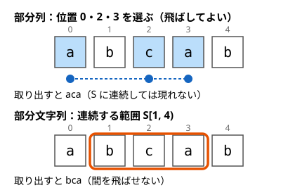

!!! abstract "要点"
    - **何のページか**：部分列（飛び飛びに選ぶ）と[部分文字列](../guide/glossary.md#substring)（連続する部分）が出てくる問題で、問われ方から使う手法を引ける。判定・選び方の数・異なるものの数・最長の共通部分・種類数の問われ方に分ける。
    - **いつ使うか**：
        - T が S の部分列か判定する。
        - S から何文字か選んで順に並べると T になる選び方の数。
        - S の部分列として現れる異なる文字列の個数。
        - S の部分文字列の種類数。
    - **使い方**：まず「連続か、飛び飛びか」と「位置の選び方を数えるか、できる文字列の種類を数えるか」を問題文で確かめる。次に[一覧の表](#overview)で行を探し、行の節から手法のページへ進む。
    - **計算量**：部分列の判定 $O(\lvert S \rvert + \lvert T \rvert)$、$T$ が部分列として現れる選び方の数 $O(\lvert S \rvert \lvert T \rvert)$。ほかは行き先のページによる

<!-- textlint-disable -->
別名：部分列・部分文字列・subsequence・substring
<!-- textlint-enable -->

部分列と部分文字列は、どちらも文字列 $S$ から文字を取り出してできる文字列である。部分列は位置を飛ばしてよく、部分文字列は連続していなければならない。名前は似ているが、取り出し方の数と使う道具は大きく違う。

## 題材の性質 {#properties}

ここでは 0-indexed で、$N = \lvert S \rvert$、$M = \lvert T \rvert$ とする。部分文字列は半開区間で $S[l, r)$ と書く。

- **部分列**：位置 $i_1 < i_2 < \dots < i_k$ を選び、その文字を元の順に並べたもの。位置の選び方は空も含めて $2^N$ 通りあり、全部は試せない。
- **部分文字列**：連続する範囲 $S[l, r)$ の文字を並べたもの。空でないものは $N(N+1)/2$ 通りで、$O(N^2)$ 個しかない。
- **包含**：部分文字列は部分列でもある。逆は成り立たない。

次の図は $S =$ `abcab` から、部分列 `aca` と部分文字列 `bca` を取り出したところである。



部分列の `aca` は位置 1 を飛ばしているので、部分文字列としては $S$ に現れない。2 つの語の違いと、問題文での見分け方は[部分文字列と部分列の違い](../string/string-basics.md#substring-vs-subsequence)にある。

部分列を数える問題では、もう 1 つの分かれ目がある。何を 1 つと数えるかである。$S =$ `aab` から `ab` を取り出す位置の組は $(0, 2)$ と $(1, 2)$ の 2 通りあるが、できる文字列は `ab` の 1 種類である。

- **位置の選び方を数える**：同じ文字列でも位置が違えば別に数える。「選び方の数」「何個含まれるか」と書かれる。重複を気にせず、照合した文字数などを状態にした DP で数えられる。
- **異なる文字列を数える**：同じ文字列は 1 回だけ数える。「異なる」「何種類」と書かれる。取り出し方を 1 つに決める工夫（最も左で取る）が要る。

部分列の問題には「できるだけ左で拾う」という共通の性質がよく効く。$T$ を部分列として取り出せるなら、各文字を直前に取った位置より右で最も左の位置から取る取り出し方でも取り出せる。左で取るほど、残りの文字に使える範囲が広がるだけだからである。判定の貪欲も、異なる部分列の数え上げも、この性質の上に立つ。

## 問われ方と手法の一覧 {#overview}

問題文の形から行を探し、問われ方のリンクから行の節へ移る。節で言い換えを確かめてから、手法のページへ進む。上の 6 行が部分列、下の 4 行が主に部分文字列の問われ方である。代表の問題は、このページに載せたものだけを書いた。

| よく出る問われ方 | 使う手法 | ページ | 代表の問題 |
|---|---|---|---|
| [T が S の部分列か（多数の T・辞書順最小の部分列も）](#is-subsequence) | 前から貪欲に照合、次の出現位置の表 | [部分列の判定と次の出現位置の表](../string/subsequence-matching.md) | — |
| [T が部分列として現れる選び方の数](#count-occurrences) | 照合した文字数を状態にした DP | [フェーズを状態に持つ DP](../dp/dp-phase.md#matched-prefix) | ABC211 C |
| [条件を満たす部分列（位置の選び方）の数](#count-with-condition) | 末尾の文字・余りを状態にした DP | [DP の状態の設計](../dp/dp-state-design.md)、[余り・個数を状態に持つ DP](../dp/dp-mod-state.md) | ABC456 D |
| [異なる部分列（文字列の種類）の数・K 番目](#distinct-subsequences) | 最も左の取り出し方を数える部分列 DP | [部分列 DP](../dp/subsequence-dp.md)、[数え上げの重複の除き方](../comb/counting-dedup.md#leftmost) | — |
| [添字が増える 3 つ組の数](#index-tuples) | 段階を状態にした DP、真ん中を固定 | [フェーズを状態に持つ DP](../dp/dp-phase.md#counting-phases) | — |
| [最長共通部分列・最長増加部分列](#longest) | LCS・LIS | [最長共通部分列](../dp/lcs.md)、[最長増加部分列](../dp/lis.md) | — |
| [部分文字列どうしの一致・パターンの出現位置](#substring-match) | ローリングハッシュ、Z-algorithm、KMP 法 | [ローリングハッシュ](../string/rolling-hash.md)、[Z-algorithm](../string/z-algorithm.md)、[KMP 法](../string/kmp.md#matching) | — |
| [異なる部分文字列の数・辞書順 K 番目](#distinct-substrings) | Suffix Array と LCP 配列 | [Suffix Array](../string/suffix-array.md#distinct-substrings) | — |
| [回文の部分文字列の数・最長回文部分列](#palindromes) | 中心から伸ばす・Manacher、S と反転の LCS・区間 DP | [回文の扱い](../string/palindrome.md)、[区間 DP](../dp/interval-dp.md) | — |
| [T を部分文字列に含まない文字列の数](#avoid-substring) | 照合の状態を持つ DP | [照合オートマトン上の DP](../string/string-automaton-dp.md) | — |

数列の連続部分列（区間）の和や個数は、文字列ではなく[区間の題材のページ](#subarrays)へ進む。問題へのリンクは、[例題](#examples)と[練習問題](#practice)の囲みにある。

## T が S の部分列か → 前から貪欲に照合・次の出現位置の表（subsequence-matching） {#is-subsequence}

$T$ が $S$ の部分列かは、$S$ を左から 1 回走査し、$T$ の次の文字と一致したら照合を 1 つ進める貪欲で判定できる。最後に $T$ を全部照合できていれば部分列である。[題材の性質](#properties)の「できるだけ左で拾う」が正しさの理由で、$O(N + M)$ で済む。

```text
j = 0
for i = 0 .. N-1:
    if j < M and S[i] == T[j]: j += 1
return j == M
```

同じ $S$ に対して多数の $T$ を判定するなら、各位置から各文字が次に現れる位置の表を後ろから作る。表があれば、判定 1 回は $O(M)$ になる。辞書順最小の長さ $K$ の部分列も、同じ表を引きながら先頭から 1 文字ずつ決められる。手順と正しさは[貪欲な照合](../string/subsequence-matching.md#greedy-matching)と[次の出現位置の表](../string/subsequence-matching.md#next-occurrence)にある。

## T が部分列として現れる選び方の数 → 照合した文字数を状態にした DP（dp-state-design） {#count-occurrences}

$S$ から $M$ 文字を選んで元の順に並べると $T$ になる選び方の数は、「$T$ の何文字目まで集めたか」を状態にした DP で数える。位置の選び方を数えるので、同じ $T$ を作る選び方は位置が違えば別に数える。

- 状態：$\mathrm{dp}[i][j]$ ＝ $S$ の先頭 $i$ 文字から選び、$T$ の先頭 $j$ 文字と一致させた選び方の数。
- 遷移：$S[i]$ を選ばなければ $\mathrm{dp}[i+1][j]$ へ足す。$S[i] = T[j]$ なら、選んで $\mathrm{dp}[i+1][j+1]$ へも足す。
- 初期値と答え：$\mathrm{dp}[0][0] = 1$（何も選ばない 1 通り）、答えは $\mathrm{dp}[N][M]$。

状態は $(N+1)(M+1)$ 個、遷移は 2 通りなので $O(NM)$ である。この状態で足りるのは、この先どの位置を選べるかが「次に集める $T$ の文字」だけで決まるからである（[DP の状態の設計](../dp/dp-state-design.md#why-summary-works)）。1 本の配列で書くときは $j$ の大きい方から回す。小さい方から回すと、$T$ に同じ文字が続くとき 1 文字の $S[i]$ を $T$ の 2 文字に使ってしまう。詳しい書き方と `?` を埋めた全通りの和への広げ方は[何文字目まで集めたか](../dp/dp-phase.md#matched-prefix)にある（[例題](#abc211_c)）。

## 条件を満たす部分列の数 → 末尾の文字や余りを状態にした DP（dp-state-design, dp-mod-state） {#count-with-condition}

決まった $T$ ではなく、条件を満たす部分列（位置の選び方）がいくつあるかを問う形もある。部分列を左から 1 文字ずつ伸ばすとみて、条件の判定に要る要約だけを状態にする。何を要約にするかは条件の形で決まる。

- **隣り合う文字についての条件**（`b` の直後に `a` を置かない、など）：部分列の末尾の文字を状態にする。$\mathrm{cnt}[c]$ ＝ ここまでで末尾が $c$ の部分列の数、として $S$ を左から見る。$S[i] = c$ なら、$c$ をつないでよい末尾の文字 $d$ について $\mathrm{cnt}[d]$ の和と、$c$ 1 文字だけの 1 通りを $\mathrm{cnt}[c]$ に足す。この例なら、$S[i] =$ `a` のときだけ、末尾が `b` の部分列の数を和に入れない。
- **和や値の倍数の条件**：和を $m$ で割った余りを状態にする（[余りを状態にしてよい理由](../dp/dp-mod-state.md#why-remainder)）。
- **選ぶ位置が隣り合わない**など、位置そのものの条件：直前の位置を選んだかを状態にする。

末尾の文字で数える DP では、どの部分列も最後に選んだ位置でちょうど 1 回だけ足される。だから位置の選び方を重複なく数えられる。末尾の数文字を持つ設計は、[末尾の数文字を状態にする](../dp/dp-state-design.md#last-characters)で扱う。

## 異なる部分列の数 → 部分列 DP と代表元の決め方（subsequence-dp, counting-dedup） {#distinct-subsequences}

「異なる部分列の個数」は、できる文字列の種類を数える。位置の選び方をそのまま数えると、`aab` の `ab` のように同じ文字列を 2 回以上数えてしまう。そこで、各文字列について取り出し方を 1 つだけ決め、それだけを数える。

決め方は「各文字を、直前に取った位置より右で最も左の位置から取る」である。この取り出し方は文字列ごとにただ 1 つに決まる。次の出現位置の表を使えば、位置 $p$ で文字を取ったあと、次の文字 $c$ を取る位置は $\mathrm{nxt}[p+1][c]$ の 1 か所に決まる。こうして、各位置から文字ごとに配る DP になる。理由と DP は[最も左を取る取り出し方が一意な理由](../dp/subsequence-dp.md#leftmost)と[次の出現位置の表で配る DP](../dp/subsequence-dp.md#next-table-dp)にある。空文字列を数えるかどうかは、長さ 1 の入力で確かめる。

同じ考え方は向きを変えても使える。

- **部分列として現れない最短の文字列・辞書順 K 番目の部分列**：同じ表を後ろから使う（[最短の文字列](../dp/subsequence-dp.md#shortest-non-subsequence)、[辞書順 K 番目](../dp/subsequence-dp.md#kth-subsequence)）。
- **S を部分列として含む長さ L の文字列の数**：数える相手が逆になるが、最も左の埋め込みを代表にして数える（[数え上げの重複の除き方](../comb/counting-dedup.md#leftmost)）。

## 位置の 3 つ組（添字が増える順）の数 → 段階を状態にした DP（dp-phase） {#index-tuples}

$i < j < k$ の位置の組で、文字や値が条件を満たすものの数を問う形である。たとえば $S[i] S[j] S[k]$ が `ABC` になる組の数は、[選び方の数](#count-occurrences)の $T =$ `ABC` の場合にあたる。「いくつ選んだか」を段階として左から進めれば、3 重ループの $O(N^3)$ を $O(N)$ にできる。段階の数え方は[段階の数え方](../dp/dp-phase.md#counting-phases)にある。

値の大小の条件（$A_i < A_j < A_k$ など）では、段階の DP よりも、真ん中の $j$ を固定して左右を別々に数える方が書きやすい。$j$ より左で $A_j$ より小さいものの個数と、右で大きいものの個数を、それぞれ数えて掛ければよい（[真ん中を固定して左右を独立に数える](../thinking/fix-variable.md#fix-middle)）。$j$ を左から動かしながら [BIT](../ds/fenwick-tree.md) で数えれば、全体で $O(N \log N)$ になる。

## 最長共通部分列・最長増加部分列 → LCS・LIS（lcs, lis） {#longest}

2 つの文字列に共通する部分列の最長は最長共通部分列（LCS）で、末尾どうしが一致するかで分ける 2 次元の DP により $O(NM)$ で求まる（[表の意味と遷移](../dp/lcs.md#recurrence)）。同じ形の表（状態は同じで、遷移と初期値を変える）で、挿入・削除・置換の最小回数（編集距離）も求まる（[編集距離](../dp/lcs.md#edit-distance)）。

数列から順序を保って選ぶ増加列の最長は最長増加部分列（LIS）で、二分探索を使えば $O(N \log N)$ で求まる（[二分探索版](../dp/lis.md#binary-search)）。

部分列ではなく、共通する部分文字列の最長を問われたら、表の意味を「末尾をそろえた一致の長さ」に変える。一致しないマスで 0 に戻し、答えは表全体の最大値から読む（[最長共通部分文字列](../dp/lcs.md#substring)）。「部分列」と「連続する部分」を読み違えると、別の DP を書くことになる。

## 部分文字列の一致・比較 → ローリングハッシュ・Z（rolling-hash, z-algorithm） {#substring-match}

部分文字列の問題では、2 つの部分文字列が等しいかの判定が基本の部品になる。部分文字列は $O(N^2)$ 個あり、毎回 1 文字ずつ比べると 1 回 $O(N)$ かかる。

- **任意の 2 つの部分文字列の一致**：接頭辞のハッシュを前計算すれば、どの $S[l, r)$ のハッシュも $O(1)$ で取り出せる。取り出し方は[多項式ハッシュと部分文字列の取り出し](../string/rolling-hash.md#polynomial-hash)にある。二分探索と組めば、最長共通接頭辞や辞書順の比較もできる。確率的な判定なので、基数の選び方に注意する。
- **パターン $P$ の全出現位置**：$P$・区切り・$S$ をつないだ列の Z 配列を使えば、決定的に $O(N + M)$ で見つかる（[パターン検索](../string/z-algorithm.md#pattern-search)）。KMP 法でもよい（[パターン照合](../string/kmp.md#matching)）。
- **巡回シフトの一致**：$S$ を 2 回つないだ $SS$ の中で探す（[巡回シフト](../string/z-algorithm.md#cyclic-shift)）。

道具の選び方は[ハッシュで代用できる場面とできない場面](../string/rolling-hash.md#when-to-use)にある。

## 部分文字列の種類数・K 番目 → Suffix Array（suffix-array） {#distinct-substrings}

部分文字列はどれも、ある接尾辞の接頭辞である。そのため、接尾辞を辞書順に並べた Suffix Array と、隣り合う接尾辞の最長共通接頭辞の長さ（LCP 配列）から、部分文字列の種類が数えられる。

$$
\text{（異なる部分文字列の数）} = \frac{N(N+1)}{2} - \sum_{i=0}^{N-2} \mathrm{lcp}[i]
$$

辞書順で隣の接尾辞と共通する接頭辞が、それまでに数えた部分文字列と重なる分である。式の理由は[異なる部分文字列の数](../string/suffix-array.md#distinct-substrings)、辞書順 K 番目の求め方は[部分文字列の辞書順 K 番目](../string/suffix-array.md#kth-substring)にある。答えは $N^2/2$ 程度まで大きくなるので `long long` で持つ。

$K$ が小さければ、Suffix Array を使わずに済むこともある。辞書順で $K$ 番目の異なる部分文字列の長さは $K$ 以下なので、長さ $K$ 以下の部分文字列だけを列挙すれば足りる（理由は[部分文字列と部分列の違い](../string/string-basics.md#substring-vs-subsequence)の最後の段落）。

## 回文の部分文字列・部分列 → 回文のページと区間 DP（palindrome, interval-dp） {#palindromes}

回文も、部分文字列か部分列かで手法が分かれる。

- **回文の部分文字列**：中心を決めて外へ 1 組ずつ伸ばせば、回文の部分文字列を $O(N^2)$ ですべて見つけられる（[中心から伸ばす](../string/palindrome.md#expand-center)）。$N$ が $10^5$ を超えるなら、各中心の最長回文の長さを Manacher で $O(N)$ で求める（[Manacher](../string/palindrome.md#manacher)）。
- **最長回文部分列**：$S$ と、$S$ を反転した列の LCS の長さに等しい（[最長回文部分列](../dp/lcs.md#palindromic-subsequence)）。区間ごとの最長回文部分列を状態にした[区間 DP](../dp/interval-dp.md)でも $O(N^2)$ で書け、条件を足しやすい（漸化式は同じ節）。
- **長さ K の回文を含まない文字列の数**：末尾の $K-1$ 文字を状態に持つ DP で数える（[直前 K−1 文字を状態にした DP](../string/palindrome.md#avoid-k-palindrome)）。

## T を部分文字列に含まない文字列の数 → 照合の状態を持つ DP（string-automaton-dp） {#avoid-substring}

長さ $L$ の文字列のうち、$T$ を部分文字列に含まないものを数える形である。先頭から 1 文字ずつ決めるとき、$T$ が現れるかに効くのは「いまの末尾が $T$ の先頭何文字と一致しているか」だけである。これを状態にして、一致が崩れたら KMP 法の失敗関数で戻る（[照合の状態とマルコフ性](../string/string-automaton-dp.md#matching-state)）。状態は $M + 1$ 個で、遷移の表を前計算すれば $O(LM\sigma)$ になる（$\sigma$ は文字の種類の数）。

$T$ が短ければ、末尾の $M - 1$ 文字をそのまま状態にしてもよい（[末尾の数文字を状態にする](../dp/dp-state-design.md#last-characters)）。パターンが複数なら Aho-Corasick 法を使う（[複数パターン](../string/string-automaton-dp.md#multiple-patterns)）。

部分列として含まない文字列の数なら、状態は「$T$ を何文字目まで貪欲に照合したか」で足りる。一致が崩れても照合が戻らないので、失敗関数は要らない。含むものの数を数えるなら、[最も左の埋め込み](../comb/counting-dedup.md#leftmost)を代表にする。

## 数列の連続部分列 → 題材別の区間（interval） {#subarrays}

数列の「連続部分列」は、文字列の部分文字列と同じく連続する範囲 $[l, r)$ である。ただ、問われるのは一致や種類より、和・最小値・個数であることが多い。区間の和は累積和、伸び縮みで単調な条件は尺取り法で扱う。問われ方ごとの対応は[区間](../patterns/interval.md#overview)にまとめてある。

数列でも「部分列」と書かれていれば飛び飛びに選んでよい。増加列の最長なら[最長増加部分列](#longest)の行へ戻る。

## 落とし穴 {#pitfalls}

- **部分列と部分文字列を読み違える**：英語の subsequence は部分列、substring は部分文字列である。数列の問題で「連続部分列」と「部分列」が混ざることもある。入力例で、飛ばした取り出し方が数えられているかを確かめる。
- **位置の選び方と文字列の種類を取り違える**：`aab` から `ab` を取り出す方法は 2 通りだが、異なる文字列は 1 個である。種類を問われているのに位置の選び方を数えると、答えが大きすぎる。
- **1 本の配列にした DP を小さい方から回す**：$T$ の何文字目まで集めたかの DP で $j$ を小さい方から回すと、同じ $S[i]$ を $T$ の 2 文字に使う。$T =$ `aa`、$S =$ `a` で 1 通りと答えてしまう（正しくは 0）。
- **空文字列を含めるか**：異なる部分列の DP の初期値 $\mathrm{dp}[0] = 1$ は空文字列を表す。問題が空でない部分列を問うなら、最後に 1 を引く。
- **部分文字列を作って比べる**：部分文字列を組ごとに `substr` で作って比べると、1 回 $O(N)$ かかり全体で $O(N^3)$ になる。ハッシュか Z 配列で比べる（[計算量の落とし穴](../string/string-basics.md#cost-pitfalls)）。

## 例題 {#examples}

### ABC211 C. chokudai {#abc211_c}

<div class="kp-problems" data-role="example" markdown>

- [ABC211 C. chokudai](https://atcoder.jp/contests/abc211/tasks/abc211_c)（diff 559）：文字列 S から 8 文字を選んで順に並べると chokudai になる選び方の数を、10^9+7 で割った余りで求める。

</div>

方針：[選び方の数](#count-occurrences)の DP で、$T =$ `chokudai`（$M = 8$）とする。$S$ を 1 文字ずつ見て、$S[i] = T[j]$ となる $j$ について、$T$ を $j$ 文字集めた選び方の数を $j + 1$ 文字の方へ足す。状態は 9 通りなので、全体で $O(8N)$ である。

??? note "解法の詳細"
    1 本の配列 $\mathrm{dp}[0..8]$ で書く。$\mathrm{dp}[j]$ は、ここまで見た $S$ の文字から選び、`chokudai` の先頭 $j$ 文字と一致させた選び方の数である。

    ```text
    T = "chokudai"
    dp = [1, 0, 0, 0, 0, 0, 0, 0, 0]
    for c in S:
        for j = 7 down to 0:
            if c == T[j]: dp[j+1] = (dp[j+1] + dp[j]) mod (10^9+7)
    return dp[8]
    ```

    - `chokudai` には同じ文字が 2 回現れない。そのため、この問題に限っては $j$ をどちらの向きに回しても答えは同じになる。ほかの $T$ にも使えるよう、大きい方から回す書き方にしておく。
    - 各位置の加算のたびに余りを取る。最後だけ取ると、C++ では途中で `long long` を超える。

## 練習問題 {#practice}

<div class="kp-problems" data-role="practice" markdown>

- [ABC456 D. Not Adjacent 2](https://atcoder.jp/contests/abc456/tasks/abc456_d)（diff 586）：a・b・c からなる文字列 S の空でない部分列（位置の選び方）のうち、同じ文字が隣り合わないものの個数を 998244353 で割った余りで求める。

</div>

??? note "練習の方針"
    - **ABC456 D**：[条件を満たす部分列の数](#count-with-condition)の、末尾の文字を状態にする型である。末尾が a・b・c の部分列の数 $\mathrm{cnt}[a]$・$\mathrm{cnt}[b]$・$\mathrm{cnt}[c]$ を持つ。$S[i] = $ a なら、$\mathrm{cnt}[a]$ に $\mathrm{cnt}[b] + \mathrm{cnt}[c] + 1$ を足す（b か c で終わる部分列の後ろにつなぐか、a 1 文字だけにする）。答えは 3 つの和で、全体で $O(N)$ である。

## 確認問題 {#quiz}

??? question "確認問題：`abc` の空でない部分文字列と、空でない部分列はそれぞれ何個か"
    部分文字列は `a`・`b`・`c`・`ab`・`bc`・`abc` の 6 個で、$N(N+1)/2 = 6$ と合う。部分列は位置の選び方が空を除いて $2^3 - 1 = 7$ 通りで、文字がすべて異なるので異なる文字列も 7 個ある（`ac` が増える）。

## 参考 {#references}

- [sano192「ABC211 A～D問題 ものすごく丁寧でわかりやすい解説 python 灰色～茶色コーダー向け」](https://qiita.com/sano192/items/051207b6607b56cc439e)：ABC211 C の、何文字目まで作ったかを状態にした DP
- [m193h「AtCoder ABC211 個人的メモ」](https://zenn.dev/m193h/articles/20210725sun135318m193habc211)：ABC211 C の DP の裏付け
- [comet725「ABC456Dを解いた【DP】」](https://qiita.com/comet725/items/96ce9b1e24f522c6e86f)：ABC456 D の、末尾の文字ごとに部分列の数を持つ DP
- [iwamutsu「AtCoder Beginner Contest 456 参加記録と解答例 (A～D問題)」](https://zenn.dev/iwamutsu/articles/trvmolry2fo0il)：ABC456 D の問い（位置が違えば別に数える・空を含めない）と更新式
