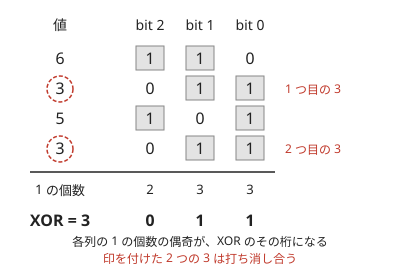

!!! abstract "要点"
    - **何のページか**：XOR が出てくる問題で、問われ方から使う手法を引ける。桁ごとに独立で、同じ値どうしで打ち消し合う。この 2 つの性質から、桁ごとの数え上げ・累積 XOR・XOR 基底・Binary Trie・Nim・集合のハッシュへつなぐ。
    - **いつ使うか**：
        - すべての組・すべての区間の XOR の総和。
        - $x$ を選んで XOR の最大値・最小値を求める。
        - いくつか選んだ XOR で作れる値・作れる値の個数・K 番目。
        - 区間の XOR・木のパスの XOR・経路の XOR。
        - 石を取り合うゲームで、山の石の数の XOR。
    - **使い方**：問われ方を[一覧の表](#overview)で探し、行の節でどちらの性質を使うかを確かめてから手法のページへ進む。
    - **計算量**：値を $2^B$ 未満とする。桁ごとの数え上げ $O(NB)$。累積 XOR は前計算 $O(N)$、区間 1 回 $O(1)$。XOR 基底の挿入と Binary Trie の操作は 1 回 $O(B)$
    - **前提**：[bit 演算の基本と XOR の性質](../basics/bit-operations.md)

<!-- textlint-disable -->
別名：排他的論理和・ビットごとの排他的論理和・exclusive or
<!-- textlint-enable -->

XOR（$\oplus$）は、2 つの整数の同じ桁どうしで、ちょうど一方だけが 1 のときに 1 とする演算である。問われ方は多いが、使う性質は「桁ごとに独立」と「同じ値で打ち消し合う」の 2 つに、ほとんどが収まる。どちらを使う問題かを見分けると、行く先の手法が決まる。

## 題材の性質 {#properties}

XOR の問題で使う性質は、次の 2 つと、そこから出る 2 つの見方である。演算の定義と式の変形は[bit 演算の基本と XOR の性質](../basics/bit-operations.md#xor-properties)にある。

- **桁ごとに独立**：$a \oplus b$ の bit $k$ は、$a$ と $b$ の bit $k$ だけで決まる。ほかの桁からの繰り上がりがない。だから、和や個数を bit ごとの 0 と 1 だけの問題に分けて数え、最後に $2^k$ を掛けて足し戻せる。
- **同じ値で打ち消し合う**：$x \oplus x = 0$、$x \oplus 0 = x$ で、順番を入れ替えても結果は変わらない。0 が[単位元](../guide/glossary.md#identity-element)で、各値は自分自身が[逆元](../guide/glossary.md#inverse-element)になる。そのため、足し算の引き算にあたる操作も XOR そのものになる。累積和の差が累積 XOR の XOR に変わり、根からの XOR の共通部分が消え、同じ要素を 2 回入れたハッシュが元に戻る。

2 つを合わせると、いくつかの値の XOR の bit $k$ は「bit $k$ が 1 の値の個数の偶奇」になる。



この図では、6・3・5・3 の XOR は 3 である。列ごとに 1 の個数を数えれば、ほかの列を見ずに各桁が決まる。2 回現れる 3 は打ち消し合うので、$6 \oplus 5 = 3$ と同じ値になる。

この 2 つから、さらに次の 2 つの見方が出る。

- **繰り上がりのない足し算**：bit を成分とする 0・1 のベクトルとみると、XOR は成分ごとの mod 2 の足し算である。「いくつか選んで XOR した値」は、選んだベクトルの和になる。そのため、作れる値の集合は掃き出し法で調べられる（[XOR 基底](../math/xor-basis.md#insert)）。
- **大小は上の bit で決まる**：XOR した結果の大小は、異なる最も上の bit で決まる。bit $k$ の重み $2^k$ は、下の bit をすべて 1 にした $2^k - 1$ より大きいからである。最大・最小を求めるときは、上の bit から 1 つずつ決めてよい。

逆に、XOR と足し算が混ざると桁ごとに分けられない。$a + b = (a \oplus b) + 2(a \text{ AND } b)$ で、足し算は AND の分だけ繰り上がるからである（[足し算では使えない理由](../basics/bitwise-independence.md#addition)）。また、AND・OR は打ち消し合わないので、累積から区間の値を取り出せない。

??? question "確認問題：区間の AND は累積で取り出せるか"
    $P_{i+1} = P_i \text{ AND } a_i$ のような累積 AND から、区間 $[l, r)$ の AND を求められるか。

    ??? success "答え"
        求められない。AND には逆の操作がなく、一度 0 になった bit は戻せないからである。$a = (0, 1)$ で $[1, 2)$ の AND は 1 だが、$P_1 = P_2 = 0$ で、そこから 1 を作る手段がない。区間の AND・OR は、bit ごとに 1 の個数の累積和を持つか、Sparse Table を使う（[区間の XOR の節](../basics/bitwise-independence.md#range-xor)）。

## 問われ方と手法の一覧 {#overview}

問題文の形から行を探し、手法のページへ進む。手法の後の括弧は、上の 2 つの性質と 2 つの見方のどれを主に使うかを示す（独立＝桁ごとに独立、打消＝同じ値で打ち消し合う、線形＝繰り上がりのない足し算、上位＝上の bit で大小が決まる）。

| よく出る問われ方 | 使う手法（性質） | ページ | 代表の問題 |
|---|---|---|---|
| 全ペア・全区間の XOR の和 | 桁ごとに 0 と 1 の個数を数える（独立） | [bit ごとに独立に考える](../basics/bitwise-independence.md#per-bit-contribution) | ABC147 D、ABC365 E |
| 区間の XOR（更新あり・なし） | 累積 XOR、BIT（打消） | [累積和](../basics/prefix-sum.md)、[BIT](../ds/fenwick-tree.md#what-it-does) | ABC185 F |
| 木のパスの XOR | 根からの XOR どうしの XOR（打消） | [木の距離](../tree/tree-distance.md#root-prefix) | ABC201 E、ARC045 C |
| $x$ を選んで XOR の最大・最小、2 要素の XOR の最小 | 上の bit から決める、Binary Trie（上位） | [Binary Trie](../ds/binary-trie.md#xor-min-max) | ABC281 F、ABC308 G |
| 選んだ XOR で作れる値・最大値・K 番目 | XOR 基底（線形） | [XOR 基底](../math/xor-basis.md) | ABC283 G、ABC236 F |
| グラフのウォークの XOR の最小・最大 | 閉路の XOR を基底に入れる（打消・線形） | [XOR 基底](../math/xor-basis.md#xor-walk) | ABC451 G |
| 上限 $K$ 以下で XOR の条件を満たす数 | 2 進の桁 DP（独立・上位） | [桁 DP](../dp/digit-dp.md#binary) | ABC117 D、ABC129 E |
| XOR と和が等しい区間の数 | 尺取り法（独立） | [尺取り法](../basics/two-pointers.md#monotonicity) | ARC098 D |
| 小さいグリッドの経路の XOR | 対角線で分ける半分全列挙（打消） | [半分全列挙](../basics/meet-in-the-middle.md#grid-diagonal) | ABC271 F |
| 石取りゲームの勝敗 | Nim・Grundy 数（独立・偶奇） | [Nim](../comb/nim.md#bouton)、[Grundy 数](../comb/grundy-number.md#sum) | 鉄則本 A33・A34、ABC368 F |
| 2 つの集合が一致するか | 乱数の XOR によるハッシュ（打消） | [集合のハッシュ](../string/hashing-for-sets.md#xor-vs-sum) | ABC250 E、ABC367 F |
| 添字の XOR で畳み込む | アダマール変換（線形） | [アダマール変換](../math/hadamard-transform.md#transform) | ABC212 H |
| 列全体を同じ値で XOR したものを探す | 隣どうしの XOR の列で照合（打消） | [KMP 法](../string/kmp.md#abc150_f) | ABC150 F |

代表の問題は行き先のページの例題・練習・力試しにあり、リンクは行の節から張った。このページに載せた問題は[例題](#examples)と[練習問題](#practice)の囲みにある。

## 全ペア・全区間の XOR の和 → 桁ごとに 0 と 1 の個数を数える（bitwise-independence） {#sum-of-xor}

全ペアの XOR の和 $\sum_{i < j} (a_i \oplus a_j)$ は、ペアを作らずに求められる。桁ごとに独立なので、bit $k$ が 1 になるペアの数だけを数えればよい。bit $k$ が 1 の要素が $c_k$ 個なら、そのペアは $c_k (N - c_k)$ 個で、答えは $\sum_k c_k (N - c_k) 2^k$ である。全体で $O(NB)$ になる。

全区間の XOR の和は、[累積 XOR](#range-xor) で区間をペアに言い換えてから同じように数える。木の全頂点の組なら、根からの XOR で組に言い換える（[木のパスの XOR](#tree-path)）。数え方と、AND・OR の場合の式は [bit ごとの寄与](../basics/bitwise-independence.md#per-bit-contribution)にある。代表は [ABC147 D](../basics/bitwise-independence.md#abc147_d) で、区間の版はそのページの[練習問題](../basics/bitwise-independence.md#practice)の ABC365 E である。

個数と $2^k$ の積は大きくなる。mod を取らない問題では、`long long` に収まるかを先に見積もる。

## 区間の XOR → 累積 XOR、更新があれば BIT（prefix-sum, fenwick-tree） {#range-xor}

区間の XOR は、累積和と同じ形で求まる。0-indexed で $P_0 = 0$、$P_{i+1} = P_i \oplus a_i$ とすると、半開区間 $[l, r)$ の XOR は $P_r \oplus P_l$ である。$[0, l)$ の分が 2 回現れて打ち消し合う。累積和の引き算が XOR に変わるだけで、添字の約束は[累積和](../basics/prefix-sum.md#half-open)と同じである。

- **値の更新がある**：XOR は自分自身が逆元なので、BIT に載せて接頭辞の XOR どうしの XOR で区間を取り出せる。代表は [BIT の例題 ABC185 F](../ds/fenwick-tree.md#abc185_f) である。
- **区間の XOR が $X$ になる区間の数**：$P_r \oplus P_l = X$ は $P_l = P_r \oplus X$ と同じなので、値ごとの個数を連想配列で数える。和の場合の[累積和と連想配列で区間を数える](../basics/prefix-sum-counting.md#equal-k)と同じ形である。
- **連続する整数の XOR**：$0 \oplus 1 \oplus \dots \oplus n$ は、$n \bmod 4$ で場合分けした式（$n$・$1$・$n + 1$・$0$）で決まる。$a$ 以上 $b$ 以下の XOR も累積の形にして $O(1)$ で求まる（[0〜n の XOR](../basics/bit-operations.md#xor-properties)）。

「自分以外の全員の XOR」も同じ打ち消しで扱う。全体の XOR を $T$ とすると、$a_i$ を除いた XOR は $T \oplus a_i$ である（[例題](#abc171_e)）。

## 木の 2 点間のパスの XOR → 根からの XOR どうしの XOR（tree-distance） {#tree-path}

木の根から各頂点への辺の重みの XOR を $S[v]$ とすると、$u$–$v$ パスの XOR は $S[u] \oplus S[v]$ である。根から $\mathrm{lca}(u, v)$ までの部分が 2 回現れて打ち消し合うので、和の場合と違って LCA を求めなくてよい。理由と実装は[根からの累積値で 2 点間を表す](../tree/tree-distance.md#root-prefix)にある。

こう言い換えると、木の頂点の組の問題が、列 $S$ の 2 要素の組の問題になる。全組の XOR の和は[桁ごとの数え上げ](#sum-of-xor)、XOR が $X$ になる組の数は値ごとの個数で数える。代表は木の距離のページの[練習問題](../tree/tree-distance.md#practice)の ABC201 E と、[力試し](../tree/tree-distance.md#challenge)の ARC045 C である。XOR の最大の組なら [Binary Trie](#choose-x) に載せる。

## x を選んで XOR の最大・最小、2 要素の XOR の最小 → 上位 bit から決める・Binary Trie {#choose-x}

XOR した値の大小は上の bit で決まるので、上の bit から 1 つずつ決める。

- **集合の中から $x$ との XOR が最小の要素を探す**：上の bit から $x$ と同じ側を優先して降りる。値を上の bit から 0・1 で枝分かれする二分木に入れておけば、1 回 $O(B)$ で答えられ、追加・削除もできる（[Binary Trie の XOR の最小・最大](../ds/binary-trie.md#xor-min-max)）。
- **$x$ を選んで全要素との XOR の最大値を最小にする**：要素を上の bit で 2 組に分ける再帰で $O(NB)$ になる。両方の組が空でない bit では、どちらかの組が必ず 1 になる（[上位 bit で 2 つに分けて再帰する](../basics/bitwise-independence.md#split-by-top-bit)）。代表は [ABC281 F](../ds/binary-trie.md#abc281_f) である。
- **2 要素の XOR の最小・最大**：最大は、要素を 1 つずつ入れながら入れる前の集合との最大を問う。追加・削除のたびに最小を答えるなら、Binary Trie の各ノードに、その部分木の中の 2 要素の XOR の最小値を持たせ、追加・削除のたびに根まで作り直す。代表は [ABC308 G](../ds/binary-trie.md#abc308_g) である。
- **$x \le K$ のもとで $\sum_i (x \oplus a_i)$ を最大にする**：目的が bit ごとの寄与の和なので、上の bit を優先する貪欲は誤る。$K$ と初めて食い違う bit で場合分けする（[上の bit から決める貪欲](../basics/bitwise-independence.md#top-down)）。

## 選んだ XOR で作れる値・最大値・K 番目 → XOR 基底（xor-basis） {#basis}

要素をいくつでも選んで XOR したときに作れる値は、桁ごとには分けられない。選んだ要素の桁がすべて同時に効くからである。XOR を繰り上がりのない足し算（mod 2 のベクトルの和）とみて、要素を最上位の bit で掃き出しながら基底に入れる（[基底への挿入](../math/xor-basis.md#insert)）。

- **作れる値の個数**：基底の大きさを $r$ とすると $2^r$ 個である（[作れる値の個数](../math/xor-basis.md#count)）。
- **作れる値の最大値**：上の bit から貪欲に基底を XOR して決める（[XOR の最大値](../math/xor-basis.md#max)）。
- **K 番目に小さい値**：簡約した基底で、$K$ の 2 進表記に従って基底を選ぶ（[K 番目に小さい値](../math/xor-basis.md#kth)）。代表は [ABC283 G](../math/xor-basis.md#abc283_g) である。
- **安く買ってすべての値を作れるようにする**：安い順に見て、基底へ入るものだけを採る（[コストの小さい順に基底へ入れる貪欲](../math/xor-basis.md#min-cost)）。代表は [ABC236 F](../math/xor-basis.md#abc236_f) である。

「いくつかの変数の XOR が決まった値になる」という式が並ぶなら、mod 2 の連立一次方程式として[掃き出し法](../math/gaussian-elimination.md#mod-2)で解く。XOR 基底は、その掃き出しを 1 行ずつ足しながら行うものとみなせる。

## グラフの経路の XOR の最小 → 閉路の XOR を基底にする（xor-basis） {#path-xor}

無向グラフで同じ辺を何度通ってもよいなら、$u$ から $v$ へのウォークの XOR は「全域木での根からの XOR の $d(u) \oplus d(v)$」に「閉路の値をいくつか XOR したもの」を足した形になる。閉路を 1 周して同じ道を戻れば、往復した部分は打ち消し合い、閉路の値だけが加わるからである。そこで、全域木に入らない辺 $(a, b, w)$ のそれぞれについて、閉路の値 $d(a) \oplus d(b) \oplus w$ を XOR 基底へ入れる。ほかの閉路の値は、これらの XOR で作れる。そのうえで $d(u) \oplus d(v)$ を基底で最小化（最大化）する。理由と実装は[グラフのウォークの XOR](../math/xor-basis.md#xor-walk) にある。

代表は XOR 基底のページの[練習問題](../math/xor-basis.md#practice)の ABC451 G である。辺の重みの範囲が小さければ、（頂点, XOR の値）を状態にした探索でもよい（[状態を頂点にする](../graph/extended-dijkstra.md#choose-state)）。

## XOR が絡む条件を満たす数の個数 → 桁 DP（digit-dp） {#digit-dp}

「$K$ 以下の非負整数 $X$ で、XOR を含む条件を満たすものの個数・最大値」は、$K$ を 2 進で見た桁 DP で解く。桁ごとに独立なので、上の bit から 1 つずつ決めるとき、各 bit の寄与はその bit だけで決まる。上限 $X \le K$ だけが bit をつなぐので、それを「$K$ と一致しているか」のフラグで持つ（[2 進の桁 DP](../dp/digit-dp.md#binary)）。

$a + b = a \oplus b$ のような足し算との組み合わせは、「同じ bit に 1 が重ならない」と言い換えれば、bit ごとの独立な条件として同じ形で数えられる。代表は桁 DP のページの[練習問題](../dp/digit-dp.md#practice)の ABC117 D・ABC129 E である。2 つ以上の数を同時に決めるなら、上限のフラグを数ごとに並べて持つ（[複数の数を同時に決める](../dp/digit-dp-advanced.md#multiple-numbers)）。

## XOR と和が等しい区間の数 → 尺取り法（two-pointers） {#xor-equals-sum}

区間の XOR と和が等しいのは、どの bit も区間の 2 つ以上の要素で立っていないときに限る。$a \oplus b \le a + b$ で、等号は同じ bit に 1 が重ならないときだけ成り立つからである。この条件は、区間から要素を取り除いても崩れない。だから各左端に対する右端の限界は左端とともに右へ進み、[尺取り法](../basics/two-pointers.md#monotonicity)で $O(N)$ で数えられる。

区間が条件を満たす間は XOR と和が等しいことを使うと、持つ値を減らせる。代表は尺取り法のページの[力試し](../basics/two-pointers.md#challenge)の ARC098 D である。

## 小さいグリッドの経路の XOR → 半分全列挙（meet-in-the-middle） {#meet-in-the-middle}

グリッドの左上から右下へ右か下に進む経路で、通ったマスの XOR についての条件を数える問題は、経路が多すぎて全部は辿れない。反対角線のマスで経路を前半と後半に切り、それぞれを全列挙して、（対角線のマス, XOR の値）で突き合わせる（[グリッドの経路を対角線で分ける](../basics/meet-in-the-middle.md#grid-diagonal)）。

代表は半分全列挙のページの[練習問題](../basics/meet-in-the-middle.md#practice)の ABC271 F である。

対角線のマスで切るときは、そのマスの値を前半と後半の一方にだけ入れる。両方に入れると、XOR では打ち消し合って値が変わる。

## 石取りゲーム → Nim・Grundy 数（nim, grundy-number） {#games}

いくつかの山から交互に好きな個数の石を取り、最後の石を取った方が勝つゲーム（Nim）は、山の石の数の XOR が 0 なら手番の人の負け、0 でなければ勝ちである（[Bouton の定理](../comb/nim.md#bouton)）。XOR が「各 bit の 1 の個数の偶奇」であることが効く。1 つの山を変えると、どこかの bit の偶奇が必ず崩れる。崩れた偶奇は、1 つの山だけを減らしてそろえ直せる。代表は [鉄則本 A33](../comb/nim.md#tessoku_book_ag) である。

取り方に制限のあるゲームや、いくつかのゲームを並べて 1 つずつ選んで動かすゲームは、各ゲームの Grundy 数を求めて XOR する（[ゲームの和は XOR](../comb/grundy-number.md#sum)）。代表は [鉄則本 A34](../comb/grundy-number.md#tessoku_book_ah) と [ABC368 F](../comb/grundy-number.md#abc368_f) である。勝つ盤面の数を数えるなら、XOR の畳み込み（[添字の XOR で畳み込む](#xor-convolution)）になる。

## 2 つの集合が一致するか → 乱数の XOR によるハッシュ（hashing-for-sets） {#set-hash}

値ごとに 64 bit の乱数を割り当て、集合に入っている値の乱数を XOR したものをハッシュにする。順番によらず、同じ値を 2 回入れると打ち消し合うので、追加と削除が同じ $h \oplus z(v)$ で済む。累積 XOR と同じく、接頭辞のハッシュの XOR で区間のハッシュも取り出せる（[集合は XOR、多重集合は和](../string/hashing-for-sets.md#xor-vs-sum)）。代表は [ABC250 E](../string/hashing-for-sets.md#abc250_e) である。

打ち消し合うことは、多重集合では欠点になる。値が 2 個あると消えるので、XOR のハッシュが見分けるのは「各値の個数の偶奇」だけである。個数そのものを比べるなら和を使う（代表は [ABC367 F](../string/hashing-for-sets.md#abc367_f)）。

## 添字の XOR で畳み込む → アダマール変換（hadamard-transform） {#xor-convolution}

$c_k = \sum_{i \oplus j = k} a_i b_j$ の形の畳み込みは、長さ $2^n$ の配列なら、アダマール変換で $O(n 2^n)$ で計算できる。各 bit で $(x, y) \to (x + y, x - y)$ と変換すると、XOR の畳み込みが要素ごとの積になる（[アダマール変換と逆変換](../math/hadamard-transform.md#transform)）。同じ配列を何度も畳み込むなら、変換後の値を累乗すればよい。

Nim の山の大きさの列のうち、XOR が 0 でないものを数える問題がこの形になる。代表は [ABC212 H](../math/hadamard-transform.md#abc212_h) である。

## 落とし穴 {#pitfalls}

- **演算子の優先順位**：`^` は `==` や `<` より弱い。`a ^ b == c` は `a ^ (b == c)` になる。XOR を含む式は括弧で囲む（[演算子の優先順位](../basics/bit-operations.md#operators)）。
- **`1 << k` のあふれ**：値が $2^{31}$ 以上になりうるなら `1LL << k` と書く。調べる bit の数も、値の上限（$10^{18}$ 未満なら 60 個）に合わせる。
- **足し算と混ぜて桁ごとに分ける**：$\bigoplus (a_i + a_j)$ のように、足してから bit を見るときは繰り上がりがあり、桁ごとには分けられない。XOR してから足す $\sum (x \oplus a_i)$ は分けてよい。
- **和の最大化で上の bit を優先する**：上の bit を優先してよいのは、1 つの値の大小を比べるときだけである。寄与の和では、下の bit の寄与が上の bit を上回ることがある。
- **多重集合を XOR のハッシュで比べる**：同じ値 2 個が打ち消し合うので、$\{1, 1, 2\}$ と $\{2\}$ が必ず同じハッシュになる。
- **自分自身との組**：$S[u] \oplus S[v] = 0$ の組を値ごとの個数で数えるとき、$u = v$ の組まで数えやすい。頂点を 1 つずつ見て、それより前の頂点とだけ組にする。

## 例題 {#examples}

### ABC171 E. Red Scarf {#abc171_e}

<div class="kp-problems" data-role="example" markdown>

- [ABC171 E. Red Scarf](https://atcoder.jp/contests/abc171/tasks/abc171_e)（diff 778）：N 人（N は偶数）それぞれについて自分以外の全員の値の XOR が与えられるとき、各人の値を求める。

</div>

方針：与えられた $N$ 個の値をすべて XOR し、各人の値がその中に何回ずつ現れるかを数える。同じ値は偶数回で打ち消し合うので、$N$ が偶数であることがどこで効くかを考えると、全員の値の XOR が求まる。そこから各人の値を打ち消しで取り出す。全体で $O(N)$ である。

??? note "解法の詳細"
    1-indexed で、人 $i$ の値を $x_i$、与えられる値を $A_i = \bigoplus_{j \ne i} x_j$ とする。

    ```text
    T = 0
    for i = 1 .. N: T ^= A_i
    for i = 1 .. N: x_i = T ^ A_i を出力
    ```

    - $\bigoplus_i A_i$ の中で、$x_j$ は $i \ne j$ の $N - 1$ 回現れる。$N - 1$ は奇数なので、偶数回分が打ち消し合って $x_j$ が 1 回分残り、$\bigoplus_i A_i = \bigoplus_j x_j = T$ になる。
    - $T \oplus A_i = \bigl(\bigoplus_j x_j\bigr) \oplus \bigl(\bigoplus_{j \ne i} x_j\bigr) = x_i$ である。$j \ne i$ の分が 2 回ずつ現れて消える。
    - $N$ が奇数だと、$x_j$ は偶数回現れてすべて消え、$\bigoplus_i A_i = 0$ になって $T$ を復元できない。偶数という条件はこのためにある。

## 練習問題 {#practice}

<div class="kp-problems" data-role="practice" markdown>

- [ABC197 C. ORXOR](https://atcoder.jp/contests/abc197/tasks/abc197_c)（diff 809）：数列をいくつかの連続した区間に区切り、各区間の OR をすべて XOR した値の最小値を求める。

</div>

??? note "練習の方針"
    - **ABC197 C**：OR と XOR が混ざり、桁ごとに分けても区切り方は共通なので、性質で解くより全探索する。$N$ が小さいので、隣り合う要素の間の $N - 1$ か所で区切るかどうかの $2^{N-1}$ 通りを [bit 全探索](../basics/bit-full-search.md#bitmask)で試し、区間ごとの OR を XOR した値の最小を取る。

## 参考 {#references}

- [drken「AtCoder ABC 171 E - Red Scarf (2Q, 茶色, 500 点)」](https://drken1215.hatenablog.com/entry/2020/06/22/122500)：例題の、すべての値を XOR すると N が偶数なので全員の XOR になる方針
- [oraclesqlpuzzle「ABC197-C ORXOR」](https://oraclesqlpuzzle.ninja-web.net/kyoupro/05-atcoder-02-abc/kyoupro-abc197-c.html)：練習の、区切り方の全探索
