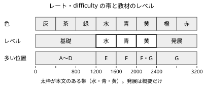
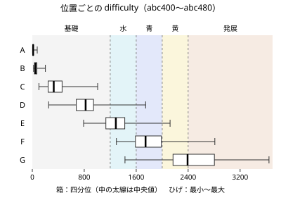

!!! abstract "要点"
    - **何のページか**：レート・パフォーマンス・色、difficulty、ABC の形式と順位、練習用コンテスト、生成 AI のルールがわかる。教材のレベルは difficulty（その問題を半々で解けるレート）の帯で決まる。
    - **使い方**：問題の行の「diff」や、ページのレベル（水・青・黄）の意味を確かめるときに引く。時間配分などコンテスト中の判断は[コンテストの戦い方](../guide/contest-strategy.md)、色ごとの学ぶ順は[色別ロードマップ](../guide/roadmap.md)にある。
    - **数字の出どころ**：AtCoder Problems の公開データ（2026-10-21 取得）と、その推定のソースコード、第三者の解説。atcoder.jp のページは開いていないので、公式の細則は各自で確かめる。

<!-- textlint-disable -->
別名：レーティング・パフォーマンス・difficulty の読み方・ABC の形式・ARC の区分・生成 AI のルール・AtCoder生成AI対策ルール・色
<!-- textlint-enable -->

AtCoder の仕組みのうち、この教材を引くのに要るのは 3 つの数である。参加者の実力を表すレーティング、1 回の成績を表すパフォーマンス、問題の難しさを表す difficulty で、3 つとも同じ物差し（レート）で測る。教材のレベルは difficulty の帯で決めているので、この物差しが分かれば「水のページ」が誰のどの問題向けかが読める。

## レーティングとパフォーマンス {#rating}

パフォーマンスは、1 回のコンテストの順位をレートの物差しに直した値である。パフォーマンス 1600 は、その回に（参加回数の補正をかける前の）レート 1600 の人と同じくらいの順位を取ったことを表す。値は順位と、同じ回の参加者のレートから決まる。

レーティング（レート）は、これまでのパフォーマンスから計算する実力の推定値である。第三者の解説（anqooqie 氏、2019 年の更新）によると、計算は次の 3 段からなる。

1. **新しい回ほど重くする**：最新の回から順に $0.9, 0.9^2, 0.9^3, \dots$ の重みを付ける。
2. **良い回を重く見る平均を取る**：パフォーマンス $p_i$ をそのまま平均せず、$2^{p_i/800}$ の重み付き平均を取ってから $800 \log_2$ で戻す。平均より高い回が強く効くので、低い回が 1 回あっても大きくは下がらない。
3. **参加回数が少ないうちは引く**：参加回数 $n$ に応じた補正を引く。補正は $n = 1$ で 1200、$n = 2$ で約 745、$n = 5$ で約 347、$n = 10$ で約 157、$n = 20$ で約 46 で、回数が増えると 0 に近づく。

$$
\text{レート} = 800 \log_2 \frac{\sum_i 2^{p_i/800} \cdot 0.9^i}{\sum_i 0.9^i} - (\text{参加回数による補正})
$$

$i$ は新しい順の番号で、最新の回が $i = 1$ である。

ここから次のことが言える。

- **色を上げるには、目標の色のパフォーマンスを何度も出す**：重みが $0.9$ ずつしか減らないので、1 回の上振れはレートを少ししか動かさない。目標を「その色のパフォーマンスを安定して出す」に置く理由はここにある（[色別ロードマップ](../guide/roadmap.md#goal)）。
- **始めて 10 回ほどはレートが低く出る**：3 段目の補正のためで、実力が下がったわけではない。補正がなければ参加者のレートの平均は 600〜700 ほどになる、という見積もりもある（drken 氏の tips）。
- **400 未満は縮めて表示する**：計算した値 $r$ が 400 以下なら $400 / e^{(400 - r)/400}$ に直すので、表示のレートは 0 より大きく 400 以下に収まる。

パフォーマンスには回ごとに上限がある。同じ解説によると、上限は「Rated の対象の上限 ＋ 401」で、今の ABC（1999 以下が対象）では 2400 になる。易しいコンテストで全完を重ねて高いレートを取れないようにするためと考えられる（解説の筆者の推測で、公式の説明は確かめていない）。

## 色と人数の割合 {#colors}

色は、レートを 400 ごとに区切った帯の名前である。灰（〜399）・茶（400〜）・緑（800〜）・水（1200〜）・青（1600〜）・黄（2000〜）・橙（2400〜）・赤（2800〜）の 8 つがある。

アクティブな参加者に占める割合は、nabata 氏の集計（2024-08-10 の時点。過去 2 年以内に Rated のコンテストに 1 回以上出た人が対象）では次のとおりである。

| 色 | 割合 | その色以上の割合 |
| --- | ---: | ---: |
| 赤 | 0.11% | 0.11% |
| 橙 | 0.24% | 0.36% |
| 黄 | 1.10% | 1.46% |
| 青 | 2.23% | 3.69% |
| 水 | 4.16% | 7.84% |
| 緑 | 7.79% | 15.64% |
| 茶 | 12.49% | 28.13% |
| 灰 | 71.87% | 100.00% |

この教材が目指す黄色は、アクティブな参加者の上位 1.5% ほどに当たる。水は上位 8% ほど、青は上位 4% ほどである。chokudai 氏の記事（2019 年）では、水を上位 15%、青を上位 7%、黄を上位 3% としていた。上の集計で割合が小さいのは、参加者の数え方（集計の対象と時期）が違うためと考えられる。どちらの数字でも、上の帯ほど人数が急に減ることは同じである。

## difficulty の定義 {#difficulty}

difficulty は、その問題を解ける確率がちょうど 50% になるレートである。AtCoder 本体ではなく、有志のサービスの AtCoder Problems が、コンテストの結果から推定して出している。この教材の問題の行の「diff」はこの値である。

AtCoder Problems の推定のソースコードでは、レート $r$ の人が difficulty $d$ の問題を解く確率を次の形のロジスティック曲線とし、実際に解いた人数に合うように $d$ を決めている。

$$
P(\text{解く}) = \frac{1}{1 + 6^{(d - r)/400}}
$$

この式から、difficulty との差で解く確率がおおよそ読める。

| レート $r$ | 解く確率 |
| --- | ---: |
| $d - 400$ | 約 14%（$1/7$） |
| $d - 200$ | 約 29% |
| $d$ | 50% |
| $d + 200$ | 約 71% |
| $d + 400$ | 約 86%（$6/7$） |

つまり、difficulty 1600 の問題は「青の人なら解ける問題」ではなく、「レート 1600 の人が半々で解ける問題」である。レート 2000 の人でも 7 回に 1 回ほどは解けない。

推定の約束で、知っておくと読み違えないものが 3 つある。

- **使うのは 2 回目以上の参加者の結果だけ**：初めて出た人は、レートがまだ実力を表さないので除く。
- **difficulty のない問題がある**：Rated のコンテストとして開かれていない問題集（典型90・EDPC など）や、参加者が少ない問題には値が付かない。この教材では「diff —」と書く。
- **400 未満は縮めた値**：レートの表示と同じ式で 0 より大きく 400 以下の値に直してある。A・B の difficulty が 10〜50 ほどなのはこのためで、差を引き算で比べても意味が薄い。

difficulty は参加者のレートを物差しにしているので、参加者全体が強くなって同じ順位を取りにくくなる、という意味の難化はこの数字には表れない。ABC391〜410（2025 年 2〜6 月）の問題は、配点から見込むより difficulty が 100 ほど低く出ていたという分析（sirsoldano 氏）もある。AtCoder Problems のデータで ABC の F の中央値を年ごとに数えると、2024 年 1876・2025 年 1678・2026 年 1864 で、2026 年は 2024 年と同じ程度に戻っている。この教材では時期を区別せずに difficulty を使う。

## difficulty と教材のレベル {#levels}

教材のレベルは、その手法が主に必要になる問題の difficulty の帯で決めている。帯の区切りは色と同じ 400 ごとで、緑以下をまとめて基礎、橙以上をまとめて発展とした。

| レベル | difficulty | ページの形 | 多く現れる位置 |
| --- | --- | --- | --- |
| 基礎 | 〜1199 | 短く、応用の型と落とし穴に絞る | A〜D |
| 水 | 1200〜1599 | 本文のある手法のページ | E と易しい F |
| 青 | 1600〜1999 | 本文のある手法のページ | F と難しい E |
| 黄 | 2000〜2399 | 本文のある手法のページ | 難しい F と易しい G |
| 発展 | 2400〜 | 概要だけ | G の上半分 |

ページのレベルは「その手法がまとまって現れ始める帯」で、最近の ABC（abc319 以降）の問題を主な根拠にした。応用が上の帯に出る手法では、ページの中の節にページより上のレベルを付けた。レベルの付いた節は、その色のロードマップに並ぶ。

レベルの読み方は difficulty と同じで、「水のページ」は「水の人なら当然知っている手法」ではなく、「水の帯の問題を半々以上で解くために要る手法」である。自分のレートの 1 つ上の帯のページが、次に読むページの候補になる。

## ABC の形式 {#abc-format}

ABC（AtCoder Beginner Contest）は、主に土曜日に開かれる（abc400〜480 の 81 回のうち 75 回が土曜日）初中級者向けのコンテストである。今の形式は A〜G の 7 問・100 分で、レート 1999 以下の参加者が Rated（成績がレートに反映される）になる。

形式は次のように変わってきた（AtCoder Problems のコンテスト一覧で問題数・時間・Rated の範囲を数え、日本語版 Wikipedia の記述と照らした）。

| 回 | 時期 | 問題数 | 時間 | Rated |
| --- | --- | --- | --- | --- |
| abc001〜041 | 2013-10〜2016-07 | 4 | 120 分 | なし |
| abc042〜125 | 2016-07〜2019-04 | 4 | 100 分 | 〜1199 |
| abc126〜211 | 2019-05〜2021-07 | 6 | 100 分 | 〜1999 |
| abc212〜318 | 2021-07〜2023-09 | 8 | 100 分 | 〜1999 |
| abc319〜 | 2023-09〜 | 7 | 100 分 | 〜1999 |

- 8 問体制のうち abc233〜318 は、8 問目の記号が H ではなく Ex だった。
- 配点は abc300 まで固定で、8 問体制では A から順に 100・200・300・400・500・500・600・600 点だった。abc301 から、問題ごとに 25 点刻みで変わるようになった。
- 7 問体制に変わったのは、難しい問題の在庫が尽きたためとされる（Wikipedia）。

形式が変わると、同じ記号でも難しさが変わる。6 問体制の F（中央値 2132）と今の F（abc400〜480 の中央値 1744）は別物で、古いガイドラインの「何完で何色」は今の位置に読み替えて使う。読み替えには difficulty を使うのが確実である（[位置ごとの difficulty](#difficulty-by-position)）。

## 位置ごとの difficulty {#difficulty-by-position}

ABC の問題の difficulty は位置（A〜G）でおおよそ決まる。次の図と表は、abc400〜abc480 の 81 回で各位置の difficulty の分布を AtCoder Problems のデータから数えたものである。

| 位置 | 第 1 四分位 | 中央値 | 第 3 四分位 | 最小〜最大 |
| --- | ---: | ---: | ---: | --- |
| C | 243 | 330 | 458 | 102〜1006 |
| D | 677 | 821 | 942 | 251〜1745 |
| E | 1133 | 1286 | 1424 | 790〜2122 |
| F | 1588 | 1744 | 1987 | 1295〜2811 |
| G | 2167 | 2391 | 2804 | 1427〜3645 |

A・B の中央値は 13・48 で、どちらもすべて灰の帯にある（一部の問題は difficulty がない）。教材のレベルの帯で数えると、割合は次のとおりである。

- **D**：93% が基礎で、水以上は 7%。
- **E**：水 59%・基礎 31%・青以上 10%。
- **F**：水 26%・青 49%・黄 19%・発展 6%。75% が 2000 未満。
- **G**：黄 38%・発展 49%・青以下 12%。

位置の並びと難しさの順は、ときどき逆転する。7 問体制の 162 回では、E が F より難しかった回が 17 回（約 10%）、F が G より難しかった回が 15 回（約 9%）あった。

7 問体制になってからの 3 年間で、D〜G の中央値に一方向の変化（難化・易化）は見えず、回ごとのばらつきの方が大きい。四分位範囲は E で約 300、F で約 400、G で約 640 ある。

この分布から、目標のパフォーマンスごとに各位置を解く確率と時間を見積もった表は[コンテストの戦い方](../guide/contest-strategy.md#time-targets)に、位置ごとに多い手法は[色別ロードマップ](../guide/roadmap.md#recent-positions)にある。

## 順位とペナルティ {#ranking}

ABC・ARC・AGC の順位は、まず得点の合計で決まり、同点なら「最後に正解した時刻＋ペナルティ」の早い方が上になる。ペナルティは誤答 1 回につき 5 分で、最終的に正解した問題への誤答だけが数えられる。正解しなかった問題にいくら誤答しても、ペナルティにはならない。

ここから次のことが言える。

- **同じ完答数なら速さで決まる**：ABC では得点はほぼ完答数で決まるので、同じ完答数の中の順位は時刻で決まる。速さがパフォーマンスをどれだけ動かすかは[完答数・速さとパフォーマンス](../guide/contest-strategy.md#solves)にある。
- **誤答 1 回は 5 分の遅れと同じ**：正解した問題の誤答は、その分だけ最後の正解の時刻を遅らせたのと同じに扱われる。提出の前に確かめる項目は[提出前の確認とペナルティ](../guide/contest-strategy.md#before-submit)にある。
- **終了間際の提出に損はない**：解けていない問題に出して外れても、ペナルティは付かない。

どの提出が誤答に数えられるか（コンパイルエラーの扱いなど）の細則は、この教材では確かめていない。参加するコンテストのルールのページで確かめる。

## ARC・AGC・AHC と ARC の区分 {#contests}

ABC のほかに、AtCoder の定期コンテストには次の 3 種類がある。どれもコンテストごとに Rated の範囲が決まっていて、自分のレートが範囲の中なら Rated になる。

- **ARC（AtCoder Regular Contest）**：中上級者向けで、ABC より考察の比重が重い。2026-02 からは Rated の範囲の違う 3 つの区分がある（下の表）。
- **AGC（AtCoder Grand Contest）**：上級者向けで、最も難しい。AtCoder Problems のデータでは、agc067（2024-08）からは 2000 以上が Rated で、agc078（2026-09）は 2800 以上だった。
- **AHC（AtCoder Heuristic Contest）**：最適解を求めるのが難しい問題で、よりよい近似解を競う。レートはアルゴリズムのコンテストとは別に付き、数時間の短期の回と 1 週間以上の長期の回がある。

ARC の区分は、AtCoder Problems のコンテスト一覧（2026-10 まで）で次のように数えた。

| 区分 | Rated | 時間 | 問題数 | 最初の回 |
| --- | --- | --- | --- | --- |
| ARC-- | 800〜2399 | 120 分 | 6〜7 | arc219（2026-05） |
| ARC | 1200〜2799 | 120 分 | 5〜7 | — |
| ARC++ | 1600〜2999 | 150 分 | 5 | arc216（2026-03） |

2026 年 1 月までは Div. 1（おもに 1600〜2999。初めの 2 回は 1600〜2799）と Div. 2（1200〜2399）の 2 つの区分と、区分のない回（1200〜2799）があった。ARC-- は緑（800〜）から Rated になるので、レート 1000 前後の人が出られる ARC である。区分ごとの問題の難しさは、まだ回数が少なく、この教材では確かめていない。

この教材の問題は ABC が中心で、ARC は少なめに載せている。ARC の問題は、ABC と同じ手法を使うものでも、考察の比重の重いことが多い。

## 練習用のコンテスト {#practice-contests}

決まった時刻に始まる練習用のコンテストもある。どれもレートは変わらない（AtCoder Problems のデータで Rated の範囲が付いていない）。

- **AtCoder Daily Training（ADT）**：過去の ABC の問題を組み直して、平日に出すコンテストである。2023-10 から開かれ、EASY・MEDIUM・HARD・ALL のコースがある。
- **AtCoder Weekday Contest（AWC）**：2026-02 から平日に開かれている Beta のコンテストで、ほとんどの回が 5 問である。問題は新しく作られたもので、difficulty は付かない。

コースごとの問題数と difficulty、アルゴリズム実技検定（PAST）の過去問、AtCoder Problems のバーチャルコンテストを使った練習は[問題集と練習用コンテストの案内](../guide/problem-sets.md#practice-contests)にまとめてある。

## 生成 AI のルール {#ai-rules}

<!-- textlint-disable -->

AtCoder生成AI対策ルール（20261014 版）は、ABC・ARC・AGC の開催中に、問題文やその要約を生成 AI に入力して解法やコードを出力させることを禁じている。過去問の練習には適用されない。

<!-- textlint-enable -->

ルールは版ごとに変わってきた。第三者の整理（ToastUz 氏の記事、2025-10 の更新）によると、次のとおりである。

- **20241206 版**：ABC と ARC の Div. 2 の開催中に生成 AI の利用を制限した。問題文の翻訳やコードの補完などは例外とされ、AGC・ARC の Div. 1・AHC は対象外だった。
- **20251003 版**：ABC・ARC・AGC の開催中の利用を、コードの補完なども含めて禁じた。
- **20261014 版**：今の版で、上の禁止を引き継いでいる。

版がまた変わることもあるので、参加する前に AtCoder の告知で最新の版を確かめる。AHC での扱いは、この教材では確かめていない。

この教材では、コンテスト中は claude.ai に解説を頼まず、終了後は頼んでよいとしている。ADT・AWC の扱いを含む約束と、教材がどの版のルールを前提にしているかは[この教材の使い方](how-to-use.md#ai-rule-version)にある。

## 参考 {#references}

- [kenkoooo「AtCoderProblems / time-estimator/function.py」](https://github.com/kenkoooo/AtCoderProblems/blob/master/lambda-functions/time-estimator/function.py)：difficulty の推定の式（傾き ln6/400 のロジスティック曲線）、対象を 2 回目以上の参加者に限ること、参加者のレートの 400 以下を縮める前に戻すこと
- [kenkoooo「AtCoderProblems：atcoder-problems-frontend/src/utils/index.ts」](https://github.com/kenkoooo/AtCoderProblems/blob/master/atcoder-problems-frontend/src/utils/index.ts)：difficulty の 400 未満を縮めて表示する式（clipDifficulty）
- [anqooqie「AtCoderのレート計算式」](https://qiita.com/anqooqie/items/92005e337a0d2569bdbd)：レートの計算の 3 段（0.9 の重み・$2^{p/800}$ の平均・参加回数の補正）と補正の値、400 未満の縮め方、パフォーマンスの上限
- [drken「AtCoder コンテストについての tips」](https://qiita.com/drken/items/8a6f139158cde8a61dce)：順位の決まり方、色の区切り、参加回数による補正がない場合の平均レートの見積もり
- [nabata「AtCoderの水色(以上)がどれだけのレベルなのかを可能な限り客観的に全力で可視化してみた(国別人数や解答速度や所属大学)」](https://qiita.com/nabata/items/c63f00e32be63416a7db)：アクティブな参加者に占める色ごとの割合（2024-08）
- [日本語版 Wikipedia「AtCoder」](https://ja.wikipedia.org/wiki/AtCoder)：ABC の形式と配点の変遷、ペナルティ、AGC・AHC の説明
- [sirsoldano「生成AIはAtCoderBeginnerContestのインフレを加速させたか」](https://qiita.com/sirsoldano/items/ad3d05e4a37759850445)：ABC391〜410 の difficulty が配点から見込むより低いという分析
- [ToastUz「AtCoderで生成AIをフル活用！2025年の競技プログラミング術」](https://qiita.com/ToastUz/items/98a4ff7fd63a061ef18d)：生成 AI のルールの 20241206 版と 20251003 版の違い
- [chokudai「AtCoder（競技プログラミング）の色・ランクと実力評価、問題例」](https://chokudai.hatenablog.com/entry/2019/02/11/155904)：色ごとの上位の割合の目安
