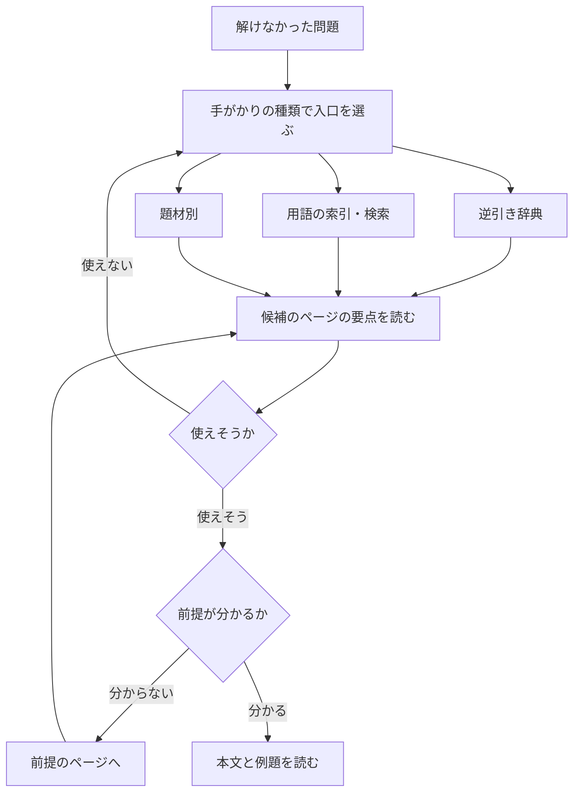

!!! abstract "要点"
    - **何のページか**：解けなかった ABC の問題から、逆引き辞典 → ページ冒頭の要点 → 前提の順に教材を引ける。レベルの意味、進捗の記録と退避、claude.ai での解説の頼み方も示す。
    - **使い方**：解けなかった問題があるときは[辞書としての引き方](#lookup)の表から入口を選ぶ。色ごとに順に学ぶときは[色ごとに学ぶとき](#by-color)から始める。記録を別の端末へ移すときは[書き出しと読み込み](#backup)を使う。
    - **前提**：なし

<!-- textlint-disable -->
別名：使い方・教材の引き方・辞書の引き方・claude.ai での解説の頼み方・データの書き出し
<!-- textlint-enable -->

この教材の使い方は、辞書として引く・色ごとに学ぶ・記録を残す・claude.ai に解説を頼むの 4 つの使い方について、どのページから入り、どう読むかをまとめた案内である。手法の中身は各ページにあり、ここでは入口と約束だけを示す。

## この教材の目的と範囲 {#purpose}

この教材は、AtCoder で黄色（レーティング 2000）を目指す人が、解けなかった問題から手法を引くための辞書である。想定する読者は、ABC の D までは安定して解け、E は時々解けるくらいの人である。C++ の基本の文法は分かるものとし、初歩の文法の説明はしない。

範囲と深さは、その知識を使う問題の難しさで決めている。

- **本格的に扱う**：水・青・黄のレベルの手法。なぜ正しいか、自分で実装できる粒度の処理の流れ、落とし穴、例題と練習問題まで書く。
- **短く扱う**：基礎のレベルの手法。初歩は省き、応用の型・落とし穴・上位の手法へのつながりに絞る。
- **概要だけ扱う**：発展（difficulty 2400 以上）の手法。何ができるか・どんな問題で使うか・ライブラリでの使い方だけを書き、証明や実装は資料に任せる。

最近の ABC では、水の手法がおおよそ E と易しい F、青の手法が F と難しい E、黄の手法が難しい F と易しい G で使われる。F の多くは青までの知識で解けるので、黄色に届くには、黄の知識を増やすことより青までの知識を速く確実に使うことが効く。この教材が水・青を厚く書いているのはそのためである。

この教材は出題範囲の一覧（シラバス）ではない。どのページにも当たらない考察だけで解く問題もあり、G の上半分では発展の手法も使われる（[色別ロードマップ](../guide/roadmap.md#not-a-syllabus)）。

## 章の構成 {#structure}

ページは 15 の分野のどれか 1 つに属し、分野がナビゲーションの章になる。ナビゲーションの最後にある「一覧」の章だけは分野ではなく、全分野のページをレベル別・種類別に並べ直した一覧を集めている。分野をまたいで引くときは、逆引き辞典・用語の索引・問題番号の索引・種類別の一覧・題材別のページを使う（[辞書としての引き方](#lookup)）。

<!-- gen:begin fields -->
<!-- textlint-disable -->

| 章 | 中身 | ページ |
| --- | --- | --- |
| [はじめに](index.md) | この教材の使い方、記法と用語の約束、AtCoder の仕組み | 3 |
| [横断ページ](../guide/index.md) | 逆引き辞典、用語の索引、問題番号の索引、使い分け、知識マップ、ロードマップ、早見表、戦い方など | 16 |
| [基本テクニック](../basics/index.md) | 計算量の見積もり、全探索、二分探索、累積和・いもす法、尺取り法、ソート・座標圧縮、貪欲、半分全列挙、ダブリング、分割統治、周期性、bit 演算 | 32 |
| [考察](../thinking/index.md) | 言い換え・主客転倒・寄与・余事象・偶奇・不変量・構築などの考察の型 | 9 |
| [動的計画法](../dp/index.md) | DP の考え方、列・区間・集合・桁・木の DP、DP の高速化 | 38 |
| [グラフ](../graph/index.md) | 探索、最短路、有向グラフ、連結性と全域木、探索木と次数の性質、フロー | 47 |
| [木](../tree/index.md) | 木の性質、直径・LCA・オイラーツアー・マージテク・重心など | 26 |
| [データ構造](../ds/index.md) | STL の応用、スタック・キュー、Union-Find、BIT・セグメント木、クエリ処理の工夫 | 37 |
| [整数論・代数](../math/index.md) | mod、素数・約数、GCD と合同式、floor、行列・線形代数、畳み込み | 42 |
| [数え上げ・確率・ゲーム](../comb/index.md) | 数え方の考え方、二項係数・包除、確率・期待値（期待値 DP を含む）、ゲーム（ゲーム DP を含む） | 49 |
| [文字列](../string/index.md) | ハッシュ、Z・KMP・Manacher、Trie、Suffix Array、Aho-Corasick | 13 |
| [幾何](../geometry/index.md) | ベクトルと外積、誤差、凸包、偏角ソート、45 度回転など | 8 |
| [その他の技法](../misc/index.md) | インタラクティブ、乱択、bitset による高速化、構文解析 | 4 |
| [題材別](../patterns/index.md) | 括弧列・mex・順列・XOR・区間・グリッドなど、問題に現れる対象から手法を引く案内 | 11 |
| [C++](../cpp/index.md) | 解説コードに出る書き方、AtCoder と手元の環境、落とし穴、ACL の読み方 | 20 |
| [一覧](../lists/index.md) | レベル別の一覧 5 つと種類別の一覧 30 個（全分野のページを、レベルと手法の種類で並べ直したもの） | — |

<!-- textlint-enable -->
<!-- gen:end fields -->

章の並びには意図がある。

- **はじめに・横断ページを先に置く**：辞書として引く入口（逆引き辞典・用語の索引・問題番号の索引・知識マップ）を最初に見せるためである。
- **手法の分野は前提の流れの順に置く**：基本テクニック → 考察 → 動的計画法 → グラフ → 木 → データ構造 → 整数論・代数 → 数え上げ・確率・ゲーム → 文字列 → 幾何 → その他の技法の順である。後の分野は、前の分野の知識を使うことが多い。
- **題材別と C++ を分野の最後に置く**：題材別は括弧列・mex・順列のような「問題に出てくる対象」から手法を引く案内で、C++ は解説のコードの書き方から引く辞典である。どちらも、手法の分野を横から引くための章である。
- **一覧を最後に置く**：一覧は手法を説明するページを持たず、分野の章にあるページをレベルと手法の種類で並べ直しただけの章だからである。

分野の中のページは、小さい章（chapter）に分かれて並ぶ。章の中では、前提のページがそれを使うページより先に来る。レベルの順ではないので、高いレベルのページの後に低いレベルのページが来ることもある。易しさは各ページのレベルの印で見分ける。

分野の入口のページには、章ごとのページの一覧（題名・レベルの印・要約の最初の文）と、その分野の学ぶ順・使い分け・問題集への案内がある。最後の「ほかの分野にある関連ページ」には、木 DP（動的計画法の章にある）のように、ほかの分野に置いた、その分野の主題に関わるページが並ぶ。

## 辞書としての引き方 {#lookup}

解けなかった問題から引くときは、手がかりの種類で入口を選ぶ。次の表の左の列で、自分が持っている手がかりを探す。

| 手がかり | 入口 | 引けるもの |
| --- | --- | --- |
| 問題文の言い回し・求めるもの | [逆引き辞典（言い回しから）](../guide/reverse-index-signs.md#by-phrase) | その言い回しで疑う手法のページ |
| 立てた式が遅い | [逆引き辞典（式の形から）](../guide/reverse-index-signs.md#by-shape) | 式を速くする道具のページ |
| 制約の数字 | [逆引き辞典（制約から）](../guide/reverse-index-constraints.md#constraint-table) | 許される計算量と候補の手法 |
| 手法の名前・別名・英語名 | [用語の索引](../guide/term-index.md) | その名前のページ |
| 括弧列・順列・グリッドなどの題材 | [題材別](../patterns/index.md) | 題材ごとの問われ方と手法の表 |
| 解説に出た手法が 2 つで迷う | [似た手法の使い分け](../guide/method-comparison.md) | 見分け方と、どちらを選ぶか |
| 問題番号・問題集の番号 | [問題番号の索引](../guide/problem-index.md)・[最近の ABC → ページ](../guide/problem-sets.md#recent-abc) | その問題を載せたページ。最近の ABC は、本文にない問題も使う手法のページを引ける |
| 解説のコードの 1 行が読めない | [C++ の逆引き](../cpp/cpp-reverse-index.md#how-to-read) | その書き方の説明 |
| 方針がまったく立たない | [詰まったときの発想リスト](../guide/thinking-checklist.md) | 順にたどる問い |
| WA・TLE が取れない | [原因チェックリスト](../guide/debugging-checklist.md) | 結果ごとの原因の候補 |

画面の上の検索欄でも、題名・別名・本文の語を引ける。検索で見つからないときは、手法名を別名や英語名に言い換えるか、上の表の逆引き辞典に移る。

引いた後は、次の流れで読む。



図の流れを言葉で書くと、次の 3 段になる。

1. **入口で候補を出す**：逆引き辞典・用語の索引・題材別のどれかで、候補のページを 1〜3 個に絞る。
2. **要点だけで判断する**：各ページの冒頭の「要点」の囲みには、何ができるか・いつ使うか・計算量・前提がある。「いつ使うか」と問題の制約を見比べ、計算量が制約に収まることを確かめる。合わなければ入口に戻る。
3. **前提をたどってから本文へ**：要点の「前提」のページが分からなければ、先にそちらを読む。前提の前提まで含めた全体は、[知識マップ](../guide/knowledge-map.md#focus)の焦点の表示で見られる。

1 つの問題に 2 つ以上の手法が要ることも多い。たとえば「言い換えてからセグメント木に載せる」問題では、言い換えの型のページと、データ構造のページの両方を引く。

## 色ごとに学ぶとき {#by-color}

色ごとに順に学ぶときは、[色別ロードマップ](../guide/roadmap.md)から始める。ロードマップには、色ごとの到達の目安（ABC の何問を何分で解くか）と、その色のページを前提の順に並べた列がある。列は各ページのレベル・前提・出題頻度から機械的に作られ、ページの中にある上の帯の節も「ページ › 節」の行として入る。

- **読む順を決める**：今のレートから次の色を 1 つ決め、その色の列を必修の行から読む（[色ごとのページの列](../guide/roadmap.md#reading-order)）。
- **前提のつながりを見る**：[知識マップ](../guide/knowledge-map.md)は、ページの前提関係を分野ごとの図で示す。理解したページが塗られ、前提をすべて理解したページが次の候補として光る。
- **練習する**：問題の選び方と量の目安は[精進の仕方](../guide/practice-method.md#choosing-problems)、問題集の一覧は[問題集と練習用コンテストの案内](../guide/problem-sets.md#collections)にある。
- **同じレベルのページを一覧で見る**：レベル別・種類別の一覧は次のとおりである。かっこ内はページの数である。

<!-- gen:begin lists -->
<!-- textlint-disable -->

- レベル別：[基礎](../lists/level-basic.md)（100）・[水](../lists/level-cyan.md)（79）・[青](../lists/level-blue.md)（52）・[黄](../lists/level-yellow.md)（37）・[発展](../lists/level-advanced.md)（51）
- 種類別：[計算量](../lists/kind-complexity.md)（6）・[全探索](../lists/kind-brute-force.md)（7）・[二分探索](../lists/kind-binary-search.md)（16）・[累積和・差分](../lists/kind-prefix-sum.md)（12）・[尺取り・スライド窓](../lists/kind-two-pointers.md)（3）・[貪欲](../lists/kind-greedy.md)（11）・[ソート・座標圧縮](../lists/kind-sorting.md)（11）・[ダブリング・分割統治](../lists/kind-doubling.md)（13）・[DP](../lists/kind-dp.md)（61）・[グラフ探索](../lists/kind-graph-search.md)（24）・[最短路](../lists/kind-shortest-path.md)（13）・[連結性・全域木](../lists/kind-connectivity.md)（14）・[フロー・マッチング](../lists/kind-flow.md)（9）・[木](../lists/kind-tree.md)（31）・[データ構造](../lists/kind-data-structure.md)（46）・[区間クエリ](../lists/kind-range-query.md)（22）・[クエリ処理の工夫](../lists/kind-query-processing.md)（15）・[整数論](../lists/kind-number-theory.md)（39）・[線形代数・行列](../lists/kind-linear-algebra.md)（11）・[畳み込み・多項式](../lists/kind-convolution.md)（11）・[数え上げ](../lists/kind-counting.md)（47）・[確率・期待値](../lists/kind-probability.md)（12）・[ゲーム](../lists/kind-game.md)（6）・[文字列](../lists/kind-string.md)（18）・[ハッシュ・乱択](../lists/kind-hashing.md)（6）・[幾何](../lists/kind-geometry.md)（8）・[ビット演算](../lists/kind-bit.md)（16）・[考察](../lists/kind-observation.md)（31）・[実装・C++](../lists/kind-implementation.md)（26）・[案内](../lists/kind-guide.md)（35）

<!-- textlint-enable -->
<!-- gen:end lists -->

列を全部読んでから次の色へ進む必要はない。水の列を読み終える前に E を解き始めてよく、解けなかった問題は[辞書としての引き方](#lookup)で引く。

## レベルの意味 {#levels}

レベルは、その手法を知らないと解けない問題がまとまって現れ始める [difficulty](../guide/glossary.md#difficulty) の帯である。difficulty は、その問題を解ける確率がちょうど半々になるレートの推定値で、AtCoder Problems が出している。

| レベル | difficulty | 最近の ABC での位置の目安 | 扱い |
| --- | --- | --- | --- |
| 基礎 | 〜1199 | D まで | 短く。応用の型と落とし穴 |
| 水 | 1200〜1599 | E と易しい F | 本格的に |
| 青 | 1600〜1999 | F と難しい E | 本格的に |
| 黄 | 2000〜2399 | 難しい F と易しい G | 本格的に |
| 発展 | 2400〜 | G の上半分 | 概要だけ |

位置の目安は、abc400〜abc480 の 81 回の difficulty の分布から取ったおおよその対応である。位置ごとの詳しい分布（箱ひげ図と四分位の表）は [AtCoder の仕組み](atcoder-system.md#difficulty-by-position)にある。

レベルを読むときは、次の 4 点に気をつける。

- **知識の難しさではない**：レベルは「その知識を使う問題の難しさ」で決めている。短く説明できる手法でも、使う問題が難しければ上のレベルになる。
- **最近の問題で決めている**：根拠には主に abc319 以降（7 問体制）の問題を数えている。2019 年以前の ABC は、同じ手法でも difficulty が高めに出るためである。
- **1 ページの中に上の帯の節がある**：易しい使い方と難しい使い方で帯が分かれる手法は、ページの中の一部の節に上のレベルを付けている。その節の見出しと目次の項目には、レベルの色の印（「青」など）が付く。節の最初には、追加で要る前提が書いてある。ページより下のレベルの節は置かず、下のページへのリンクで済ませる。
- **典型90 は★で読む**：[典型90](../guide/glossary.md#typical90) のように difficulty のない問題集は、作者の★を目安にする。★4 以下が基礎、★5 が水、★6 が青、★7 が黄以上にあたる。

はじめに・横断ページ・題材別・使い分けなどの案内のページはレベルを持たない。C++ のページは、その書き方が解説のコードに出始める帯をレベルにしている。レート・色・difficulty の仕組みそのものは、[AtCoder の仕組み](atcoder-system.md#difficulty)にある。

## ページの構成と読み方 {#page-anatomy}

どのページも、上から次の順に並ぶ。上の 3 つだけで「この問題に使えるか」を判断できるように書いてある。

1. **ページの上の帯**：レベル（AtCoder の色）・分野・種類のバッジと、「理解した」のチェック欄がある。バッジを押すと、そのレベル・分野・種類のページの一覧へ移る。「青の節」のような節のチェック欄の横の矢印を押すと、その帯の最初の節へ移る。準備中のページには「準備中」の帯も出る（[ページの段階と「準備中」の帯](#stub)）。
2. **要点の囲み**：何ができるか・いつ使うか・計算量・前提の 4 項目である。「いつ使うか」は、問題文の言い回し・制約の形・立てた式の形で書いてある。手法名を知らなくても照らし合わせられる。案内のページでは「何のページか」と「使い方」になる。
3. **別名の行と導入**：ページの題名以外の呼び方（略称・英語名・揺れた表記）をすべて並べ、題名を主語にした 1〜3 文で何をするものかを言う。
4. **本文**：ページの種類ごとに構成が違う（下の表）。ページより上のレベルの節は、見出しと目次の項目にレベルの印が付く（[レベルの意味](#levels)）。
5. **ページの下**：前提・次に読む・関連の 3 つの欄、「自作の確認」の行、知識マップでこのページの前後を見るリンクがある。「理解した」のチェック欄がもう一度出る。最後の行には、ページの段階と更新日、「このページの誤りを報告する」のリンクがある（[誤りの報告](#report)）。

ページの下の 3 つの欄には、次のページが並ぶ。行き先にレベルがあれば、行の後ろにその印が付く。

- **前提**：このページを読む前に分かっているとよいページ。直接の前提だけを並べるので、前提の前提は知識マップでたどる。
- **次に読む**：このページを前提にするページ。同じレベルと 1 つ上のレベルのページを先にして 8 件まで並べ、残りは知識マップで見る。
- **関連**：前提・次に読むとは別に、書き手があわせて読むとよいとしたページと節。本文でリンクしていないものも入る。書き手が並べた順に 20 件まで出し、節は「ページ › 節の題」の形になる。前提・次に読むに出たページは重ねて出さない。

[Library Checker](../guide/glossary.md#library-checker) の問題で自作のコードを確かめられるページには、欄の下に「自作の確認」の行があり、その問題が並ぶ。問題名を押すと問題文へ、「確かめ方」を押すと[自作ライブラリの設計と動作確認](../guide/library-design.md#verify)の手順へ移る。発展の概要のページでは、本文にリンクのある問題（ライブラリの節や練習問題の「Library Checker」など）を重ねて出さない。

| 種類 | 中身 | 本文の構成 |
| --- | --- | --- |
| 手法 | 手法・データ構造・定理 | 必要になる場面 → なぜ正しいか → 処理の流れ → 計算量 → 落とし穴 → 例題 → 練習 |
| 考察 | 考察の型 | 使える合図 → 最小の例 → 例題 |
| 題材別 | 括弧列・mex などの対象 | 題材の性質 → 問われ方と手法の表 |
| 入口・比較 | 写像 12 相などの案内 | 何から引くか → 手法 → ページの表 |
| 発展の概要 | 2400 以上の手法 | 何ができるか → サイン → 使い方 → 資料 |
| C++ | 書き方 | 一言 → 素朴に書くと → 版 → 落とし穴 |
| 案内 | 逆引き辞典・ロードマップ・このページなど | ページごとに違う |

手法の表の構成は水・青・黄のページのものである。基礎のページは短く、応用の型 → 落とし穴 → 上位の手法へのつながり → 問題の順になる。

本文には、決まった見出しの節がある。見出しの名前で探せば、どのページでも同じ役割の節にたどり着ける。

- **落とし穴**：実際に起きる誤解とバグと、その避け方。
- **例題・練習問題・力試し**：問題の一覧（[問題の表示](#problems)）。例題には方針があり、解法の詳細は折りたたんである。考察のページでは、方針も折りたたんである。
- **確認問題**：「なぜ？」「この場合は？」の小問。答えは折りたたんであるので、考えてから開く。
- **使い分け**：似た手法とどちらを選ぶか。
- **上位の手法へのつながり**：基礎のページで、次にどの手法へ進むか。
- **参考**：執筆で参考にした資料。

手法のページには、ACL に対応があれば「ACL では」の囲みがあり、名前・主なメソッド・計算量だけを書いてある。データ構造そのもののページには、[ACL](../guide/glossary.md#acl) を使わずに自分で書く人向けに、保つ性質・各操作の手順・境界の小見出しがある。ACL に同じ部品があれば、自作のコードは「自作するとき」の折りたたみに入れ、最初に ACL と違う名前・返り値を書いてある（違いの一覧は[自作ライブラリの設計と動作確認](../guide/library-design.md#acl-names)）。長い証明は「証明」の折りたたみに入れてある。

本文のコードは要所だけである。中心になる関数や処理の数行を取り出したもので、`#include`・`main`・入出力はほとんど省いてある。プログラム全体は、各コードの下の「完全なプログラム：ファイル名（GitHub）」の行のリンクから、GitHub にある [`snippets/`](https://github.com/yuukougun/kyopro-atlas/tree/main/snippets) のファイルで見られる。同じファイルのコードが続くときは、最後のコードの下にだけこの行がある。完全なプログラムの入出力は、手元でコンパイルと実行を確かめるための自前の形で、問題の入力の形ではない。提出用のコードではないので、問題に使うときは入出力をその問題に合わせて書く。コードの書き方の約束（添字・区間・名前など）は[コード片の約束](notation.md#code)にある。

コードに `mint` が出るときは、同じ行に「`mint` は ACL の `modint998244353`（modint）」のような注記がある。`mint` は、四則演算のたびに自動で法（998244353 など）で割った余りを取る整数の型である（[modint](../math/modint.md)）。型を決める `using mint = atcoder::modint998244353;` の行は要所の外にあるので、コードには出ない。法が $10^9 + 7$ のコードでは `modint1000000007` になる。

数式の記法（半開区間 $[l, r)$、添字の 0-indexed と 1-indexed、計算量の書き方）は[記法と用語の約束](notation.md)、用語の定義は[用語集](../guide/glossary.md)にある。本文では、用語集にある語は最初に出たところで用語集へリンクする。

## 問題の表示 {#problems}

例題・練習問題・力試しは、1 問を 1 行で次の形に書いてある。

```text
- ABC340 E. Mancala 2（diff 1157）：円環に並ぶ箱の玉を取り出して順に配る操作を繰り返した後の、各箱の玉の数を求める。
```

- **題名**：「コンテストの表示名 記号. 題名」で、AtCoder の問題ページへのリンクになっている。表示名は ABCNNN・ARCNNN のほか、典型90・EDPC（Educational DP Contest）・鉄則本・アルゴ数学などがある。
- **diff**：AtCoder Problems の difficulty である。difficulty の付かない問題（典型90 など）は「diff なし」と書く。典型90 は題名の★が難しさの目安になる（[典型90問の★とレベル](../guide/problem-sets.md#typical90-stars)）。「diff 1024・参考値」のように「参考値」を添えた値は、2016 年 7 月までの [Rated](../guide/glossary.md#rated) でなかったコンテストの問題に AtCoder Problems が参考として出している値で、ふつうの値より確かさが低い。値は取得した時点のもので、後で少し変わることがある。
- **要約**：何を問う問題かを、手法名を出さずに 1 文で書いたものである。解き方が見えないように、問いだけを書いている。

問題は役割で 3 つに分けてある。

| 役割 | 意味 | 書いてあること |
| --- | --- | --- |
| 例題 | そのページの手法をそのまま使う代表 | 方針と、折りたたんだ解法の詳細（考察のページは方針も折りたたむ） |
| 練習 | 手法を少し変えて使う | 一覧の後の折りたたみに方針 |
| 力試し | 手法を言い換えや組み合わせで使う難しめの問題（多くはページより上の帯） | 一覧だけ |

1 つの問題は、1 つのページでだけ例題になる。ほかのページでは練習か本文の参照になるので、例題の方針はその問題を例題にしたページで読む。問題の並びは易しい順である。

載せた問題は、どれも実在と題名・difficulty を AtCoder Problems の公開データで確かめ、問いと解き方を第三者の解説で確かめている。各行の先頭には「解いた」のチェック欄が付く（[進捗の記録](#progress)）。

## ページの段階と「準備中」の帯 {#stub}

どのページも、制作の段階を次の 4 つのどれかで持つ。ページの最後の行に、段階と更新日が出る。

| 段階 | 意味 |
| --- | --- |
| 準備中 | 骨組みだけで、本文はまだない。ページの上に「準備中」の帯も出る |
| 下書き | 本文を書いたが、まだ検証していない |
| 検証済み | 書いた担当とは別の担当が、事実（問題・計算量・定理）・コード・図・説明の分かりやすさを確かめ、見つかった誤りを直した |
| 完成 | 検証済みのページに、作者が目を通して確かめた |

検証済みのページは、作者が目を通したものから完成にしていく。検証済みでも誤りが残ることはあるので、見つけたときは[誤りの報告](#report)の手順で知らせる。更新日は、そのページの中身を最後に直した日である。

いまは、すべてのページに本文がある。ページを新しく足すときは、逆引き辞典・知識マップ・索引が全体で動くように、本文より先に骨組みだけを公開することがある。そのページには「準備中」の帯が出る。

帯の出ているページは本文がまだなく、冒頭の要点も目次の要約・サイン・前提を写しただけである。中身を確かめた記述ではないので、解法の根拠にしない（claude.ai の解説でも根拠にしない。[claude.ai での解説の頼み方](#claude)）。そのページへのリンクは節ではなくページ全体を指し、本文が書けると節へのリンクに張り替える。

## 誤りの報告 {#report}

誤りや分かりにくいところを見つけたときは、[GitHub の Issue](https://github.com/yuukougun/kyopro-atlas/issues) で知らせる。受け付けるのは GitHub の Issue だけで、報告には GitHub のアカウントが要る。

1. そのページの最後の行の「このページの誤りを報告する」を押す。GitHub の新しい Issue の画面が開き、ページの題名・URL・更新日が入っている。
2. 種類を選び、場所（節の見出し・問題の行・コードの行など）と内容を書く。正しいと考える内容と、その根拠（資料の URL など）があれば添える。
3. 画面の下のボタンで送る。

Issue は公開され、誰でも読める。問題文や解説の文章は写さず（ほかの人の文章の転載になる）、問題は問題 ID（`abc340_e` など）で示す。報告を受けて直したページは、更新日が新しくなる。

## 進捗の記録（解いた・理解した） {#progress}

この教材は、2 種類のチェックを付けて進捗を記録できる。

- **理解した**：レベルのあるページの上と下のチェック欄で付ける（このページのような案内のページにはない）。チェック欄はページのレベルと、ページの中の上の帯の節のレベルの数だけ並ぶ（「水」「青の節」のように）。「青の節」の欄にマウスを載せるとその帯の節の題名が出て、欄の横の矢印を押すとその帯の最初の節へ移る。
- **解いた**：例題・練習・力試しの一覧の、各行の先頭のチェック欄で付ける。同じ問題が複数のページに載っていても、記録は問題ごとに 1 つで、どのページでも同じ状態になる。

付けた記録は、次の 2 か所で使われる。

- [色別ロードマップの集計](../guide/roadmap.md#progress)：レベル別・分野別の、理解した数と解いた数の表。
- [知識マップ](../guide/knowledge-map.md#progress)：理解したページの塗りと、次の候補の光る枠。

記録は、このブラウザの localStorage の 1 つのキー（`kyopro-atlas:v1`）に保存する。サーバには送らず、端末どうしでも同期しない。同じブラウザのほかのタブで付けたチェックは、開いているページに直ちに反映する。保存を拒否する設定のブラウザでも、ページは壊れずに動き、記録はタブを閉じるか再読み込みするまでしか残らない。

記録はページの id（URL の最後の部分）と問題 ID で持つ。ページの id は変えない約束で、変えるときは古い記録を読み替える。

## 書き出しと読み込み（手動の退避） {#backup}

記録はこのブラウザの中にしかないので、ブラウザのデータを消すと記録も消える。別の端末へ移すときや、退避しておくときは、次の欄で書き出しと読み込みをする。これは同期ではなく、手でコピーして貼り付ける退避である。

<div class="kp-progress-io"></div>

- **書き出す**：記録の JSON が表示されるので、「コピーする」で全体を写し、メモなどに保存する。
- **読み込む**：書き出した JSON を貼り付けて、「今の記録と合わせる」か「今の記録を置き換える」を選ぶ。
    - 合わせる：どちらかで解いた・理解したになっているものは、解いた・理解したにする。2 つの端末の記録をまとめるときはこちらを使う。
    - 置き換える：今の記録を消して、貼り付けた記録だけにする。今の記録が残っているときは、確認のためにもう一度押す必要がある。

書き出した JSON は次の形である。ページの id と問題 ID が並んでいるだけなので、手で読める。

```text
{"solved": {"abc340_e": true}, "understood": {"lazy-segment-tree": {"水": true}}, "updatedAt": "2026-10-21T12:00:00+09:00"}
```

iPhone や Mac の Safari では、Safari を使った 7 日の間にこのサイトを一度も操作しないと、localStorage を含むサイトの保存データが消える。WebKit が 2020 年に発表した Intelligent Tracking Prevention の仕様である。ホーム画面に追加したウェブアプリは、そのアプリを実際に使った日だけを数えるので消えにくい。Safari で読むときは、ホーム画面に追加するか、ときどき書き出して退避しておく。同じ欄は[色別ロードマップ](../guide/roadmap.md#progress)にもある。

## claude.ai での解説の頼み方 {#claude}

解けなかった問題は、claude.ai に教材のページを引きながら解説してもらえる。使うのは claude.ai/code の Projects（各スレッドが教材のリポジトリを読み込んで動くプロジェクト）である。Projects は 2026 年の時点ではベータで、Pro・Max のプランから順に使えるようになっている。プロジェクトの指示（プロジェクトの歯車 → Memory → Project instructions。16,000 字まで）には、リポジトリの `claude/project-instructions.md` の枠の中をそのまま貼る。Claude はその指示と `claude/explain.md` の手順に従い、ファイルを読むだけで変更はしない。

**コンテストの終了後の問題にだけ使う**。開催中の ABC・ARC・AGC の問題を生成 AI に解かせることは、AtCoder のルールで禁じられている（[AtCoder生成AI対策ルールの版](#ai-rule-version)）。

頼むときは、1 つのスレッドで 1 問を扱い、最初のメッセージに次のことを書く。

```text
ABCxxx E の解説を頼みたい。終了したコンテストの問題である。
問題：（問題文のスクリーンショットを添えるか、自分の言葉で要約する）
考えたこと：（どこまで分かったか。立てた式や試した方針）
詰まったところ：（どこで止まったか。WA なら提出のどこが怪しいか）
欲しいもの：ヒントだけ ／ 解説まで
```

- **問題は画像か要約で渡す**：Claude は atcoder.jp と codeforces.com のページを開かない約束にしている（どちらも AI の利用を断る指定がある）。問題の URL だけを渡しても読まないので、問題文の画像か要約を添える。問題 ID も書いておくと、教材でその問題を載せたページを探せる。
- **考えたことを書く**：どこで詰まったかが分かると、足りない一歩だけを示せる。
- **ヒントか解説かを選ぶ**：ヒントだけなら、手法の名前を出さずに気づくべき点を 1 つずつ示す。解説までなら、方針 → なぜ正しいか → 計算量 → 実装の要点の順になる。どちらかを書かなければ、最初に聞かれる。

解説には、根拠にした教材のページと節の URL が付く。教材にない知識を使うときは、そうと明示される。準備中のページは根拠にしない。最後に、解けなかった原因として、知識不足・気づけなかった・実装ミス・時間不足の 4 つのどれかが添えられる。原因ごとの次の行動は、[精進の仕方](../guide/practice-method.md#records)でまとめている。

回答の最後には、Claude が参照した索引の版が書かれる。サイトの今の索引の版は次のとおりである。食い違うときは、Claude とサイトが別の時点の教材を見ている。push の直後は、Claude の読む版の方が新しいこともある。どちらが古いかは、版の後ろに出るページの updated の最大の日付で見分ける。

<!-- gen:begin version -->
<!-- textlint-disable -->

索引の版：`3e0fb5e5fc79`（ページの updated の最大：2026-10-29）

<!-- textlint-enable -->
<!-- gen:end version -->

記録に残したいときは、解説の最後に「記録用まとめを出して」と頼む。出たまとめは、手元の [記録用スキル](#record-skill) に貼り付けて使う。

## AtCoder生成AI対策ルールの版 {#ai-rule-version}

<!-- textlint-disable -->

この教材が前提にしているのは、AtCoder生成AI対策ルールの 20261014 版である。ルールの中身（開催中に問題文や要約を生成 AI に入力して解法やコードを出させることの禁止）と版の履歴は [AtCoder の仕組み](atcoder-system.md#ai-rules)にまとめてある。

<!-- textlint-enable -->

この教材の約束は、この版に合わせて次のように決めている。

- **claude.ai の解説は、終了したコンテストの問題にだけ使う**。開催中かどうか分からない問題は、Claude が最初に確かめ、終了したと分かるまで解説しない。
- **ADT と AWC も同じ扱いにする**：AtCoder Daily Training（ADT）と AtCoder Weekday Contest（AWC）も、開催中は解説を頼まない。ルールの対象かを確かめきれていないので、安全な側に倒してプロジェクトの指示でも断る対象に入れている。
- **コンテスト中は教材を読むだけにする**：教材のページを自分で読むのはかまわないが、問題文を claude.ai に見せない。

ルールは版ごとに変わってきた。コンテストに出る前には、AtCoder の告知で最新の版を確かめる。版が改められたら、このページとプロジェクトの指示（`claude/project-instructions.md`）を見直す。コンテスト中のふるまいは[コンテストの戦い方](../guide/contest-strategy.md#ai-rules)、ABC・ARC・AGC の区分は [AtCoder の仕組み](atcoder-system.md#contests)にある。

## 記録用スキル /record-problem {#record-skill}

`/record-problem` は、残したい問題を手元のリポジトリの `notes/<問題ID>.md` に 1 問 1 ファイルで記録する Claude Code のスキルである。手元の Claude Code で、`/record-problem` と打ったときだけ動く。

使い方は 2 通りある。

1. **claude.ai のまとめを貼る**：claude.ai の解説で「記録用まとめを出して」と頼み、出たコードブロックを写す。手元の Claude Code で `/record-problem` に続けて貼り付ける。
2. **問題 ID だけで始める**：`/record-problem abc340_e` のように問題 ID か問題の URL を渡す。原因・学んだことの一言・関連するページ・教材の改善案を聞かれるので答える。

スキルは次のように記録する。

- **問題を確かめる**：問題の実在・題名・difficulty を、AtCoder Problems の公開データ（`tools/ap.py`）で確かめる。atcoder.jp は開かない。コンテストの直後でまだデータにない問題は、difficulty を「未定」にする。
- **1 問 1 ファイルにする**：同じ問題のファイルがあれば、新しく作らずに記録を追記する。手で書き足した部分は変えない。
- **関連するページを確かめる**：ページの id と URL を教材のファイルで確かめてから書く。
- **集計しない**：件数や傾向は出さない。振り返りは自分で `notes/` を読んで行う。

`notes/` は git の追跡外で、記録は手元にだけ残る。claude.ai の解説（クラウドのスレッド）では使わない。クラウドで書いた記録は手元に残らないので、スキルはクラウドで呼ばれると何も書かずに終わる。まとめの形は、リポジトリの `claude/record-format.md` で決めている。記録を何に使うかは[精進の仕方](../guide/practice-method.md#records)にある。

## 参考 {#references}

- [USACO Guide](https://usaco.guide/)：前提をページ冒頭に示す形と、「シラバスではない」と明記する案内（構成の参考だけ）
- [WebKit「Full Third-Party Cookie Blocking and More」](https://webkit.org/blog/10218/full-third-party-cookie-blocking-and-more/)：Safari が 7 日で保存データを消す条件と、ホーム画面のウェブアプリの扱い
- [Claude Code Docs「Skills」](https://code.claude.com/docs/en/skills)：記録用スキルの形式と、`/名前` で呼んだときだけ動かす設定
- [Claude Code Docs「Let Claude coordinate ongoing work with Projects」](https://code.claude.com/docs/en/claude-projects)：claude.ai/code の Projects で、スレッドがリポジトリを clone して始まる仕組みと、プロジェクトの指示の置き場所と字数の上限
- [E869120「AtCoder での実力アップを目指そう！　～競プロ典型 90 問～」](https://qiita.com/e869120/items/1b2a5f0f07fd927e44e9)：★と difficulty の帯の対応
