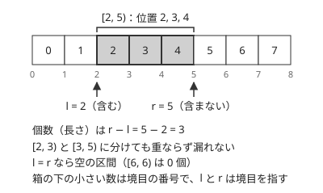
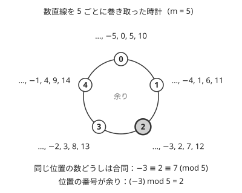

!!! abstract "要点"
    - **何のページか**：教材全体で使う記法の約束を引ける。計算量、半開区間、添字、合同式・整除・floor・ceil・Σ などの数学の記法、グラフ・木・文字列の記号を定め、各ページは定義を繰り返さずに参照する。
    - **使い方**：ページの中で見慣れない記号に出会ったら、節の名前（区間・添字・数学・集合・確率・グラフ・木・文字列）から引く。各節は記号の意味だけを書き、使い方は行き先のページに任せる。
    - **約束の優先順位**：ページの冒頭に「このページで使う記法」があれば、そちらが優先する（閉区間で書く手法、1-indexed で書く数学のページなど）。

<!-- textlint-disable -->
別名：記法・0-indexed・1-indexed・半開区間・数学の記法・合同式・整除・床関数・天井関数・Σ の記法・notation
<!-- textlint-enable -->

記法と用語の約束は、教材のどのページでも同じ意味で使う記号と書き方の一覧である。語の意味は[用語集](../guide/glossary.md)、数値の目安は[早見表](../guide/cheatsheet.md)にあり、ここは記号の読み方を受け持つ。ページごとに意味の変わる記号（$d(n)$ や $\sigma$ など）は、そのページの冒頭で定め、ここには代表的な使われ方だけを載せる。

## 計算量の書き方 {#complexity}

計算量は $O(N \log N)$ のように、入力の大きさを表す文字で書く。log の底は書かない。$\log_2 N$ と $\log_{10} N$ は定数倍しか違わないので、$O$ の中では区別しないからである。見積もりで回数を出すときだけ、底を 2 として $\log_2 (2 \times 10^5) \approx 17.6$ のように数える（[計算量の見積もり](../basics/complexity-estimation.md#how-to-estimate)）。

- **文字が複数あるとき**：グラフは頂点数 $N$ と辺数 $M$ を両方残し、$O(N + M)$・$O((N + M) \log N)$ と書く。クエリは $O(N + Q \log N)$ のように前計算と分ける。
- **$\log^2 N$**：$(\log N)^2$ のことで、$\log \log N$ とは別である。
- **条件の付く計算量**：[ならし計算量](../guide/glossary.md#amortized-complexity)は「ならし $O(\alpha(N))$」、乱択やハッシュの平均は「期待 $O(N)$」と、語を前に付けて書く。何も付けなければ最悪の場合の計算量である。
- **前計算とクエリ**：「前計算 $O(N)$、1 回 $O(1)$」のように分けて書く。
- **メモリ**：「メモリ $O(N)$」と書き、時間と区別する。

front matter と索引の文字には数式を使わず、`O(N log N)`・`O((N+M) log N)` と書く。制約から許される計算量を探すときは[制約 → 許される計算量の表](../basics/complexity-estimation.md#constraint-table)を引く。

## 区間は半開区間 {#half-open}

区間は[半開区間](../guide/glossary.md#half-open-interval) $[l, r)$ を基本にする。$[l, r)$ は $l$ 以上 $r$ 未満の整数 $l, l + 1, \dots, r - 1$ を表し、$r$ は含まない。



半開区間を基本にするのは、境目の計算が場合分けなしで書けるからである。

- **長さ**：$[l, r)$ の要素の個数は $r - l$ で、$+1$ が要らない。
- **空区間**：$l = r$ なら空である。長さ 0 の区間を特別扱いしなくてよい。
- **分割**：$l \le m \le r$ なら、$[l, r)$ は $[l, m)$ と $[m, r)$ に重なりなく漏れなく分かれる。分割統治やセグメント木の区間がこの形になる。
- **累積和**：$S_0 = 0$、$S_{i+1} = S_i + a_i$ とすると、$[l, r)$ の和は $S_r - S_l$ である（[累積和の半開区間](../basics/prefix-sum.md#half-open)）。
- **ループ**：`for (int i = l; i < r; i++)` がそのまま $[l, r)$ を回る。

閉区間を使うときは、本文で「閉区間 $[l, r]$」と明記する。題材が閉区間で定まる手法（[区間篩](../math/segmented-sieve.md)の $[L, R]$、[商の列挙](../math/floor-quotient-enum.md)の商が同じ範囲）は閉区間のまま書く。和の記号 $\sum_{i=l}^{r}$ は数学の慣習どおり両端を含む。

問題文の区間は「$l$ 番目から $r$ 番目まで」の 1-indexed の閉区間が多い。0-indexed の半開区間に直すと $[l - 1, r)$ になり、右端は変わらない。座標の区間を[座標圧縮](../basics/coordinate-compression.md#intervals)するときは、閉区間 $[l, r]$ を $[l, r + 1)$ に直してから両端点を入れる。

## 添字（1-indexed と 0-indexed） {#indexing}

問題文は 1-indexed（$A_1, \dots, A_N$、頂点 $1, \dots, N$）、実装は 0-indexed（$a_0, \dots, a_{N-1}$、頂点 $0, \dots, N - 1$）で書く。各ページは最初にどちらで書くかを示し、変換を式で書く。

- **列**：$a_i = A_{i+1}$。大文字を問題文の 1-indexed、小文字を実装の 0-indexed にすることが多い。
- **頂点**：読み込んだ直後に 1 を引く。出力するときに 1 を足す。
- **累積和**：$S_0 = 0$ を置くので、$S$ は長さ $N + 1$ で $S_0, \dots, S_N$ になる。
- **数学の式**：和・二項係数・数列の漸化式のページは、数学の慣習どおり 1-indexed で書くことがある。そのときはページの冒頭で示す（[和の計算](../math/sigma-manipulation.md)など）。

次のコード片は、1-indexed で与えられた辺を読み込んだ直後に 0-indexed へ直し、各頂点の次数を出す。

```cpp
--8<-- "notation/conventions.cpp:core"
```

bit の番号は、最下位を 0 番目と数える（$2^i$ の位が $i$ 番目の bit）。グリッドのマス $(i, j)$ は $i$ 行目・$j$ 列目で、0-indexed の $0 \le i < H$、$0 \le j < W$ にする。移動量の配列は行と列の取り違えを避けて di・dj と書く（[グリッドの 4 近傍](../graph/grid-graph.md#neighbors)）。

## 数と制約の書き方 {#numbers}

大きな数は $2 \times 10^5$、$10^{18}$ のように指数で書き、front matter では `2×10^5` と書く。法は次の 2 つが多く、どちらも素数である。

- $10^9 + 7$：$1000000007$。2 つの余りの積は最大で $(10^9 + 6)^2 \approx 1.0 \times 10^{18}$ で、`long long` の上限 $9.2 \times 10^{18}$ に収まる。
- $998244353$：$119 \times 2^{23} + 1$ の形の素数で、NTT に向く（[998244353 の理由](../math/mod-arithmetic.md#why-998244353)）。

制約の読み方は次のとおりである。

- **$N, Q \le 2 \times 10^5$**：$N$ と $Q$ はそれぞれ $2 \times 10^5$ 以下で、同時に最大になりうる。見積もりでは両方の最大値を入れる。
- **$1 \le A_i \le 10^9$**：各要素の範囲である。和は $N \times 10^9$ になりうるので、`int` に収まるかを別に確かめる（[型の範囲](../guide/cheatsheet.md#type-limits)）。
- **総和の制約**：多重テストケースで「$N$ の総和は $2 \times 10^5$ 以下」とあれば、ケースごとではなく総和で見積もる（[複数テストケース](../basics/complexity-estimation.md#multiple-testcases)）。

文字は、列の長さや頂点数を $N$、辺数を $M$、クエリ数を $Q$、グリッドの大きさを $H \times W$、法を $m$（素数なら $p$）とする。値の上限には決まった文字を当てず、ページの冒頭で定める（辺の出てこないページでは $M$ を使うこともある）。数式の無限大は $\infty$ で、コードでは定数 `INF` を置く（[INF の選び方](../cpp/cpp-types-literals.md#inf)）。

量の単位は数と単位の間に半角の空白を入れ、「40 MB」と書く。見積もりは 1 MB を $10^6$ バイトとして数える。メモリ制限は AtCoder の表示どおり MiB（1 MiB は $2^{20}$ バイト）で書き、1024 MiB は約 $1.07 \times 10^9$ バイトである。

## 数学の記法 {#math}

整数の記号は次のとおりである。表の行き先には、計算の手順と落とし穴がある。

| 記法 | 意味 | 詳しいページ |
| --- | --- | --- |
| $a \bmod m$ | $a$ を $m$ で割った余り。$m \ge 1$ で、値は $0$ 以上 $m$ 未満 | [mod の計算の基本](../math/mod-arithmetic.md#negative) |
| $a \equiv b \pmod{m}$ | $a - b$ が $m$ の倍数（[合同](../guide/glossary.md#congruence)） | [mod の計算の基本](../math/mod-arithmetic.md) |
| $a \mid b$ | $a$ が $b$ を割り切る（$b = ka$ となる整数 $k$ がある） | [約数列挙](../math/divisor-enum.md) |
| $\lfloor x \rfloor$・$\lceil x \rceil$ | $x$ 以下の最大の整数・$x$ 以上の最小の整数 | [整数の割り算](../math/integer-division.md#floor-ceil) |
| $\gcd(a, b)$・$\operatorname{lcm}(a, b)$ | 最大公約数・最小公倍数。$\gcd(0, a) = a$（$a \ge 0$） | [GCD と LCM](../math/gcd-lcm.md) |
| $\binom{n}{k}$ | $n$ 個から $k$ 個を選ぶ方法の数。範囲の外は 0 | [二項係数](../comb/binomial-coefficient.md#out-of-range) |
| $a^{-1}$ | 法 $m$ での $a$ の逆元（$a a^{-1} \equiv 1$） | [逆元](../math/mod-inverse.md#existence) |

$a \bmod m$ と $a \equiv b \pmod{m}$ は役割が違う。$\bmod$ は値を 1 つ返す演算で、$(-3) \bmod 5 = 2$ である。$\equiv$ は 2 つの数の関係で、$-3 \equiv 2 \equiv 7 \pmod{5}$ のように、余りが同じ数どうしをすべて結ぶ。C++ の `%` は左の数が負なら 0 以下の値を返す。`-3 % 5` は $-2$ で、$\bmod$ と一致しない（[C++ の / と % と数学の違い](../math/integer-division.md#cpp-vs-math)）。



合同式は、数直線を $m$ ごとに巻き取った時計で考えると分かりやすい。同じ位置に重なる数どうしが合同で、その位置の番号 $0, \dots, m - 1$ が $\bmod$ の値である。足し算・引き算・掛け算は時計の上でそのまま行えるが、割り算は[次の節](#congruence-division)の条件が要る。

整除 $a \mid b$ は「割り切る」という関係で、値ではない。どの $a$ についても $a \mid 0$ である。$\lfloor a/b \rfloor$ の $/$ は実数の割り算で、C++ の整数の `/` ではない。正の整数 $b$ と整数 $a$ について $\lceil a/b \rceil = \lfloor (a + b - 1)/b \rfloor$ である（[切り上げの式](../math/integer-division.md#ceil-formula)）。

### 和と積・条件の記号

- **$\sum$・$\prod$**：$\sum_{i=0}^{N-1} a_i$ は $i = 0, 1, \dots, N - 1$ の和で、上端と下端をどちらも含む。$\sum_{d \mid n}$ は $n$ の正の約数 $d$ すべてについての和、$\prod_{p \mid n}$ は $n$ の異なる素因数 $p$ すべてについての積である。
- **空の和と空の積**：足す項がなければ和は 0、掛ける項がなければ積は 1 と約束する。$0! = 1$ もこの約束による（[空の和は 0・空の積は 1](../math/sigma-manipulation.md#empty-sum)）。
- **Iverson の記法 $[P]$**：条件 $P$ が成り立てば 1、そうでなければ 0 を表す。$\sum_{i=1}^{N} [A_i \text{ が偶数}]$ は偶数の個数である。和の範囲を条件に移すときに使う。
- **$\max$・$\min$・絶対値**：本文では $\lvert x \rvert$ と書く。表の中では `|` が列の区切りになるので、必ず `\lvert x \rvert` と書く。

### ページごとに定める数論の記号

次の記号は、使うページの冒頭で定める。同じ文字が別の意味になることがあるので、ページの定義を優先する。

- $v_p(n)$：$n$ を素因数分解したときの素数 $p$ の指数（[素因数分解](../math/prime-factorization.md)）
- $d(n)$・$\sigma(n)$：$n$ の正の約数の個数・和（[約数の個数と和](../math/divisor-enum.md#count-and-sum)）
- $\varphi(n)$：$1$ 以上 $n$ 以下で $n$ と[互いに素](../guide/glossary.md#coprime)な整数の個数（[オイラーの φ 関数](../math/euler-phi.md#formula)）
- $\omega(n)$・$\Omega(n)$：異なる素因数の個数・重複も数えた素因数の個数（[約数の個数の上界](../math/divisor-count-bound.md)・[最小素因数の篩](../math/spf-sieve.md)）
- $\pi(x)$：$x$ 以下の素数の個数（[エラトステネスの篩](../math/sieve-eratosthenes.md)）
- $\operatorname{ord}_m(a)$：法 $m$ での $a$ の位数（[位数](../math/multiplicative-order.md#order)）
- $[x^n] f$：多項式・形式的冪級数 $f$ の $x^n$ の係数（[形式的冪級数](../math/fps-basics.md)）
- $\mathrm{C}[n][k]$：パスカルの三角形で作った二項係数の表（[パスカルの三角形](../comb/binomial-coefficient.md#pascal)）

### 名前の付いた量・表・擬似コード

- **2 文字以上の名前**：$\mathrm{dp}[i][j]$・$\mathrm{cnt}[v]$・$\mathrm{val}(x)$ のように `\mathrm` で立体にする。斜体のままだと $d \cdot p$ の積に見える。
- **配列と関数**：表の値は角括弧 $\mathrm{dist}[v]$、式で決まる値は丸括弧 $\mathrm{lca}(u, v)$ と書く。
- **代入**：擬似コード（`text` のコードの囲み）では $x \leftarrow y$ を `x ← y` と書く。擬似コードの中では絶対値・要素数を `|x|` と書いてよい。
- **一般の二項演算**：問題に合わせた結合法則を満たす演算は、本文で $\circ$ や `op` と書き、そのページで定義する。

### 行列とベクトルの向き

[行列累乗](../math/matrix-power.md#write-as-matrix)では、状態を縦に並べた列ベクトル $v$ とし、1 回の遷移を $v' = Av$ と書く。$A$ の $(i, j)$ 成分 $a_{ij}$ は「状態 $j$ から状態 $i$ へ移る係数」である。区間の遷移を[セグメント木に載せる](../ds/segment-tree-monoids.md#matrix)ときは、状態を横ベクトルにして $v \leftarrow vT$ と書く。こうすると左の区間の行列を左に置けばよく、`op(a, b)` が積 $ab$ そのものになる。どちらの向きかは各ページの冒頭で示す。

## 合同式で割ってよいとき {#congruence-division}

合同式の両辺を同じ数 $c$ で割ってよいのは、$c$ と法 $m$ が[互いに素](../guide/glossary.md#coprime)のとき（$\gcd(c, m) = 1$）だけである。そのとき $c$ には法 $m$ での逆元 $c^{-1}$ があり、両辺に $c^{-1}$ を掛けることが「割る」ことにあたる。

$$
ac \equiv bc \pmod{m},\ \gcd(c, m) = 1 \implies a \equiv b \pmod{m}
$$

互いに素でないと成り立たない。$2 \cdot 1 \equiv 2 \cdot 4 \pmod{6}$（$2$ と $8$ の差は 6）だが、$1 \not\equiv 4 \pmod{6}$ である。一般には、$g = \gcd(c, m)$ として、法も $g$ で割った $a \equiv b \pmod{m/g}$ までしか言えない。上の例では $g = 2$ で、$1 \equiv 4 \pmod{3}$ は正しい。

法が素数 $p$ なら、$p$ の倍数でない数はどれも $p$ と互いに素なので、0 でない値ではいつでも割れる。$998244353$ や $10^9 + 7$ を法にして分数の答えを求められるのはこのためである（[分数を mod で表す](../math/mod-inverse.md#rational)）。法が合成数のときや、割る数が $p$ の倍数になりうるときは、逆元がない場合を考える（[逆元がない場合](../math/mod-inverse.md#not-invertible)）。$ax \equiv b \pmod{m}$ の形の一次合同式の解き方は[拡張ユークリッドの互除法](../math/ext-gcd.md#linear-congruence)にある。

## 集合と bit の記法 {#sets-bits}

集合の記号は次のとおりである。全体の集合を $U$ とする。

- **部分集合**：$S \subseteq T$ は $S$ の要素がすべて $T$ に入ること（$S = T$ も含む）。要素が $N$ 個の集合の部分集合は、空集合も含めて $2^N$ 個ある。
- **要素数**：$\lvert S \rvert$。
- **和・共通部分・差・補集合**：$S \cup T$・$S \cap T$・$S \setminus T$。補集合は $U \setminus S$ と書き、確率の余事象では $\overline{A}$ と書く。

部分集合を整数で表すときは、要素 $i$（$0 \le i < N$）を $i$ 番目の bit に対応させ、$i$ 番目の bit が 1 なら $i$ を含むとする（[bit 全探索の書き方](../basics/bit-full-search.md#bitmask)）。集合の演算は bit 演算に対応する。

| 集合 | 数式での bit 演算 | C++ |
| --- | --- | --- |
| $S \cup T$ | $S \text{ OR } T$ | `S | T` |
| $S \cap T$ | $S \text{ AND } T$ | `S & T` |
| 対称差 | $S \oplus T$（XOR） | `S ^ T` |
| $T \subseteq S$ | $S \text{ AND } T = T$ | `(S & T) == T` |
| $\lvert S \rvert$ | $\operatorname{popcount}(S)$ | `popcount((unsigned)S)` |

数式の中では XOR を $\oplus$、AND・OR を $\text{AND}$・$\text{OR}$ の文字で書く。C++ の書き方の話ではバッククォートで `&`・`|`・`^` と書く。$\operatorname{popcount}(x)$ は $x$ の 2 進表記の 1 の個数で、[popcount](../guide/glossary.md#popcount) と呼ぶ。演算子の優先順位などの落とし穴は [bit 演算](../basics/bit-operations.md#operators)にある。

## 確率・期待値の記法 {#probability}

確率と期待値の記号は次のとおりである。

- **$P(A)$**：事象 $A$ の起きる確率。$P(A \cap B)$ は $A$ と $B$ が両方起きる確率である。
- **$\overline{A}$**：$A$ が起きないという事象（余事象）。$P(\overline{A}) = 1 - P(A)$ である。
- **$P(A \mid B)$**：$B$ が起きたときの $A$ の条件付き確率で、$P(B) > 0$ のとき $P(A \cap B)/P(B)$ である（[条件付き確率](../comb/probability-basics.md#conditional)）。
- **独立**：$P(A \cap B) = P(A)P(B)$ が成り立つこと（[独立](../comb/probability-basics.md#independence)）。
- **$E[X]$**：確率変数 $X$ の期待値。期待値の線形性 $E[X + Y] = E[X] + E[Y]$ は、$X$ と $Y$ が独立でなくても成り立つ（[期待値の線形性](../comb/linearity-of-expectation.md#linearity)）。
- **$V[X]$**：分散で、$V[X] = E[X^2] - E[X]^2$ である（[分散](../comb/expectation-of-square.md#variance)）。

事象 $A$ が起きたら 1、起きなければ 0 をとる確率変数を[指示確率変数](../guide/glossary.md#indicator)と呼び、その期待値は $P(A)$ に等しい。条件 $P$ の Iverson の記法 $[P]$ と同じ形で、確率変数として使うときの呼び名である。

## グラフの記法 {#graph}

グラフは頂点数 $N$・辺数 $M$ で書き、頂点は実装では $0, \dots, N - 1$ とする。

- **辺**：無向辺は $\{u, v\}$ か「辺 $(u, v)$」、有向辺は $u \to v$ と書く。辺の重みは $w$ で、辺 $e$ の重みを $w(e)$ と書くこともある。
- **隣接リスト**：$g[v]$ は $v$ から出る辺（または隣の頂点）の一覧である（[グラフの表し方](../graph/graph-basics.md#representations)）。
- **次数**：$\deg(v)$ は $v$ につながる辺の本数。$\sum_v \deg(v) = 2M$ である（[握手補題](../graph/graph-basics.md#handshake)）。
- **最短距離**：始点を決めた最短距離の表を $\mathrm{dist}[v]$、2 頂点の間の最短距離を $\mathrm{dist}(s \to t)$ と書く。届かない頂点は $\infty$ とする（[ダイクストラ法](../graph/dijkstra.md)）。

グラフの用語（次数・自己ループ・多重辺・パスとウォーク）の意味は[グラフの基本の用語](../graph/graph-basics.md#terms)と[用語集](../guide/glossary.md#path-walk)にある。

## 木の記法 {#tree}

根付き木では、各頂点 $v$ について次の記号を使う。根の選び方は各ページで示す（実装では多くは頂点 0）。

| 記号 | 意味 | 詳しいページ |
| --- | --- | --- |
| $\mathrm{par}[v]$ | 親（根では $-1$） | [親・深さ・部分木サイズ](../tree/tree-traversal.md#parent-depth-size) |
| $\mathrm{dep}[v]$ | 深さ（根から $v$ までの辺の本数。根は 0） | [親・深さ・部分木サイズ](../tree/tree-traversal.md#parent-depth-size) |
| $\mathrm{sz}[v]$ | 部分木サイズ（$v$ を含む） | [親・深さ・部分木サイズ](../tree/tree-traversal.md#parent-depth-size) |
| $\mathrm{in}[v]$・$\mathrm{out}[v]$ | 行きがけ番号・出るときの次の番号。部分木は $[\mathrm{in}[v], \mathrm{out}[v])$ | [in・out の定義](../tree/euler-tour.md#in-out) |
| $\mathrm{ord}[t]$ | 行きがけ順で $t$ 番目の頂点。$\mathrm{ord}[\mathrm{in}[v]] = v$ | [in・out の定義](../tree/euler-tour.md#in-out) |
| $S[v]$ | 根から $v$ までの値の累積 | [根からの累積](../tree/tree-distance.md#root-prefix) |
| $\mathrm{lca}(u, v)$ | $u$ と $v$ の最小共通祖先 | [LCA](../tree/lca.md) |
| $d(u, v)$ | $u$ と $v$ の距離（パスの辺の本数か重みの和） | [LCA で距離を求める](../tree/lca.md#distance) |

$\mathrm{out}[v]$ は「最後に振った番号」ではなく「次に振る番号」なので、部分木が半開区間になり、$\mathrm{out}[v] - \mathrm{in}[v] = \mathrm{sz}[v]$ である。辺の本数で測るとき、$d(u, v) = \mathrm{dep}[u] + \mathrm{dep}[v] - 2\,\mathrm{dep}[\mathrm{lca}(u, v)]$ である。

木上の Mo では、入るときと出るときに頂点を 1 回ずつ書いた長さ $2N$ の列を使う。この列で頂点 $v$ が最初に現れる位置を $\mathrm{ST}(v)$、2 回目に現れる位置を $\mathrm{EN}(v)$ と書く（[木上の Mo](../tree/euler-tour.md#mo-on-tree)）。

## 文字列の記法 {#string}

文字列 $S$ の記号は次のとおりである。添字は 0-indexed で書く。

- **長さ**：$\lvert S \rvert$。
- **文字**：$S[i]$ は $i$ 番目（$0 \le i < \lvert S \rvert$）の文字。
- **部分文字列**：$S[l, r)$ は $S[l], S[l + 1], \dots, S[r - 1]$ をこの順に並べた連続する部分で、長さは $r - l$ である。
- **接頭辞・接尾辞**：$S[0, i)$ が接頭辞、$S[i, \lvert S \rvert)$ が接尾辞である（$0 \le i \le \lvert S \rvert$）。$i = 0$ の接頭辞と $i = \lvert S \rvert$ の接尾辞は空文字列、$i = \lvert S \rvert$ の接頭辞と $i = 0$ の接尾辞は $S$ 自身である。
- **連結・反転**：$S$ と $T$ の連結を $ST$ か $S + T$、反転した文字列を $S^R$ と書く。
- **具体的な文字列**：本文では `abc` のように等幅で、数式の中では $\texttt{abc}$ と書く。

部分文字列は連続する部分、部分列は飛び飛びに選んで順序を保った列で、別の語である（[部分文字列と部分列の違い](../string/string-basics.md#substring-vs-subsequence)、[部分列](../guide/glossary.md#subsequence)）。$\texttt{ace}$ は $\texttt{abcde}$ の部分列だが、部分文字列ではない。

文字の種類の数は $\sigma$ と書くことがある。約数の和 $\sigma(n)$ とは別の記号なので、ページの冒頭の定義に従う。失敗リンクは、[照合の状態の DP](../string/string-automaton-dp.md#kmp-automaton) では $\mathrm{fail}[v]$、[Aho-Corasick 法](../string/aho-corasick.md#failure-links)では $\mathrm{link}(v)$ と書いており、同じものを指す。

## コード片の約束 {#code}

教材のコード片は、AtCoder の GCC 15.2（`-std=gnu++23`）で通る範囲で書き、読みやすさを優先する（[AtCoder の C++ 環境](../cpp/cpp-environment.md#options)）。

- **形**：`#include <bits/stdc++.h>` と `using namespace std;` を使う。マクロ（`rep` など）と型の別名は使わず、`long long` と書く。例外は数論の `u64`・`u128` と、ACL の `using mint = atcoder::modint998244353;` である。
- **添字と区間**：添字は 0-indexed、区間は半開区間で、ループは `for (int i = l; i < r; i++)` の形にする。
- **名前**：変数名は記法にそろえる（`n`・`m`・`q`・`a`・`dp`・`par`・`dep`・`sz`・`dist`）。
- **入出力**：改行は `'\n'` で書く（[endl と改行文字の違い](../cpp/cpp-io.md#endl)）。
- **再帰**：DFS は `auto dfs = [&](auto&& self, int v, int p) -> void { … };` の形にし、`-> void` を省かない。

コード片は本文に全体を載せず、要点の数行だけを取り込む。完全なプログラムは手元でコンパイルと実行を確かめてある。

## 用語の表記 {#terms}

用語の書き方は[用語集の表記の正規形](../guide/glossary.md#canonical-forms)にそろえる。かっこ内の書き方（セグ木・BIT など）は本文で使ってよく、ほかの別名は各ページの別名の行でだけ使う。表記の揺れは textlint と prh で検査する。

すべての語に共通する約束（人名のハイフン、半角と全角の間の空白、算用数字と漢数字、ひらがなで書く語、組合せと組み合わせる、閉路と巡回）は[表記の規則](../guide/glossary.md#canonical-rules)にある。本文は だ・である調で書く。

## 確認問題 {#quiz}

??? question "確認問題：$2x \equiv 4 \pmod{6}$ の解は？"
    両辺を 2 で割ってよいかは、[合同式で割ってよいとき](#congruence-division)の条件で確かめる。

    ??? success "答え"
        $x \equiv 2 \pmod{3}$、すなわち $x \equiv 2, 5 \pmod{6}$ である。両辺を 2 で割って $x \equiv 2 \pmod{6}$ とすると、$x = 5$ を落とす。$2$ と $6$ は互いに素でないので、2 で割るときは法も $\gcd(2, 6) = 2$ で割り、$x \equiv 2 \pmod{3}$ になる。$x = 0, 1, \dots, 5$ を代入すると $2x \bmod 6$ は $0, 2, 4, 0, 2, 4$ で、4 になるのは $x = 2, 5$ だけである。

??? question "確認問題：0-indexed の配列 $a_0, \dots, a_{N-1}$ の累積和を $S_0 = 0$、$S_{i+1} = S_i + a_i$ とする。問題文の「$l$ 番目から $r$ 番目まで」（1-indexed）の和は？"
    $S_j - S_i$ は 0-indexed の半開区間 $[i, j)$ の和である。

    ??? success "答え"
        $S_r - S_{l-1}$ である。問題文の $l$ 番目は 0-indexed で $l - 1$、$r$ 番目は $r - 1$ なので、範囲は半開区間 $[l - 1, r)$ になる。左端は 1 を引き、右端はそのままにする。長さは $r - (l - 1) = r - l + 1$ で、元の個数と一致する。

??? question "確認問題：$(-7) \bmod 3$ と C++ の `-7 % 3` の値は？"
    $\bmod$ が返すのは $0$ 以上 $m$ 未満の余りである。

    ??? success "答え"
        $(-7) \bmod 3 = 2$（$-7 = 3 \times (-3) + 2$）で、C++ の `-7 % 3` は $-1$ である。C++ の `/` は 0 の向きに切り捨てるので `-7 / 3` が $-2$ になり、余りは $-7 - 3 \times (-2) = -1$ になる。0 以上に直すには $m$ を足す（[負の数を 0 以上に直す](../math/mod-arithmetic.md#negative)）。

## 参考 {#references}

- [cppreference「Arithmetic operators」](https://en.cppreference.com/cpp/language/operator_arithmetic)：整数の `/` が 0 の向きに切り捨て、`%` の符号が左の数に従うこと
- [Wikipedia「整数の合同」](https://ja.wikipedia.org/wiki/%E6%95%B4%E6%95%B0%E3%81%AE%E5%90%88%E5%90%8C)：一次合同式がただ 1 つの解を持つ条件（係数と法が互いに素）
- [Wikipedia「Iverson bracket」](https://en.wikipedia.org/wiki/Iverson_bracket)：$[P]$ の定義
